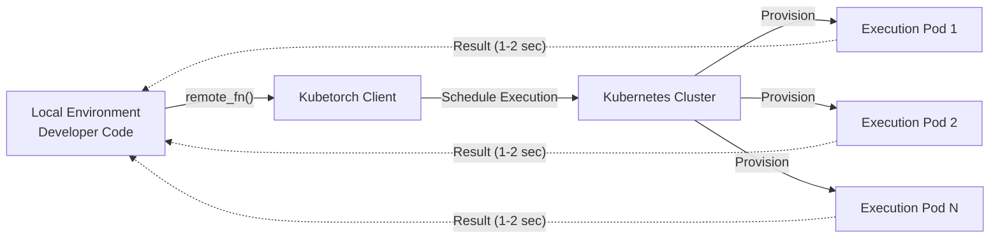
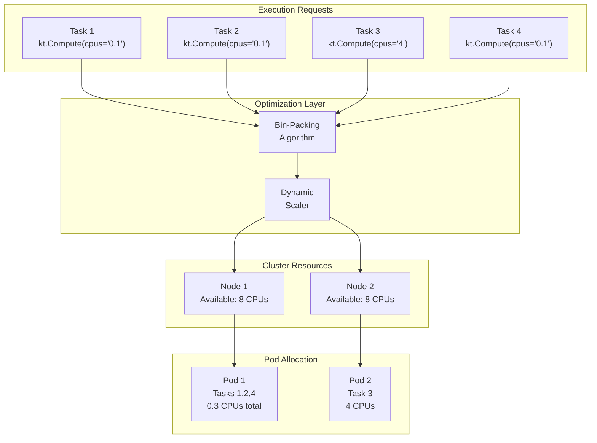
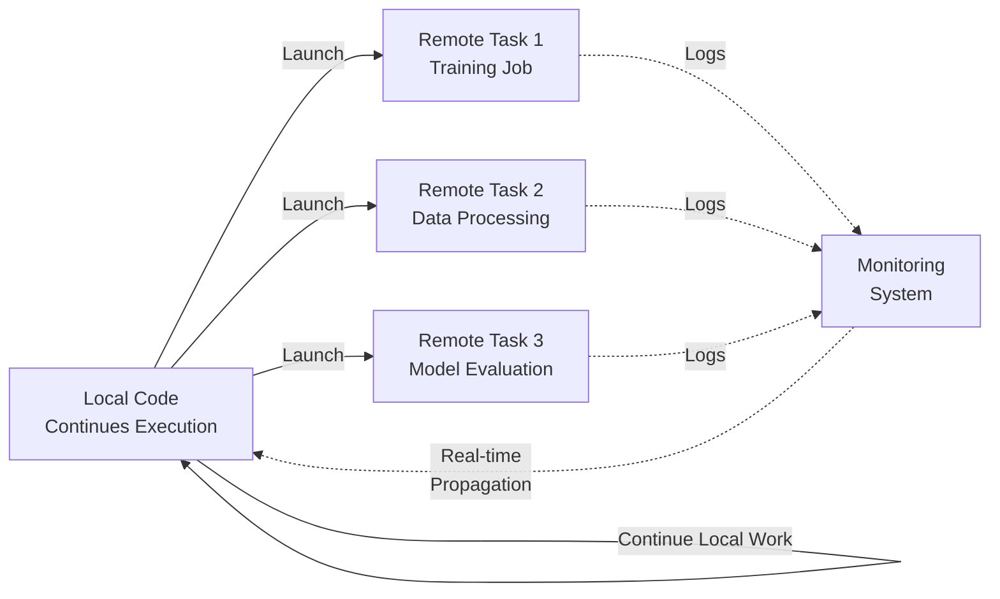
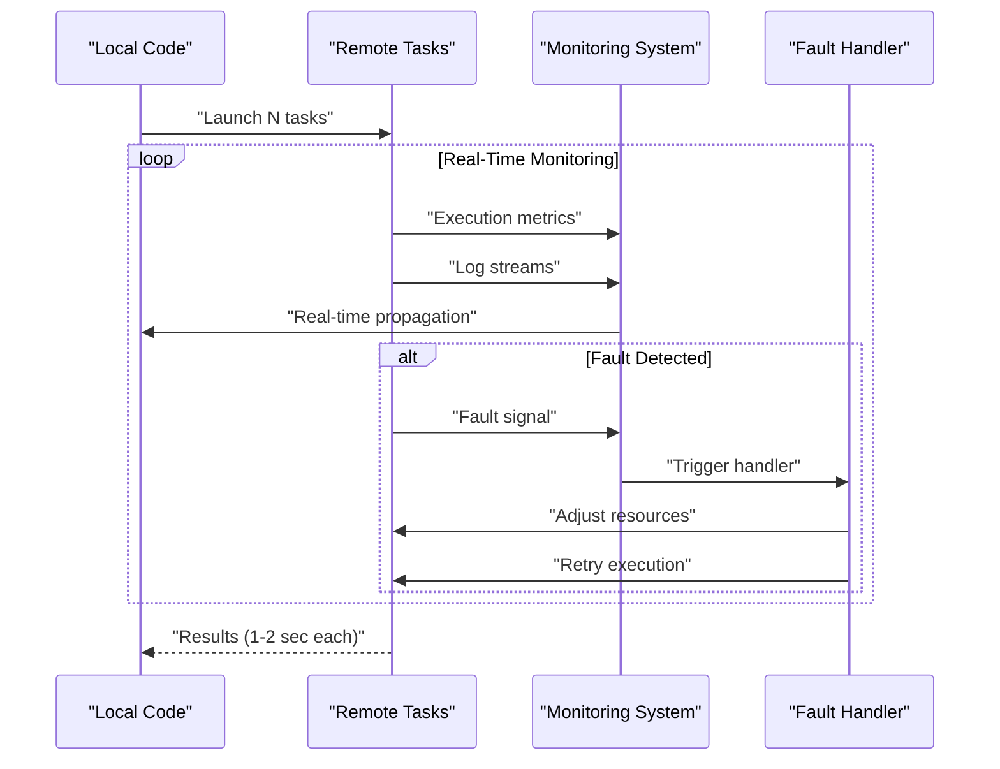
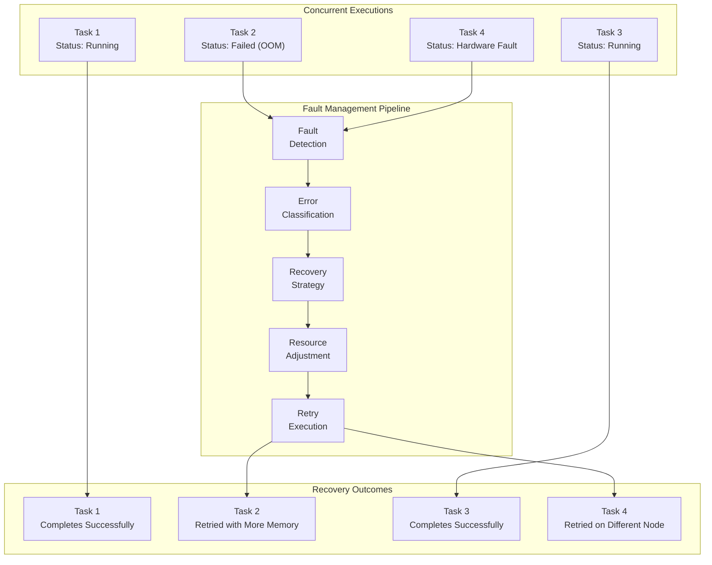
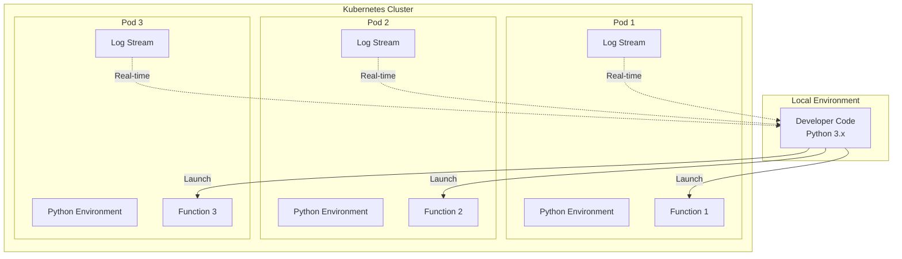
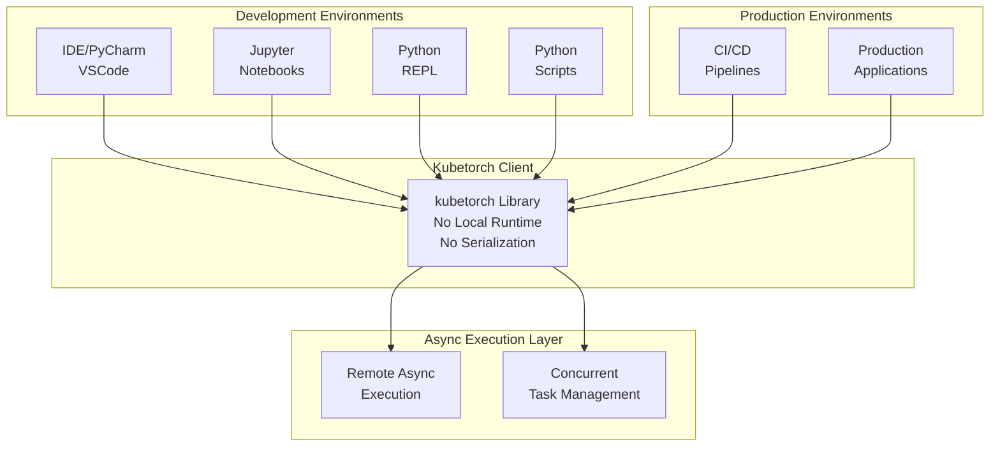

<!-- source: DeepWiki mcp.deepwiki.com · repo run-house/kubetorch · page 6.2 Async Execution Patterns · fetched 2026-10-21 -->

# Async Execution Patterns

<details>
<summary>Relevant source files</summary>

The following files were used as context for generating this wiki page:

- [README.md](README.md)

</details>


## Purpose and Scope

This document covers asynchronous and concurrent execution patterns when using Kubetorch for distributed workloads. It explains how to execute multiple remote functions in parallel, manage long-running tasks, and handle non-blocking execution flows.

For basic function execution concepts, see [Serverless Execution Model](#2.3). For the detailed execution lifecycle, see [Execution Lifecycle](#4.2). For multi-environment integration patterns, see [Multi-Environment Integration](#6.1).

**Sources:** [README.md:1-75]()

## Asynchronous Execution Model

Kubetorch's remote execution is inherently asynchronous in nature, even when using synchronous Python syntax. When you call a remote function, the request is sent to the Kubernetes cluster, executed on a remote pod, and results are returned to your local environment.



The execution flow involves:

1. **Request Submission**: Local function call triggers remote execution request
2. **Resource Allocation**: Kubernetes scheduler provisions pods based on `kt.Compute` specifications
3. **Parallel Execution**: Multiple pods can execute concurrently across cluster nodes
4. **Result Aggregation**: Results stream back to the local environment with 1-2 second latency

This architecture enables concurrent execution of multiple workloads without explicit thread or process management in user code.

**Sources:** [README.md:6-9](), [README.md:23-28](), Architecture Diagram 2 (Function Execution Lifecycle)

## Concurrent Execution Patterns

### Independent Task Parallelism

The most common async pattern is executing multiple independent functions concurrently. Each remote function can be invoked separately, and Kubetorch's resource management system handles parallel provisioning and execution.

```mermaid
sequenceDiagram
    participant Dev as "Developer"
    participant KT as "Kubetorch Client"
    participant Opt as "Optimization Engine"
    participant K8s as "Kubernetes"
    participant P1 as "Pod 1"
    participant P2 as "Pod 2"
    participant P3 as "Pod 3"
    
    Dev->>KT: "remote_fn_1()"
    Dev->>KT: "remote_fn_2()"
    Dev->>KT: "remote_fn_3()"
    
    KT->>Opt: "3 execution requests"
    Opt->>Opt: "Bin-packing analysis"
    
    par Parallel Provisioning
        Opt->>K8s: "Allocate Pod 1"
        Opt->>K8s: "Allocate Pod 2"
        Opt->>K8s: "Allocate Pod 3"
    end
    
    K8s->>P1: "Launch"
    K8s->>P2: "Launch"
    K8s->>P3: "Launch"
    
    par Concurrent Execution
        P1->>P1: "Execute fn_1"
        P2->>P2: "Execute fn_2"
        P3->>P3: "Execute fn_3"
    end
    
    P1-->>Dev: "Result 1 (1-2 sec)"
    P2-->>Dev: "Result 2 (1-2 sec)"
    P3-->>Dev: "Result 3 (1-2 sec)"
```

**Pattern Characteristics:**

| Aspect | Behavior |
|--------|----------|
| **Resource Allocation** | Bin-packing optimization determines pod placement |
| **Execution Timing** | Concurrent execution across available cluster resources |
| **Result Return** | Individual results stream back as they complete (1-2 second latency) |
| **Fault Isolation** | Failure in one task doesn't affect others |
| **Cost Efficiency** | Optimization engine maximizes resource utilization (50%+ savings) |

**Sources:** [README.md:33-35](), Architecture Diagram 4 (Execution Lifecycle), Architecture Diagram 5 (Cost Optimization)

### Resource Sharing and Bin-Packing

When executing multiple concurrent tasks, Kubetorch's bin-packing engine optimizes resource allocation across pods. Small tasks may be co-located on the same node, while resource-intensive tasks receive isolated execution.



**Bin-Packing Strategy:**

- **Small Tasks**: Multiple tasks with minimal resource requirements (`cpus="0.1"`) are packed onto shared nodes
- **Large Tasks**: Resource-intensive workloads (`cpus="4"`, `memory="16Gi"`) receive dedicated allocations
- **Dynamic Adjustment**: Scaler monitors utilization and adjusts allocations based on actual demand
- **Cost Optimization**: Efficient packing reduces node count and achieves 50%+ cost savings

**Sources:** [README.md:34](), Architecture Diagram 5 (Cost Optimization and Resource Management)

## Non-Blocking Execution Patterns

### Fire-and-Forget Pattern

For long-running tasks where immediate results aren't needed, functions can be invoked without blocking the local execution flow. The Kubetorch client returns control immediately while execution continues on the cluster.



**Pattern Benefits:**

- **Local Execution Unblocked**: Developer can continue working while remote tasks execute
- **Real-Time Monitoring**: Logs and exceptions propagate back automatically
- **Hardware Fault Detection**: System detects and handles faults without local intervention
- **Resource Efficiency**: Dynamic scaling adjusts allocations during execution

**Sources:** [README.md:7](), Architecture Diagram 2 (Function Execution Lifecycle)

### Result Collection Patterns

When executing multiple concurrent tasks, results need to be collected and aggregated. The monitoring system provides real-time feedback during execution.



**Result Collection Mechanisms:**

| Mechanism | Description |
|-----------|-------------|
| **Sequential Collection** | Results are returned as each task completes |
| **Log Streaming** | Real-time stdout/stderr propagation during execution |
| **Exception Propagation** | Errors surface immediately without waiting for completion |
| **Fault Recovery** | Automatic retry with resource adjustment on failure |

**Sources:** [README.md:7](), Architecture Diagram 2 (Function Execution Lifecycle), Architecture Diagram 4 (Deployment and Operations)

## Fault Handling in Async Context

When executing multiple concurrent tasks, fault handling operates independently for each execution. The fault management pipeline detects, classifies, and recovers from errors automatically.



**Fault Handling Characteristics:**

- **Isolated Recovery**: Each task's fault handling is independent
- **Programmatic Recovery**: 95% of faults recovered automatically without manual intervention
- **Resource Adjustment**: Memory, CPU, or node allocation modified based on fault type
- **Transparent Retry**: Failed tasks retry with adjusted resources automatically
- **Parallel Execution Maintained**: Successful tasks continue while others recover

**Fault Types Handled:**

| Fault Type | Detection | Recovery Action |
|------------|-----------|-----------------|
| **OOM (Out of Memory)** | Pod exit code 137 | Increase memory allocation and retry |
| **Hardware Fault** | Node failure signal | Reschedule on different node |
| **Timeout** | Execution duration threshold | Increase CPU allocation or timeout limit |
| **Transient Errors** | Exit code analysis | Immediate retry on same resources |

**Sources:** [README.md:35](), Architecture Diagram 5 (Cost Optimization and Resource Management)

## Execution Contexts and Environment Isolation

Each async execution runs in an isolated Kubernetes pod with its own Python environment. This isolation ensures that concurrent tasks don't interfere with each other.



**Isolation Properties:**

- **Process Isolation**: Each function executes in a separate Kubernetes pod
- **Resource Isolation**: CPU, memory, and GPU allocations are containerized
- **Environment Independence**: No shared state between concurrent executions
- **Log Segregation**: Each execution's logs stream independently to the local environment

**Sources:** [README.md:9](), Architecture Diagram 1 (Complete System Ecosystem)

## Integration with Development Environments

Async execution patterns work consistently across all Python environments: IDEs, notebooks, REPL, and production code. No special configuration is required for different execution contexts.



**Key Properties:**

- **No Local Runtime**: No background processes or daemons required in the local environment
- **No Code Serialization**: Functions are transferred without explicit pickling or serialization by the developer
- **Universal API**: Same async patterns work identically across all environments
- **1-2 Second Iteration**: Fast feedback loop maintained regardless of environment

**Sources:** [README.md:9](), Architecture Diagram 3 (Multi-Environment Integration)

## Performance Considerations

### Execution Latency

Kubetorch achieves 1-2 second round-trip latency for remote function execution, which includes:

- Request transmission from local to cluster
- Pod provisioning (or reuse of existing pods)
- Function execution
- Result return and log streaming

This latency profile supports rapid iteration even when executing many concurrent tasks.

### Throughput Optimization

For high-throughput async workloads:

| Factor | Optimization Strategy |
|--------|----------------------|
| **Resource Allocation** | Bin-packing maximizes pod density on cluster nodes |
| **Dynamic Scaling** | Cluster scales up/down based on concurrent workload demand |
| **Fault Recovery** | Automatic retry prevents manual intervention bottlenecks |
| **Cost Efficiency** | 50%+ savings through efficient resource utilization |

**Sources:** [README.md:33-35](), Architecture Diagram 5 (Cost Optimization and Resource Management)

## Common Async Patterns

### Map-Reduce Pattern

Distribute computation across multiple remote functions and aggregate results locally.

**Pattern Flow:**
1. Define compute specification with `kt.Compute`
2. Wrap mapping function with `kt.fn` and bind with `.to(compute)`
3. Invoke mapped function concurrently across input data
4. Collect results as they complete (1-2 second latency per task)
5. Reduce results locally

**Sources:** [README.md:20-28]()

### Pipeline Pattern

Chain multiple remote function calls where each stage processes results from the previous stage.

**Pattern Flow:**
1. Stage 1 executes on remote compute
2. Result streams back to local environment
3. Local code processes/transforms result
4. Stage 2 launches with transformed input
5. Process repeats for N stages

### Batch Processing Pattern

Execute large batches of tasks with automatic resource optimization.

**Pattern Flow:**
1. Submit batch of N remote function calls
2. Bin-packing engine optimizes pod placement
3. Dynamic scaler provisions sufficient resources
4. Concurrent execution across cluster nodes
5. Results aggregate as tasks complete
6. Fault handler recovers failed tasks automatically

**Sources:** [README.md:34-35](), Architecture Diagram 5 (Cost Optimization)

## Async Execution with ML Workloads

For machine learning applications, async patterns are particularly valuable for:

- **RL Training**: Parallel environment simulation across multiple pods
- **Distributed Training**: Concurrent worker processes coordinated across cluster
- **Hyperparameter Tuning**: Simultaneous execution of multiple configurations
- **Data Processing**: Parallel data transformation and augmentation

The 100x iteration speedup (from 10+ minutes to 1-3 seconds) enables rapid experimentation with these patterns directly from development environments.

**Sources:** [README.md:33]()

---

This document provides a comprehensive overview of async execution patterns in Kubetorch. For specific API details on function wrapping and compute specification, see [kt.fn](#5.1) and [kt.Compute](#5.2). For large-scale ML workload patterns, see [Large-Scale ML Workloads](#6.4).

---

