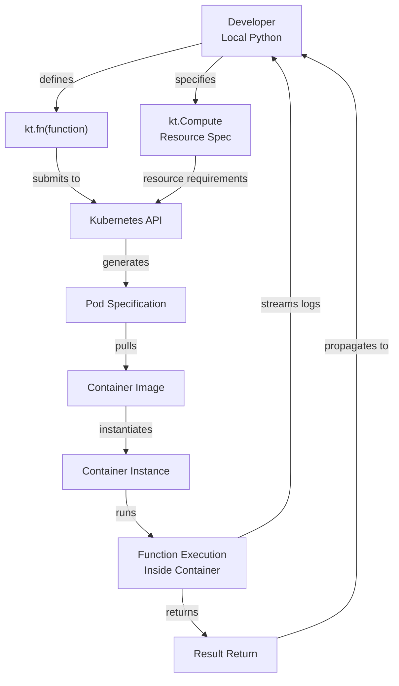
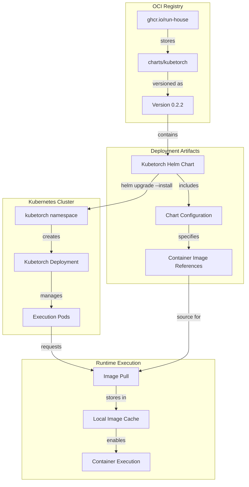
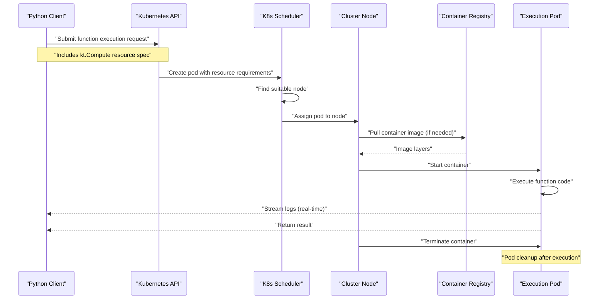
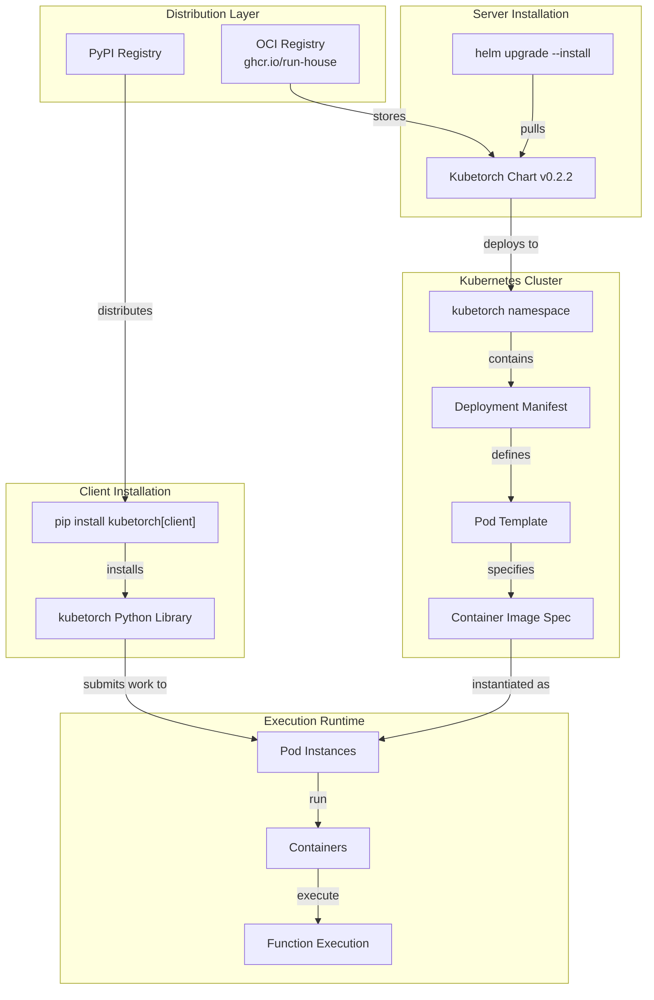
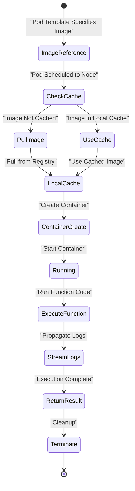
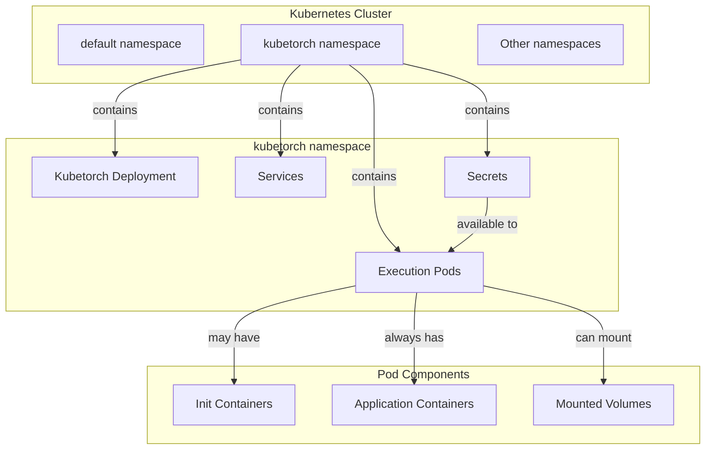

<!-- source: DeepWiki mcp.deepwiki.com · repo run-house/kubetorch · page 6.3 Docker Workflows · fetched 2026-10-21 -->

# Docker Workflows

<details>
<summary>Relevant source files</summary>

The following files were used as context for generating this wiki page:

- [README.md](README.md)

</details>


## Purpose and Scope

This document explains how Docker containers are used within Kubetorch's execution architecture. It covers the container-based execution model, OCI registry integration for chart and image distribution, and the pod lifecycle that manages containerized workloads. 

For information about deploying the Kubetorch server components themselves, see [Kubernetes Deployment](#7.1) and [Helm Installation](#7.2). For details on function execution patterns, see [Serverless Execution Model](#2.3).

**Note:** The provided codebase files contain limited explicit Docker API documentation. This page documents the container architecture as it appears in the deployment and execution infrastructure, based on the Helm-based deployment model and Kubernetes pod execution visible in [README.md]().

---

## Container Execution Model

Kubetorch executes remote functions within Kubernetes pods, which are fundamentally container-based execution environments. When a developer invokes a remote function using `kt.fn`, the system provisions a containerized execution environment on the Kubernetes cluster.

### Execution Flow



**Sources:** [README.md:1-75]()

### Container Lifecycle Stages

| Stage | Description | Component |
|-------|-------------|-----------|
| **Specification** | Developer defines resource requirements via `kt.Compute` | Client-side |
| **Submission** | Function execution request sent to Kubernetes API | Client-Server boundary |
| **Provisioning** | Kubernetes scheduler allocates pod with specified resources | Server-side |
| **Image Pull** | Container image pulled from registry (if not cached) | Server-side |
| **Instantiation** | Container created with environment and dependencies | Server-side |
| **Execution** | Function code runs inside container | Server-side |
| **Cleanup** | Container terminated after execution completes | Server-side |

The containerized execution model provides isolation between different function invocations while maintaining the illusion of local execution for developers. Real-time log streaming bridges the container boundary, propagating stdout/stderr back to the local environment as described in [README.md:7]().

**Sources:** [README.md:1-75]()

---

## OCI Registry Integration

Kubetorch uses OCI (Open Container Initiative) registries for distributing both Helm charts and container images. The deployment architecture separates distribution channels for server components and runtime images.



**Sources:** [README.md:45-55]()

### Registry Configuration

The Helm deployment command shown in [README.md:48-50]() demonstrates the OCI registry integration:

```bash
helm upgrade --install kubetorch oci://ghcr.io/run-house/charts/kubetorch \
  --version 0.2.2 -n kubetorch --create-namespace
```

Key components:
- **Registry URL**: `oci://ghcr.io/run-house/charts`
- **Chart Name**: `kubetorch`
- **Version Pin**: `0.2.2`
- **Target Namespace**: `kubetorch`

This command pulls the Helm chart from the OCI-compliant GitHub Container Registry. The chart itself contains references to container images used for execution pods.

**Sources:** [README.md:48-50]()

---

## Pod and Container Management

Kubernetes pods serve as the execution units for Kubetorch functions. Each pod contains one or more containers that run the actual workload code.

### Pod Provisioning Pipeline



**Sources:** [README.md:1-75]()

### Resource Specification and Container Limits

The `kt.Compute` construct maps directly to Kubernetes container resource specifications. Example from [README.md:21]():

```python
compute = kt.Compute(cpus=".1")
```

This resource specification translates to Kubernetes pod constraints:

| Python API | Kubernetes Manifest | Container Runtime |
|------------|---------------------|-------------------|
| `cpus=".1"` | `resources.requests.cpu: "100m"` | CPU quota/shares |
| `memory="16Gi"` | `resources.requests.memory: "16Gi"` | Memory limits |
| `gpus=1` | `resources.limits.nvidia.com/gpu: "1"` | GPU allocation |

The translation from high-level Python specifications to low-level container resource constraints is handled transparently by the Kubetorch server deployment.

**Sources:** [README.md:21]()

---

## Deployment Architecture

The relationship between Helm charts, OCI registries, and container execution forms the deployment architecture:



**Sources:** [README.md:38-55]()

### Installation Flow

The two-step installation process separates client and server concerns:

1. **Client Installation** [README.md:41-42]():
   - `pip install "kubetorch[client]"` - Installs Python library to local environment
   - No Docker containers involved at this stage
   - Pure Python dependency installation

2. **Server Deployment** [README.md:47-54]():
   - Helm pulls chart from OCI registry
   - Chart contains Kubernetes manifests with container image references
   - Deployment creates pods that pull and run container images

**Sources:** [README.md:38-55]()

---

## Container Image Lifecycle

The typical lifecycle of a container image in Kubetorch involves several stages:



**Sources:** [README.md:1-75]()

### Image Caching Behavior

Kubernetes nodes cache pulled container images, reducing startup time for subsequent executions:

| First Execution | Subsequent Executions | Impact |
|-----------------|----------------------|---------|
| Image pull required | Uses cached image | Faster startup |
| Full layer download | No network transfer | Reduced latency |
| Registry bandwidth used | Local disk read | Lower costs |

This caching behavior contributes to the claimed "1-2 second iteration cycles" mentioned in [README.md:7](), as repeated function invocations avoid image pull overhead.

**Sources:** [README.md:7]()

---

## Integration with Kubernetes Namespaces

The Helm deployment creates a dedicated `kubetorch` namespace for container execution, providing resource isolation:



**Sources:** [README.md:50,54]()

The namespace isolation ensures that:
- Kubetorch pods are logically separated from other workloads
- Resource quotas can be applied at the namespace level
- Secrets are scoped to the namespace boundary
- Network policies can control pod-to-pod communication

The Helm installation command uses `--create-namespace` to automatically create this namespace if it doesn't exist [README.md:50,54]().

**Sources:** [README.md:50,54]()

---

## Serverless Platform Considerations

The Kubetorch Serverless managed platform, mentioned in [README.md:60-62](), abstracts away container and Docker management entirely. In this deployment model:

- Container images are managed by the platform provider
- Image updates and security patches are automatic
- Developers interact only with the Python API
- No Helm charts or OCI registry configuration required

This represents the fully managed extreme of the Docker workflow spectrum, where containerization happens transparently behind the scenes.

**Sources:** [README.md:60-62]()

---

## Summary

Docker and container technologies form the execution foundation of Kubetorch, though they are largely abstracted away from the developer experience. The key architectural points:

1. **OCI Registry Distribution**: Helm charts and container images distributed via `ghcr.io/run-house`
2. **Pod-Based Execution**: Functions run in Kubernetes pods backed by containers
3. **Resource Mapping**: `kt.Compute` specifications map to container resource constraints
4. **Namespace Isolation**: Dedicated `kubetorch` namespace for container workloads
5. **Transparent Caching**: Kubernetes node-level image caching optimizes repeated executions

The container layer enables the "serverless" execution model while maintaining reproducibility and isolation. Real-time log streaming and exception propagation bridge the container boundary, making remote execution feel local to developers.

**Sources:** [README.md:1-75]()

---

