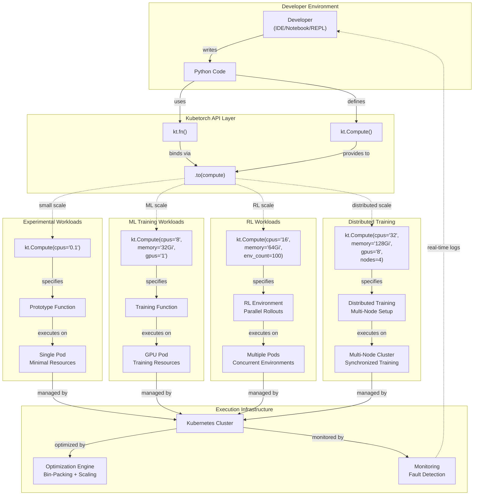
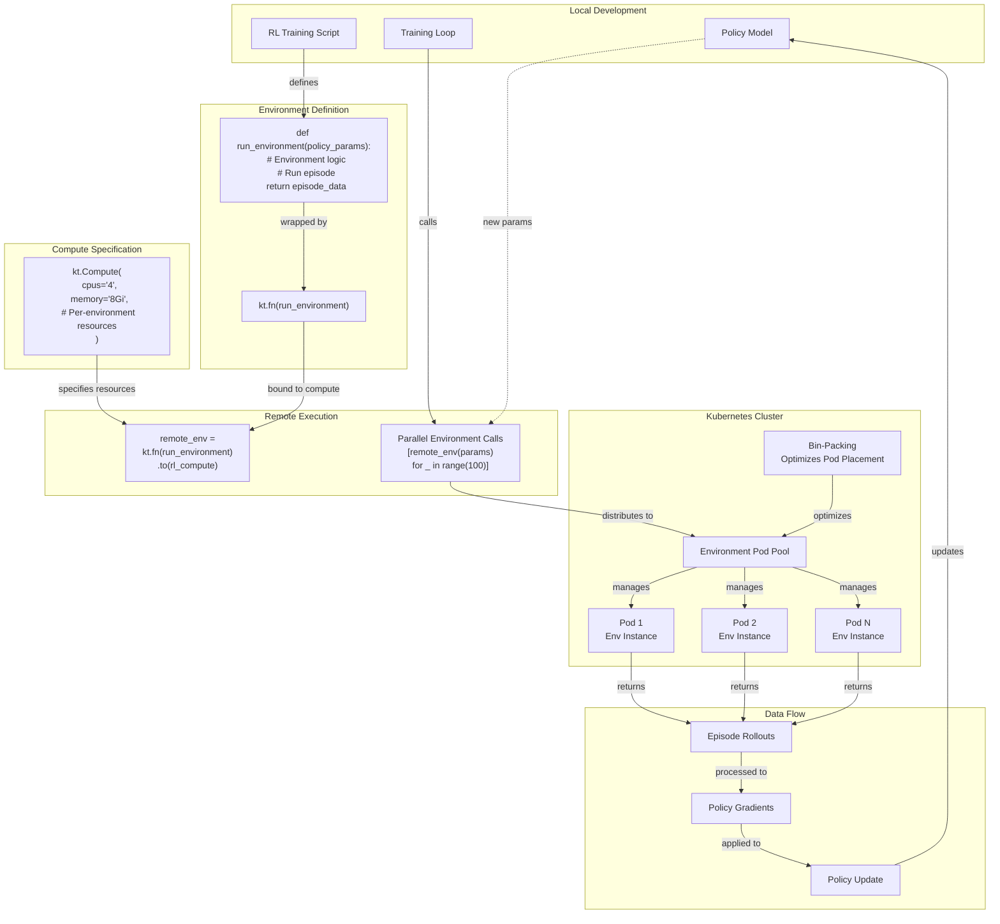
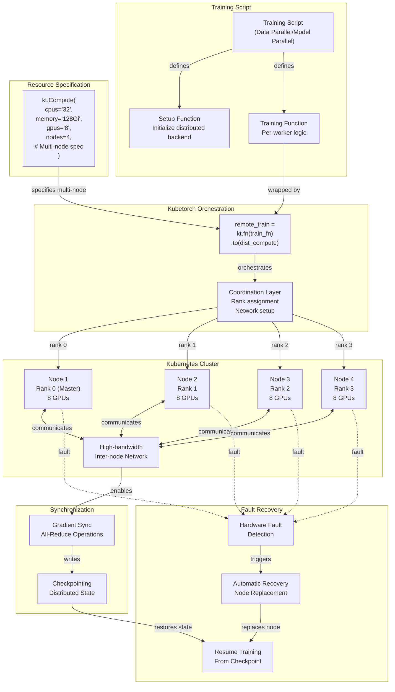
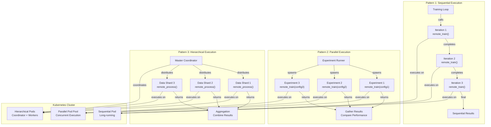
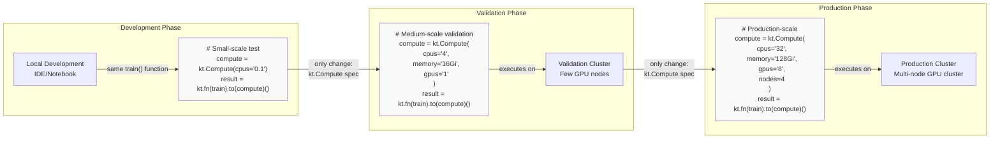
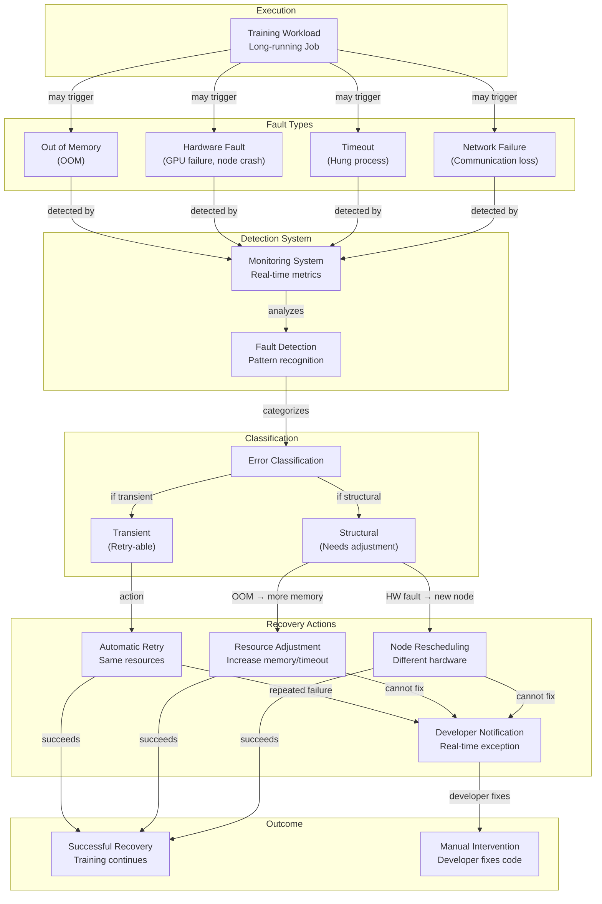

<!-- source: DeepWiki mcp.deepwiki.com · repo run-house/kubetorch · page 6.4 Large-Scale ML Workloads · fetched 2026-10-21 -->

# Large-Scale ML Workloads

<details>
<summary>Relevant source files</summary>

The following files were used as context for generating this wiki page:

- [README.md](README.md)

</details>


## Purpose and Scope

This document covers patterns and best practices for running large-scale machine learning workloads on Kubetorch, including reinforcement learning (RL) training, distributed training, and other complex ML applications. It explains how to scale from small experimental workloads to production-scale ML systems using the same Pythonic API.

For basic function execution patterns, see [Functions (kt.fn)](#2.1). For resource specification fundamentals, see [Compute Resources (kt.Compute)](#2.2). For optimization mechanisms that enable cost-efficient scaling, see [Optimization Engine](#4.4).

**Sources:** [README.md:1-75]()

---

## Overview of Large-Scale Capabilities

Kubetorch provides a unified interface for ML workloads at any scale. The same `kt.fn` and `kt.Compute` abstractions that handle small experimental tasks (`cpus=".1"`) scale transparently to production ML workloads requiring GPUs, high memory, and distributed execution.

The system delivers "100x faster iteration" for complex ML applications by reducing iteration cycles from 10+ minutes to 1-3 seconds, enabling rapid experimentation directly from IDEs, notebooks, or Python scripts [README.md:33]().

### Key Characteristics for ML Workloads

| Characteristic | Capability |
|---|---|
| **API Consistency** | Same `kt.fn(function).to(compute)` pattern for all scales |
| **Resource Flexibility** | CPU-only, GPU-accelerated, or multi-node configurations |
| **Iteration Speed** | 1-2 second cycles from local environment to cluster execution |
| **Fault Tolerance** | Automatic recovery from OOM, hardware faults, and transient errors |
| **Cost Optimization** | Bin-packing and dynamic scaling reduce costs by 50%+ |
| **Real-time Feedback** | Logs, exceptions, and metrics stream back to local environment |

**Sources:** [README.md:1-75]()

---

## Workload Scaling Pattern

The following diagram illustrates how the same Kubetorch API supports workloads from experimentation through production scale:



**Key Insight:** The API remains constant (`kt.fn().to(kt.Compute())`) while resource specifications scale from fractional CPUs to multi-node GPU clusters. The optimization engine automatically handles bin-packing, scaling, and fault tolerance regardless of workload size.

**Sources:** [README.md:1-75]()

---

## Reinforcement Learning Workloads

Reinforcement learning workloads typically require running many parallel environment instances for policy rollouts. Kubetorch enables rapid RL iteration by treating environments as remote functions.

### RL Architecture Pattern



### RL Resource Patterns

RL workloads benefit from Kubetorch's bin-packing optimization because environment instances often have modest individual resource requirements but need high parallelism:

| Pattern | Resource Specification | Pod Count | Use Case |
|---|---|---|---|
| **Lightweight Envs** | `cpus="1", memory="2Gi"` | 100-1000 | Simple gym environments |
| **Moderate Envs** | `cpus="4", memory="8Gi"` | 50-200 | Physics simulations |
| **Heavy Envs** | `cpus="8", memory="16Gi", gpus="0.5"` | 10-50 | Rendering-based envs |
| **Distributed Rollouts** | `cpus="16", memory="32Gi"` | 20-100 | Large-scale RL |

The optimization engine automatically packs multiple lightweight environments onto shared nodes, delivering the claimed 50%+ cost savings [README.md:34]().

**Sources:** [README.md:1-75]()

---

## Distributed Training Workloads

Distributed training workloads require coordinated execution across multiple nodes with high-bandwidth interconnects. Kubetorch supports multi-node training by allowing resource specifications that span multiple pods.

### Distributed Training Architecture



### Multi-Node Resource Specifications

For distributed training, `kt.Compute` specifications must account for per-node and total cluster resources:

```python
# Conceptual pattern - actual implementation in codebase
compute = kt.Compute(
    cpus="32",        # CPUs per node
    memory="128Gi",   # Memory per node
    gpus="8",         # GPUs per node
    nodes=4           # Total nodes in training cluster
)
```

The fault tolerance system (achieving 95% fewer production faults [README.md:35]()) automatically detects and recovers from node-level failures, preserving training progress through checkpointing.

**Sources:** [README.md:1-75]()

---

## Resource Specification for ML Workloads

The `kt.Compute` class provides flexible resource specifications tailored to different ML workload requirements. The following table maps common ML workload patterns to appropriate resource specifications:

### ML Workload Resource Matrix

| Workload Type | CPUs | Memory | GPUs | Nodes | Example Use Case |
|---|---|---|---|---|---|
| **Model Prototyping** | `"0.5-2"` | `"4-8Gi"` | `"0"` | `1` | Testing architectures |
| **CPU Training** | `"8-16"` | `"32-64Gi"` | `"0"` | `1` | Classical ML, small models |
| **GPU Training (Single)** | `"8"` | `"32Gi"` | `"1"` | `1` | CNNs, Transformers |
| **GPU Training (Multi)** | `"16"` | `"64Gi"` | `"4-8"` | `1` | Large models, single node |
| **Distributed Training** | `"32"` | `"128Gi"` | `"8"` | `2-16` | Very large models, data parallel |
| **RL Rollouts** | `"2-4"` | `"4-8Gi"` | `"0"` | `1` | Per-environment pods |
| **Inference Serving** | `"1-2"` | `"2-4Gi"` | `"0-1"` | `1` | Model serving |
| **Hyperparameter Search** | `"4"` | `"16Gi"` | `"1"` | `1` | Parallel training runs |

### Compute Definition Pattern

```python
# Pattern from README.md example
compute = kt.Compute(cpus=".1")  # Fractional CPUs for small tasks
```

The compute specification is defined using `kt.Compute()` [README.md:21](), then bound to functions using the `.to(compute)` method [README.md:24](). The same pattern scales from experimental workloads (`cpus=".1"`) to production-scale distributed training.

**Sources:** [README.md:1-75]()

---

## Execution Patterns for Complex Workloads

### Sequential vs Parallel Execution



**Pattern Selection Guidelines:**

- **Sequential:** Long-running training with checkpointing between iterations
- **Parallel:** Hyperparameter search, ensemble training, A/B testing
- **Hierarchical:** Map-reduce style data processing, distributed evaluation

For asynchronous execution patterns, see [Async Execution Patterns](#6.2).

**Sources:** [README.md:1-75]()

---

## Scaling from Development to Production

Kubetorch enables seamless scaling from laptop development to production clusters using the same code:

### Development-to-Production Workflow



**Key Principle:** The training function remains unchanged. Only the `kt.Compute` resource specification changes between environments.

### Iteration Speed Advantage

The 1-2 second iteration cycle [README.md:7]() enables:

1. **Rapid Prototyping:** Test model architectures directly on cluster resources
2. **Quick Debugging:** Immediately see logs and exceptions from remote execution
3. **Fast Experimentation:** Run parameter sweeps without container rebuilds
4. **Real-time Monitoring:** Track training metrics as they happen

This represents a 100x speedup over traditional workflows that require 10+ minutes per iteration [README.md:33]().

**Sources:** [README.md:1-75]()

---

## Fault Tolerance for Long-Running ML Jobs

Large-scale ML workloads are susceptible to various failure modes. Kubetorch's fault tolerance system automatically handles these issues:

### Fault Detection and Recovery Pipeline



### Fault Tolerance Statistics

The system achieves 95% fewer production faults [README.md:35]() through:

| Mechanism | Failure Types Handled | Recovery Strategy |
|---|---|---|
| **OOM Detection** | Memory exhaustion | Increase memory allocation, retry |
| **Hardware Monitoring** | GPU failures, node crashes | Reschedule to different node |
| **Timeout Management** | Hung processes, deadlocks | Kill and retry with extended timeout |
| **Network Recovery** | Communication failures | Retry with backoff, failover |
| **Checkpoint Integration** | Long-running job interruption | Resume from last checkpoint |

The fault handler operates automatically and transparently, with real-time exception propagation back to the developer environment [README.md:7]().

**Sources:** [README.md:1-75]()

---

## Performance Characteristics

### Iteration Cycle Comparison

| Workflow Stage | Traditional Kubernetes | Kubetorch |
|---|---|---|
| **Code Change** | Modify code | Modify code |
| **Container Build** | 2-5 minutes | Not required |
| **Container Push** | 1-2 minutes | Not required |
| **Pod Deployment** | 1-3 minutes | Automatic |
| **Job Start** | 30 seconds - 2 minutes | Immediate |
| **Log Access** | Manual kubectl/UI | Real-time stream |
| **Result Return** | Manual collection | Automatic |
| **Total Time** | **10+ minutes** | **1-2 seconds** |

This 100x speedup [README.md:33]() enables interactive development of production-scale ML workloads directly from IDEs and notebooks.

### Resource Utilization Optimization

The optimization engine delivers 50%+ cost savings [README.md:34]() through:

1. **Bin-Packing:** Multiple small RL environments packed onto shared nodes
2. **Dynamic Scaling:** Cluster scales down during idle periods
3. **Right-Sizing:** Automatic resource adjustment based on actual usage
4. **Fault-Driven Learning:** Failed jobs inform future resource allocations

See [Optimization Engine](#4.4) for detailed mechanisms.

**Sources:** [README.md:1-75]()

---

## Integration with ML Frameworks

Kubetorch works with standard Python ML frameworks without modification:

### Framework Compatibility

| Framework | Usage Pattern | Notes |
|---|---|---|
| **PyTorch** | Wrap training functions with `kt.fn` | Standard PyTorch code works unchanged |
| **TensorFlow** | Wrap training functions with `kt.fn` | Standard TensorFlow code works unchanged |
| **JAX** | Wrap training functions with `kt.fn` | Standard JAX code works unchanged |
| **Scikit-learn** | Wrap training functions with `kt.fn` | Useful for hyperparameter search |
| **Ray** | Can coexist with Kubetorch | Use Ray for within-job parallelism |
| **Horovod** | Wrap distributed training setup | Multi-node coordination supported |

Since Kubetorch has "no code serialization" [README.md:9](), standard imports and dependencies work without modification. The remote environment replicates your local Python environment.

**Sources:** [README.md:1-75]()

---

## Best Practices

### Resource Specification

1. **Start Small:** Begin with minimal resources (`cpus="0.5"`) and scale up based on actual needs
2. **Monitor Usage:** Use real-time logs to identify resource bottlenecks
3. **Leverage Fault Recovery:** Let the system learn optimal allocations through automatic adjustment
4. **GPU Sharing:** Use fractional GPUs (`gpus="0.5"`) for multiple concurrent training runs

### Development Workflow

1. **Prototype Locally:** Test logic with small data samples and minimal resources
2. **Validate Medium-Scale:** Run on single GPU with representative data
3. **Scale to Production:** Increase resources to multi-GPU/multi-node for full training
4. **Monitor Continuously:** Watch real-time logs for issues during development

### Cost Optimization

1. **Use Dynamic Scaling:** Let the system scale resources automatically
2. **Batch Experiments:** Run multiple experiments in parallel to maximize node utilization
3. **Leverage Bin-Packing:** Small tasks automatically packed for efficiency
4. **Clean Up Resources:** Ensure jobs terminate properly to release resources

### Fault Management

1. **Trust Automatic Recovery:** System handles 95% of faults automatically
2. **Set Appropriate Timeouts:** Allow sufficient time for long-running operations
3. **Use Checkpointing:** Save intermediate state for fault recovery
4. **Monitor Real-Time Logs:** Catch issues early through live log streaming

**Sources:** [README.md:1-75]()

---

## Summary

Kubetorch enables large-scale ML workloads through:

- **Unified API:** Same `kt.fn().to(kt.Compute())` pattern from experimentation to production
- **Rapid Iteration:** 1-2 second cycles enable interactive development at cluster scale
- **Automatic Scaling:** Transparent scaling from single-CPU tasks to multi-node GPU clusters
- **Fault Tolerance:** 95% fewer production faults through automatic detection and recovery
- **Cost Efficiency:** 50%+ cost savings through bin-packing and dynamic scaling
- **Framework Agnostic:** Works with PyTorch, TensorFlow, JAX, and other Python ML frameworks

The system abstracts Kubernetes complexity while providing production-grade reliability and performance, enabling ML engineers to focus on model development rather than infrastructure management.

For deployment details, see [Kubernetes Deployment](#7.1). For optimization internals, see [Optimization Engine](#4.4). For fault tolerance mechanisms, see [Fault Tolerance System](#4.5).

**Sources:** [README.md:1-75]()

---

