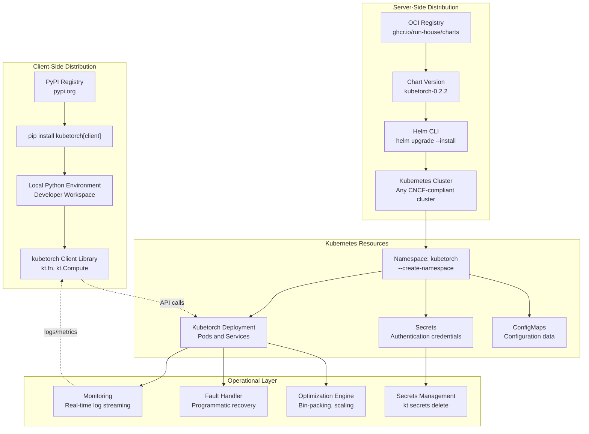
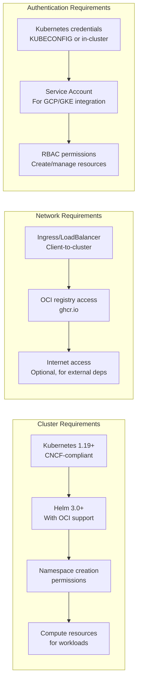
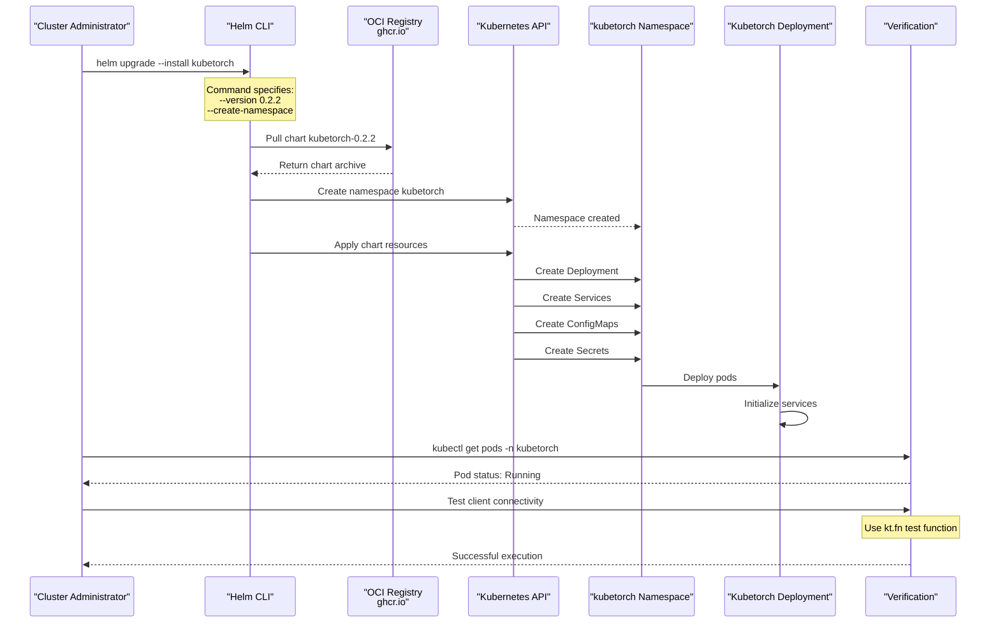
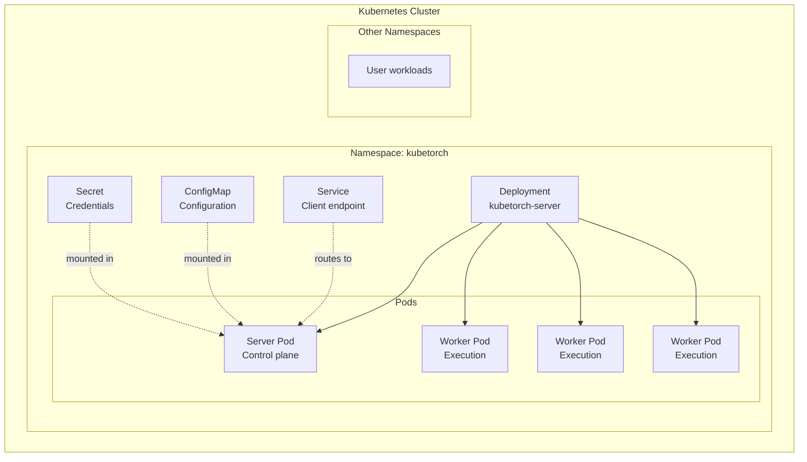
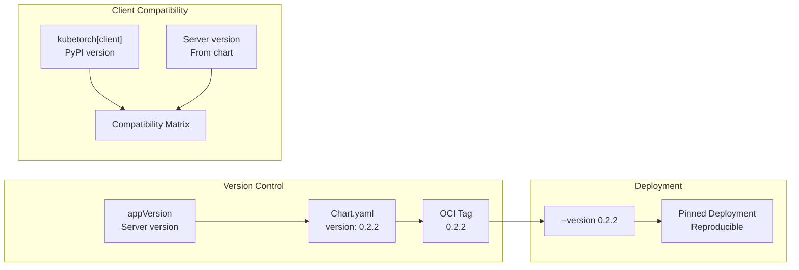
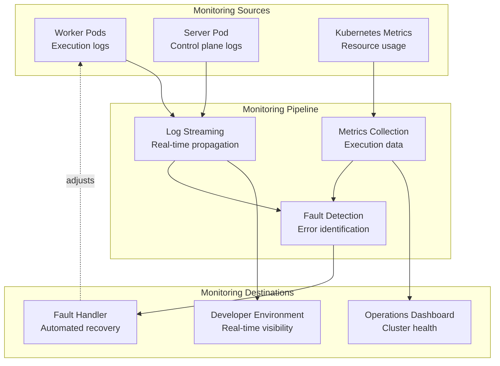

<!-- source: DeepWiki mcp.deepwiki.com · repo run-house/kubetorch · page 7 Deployment and Operations · fetched 2026-10-21 -->

# Deployment and Operations

<details>
<summary>Relevant source files</summary>

The following files were used as context for generating this wiki page:

- [README.md](README.md)

</details>


This document provides comprehensive deployment and operational guidance for installing, configuring, and maintaining Kubetorch in production and development environments. It covers the server-side Kubernetes deployment, which is separate from the client-side Python package installation.

**Scope**: This page focuses on the operational aspects of running Kubetorch's Kubernetes infrastructure. For client-side installation (`pip install kubetorch[client]`), see [Getting Started](#3). For specific deployment scenarios, see the child pages: [Kubernetes Deployment](#7.1), [Helm Installation](#7.2), [GCP and GKE Setup](#7.3), [Secrets Management](#7.4), and [Kubetorch Serverless](#7.5).

## Deployment Architecture

Kubetorch uses a client-server architecture where the Python client communicates with a Kubernetes-based server deployment. The separation between client and server components enables independent versioning, deployment, and scaling.

### Component Distribution Model



**Sources**: [README.md:37-56]()

### Deployment Methods Comparison

| Method | Command | Use Case | Pros | Cons |
|--------|---------|----------|------|------|
| **Direct OCI Install** | `helm upgrade --install kubetorch oci://ghcr.io/run-house/charts/kubetorch --version 0.2.2` | Standard deployments, production | Single command, always pulls latest specified version, no local files | Requires network access to OCI registry |
| **Local Chart Install** | `helm pull oci://...` then `helm upgrade --install kubetorch ./kubetorch` | Custom configurations, air-gapped environments | Can inspect/modify chart locally, works offline after download | Two-step process, must manage local chart files |

**Sources**: [README.md:47-54]()

## Prerequisites and Requirements

### Cluster Requirements

The following Kubernetes cluster requirements must be met before deploying Kubetorch:



**Sources**: [README.md:45-56]()

### Client Environment Requirements

| Component | Requirement | Notes |
|-----------|-------------|-------|
| Python | 3.8+ | Client library compatibility |
| pip | Latest recommended | For package installation |
| Network | Access to K8s cluster | Via KUBECONFIG or service endpoints |
| Credentials | Cluster access credentials | See [Secrets Management](#7.4) |

**Sources**: [README.md:39-43]()

## Deployment Workflow

### Standard Deployment Process



**Sources**: [README.md:47-54]()

## Namespace and Resource Organization

Kubetorch deploys all resources into a dedicated `kubetorch` namespace to isolate its components from other cluster workloads.

### Resource Hierarchy



The `--create-namespace` flag in the Helm command automatically creates this namespace if it doesn't exist [README.md:49-50]().

**Sources**: [README.md:47-54]()

## Operational Commands

### Core Management Commands

| Operation | Command | Purpose |
|-----------|---------|---------|
| **Install** | `helm upgrade --install kubetorch oci://ghcr.io/run-house/charts/kubetorch --version 0.2.2 -n kubetorch --create-namespace` | Initial deployment or upgrade |
| **Status** | `helm status kubetorch -n kubetorch` | Check deployment status |
| **List** | `helm list -n kubetorch` | List releases in namespace |
| **Uninstall** | `helm uninstall kubetorch -n kubetorch` | Remove deployment |
| **Delete Secrets** | `kt secrets delete -A -y` | Clean up authentication secrets |

**Sources**: [README.md:47-54]()

### Verification Commands

After deployment, verify the installation using these commands:

```bash
# Check pod status
kubectl get pods -n kubetorch

# Check service endpoints
kubectl get svc -n kubetorch

# View deployment details
kubectl describe deployment -n kubetorch

# Check logs
kubectl logs -n kubetorch -l app=kubetorch
```

### Secret Management Operations

The `kt secrets delete` command provides programmatic secret cleanup:

| Flag | Purpose | Example |
|------|---------|---------|
| `-A` | All secrets | Remove all Kubetorch-managed secrets |
| `-y` | Skip confirmation | Automatic yes for CI/CD |
| `--help` | Show help | Display all options |

This command is used in CI/CD cleanup steps to ensure test environments are properly cleaned [README.md:1-75]().

**Sources**: [README.md:1-75]()

## Configuration Management

### Helm Chart Configuration

The Helm chart supports configuration through values files and command-line overrides:

```bash
# Using custom values file
helm upgrade --install kubetorch oci://ghcr.io/run-house/charts/kubetorch \
  --version 0.2.2 -n kubetorch --create-namespace \
  -f custom-values.yaml

# Using command-line overrides
helm upgrade --install kubetorch oci://ghcr.io/run-house/charts/kubetorch \
  --version 0.2.2 -n kubetorch --create-namespace \
  --set replicaCount=3 \
  --set resources.limits.memory=4Gi
```

**Sources**: [README.md:47-54]()

## Version Management

### Chart Versioning

Kubetorch uses semantic versioning for Helm charts. The current stable version is `0.2.2` [README.md:50]().



**Version Pinning Best Practices**:
- Always specify `--version` flag to ensure reproducible deployments
- Version is specified as `0.2.2` in the Helm command [README.md:50]()
- Chart version is independent of client package version

**Sources**: [README.md:47-54]()

## Integration Points

### GCP and GKE Integration

Kubetorch has specific integration with Google Cloud Platform and Google Kubernetes Engine. This integration handles:

- **Service Account Authentication**: GCP service accounts for cluster access
- **GKE Cluster Management**: Automated cluster credential management
- **Secret Storage**: Kubernetes secrets for storing GCP credentials

For detailed GCP/GKE setup instructions, see [GCP and GKE Setup](#7.3).

**Sources**: [README.md:1-75]()

### CI/CD Integration

Kubetorch can be deployed and tested in CI/CD pipelines. The operational pattern involves:

1. **Authentication**: Set up cluster credentials via environment variables or secrets
2. **Deployment**: Use Helm commands in CI/CD jobs
3. **Testing**: Run client tests against the deployed cluster
4. **Cleanup**: Use `kt secrets delete -A -y` to remove test credentials

For detailed CI/CD configuration, see [CI/CD Pipeline](#8.2).

**Sources**: [README.md:1-75]()

## Monitoring and Observability

Kubetorch provides built-in monitoring capabilities that are deployed automatically with the Helm chart:



### Monitoring Features

| Feature | Description | Benefit |
|---------|-------------|---------|
| **Real-time Log Streaming** | Logs automatically propagate from pods to client | No manual log inspection needed |
| **Exception Propagation** | Python exceptions show in local environment | Native debugging experience |
| **Hardware Fault Detection** | Detects node failures, OOM, etc. | Proactive failure handling |
| **Execution Metrics** | Performance and resource usage data | Optimization insights |

For detailed monitoring setup, see [Monitoring and Observability](#4.6).

**Sources**: [README.md:1-75]()

## High Availability and Scaling

### Deployment Scaling

Kubetorch's deployment can be scaled through Helm values:

```bash
# Scale server replicas
helm upgrade kubetorch oci://ghcr.io/run-house/charts/kubetorch \
  --version 0.2.2 -n kubetorch \
  --reuse-values \
  --set replicaCount=3
```

### Dynamic Workload Scaling

Kubetorch includes built-in dynamic scaling that automatically adjusts worker pod count based on workload demand. This is part of the optimization engine that delivers the claimed "50%+ compute cost savings" [README.md:34]().

**Sources**: [README.md:34]()

## Maintenance Operations

### Upgrade Procedure

To upgrade Kubetorch to a new version:

```bash
# Check current version
helm list -n kubetorch

# Upgrade to new version
helm upgrade kubetorch oci://ghcr.io/run-house/charts/kubetorch \
  --version 0.2.3 -n kubetorch \
  --reuse-values

# Verify upgrade
kubectl rollout status deployment -n kubetorch
```

### Backup and Recovery

**Critical Resources to Backup**:
- Kubernetes secrets in the `kubetorch` namespace
- Custom Helm values files
- ConfigMaps with custom configuration

**Recovery Procedure**:
1. Restore namespace if deleted
2. Re-apply secrets from backup
3. Redeploy using Helm with backed-up values

### Resource Cleanup

For complete removal of Kubetorch:

```bash
# Delete Helm release
helm uninstall kubetorch -n kubetorch

# Clean up secrets
kt secrets delete -A -y

# Optionally delete namespace
kubectl delete namespace kubetorch
```

**Sources**: [README.md:1-75]()

## Managed Platform Alternative

Kubetorch Serverless provides a fully managed alternative to self-hosted deployment, eliminating operational overhead while maintaining the same client API.

**Contact**: 
- Email: hello@run.house [README.md:62]()
- Slack: Community channel [README.md:62]()

For details on the managed platform, see [Kubetorch Serverless](#7.5).

**Sources**: [README.md:60-62]()

## Detailed Deployment Topics

The following child pages provide detailed documentation for specific deployment scenarios:

- **[Kubernetes Deployment](#7.1)**: Step-by-step Kubernetes deployment guide, namespace creation, and resource requirements
- **[Helm Installation](#7.2)**: Comprehensive Helm installation documentation for both OCI and local chart methods with configuration options
- **[GCP and GKE Setup](#7.3)**: GCP service account setup, GKE cluster configuration, and authentication mechanisms
- **[Secrets Management](#7.4)**: Secrets handling, Kubernetes secret integration, and cleanup procedures using `kt secrets delete`
- **[Kubetorch Serverless](#7.5)**: Managed platform option with details on accessing the serverless offering

**Sources**: [README.md:1-75]()

---

