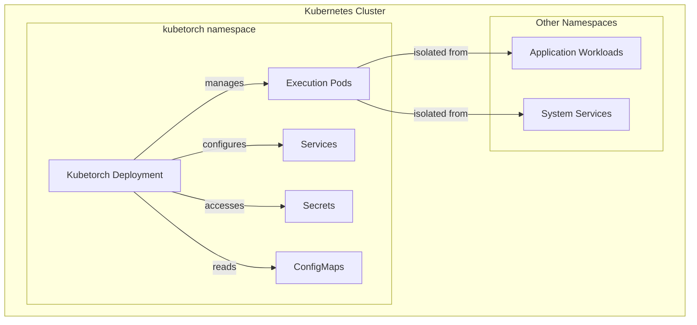
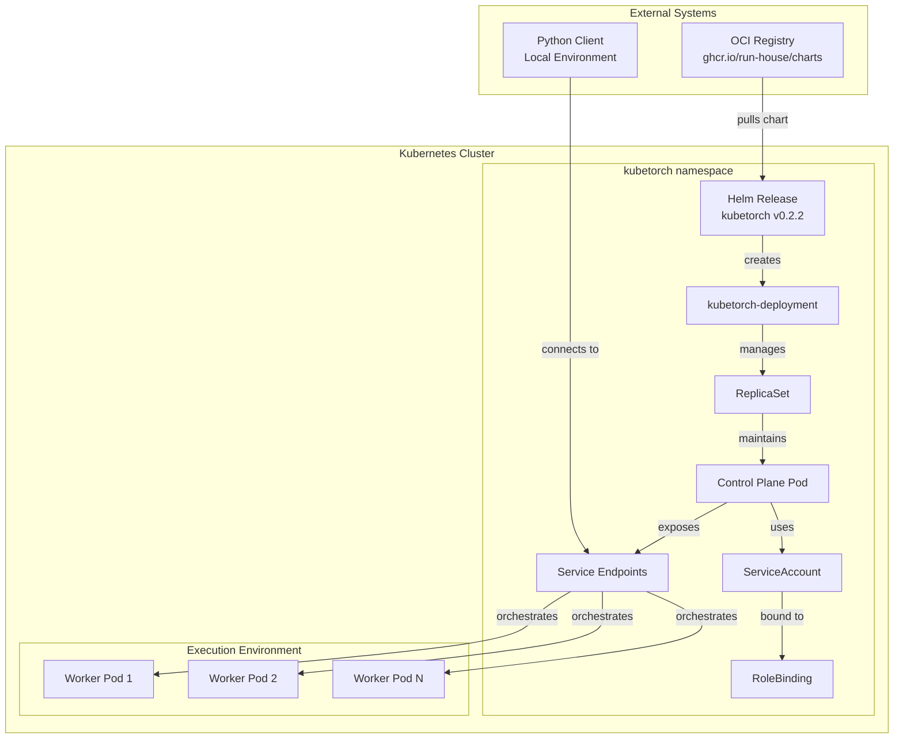
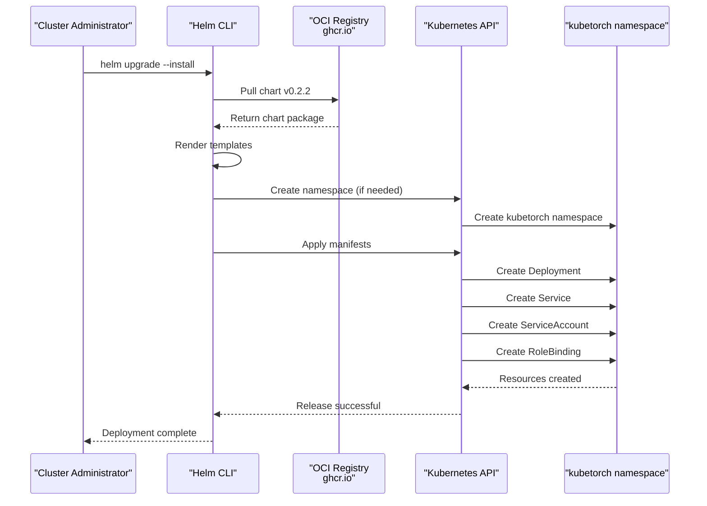
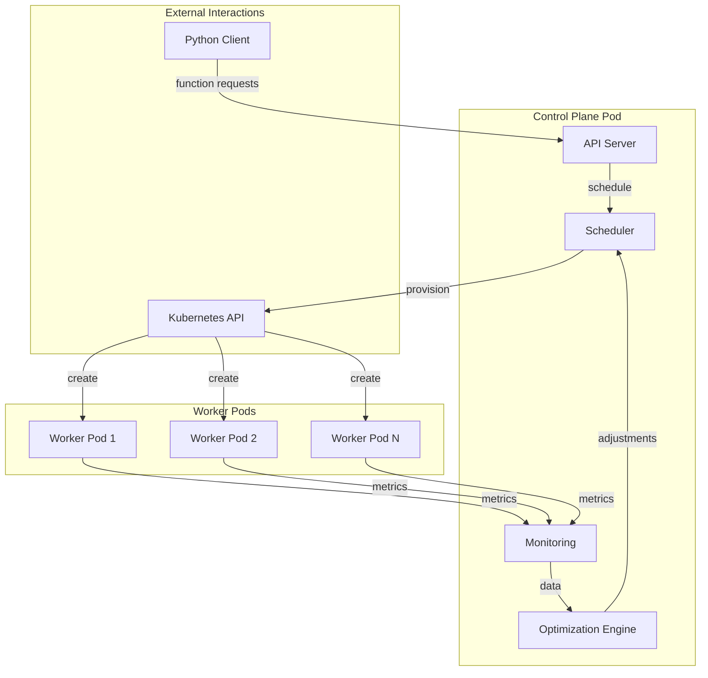
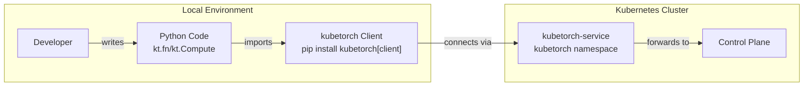

<!-- source: DeepWiki mcp.deepwiki.com · repo run-house/kubetorch · page 7.1 Kubernetes Deployment · fetched 2026-10-21 -->

# Kubernetes Deployment

<details>
<summary>Relevant source files</summary>

The following files were used as context for generating this wiki page:

- [README.md](README.md)

</details>


## Purpose and Scope

This page provides a comprehensive guide for deploying Kubetorch to a Kubernetes cluster. It covers prerequisites, namespace configuration, resource requirements, deployment architecture, and verification procedures. 

For detailed Helm installation options and configuration, see [Helm Installation](#7.2). For GCP and GKE-specific setup procedures, see [GCP and GKE Setup](#7.3). For managing Kubetorch secrets after deployment, see [Secrets Management](#7.4). For initial client installation, see [Installation](#3.1).

---

## Prerequisites

Before deploying Kubetorch to your Kubernetes cluster, ensure the following requirements are met:

| Requirement | Version/Specification | Purpose |
|-------------|----------------------|---------|
| Kubernetes Cluster | v1.20 or later | Target environment for Kubetorch deployment |
| kubectl | Compatible with cluster version | Command-line tool for cluster interaction |
| Helm | v3.8 or later | Package manager for Kubernetes deployment |
| Cluster Access | Valid kubeconfig | Authentication and authorization to cluster |
| Namespace Permissions | create, get, list | Ability to create and manage the `kubetorch` namespace |

### Cluster Access Verification

Before proceeding with deployment, verify cluster connectivity:

```bash
# Check cluster connection
kubectl cluster-info

# Verify namespace permissions
kubectl auth can-i create namespace
kubectl auth can-i create deployments
kubectl auth can-i create services
```

**Sources:** [README.md:45-56]()

---

## Namespace Architecture

Kubetorch operates within a dedicated Kubernetes namespace to isolate its resources from other cluster workloads. The default namespace is `kubetorch`, created during the Helm installation process.

### Namespace Structure



**Namespace Isolation Benefits:**

- **Resource Isolation**: Kubetorch pods and services are separated from other cluster workloads
- **Access Control**: Kubernetes RBAC policies can be applied at the namespace level
- **Resource Quotas**: CPU, memory, and GPU quotas can be enforced per namespace
- **Cleanup Simplification**: Deleting the namespace removes all Kubetorch resources

### Creating the Namespace

The namespace is automatically created during Helm installation with the `--create-namespace` flag [README.md:50](), [README.md:54](). To manually create the namespace before installation:

```bash
kubectl create namespace kubetorch
```

To verify namespace creation:

```bash
kubectl get namespace kubetorch
kubectl describe namespace kubetorch
```

**Sources:** [README.md:48-55]()

---

## Deployment Overview

The Kubetorch deployment consists of server-side components that run within the Kubernetes cluster and manage remote function execution, resource allocation, and monitoring.

### Deployment Architecture



### Core Components Deployed

The Helm installation creates the following resources in the `kubetorch` namespace:

| Resource Type | Name/Pattern | Purpose |
|--------------|--------------|---------|
| Deployment | `kubetorch-deployment` | Control plane managing function execution |
| Service | `kubetorch-service` | Endpoint for client connections |
| ServiceAccount | `kubetorch-sa` | Identity for deployment pods |
| RoleBinding | `kubetorch-rolebinding` | Permissions for pod management |
| ConfigMap | `kubetorch-config` | Configuration parameters |
| Secret | `kubetorch-secrets` | Sensitive credentials |

**Sources:** [README.md:48-55]()

---

## Resource Requirements

### Control Plane Resources

The Kubetorch control plane deployment requires minimal resources:

| Resource | Minimum | Recommended | Purpose |
|----------|---------|-------------|---------|
| CPU | 100m | 500m | Request processing and orchestration |
| Memory | 256Mi | 512Mi | State management and caching |
| Persistent Storage | Not required | Optional | Configuration persistence |

### Worker Pod Resources

Worker pods are dynamically provisioned based on function execution requests. Resource requirements are specified by developers using `kt.Compute` [README.md:21]() and can range from:

| Workload Type | CPU Range | Memory Range | GPU |
|--------------|-----------|--------------|-----|
| Small Tasks | 0.1 - 1 core | 128Mi - 1Gi | Not required |
| Medium Tasks | 1 - 8 cores | 1Gi - 16Gi | Optional |
| Large ML Workloads | 8+ cores | 16Gi+ | Often required |

### Cluster-Level Requirements

For effective Kubetorch operation, the cluster should provide:

- **Dynamic Pod Scheduling**: Ability to rapidly provision and terminate pods
- **Resource Quotas**: Sufficient CPU, memory, and GPU allocation for expected workloads
- **Network Policies**: Open communication between kubetorch namespace pods
- **Storage Classes**: Access to storage for function artifacts (if needed)

**Sources:** [README.md:21](), [README.md:33-35]()

---

## Deployment Methods

Kubetorch provides two Helm-based deployment methods, both pulling from the OCI registry at `ghcr.io/run-house/charts/kubetorch`.

### Deployment Flow



### Method 1: Direct OCI Installation

This method installs directly from the OCI registry in a single command [README.md:48-50]():

```bash
helm upgrade --install kubetorch oci://ghcr.io/run-house/charts/kubetorch \
  --version 0.2.2 -n kubetorch --create-namespace
```

**Characteristics:**
- Single-command deployment
- Always pulls the latest chart from registry
- Suitable for standard deployments
- No local chart storage required

### Method 2: Local Chart Installation

This method downloads the chart locally before installation [README.md:52-54]():

```bash
# Step 1: Download chart
helm pull oci://ghcr.io/run-house/charts/kubetorch --version 0.2.2 --untar

# Step 2: Install from local directory
helm upgrade --install kubetorch ./kubetorch -n kubetorch --create-namespace
```

**Characteristics:**
- Two-step process
- Chart can be inspected or modified before deployment
- Suitable for air-gapped environments
- Enables offline installation

For detailed configuration options and advanced Helm usage, see [Helm Installation](#7.2).

**Sources:** [README.md:48-55]()

---

## Post-Deployment Verification

After deployment, verify that all components are running correctly.

### Check Helm Release

```bash
# List Helm releases in kubetorch namespace
helm list -n kubetorch

# Get release details
helm status kubetorch -n kubetorch
```

Expected output should show the release status as `deployed` and version `0.2.2`.

### Verify Deployment Resources

```bash
# Check deployment status
kubectl get deployments -n kubetorch

# Check pod status
kubectl get pods -n kubetorch

# Check service endpoints
kubectl get services -n kubetorch

# View all resources in namespace
kubectl get all -n kubetorch
```

### Verification Checklist

| Component | Verification Command | Expected State |
|-----------|---------------------|----------------|
| Namespace | `kubectl get ns kubetorch` | Active |
| Deployment | `kubectl get deployment -n kubetorch` | Available replicas ≥ 1 |
| Pods | `kubectl get pods -n kubetorch` | Running/Ready |
| Service | `kubectl get svc -n kubetorch` | ClusterIP assigned |
| ServiceAccount | `kubectl get sa -n kubetorch` | Created |

### Check Logs

```bash
# View deployment logs
kubectl logs -n kubetorch deployment/kubetorch-deployment

# Stream logs in real-time
kubectl logs -n kubetorch deployment/kubetorch-deployment -f
```

**Sources:** [README.md:48-55]()

---

## Deployed Component Details

### Control Plane Pod

The control plane pod serves as the orchestration layer for remote function execution:



**Responsibilities:**
- Receives function execution requests from Python clients
- Schedules worker pods based on resource requirements
- Monitors execution status and health
- Implements optimization strategies for resource allocation
- Propagates logs and exceptions back to clients

### Service Endpoints

The `kubetorch-service` exposes the control plane to clients:

- **Type**: ClusterIP (internal to cluster)
- **Port**: Configured during deployment
- **Protocol**: HTTP/gRPC for client communication
- **Load Balancing**: Distributes requests across control plane replicas

### Worker Pods

Worker pods are ephemeral execution environments created on-demand:

- **Lifecycle**: Created per function execution, terminated after completion
- **Resource Allocation**: Based on `kt.Compute` specifications [README.md:21]()
- **Isolation**: Each function execution runs in a separate pod
- **Networking**: Direct communication with control plane for status updates

**Sources:** [README.md:6-9](), [README.md:21]()

---

## Namespace Management

### Resource Monitoring

Monitor resource usage within the kubetorch namespace:

```bash
# View resource usage by pods
kubectl top pods -n kubetorch

# View resource quotas (if configured)
kubectl get resourcequota -n kubetorch

# View limit ranges (if configured)
kubectl get limitrange -n kubetorch
```

### Namespace Configuration

To apply resource quotas or limit ranges to the namespace:

```bash
# Example: Apply resource quota
kubectl apply -f resource-quota.yaml -n kubetorch

# Example: Apply limit range
kubectl apply -f limit-range.yaml -n kubetorch
```

### Cleanup and Deletion

To completely remove the Kubetorch deployment:

```bash
# Uninstall Helm release
helm uninstall kubetorch -n kubetorch

# Delete namespace (removes all resources)
kubectl delete namespace kubetorch
```

For secret cleanup without full uninstallation, see [Secrets Management](#7.4).

**Sources:** [README.md:48-55]()

---

## Integration with Python Client

After successful deployment, the Python client can connect to the cluster:



The client automatically discovers the kubetorch service endpoint using:
- Kubernetes service discovery (for in-cluster clients)
- Kubeconfig credentials (for external clients)
- Configured cluster context

For client installation and configuration, see [Installation](#3.1).

**Sources:** [README.md:39-43](), [README.md:13-28]()

---

## Security Considerations

### ServiceAccount Permissions

The `kubetorch-sa` ServiceAccount requires specific RBAC permissions:

| Resource | Verbs | Scope | Purpose |
|----------|-------|-------|---------|
| Pods | create, get, list, delete | kubetorch namespace | Worker pod management |
| Services | get, list | kubetorch namespace | Endpoint discovery |
| Secrets | get, list, create, update | kubetorch namespace | Credential management |
| ConfigMaps | get, list | kubetorch namespace | Configuration access |

### Network Policies

Recommended network policies for the kubetorch namespace:

- **Ingress**: Allow connections from Python clients (configure based on client locations)
- **Egress**: Allow connections to Kubernetes API and external registries
- **Pod-to-Pod**: Allow communication between control plane and worker pods

### Secret Management

Sensitive data is stored in Kubernetes Secrets within the namespace. For detailed secret management procedures, including the `kt secrets delete` command, see [Secrets Management](#7.4).

**Sources:** [README.md:48-55]()

---

## Troubleshooting Deployment Issues

### Common Issues

| Issue | Symptom | Resolution |
|-------|---------|------------|
| Namespace Already Exists | `Error: namespace "kubetorch" already exists` | Remove `--create-namespace` flag or delete existing namespace |
| Insufficient Permissions | `Error: cannot create resource "deployments"` | Verify cluster admin access or request necessary permissions |
| Chart Version Not Found | `Error: chart version 0.2.2 not found` | Verify OCI registry access and chart version availability |
| Pod Not Starting | Pods in `Pending` or `CrashLoopBackOff` state | Check pod logs with `kubectl logs` and resource availability |

### Diagnostic Commands

```bash
# View detailed deployment information
kubectl describe deployment kubetorch-deployment -n kubetorch

# Check events in namespace
kubectl get events -n kubetorch --sort-by='.lastTimestamp'

# View pod details
kubectl describe pod <pod-name> -n kubetorch

# Check resource constraints
kubectl get nodes
kubectl describe nodes
```

For additional troubleshooting guidance, see [Common Issues](#9.1) and [Debugging and Logging](#9.2).

**Sources:** [README.md:48-55]()

---

