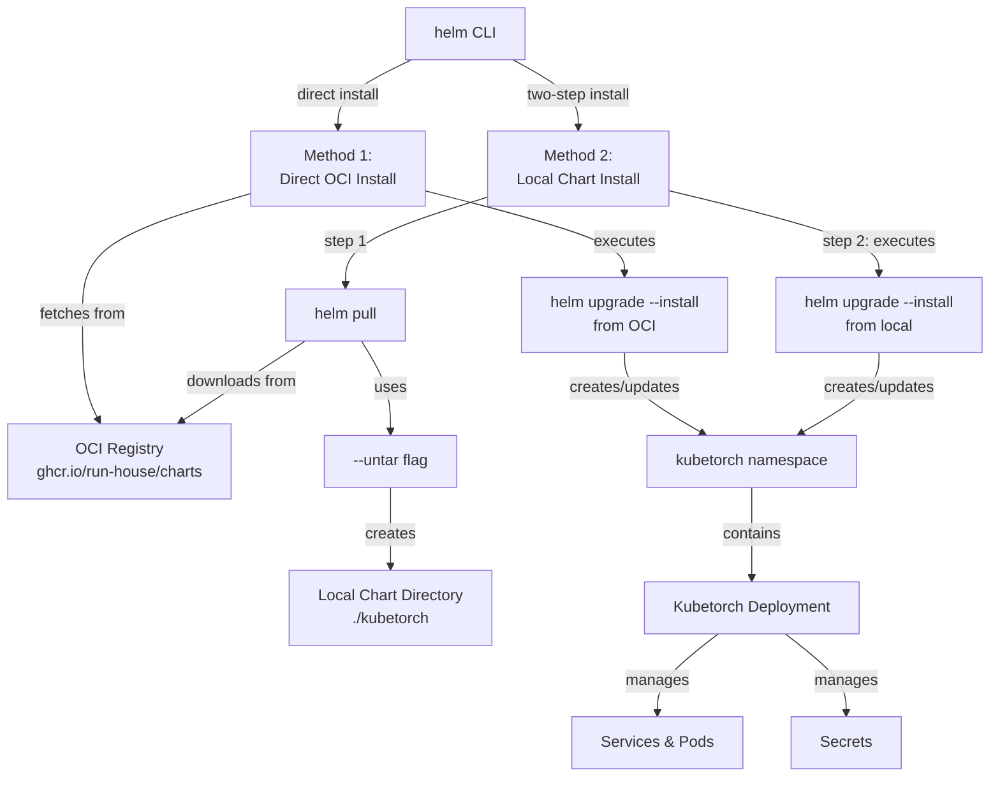
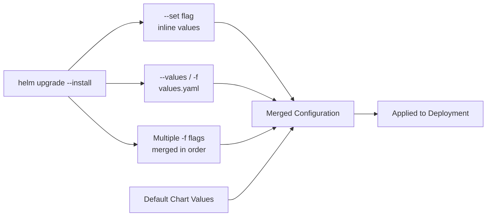
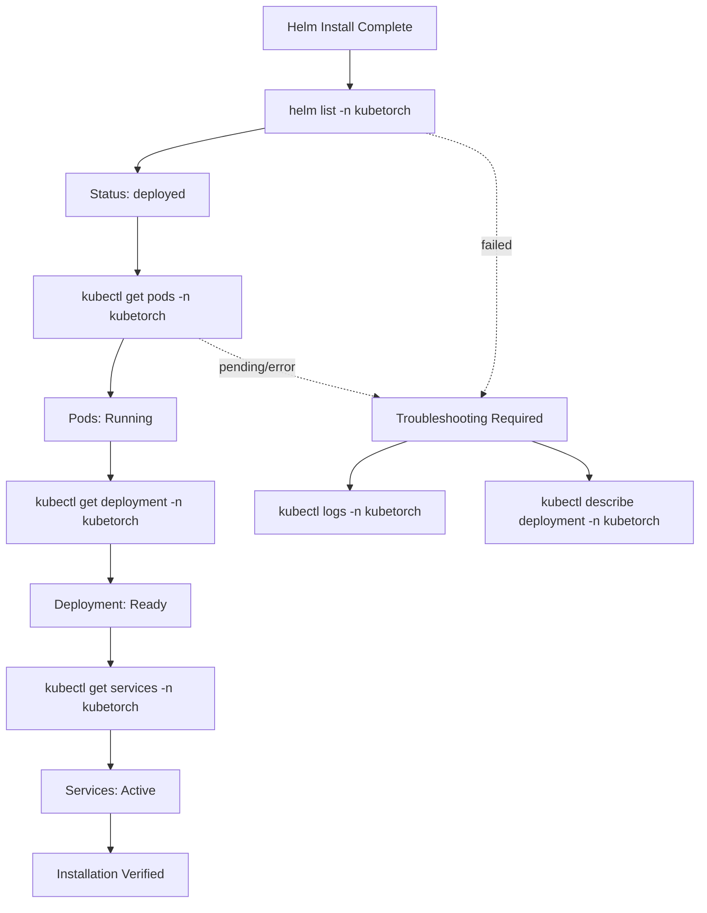
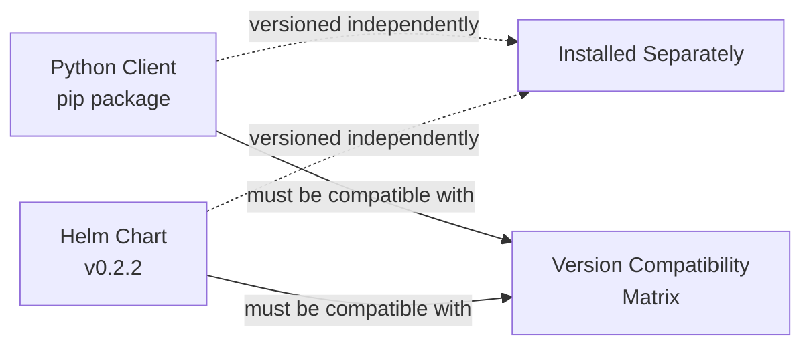

<!-- source: DeepWiki mcp.deepwiki.com · repo run-house/kubetorch · page 7.2 Helm Installation · fetched 2026-10-21 -->

# Helm Installation

<details>
<summary>Relevant source files</summary>

The following files were used as context for generating this wiki page:

- [README.md](README.md)

</details>


This document provides detailed instructions for deploying the Kubetorch server component to a Kubernetes cluster using Helm. It covers both installation methods (direct OCI registry installation and local chart installation), configuration options, and verification procedures. For general Kubernetes deployment concepts and namespace setup, see [Kubernetes Deployment](#7.1). For GCP-specific cluster setup, see [GCP and GKE Setup](#7.3).

## Overview

Kubetorch's server component is distributed as a Helm chart via an OCI (Open Container Initiative) registry. The chart is versioned independently from the Python client package and is hosted at `ghcr.io/run-house/charts/kubetorch`. The current stable version is `0.2.2`.

The Helm installation process creates a dedicated `kubetorch` namespace in your Kubernetes cluster and deploys the necessary resources for remote function execution, including the Kubetorch deployment, services, and secrets management infrastructure.

**Sources:** [README.md:45-55]()

## Installation Methods

Kubetorch provides two Helm installation methods to accommodate different operational requirements and security policies.

### Installation Flow



**Sources:** [README.md:48-54]()

### Method 1: Direct OCI Install

The direct OCI installation method performs a single-command deployment by pulling the chart directly from the OCI registry and installing it in one operation.

**Command:**

```bash
helm upgrade --install kubetorch oci://ghcr.io/run-house/charts/kubetorch \
  --version 0.2.2 -n kubetorch --create-namespace
```

**Command Breakdown:**

| Component | Description |
|-----------|-------------|
| `helm upgrade --install` | Creates new installation or upgrades existing deployment |
| `kubetorch` | Release name within the cluster |
| `oci://ghcr.io/run-house/charts/kubetorch` | OCI registry path for the chart |
| `--version 0.2.2` | Specific chart version to install |
| `-n kubetorch` | Target namespace (short form of `--namespace`) |
| `--create-namespace` | Creates namespace if it doesn't exist |

**Use Cases:**
- Standard production deployments
- Automated CI/CD pipelines
- Quick initial setup
- Environments with direct internet access to GitHub Container Registry

**Advantages:**
- Single command execution
- Always pulls latest chart for specified version
- Minimal local disk usage
- Simplified automation scripts

**Sources:** [README.md:48-50]()

### Method 2: Local Chart Install

The local chart installation method separates chart retrieval from installation, allowing for inspection, customization, or offline deployment.

**Commands:**

```bash
# Step 1: Pull chart from OCI registry
helm pull oci://ghcr.io/run-house/charts/kubetorch --version 0.2.2 --untar

# Step 2: Install from local directory
helm upgrade --install kubetorch ./kubetorch -n kubetorch --create-namespace
```

**Step 1 Breakdown:**

| Component | Description |
|-----------|-------------|
| `helm pull` | Downloads chart without installing |
| `oci://ghcr.io/run-house/charts/kubetorch` | OCI registry path |
| `--version 0.2.2` | Specific chart version |
| `--untar` | Extracts chart into `./kubetorch` directory |

**Step 2 Breakdown:**

| Component | Description |
|-----------|-------------|
| `helm upgrade --install` | Creates or upgrades release |
| `kubetorch` | Release name |
| `./kubetorch` | Local chart directory path |
| `-n kubetorch --create-namespace` | Namespace configuration |

**Use Cases:**
- Security review requirements
- Customizing chart values before deployment
- Offline or air-gapped environments
- Version control of deployed charts
- Multi-cluster deployments with identical configuration

**Advantages:**
- Chart inspection before installation
- Modification of templates or values
- Offline deployment capability
- Version control integration
- Repeatable deployments without network dependency

**Sources:** [README.md:52-54]()

## Prerequisites

Before installing Kubetorch via Helm, ensure the following requirements are met:

### Required Tools

| Tool | Minimum Version | Purpose |
|------|----------------|---------|
| `helm` | 3.x | Chart installation and management |
| `kubectl` | 1.19+ | Kubernetes cluster access verification |

### Cluster Requirements

- Active Kubernetes cluster (1.19 or later recommended)
- Current kubeconfig context pointing to target cluster
- Cluster-admin or equivalent permissions for namespace creation and resource deployment
- Internet access to `ghcr.io` (for direct OCI method) or pre-downloaded chart (for local method)

### Verification Commands

```bash
# Verify Helm installation
helm version

# Verify kubectl configuration and cluster access
kubectl cluster-info

# Verify current context
kubectl config current-context

# Check available namespaces (verify permissions)
kubectl get namespaces
```

**Sources:** [README.md:45-55]()

## Configuration Options

Kubetorch's Helm chart supports configuration through values passed during installation. Configuration can be specified via command-line flags or values files.

### Configuration Methods



### Common Configuration Patterns

**Inline Value Configuration:**

```bash
helm upgrade --install kubetorch oci://ghcr.io/run-house/charts/kubetorch \
  --version 0.2.2 \
  -n kubetorch --create-namespace \
  --set key1=value1 \
  --set key2=value2
```

**Values File Configuration:**

```bash
# Create custom values file
cat > custom-values.yaml <<EOF
# Custom configuration
# (Actual keys depend on chart implementation)
EOF

# Install with values file
helm upgrade --install kubetorch oci://ghcr.io/run-house/charts/kubetorch \
  --version 0.2.2 \
  -n kubetorch --create-namespace \
  -f custom-values.yaml
```

**Multiple Values Files (Merged):**

```bash
helm upgrade --install kubetorch oci://ghcr.io/run-house/charts/kubetorch \
  --version 0.2.2 \
  -n kubetorch --create-namespace \
  -f base-values.yaml \
  -f environment-overrides.yaml
```

**Sources:** [README.md:48-54]()

## Installation Verification

After executing the Helm installation command, verify that the deployment succeeded and resources are running correctly.

### Verification Steps



**Verification Commands:**

```bash
# Check Helm release status
helm list -n kubetorch

# Verify pods are running
kubectl get pods -n kubetorch

# Check deployment status
kubectl get deployment -n kubetorch

# Verify services
kubectl get services -n kubetorch

# View pod logs (if pods exist)
kubectl logs -n kubetorch -l app=kubetorch

# Detailed deployment information
kubectl describe deployment -n kubetorch
```

**Expected Outputs:**

| Command | Expected Result |
|---------|----------------|
| `helm list -n kubetorch` | Release `kubetorch` with status `deployed` |
| `kubectl get pods -n kubetorch` | One or more pods in `Running` state |
| `kubectl get deployment -n kubetorch` | Deployment with `READY` matching `DESIRED` replicas |
| `kubectl get services -n kubetorch` | Services with assigned `CLUSTER-IP` addresses |

**Sources:** [README.md:45-55]()

## Version Management

The Kubetorch Helm chart is independently versioned from the Python client package, allowing server-side updates without requiring client reinstallation.

### Listing Available Versions

```bash
# Show all available chart versions
helm search repo kubetorch --versions

# Show specific version information from OCI registry
helm show chart oci://ghcr.io/run-house/charts/kubetorch --version 0.2.2
```

### Upgrading to New Versions

```bash
# Upgrade to specific version (Method 1: Direct OCI)
helm upgrade --install kubetorch oci://ghcr.io/run-house/charts/kubetorch \
  --version <new-version> \
  -n kubetorch

# Upgrade from local chart (Method 2)
helm pull oci://ghcr.io/run-house/charts/kubetorch --version <new-version> --untar
helm upgrade --install kubetorch ./kubetorch -n kubetorch
```

### Version Compatibility



The Python client and Helm chart versions follow independent release cycles. Consult the [official documentation](https://www.run.house/kubetorch/installation) for compatibility matrix between client and server versions.

**Sources:** [README.md:48-54](), [README.md:57]()

## Uninstallation

To remove the Kubetorch deployment from your cluster:

```bash
# Uninstall release
helm uninstall kubetorch -n kubetorch

# Optionally delete namespace (removes all resources)
kubectl delete namespace kubetorch
```

**Warning:** Uninstalling the release will terminate all running workloads and delete associated resources. For secrets cleanup specifically, see [Secrets Management](#7.4).

**Sources:** [README.md:48-54]()

## Common Deployment Scenarios

### Development Environment

Quick installation for local development and testing:

```bash
helm upgrade --install kubetorch oci://ghcr.io/run-house/charts/kubetorch \
  --version 0.2.2 \
  -n kubetorch --create-namespace
```

### Production Environment with Custom Configuration

Installation with values file for production settings:

```bash
# Pull chart for review
helm pull oci://ghcr.io/run-house/charts/kubetorch --version 0.2.2 --untar

# Review and customize values
cat kubetorch/values.yaml
vi custom-production-values.yaml

# Install with custom configuration
helm upgrade --install kubetorch ./kubetorch \
  -n kubetorch --create-namespace \
  -f custom-production-values.yaml
```

### CI/CD Pipeline Integration

Automated deployment in CI/CD workflows (see [CI/CD Pipeline](#8.2) for complete workflow documentation):

```bash
# Authenticate to cluster (implementation-specific)
# ...

# Deploy specific version
helm upgrade --install kubetorch oci://ghcr.io/run-house/charts/kubetorch \
  --version 0.2.2 \
  -n kubetorch --create-namespace \
  --wait --timeout 5m
```

**Sources:** [README.md:48-55]()

## Troubleshooting

### Chart Pull Failures

If `helm pull` or direct OCI installation fails:

```bash
# Verify Helm can access OCI registry
helm registry login ghcr.io

# Check network connectivity
curl -I https://ghcr.io

# Verify specific chart exists
helm show chart oci://ghcr.io/run-house/charts/kubetorch --version 0.2.2
```

### Installation Failures

If installation fails:

```bash
# Check Helm release history
helm history kubetorch -n kubetorch

# View detailed error logs
helm get notes kubetorch -n kubetorch
helm get values kubetorch -n kubetorch

# Check Kubernetes events
kubectl get events -n kubetorch --sort-by='.lastTimestamp'
```

### Permission Errors

If namespace creation or resource deployment fails due to permissions:

```bash
# Verify current user permissions
kubectl auth can-i create namespaces
kubectl auth can-i create deployments -n kubetorch
kubectl auth can-i create services -n kubetorch

# Have cluster admin pre-create namespace if needed
kubectl create namespace kubetorch
```

For additional troubleshooting guidance, see [Common Issues](#9.1).

**Sources:** [README.md:45-55]()

## Next Steps

After successfully installing the Kubetorch server component via Helm:

1. Install the Python client: see [Installation Guide](#3.1)
2. Configure GCP/GKE integration (if applicable): see [GCP and GKE Setup](#7.3)
3. Set up secrets management: see [Secrets Management](#7.4)
4. Run your first workload: see [Hello World Example](#3.2)
5. Learn about monitoring: see [Monitoring and Observability](#4.6)

For managed hosting alternatives, see [Kubetorch Serverless](#7.5).

**Sources:** [README.md:57-68]()

---

