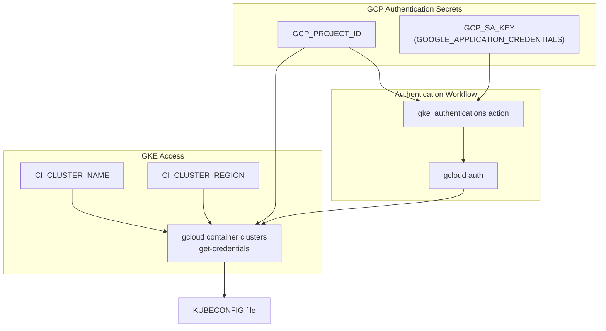
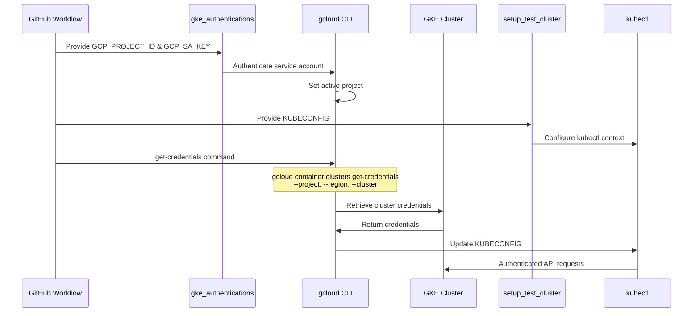
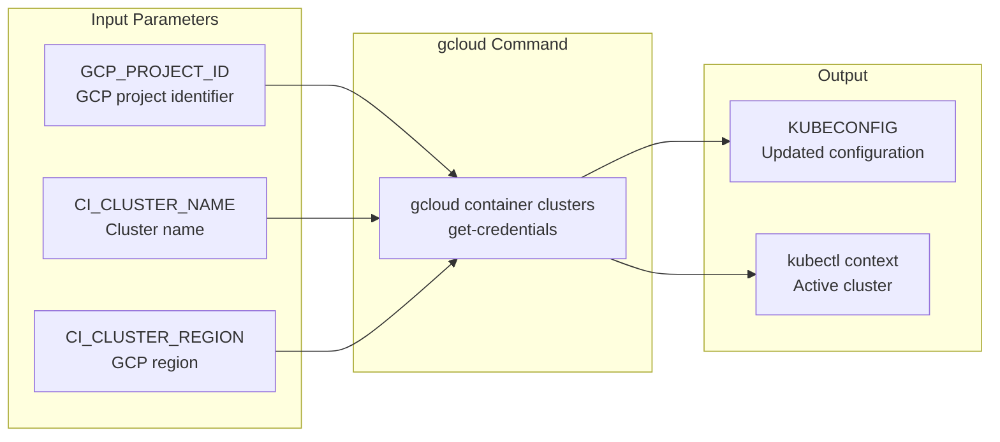
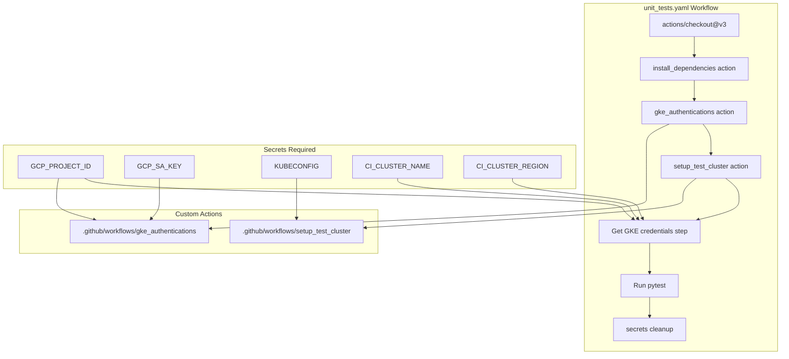
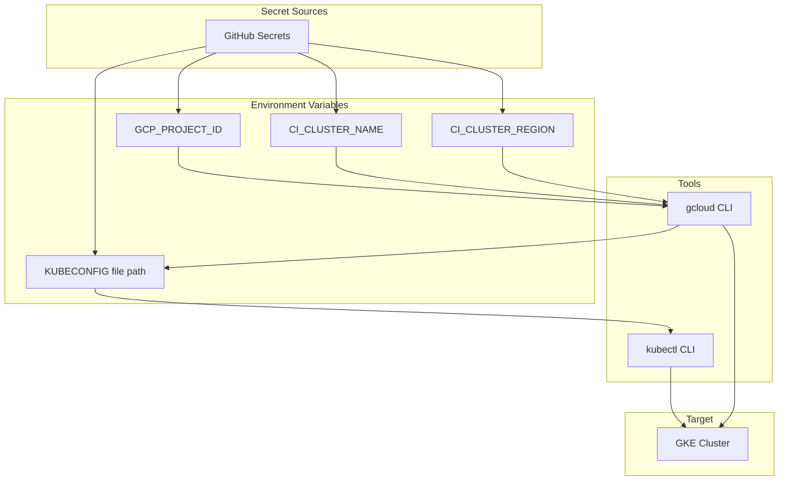
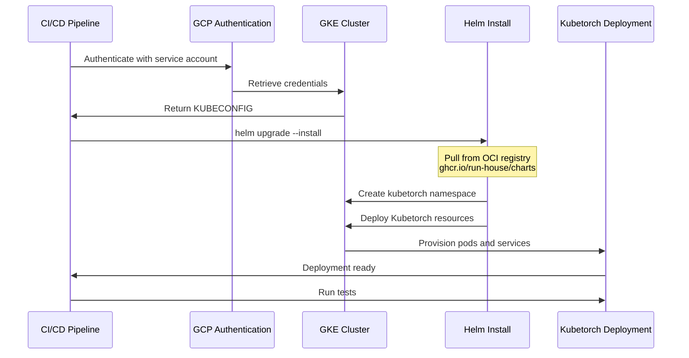

<!-- source: DeepWiki mcp.deepwiki.com · repo run-house/kubetorch · page 7.3 GCP and GKE Setup · fetched 2026-10-21 -->

# GCP and GKE Setup

<details>
<summary>Relevant source files</summary>

The following files were used as context for generating this wiki page:

- [.github/workflows/unit_tests.yaml](.github/workflows/unit_tests.yaml)
- [README.md](README.md)

</details>


This page documents the configuration of Google Cloud Platform (GCP) service accounts and Google Kubernetes Engine (GKE) clusters for Kubetorch deployment. It covers authentication mechanisms, credential management, and the integration patterns used in both development and CI/CD environments.

For general Kubernetes deployment concepts, see [Kubernetes Deployment](#7.1). For Helm-based installation procedures, see [Helm Installation](#7.2). For secrets management patterns, see [Secrets Management](#7.4).

---

## Overview

Kubetorch's GCP/GKE integration involves three primary components:

1. **GCP Service Account**: Provides authentication for accessing GCP resources
2. **GKE Cluster**: Hosts the Kubetorch Kubernetes deployment
3. **Credential Management**: Handles secure storage and retrieval of authentication tokens

The system uses `gcloud` CLI commands for credential retrieval and Kubernetes secrets for secure credential storage.

---

## Prerequisites

Before configuring GCP and GKE for Kubetorch, ensure the following are available:

| Requirement | Description | Used For |
|------------|-------------|----------|
| GCP Project | Active Google Cloud Platform project | Resource organization and billing |
| GKE Cluster | Running Kubernetes cluster on GKE | Kubetorch deployment target |
| Service Account | GCP service account with appropriate IAM roles | Authentication and authorization |
| `gcloud` CLI | Google Cloud SDK command-line tool | Credential retrieval and cluster access |
| `kubectl` | Kubernetes command-line tool | Cluster interaction |

---

## GCP Service Account Configuration

### Required Secrets

Kubetorch's GCP authentication requires two primary secrets:



**Diagram: GCP Authentication Flow in CI/CD**

### Secret Definitions

| Secret Name | Alternative Name | Purpose |
|------------|------------------|---------|
| `GCP_PROJECT_ID` | N/A | Identifies the GCP project containing the GKE cluster |
| `GCP_SA_KEY` | `GOOGLE_APPLICATION_CREDENTIALS` | Service account JSON key for authentication |
| `CI_CLUSTER_NAME` | N/A | Name of the GKE cluster for CI/CD testing |
| `CI_CLUSTER_REGION` | N/A | GCP region where the cluster is deployed |
| `KUBECONFIG` | N/A | Kubernetes configuration file content |

### Authentication Workflow

The authentication process follows this sequence in CI/CD pipelines:



**Diagram: Service Account Authentication Sequence**

Sources: [.github/workflows/unit_tests.yaml:53-71]()

---

## GKE Cluster Access

### Credential Retrieval Command

The primary mechanism for obtaining GKE cluster credentials uses the `gcloud container clusters get-credentials` command:

```bash
gcloud container clusters get-credentials $CLUSTER_NAME \
  --region $CLUSTER_REGION \
  --project $GCP_PROJECT_ID
```

This command performs the following operations:

1. Authenticates to GCP using the active service account
2. Retrieves cluster endpoint and CA certificate
3. Generates authentication token
4. Updates the `KUBECONFIG` file with cluster context

### Cluster Configuration Parameters



**Diagram: GKE Credential Retrieval Parameters**

| Parameter | Environment Variable | Example Value | Description |
|-----------|---------------------|---------------|-------------|
| Project ID | `GCP_PROJECT_ID` | `my-gcp-project` | GCP project containing the cluster |
| Cluster Name | `CI_CLUSTER_NAME` | `kubetorch-test` | Name of the GKE cluster |
| Region | `CI_CLUSTER_REGION` | `us-central1` | GCP region for the cluster |

Sources: [.github/workflows/unit_tests.yaml:68-71]()

---

## GitHub Actions Integration

### Workflow Structure

The CI/CD pipeline integrates GCP/GKE authentication through three custom actions:



**Diagram: CI/CD Authentication Pipeline Structure**

### Authentication Step Configuration

The workflow uses the `gke_authentications` custom action located at `.github/workflows/gke_authentications`:

```yaml
- name: Setup authentications
  uses: ./.github/workflows/gke_authentications
  with:
    GCP_PROJECT_ID: ${{ secrets.GCP_PROJECT_ID }}
    GCP_SA_KEY: ${{ secrets.GOOGLE_APPLICATION_CREDENTIALS }}
```

This step handles:
- Service account authentication
- GCP project activation
- Credential configuration for subsequent steps

Sources: [.github/workflows/unit_tests.yaml:53-57]()

### Test Cluster Setup

The `setup_test_cluster` action configures the Kubernetes context:

```yaml
- name: Setup Test Cluster
  uses: ./.github/workflows/setup_test_cluster
  with:
    KUBECONFIG: ${{ secrets.KUBECONFIG }}
```

This step:
- Writes KUBECONFIG content to file
- Sets `KUBECONFIG` environment variable
- Configures `kubectl` context

Sources: [.github/workflows/unit_tests.yaml:62-65]()

### Credential Retrieval Step

After authentication and setup, the workflow explicitly retrieves cluster credentials:

```yaml
- name: Get GKE credentials
  run: |
    gcloud container clusters get-credentials ${{ secrets.CI_CLUSTER_NAME }} \
      --region ${{ secrets.CI_CLUSTER_REGION }} \
      --project ${{ secrets.GCP_PROJECT_ID }}
```

This ensures the latest credentials are available for test execution.

Sources: [.github/workflows/unit_tests.yaml:67-71]()

---

## Credential Management Lifecycle

### Environment Variable Configuration

The workflow manages several environment variables for GCP/GKE integration:



**Diagram: Environment Variable Flow**

| Variable | Scope | Purpose |
|----------|-------|---------|
| `GCP_PROJECT_ID` | Workflow-level | Project identification for all GCP operations |
| `CI_CLUSTER_NAME` | Step-level | Cluster name for credential retrieval |
| `CI_CLUSTER_REGION` | Step-level | Region for cluster location |
| `KUBECONFIG` | Environment | Path to Kubernetes configuration file |
| `PYTHONPATH` | Environment | Python module resolution path |
| `TEST_HASH` | Environment | Test isolation identifier |

Sources: [.github/workflows/unit_tests.yaml:33-79]()

### Cleanup Process

The workflow includes automatic cleanup of Kubetorch secrets after test completion:

```yaml
- name: secrets cleanup
  if: ${{ always() }}
  run: |
    echo "Running teardown command: kt secrets delete -A -y for username ${TEST_HASH}"
    kt config set username $TEST_HASH
    kt secrets delete -A -y
  timeout-minutes: 60
```

This step:
- Runs regardless of test success/failure (`always()` condition)
- Uses the `kt secrets delete` CLI command
- Deletes all secrets (`-A` flag) without confirmation (`-y` flag)
- Operates within a 60-minute timeout

Sources: [.github/workflows/unit_tests.yaml:87-93]()

---

## Security Considerations

### Service Account Permissions

The GCP service account requires specific IAM roles:

| IAM Role | Purpose |
|----------|---------|
| `container.clusters.get` | Retrieve cluster metadata |
| `container.clusters.getCredentials` | Generate access credentials |
| Project Viewer or equivalent | Read cluster configuration |

### Secret Storage

GitHub Secrets are used for all sensitive credentials:

- **Never commit** service account keys to version control
- **Rotate** service account keys periodically
- **Limit** secret access to required workflows only
- **Monitor** secret usage through GitHub audit logs

### KUBECONFIG Management

The KUBECONFIG secret contains cluster access credentials and should:

- Be stored as a GitHub secret
- Not be logged or printed during workflow execution
- Be refreshed when cluster credentials rotate
- Be scoped to specific namespaces when possible

---

## Troubleshooting

### Common Authentication Issues

| Issue | Symptoms | Solution |
|-------|----------|----------|
| Invalid service account key | `gcloud auth` fails | Verify `GCP_SA_KEY` format (JSON), regenerate if corrupted |
| Wrong project ID | Cluster not found | Verify `GCP_PROJECT_ID` matches cluster project |
| Expired credentials | Authentication errors | Refresh credentials with `gcloud container clusters get-credentials` |
| Missing IAM permissions | Permission denied errors | Add required IAM roles to service account |
| Invalid cluster name | Cluster does not exist | Verify `CI_CLUSTER_NAME` matches actual cluster name |
| Wrong region | Cluster not found in region | Verify `CI_CLUSTER_REGION` matches cluster location |

### Debugging Commands

To verify GCP/GKE configuration:

```bash
# Verify authenticated account
gcloud auth list

# Verify active project
gcloud config get-value project

# List available clusters
gcloud container clusters list --project=$GCP_PROJECT_ID

# Verify kubectl context
kubectl config current-context

# Test cluster connectivity
kubectl cluster-info
```

### Workflow Debugging

Enable debug logging in GitHub Actions:

1. Set repository secret `ACTIONS_STEP_DEBUG` to `true`
2. Set repository secret `ACTIONS_RUNNER_DEBUG` to `true`
3. Re-run workflow to see detailed logs

---

## Best Practices

### Development Environment

For local development with GCP/GKE:

1. **Install `gcloud` CLI**: Ensure Google Cloud SDK is installed and configured
2. **Authenticate locally**: Use `gcloud auth login` for interactive authentication
3. **Set default project**: Configure `gcloud config set project $PROJECT_ID`
4. **Retrieve credentials**: Run `gcloud container clusters get-credentials` with cluster details
5. **Verify access**: Test with `kubectl get nodes`

### CI/CD Environment

For automated testing and deployment:

1. **Use service accounts**: Never use personal GCP credentials in CI/CD
2. **Scope permissions**: Grant minimum required IAM roles
3. **Separate clusters**: Use dedicated clusters for CI/CD, not production
4. **Cleanup resources**: Always clean up test resources (as shown in [.github/workflows/unit_tests.yaml:87-93]())
5. **Timeout workflows**: Set appropriate timeouts to prevent hung jobs

### Multi-Cluster Management

For organizations with multiple GKE clusters:

1. **Naming conventions**: Use consistent cluster naming (e.g., `kubetorch-{env}-{region}`)
2. **Secret organization**: Group secrets by environment (dev, staging, prod)
3. **Context management**: Use `kubectl config` to manage multiple cluster contexts
4. **Cluster separation**: Maintain separate service accounts per environment

---

## Integration with Kubetorch Deployment

After GCP/GKE authentication is configured, the Kubetorch deployment proceeds through Helm (see [Helm Installation](#7.2)):



**Diagram: GKE Authentication to Deployment Flow**

The authenticated GKE cluster becomes the target for:
- Helm chart installation
- Kubetorch namespace creation
- Resource provisioning
- Test execution

Sources: [README.md:45-55](), [.github/workflows/unit_tests.yaml:62-85]()

---

