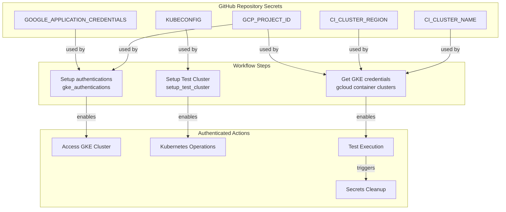
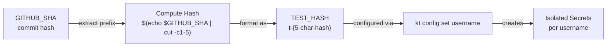
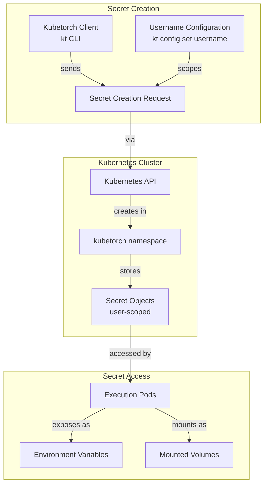
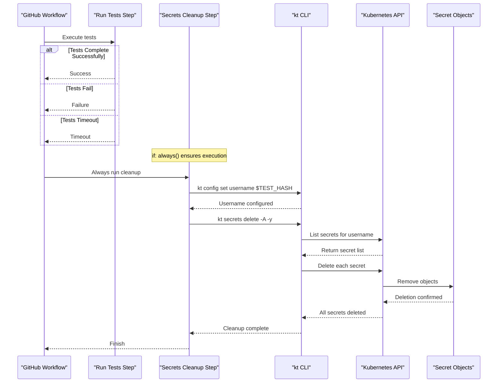

<!-- source: DeepWiki mcp.deepwiki.com · repo run-house/kubetorch · page 7.4 Secrets Management · fetched 2026-10-21 -->

# Secrets Management

<details>
<summary>Relevant source files</summary>

The following files were used as context for generating this wiki page:

- [.github/workflows/unit_tests.yaml](.github/workflows/unit_tests.yaml)

</details>


## Purpose and Scope

This document explains how Kubetorch manages secrets within its execution environment, including Kubernetes secret integration, GitHub Actions secret configuration, and cleanup procedures. It covers secret lifecycle management, storage mechanisms, and operational best practices for maintaining secure credentials throughout the deployment and testing infrastructure.

For information about deploying Kubetorch to Kubernetes clusters, see [Kubernetes Deployment](#7.1). For Helm-specific configuration, see [Helm Installation](#7.2). For GCP authentication setup, see [GCP and GKE Setup](#7.3).

---

## Overview of Secrets in Kubetorch

Kubetorch requires several categories of secrets to operate securely across its client-server architecture:

| Secret Category | Purpose | Storage Location | Scope |
|----------------|---------|------------------|-------|
| **GCP Service Account Credentials** | Authenticate to Google Cloud Platform and GKE | GitHub Actions secrets, Kubernetes secrets | Cluster authentication |
| **Kubernetes Configuration** | Access and manage Kubernetes clusters | GitHub Actions secrets, local kubeconfig | Cluster operations |
| **Cluster Metadata** | Identify target clusters and regions | GitHub Actions secrets | Deployment targeting |
| **User Credentials** | Isolate executions by username/test run | Kubernetes secrets | Execution isolation |

Kubetorch manages these secrets through a combination of external secret stores (GitHub Actions secrets for CI/CD) and Kubernetes native secrets (for runtime execution). The system provides CLI commands for programmatic secret management and automatic cleanup procedures to prevent secret leakage across test runs and deployments.

**Sources:** [.github/workflows/unit_tests.yaml:53-71]()

---

## GitHub Actions Secrets Configuration

### Required Secrets for CI/CD

The CI/CD pipeline requires the following secrets to be configured in the GitHub repository settings:



**Diagram: GitHub Actions Secrets Flow**

### Secret Usage in Workflows

The [.github/workflows/unit_tests.yaml]() workflow demonstrates the complete secret usage pattern:

**Authentication Phase** ([lines 53-57]()):
```yaml
- name: Setup authentications
  uses: ./.github/workflows/gke_authentications
  with:
    GCP_PROJECT_ID: ${{ secrets.GCP_PROJECT_ID }}
    GCP_SA_KEY: ${{ secrets.GOOGLE_APPLICATION_CREDENTIALS }}
```

**Cluster Access Phase** ([lines 62-71]()):
```yaml
- name: Setup Test Cluster
  uses: ./.github/workflows/setup_test_cluster
  with:
    KUBECONFIG: ${{ secrets.KUBECONFIG }}

- name: Get GKE credentials
  run: |
    gcloud container clusters get-credentials ${{ secrets.CI_CLUSTER_NAME }} \
      --region ${{ secrets.CI_CLUSTER_REGION }} \
      --project ${{ secrets.GCP_PROJECT_ID }}
```

These secrets enable the workflow to authenticate to GCP, access the GKE cluster, and execute Kubernetes operations without embedding credentials in the codebase.

**Sources:** [.github/workflows/unit_tests.yaml:53-71]()

---

## Test Hash-Based Secret Isolation

### Purpose of Test Hashing

Kubetorch uses a hash-based username system to isolate secrets and resources across concurrent test runs, preventing conflicts when multiple CI jobs or developers execute tests simultaneously.



**Diagram: Test Hash Generation and Secret Isolation**

### Implementation

The test hash is generated from the Git commit SHA ([lines 76-79]()):

```bash
TEST_HASH="t-$(echo $GITHUB_SHA | cut -c1-5)"
echo "TEST_HASH=$TEST_HASH" >> $GITHUB_ENV
```

This hash is then used to configure the Kubetorch username ([line 91]()):

```bash
kt config set username $TEST_HASH
```

By scoping secrets to a unique username per test run, Kubetorch ensures:
- **Concurrent Execution**: Multiple test runs can execute simultaneously without secret conflicts
- **Reproducible Cleanup**: Each test run's secrets can be identified and deleted reliably
- **Audit Trail**: Secrets can be traced back to specific commits via the hash

**Sources:** [.github/workflows/unit_tests.yaml:76-92]()

---

## Kubernetes Secrets Storage

### Runtime Secret Management

While GitHub Actions secrets facilitate CI/CD authentication, Kubetorch stores runtime execution secrets directly in Kubernetes using native Kubernetes secret objects. These secrets are created within the `kubetorch` namespace and scoped to individual users or execution contexts.



**Diagram: Kubernetes Secret Storage and Access**

### Secret Lifecycle

Secrets follow a managed lifecycle:
1. **Creation**: Secrets are created via the Kubetorch client or CLI when functions are deployed
2. **Storage**: Kubernetes stores secrets as base64-encoded data within the namespace
3. **Access**: Execution pods retrieve secrets through the Kubernetes API
4. **Cleanup**: Secrets are explicitly deleted via `kt secrets delete` command

**Sources:** [.github/workflows/unit_tests.yaml:87-93]()

---

## Secrets Cleanup Procedures

### The `kt secrets delete` Command

Kubetorch provides the `kt secrets delete` CLI command for programmatic secret cleanup. This command is essential for maintaining cluster hygiene and preventing secret accumulation across test runs.

### Command Syntax and Options

```bash
kt secrets delete [OPTIONS]
```

| Option | Description | Example Usage |
|--------|-------------|---------------|
| `-A` or `--all` | Delete all secrets for the current username | `kt secrets delete -A` |
| `-y` or `--yes` | Skip confirmation prompt (non-interactive) | `kt secrets delete -A -y` |
| (default) | Delete specific named secrets | `kt secrets delete secret-name` |

### Cleanup in CI/CD Pipeline

The unit tests workflow implements automatic cleanup using the `if: ${{ always() }}` condition to ensure secrets are deleted regardless of test success or failure ([lines 87-93]()):

```yaml
- name: secrets cleanup
  if: ${{ always() }}
  run: |
    echo "Running teardown command: kt secrets delete -A -y for username ${TEST_HASH}"
    kt config set username $TEST_HASH
    kt secrets delete -A -y
  timeout-minutes: 60
```

This cleanup pattern ensures:
- **Unconditional Execution**: Runs even if tests fail or timeout
- **Complete Cleanup**: `-A` flag deletes all secrets for the test hash
- **Non-Interactive**: `-y` flag avoids manual confirmation in CI environments
- **Timeout Protection**: 60-minute timeout prevents indefinite hanging

### Cleanup Lifecycle Diagram



**Diagram: Secrets Cleanup Lifecycle in CI/CD**

**Sources:** [.github/workflows/unit_tests.yaml:87-93]()

---

## Secret Management Best Practices

### Security Considerations

1. **Never Commit Secrets**: Secrets should never be hardcoded in source code or committed to version control
2. **Use Scoped Access**: Configure GitHub Actions with minimal required permissions ([lines 43-45]())
3. **Rotate Regularly**: Service account keys and credentials should be rotated periodically
4. **Audit Secret Usage**: Monitor secret access patterns in Kubernetes audit logs
5. **Implement Cleanup**: Always include cleanup steps in automation workflows

### Operational Patterns

**For CI/CD Pipelines:**
- Use `if: ${{ always() }}` for cleanup steps to handle all execution paths
- Generate unique identifiers (test hashes) for parallel execution isolation
- Set reasonable timeouts for cleanup operations ([line 93]())
- Log cleanup actions for debugging ([line 90]())

**For Local Development:**
- Store kubeconfig in standard locations (`~/.kube/config`)
- Use `kubectl` contexts to manage multiple cluster credentials
- Explicitly delete secrets after debugging sessions
- Avoid sharing service account keys across team members

**For Production Deployments:**
- Use managed identity services (e.g., Workload Identity on GKE) when possible
- Implement secret encryption at rest in Kubernetes
- Restrict secret access via RBAC policies
- Monitor for secret exfiltration attempts

### Cleanup Verification

After running `kt secrets delete -A -y`, verify cleanup with:

```bash
# List remaining secrets for your username
kubectl get secrets -n kubetorch --field-selector metadata.name=<username>-*

# Verify no secrets remain
kubectl get secrets -n kubetorch | grep $TEST_HASH
```

**Sources:** [.github/workflows/unit_tests.yaml:42-93]()

---

## Troubleshooting Secret Issues

### Common Problems

| Issue | Symptom | Resolution |
|-------|---------|------------|
| **Authentication Failure** | `gcloud` commands fail with permission errors | Verify `GCP_PROJECT_ID` and `GOOGLE_APPLICATION_CREDENTIALS` secrets are set correctly |
| **Cluster Access Denied** | `kubectl` commands return 403 errors | Check `KUBECONFIG` secret and verify service account has cluster admin role |
| **Secret Not Found** | Pods fail to start with missing secret errors | Ensure secrets are created before function execution; check username configuration |
| **Cleanup Timeout** | Cleanup step exceeds 60-minute timeout | Check for stuck secret deletions; may require manual cleanup via `kubectl` |
| **Orphaned Secrets** | Secrets accumulate in namespace | Implement automated cleanup in all test/deployment workflows |

### Debugging Commands

```bash
# Check current username configuration
kt config get username

# List all secrets in kubetorch namespace
kubectl get secrets -n kubetorch

# Inspect a specific secret
kubectl describe secret <secret-name> -n kubetorch

# Force delete a stuck secret
kubectl delete secret <secret-name> -n kubetorch --force --grace-period=0

# View cleanup logs from workflow
# Navigate to GitHub Actions → Unit tests → secrets cleanup step
```

For authentication troubleshooting, see [GCP and GKE Setup](#7.3). For deployment-related secret issues, see [Kubernetes Deployment](#7.1).

**Sources:** [.github/workflows/unit_tests.yaml:87-93]()

---

