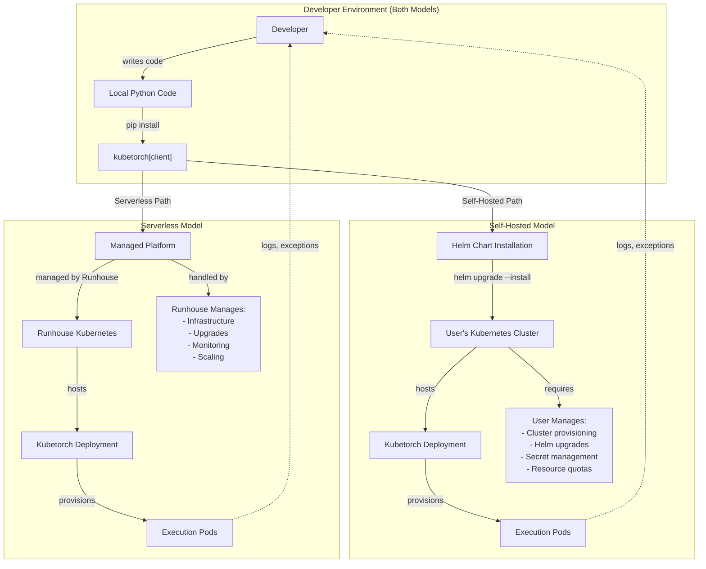
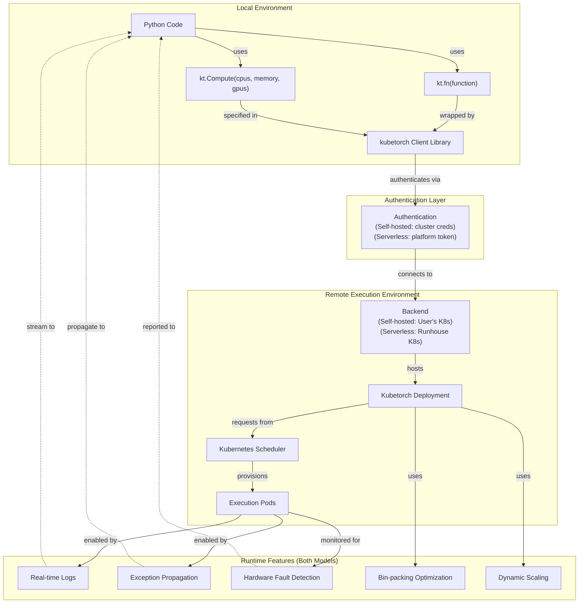
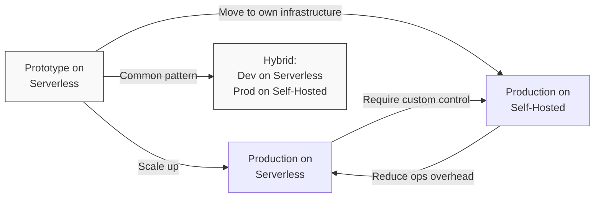

<!-- source: DeepWiki mcp.deepwiki.com · repo run-house/kubetorch · page 7.5 Kubetorch Serverless · fetched 2026-10-21 -->

# Kubetorch Serverless

<details>
<summary>Relevant source files</summary>

The following files were used as context for generating this wiki page:

- [README.md](README.md)

</details>


**Purpose**: This document describes Kubetorch Serverless, the fully managed platform alternative to self-hosted Kubernetes deployment. It explains the differences between self-hosted and serverless deployment models, when to choose each option, and how to get started with the managed service.

For information about self-hosting Kubetorch on your own Kubernetes cluster, see [Kubernetes Deployment](#7.1), [Helm Installation](#7.2), and [GCP and GKE Setup](#7.3). For core concepts about the client-server architecture, see [Client-Server Architecture](#2.4).

---

## Overview

Kubetorch Serverless is a managed platform offering of Kubetorch, hosted and operated by Runhouse. It provides the same Pythonic serverless interface for ML workloads without requiring users to deploy or manage Kubernetes infrastructure.

The serverless platform eliminates operational overhead while maintaining the core Kubetorch experience: the same Python client (`kubetorch[client]`), the same `kt.fn` and `kt.Compute` APIs, and the same 1-2 second iteration cycles with real-time log propagation.

**Key distinction**: 
- **Self-hosted**: You deploy the Kubetorch Helm chart ([README.md:45-55]()) to your own Kubernetes cluster and manage the infrastructure
- **Serverless**: Runhouse deploys and manages the infrastructure; you only install the Python client

Sources: [README.md:60-62]()

---

## Deployment Model Comparison

The following diagram illustrates the architectural differences between self-hosted and serverless deployments:

**Diagram: Self-Hosted vs. Serverless Deployment Models**



Sources: [README.md:45-62]()

---

## Feature Comparison

The following table compares self-hosted and serverless deployment options across key operational dimensions:

| **Aspect** | **Self-Hosted** | **Kubetorch Serverless** |
|------------|----------------|--------------------------|
| **Setup** | Requires Kubernetes cluster setup, Helm installation | Contact Runhouse for access |
| **Infrastructure Management** | User provisions and manages cluster | Fully managed by Runhouse |
| **Operational Overhead** | User handles upgrades, monitoring, scaling | Zero operational overhead |
| **Client Experience** | Same Python client and APIs | Same Python client and APIs |
| **Execution Model** | `kt.fn`, `kt.Compute`, real-time logs | `kt.fn`, `kt.Compute`, real-time logs |
| **Cost Model** | User pays cloud provider for cluster resources | Usage-based pricing through Runhouse |
| **Control** | Full control over cluster configuration | Managed configuration |
| **Secrets Management** | User manages via `kubectl` and `kt secrets delete` | Managed by platform |
| **Version Control** | User controls Helm chart version (e.g., `--version 0.2.2`) | Platform handles versioning |
| **Customization** | Full Helm values customization | Limited to platform-supported options |
| **Security & Compliance** | User's security policies and boundaries | Runhouse security policies |

Sources: [README.md:45-62]()

---

## When to Use Each Option

### Choose Self-Hosted When:

1. **Security and Compliance Requirements**: You need data to remain within specific geographic regions or security boundaries
2. **Existing Infrastructure**: You already have Kubernetes clusters and operational expertise
3. **Custom Configurations**: You require specific Helm chart customizations or cluster-level policies
4. **Cost Optimization**: You have reserved compute capacity or negotiated cloud pricing
5. **Full Control**: You need complete control over upgrades, configurations, and infrastructure

### Choose Kubetorch Serverless When:

1. **Rapid Prototyping**: You want to start using Kubetorch immediately without infrastructure setup
2. **No Kubernetes Expertise**: Your team lacks Kubernetes operational experience
3. **Zero Operational Overhead**: You want to focus purely on ML workloads, not infrastructure
4. **Variable Workloads**: Your compute needs fluctuate and benefit from fully elastic scaling
5. **Proof of Concept**: You're evaluating Kubetorch before committing to self-hosted deployment

Sources: [README.md:60-62]()

---

## Getting Started with Kubetorch Serverless

### Access and Onboarding

Kubetorch Serverless is currently available by contacting Runhouse. The onboarding process involves:

**Diagram: Kubetorch Serverless Onboarding Flow**

```mermaid
graph LR
    START["Developer"]
    CONTACT["Contact Runhouse"]
    CHANNELS["Email: hello@run.house<br/>Slack Community"]
    PROVISION["Platform Access<br/>Provisioned"]
    INSTALL["Install Client:<br/>pip install kubetorch[client]"]
    CONFIG["Configure<br/>Authentication"]
    USE["Use kt.fn and kt.Compute<br/>Same APIs"]
    
    START -->|"Step 1"| CONTACT
    CONTACT -->|"via"| CHANNELS
    CHANNELS -->|"Step 2"| PROVISION
    PROVISION -->|"Step 3"| INSTALL
    INSTALL -->|"Step 4"| CONFIG
    CONFIG -->|"Step 5"| USE
```



**Contact Information**:
- **Email**: hello@run.house ([README.md:62]())
- **Slack**: Join the Kubetorch Slack community at [join.slack.com/t/kubetorch/shared_invite/zt-3g76q5i4j-uP60AdydxnAmjGVAQhtALA]() ([README.md:62](), [README.md:68]())

Sources: [README.md:60-62](), [README.md:68]()

---

## Client Usage Consistency

Regardless of deployment model, the Python client experience remains identical. The same code works with both self-hosted and serverless deployments:

```python
import kubetorch as kt

def hello_world():
    return "Hello from Kubetorch!"

# Define compute requirements (same for both models)
compute = kt.Compute(cpus=".1")

# Wrap and send function (same for both models)
remote_hello = kt.fn(hello_world).to(compute)

# Execute remotely (same for both models)
result = remote_hello()
print(result)
```

The only difference is the backend infrastructure: self-hosted executes on your cluster, serverless executes on Runhouse-managed infrastructure. The client code, APIs, execution model, and log propagation remain unchanged.

Sources: [README.md:13-29](), [README.md:9]()

---

## Architecture: Client Perspective

From the client's perspective, the architecture is identical for both deployment models:

**Diagram: Client-Server Communication (Both Models)**



Sources: [README.md:7-9](), [README.md:13-29](), [README.md:33-35]()

---

## Relationship to Self-Hosted Components

Understanding the relationship between self-hosted components and the serverless platform helps clarify what is managed vs. what remains the same:

| **Component** | **Self-Hosted** | **Serverless** | **Reference** |
|---------------|----------------|----------------|---------------|
| **Python Client** | Install via `pip install kubetorch[client]` | Install via `pip install kubetorch[client]` | [README.md:42]() |
| **Helm Chart** | User installs (`helm upgrade --install`) | Managed by Runhouse | [README.md:48-54]() |
| **OCI Registry** | User pulls from `ghcr.io/run-house/charts/kubetorch` | Pre-deployed by Runhouse | [README.md:49]() |
| **Chart Version** | User specifies (`--version 0.2.2`) | Managed by platform | [README.md:50]() |
| **Namespace** | User creates (`-n kubetorch --create-namespace`) | Pre-created by platform | [README.md:50]() |
| **Kubernetes Cluster** | User provisions (e.g., GKE setup) | Managed by Runhouse | See [GCP and GKE Setup](#7.3) |
| **Secrets** | User manages (`kubectl`, `kt secrets delete`) | Managed by platform | See [Secrets Management](#7.4) |
| **Monitoring** | User configures (optional) | Included in platform | See [Monitoring and Observability](#4.6) |

Sources: [README.md:42](), [README.md:48-54]()

---

## Operational Differences

### Self-Hosted Operations

When self-hosting, users are responsible for:

1. **Cluster Provisioning**: Setting up Kubernetes (GKE, EKS, AKS, etc.)
2. **Helm Deployment**: Installing and upgrading the Kubetorch chart ([README.md:48-54]())
3. **Secret Management**: Handling cluster credentials and application secrets
4. **Monitoring**: Setting up observability tools (optional)
5. **Scaling**: Configuring cluster autoscaling and resource quotas
6. **Upgrades**: Managing Helm chart version upgrades
7. **Troubleshooting**: Diagnosing and resolving cluster-level issues

See [Kubernetes Deployment](#7.1), [Helm Installation](#7.2), [GCP and GKE Setup](#7.3), and [Secrets Management](#7.4) for detailed self-hosted operational procedures.

### Serverless Operations

With Kubetorch Serverless, the only user responsibility is:

1. **Client Installation**: `pip install kubetorch[client]` ([README.md:42]())
2. **Authentication**: Configuring platform access (handled during onboarding)
3. **Writing Code**: Using `kt.fn` and `kt.Compute` as documented

All infrastructure, monitoring, scaling, upgrades, and troubleshooting are handled by Runhouse.

Sources: [README.md:42](), [README.md:48-54](), [README.md:60-62]()

---

## Migration Between Models

Organizations can migrate between self-hosted and serverless deployments without code changes. The Python client code remains identical; only the backend configuration changes.

**Diagram: Migration Paths**



**Common Migration Pattern**:
1. Start with Kubetorch Serverless for rapid prototyping
2. Develop and iterate on ML workloads using `kt.fn` and `kt.Compute`
3. Evaluate requirements for production (security, compliance, cost)
4. Optionally migrate to self-hosted deployment for production workloads
5. Continue using serverless for development and experimentation

This hybrid approach is common: development teams use serverless for fast iteration, while production workloads run on self-hosted infrastructure for security or cost optimization.

Sources: [README.md:60-62]()

---

## Next Steps

- **For Serverless Access**: Contact Runhouse at hello@run.house or via [Slack]() ([README.md:62]())
- **For Self-Hosted Setup**: See [Kubernetes Deployment](#7.1) and [Helm Installation](#7.2)
- **For API Usage**: Refer to [kt.fn](#5.1) and [kt.Compute](#5.2) documentation
- **For Examples**: Visit the [Examples documentation](https://www.run.house/examples) ([README.md:67]())
- **For Community Support**: Join the [Kubetorch Slack community](https://join.slack.com/t/kubetorch/shared_invite/zt-3g76q5i4j-uP60AdydxnAmjGVAQhtALA) ([README.md:68]())

Sources: [README.md:60-68]()

---

