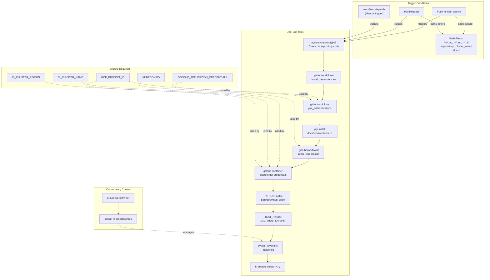
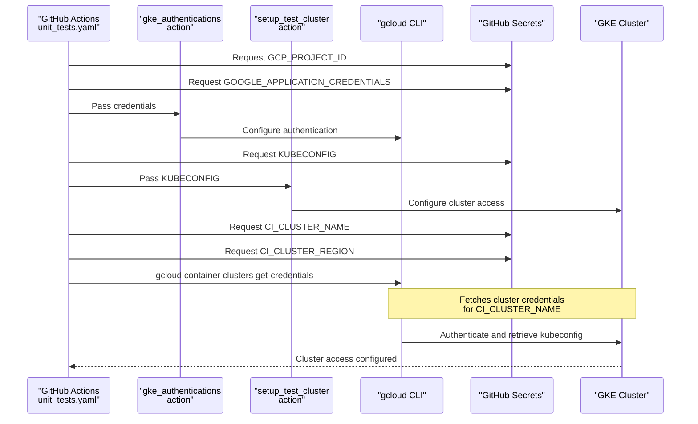
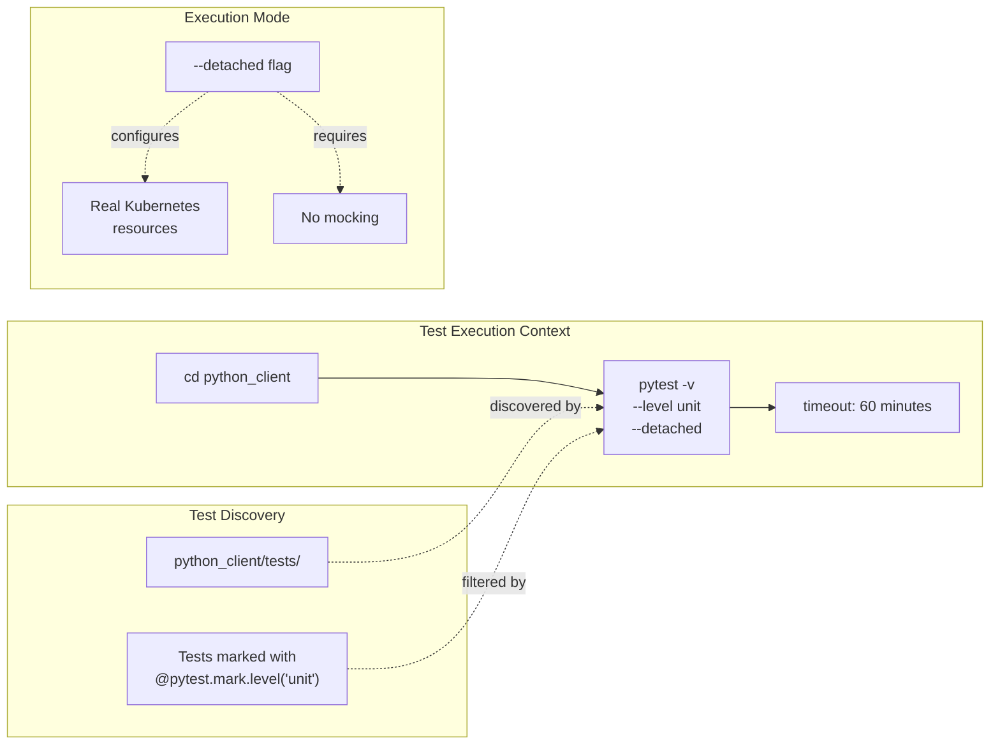
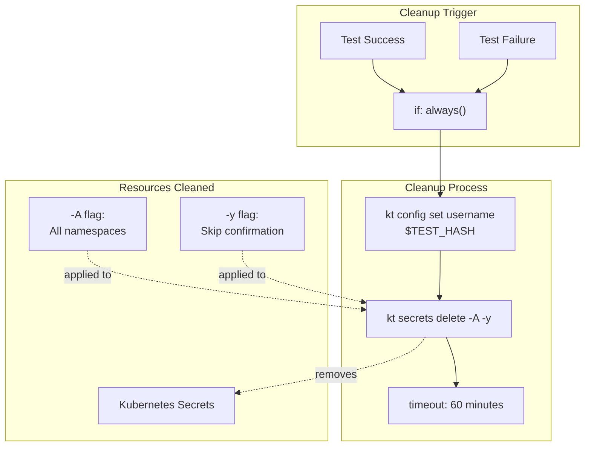

<!-- source: DeepWiki mcp.deepwiki.com · repo run-house/kubetorch · page 8 Development and Testing · fetched 2026-10-21 -->

# Development and Testing

<details>
<summary>Relevant source files</summary>

The following files were used as context for generating this wiki page:

- [.github/workflows/unit_tests.yaml](.github/workflows/unit_tests.yaml)

</details>


This document covers the development workflow, testing infrastructure, and CI/CD pipeline for Kubetorch. It explains how to run tests locally, understand the automated testing pipeline, and contribute new tests to the codebase.

For deployment and operational procedures, see [Deployment and Operations](#7). For troubleshooting test failures, see [Troubleshooting](#9).

---

## Testing Overview

Kubetorch uses `pytest` as its testing framework with a level-based test classification system. Tests are organized by execution requirements and complexity:

| Test Level | Description | Execution Context | Typical Duration |
|------------|-------------|-------------------|------------------|
| `unit` | Core functionality tests requiring a Kubernetes cluster | CI/CD pipeline or local with cluster access | < 60 minutes |

Tests are located in `python_client/tests/` and can be filtered by level using the `--level` flag:

```bash
pytest --level unit
```

All tests run in "detached" mode (`--detached` flag), meaning they interact with actual Kubernetes resources rather than using mocks. This ensures end-to-end validation of the complete system including client-server communication, resource provisioning, and execution lifecycle.

**Sources:** [.github/workflows/unit_tests.yaml:81-85]()

---

## CI/CD Pipeline Architecture

### GitHub Actions Workflow Structure



**Diagram: CI/CD Pipeline Execution Flow**

The unit test workflow [.github/workflows/unit_tests.yaml:1-94]() follows a multi-stage pipeline that sets up authentication, configures the test environment, executes tests, and ensures cleanup.

**Sources:** [.github/workflows/unit_tests.yaml:1-94]()

---

## Pipeline Stages

### Stage 1: Trigger Configuration

The workflow activates under three conditions:

1. **Push to main branch** [.github/workflows/unit_tests.yaml:4-5]()
2. **Pull requests** [.github/workflows/unit_tests.yaml:18]()
3. **Manual dispatch** via GitHub UI [.github/workflows/unit_tests.yaml:31]()

Path filters exclude documentation, infrastructure code, and exploratory files from triggering test runs [.github/workflows/unit_tests.yaml:6-16]():

```
paths-ignore:
  - 'python_client/kubetorch/docs/**'
  - '**/*.md'
  - '**/*.rst'
  - '**/*.tf'
  - 'exploratory/**'
  - 'cluster_setup/**'
```

This optimization prevents unnecessary CI runs when only documentation or non-functional code changes.

**Sources:** [.github/workflows/unit_tests.yaml:3-31]()

---

### Stage 2: Environment Setup

#### Concurrency Control

The workflow implements concurrency management to prevent resource conflicts [.github/workflows/unit_tests.yaml:36-38]():

```yaml
concurrency:
  group: ${{ github.workflow }}-${{ github.ref }}
  cancel-in-progress: true
```

This ensures only one test run executes per branch at a time, automatically canceling outdated runs when new commits are pushed.

#### Repository Checkout

Uses `actions/checkout@v3` to clone the repository [.github/workflows/unit_tests.yaml:47-48]().

#### Dependency Installation

Invokes the reusable action `.github/workflows/install_dependencies` [.github/workflows/unit_tests.yaml:50-51]() to install Python dependencies and the `kubetorch` client package.

**Sources:** [.github/workflows/unit_tests.yaml:36-51]()

---

### Stage 3: Authentication and Cluster Setup



**Diagram: Authentication and Cluster Configuration Sequence**

#### GKE Authentication

The workflow uses a reusable authentication action [.github/workflows/unit_tests.yaml:53-57]():

```yaml
- name: Setup authentications
  uses: ./.github/workflows/gke_authentications
  with:
    GCP_PROJECT_ID: ${{ secrets.GCP_PROJECT_ID }}
    GCP_SA_KEY: ${{ secrets.GOOGLE_APPLICATION_CREDENTIALS }}
```

Required secrets:
- `GCP_PROJECT_ID`: Google Cloud project identifier
- `GOOGLE_APPLICATION_CREDENTIALS`: Service account key JSON

#### Test Cluster Setup

Configures access to the test Kubernetes cluster [.github/workflows/unit_tests.yaml:62-65]():

```yaml
- name: Setup Test Cluster
  uses: ./.github/workflows/setup_test_cluster
  with:
    KUBECONFIG: ${{ secrets.KUBECONFIG }}
```

#### GKE Credentials Retrieval

Fetches cluster credentials using `gcloud` CLI [.github/workflows/unit_tests.yaml:67-71]():

```bash
gcloud container clusters get-credentials ${{ secrets.CI_CLUSTER_NAME }} \
  --region ${{ secrets.CI_CLUSTER_REGION }} \
  --project ${{ secrets.GCP_PROJECT_ID }}
```

Required secrets:
- `CI_CLUSTER_NAME`: Name of the GKE cluster for testing
- `CI_CLUSTER_REGION`: GCP region of the test cluster

**Sources:** [.github/workflows/unit_tests.yaml:53-71]()

---

### Stage 4: Test Environment Configuration

#### Python Source Root

Sets the `PYTHONPATH` environment variable to enable imports from the client package [.github/workflows/unit_tests.yaml:73-74]():

```bash
echo "PYTHONPATH=$(pwd)/python_client" >> $GITHUB_ENV
```

This allows test files to import `kubetorch` modules without requiring package installation.

#### Test Hash Generation

Creates a unique identifier for the test run based on the commit SHA [.github/workflows/unit_tests.yaml:76-79]():

```bash
TEST_HASH="t-$(echo $GITHUB_SHA | cut -c1-5)"
echo "TEST_HASH=$TEST_HASH" >> $GITHUB_ENV
```

This hash (format: `t-<5-char-sha>`) serves two purposes:
1. Isolates resources created by different test runs
2. Enables targeted cleanup of test-specific resources

**Sources:** [.github/workflows/unit_tests.yaml:73-79]()

---

### Stage 5: Test Execution



**Diagram: Test Execution Configuration**

The test execution command [.github/workflows/unit_tests.yaml:81-85]():

```bash
cd python_client
pytest -v --level unit --detached
```

#### Command Breakdown

| Flag | Purpose |
|------|---------|
| `-v` | Verbose output showing individual test names |
| `--level unit` | Filter tests to only run those marked with level "unit" |
| `--detached` | Execute against real Kubernetes cluster (no mocks) |

The execution has a 60-minute timeout [.github/workflows/unit_tests.yaml:85]() to prevent hung tests from blocking the CI pipeline indefinitely.

**Sources:** [.github/workflows/unit_tests.yaml:81-85]()

---

### Stage 6: Cleanup



**Diagram: Test Cleanup Process**

The cleanup step executes unconditionally using `if: ${{ always() }}` [.github/workflows/unit_tests.yaml:88](), ensuring resource cleanup even if tests fail.

#### Cleanup Commands

[.github/workflows/unit_tests.yaml:89-92]()

```bash
echo "Running teardown command: kt secrets delete -A -y for username ${TEST_HASH}"
kt config set username $TEST_HASH
kt secrets delete -A -y
```

**Command sequence:**

1. **Set username context**: `kt config set username $TEST_HASH` configures the CLI to target resources created by this specific test run
2. **Delete secrets**: `kt secrets delete -A -y` removes all Kubernetes secrets created during testing

**Flags:**
- `-A`: Delete secrets across all namespaces
- `-y`: Skip interactive confirmation prompts

This cleanup strategy ensures test isolation by:
- Using unique identifiers (`TEST_HASH`) per test run
- Cleaning up even on test failure
- Removing secrets that may contain sensitive data

The cleanup also has a 60-minute timeout [.github/workflows/unit_tests.yaml:93]() to prevent indefinite blocking.

**Sources:** [.github/workflows/unit_tests.yaml:87-93]()

---

## Running Tests Locally

### Prerequisites

Before running tests locally, ensure:

1. **Python environment**: Python 3.8+ with `pytest` installed
2. **Kubetorch client**: Installed from `python_client/` directory
3. **Kubernetes cluster access**: Valid `KUBECONFIG` pointing to a test cluster
4. **GCP authentication**: Service account credentials configured if using GKE
5. **kubectl CLI**: Installed and configured

### Local Execution Steps

#### 1. Set Python Path

```bash
export PYTHONPATH=$(pwd)/python_client
```

#### 2. Generate Test Hash

```bash
export TEST_HASH="t-$(git rev-parse HEAD | cut -c1-5)"
kt config set username $TEST_HASH
```

This ensures your local test resources are isolated from other developers' tests.

#### 3. Run Tests

```bash
cd python_client
pytest -v --level unit --detached
```

#### 4. Cleanup After Testing

```bash
kt secrets delete -A -y
```

### Environment Variables

The following environment variables may be required depending on your test cluster configuration:

| Variable | Purpose | Example |
|----------|---------|---------|
| `PYTHONPATH` | Python module search path | `$(pwd)/python_client` |
| `KUBECONFIG` | Path to Kubernetes config | `~/.kube/config` |
| `TEST_HASH` | Unique test run identifier | `t-a1b2c` |
| `GOOGLE_APPLICATION_CREDENTIALS` | GCP service account key | `/path/to/key.json` |

**Sources:** [.github/workflows/unit_tests.yaml:73-92]()

---

## Test Organization and Structure

### Test Directory Layout

```
python_client/
├── tests/
│   ├── test_*.py              # Test modules
│   ├── conftest.py            # Pytest configuration and fixtures
│   └── fixtures/              # Reusable test utilities
└── kubetorch/
    └── ...                     # Source code
```

### Test Level Markers

Tests use pytest markers to specify their execution level. The `--level` flag filters tests based on these markers:

```python
@pytest.mark.level("unit")
def test_function_execution():
    # Test that requires Kubernetes cluster
    pass
```

### Detached Mode

The `--detached` flag indicates tests should execute against real infrastructure rather than mocks. This mode:

- Creates actual Kubernetes pods and services
- Validates end-to-end system behavior
- Requires cleanup of created resources
- Provides higher confidence than unit tests with mocks

**Sources:** [.github/workflows/unit_tests.yaml:81-85]()

---

## Contributing New Tests

### Test Requirements

When adding new tests:

1. **Mark test level**: Use `@pytest.mark.level("unit")` decorator
2. **Use test hash**: Reference `TEST_HASH` for resource naming to ensure isolation
3. **Clean up resources**: Ensure all created resources are cleaned up (or rely on the global cleanup)
4. **Document setup**: If tests require specific cluster configuration, document in test docstrings
5. **Timeout consideration**: Ensure tests complete within 60 minutes collectively

### Example Test Structure

```python
import pytest

@pytest.mark.level("unit")
def test_remote_function_execution(test_cluster):
    """Test basic remote function execution.
    
    Requires:
    - Active Kubernetes cluster
    - Kubetorch deployment installed
    """
    import kubetorch as kt
    
    def add(a, b):
        return a + b
    
    compute = kt.Compute(cpus="0.1")
    remote_add = kt.fn(add).to(compute)
    
    result = remote_add(2, 3)
    assert result == 5
```

### CI Integration

New tests automatically run in the CI pipeline when:
- Pushed to `main` branch
- Included in a pull request
- Changes affect Python code (not in `paths-ignore`)

Tests should be self-contained and not depend on specific execution order.

**Sources:** [.github/workflows/unit_tests.yaml:1-94]()

---

## Secrets and Configuration Management

### Required GitHub Secrets

The CI/CD pipeline requires the following secrets to be configured in the repository:

| Secret Name | Type | Purpose |
|-------------|------|---------|
| `GCP_PROJECT_ID` | String | Google Cloud project identifier |
| `GOOGLE_APPLICATION_CREDENTIALS` | JSON | Service account key for GCP authentication |
| `KUBECONFIG` | YAML | Kubernetes configuration file |
| `CI_CLUSTER_NAME` | String | Name of GKE test cluster |
| `CI_CLUSTER_REGION` | String | GCP region of test cluster |

### Secret Security

- Secrets are only accessible to workflows with `id-token: write` and `contents: read` permissions [.github/workflows/unit_tests.yaml:43-45]()
- Secrets are never logged or exposed in test output
- Cleanup procedures ensure test-created secrets are removed from the cluster

### Test-Created Secrets

Tests may create Kubernetes secrets during execution. The cleanup phase removes these using:

```bash
kt secrets delete -A -y
```

This command targets secrets associated with the `TEST_HASH` username, ensuring only test-specific secrets are deleted.

**Sources:** [.github/workflows/unit_tests.yaml:43-45,53-71,87-92]()

---

## Debugging Test Failures

### Access CI Logs

When tests fail in CI:

1. Navigate to the GitHub Actions tab
2. Select the failed workflow run
3. Expand the "Run tests with level unit" step
4. Review pytest output and tracebacks

### Common Failure Scenarios

| Failure Type | Likely Cause | Debug Steps |
|--------------|--------------|-------------|
| Authentication errors | Invalid GCP credentials | Verify `GCP_SA_KEY` and `GCP_PROJECT_ID` secrets |
| Cluster connection timeout | Cluster unavailable or `KUBECONFIG` invalid | Check cluster status with `kubectl cluster-info` |
| Resource quota exceeded | Too many concurrent tests | Review cluster resource usage |
| Cleanup timeout | Large number of orphaned resources | Manually run `kt secrets delete -A -y` |

### Local Debugging

To reproduce CI failures locally:

1. Set up the same environment variables used in CI
2. Run tests with verbose output: `pytest -vv --level unit --detached`
3. Check Kubernetes resources: `kubectl get pods -A`
4. Review logs: `kubectl logs <pod-name> -n kubetorch`

**Sources:** [.github/workflows/unit_tests.yaml:81-93]()

---

## Performance and Optimization

### Test Execution Time

The CI pipeline has a 60-minute timeout [.github/workflows/unit_tests.yaml:85]() for the entire test suite. Individual tests should complete within a few minutes to allow for comprehensive test coverage.

### Parallel Execution

Currently, tests run sequentially. The concurrency control [.github/workflows/unit_tests.yaml:36-38]() ensures only one test run per branch executes at a time to prevent resource conflicts.

### Resource Cleanup Efficiency

The cleanup phase uses:
- Targeted deletion via `TEST_HASH` username
- Batch deletion across all namespaces (`-A`)
- Non-interactive mode (`-y`)

This approach minimizes cleanup time while ensuring thorough resource removal.

**Sources:** [.github/workflows/unit_tests.yaml:36-38,85-93]()

---

