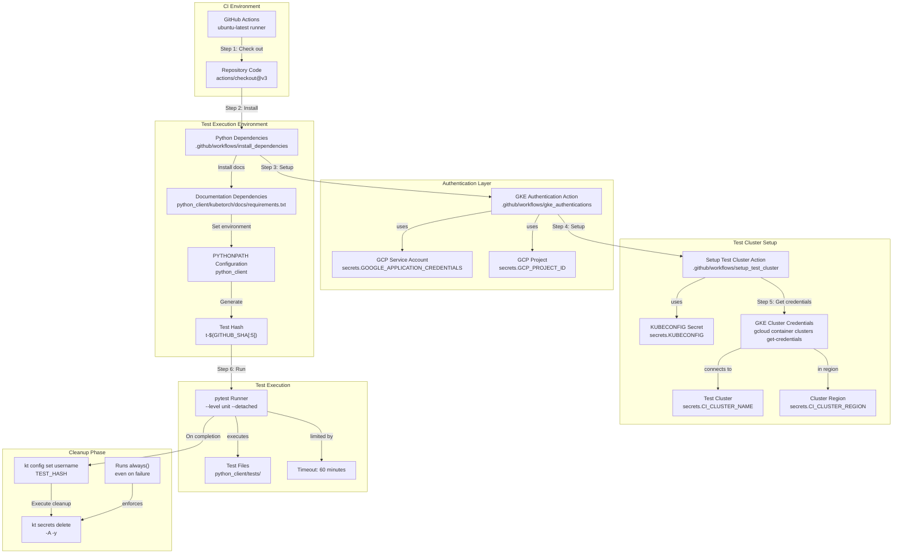
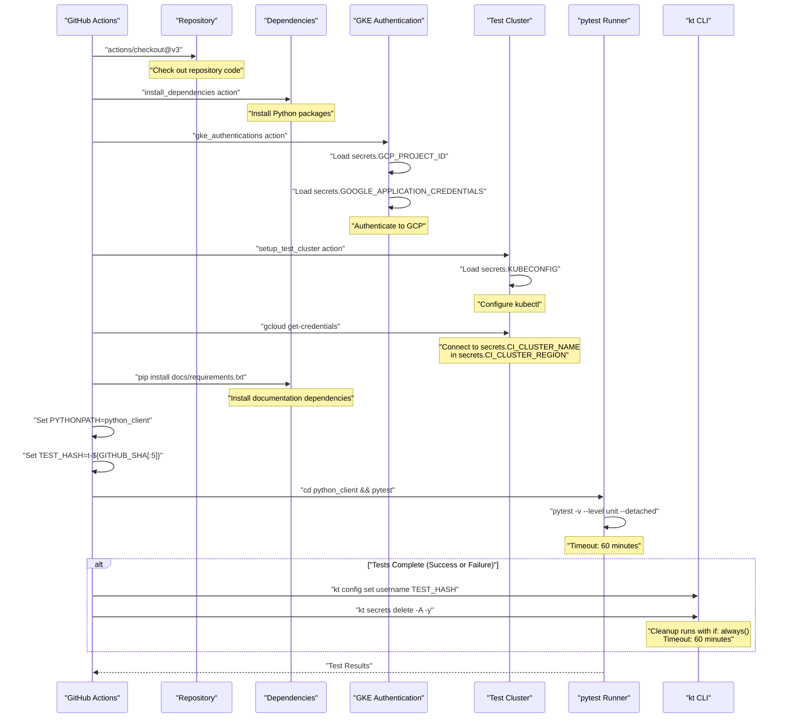
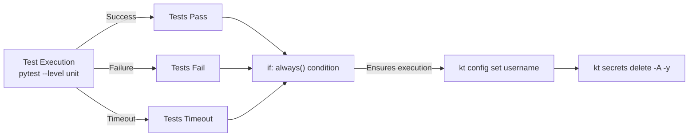
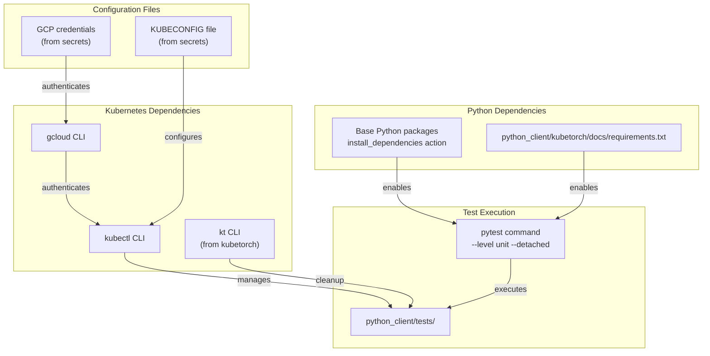

<!-- source: DeepWiki mcp.deepwiki.com · repo run-house/kubetorch · page 8.1 Testing Infrastructure · fetched 2026-10-21 -->

# Testing Infrastructure

<details>
<summary>Relevant source files</summary>

The following files were used as context for generating this wiki page:

- [.github/workflows/unit_tests.yaml](.github/workflows/unit_tests.yaml)

</details>


## Purpose and Scope

This document describes Kubetorch's testing infrastructure, including pytest configuration, test organization, test cluster setup, and the CI/CD testing pipeline. It covers the mechanisms for running unit tests both locally and in continuous integration environments, test-specific fixtures, and cleanup procedures.

For information about the CI/CD pipeline workflow itself, see [CI/CD Pipeline](#8.2). For guidance on running tests locally as a developer, see [Running Tests Locally](#8.3).

---

## Test Organization and Levels

Kubetorch uses pytest as its testing framework with a custom test level system that allows selective test execution based on the scope and environment requirements.

### Test Level System

Tests are organized by level using the `--level` flag:

| Level | Purpose | Environment | Execution Time |
|-------|---------|-------------|----------------|
| `unit` | Fast unit tests that validate core functionality | Requires test cluster access | < 60 minutes |
| Other levels | (Documentation not available in provided files) | Varies | Varies |

The unit test level is specified when running tests:
```bash
pytest -v --level unit --detached
```

The `--detached` flag indicates tests should run in a detached mode, likely preventing interactive prompts or requiring manual intervention.

**Sources:** [.github/workflows/unit_tests.yaml:81-85]()

---

## Test Infrastructure Architecture

The following diagram shows the complete testing infrastructure and how components interact:

### Testing Infrastructure Component Diagram



**Sources:** [.github/workflows/unit_tests.yaml:46-93]()

---

## CI/CD Workflow Configuration

### Workflow Triggers

The unit test workflow is triggered by three events:

1. **Push to main branch** - Runs on all pushes to `main` except for specific ignored paths
2. **Pull requests** - Runs on all PRs except for specific ignored paths  
3. **Manual dispatch** - Can be triggered manually via `workflow_dispatch`

**Ignored Paths:**
- Documentation files: `python_client/kubetorch/docs/**`, `**/*.md`, `**/*.rst`
- Infrastructure files: `**/*.tf`, `cluster_setup/**`
- Exploratory code: `exploratory/**`
- Deployment tests: `python_client/tests/test_deploy.py`
- Other workflow files: `.github/workflows/create_cluster.yaml`, etc.

**Sources:** [.github/workflows/unit_tests.yaml:3-31]()

### Concurrency Control

```yaml
concurrency:
  group: ${{ github.workflow }}-${{ github.ref }}
  cancel-in-progress: true
```

Tests use concurrency groups to cancel in-progress runs when new commits are pushed to the same branch, preventing resource waste and ensuring only the latest code is tested.

**Sources:** [.github/workflows/unit_tests.yaml:36-38]()

---

## Test Execution Flow

The following sequence diagram shows the complete test execution lifecycle:

### Test Execution Sequence



**Sources:** [.github/workflows/unit_tests.yaml:46-93]()

---

## Environment Configuration

### Required Secrets

The test workflow requires the following GitHub secrets to be configured:

| Secret Name | Purpose | Used By |
|-------------|---------|---------|
| `GCP_PROJECT_ID` | GCP project identifier | GKE authentication |
| `GOOGLE_APPLICATION_CREDENTIALS` | GCP service account key | GKE authentication |
| `KUBECONFIG` | Kubernetes cluster configuration | Test cluster setup |
| `CI_CLUSTER_NAME` | Name of the test cluster | GKE credentials step |
| `CI_CLUSTER_REGION` | Region where test cluster is deployed | GKE credentials step |

**Sources:** [.github/workflows/unit_tests.yaml:56-71]()

### Environment Variables

Several environment variables are set during test execution:

```bash
# Global environment
CI=true

# Test-specific environment
PYTHONPATH=$(pwd)/python_client
TEST_HASH=t-$(echo $GITHUB_SHA | cut -c1-5)
```

- `CI`: Indicates code is running in CI environment
- `PYTHONPATH`: Sets Python import path to the client code directory
- `TEST_HASH`: Unique identifier derived from commit SHA, used for resource naming and cleanup

**Sources:** [.github/workflows/unit_tests.yaml:33-79]()

---

## Test Cleanup Procedures

### Automatic Resource Cleanup

The test workflow includes a mandatory cleanup step that always runs, even if tests fail:

```bash
kt config set username $TEST_HASH
kt secrets delete -A -y
```

This cleanup procedure:
1. Sets the `kt` CLI username to the test-specific hash
2. Deletes all secrets (`-A` flag) for that username without confirmation (`-y` flag)

The cleanup step has a 60-minute timeout and uses the `if: ${{ always() }}` condition to ensure it runs regardless of test outcome.

**Sources:** [.github/workflows/unit_tests.yaml:87-93]()

### Cleanup Execution Guarantee



This ensures test resources (particularly Kubernetes secrets) are always cleaned up, preventing resource leaks and conflicts between test runs.

**Sources:** [.github/workflows/unit_tests.yaml:87-93]()

---

## Test Permissions

The workflow requires specific GitHub Actions permissions:

```yaml
permissions:
  id-token: write
  contents: read
```

- `id-token: write` - Allows the workflow to obtain OIDC tokens for authentication
- `contents: read` - Allows reading the repository contents

These permissions support secure authentication to GCP/GKE without storing long-lived credentials.

**Sources:** [.github/workflows/unit_tests.yaml:43-45]()

---

## Test Execution Commands

### Running Unit Tests

The primary test execution command:

```bash
cd python_client
pytest -v --level unit --detached
```

**Command Breakdown:**
- `cd python_client` - Changes to the Python client directory containing test files
- `pytest -v` - Runs pytest with verbose output
- `--level unit` - Selects only unit-level tests
- `--detached` - Runs tests in detached mode (non-interactive)

The command has a 60-minute timeout to prevent hung test runs.

**Sources:** [.github/workflows/unit_tests.yaml:81-85]()

### Cleanup Commands

```bash
echo "Running teardown command: kt secrets delete -A -y for username ${TEST_HASH}"
kt config set username $TEST_HASH
kt secrets delete -A -y
```

These commands clean up test resources:
1. Logs the cleanup operation for debugging
2. Configures the `kt` CLI with the test-specific username
3. Deletes all secrets for that username

**Sources:** [.github/workflows/unit_tests.yaml:89-92]()

---

## Workflow Actions and Dependencies

The test workflow uses several custom GitHub Actions:

| Action Path | Purpose | Step Number |
|-------------|---------|-------------|
| `.github/workflows/install_dependencies` | Install Python dependencies | Step 2 |
| `.github/workflows/gke_authentications` | Authenticate to GKE | Step 3 |
| `.github/workflows/setup_test_cluster` | Configure test cluster | Step 4 |

These actions are modular components that encapsulate common setup tasks, making the workflow more maintainable and reusable.

**Sources:** [.github/workflows/unit_tests.yaml:50-66]()

---

## Test Infrastructure Dependencies

### Code-Level Dependencies



**Sources:** [.github/workflows/unit_tests.yaml:50-93]()

---

