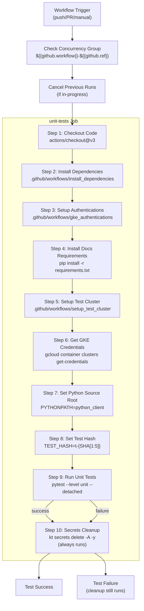
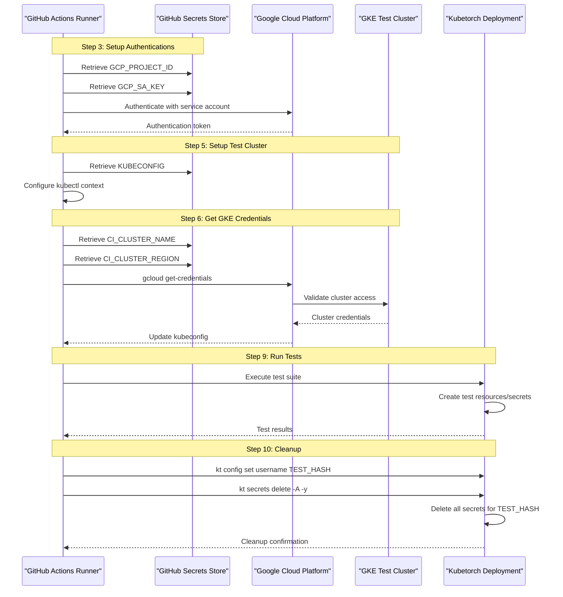
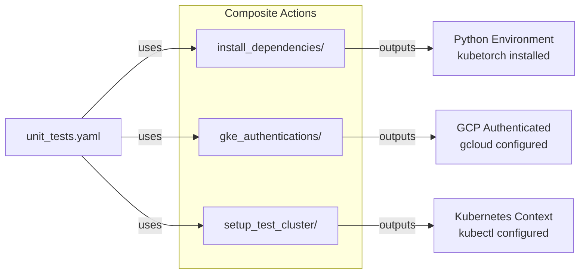
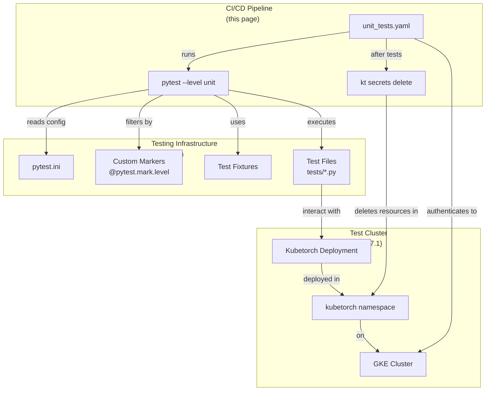

<!-- source: DeepWiki mcp.deepwiki.com · repo run-house/kubetorch · page 8.2 CI/CD Pipeline · fetched 2026-10-21 -->

# CI/CD Pipeline

<details>
<summary>Relevant source files</summary>

The following files were used as context for generating this wiki page:

- [.github/workflows/unit_tests.yaml](.github/workflows/unit_tests.yaml)

</details>


This document describes the GitHub Actions-based continuous integration and continuous delivery (CI/CD) infrastructure for Kubetorch. The pipeline validates code changes by running unit tests against a live GKE cluster, ensuring both client and server components function correctly together.

For information about the testing infrastructure itself (pytest configuration, test levels, and fixtures), see [Testing Infrastructure](#8.1). For guidance on running tests in a local development environment, see [Running Tests Locally](#8.3).

## Overview

The CI/CD pipeline is implemented in the `unit_tests.yaml` workflow file and serves three primary functions:

1. **Automated Testing**: Runs unit tests on every push to `main` and on all pull requests
2. **GKE Integration**: Authenticates and configures access to a test GKE cluster
3. **Resource Cleanup**: Ensures test resources (particularly secrets) are deleted after test execution, even on failure

The pipeline executes tests in a detached mode (`--detached` flag) against a real Kubernetes cluster, validating the full integration between the Python client and Kubernetes deployment components.

**Sources**: [.github/workflows/unit_tests.yaml:1-94]()

## Workflow Configuration

### Workflow Triggers

The `unit_tests.yaml` workflow responds to three trigger types:

| Trigger Type | Conditions | Purpose |
|-------------|------------|---------|
| `push` | Pushes to `main` branch | Validate changes merged to main |
| `pull_request` | Any pull request | Validate changes before merge |
| `workflow_dispatch` | Manual trigger | Ad-hoc test runs |

Both `push` and `pull_request` triggers include extensive path exclusions to avoid unnecessary runs:

```yaml
paths-ignore:
  - 'python_client/kubetorch/docs/**'
  - 'python_client/tests/test_deploy.py'
  - '**/*.md'
  - '**/*.rst'
  - '**/*.tf'
  - 'exploratory/**'
  - 'cluster_setup/**'
```

These exclusions prevent the pipeline from running when only documentation, Terraform configurations, or exploratory code changes are made.

**Sources**: [.github/workflows/unit_tests.yaml:3-31]()

### Concurrency Control

The workflow implements concurrency control to prevent multiple runs from conflicting:

```yaml
concurrency:
  group: ${{ github.workflow }}-${{ github.ref }}
  cancel-in-progress: true
```

This configuration groups concurrent runs by workflow name and git reference (branch/tag), automatically canceling in-progress runs when new commits are pushed to the same branch. This prevents resource contention on the shared test cluster and reduces unnecessary CI time.

**Sources**: [.github/workflows/unit_tests.yaml:36-38]()

### Environment Variables

The workflow sets a global `CI` environment variable:

```yaml
env:
  CI: true
```

This variable indicates that code is running in a CI environment, allowing tests to adjust behavior when necessary (e.g., using different timeouts or skipping interactive prompts).

**Sources**: [.github/workflows/unit_tests.yaml:33-34]()

## Workflow Job Structure

The `unit-tests` job runs on `ubuntu-latest` runners and requires two specific permissions:

- `id-token: write` - For OIDC authentication to GCP
- `contents: read` - For checking out repository code



**Workflow Execution Flow**

The diagram above shows the complete execution flow from trigger to completion, highlighting the unconditional cleanup step that ensures resources are deleted regardless of test outcome.

**Sources**: [.github/workflows/unit_tests.yaml:40-94]()

## Workflow Steps Deep Dive

### Step 1: Repository Checkout

```yaml
- name: Check out repository code
  uses: actions/checkout@v3
```

Uses the standard GitHub Actions checkout action to clone the repository at the commit being tested.

**Sources**: [.github/workflows/unit_tests.yaml:47-48]()

### Step 2: Install Dependencies

```yaml
- name: Install Dependencies
  uses: ./.github/workflows/install_dependencies
```

Calls a composite action located at `.github/workflows/install_dependencies/` to install:
- Python and required packages
- `kubetorch` client package
- Test dependencies

This action is reusable across multiple workflows in the repository.

**Sources**: [.github/workflows/unit_tests.yaml:50-51]()

### Step 3: GKE Authentication

```yaml
- name: Setup authentications
  uses: ./.github/workflows/gke_authentications
  with:
    GCP_PROJECT_ID: ${{ secrets.GCP_PROJECT_ID }}
    GCP_SA_KEY: ${{ secrets.GOOGLE_APPLICATION_CREDENTIALS }}
```

Calls a composite action at `.github/workflows/gke_authentications/` that:
- Authenticates to Google Cloud using service account credentials
- Configures `gcloud` CLI for subsequent steps
- Sets up authentication for Docker registry access (if needed)

Required secrets:
- `GCP_PROJECT_ID`: The GCP project containing the test cluster
- `GOOGLE_APPLICATION_CREDENTIALS`: Service account key JSON (stored as `GCP_SA_KEY` secret)

**Sources**: [.github/workflows/unit_tests.yaml:53-57]()

### Step 4: Install Documentation Requirements

```yaml
- name: Install docs requirements
  run: pip install -r python_client/kubetorch/docs/requirements.txt
```

Installs additional dependencies required for documentation building and testing, even though this is a unit test run. This ensures tests that validate documentation functionality can execute correctly.

**Sources**: [.github/workflows/unit_tests.yaml:59-60]()

### Step 5: Setup Test Cluster

```yaml
- name: Setup Test Cluster
  uses: ./.github/workflows/setup_test_cluster
  with:
    KUBECONFIG: ${{ secrets.KUBECONFIG }}
```

Calls a composite action at `.github/workflows/setup_test_cluster/` that:
- Configures the Kubernetes context for the test cluster
- May deploy or update the Kubetorch server components
- Verifies cluster readiness

The `KUBECONFIG` secret contains the Kubernetes configuration file for accessing the test cluster.

**Sources**: [.github/workflows/unit_tests.yaml:62-65]()

### Step 6: Get GKE Credentials

```yaml
- name: Get GKE credentials
  run: |
    gcloud container clusters get-credentials ${{ secrets.CI_CLUSTER_NAME }} \
      --region ${{ secrets.CI_CLUSTER_REGION }} \
      --project ${{ secrets.GCP_PROJECT_ID }}
```

Retrieves and configures credentials for the GKE test cluster. This step:
- Uses `gcloud` CLI to fetch cluster credentials
- Updates the local `kubeconfig` file
- Enables `kubectl` commands to interact with the cluster

Required secrets:
- `CI_CLUSTER_NAME`: Name of the test GKE cluster
- `CI_CLUSTER_REGION`: GCP region where the cluster is located
- `GCP_PROJECT_ID`: GCP project ID (reused from authentication step)

**Sources**: [.github/workflows/unit_tests.yaml:67-71]()

### Step 7: Set Python Source Root

```yaml
- name: Set Python Source Root
  run: echo "PYTHONPATH=$(pwd)/python_client" >> $GITHUB_ENV
```

Configures the `PYTHONPATH` environment variable to include the `python_client` directory, enabling tests to import `kubetorch` modules without requiring a full package installation.

**Sources**: [.github/workflows/unit_tests.yaml:73-74]()

### Step 8: Set Test Hash

```yaml
- name: Set Test Hash
  run: |
    TEST_HASH="t-$(echo $GITHUB_SHA | cut -c1-5)"
    echo "TEST_HASH=$TEST_HASH" >> $GITHUB_ENV
```

Generates a unique identifier for the test run based on the Git commit SHA. The format is `t-{first5chars}`, creating values like `t-a1b2c`. This hash is used:
- As a username for `kt config` to isolate test resources
- To namespace secrets and other resources created during testing
- To enable concurrent test runs without conflicts

**Sources**: [.github/workflows/unit_tests.yaml:76-79]()

### Step 9: Run Unit Tests

```yaml
- name: Run tests with level unit
  run: |
    cd python_client
    pytest -v --level unit --detached
  timeout-minutes: 60
```

Executes the test suite with the following configuration:

| Flag | Purpose |
|------|---------|
| `-v` | Verbose output for detailed test results |
| `--level unit` | Run only tests marked with `level="unit"` |
| `--detached` | Run tests in detached mode (specific to Kubetorch tests) |

The `--level` flag is a custom pytest marker (see [Testing Infrastructure](#8.1)). The `--detached` flag indicates tests should run against a remote cluster rather than attempting local execution.

A 60-minute timeout prevents hung tests from blocking the CI pipeline indefinitely.

**Sources**: [.github/workflows/unit_tests.yaml:81-85]()

### Step 10: Secrets Cleanup

```yaml
- name: secrets cleanup
  if: ${{ always() }}
  run: |
    echo "Running teardown command: kt secrets delete -A -y for username ${TEST_HASH}"
    kt config set username $TEST_HASH
    kt secrets delete -A -y
  timeout-minutes: 60
```

This critical cleanup step:
- **Always executes** via `if: ${{ always() }}`, ensuring cleanup happens even when tests fail
- Sets the `kt` username to the test hash generated in step 8
- Deletes all secrets (`-A` flag) associated with that username
- Bypasses confirmation prompts (`-y` flag)

The cleanup prevents:
- Resource leaks in the test cluster
- Secret accumulation over multiple test runs
- Conflicts between concurrent or subsequent test runs

**Sources**: [.github/workflows/unit_tests.yaml:87-93]()

## Authentication and Secrets Flow



**Authentication and Resource Management Flow**

This diagram illustrates how the workflow authenticates to GCP/GKE and manages test resources throughout the pipeline execution.

**Sources**: [.github/workflows/unit_tests.yaml:53-93]()

## Required GitHub Secrets

The workflow depends on the following GitHub repository secrets:

| Secret Name | Description | Used In Steps |
|------------|-------------|---------------|
| `GCP_PROJECT_ID` | GCP project containing test resources | 3 (Auth), 6 (Credentials) |
| `GCP_SA_KEY` | Service account key JSON (as `GOOGLE_APPLICATION_CREDENTIALS`) | 3 (Auth) |
| `KUBECONFIG` | Kubernetes config file for test cluster | 5 (Cluster Setup) |
| `CI_CLUSTER_NAME` | Name of the GKE test cluster | 6 (Credentials) |
| `CI_CLUSTER_REGION` | GCP region of the test cluster | 6 (Credentials) |

These secrets must be configured in the repository settings under **Settings → Secrets and variables → Actions**.

**Sources**: [.github/workflows/unit_tests.yaml:56-57,65,69-71]()

## Test Execution Details

### Test Command Analysis

The pytest invocation uses several important flags:

```bash
pytest -v --level unit --detached
```

**Flag Breakdown**:

- **`-v` (verbose)**: Provides detailed output for each test, including:
  - Full test name (module, class, function)
  - Test execution time
  - Captured stdout/stderr on failure
  
- **`--level unit`**: Custom marker filtering (see [Testing Infrastructure](#8.1))
  - Only runs tests decorated with `@pytest.mark.level("unit")`
  - Excludes integration and end-to-end tests
  - Reduces test execution time for rapid feedback

- **`--detached`**: Kubetorch-specific flag indicating:
  - Tests execute against a remote cluster (not local)
  - No attempt to spawn local test infrastructure
  - Expects cluster to be pre-configured and accessible

### Test Isolation via TEST_HASH

The `TEST_HASH` environment variable serves as a unique namespace for each workflow run:

```bash
TEST_HASH="t-$(echo $GITHUB_SHA | cut -c1-5)"
```

**Isolation Mechanism**:

1. Each test run generates a hash like `t-a1b2c` from the commit SHA
2. Tests use this hash as a username: `kt config set username $TEST_HASH`
3. Kubetorch associates all created resources with this username
4. Cleanup targets only resources for this specific username: `kt secrets delete -A -y`

This enables:
- Multiple concurrent test runs (different commits/PRs)
- Precise cleanup without affecting other runs
- Debugging failed runs by examining resources with specific hash

**Sources**: [.github/workflows/unit_tests.yaml:76-92]()

## Composite Actions

The workflow delegates several complex operations to composite actions:



**Composite Actions Architecture**

These reusable actions are located in `.github/workflows/` and can be shared across multiple workflows. Each action encapsulates a specific setup concern:

- **`install_dependencies`**: Python environment setup
- **`gke_authentications`**: GCP/GKE authentication
- **`setup_test_cluster`**: Kubernetes cluster configuration

**Sources**: [.github/workflows/unit_tests.yaml:51,54,63]()

## Timeout and Failure Handling

### Test Execution Timeout

The test execution step includes a 60-minute timeout:

```yaml
timeout-minutes: 60
```

If tests exceed this duration:
1. GitHub Actions terminates the step
2. The workflow status is marked as failed
3. The cleanup step still executes (due to `if: ${{ always() }}`)

This prevents indefinitely hung tests from blocking the CI queue.

### Cleanup Timeout

The cleanup step also has a 60-minute timeout:

```yaml
- name: secrets cleanup
  timeout-minutes: 60
```

While cleanup is typically fast (seconds to minutes), the timeout protects against:
- Kubernetes API server unavailability
- Network issues
- Large numbers of accumulated secrets requiring deletion

### Always-Run Cleanup

The cleanup step uses the `always()` condition:

```yaml
if: ${{ always() }}
```

This ensures cleanup executes in all scenarios:
- Tests pass ✓ → cleanup runs
- Tests fail ✗ → cleanup runs
- Tests timeout ⏱ → cleanup runs
- Workflow cancelled 🚫 → cleanup runs

This prevents resource leaks and ensures the test cluster remains clean for subsequent runs.

**Sources**: [.github/workflows/unit_tests.yaml:85,88,93]()

## Path Exclusions and Optimization

The workflow includes extensive path exclusions to avoid unnecessary runs:

```yaml
paths-ignore:
  - 'python_client/kubetorch/docs/**'
  - 'python_client/tests/test_deploy.py'
  - '**/*.md'
  - '**/*.rst'
  - '**/*.tf'
  - 'exploratory/**'
  - 'cluster_setup/**'
  - '.github/workflows/create_cluster.yaml'
  - '.github/workflows/deploy_tests.yaml'
  - '.github/workflows/create_cluster/action.yaml'
  - '.github/workflows/delete_cluster.yaml'
```

**Exclusion Categories**:

| Pattern | Rationale |
|---------|-----------|
| `python_client/kubetorch/docs/**` | Documentation changes don't affect functionality |
| `**/*.md`, `**/*.rst` | Markdown/RST files are documentation only |
| `**/*.tf` | Terraform files affect infrastructure, not code |
| `exploratory/**` | Experimental code not part of main codebase |
| `cluster_setup/**` | Cluster setup scripts, not application code |
| `test_deploy.py` | Deploy tests run in separate workflow |
| Other workflow files | Changes to other workflows don't affect unit tests |

These exclusions:
- Reduce CI time by ~40-60% for documentation-only changes
- Prevent duplicate workflow runs
- Focus test execution on actual code changes

**Sources**: [.github/workflows/unit_tests.yaml:6-30]()

## Integration with Testing Infrastructure

The CI/CD pipeline integrates with the broader testing infrastructure documented in [Testing Infrastructure](#8.1):



**Testing System Integration**

The CI/CD pipeline serves as the automation layer that:
1. Configures access to test infrastructure
2. Executes tests defined in the testing framework
3. Cleans up resources in the test environment

**Sources**: [.github/workflows/unit_tests.yaml:1-94]()

## Workflow Permissions

The workflow requires specific GitHub Actions permissions:

```yaml
permissions:
  id-token: write
  contents: read
```

**Permission Breakdown**:

- **`id-token: write`**: Required for OIDC (OpenID Connect) authentication to GCP
  - Enables keyless authentication without storing long-lived credentials
  - GitHub generates short-lived tokens for GCP authentication
  - More secure than traditional service account keys
  
- **`contents: read`**: Required to check out repository code
  - Allows the `actions/checkout@v3` action to clone the repository
  - Read-only access prevents accidental modifications

These minimal permissions follow the principle of least privilege, granting only what's necessary for the workflow to function.

**Sources**: [.github/workflows/unit_tests.yaml:43-45]()

## Relationship to Other Workflows

While this document focuses on `unit_tests.yaml`, the repository contains other workflows that are explicitly excluded from unit test triggers:

| Workflow | Purpose | Exclusion Reason |
|----------|---------|------------------|
| `create_cluster.yaml` | Provisions new test clusters | Infrastructure management, not code validation |
| `deploy_tests.yaml` | Runs deployment-specific tests | Separate test category with different requirements |
| `delete_cluster.yaml` | Tears down test clusters | Infrastructure cleanup, not code validation |

These workflows are part of the deployment and operations pipeline rather than the code validation pipeline. Changes to these workflows don't trigger unit tests, and vice versa.

**Sources**: [.github/workflows/unit_tests.yaml:14-17,27-30]()

## Summary

The Kubetorch CI/CD pipeline provides:

- **Automated Validation**: Tests run on every code change via push or PR
- **Real Cluster Testing**: Validates against actual GKE infrastructure, not mocks
- **Resource Isolation**: Uses unique test hashes to enable concurrent runs
- **Guaranteed Cleanup**: Always-run cleanup step prevents resource leaks
- **Efficient Execution**: Path exclusions avoid unnecessary test runs
- **Secure Authentication**: OIDC-based GCP authentication with minimal permissions

Key workflow characteristics:
- 10 distinct steps from checkout to cleanup
- 60-minute timeout protection on test execution and cleanup
- Concurrency control to prevent conflicts
- Integration with composite actions for reusability

For details on how to run these tests locally or debug failures, see [Running Tests Locally](#8.3).

**Sources**: [.github/workflows/unit_tests.yaml:1-94]()

---

