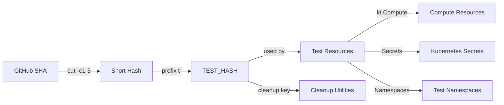
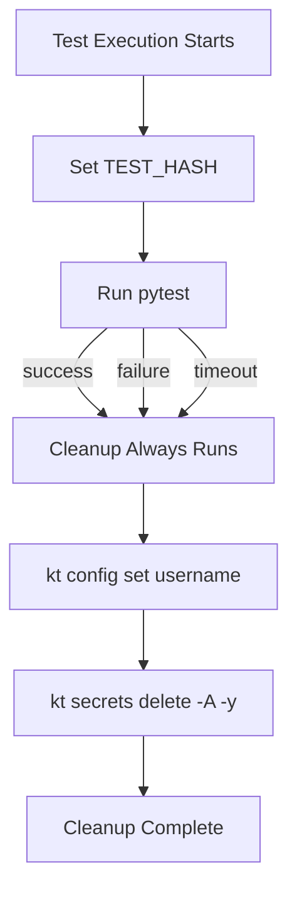
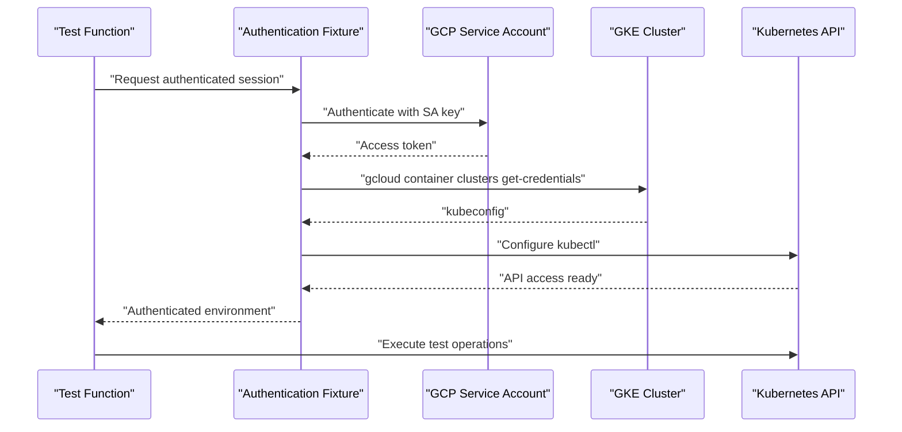
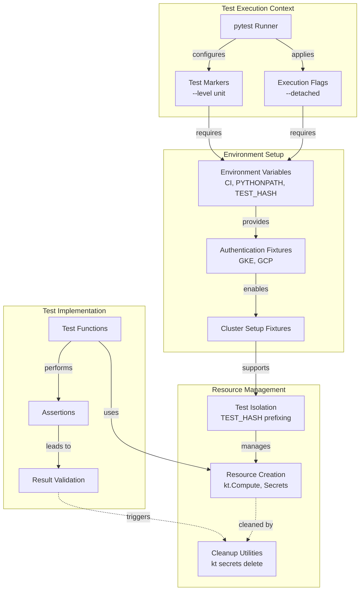

<!-- source: DeepWiki mcp.deepwiki.com · repo run-house/kubetorch · page 8.4 Test Fixtures and Utilities · fetched 2026-10-21 -->

# Test Fixtures and Utilities

<details>
<summary>Relevant source files</summary>

The following files were used as context for generating this wiki page:

- [.github/workflows/unit_tests.yaml](.github/workflows/unit_tests.yaml)

</details>


This page documents the reusable test fixtures, utility functions, and helper modules available when writing tests for Kubetorch. These components provide common functionality for test isolation, resource cleanup, authentication setup, and test environment configuration.

For information about the overall testing infrastructure and pytest configuration, see [Testing Infrastructure](#8.1). For details on the CI/CD workflows that execute these tests, see [CI/CD Pipeline](#8.2). For guidance on running tests locally, see [Running Tests Locally](#8.3).

## Test Environment Configuration

### Environment Variables

The test suite relies on several environment variables that control test behavior and cluster authentication:

| Variable | Purpose | Set By | Example Value |
|----------|---------|--------|---------------|
| `CI` | Indicates running in CI environment | Workflow | `true` |
| `PYTHONPATH` | Python source root for imports | Workflow/Developer | `$(pwd)/python_client` |
| `TEST_HASH` | Unique identifier for test isolation | Workflow/Developer | `t-a1b2c` |
| `GCP_PROJECT_ID` | GCP project for cluster access | Secret | (project ID) |
| `CI_CLUSTER_NAME` | Name of test cluster | Secret | (cluster name) |
| `CI_CLUSTER_REGION` | Region of test cluster | Secret | (region) |
| `KUBECONFIG` | Kubernetes configuration | Secret | (kubeconfig yaml) |

The `TEST_HASH` variable is particularly important for test isolation, as it creates unique namespaces and resource names for each test run to prevent conflicts between concurrent executions.

**Sources:** [.github/workflows/unit_tests.yaml:34](), [.github/workflows/unit_tests.yaml:74](), [.github/workflows/unit_tests.yaml:76-79]()

### Python Path Configuration

Tests require the Python source root to be set correctly for module imports. The workflow sets this via the `PYTHONPATH` environment variable:

```
PYTHONPATH=$(pwd)/python_client
```

When running tests locally, developers must ensure this path is set to their local `python_client` directory to match the CI environment.

**Sources:** [.github/workflows/unit_tests.yaml:73-74]()

## Test Markers and Levels

### Level-Based Test Selection

Kubetorch uses a custom pytest marker system to categorize tests by execution level. Tests can be filtered using the `--level` flag:

```
pytest --level unit
```

This marker system allows selective test execution based on:
- Test complexity
- Resource requirements
- Execution time
- Dependencies on external services

The `unit` level indicates tests that run quickly and have minimal external dependencies, making them suitable for frequent execution during development and in CI.

**Sources:** [.github/workflows/unit_tests.yaml:82-84]()

### Detached Execution Mode

Tests support a `--detached` flag that modifies execution behavior:

```
pytest --level unit --detached
```

This flag likely controls how tests interact with cluster resources, potentially running remote workloads in a detached manner rather than waiting synchronously for completion. This can speed up test execution when testing asynchronous or long-running operations.

**Sources:** [.github/workflows/unit_tests.yaml:84]()

## Test Isolation and Cleanup

### Test Hash Generation

Each test run generates a unique hash identifier to isolate resources and prevent conflicts between concurrent test executions:



**Diagram: Test Hash Usage Flow**

The hash is generated from the first 5 characters of the Git commit SHA, prefixed with `t-`. This creates identifiers like `t-a1b2c` that uniquely identify each test run's resources.

**Sources:** [.github/workflows/unit_tests.yaml:76-79]()

### Cleanup Utilities

The test suite includes cleanup utilities that remove all resources associated with a test run, even when tests fail:



**Diagram: Cleanup Utility Execution Flow**

The cleanup process involves:

1. **Configuration**: Set the username to the test hash identifier
   ```
   kt config set username $TEST_HASH
   ```

2. **Deletion**: Delete all secrets and associated resources
   ```
   kt secrets delete -A -y
   ```
   - `-A`: Delete all secrets for the user
   - `-y`: Skip confirmation prompts

This cleanup runs with `if: ${{ always() }}` condition, ensuring execution even when tests fail or timeout.

**Sources:** [.github/workflows/unit_tests.yaml:87-93]()

## Test Timeout Configuration

Tests are configured with timeout limits to prevent hanging executions:

- **Test execution timeout**: 60 minutes
- **Cleanup timeout**: 60 minutes

These timeouts ensure that CI resources are not consumed indefinitely by stuck tests, while providing sufficient time for complex integration scenarios.

**Sources:** [.github/workflows/unit_tests.yaml:85](), [.github/workflows/unit_tests.yaml:93]()

## Authentication Fixtures

### GKE Authentication Setup

Tests that interact with Kubernetes clusters require GKE authentication. The workflow uses reusable authentication actions that set up:

1. **GCP Service Account**: Authentication to Google Cloud Platform
2. **Cluster Credentials**: Access to specific GKE clusters
3. **kubectl Configuration**: Kubernetes client setup

The authentication fixture pattern:



**Diagram: Authentication Fixture Sequence**

The authentication setup requires these secrets:
- `GCP_PROJECT_ID`: Project containing test clusters
- `GCP_SA_KEY`: Service account credentials
- `KUBECONFIG`: Cluster configuration
- `CI_CLUSTER_NAME`: Cluster name
- `CI_CLUSTER_REGION`: Cluster region

**Sources:** [.github/workflows/unit_tests.yaml:53-71]()

## Utility Command Mapping

The following table maps common test utilities to their corresponding command-line interfaces:

| Utility Function | CLI Command | Flags | Purpose |
|------------------|-------------|-------|---------|
| Set test username | `kt config set username` | (username) | Configure user identity for resource isolation |
| Delete all secrets | `kt secrets delete` | `-A -y` | Remove all secrets for current user without confirmation |
| Run unit tests | `pytest` | `-v --level unit --detached` | Execute unit-level tests in detached mode with verbose output |

These utilities are accessible both programmatically within test code and via CLI for manual test operations.

**Sources:** [.github/workflows/unit_tests.yaml:84](), [.github/workflows/unit_tests.yaml:91-92]()

## Test Fixture Architecture



**Diagram: Test Fixture Architecture Overview**

This architecture shows how test fixtures compose to provide a complete testing environment:

1. **pytest Runner**: Orchestrates test execution with markers and flags
2. **Environment Setup**: Provides authentication and cluster access
3. **Resource Management**: Handles isolation, creation, and cleanup
4. **Test Implementation**: Contains actual test logic and validation

The cleanup utilities ensure resources are removed regardless of test outcome, preventing resource leaks in the test cluster.

**Sources:** [.github/workflows/unit_tests.yaml:1-94]()

## Best Practices for Test Authors

When writing tests that use these fixtures and utilities:

1. **Always use TEST_HASH**: Prefix resource names with `TEST_HASH` to ensure isolation
2. **Mark test levels appropriately**: Use pytest markers to categorize test complexity
3. **Rely on cleanup fixtures**: Don't implement manual cleanup; use the provided utilities
4. **Set timeouts**: Configure reasonable timeouts for operations that might hang
5. **Use detached mode judiciously**: Apply `--detached` when testing async operations
6. **Leverage authentication fixtures**: Reuse existing auth setup rather than implementing custom authentication

These practices ensure tests are reliable, isolated, and maintainable across local and CI environments.

**Sources:** [.github/workflows/unit_tests.yaml:76-92]()

---

