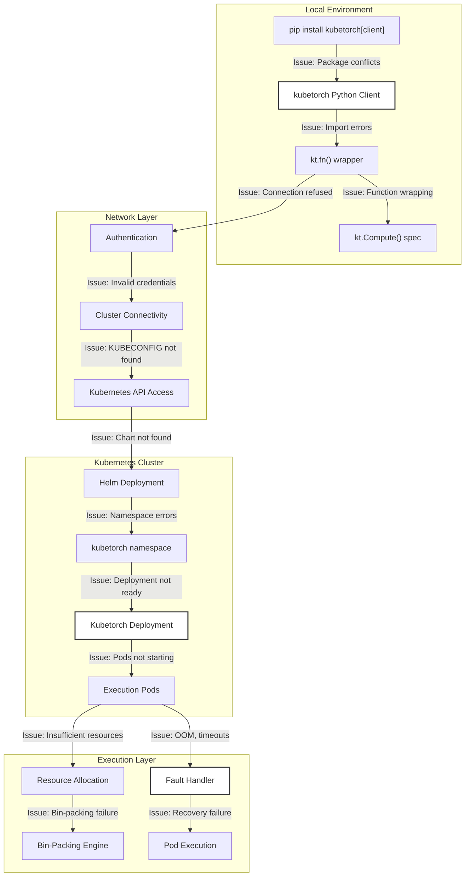
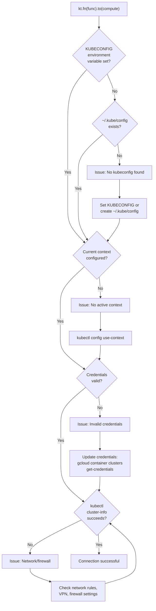
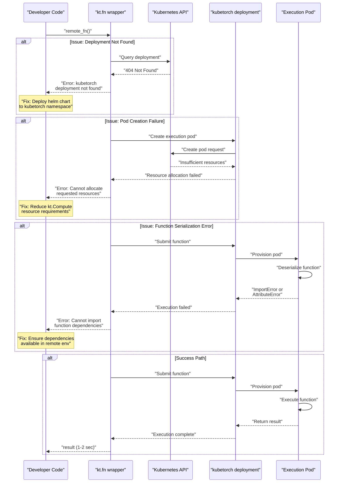
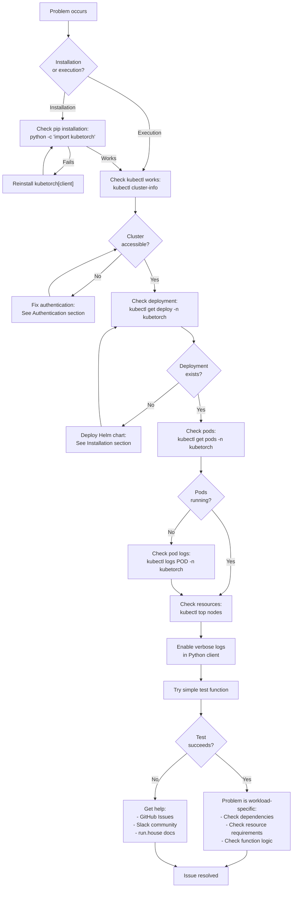

<!-- source: DeepWiki mcp.deepwiki.com · repo run-house/kubetorch · page 9 Troubleshooting · fetched 2026-10-21 -->

# Troubleshooting

<details>
<summary>Relevant source files</summary>

The following files were used as context for generating this wiki page:

- [README.md](README.md)

</details>


This document provides guidance for diagnosing and resolving common issues when using Kubetorch. It covers problems encountered during installation, deployment, function execution, and cluster operations.

For operational deployment procedures, see [Deployment and Operations](#7). For debugging techniques during development, see [Debugging and Logging](#9.2). For performance-related concerns, see [Performance Optimization](#9.3).

## Overview of Kubetorch Failure Points

Kubetorch consists of multiple distributed components that must interact correctly for successful execution. Understanding where failures can occur helps narrow down troubleshooting scope.



**Sources:** [README.md:1-75]()

## Installation Issues

### Client Package Installation Failures

**Symptom:** `pip install "kubetorch[client]"` fails or installs without the `[client]` extras.

**Diagnosis:**
- Verify Python version compatibility (3.8+)
- Check for conflicting package versions
- Ensure pip is up-to-date

**Resolution:**
```bash
# Upgrade pip first
pip install --upgrade pip

# Install with explicit extras syntax
pip install "kubetorch[client]"

# Verify installation
python -c "import kubetorch as kt; print(kt.__version__)"
```

**Common Errors:**

| Error Message | Cause | Solution |
|--------------|-------|----------|
| `No matching distribution found` | Incorrect package name or unavailable version | Verify package name is `kubetorch` |
| `ERROR: Could not find a version` | Network issues or PyPI unavailable | Check internet connectivity, retry |
| `ModuleNotFoundError: No module named 'kubetorch'` | Installation failed silently | Reinstall with `--verbose` flag |

**Sources:** [README.md:39-43]()

### Helm Deployment Failures

**Symptom:** Helm installation commands fail or deployment is not ready.

**Diagnosis:**
```bash
# Check if Helm is installed
helm version

# Verify cluster connectivity
kubectl cluster-info

# Check if namespace exists
kubectl get namespace kubetorch

# Check deployment status
kubectl get deployment -n kubetorch
```

**Resolution for OCI Registry Issues:**

```bash
# Error: "oci://ghcr.io/run-house/charts/kubetorch not found"
# Solution: Verify chart version availability
helm show chart oci://ghcr.io/run-house/charts/kubetorch --version 0.2.2

# If OCI method fails, use local chart method
helm pull oci://ghcr.io/run-house/charts/kubetorch --version 0.2.2 --untar
helm upgrade --install kubetorch ./kubetorch -n kubetorch --create-namespace
```

**Common Helm Errors:**

| Error Pattern | Root Cause | Fix |
|--------------|------------|-----|
| `Error: INSTALLATION FAILED: namespace not found` | Namespace not created | Add `--create-namespace` flag |
| `Error: UPGRADE FAILED: timed out waiting` | Pods not starting | Increase timeout with `--timeout 10m` |
| `Error: release: not found` | First installation | Use `install` instead of `upgrade` |
| `OCI registry authentication required` | Private registry access | Configure Helm registry authentication |

**Sources:** [README.md:45-55]()

## Authentication and Connectivity Issues

### Kubernetes API Connection Failures

**Symptom:** Client cannot connect to Kubernetes cluster from local environment.



**Diagnosis Steps:**

```bash
# 1. Check KUBECONFIG environment variable
echo $KUBECONFIG

# 2. Verify kubeconfig file exists and is readable
ls -la ~/.kube/config
cat ~/.kube/config

# 3. List available contexts
kubectl config get-contexts

# 4. Test basic cluster connectivity
kubectl cluster-info
kubectl get nodes

# 5. Check kubetorch deployment is running
kubectl get deployment -n kubetorch
kubectl get pods -n kubetorch
```

**Sources:** [README.md:45-55]()

### GCP/GKE Authentication Errors

**Symptom:** Cannot authenticate to GKE cluster for Kubetorch operations.

**Common GKE Authentication Issues:**

```bash
# Error: "Unable to connect to the server"
# Cause: Expired GKE credentials
# Fix: Refresh cluster credentials
gcloud container clusters get-credentials CLUSTER_NAME --region REGION

# Error: "Insufficient authentication scopes"
# Cause: Service account lacks required permissions
# Fix: Grant necessary IAM roles
gcloud projects add-iam-policy-binding PROJECT_ID \
  --member="serviceAccount:SA_EMAIL" \
  --role="roles/container.developer"

# Error: "kubectl: command not found"
# Cause: kubectl not installed with gcloud
# Fix: Install kubectl component
gcloud components install kubectl
```

**Required GCP Permissions:**

| Permission | Purpose | Role |
|-----------|---------|------|
| `container.clusters.get` | Access cluster info | `roles/container.clusterViewer` |
| `container.pods.create` | Create execution pods | `roles/container.developer` |
| `container.pods.exec` | Execute in pods | `roles/container.developer` |
| `container.secrets.get` | Access secrets | `roles/container.developer` |

**Sources:** Architecture diagrams (Diagram 4: GCP Integration subsystem)

## Function Execution Failures

### Remote Function Not Executing

**Symptom:** `remote_fn()` call hangs, times out, or returns error.



**Diagnosis:**

```python
import kubetorch as kt

def test_function():
    return "test"

compute = kt.Compute(cpus=".1")
remote_fn = kt.fn(test_function).to(compute)

try:
    result = remote_fn()
    print(f"Success: {result}")
except Exception as e:
    print(f"Error: {type(e).__name__}: {e}")
    # Check cluster logs for details
```

**Common Function Execution Errors:**

| Error Type | Symptom | Root Cause | Resolution |
|-----------|---------|------------|-----------|
| `ConnectionError` | Cannot reach cluster | Network or auth issue | Verify `kubectl` connectivity |
| `TimeoutError` | Function call hangs | Pod not starting or function hanging | Check pod logs, increase timeout |
| `ImportError` | Module not found in remote | Missing dependencies | Install deps in remote environment |
| `ResourceExhausted` | Cannot allocate resources | Cluster full or request too large | Scale cluster or reduce resources |

**Sources:** [README.md:13-29](), Architecture diagrams (Diagram 2: Function Execution Lifecycle)

### Out of Memory (OOM) Errors

**Symptom:** Function fails with OOM error or pod is evicted.

**Diagnosis:**
```bash
# Check pod events for OOM signals
kubectl get events -n kubetorch --sort-by='.lastTimestamp' | grep OOMKilled

# Check pod resource usage
kubectl top pod -n kubetorch

# View pod describe for memory limits
kubectl describe pod POD_NAME -n kubetorch | grep -A 5 "Limits"
```

**Resolution:**

According to the fault tolerance system (Diagram 5), Kubetorch automatically detects OOM errors and adjusts resources. However, if automatic recovery fails:

```python
# Increase memory allocation in kt.Compute
compute = kt.Compute(
    cpus="4",
    memory="16Gi"  # Increase from default
)
remote_fn = kt.fn(memory_intensive_function).to(compute)
```

**OOM Prevention Checklist:**

- [ ] Check actual memory usage of function locally
- [ ] Set memory limit 20-30% above peak usage
- [ ] Monitor real-time logs for memory warnings
- [ ] Consider chunking data processing for large workloads
- [ ] Verify bin-packing hasn't over-allocated node

**Sources:** Architecture diagrams (Diagram 5: Fault Management Pipeline)

## Resource and Cluster Issues

### Pods Not Starting

**Symptom:** Execution pods remain in `Pending` or `ImagePullBackOff` state.

**Diagnostic Commands:**

```bash
# List all pods in kubetorch namespace
kubectl get pods -n kubetorch

# Check pod status and events
kubectl describe pod POD_NAME -n kubetorch

# View pod logs (if pod started)
kubectl logs POD_NAME -n kubetorch

# Check node resources
kubectl describe nodes | grep -A 5 "Allocated resources"
```

**Common Pod States and Causes:**

| Pod State | Likely Cause | Investigation Command |
|-----------|-------------|----------------------|
| `Pending` | Insufficient cluster resources | `kubectl describe pod POD_NAME -n kubetorch \| grep Events` |
| `ImagePullBackOff` | Cannot pull container image | `kubectl describe pod POD_NAME -n kubetorch \| grep Image` |
| `CrashLoopBackOff` | Pod starting but failing immediately | `kubectl logs POD_NAME -n kubetorch --previous` |
| `Error` | Execution completed with error | `kubectl logs POD_NAME -n kubetorch` |
| `Unknown` | Node communication lost | `kubectl get nodes; kubectl describe node NODE_NAME` |

**Sources:** Architecture diagrams (Diagram 1: Kubernetes Execution Environment)

### Insufficient Cluster Resources

**Symptom:** `kt.Compute` requests cannot be satisfied, pods stuck in `Pending`.

**Diagnosis:**

```bash
# Check available cluster resources
kubectl top nodes

# View resource requests vs. limits
kubectl describe nodes | grep -A 10 "Allocated resources"

# Check kubetorch deployment resource quotas
kubectl get resourcequota -n kubetorch

# View pending pods and reasons
kubectl get events -n kubetorch --field-selector reason=FailedScheduling
```

**Resolution Strategies:**

1. **Reduce Resource Requests:**
```python
# Before: Too aggressive
compute = kt.Compute(cpus="32", memory="128Gi")

# After: Right-sized for workload
compute = kt.Compute(cpus="4", memory="16Gi")
```

2. **Enable Cluster Autoscaling:**
```bash
# For GKE
gcloud container clusters update CLUSTER_NAME \
  --enable-autoscaling \
  --min-nodes 1 \
  --max-nodes 10
```

3. **Add Nodes Manually:**
```bash
# For GKE
gcloud container clusters resize CLUSTER_NAME \
  --num-nodes 5
```

According to Architecture Diagram 5, the bin-packing engine optimizes resource allocation to achieve "50%+ cost savings," but this requires sufficient base cluster capacity.

**Sources:** [README.md:31-35](), Architecture diagrams (Diagram 5: Resource Allocation)

### Namespace or Deployment Not Found

**Symptom:** Client reports kubetorch deployment or namespace doesn't exist.

**Verification:**

```bash
# Check if namespace exists
kubectl get namespace kubetorch

# If namespace missing, it wasn't created during Helm install
# Recreate namespace
kubectl create namespace kubetorch

# Verify Helm release
helm list -n kubetorch

# If release missing, redeploy
helm upgrade --install kubetorch oci://ghcr.io/run-house/charts/kubetorch \
  --version 0.2.2 -n kubetorch --create-namespace

# Verify deployment is ready
kubectl rollout status deployment/kubetorch -n kubetorch
```

**Sources:** [README.md:45-55]()

## Secrets and Configuration Issues

### Secrets Management Errors

**Symptom:** Cannot access cluster or "secrets not found" errors.

**Diagnosis:**

```bash
# List secrets in kubetorch namespace
kubectl get secrets -n kubetorch

# Describe specific secret
kubectl describe secret SECRET_NAME -n kubetorch

# Check secret data (base64 encoded)
kubectl get secret SECRET_NAME -n kubetorch -o yaml
```

**Common Secret Issues:**

| Issue | Cause | Resolution |
|-------|-------|-----------|
| Secret not found | Never created or deleted | Recreate secret with proper credentials |
| Invalid secret data | Corrupted or incorrect encoding | Delete and recreate with correct values |
| Permission denied | Service account lacks access | Grant `secrets.get` permission to SA |
| Secret expired | Credentials no longer valid | Rotate secret with fresh credentials |

**Cleanup Command:**

According to the CI/CD pipeline (Diagram 4), secrets cleanup is performed via:
```bash
kt secrets delete -A -y
```

This command deletes all secrets across all namespaces (use with caution in production).

**Sources:** Architecture diagrams (Diagram 4: Secrets Management)

## Network and Firewall Issues

### Connection Timeouts

**Symptom:** Operations time out when communicating with cluster.

**Network Troubleshooting Checklist:**

```bash
# 1. Verify basic network connectivity
ping -c 3 $(kubectl config view -o jsonpath='{.clusters[0].cluster.server}' | sed 's|https://||' | cut -d: -f1)

# 2. Check if VPN is required and active
# (Organization-specific - check with cluster admin)

# 3. Test Kubernetes API endpoint
kubectl cluster-info dump | grep -i endpoint

# 4. Check firewall rules allow required ports
# - Port 443 (HTTPS) for Kubernetes API
# - Port 8443 (webhook server, if used)

# 5. Verify DNS resolution
nslookup $(kubectl config view -o jsonpath='{.clusters[0].cluster.server}' | sed 's|https://||' | cut -d: -f1)
```

**Corporate Firewall Issues:**

If behind corporate firewall or proxy:

```bash
# Set proxy environment variables
export HTTP_PROXY="http://proxy.company.com:8080"
export HTTPS_PROXY="http://proxy.company.com:8080"
export NO_PROXY="localhost,127.0.0.1,.cluster.local"

# Configure kubectl to use proxy
kubectl config set-cluster CLUSTER_NAME --proxy-url=http://proxy.company.com:8080
```

**Sources:** Architecture diagrams (Diagram 1: Network Layer)

## Debugging Workflow

### Systematic Debugging Approach



**Sources:** [README.md:1-75]()

### Enabling Verbose Logging

```python
import logging
import kubetorch as kt

# Enable debug logging
logging.basicConfig(level=logging.DEBUG)
logger = logging.getLogger('kubetorch')
logger.setLevel(logging.DEBUG)

def test_function():
    return "test"

compute = kt.Compute(cpus=".1")
remote_fn = kt.fn(test_function).to(compute)

# Execute with detailed logging
result = remote_fn()
```

**Sources:** [README.md:7-8]() (mentions real-time log propagation)

### Common Diagnostic Commands Reference

```bash
# Client-side checks
python -c "import kubetorch as kt; print(kt.__version__)"
pip list | grep kubetorch
echo $KUBECONFIG

# Cluster connectivity
kubectl cluster-info
kubectl config current-context
kubectl get nodes

# Kubetorch deployment status
kubectl get all -n kubetorch
kubectl describe deployment kubetorch -n kubetorch
kubectl logs -l app=kubetorch -n kubetorch --tail=100

# Resource monitoring
kubectl top nodes
kubectl top pods -n kubetorch
kubectl get events -n kubetorch --sort-by='.lastTimestamp'

# Helm status
helm list -n kubetorch
helm status kubetorch -n kubetorch
helm get values kubetorch -n kubetorch
```

**Sources:** [README.md:45-55]()

## Getting Additional Help

### Before Requesting Help

Gather the following diagnostic information:

1. **Environment Details:**
   - Python version: `python --version`
   - Kubetorch version: `pip show kubetorch`
   - Kubernetes version: `kubectl version`
   - Helm version: `helm version`

2. **Error Information:**
   - Complete error message and stack trace
   - Relevant log excerpts from `kubectl logs`
   - Pod status: `kubectl get pods -n kubetorch`
   - Events: `kubectl get events -n kubetorch`

3. **Reproduction Steps:**
   - Minimal code example that reproduces the issue
   - `kt.Compute` configuration used
   - Cluster size and resource availability

### Support Channels

- **Slack Community:** [Join Kubetorch Slack](https://join.slack.com/t/kubetorch/shared_invite/zt-3g76q5i4j-uP60AdydxnAmjGVAQhtALA)
- **Documentation:** [run.house/kubetorch](https://www.run.house/kubetorch/introduction)
- **Email Support:** hello@run.house
- **GitHub Issues:** For bug reports and feature requests

**Sources:** [README.md:62-68]()

### Known Limitations

Current known limitations that may affect troubleshooting:

| Limitation | Impact | Workaround |
|-----------|--------|------------|
| Real-time logs require cluster connectivity | Cannot see logs if connection lost | Check logs via `kubectl` directly |
| Bin-packing optimization requires warm-up | First executions may be slower | Expected behavior, improves over time |
| Fault recovery limited to retriable errors | Some errors cannot auto-recover | Manual intervention required |
| Resource requests must fit on single node | Very large requests may fail | Split workload or add larger nodes |

**Sources:** Architecture diagrams (Diagram 2, 5: Execution lifecycle and fault tolerance)

---

