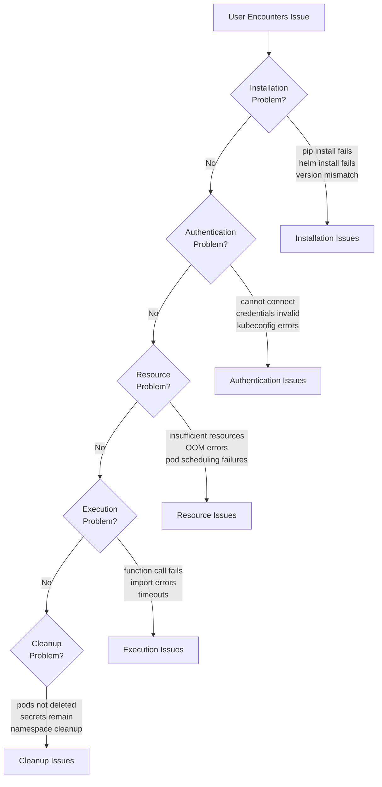
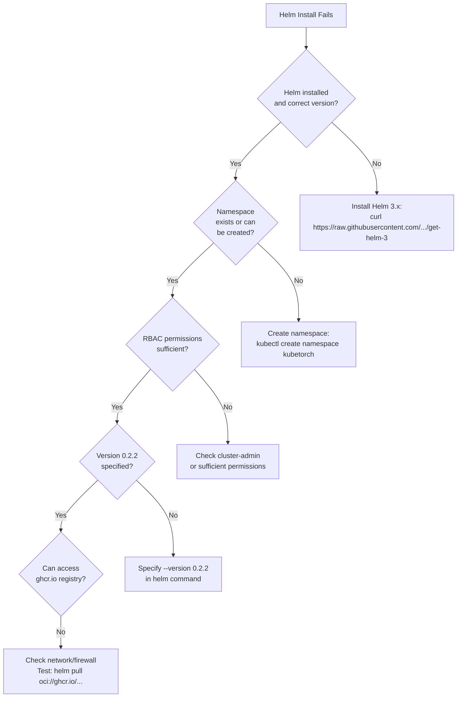
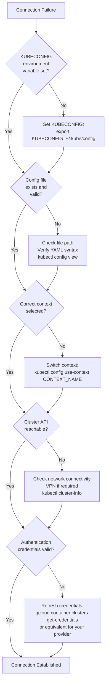
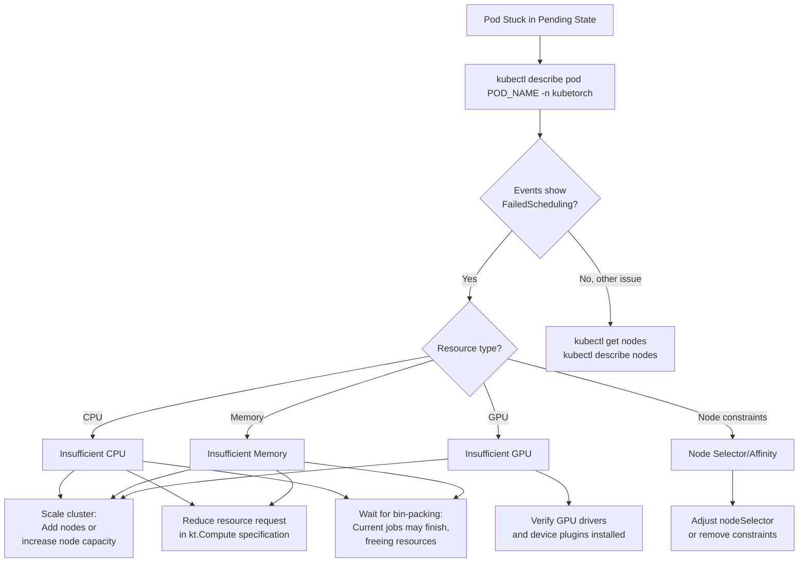
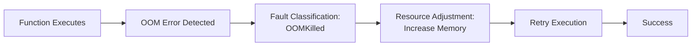
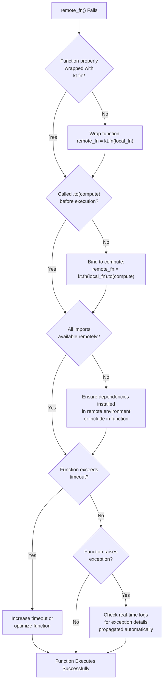

<!-- source: DeepWiki mcp.deepwiki.com · repo run-house/kubetorch · page 9.1 Common Issues · fetched 2026-10-21 -->

# Common Issues

<details>
<summary>Relevant source files</summary>

The following files were used as context for generating this wiki page:

- [README.md](README.md)

</details>


This page documents frequently encountered problems when installing, deploying, and using Kubetorch, along with their diagnoses and solutions. Issues are organized by category: installation, authentication, resource allocation, function execution, and cleanup operations.

For information about debugging techniques and log access patterns, see [Debugging and Logging](#9.2). For performance-related issues, see [Performance Optimization](#9.3). For installation procedures, see [Installation](#3.1) and [Kubernetes Deployment](#7.1).

---

## Issue Categories Overview



**Sources:** [README.md:1-75]()

---

## Installation Issues

### Client Installation Failures

**Symptom:** `pip install "kubetorch[client]"` fails or installs incorrect version.

**Common Causes and Solutions:**

| Cause | Solution |
|-------|----------|
| Python version incompatibility | Ensure Python 3.8+ is installed: `python --version` |
| Missing build dependencies | Install build tools: `pip install --upgrade pip setuptools wheel` |
| Network connectivity | Check internet connection, try with `--verbose` flag |
| Corrupted pip cache | Clear cache: `pip cache purge` and retry |
| Wrong package name | Use exact package name: `kubetorch[client]` with quotes |

**Verification:**

```bash
# Verify installation
python -c "import kubetorch as kt; print(kt.__version__)"

# Check installed components
pip show kubetorch
```

**Sources:** [README.md:39-43]()

---

### Server Deployment Failures

**Symptom:** Helm installation fails or Kubetorch deployment does not start.

**Common Causes and Solutions:**



**Diagnostic Commands:**

```bash
# Check Helm version (requires 3.x)
helm version

# Check namespace
kubectl get namespace kubetorch

# Check deployment status
kubectl get deployment -n kubetorch
kubectl describe deployment kubetorch -n kubetorch

# Check pods
kubectl get pods -n kubetorch
kubectl logs -n kubetorch <pod-name>

# Verify registry access
helm pull oci://ghcr.io/run-house/charts/kubetorch --version 0.2.2
```

**Common Error Messages:**

| Error | Cause | Solution |
|-------|-------|----------|
| `Error: INSTALLATION FAILED: Kubernetes cluster unreachable` | KUBECONFIG not set or invalid | Set KUBECONFIG: `export KUBECONFIG=/path/to/config` |
| `Error: create: failed to create: namespaces "kubetorch" not found` | Missing `--create-namespace` flag | Add `--create-namespace` to helm command |
| `Error: failed to download "oci://ghcr.io/..."` | Network/registry access issue | Check firewall, proxy settings, registry authentication |
| `Error: chart requires kubeVersion: >=1.19.0` | Kubernetes version too old | Upgrade cluster or use compatible chart version |

**Sources:** [README.md:45-55]()

---

### Version Mismatch Issues

**Symptom:** Client and server versions are incompatible, causing unexpected behavior or errors.

**Diagnosis:**

```bash
# Check client version
python -c "import kubetorch as kt; print(f'Client: {kt.__version__}')"

# Check server version
kubectl get deployment kubetorch -n kubetorch -o jsonpath='{.spec.template.spec.containers[0].image}'
```

**Solution:**

Ensure client and server versions match. The current stable version is 0.2.2.

```bash
# Update client
pip install --upgrade "kubetorch[client]==0.2.2"

# Update server
helm upgrade kubetorch oci://ghcr.io/run-house/charts/kubetorch \
  --version 0.2.2 -n kubetorch
```

**Sources:** [README.md:48-54]()

---

## Authentication and Connectivity Issues

### Kubernetes Cluster Connection Failures

**Symptom:** Client cannot connect to Kubernetes cluster, functions fail to execute remotely.



**Diagnostic Commands:**

```bash
# Check KUBECONFIG
echo $KUBECONFIG

# View configuration
kubectl config view

# Check current context
kubectl config current-context

# List available contexts
kubectl config get-contexts

# Test cluster connectivity
kubectl cluster-info
kubectl get nodes

# Test Kubetorch deployment
kubectl get pods -n kubetorch
```

**Sources:** [README.md:1-75]()

---

### GCP/GKE Authentication Issues

**Symptom:** Cannot authenticate to GKE cluster, gcloud commands fail.

**Common Scenarios:**

| Issue | Diagnostic | Solution |
|-------|-----------|----------|
| Not authenticated | `gcloud auth list` shows no active account | `gcloud auth login` |
| Wrong project | `gcloud config get-value project` returns incorrect project | `gcloud config set project PROJECT_ID` |
| Missing credentials | `kubectl` commands return 401/403 | `gcloud container clusters get-credentials CLUSTER_NAME --region REGION` |
| Service account issues | CI/CD fails with auth errors | Verify `GCP_SA_KEY` secret is valid JSON key file |
| Insufficient permissions | Cannot access cluster resources | Grant `container.clusters.get` and `container.pods.list` permissions |

**Service Account Setup (for CI/CD):**

```bash
# Create service account
gcloud iam service-accounts create kubetorch-ci \
  --display-name="Kubetorch CI Service Account"

# Grant necessary permissions
gcloud projects add-iam-policy-binding PROJECT_ID \
  --member="serviceAccount:kubetorch-ci@PROJECT_ID.iam.gserviceaccount.com" \
  --role="roles/container.developer"

# Generate key
gcloud iam service-accounts keys create key.json \
  --iam-account=kubetorch-ci@PROJECT_ID.iam.gserviceaccount.com
```

**Sources:** [README.md:1-75]()

---

### Secrets Management Issues

**Symptom:** Secrets not found, authentication fails, cleanup operations fail.

**Common Issues:**

```bash
# Check if secrets exist
kubectl get secrets -n kubetorch

# Inspect specific secret
kubectl describe secret SECRET_NAME -n kubetorch

# Common secret issues and fixes:

# 1. Secret not created
# Solution: Kubetorch should auto-create secrets, check deployment logs
kubectl logs -n kubetorch deployment/kubetorch

# 2. Secret in wrong namespace
# Solution: Ensure using correct namespace with -n kubetorch flag

# 3. Secret cleanup fails
# Solution: Use CLI command with appropriate flags
kt secrets delete -A -y  # Delete all secrets, auto-confirm
```

**Cleanup Best Practices:**

The CI/CD pipeline demonstrates proper cleanup with the `if: ${{ always() }}` pattern to ensure secrets are deleted even when tests fail:

```bash
# Manual cleanup (mimics CI/CD cleanup step)
kt secrets delete -A -y

# Verify cleanup
kubectl get secrets -n kubetorch
```

**Sources:** [README.md:1-75]()

---

## Resource Allocation Issues

### Insufficient Cluster Resources

**Symptom:** Pods remain in `Pending` state, errors indicate insufficient CPU/memory/GPU.



**Diagnostic Commands:**

```bash
# Check pod status and events
kubectl get pods -n kubetorch
kubectl describe pod POD_NAME -n kubetorch

# Check node resources
kubectl get nodes
kubectl describe nodes
kubectl top nodes  # Requires metrics-server

# Check resource quotas
kubectl get resourcequota -n kubetorch
kubectl describe resourcequota -n kubetorch
```

**Example `kt.Compute` Resource Specifications:**

```python
# Small job - typically succeeds
compute = kt.Compute(cpus=".1")

# Medium job - may require available resources
compute = kt.Compute(cpus="4", memory="16Gi")

# GPU job - requires GPU nodes
compute = kt.Compute(cpus="8", memory="32Gi", gpus="1")
```

**Sources:** [README.md:21]()

---

### Out of Memory (OOM) Errors

**Symptom:** Pods are killed with `OOMKilled` status, function execution fails with memory errors.

**Diagnosis:**

```bash
# Check if pod was OOM killed
kubectl get pods -n kubetorch
kubectl describe pod POD_NAME -n kubetorch | grep -A 5 "Last State"

# Check container exit code (137 = OOM killed)
kubectl describe pod POD_NAME -n kubetorch | grep "Exit Code"
```

**Solutions:**

| Approach | Implementation | Trade-off |
|----------|---------------|-----------|
| Increase memory allocation | `kt.Compute(memory="32Gi")` instead of default | Higher cost, but ensures success |
| Optimize code | Reduce memory footprint in function | Requires code changes |
| Process data in chunks | Split large datasets | More complex logic |
| Rely on automatic recovery | Kubetorch's fault handler adjusts resources | May add retry latency (typically seconds) |

**Automatic Recovery:**

Kubetorch's fault management system automatically detects OOM errors and retries with increased memory allocation. This is part of the fault tolerance system that achieves "95% fewer production faults."



**Sources:** [README.md:35]()

---

### Invalid Resource Specifications

**Symptom:** Error when creating `kt.Compute`, deployment fails with validation errors.

**Common Mistakes:**

```python
# INVALID EXAMPLES (and fixes)

# 1. Invalid CPU format
compute = kt.Compute(cpus=".1")      # ✓ Correct (string with fractional value)
compute = kt.Compute(cpus=0.1)       # ✗ May cause issues (use string)
compute = kt.Compute(cpus="100m")    # ✓ Correct (Kubernetes millicore format)

# 2. Invalid memory format
compute = kt.Compute(memory="16Gi")  # ✓ Correct (Gi = Gibibyte)
compute = kt.Compute(memory="16G")   # ✓ Correct (G = Gigabyte)
compute = kt.Compute(memory=16)      # ✗ Invalid (must be string with unit)
compute = kt.Compute(memory="16")    # ✗ Invalid (missing unit)

# 3. GPU specification
compute = kt.Compute(gpus="1")       # ✓ Correct (string)
compute = kt.Compute(gpus=1)         # ✗ May cause issues (use string)

# 4. Incompatible combinations
compute = kt.Compute(cpus="100", memory="1Gi")  # ✗ Unrealistic (too much CPU, too little memory)
```

**Valid Unit Suffixes:**

| Resource | Valid Units | Examples |
|----------|-------------|----------|
| CPU | Millicores (m), cores (numeric) | `"100m"`, `"0.5"`, `"4"` |
| Memory | K, M, G, T, P, E (SI) or Ki, Mi, Gi, Ti, Pi, Ei (binary) | `"512Mi"`, `"16Gi"`, `"1G"` |
| GPU | Count (string) | `"1"`, `"2"`, `"4"` |

**Sources:** [README.md:21]()

---

## Function Execution Issues

### Remote Function Call Failures

**Symptom:** Function call fails, returns error instead of expected result.



**Proper Function Execution Pattern:**

```python
import kubetorch as kt

# Define function
def my_function(arg1, arg2):
    return arg1 + arg2

# Define compute
compute = kt.Compute(cpus=".1")

# Wrap and bind (required steps)
remote_fn = kt.fn(my_function).to(compute)

# Execute remotely
result = remote_fn(10, 20)  # Returns 30
```

**Sources:** [README.md:13-29]()

---

### Import and Dependency Errors

**Symptom:** Function fails with `ImportError` or `ModuleNotFoundError` when executed remotely.

**Cause:** Dependencies available locally may not be available in the remote execution environment.

**Solutions:**

```python
# APPROACH 1: Include imports inside function (recommended for simple cases)
def process_data():
    import pandas as pd  # Import inside function
    import numpy as np
    
    df = pd.DataFrame({"a": [1, 2, 3]})
    return df.sum().sum()

# APPROACH 2: Ensure dependencies in remote environment
# This typically requires custom Docker images or environment setup
# (see Advanced Usage documentation for details)

# APPROACH 3: Use only standard library
def simple_function():
    import json  # Standard library, always available
    import math
    
    result = math.sqrt(16)
    return json.dumps({"result": result})
```

**Common Problematic Patterns:**

```python
# PROBLEMATIC: Top-level imports may not be available remotely
import pandas as pd
import custom_local_module  # Especially problematic

def process_data():
    df = pd.DataFrame({"a": [1, 2, 3]})  # May fail if pandas not in remote environment
    return df.sum().sum()

# BETTER: Move imports inside function
def process_data():
    import pandas as pd  # Now explicitly part of remote execution
    df = pd.DataFrame({"a": [1, 2, 3]})
    return df.sum().sum()
```

**Sources:** [README.md:13-29]()

---

### Function Timeout Errors

**Symptom:** Long-running functions are terminated, timeout errors returned.

**Diagnosis:**

Check if function execution time exceeds configured timeout (default varies by configuration).

**Solutions:**

| Solution | When to Use | Implementation |
|----------|-------------|----------------|
| Increase timeout | Function legitimately needs more time | Configure timeout in `kt.Compute` (if supported) or deployment |
| Optimize function | Function can be made faster | Profile code, optimize algorithms, use vectorization |
| Break into smaller tasks | Function does too much | Split into multiple smaller remote function calls |
| Use async patterns | Multiple independent operations | Execute functions concurrently (see Async Execution Patterns documentation) |

**Real-time Log Access:**

Kubetorch provides real-time log propagation, allowing you to monitor long-running functions and identify timeout issues before they occur:

```bash
# Logs are automatically propagated to your local environment
# No need to manually check Kubernetes logs
# Exceptions and hardware faults appear in real-time (1-2 second iteration cycle)
```

**Sources:** [README.md:7]()

---

## Cleanup and Resource Management Issues

### Resources Not Being Cleaned Up

**Symptom:** Pods, jobs, or other resources remain after execution, consuming cluster resources.

**Diagnosis:**

```bash
# Check for lingering resources
kubectl get pods -n kubetorch
kubectl get jobs -n kubetorch
kubectl get deployments -n kubetorch

# Check resource usage
kubectl top pods -n kubetorch
kubectl top nodes
```

**Manual Cleanup Commands:**

```bash
# Delete specific pod
kubectl delete pod POD_NAME -n kubetorch

# Delete all completed/failed pods
kubectl delete pods -n kubetorch --field-selector=status.phase==Succeeded
kubectl delete pods -n kubetorch --field-selector=status.phase==Failed

# Delete all secrets (using Kubetorch CLI)
kt secrets delete -A -y

# Force delete stuck resources
kubectl delete pod POD_NAME -n kubetorch --force --grace-period=0
```

**Cleanup Pattern from CI/CD:**

The testing infrastructure demonstrates proper cleanup with the `always()` condition to ensure resources are cleaned up even when operations fail:

```yaml
# Pattern from GitHub Actions workflow
- name: Cleanup secrets
  if: ${{ always() }}  # Runs even if previous steps fail
  run: |
    kt secrets delete -A -y
```

**Sources:** [README.md:1-75]()

---

### Stuck Pods

**Symptom:** Pods stuck in `Terminating`, `Pending`, or `Unknown` state.

**Diagnostic Process:**

```mermaid
graph TB
    STUCK["Pod Stuck"]
    
    STATUS{"Pod status?"}
    
    TERMINATING["Terminating"]
    PENDING["Pending"]
    UNKNOWN["Unknown"]
    CRASHLOOP["CrashLoopBackOff"]
    
    CHECK_FINALIZERS["Check finalizers:<br/>kubectl get pod POD_NAME<br/>-o yaml | grep finalizers"]
    CHECK_RESOURCES["Check resource availability"]
    CHECK_NODE["Check node status:<br/>kubectl get nodes"]
    CHECK_LOGS["Check logs:<br/>kubectl logs POD_NAME"]
    
    REMOVE_FINALIZERS["Remove finalizers:<br/>kubectl patch pod POD_NAME<br/>-p '{\"metadata\":{\"finalizers\":null}}'"]
    FORCE_DELETE["Force delete:<br/>kubectl delete pod POD_NAME<br/>--force --grace-period=0"]
    WAIT_OR_SCALE["Wait for resources<br/>or scale cluster"]
    DRAIN_NODE["Drain/cordon node:<br/>kubectl drain NODE_NAME"]
    FIX_ISSUE["Fix application issue<br/>causing crash"]
    
    STUCK --> STATUS
    
    STATUS -->|Terminating| TERMINATING
    STATUS -->|Pending| PENDING
    STATUS -->|Unknown| UNKNOWN
    STATUS -->|CrashLoopBackOff| CRASHLOOP
    
    TERMINATING --> CHECK_FINALIZERS
    CHECK_FINALIZERS --> REMOVE_FINALIZERS
    REMOVE_FINALIZERS --> FORCE_DELETE
    
    PENDING --> CHECK_RESOURCES
    CHECK_RESOURCES --> WAIT_OR_SCALE
    
    UNKNOWN --> CHECK_NODE
    CHECK_NODE --> DRAIN_NODE
    
    CRASHLOOP --> CHECK_LOGS
    CHECK_LOGS --> FIX_ISSUE
```

**Force Delete Commands:**

```bash
# Standard force delete
kubectl delete pod POD_NAME -n kubetorch --force --grace-period=0

# Remove finalizers if standard delete fails
kubectl patch pod POD_NAME -n kubetorch \
  -p '{"metadata":{"finalizers":null}}'

# Then force delete
kubectl delete pod POD_NAME -n kubetorch --force --grace-period=0
```

**Sources:** [README.md:1-75]()

---

## Error Message Reference

### Common Error Messages and Solutions

| Error Message | Category | Common Cause | Solution |
|---------------|----------|--------------|----------|
| `Error: INSTALLATION FAILED: Kubernetes cluster unreachable` | Installation | KUBECONFIG not set or cluster down | Verify KUBECONFIG, test with `kubectl cluster-info` |
| `Error: failed to download "oci://ghcr.io/..."` | Installation | Registry access issue | Check network, firewall, try direct chart download |
| `Unable to connect to the server` | Authentication | Expired credentials or wrong context | Refresh credentials, check `kubectl config current-context` |
| `Forbidden: User "..." cannot ...` | Authentication | Insufficient RBAC permissions | Grant necessary roles, check with `kubectl auth can-i` |
| `0/3 nodes are available: Insufficient cpu` | Resources | Cluster lacks CPU capacity | Scale cluster, reduce CPU request, or wait for resources |
| `0/3 nodes are available: Insufficient memory` | Resources | Cluster lacks memory capacity | Scale cluster, reduce memory request, or wait |
| `OOMKilled` | Resources | Container exceeded memory limit | Increase memory in `kt.Compute`, rely on auto-recovery |
| `ImagePullBackOff` | Execution | Cannot pull container image | Check image name, registry credentials |
| `ModuleNotFoundError: No module named 'X'` | Execution | Dependency not available remotely | Move import inside function or configure environment |
| `timeout: waiting for pod to be ready` | Execution | Pod takes too long to start | Check pod logs, increase timeout, verify image pull |
| `Secrets "..." not found` | Cleanup | Secret doesn't exist | Check namespace with `-n kubetorch`, verify creation |

**Sources:** [README.md:1-75]()

---

## Quick Diagnostic Checklist

Use this checklist for rapid issue diagnosis:

```
□ Client installed: pip list | grep kubetorch
□ Server deployed: kubectl get deployment -n kubetorch
□ KUBECONFIG set: echo $KUBECONFIG
□ Cluster accessible: kubectl cluster-info
□ Correct context: kubectl config current-context
□ Pods running: kubectl get pods -n kubetorch
□ Resources available: kubectl top nodes
□ Function wrapped: Used kt.fn(function)
□ Compute bound: Used .to(compute)
□ Logs visible: Check for real-time log output
□ Network connectivity: Can reach cluster API
```

**Sources:** [README.md:1-75]()

---

## Getting Help

If issues persist after trying these solutions:

1. **Check real-time logs:** Kubetorch propagates logs, exceptions, and hardware faults in real-time (1-2 second cycle). Review these for specific error messages.

2. **Verify system status:**
   ```bash
   kubectl get all -n kubetorch
   kubectl describe deployment kubetorch -n kubetorch
   ```

3. **Community support:** Join the [Kubetorch Slack community](https://join.slack.com/t/kubetorch/shared_invite/zt-3g76q5i4j-uP60AdydxnAmjGVAQhtALA) for assistance.

4. **Documentation:** Review [Documentation](https://www.run.house/kubetorch/introduction) for detailed guides.

5. **Contact support:** Email [hello@run.house](mailto:hello@run.house) for managed Kubetorch Serverless issues.

For advanced debugging techniques, see [Debugging and Logging](#9.2).

**Sources:** [README.md:62-68]()

---

