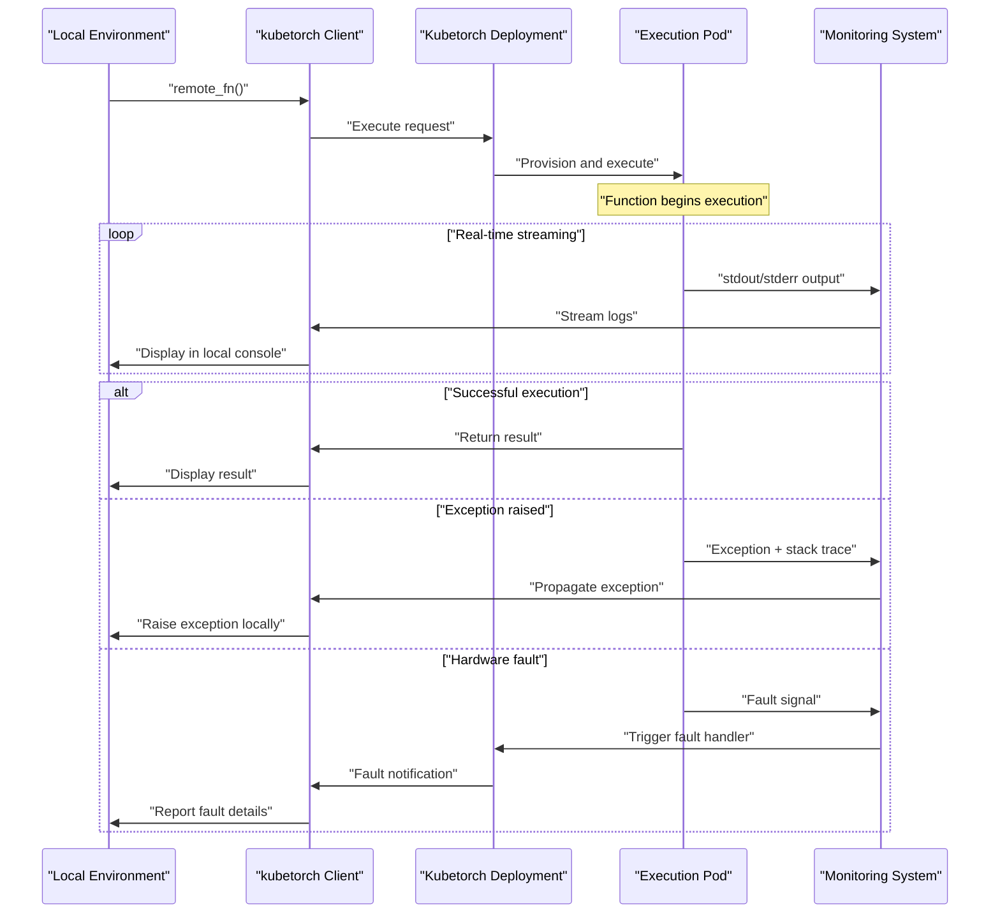
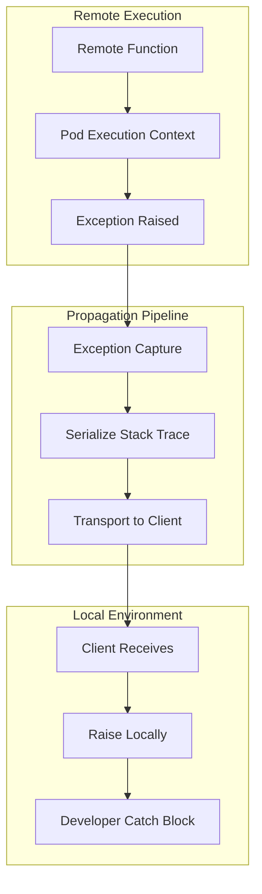
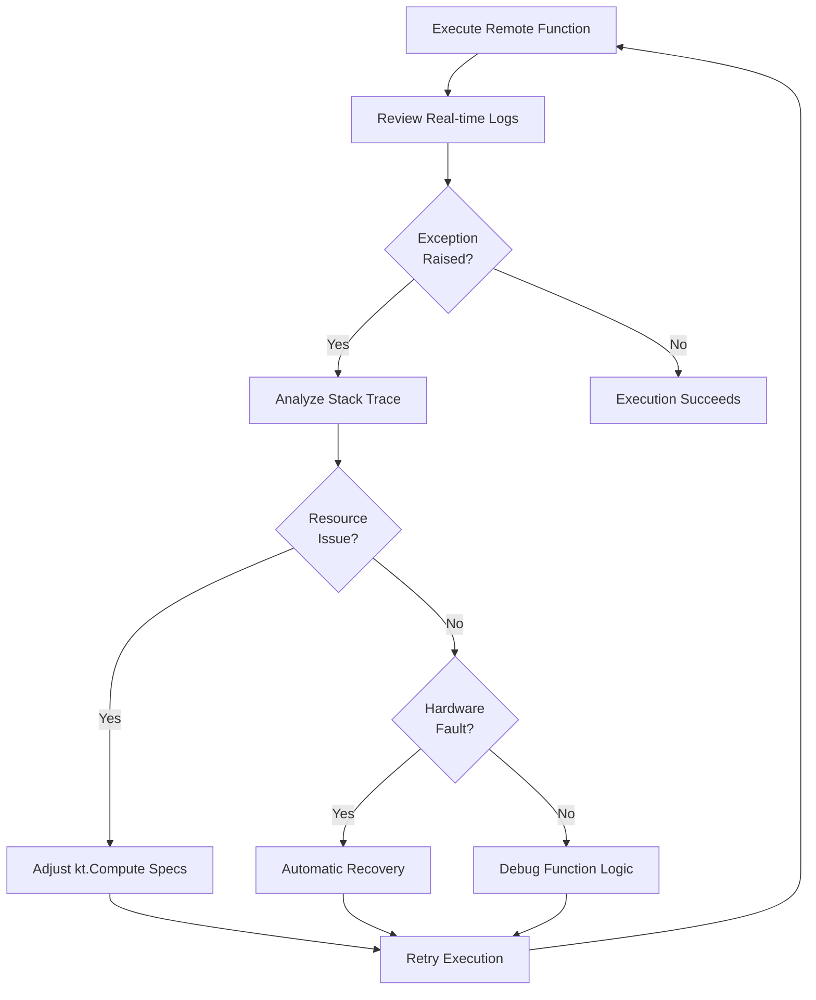
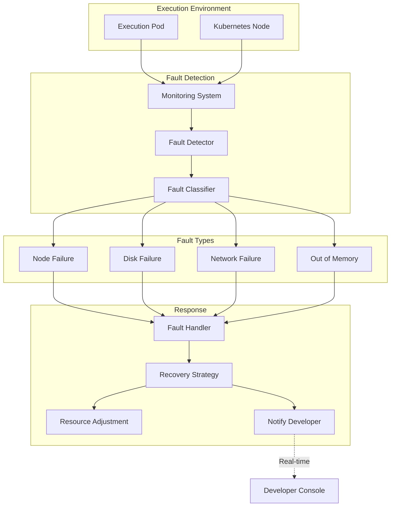
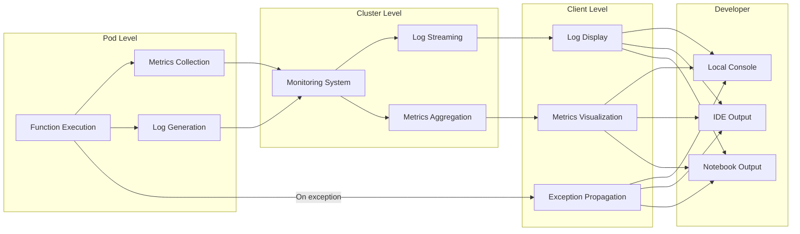

<!-- source: DeepWiki mcp.deepwiki.com · repo run-house/kubetorch · page 9.2 Debugging and Logging · fetched 2026-10-21 -->

# Debugging and Logging

<details>
<summary>Relevant source files</summary>

The following files were used as context for generating this wiki page:

- [README.md](README.md)

</details>


This page documents Kubetorch's debugging capabilities and logging infrastructure. It explains how logs are accessed during remote execution, how exceptions are propagated back to the local environment, and techniques for diagnosing execution failures.

For information about fault tolerance and automatic recovery mechanisms, see [Fault Tolerance System](#4.5). For performance troubleshooting, see [Performance Optimization](#9.3).

## Overview

Kubetorch provides real-time log propagation from remote Kubernetes pods back to the local development environment. This enables debugging remote execution with the same immediacy as local code, supporting the system's 1-2 second iteration cycle [README.md:7]().

Key capabilities:
- **Real-time log streaming**: stdout/stderr appear immediately in local environment
- **Exception propagation**: Full stack traces from remote execution
- **Hardware fault detection**: Automatic reporting of node-level failures
- **Execution metrics**: Performance data visible during execution

**Sources:** [README.md:7]()

## Log Propagation Architecture

### Log Flow Diagram



This architecture ensures that all execution output reaches the developer in real-time, regardless of where the code runs [README.md:7]().

**Sources:** [README.md:7]()

## Accessing Logs

### During Execution

Logs appear in the local Python environment automatically as the remote function executes. No special configuration or log retrieval commands are required.

```python
import kubetorch as kt

def process_data():
    print("Starting data processing...")  # Appears immediately in local console
    # Process data
    print("Processing complete")  # Streams in real-time
    return result

compute = kt.Compute(cpus="4")
remote_process = kt.fn(process_data).to(compute)

# Logs stream to console as function executes
result = remote_process()
```

The log streaming mechanism operates continuously during execution, with typical latency under 1 second from remote pod to local display [README.md:7]().

**Sources:** [README.md:7](), [README.md:11-28]()

### Log Streaming Components

| Component | Responsibility | Output Destination |
|-----------|---------------|-------------------|
| Execution Pod | Generates stdout/stderr | Monitoring System |
| Monitoring System | Captures and forwards logs | kubetorch Client |
| kubetorch Client | Receives log stream | Local Python environment |
| Local Environment | Displays logs | Developer console/IDE |

**Sources:** [README.md:7]()

## Exception Propagation

### Exception Flow

Exceptions raised during remote execution are automatically propagated back to the local environment with full stack traces.



The exception propagation mechanism preserves:
- Exception type
- Exception message
- Full stack trace from remote execution
- Local context information

**Sources:** [README.md:7]()

### Handling Remote Exceptions

Remote exceptions can be caught using standard Python exception handling:

```python
import kubetorch as kt

def risky_operation():
    raise ValueError("Invalid parameter encountered")

compute = kt.Compute(cpus=".1")
remote_fn = kt.fn(risky_operation).to(compute)

try:
    result = remote_fn()
except ValueError as e:
    print(f"Caught remote exception: {e}")
    # Stack trace shows remote execution context
```

The exception includes both remote and local stack frames, enabling developers to trace execution flow across the client-server boundary [README.md:7]().

**Sources:** [README.md:7](), [README.md:11-28]()

## Debugging Techniques

### Debugging Workflow



**Sources:** [README.md:7]()

### Common Debugging Patterns

| Issue Type | Symptoms | Debugging Approach |
|------------|----------|-------------------|
| Logic Error | Incorrect output, unexpected behavior | Review real-time logs, use print statements |
| Resource Exhaustion | OOM errors, timeout | Check `kt.Compute` specifications, increase memory/CPUs |
| Hardware Fault | Execution failure without code error | Monitor fault reports, let automatic recovery handle |
| Import Error | Module not found on remote | Ensure dependencies available in execution environment |

**Sources:** [README.md:7]()

### Interactive Debugging

Since Kubetorch supports execution from any Python environment [README.md:9](), standard debugging approaches apply:

**In IDEs (VSCode, PyCharm):**
- Use print statements in remote functions - output appears in local console
- Review exception stack traces in IDE debugger
- Modify code and re-execute with 1-2 second iteration cycle [README.md:7]()

**In Notebooks:**
- Cell output displays real-time logs from remote execution
- Exceptions appear inline with full stack traces
- Rapid iteration enables experimental debugging

**In REPL:**
- Interactive execution with immediate log feedback
- Exception handling at REPL prompt
- Test functions incrementally

**Sources:** [README.md:7](), [README.md:9]()

## Hardware Fault Detection

### Fault Detection System

Kubetorch automatically detects and reports hardware-level faults during execution:



Hardware faults are propagated to the developer in real-time [README.md:7](), along with information about the automatic recovery action being taken.

**Sources:** [README.md:7](), [README.md:35]()

### Fault Categories

| Fault Type | Detection | Developer Notification |
|------------|-----------|----------------------|
| Node Failure | Pod eviction, node unavailable | Immediate notification, automatic rescheduling |
| Out of Memory | OOM killer signal | Stack trace + resource recommendation |
| Network Failure | Connection timeout, DNS errors | Error message with retry information |
| Disk Failure | I/O errors | Immediate notification, automatic rescheduling |

The system achieves 95% fewer production faults through programmatic error recovery and resource adjustment [README.md:35]().

**Sources:** [README.md:7](), [README.md:35]()

## Monitoring and Metrics

### Execution Metrics

The monitoring system collects and streams execution metrics:

| Metric | Description | Access |
|--------|-------------|--------|
| Execution Time | Duration of remote function call | Returned with result |
| Resource Usage | CPU/memory utilization during execution | Available in logs |
| Fault Events | Hardware faults encountered | Real-time notification |
| Retry Count | Number of automatic retries | Included in fault reports |

These metrics inform the fault tolerance system's resource adjustment decisions [README.md:35]().

**Sources:** [README.md:7](), [README.md:35]()

### Diagnostic Information Flow



All diagnostic information flows in real-time to the developer's environment [README.md:7](), enabling immediate visibility into remote execution state.

**Sources:** [README.md:7]()

## Best Practices

### Effective Logging Strategies

1. **Use descriptive log messages**: Include context about execution stage and data being processed
2. **Log at critical points**: Entry/exit of functions, before/after expensive operations
3. **Include diagnostic data**: Print variable values, checkpoint progress
4. **Leverage real-time streaming**: No need to wait for execution completion to see logs

### Exception Handling Guidelines

1. **Catch specific exceptions**: Use specific exception types to handle different failure modes
2. **Let hardware faults propagate**: Automatic recovery handles hardware-level issues
3. **Wrap remote calls in try/except**: Handle expected errors gracefully
4. **Review full stack traces**: Both remote and local context available

### Resource-Related Debugging

When encountering resource issues:
1. Review `kt.Compute` specifications [README.md:21]()
2. Check for OOM errors in logs
3. Increase memory/CPU allocations incrementally
4. Let fault handler automatically adjust resources for known patterns

The system's resource adjustment mechanism learns from failures to optimize future allocations [README.md:35]().

**Sources:** [README.md:7](), [README.md:21](), [README.md:35]()

## Integration with Development Environments

### IDE Integration

Logs and exceptions appear in standard IDE output panes:
- VSCode: Output panel, Debug Console
- PyCharm: Run window, Debug window
- Jupyter: Cell output area

No special IDE plugins or extensions required [README.md:9]().

### CI/CD Integration

In GitHub Actions and other CI systems:
- Logs appear in action logs in real-time
- Exceptions fail the build with full stack traces
- Hardware faults reported in build output

Example from test infrastructure: unit tests run with `pytest --level unit` and logs stream to GitHub Actions output during execution.

**Sources:** [README.md:9]()

## Troubleshooting Debug Issues

### Logs Not Appearing

If logs don't appear in local environment:
1. Verify Kubetorch deployment is running: check Kubernetes pods in `kubetorch` namespace
2. Ensure client and server versions match [README.md:49-50]()
3. Check network connectivity between client and cluster
4. Review Kubernetes deployment logs for monitoring system issues

### Exception Stack Traces Incomplete

If exception information is missing:
1. Ensure exception occurred during function execution (not during setup)
2. Check for serialization issues with custom exception types
3. Review monitoring system logs for exception capture failures

### Hardware Faults Not Detected

If hardware faults aren't reported:
1. Verify monitoring system is deployed [README.md:49-50]()
2. Check fault detection thresholds in deployment configuration
3. Review Kubernetes event logs for node/pod events

**Sources:** [README.md:49-50]()

---

