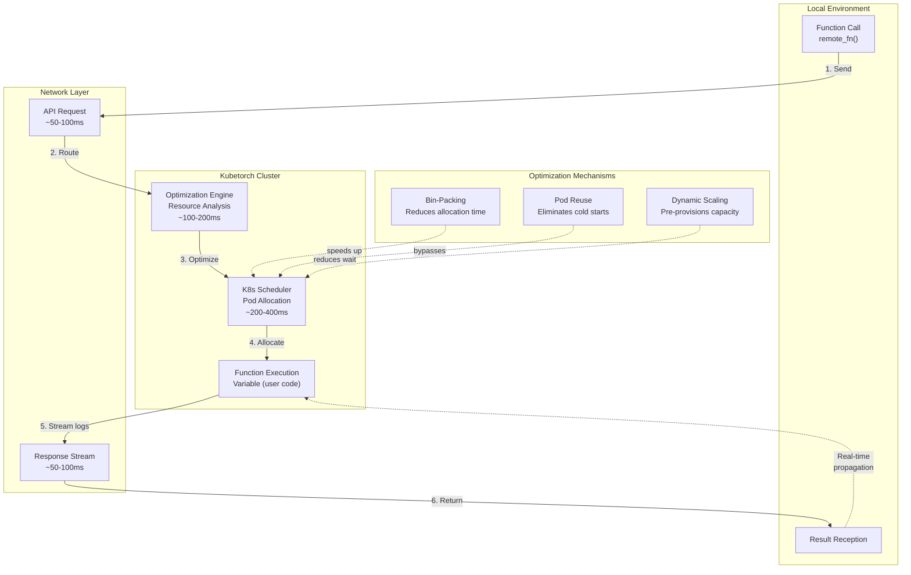
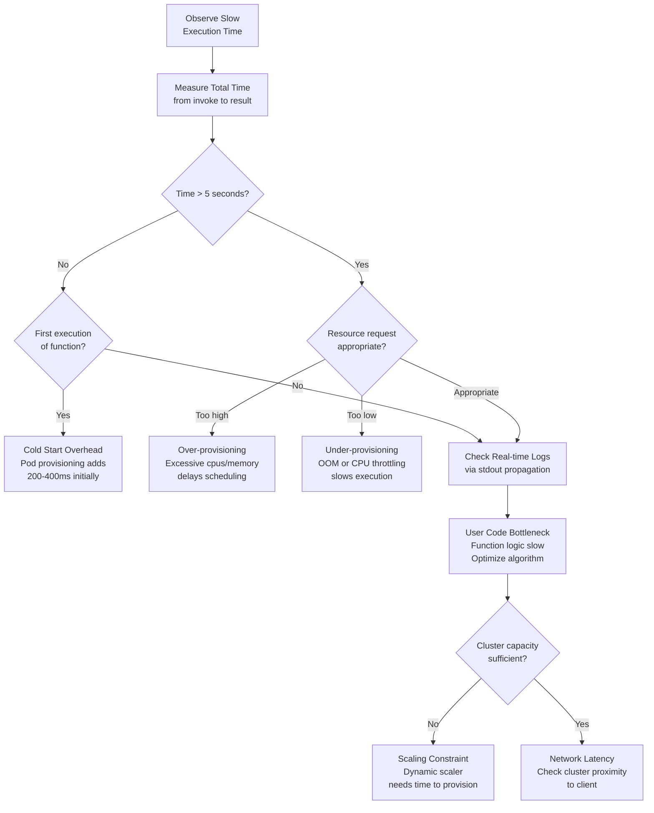
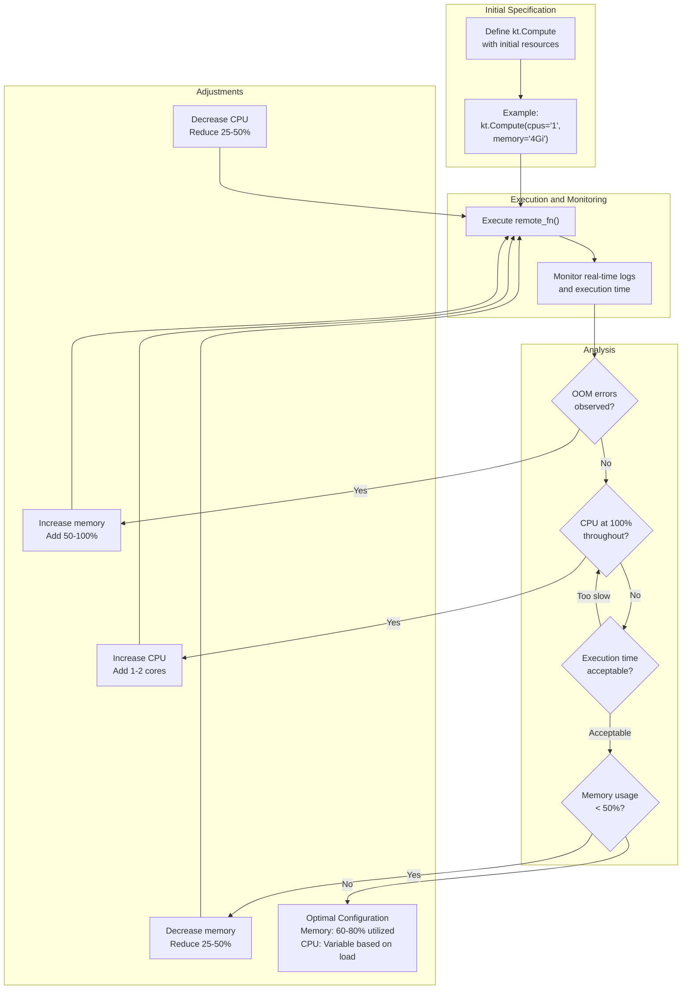
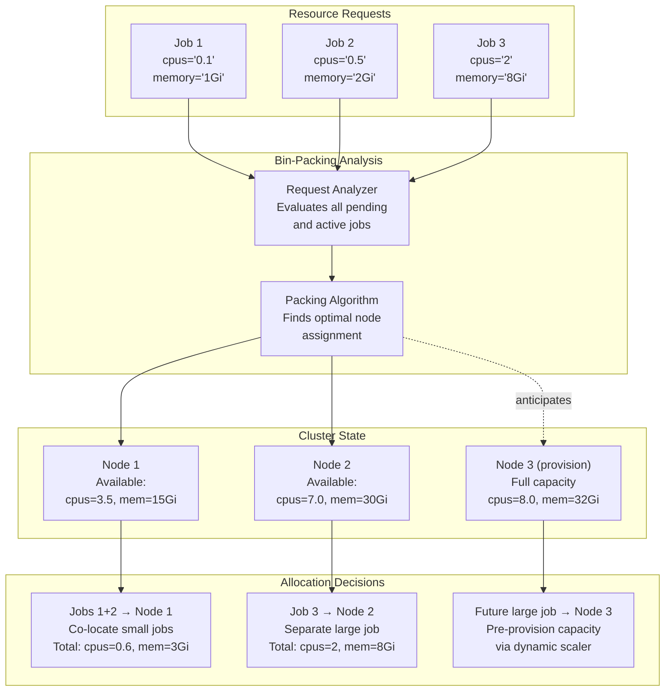
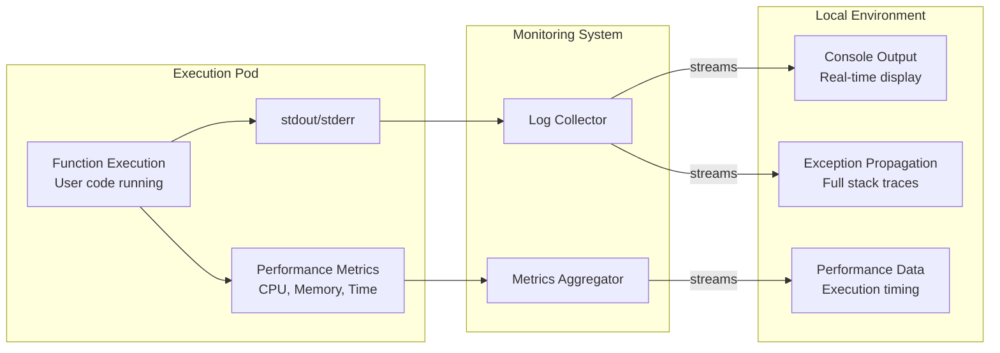
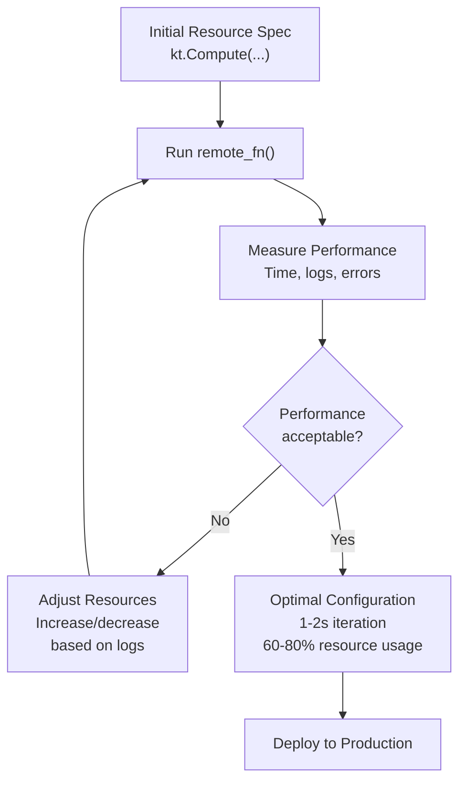

<!-- source: DeepWiki mcp.deepwiki.com · repo run-house/kubetorch · page 9.3 Performance Optimization · fetched 2026-10-21 -->

# Performance Optimization

<details>
<summary>Relevant source files</summary>

The following files were used as context for generating this wiki page:

- [README.md](README.md)

</details>


## Purpose and Scope

This document provides guidance for diagnosing and resolving performance issues in Kubetorch, understanding iteration speed characteristics, and optimizing resource utilization. It focuses on practical troubleshooting and tuning strategies for achieving the expected 1-2 second iteration cycles and optimal cost efficiency.

For information about the internal optimization mechanisms (bin-packing algorithms, dynamic scaling), see [Optimization Engine](#4.4). For details on resource management architecture, see [Resource Management](#4.3). For API-level resource specification options, see [kt.Compute](#5.2).

---

## Understanding Performance Characteristics

### Expected Iteration Speed

Kubetorch targets 1-2 second iteration cycles for remote function execution, representing a 100x improvement over traditional Kubernetes workflows. This iteration time includes:

1. Function invocation from local environment
2. Request routing to Kubernetes cluster
3. Pod allocation or reuse (via optimization engine)
4. Function execution
5. Result and log streaming back to local environment

**Sources:** [README.md:7](), [README.md:33]()

### Performance Components

The following diagram shows the components that contribute to overall iteration performance:



**Key Performance Factors:**

| Component | Typical Latency | Optimization Strategy |
|-----------|----------------|----------------------|
| Network roundtrip | 50-200ms | Minimize by cluster proximity |
| Resource optimization | 100-200ms | Cached via bin-packing engine |
| Pod allocation (cold) | 200-400ms | Eliminated via pod reuse |
| Pod allocation (warm) | 0-50ms | Achieved through pooling |
| Function execution | Variable | User code dependent |
| Log streaming | Real-time | Concurrent with execution |

**Sources:** [README.md:7](), [README.md:33]()

---

## Diagnosing Performance Issues

### Performance Analysis Workflow

Use the following decision tree to diagnose performance issues:



**Sources:** [README.md:7](), [README.md:33-35]()

### Common Symptoms and Causes

| Symptom | Likely Cause | Diagnostic Approach |
|---------|-------------|---------------------|
| First call slow (>2s), subsequent fast | Cold start overhead | Expected behavior; warm pool improves |
| All calls consistently slow (>5s) | Over-provisioned resources | Reduce `cpus` or `memory` in `kt.Compute` |
| Intermittent OOM errors | Under-provisioned memory | Increase `memory` parameter |
| Slow execution, high CPU in logs | CPU throttling | Increase `cpus` parameter |
| Network timeout errors | Cluster unreachable | Check cluster connectivity |
| Queueing delays | Cluster capacity exhausted | Monitor dynamic scaler, consider capacity |

**Sources:** [README.md:7-9](), [README.md:21]()

---

## Optimizing Resource Specifications

### Resource Right-Sizing Strategy

The `kt.Compute` resource specification directly impacts both performance and cost. Follow this optimization flow:



**Sources:** [README.md:21](), [README.md:34]()

### CPU Specification Guidelines

| Workload Type | Recommended CPU | Rationale |
|---------------|----------------|-----------|
| I/O-bound tasks (API calls, file ops) | `cpus="0.1"` to `cpus="0.5"` | Minimal compute; avoid over-allocation |
| Light compute (data transformation) | `cpus="1"` to `cpus="2"` | Balanced for typical processing |
| Compute-intensive (ML training) | `cpus="4"` to `cpus="16"` | Match to algorithm parallelism |
| Distributed workloads | `cpus="16"+` | Multi-node training, RL environments |

**Example:**
```python
# I/O-bound: Minimal CPU allocation
compute_io = kt.Compute(cpus="0.1")

# Compute-intensive: Higher allocation
compute_ml = kt.Compute(cpus="4", memory="16Gi")
```

**Sources:** [README.md:21]()

### Memory Specification Guidelines

| Workload Type | Recommended Memory | Rationale |
|---------------|-------------------|-----------|
| Minimal data processing | `memory="1Gi"` to `memory="4Gi"` | Small datasets, simple operations |
| Standard ML workloads | `memory="8Gi"` to `memory="16Gi"` | Model training, medium datasets |
| Large model training | `memory="32Gi"` to `memory="128Gi"` | LLMs, large batch sizes |
| Data-intensive tasks | `memory="64Gi"+` | Large dataset loading |

**Warning:** Over-provisioning memory delays pod scheduling due to bin-packing constraints. Start conservative and scale up based on actual usage.

**Sources:** [README.md:21](), [README.md:34]()

---

## Understanding the Optimization Engine

### How Bin-Packing Affects Performance

Kubetorch's bin-packing engine optimizes pod placement to reduce costs while maintaining performance. Understanding its behavior helps optimize resource requests:



**Performance Implications:**

1. **Small Jobs (< 1 CPU):** Packed together on shared nodes; minimal scheduling delay (~50-100ms)
2. **Medium Jobs (1-4 CPUs):** May wait for optimal node availability; slight delay if cluster fragmented (~200-400ms)
3. **Large Jobs (> 4 CPUs):** May trigger node provisioning; longer initial wait but subsequent executions fast

**Optimization Strategy:** Request resources that align with typical node sizes. On standard clusters, multiples of 1 CPU and 4Gi memory pack most efficiently.

**Sources:** [README.md:34]()

### Dynamic Scaling Behavior

The dynamic scaler anticipates resource needs and pre-provisions capacity. Performance characteristics:

| Scenario | Scaler Behavior | Performance Impact |
|----------|----------------|-------------------|
| Steady load | Maintains optimal pool size | Minimal latency (50-100ms) |
| Sudden spike | Provisions new nodes | First few requests slower (2-5s), then fast |
| Decreasing load | Gradually scales down | No impact (uses existing capacity) |
| Periodic patterns | Learns and pre-provisions | Anticipates demand, maintains speed |

**Best Practice:** For predictable workloads, allow 30-60 seconds of warm-up for the scaler to provision adequate capacity. Subsequent iterations will be fast.

**Sources:** [README.md:34]()

---

## Monitoring Performance

### Real-Time Log Analysis

Kubetorch propagates logs and exceptions in real-time, enabling immediate performance diagnosis:



**Accessing Performance Data:**

The real-time log stream automatically includes:
- Function execution start/end timestamps
- Resource utilization snapshots
- Exception traces with full context
- Hardware fault notifications

**Example Log Output:**
```
[2024-01-15 10:23:45] Function started on pod-xyz123
[2024-01-15 10:23:45] Allocated: cpus=2, memory=8Gi
[2024-01-15 10:23:46] CPU usage: 45%, Memory: 2.3Gi/8Gi
[2024-01-15 10:23:47] Function completed in 1.84s
```

**Sources:** [README.md:7-9]()

### Identifying Performance Bottlenecks from Logs

| Log Pattern | Indicates | Action |
|-------------|-----------|--------|
| `Allocated: cpus=X` followed by `CPU usage: 98-100%` | CPU saturation | Increase `cpus` in `kt.Compute` |
| `Memory: Y.YGi/ZGi` where Y ≈ Z | Memory pressure | Increase `memory` in `kt.Compute` |
| `OOMKilled` or `Exit code 137` | Out of memory | Increase `memory` significantly (2x) |
| Long delay between "Function started" and first output | Cold start | Expected on first run; warm pool improves |
| `Waiting for node allocation` | Cluster capacity | Dynamic scaler provisioning; wait or increase capacity |
| `Function completed in Xs` where X > 5 | Execution bottleneck | Profile user code, not Kubetorch overhead |

**Sources:** [README.md:7]()

---

## Common Performance Bottlenecks

### Over-Provisioning Resources

**Symptom:** Scheduling delays despite available cluster capacity.

**Cause:** Requesting excessive resources (e.g., `cpus="16"` for a simple task) forces the bin-packing engine to wait for large contiguous resource blocks.

**Solution:**
```python
# ❌ Over-provisioned for simple task
compute = kt.Compute(cpus="16", memory="64Gi")
remote_fn = kt.fn(simple_function).to(compute)

# ✅ Right-sized
compute = kt.Compute(cpus="1", memory="4Gi")
remote_fn = kt.fn(simple_function).to(compute)
```

**Impact:** Right-sizing can reduce scheduling latency from 2-5 seconds to 100-200ms.

**Sources:** [README.md:21](), [README.md:34]()

### Under-Provisioning Resources

**Symptom:** OOM errors, CPU throttling, or unexpectedly slow execution.

**Cause:** Insufficient memory or CPU allocation causes kernel to kill process or throttle execution.

**Solution:**
```python
# ❌ Under-provisioned for ML training
compute = kt.Compute(cpus="1", memory="2Gi")
remote_fn = kt.fn(train_model).to(compute)

# ✅ Adequate resources
compute = kt.Compute(cpus="4", memory="16Gi")
remote_fn = kt.fn(train_model).to(compute)
```

**Impact:** Adequate provisioning eliminates OOM failures and ensures consistent 1-2 second iteration times.

**Sources:** [README.md:21]()

### Network Latency

**Symptom:** Consistent 500ms+ overhead on all requests.

**Cause:** Cluster located far from client (e.g., client in US-East, cluster in EU-West).

**Solution:**
- Deploy Kubetorch cluster in same region as client
- Use regional Kubernetes clusters
- Consider Kubetorch Serverless for optimal routing

**Impact:** Reducing network latency from 500ms to 50ms improves perceived iteration speed significantly.

**Sources:** [README.md:60-62]()

### Cold Start Overhead

**Symptom:** First execution slow (2-5s), subsequent executions fast (<2s).

**Cause:** Initial pod provisioning, container pull, and resource allocation.

**Solution:**
This is expected behavior. The optimization engine maintains a warm pool of pods for frequently-used resource configurations. After the first execution, subsequent calls reuse existing pods.

**Mitigation Strategy:**
```python
# Pre-warm the pool with a dummy execution
compute = kt.Compute(cpus="4", memory="16Gi")
remote_fn = kt.fn(my_function).to(compute)

# First call: slower (cold start)
remote_fn()

# Subsequent calls: fast (warm pool)
for i in range(100):
    remote_fn()  # All ~1-2 seconds
```

**Sources:** [README.md:33]()

---

## Optimization Best Practices

### Resource Specification Checklist

When defining `kt.Compute` resources:

| Consideration | Recommendation |
|--------------|----------------|
| Start conservative | Begin with small allocations (`cpus="0.5"`, `memory="2Gi"`) |
| Monitor actual usage | Check logs for CPU/memory utilization |
| Iterate quickly | Adjust and re-run; 1-2 second cycles enable rapid tuning |
| Match workload type | I/O-bound vs compute-intensive requires different specs |
| Consider bin-packing | Prefer resource multiples (1, 2, 4 CPUs; 4, 8, 16 Gi memory) |
| Test at scale | Verify performance with production-representative data |

**Sources:** [README.md:21](), [README.md:34]()

### Leveraging the Optimization Engine

To maximize benefit from Kubetorch's optimization engine:

1. **Submit Multiple Jobs:** The bin-packing engine optimizes across all pending jobs. Submitting batches of similar-sized jobs improves packing efficiency.

2. **Use Consistent Resource Specs:** Repeatedly using the same `kt.Compute` configuration allows the system to maintain a warm pool, eliminating cold starts.

3. **Allow Warm-Up Time:** For large workloads, the first few requests may be slower as the dynamic scaler provisions capacity. Subsequent requests will be fast.

4. **Monitor Cost Savings:** The 50%+ cost savings claimed by Kubetorch come from the optimization engine. Under-utilized resources indicate opportunities for right-sizing.

**Sources:** [README.md:34]()

### Iterative Optimization Workflow



**Key Insight:** The 1-2 second iteration time enables rapid experimentation. Use it to quickly find optimal resource configurations.

**Sources:** [README.md:7](), [README.md:33]()

---

## Performance Metrics Summary

Expected performance characteristics after optimization:

| Metric | Target | Measurement Method |
|--------|--------|-------------------|
| Iteration time (warm) | 1-2 seconds | Time from `remote_fn()` call to result |
| Iteration time (cold) | 2-5 seconds | First execution of new resource spec |
| CPU utilization | 60-90% | From real-time logs during execution |
| Memory utilization | 60-80% | From real-time logs during execution |
| OOM error rate | < 1% | Count of `OOMKilled` events |
| Cost efficiency | 50%+ savings vs. naive allocation | Compare to over-provisioned baseline |

**Sources:** [README.md:7](), [README.md:33-35]()

---

## Troubleshooting Performance Issues

For specific performance issues not covered here:

- **Connectivity issues:** See [Common Issues](#9.1)
- **Debugging execution failures:** See [Debugging and Logging](#9.2)
- **Cluster capacity planning:** See [Kubernetes Deployment](#7.1)
- **Advanced resource management:** See [Optimization Engine](#4.4)

For community support with performance optimization:
- Join the [Slack community](https://join.slack.com/t/kubetorch/shared_invite/zt-3g76q5i4j-uP60AdydxnAmjGVAQhtALA)
- Review the [documentation](https://www.run.house/kubetorch/introduction)
- Contact support at hello@run.house

**Sources:** [README.md:60-68]()

---

