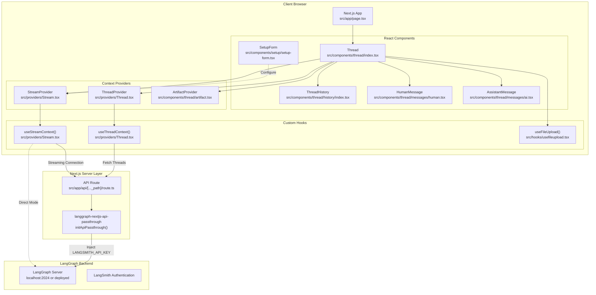
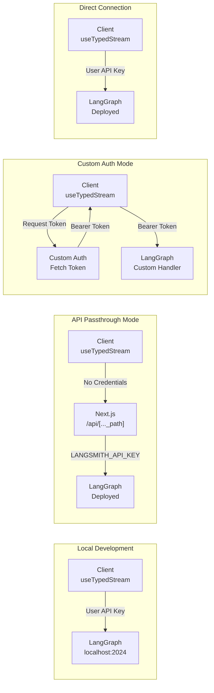

<!-- source: DeepWiki mcp.deepwiki.com · repo langchain-ai/agent-chat-ui · page 1 Overview · fetched 2026-10-26 -->

# Overview

<details>
<summary>Relevant source files</summary>

The following files were used as context for generating this wiki page:

- [.codespellignore](.codespellignore)
- [.env.example](.env.example)
- [README.md](README.md)
- [package.json](package.json)
- [src/app/api/[..._path]/route.ts](src/app/api/[..._path]/route.ts)

</details>


This document provides a high-level introduction to the agent-chat-ui repository, explaining its purpose, key features, architecture, and core systems. For installation and configuration details, see [Installation and Setup](#1.1). For information about specific subsystems, refer to the appropriate section: [Core Architecture](#2), [Message System](#3), [Agent Inbox System](#4), or [API Integration](#9).

## Purpose and Scope

Agent Chat UI is a Next.js-based web application that provides a chat interface for interacting with LangGraph agents. The application connects to LangGraph servers (local or deployed) and enables real-time conversation with AI agents that have a `messages` key in their state. The system supports advanced features including streaming responses, multimodal content (images, PDFs), file uploads, tool call visualization, human-in-the-loop interrupts, and thread management.

**Sources**: [README.md:1-3](), [package.json:1-10]()

## Application Identity

The repository is named `agent-chat-ui` and is maintained at https://github.com/langchain-ai/agent-chat-ui. A production deployment is available at https://agentchat.vercel.app. The application can be quickly bootstrapped using the `create-agent-chat-app` npx command.

```
Repository: git+https://github.com/langchain-ai/agent-chat-ui.git
Homepage: https://agentchat.vercel.app
Package Manager: pnpm@10.5.1
```

**Sources**: [package.json:2-8](), [package.json:87](), [README.md:13-17]()

## Key Features

### Real-Time Streaming Communication

The application establishes streaming connections to LangGraph servers using the `@langchain/langgraph-sdk` package. Messages stream in real-time as the agent processes them, providing immediate feedback to users. The system handles multiple event types including standard messages, UI-specific events, tool calls, and agent interrupts.

### Multimodal Content Support

Users can upload images (JPEG, PNG, GIF, WebP) and PDF files through three input methods: file selection, drag-and-drop, and clipboard paste. Files are converted to Base64-encoded content blocks and transmitted alongside text messages. The system displays uploaded content with appropriate preview components.

**Sources**: [package.json:22-24](), [README.md:3]()

### Agent Inbox and Human-in-the-Loop

When agents require human input, the system displays specialized interrupt interfaces. The Agent Inbox feature provides structured interaction options including accepting proposals, editing arguments, providing free-text responses, or ignoring interrupts. This enables sophisticated human-AI collaboration workflows.

For details, see [Agent Inbox System](#4).

### Thread Management and History

The application maintains conversation threads with persistent storage. Users can view thread history, switch between conversations, and resume previous interactions. The system automatically synchronizes thread lists when new conversations are created.

For details, see [Thread History and Management](#5).

### Artifact Rendering

The system supports rendering supplementary content in a side panel separate from the main chat interface. Agents can trigger artifact display for extended content like documents, code editors, or custom visualizations using React Portal-based rendering.

For details, see [Artifact System](#2.4).

**Sources**: [README.md:126-186]()

## System Architecture

The following diagram shows the complete application architecture, mapping high-level concepts to specific code entities:



**Architecture Overview:**

The application follows a three-tier architecture:

1. **Client Layer**: React components managed by Next.js handle UI rendering and user interactions. The `Thread` component at [src/components/thread/index.tsx]() serves as the primary interface.

2. **Server Layer**: Next.js API routes at [src/app/api/[..._path]/route.ts]() provide optional server-side proxying using the `langgraph-nextjs-api-passthrough` package.

3. **Backend Layer**: LangGraph servers (local development at `localhost:2024` or deployed instances) execute agent logic and stream responses.

The system uses React Context for state management, with three primary providers: `StreamProvider` for message streaming, `ThreadProvider` for conversation management, and `ArtifactProvider` for side panel content.

**Sources**: [package.json:21-57](), [src/app/api/[..._path]/route.ts:1-11](), [README.md:41-49]()

## Core Systems Overview

The application is organized into several interconnected systems:

### Component Hierarchy

The `Thread` component is the main interface, integrating message display, user input, file uploads, and thread history. It orchestrates interactions between multiple child components and context providers. See [Thread Component](#2.1) for details.

Message rendering is handled by specialized components: `HumanMessage` for user messages with editing capabilities, and `AssistantMessage` for AI responses with support for tool calls, custom UI, and interrupts. See [Message System](#3) for details.

### State Management Architecture

State is distributed across multiple layers:

- **URL State**: Query parameters managed by the `nuqs` library provide persistence for navigation (thread IDs, API URLs, assistant IDs)
- **Context State**: Three React Context providers manage global state for streaming, threads, and artifacts
- **Local State**: Component-specific state handles ephemeral concerns like text input and file uploads

See [State Management](#8) for details.

**Sources**: [package.json:43]()

### API Integration Patterns

The system supports three deployment modes:

1. **API Passthrough** (production-recommended): Next.js routes proxy requests, injecting server-side credentials
2. **Direct Connection**: Client communicates directly with LangGraph using user-provided credentials
3. **Custom Authentication**: Bearer token-based authentication with custom handlers

Configuration follows a three-tier priority: URL parameters → environment variables → local storage. See [API Integration](#9) for details.

**Sources**: [README.md:186-242](), [.env.example:1-14]()

## Deployment Modes Comparison



**Deployment Mode Summary:**

| Mode | Authentication | Credentials Exposed | Use Case |
|------|----------------|---------------------|----------|
| Local Development | User-provided API key | Client-side | Development with `localhost:2024` |
| API Passthrough | Server-injected | Server-side only | Production (recommended) |
| Direct Connection | User-provided API key | Client-side | Simple deployments |
| Custom Auth | Bearer tokens | Token only | Enterprise with custom auth |

**Configuration Priority:**
1. URL query parameters (`?apiUrl=...&assistantId=...`)
2. Environment variables (`NEXT_PUBLIC_API_URL`, `NEXT_PUBLIC_ASSISTANT_ID`)
3. Local storage (API key only)

If configuration is incomplete, the `SetupForm` component prompts users for required values.

**Sources**: [README.md:186-242](), [.env.example:1-14](), [src/app/api/[..._path]/route.ts:1-11]()

## Technology Stack

The application is built with modern web technologies:

### Framework and Language

- **Next.js 15.2.3**: React framework providing server-side rendering, API routes, and build optimization
- **React 19.0.0**: UI library with concurrent features and new hooks
- **TypeScript 5.7.2**: Type-safe JavaScript with strict compiler options

**Sources**: [package.json:75](), [package.json:44](), [package.json:81]()

### LangGraph Integration

- **@langchain/langgraph 0.2.63**: LangGraph client library for TypeScript
- **@langchain/langgraph-sdk 0.1.0**: SDK with streaming support and React UI components
- **@langchain/core 0.3.44**: Core LangChain primitives and message types
- **langgraph-nextjs-api-passthrough 0.0.4**: Next.js API proxy for production deployments

**Sources**: [package.json:22-24](), [package.json:39]()

### UI Components and Styling

- **Radix UI**: Accessible component primitives (Avatar, Dialog, Label, Separator, Slot, Switch, Tooltip)
- **Tailwind CSS 4.0.13**: Utility-first CSS framework with JIT compilation
- **lucide-react 0.476.0**: Icon library with consistent design
- **framer-motion 12.4.9**: Animation library for smooth transitions
- **sonner 2.0.1**: Toast notification system

**Sources**: [package.json:25-32](), [package.json:41](), [package.json:37](), [package.json:52](), [package.json:80]()

### Content Rendering

- **react-markdown 10.0.1**: Markdown parsing and rendering
- **react-syntax-highlighter 15.5.0**: Code block syntax highlighting
- **remark-gfm 4.0.1**: GitHub Flavored Markdown support
- **remark-math 6.0.0**: Mathematical expression parsing
- **rehype-katex 7.0.1**: LaTeX math rendering with KaTeX
- **katex 0.16.21**: Fast math typesetting library

**Sources**: [package.json:46-51](), [package.json:38]()

### State Management

- **nuqs 2.4.1**: Type-safe URL query parameter state management with Next.js App Router support
- **React Context API**: Built-in state management for providers

**Sources**: [package.json:43]()

### Development Tools

- **ESLint 9.19.0**: Linting with Next.js and React Hooks plugins
- **Prettier 3.5.3**: Code formatting with Tailwind CSS plugin
- **pnpm 10.5.1**: Fast, disk-efficient package manager

**Sources**: [package.json:70-72](), [package.json:77](), [package.json:87]()

## Project Structure

The codebase follows Next.js App Router conventions:

```
src/
├── app/                    # Next.js App Router
│   ├── page.tsx           # Main application page
│   └── api/               # API routes
│       └── [..._path]/    # LangGraph proxy
├── components/            # React components
│   ├── thread/           # Chat interface components
│   ├── setup/            # Configuration forms
│   └── ui/               # Reusable UI primitives
├── providers/            # React Context providers
│   ├── Stream.tsx        # Streaming state management
│   └── Thread.tsx        # Thread list management
├── hooks/                # Custom React hooks
└── lib/                  # Utility functions
```

**Sources**: [package.json:2]()

## Getting Started

To begin using the application:

1. **Installation**: Use `npx create-agent-chat-app` or clone the repository and run `pnpm install`
2. **Configuration**: Set environment variables or use the interactive setup form (see [Installation and Setup](#1.1))
3. **Development**: Run `pnpm dev` to start the development server at `http://localhost:3000`
4. **Production**: Configure API passthrough or custom authentication (see [API Integration](#9))

The deployed version is available at https://agentchat.vercel.app for immediate use without local setup.

**Sources**: [README.md:13-40](), [README.md:10-11]()

---

