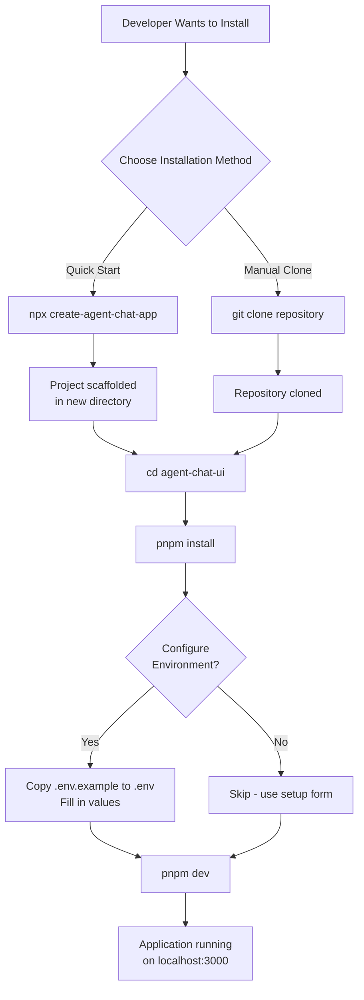
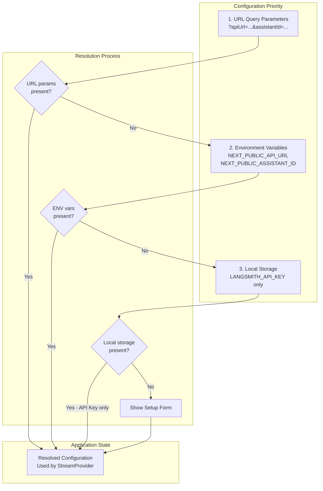
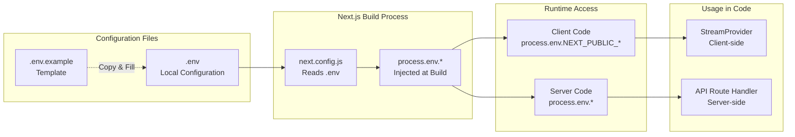
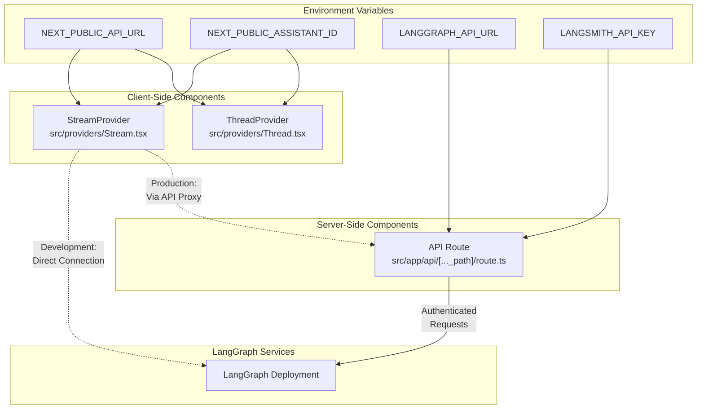

<!-- source: DeepWiki mcp.deepwiki.com · repo langchain-ai/agent-chat-ui · page 1.1 Installation and Setup · fetched 2026-10-26 -->

# Installation and Setup

<details>
<summary>Relevant source files</summary>

The following files were used as context for generating this wiki page:

- [.codespellignore](.codespellignore)
- [.env.example](.env.example)
- [README.md](README.md)
- [package.json](package.json)
- [pnpm-lock.yaml](pnpm-lock.yaml)
- [src/app/api/[..._path]/route.ts](src/app/api/[..._path]/route.ts)

</details>


This document covers the installation and initial configuration of the agent-chat-ui application. It provides step-by-step instructions for installing dependencies, configuring environment variables, and running the application in development mode. For production deployment configuration, see [API Integration](#9) and [API Passthrough for Production](#9.2).

## Purpose and Scope

This page guides developers through:
- Installing the application and its dependencies
- Configuring the development environment
- Running the application locally
- Understanding the configuration priority system

For information about connecting to production LangGraph deployments, see [API Passthrough for Production](#9.2). For custom authentication setups, see [Custom Authentication](#9.3).

---

## Prerequisites

The agent-chat-ui application requires the following tools:

| Tool | Version | Purpose |
|------|---------|---------|
| Node.js | ≥18.0.0 | JavaScript runtime |
| pnpm | 10.5.1 | Package manager |

The application uses **pnpm** as its package manager, as specified in [package.json:87](). While npm or yarn may work, pnpm is the officially supported package manager.

**Sources:** [package.json:87](), [pnpm-lock.yaml:1-6]()

---

## Installation Methods

### Installation Flow



### Method 1: Using npx (Recommended)

The quickest way to create a new instance is using the `create-agent-chat-app` scaffolding tool:

```bash
npx create-agent-chat-app
```

This command creates a new directory with the application pre-configured.

### Method 2: Clone Repository

For direct repository access or contributing to the project:

```bash
git clone https://github.com/langchain-ai/agent-chat-ui.git
cd agent-chat-ui
```

Both methods result in the same application structure.

**Sources:** [README.md:13-25]()

---

## Dependency Installation

After obtaining the application, install dependencies using pnpm:

```bash
pnpm install
```

This command:
1. Reads [package.json:21-57]() for production dependencies
2. Reads [package.json:59-82]() for development dependencies
3. Resolves and installs all transitive dependencies
4. Creates `node_modules/` directory
5. Updates [pnpm-lock.yaml:1]() lockfile

### Key Dependencies Installed

| Category | Package | Version | Purpose |
|----------|---------|---------|---------|
| Framework | `next` | ^15.2.3 | Next.js application framework |
| LangGraph | `@langchain/langgraph-sdk` | ^0.1.0 | LangGraph client SDK |
| LangGraph | `@langchain/langgraph` | ^0.2.63 | LangGraph runtime |
| LangGraph | `@langchain/core` | ^0.3.44 | LangChain core abstractions |
| Proxy | `langgraph-nextjs-api-passthrough` | ^0.0.4 | API passthrough for production |
| State Management | `nuqs` | ^2.4.1 | URL-based state management |
| UI Components | `@radix-ui/*` | Various | Accessible UI primitives |
| Styling | `tailwindcss` | ^4.0.13 | CSS framework |

The `pnpm-lock.yaml` file ensures reproducible builds by locking exact versions of all dependencies and their transitive dependencies.

**Sources:** [package.json:21-57](), [package.json:59-82](), [pnpm-lock.yaml:1-189]()

---

## Running the Application

### Development Mode

Start the development server:

```bash
pnpm dev
```

This executes the `dev` script defined in [package.json:13](), which runs `next dev`. The application will be available at:

```
http://localhost:3000
```

The Next.js development server provides:
- Hot module replacement (HMR)
- Fast refresh for React components
- TypeScript compilation
- Error overlay for debugging

### Available Scripts

The [package.json:12-19]() defines several utility scripts:

| Script | Command | Purpose |
|--------|---------|---------|
| `pnpm dev` | `next dev` | Start development server |
| `pnpm build` | `next build` | Build production bundle |
| `pnpm start` | `next start` | Start production server |
| `pnpm lint` | `next lint` | Run ESLint checks |
| `pnpm lint:fix` | `next lint --fix` | Fix ESLint issues |
| `pnpm format` | `prettier --write .` | Format all files |
| `pnpm format:check` | `prettier --check .` | Check formatting |

**Sources:** [package.json:12-19](), [README.md:33-39]()

---

## Configuration System

### Configuration Priority

The application uses a three-tier configuration priority system:



### Environment Variables

Create a `.env` file in the project root using [.env.example:1-14]() as a template:

```bash
cp .env.example .env
```

#### Development Configuration

For local development with a LangGraph server running on `localhost:2024`:

```bash
# .env file
NEXT_PUBLIC_API_URL=http://localhost:2024
NEXT_PUBLIC_ASSISTANT_ID=agent
```

These variables are defined in [.env.example:1-3]().

#### Variable Definitions

| Variable | Prefix | Purpose | Required |
|----------|--------|---------|----------|
| `NEXT_PUBLIC_API_URL` | `NEXT_PUBLIC_` | LangGraph server URL | Yes |
| `NEXT_PUBLIC_ASSISTANT_ID` | `NEXT_PUBLIC_` | Graph/Assistant identifier | Yes |
| `LANGSMITH_API_KEY` | None | LangSmith authentication (server-only) | Production only |
| `LANGGRAPH_API_URL` | None | Production deployment URL (server-only) | Production only |

The `NEXT_PUBLIC_` prefix makes variables accessible in the browser via `process.env.NEXT_PUBLIC_*`. Variables without this prefix are server-only and remain secure.

**Important:** Never prefix `LANGSMITH_API_KEY` with `NEXT_PUBLIC_` as it is a secret credential. It is used only in [src/app/api/[..._path]/route.ts:9]() for server-side API passthrough.

### Setup Form Behavior

When environment variables are not set, the application displays an interactive setup form on first load. This form collects:

1. **Deployment URL** - The LangGraph server endpoint
2. **Assistant/Graph ID** - The graph identifier
3. **LangSmith API Key** - Authentication for deployed servers (optional for localhost)

Form values are stored in local storage and used for subsequent sessions until explicitly cleared.

### Environment Variable Processing



**Sources:** [.env.example:1-14](), [README.md:51-69](), [src/app/api/[..._path]/route.ts:8-9]()

---

## Production Environment Setup

For production deployments, additional configuration is required. There are two primary approaches:

### API Passthrough Configuration

Configure the following environment variables in your deployment environment:

```bash
NEXT_PUBLIC_ASSISTANT_ID="agent"
LANGGRAPH_API_URL="https://my-agent.default.us.langgraph.app"
NEXT_PUBLIC_API_URL="https://my-website.com/api"
LANGSMITH_API_KEY="lsv2_..."
```

These variables are used by [src/app/api/[..._path]/route.ts:6-11]() to proxy requests with injected authentication.

### Variable Usage by Component



For detailed production setup instructions, see [API Passthrough for Production](#9.2).

**Sources:** [README.md:187-217](), [.env.example:7-13](), [src/app/api/[..._path]/route.ts:1-11]()

---

## Post-Installation File Structure

After successful installation, the project structure includes:

```
agent-chat-ui/
├── .env                    # Local environment variables (created by you)
├── .env.example            # Template for environment variables
├── package.json            # Dependencies and scripts
├── pnpm-lock.yaml          # Locked dependency versions
├── node_modules/           # Installed dependencies (created by pnpm)
├── src/
│   ├── app/
│   │   └── api/
│   │       └── [..._path]/
│   │           └── route.ts  # API passthrough handler
│   ├── providers/
│   │   ├── Stream.tsx       # StreamProvider configuration
│   │   └── Thread.tsx       # ThreadProvider configuration
│   └── components/          # UI components
└── ...
```

The application is now ready for development. Start the server with `pnpm dev` and navigate to `http://localhost:3000`.

**Sources:** [package.json:1-88](), [pnpm-lock.yaml:1](), [.env.example:1-14](), [src/app/api/[..._path]/route.ts:1]()

---

## Verification Steps

After installation, verify the setup:

1. **Check Node.js version:**
   ```bash
   node --version  # Should be ≥18.0.0
   ```

2. **Check pnpm installation:**
   ```bash
   pnpm --version  # Should be 10.5.1 or compatible
   ```

3. **Verify dependencies installed:**
   ```bash
   ls node_modules/@langchain  # Should list langgraph packages
   ```

4. **Test development server:**
   ```bash
   pnpm dev
   # Navigate to http://localhost:3000
   # Should see either setup form or chat interface
   ```

If any step fails, ensure:
- Node.js and pnpm are correctly installed
- `.env` file matches [.env.example:1-14]() structure
- No conflicting processes on port 3000
- Internet connection for dependency downloads

**Sources:** [package.json:13](), [README.md:33-49]()

---

## Next Steps

After successful installation and setup:

1. Configure your LangGraph server connection (see [Configuration System](#9.1))
2. Understand the core architecture (see [Core Architecture](#2))
3. Explore the Stream Provider (see [Stream Provider](#2.2))
4. Learn about message rendering (see [Message System](#3))
5. Set up production deployment (see [API Passthrough for Production](#9.2))

The application is now ready for local development and testing with LangGraph agents.

**Sources:** [README.md:41-49]()

---

