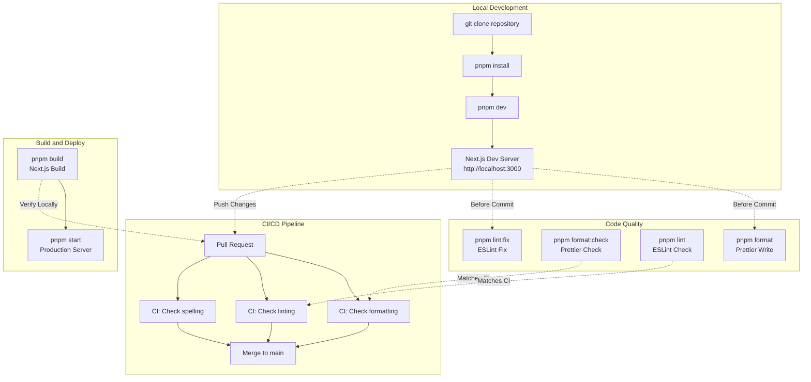
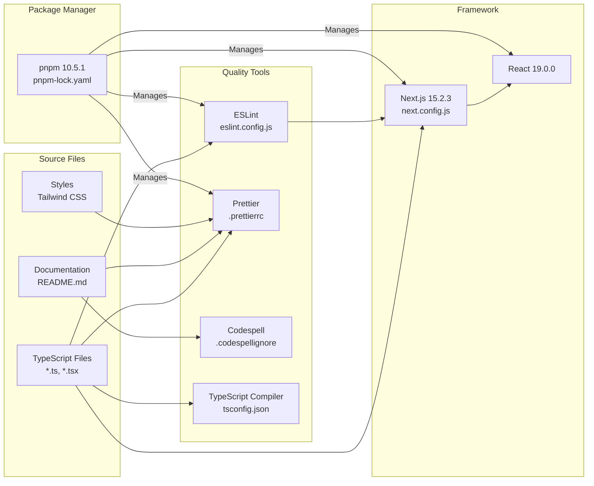
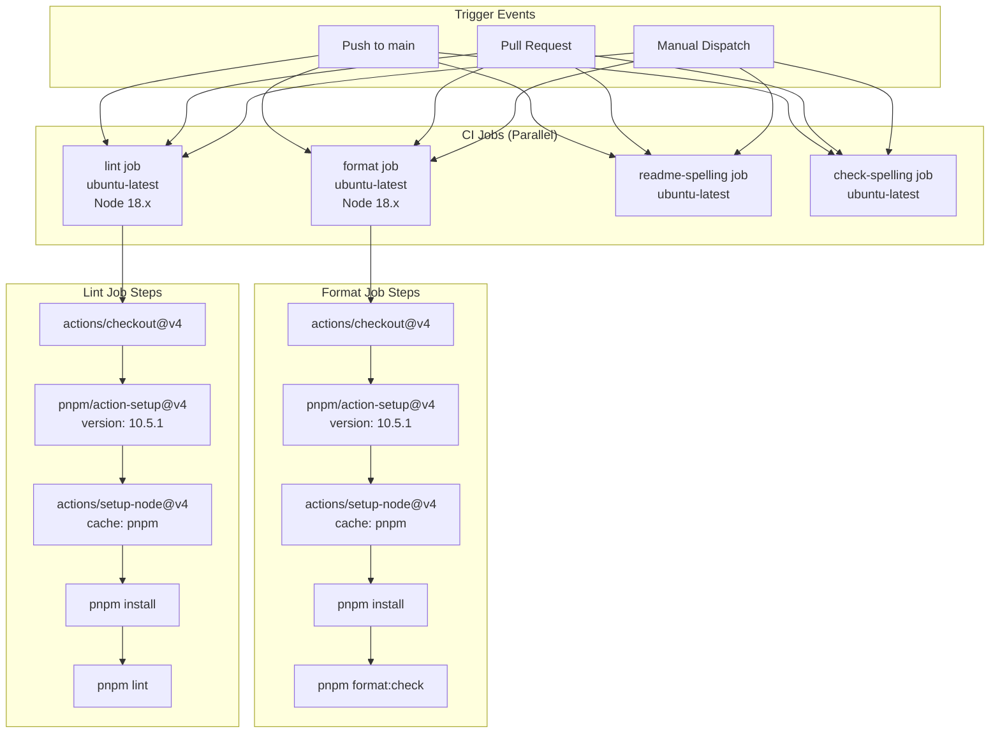

<!-- source: DeepWiki mcp.deepwiki.com · repo langchain-ai/agent-chat-ui · page 10 Development Guide · fetched 2026-10-26 -->

# Development Guide

<details>
<summary>Relevant source files</summary>

The following files were used as context for generating this wiki page:

- [.github/workflows/ci.yml](.github/workflows/ci.yml)
- [eslint.config.js](eslint.config.js)
- [package.json](package.json)

</details>


This document provides an overview of the development workflow, tooling, and configuration for the agent-chat-ui codebase. It covers the build system, quality assurance tools, and development processes that contributors should be familiar with when working on the project.

For detailed information about specific aspects of development:
- Build scripts and CI/CD processes: see [Build and CI System](#10.1)
- TypeScript compiler settings: see [TypeScript Configuration](#10.2)
- Package management with pnpm: see [Dependency Management](#10.3)
- Next.js and ESLint configuration: see [Application Configuration](#10.4)

For information about the runtime architecture and deployment options, see [API Integration](#9).

## Development Workflow Overview

The agent-chat-ui project follows a standard Next.js development workflow with integrated code quality checks. The development process uses **pnpm** as the package manager (version 10.5.1), Next.js for the application framework, and automated CI/CD through GitHub Actions.



**Sources**: [package.json:12-19](), [.github/workflows/ci.yml:21-75]()

## Common Development Commands

The following table lists the primary npm scripts available for development:

| Command | Purpose | Description |
|---------|---------|-------------|
| `pnpm dev` | Start development server | Runs Next.js in development mode with hot-reloading on port 3000 |
| `pnpm build` | Build for production | Creates an optimized production build in `.next/` directory |
| `pnpm start` | Start production server | Serves the production build created by `pnpm build` |
| `pnpm lint` | Check code quality | Runs ESLint to check for code quality issues |
| `pnpm lint:fix` | Fix code issues | Runs ESLint with auto-fix for resolvable issues |
| `pnpm format` | Format code | Runs Prettier to format all files according to style guide |
| `pnpm format:check` | Check formatting | Runs Prettier in check mode without modifying files |

**Sources**: [package.json:12-19]()

## Development Toolchain

The project uses a comprehensive set of tools to maintain code quality and consistency:



**Sources**: [package.json:59-83](), [eslint.config.js:1-33](), [.github/workflows/ci.yml:56-75]()

### TypeScript and ESLint

The codebase is written entirely in TypeScript with strict type checking enabled. **ESLint** configuration extends the recommended configurations from `@eslint/js` and `typescript-eslint`, with additional plugins for React:

- `eslint-plugin-react-hooks`: Enforces Rules of Hooks
- `eslint-plugin-react-refresh`: Warns about non-component exports

Key ESLint rules configured in [eslint.config.js:20-31]():
- `@typescript-eslint/no-explicit-any`: Disabled (allows `any` type)
- `@typescript-eslint/no-unused-vars`: Warns on unused variables, with exceptions for underscore-prefixed names
- `react-refresh/only-export-components`: Warns when non-components are exported from component modules

### Code Formatting

**Prettier** is used for consistent code formatting across the codebase. The configuration includes:
- `prettier-plugin-tailwindcss`: Automatically sorts Tailwind CSS class names

Formatting is enforced in CI via the `format:check` script, which runs `prettier --check .` to verify all files match the style guide without modifying them.

**Sources**: [package.json:78](), [.github/workflows/ci.yml:22-37]()

### Spell Checking

The CI pipeline includes spell checking using **codespell** for both documentation and source code:

1. **README spelling check**: Validates spelling in `README.md` using exceptions from `.codespellignore`
2. **Code spelling check**: Validates spelling in all files under `src/` directory

These checks prevent common typos and maintain documentation quality.

**Sources**: [.github/workflows/ci.yml:56-75]()

## CI/CD Pipeline

The project uses GitHub Actions for continuous integration. The workflow is defined in [.github/workflows/ci.yml]() and runs on:
- Every push to `main` branch
- Every pull request
- Manual workflow dispatch



**Key CI Features**:

1. **Concurrency Control**: The workflow uses `cancel-in-progress: true` to automatically cancel outdated runs when new commits are pushed to the same PR
2. **Parallel Execution**: All four jobs (format, lint, readme-spelling, check-spelling) run in parallel for faster feedback
3. **Cache Optimization**: Node modules are cached using `actions/setup-node` with `cache: "pnpm"` to speed up installation
4. **Consistent Environment**: All jobs use `ubuntu-latest` runners with Node.js 18.x and pnpm 10.5.1

**Sources**: [.github/workflows/ci.yml:1-75]()

## Dependencies Structure

The project dependencies are organized into two categories in [package.json]():

**Runtime Dependencies** ([package.json:21-58]()):
- **LangGraph SDK**: Core integration packages (`@langchain/langgraph-sdk`, `@langchain/langgraph`, `@langchain/core`)
- **Next.js**: Application framework and React runtime
- **UI Libraries**: Radix UI primitives, Lucide icons, Framer Motion animations
- **Content Rendering**: `react-markdown`, `react-syntax-highlighter`, `rehype-katex`, `remark-gfm`
- **State Management**: `nuqs` for URL-based state
- **API Integration**: `langgraph-nextjs-api-passthrough` for production deployment
- **Utilities**: `date-fns`, `lodash`, `uuid`, `zod`

**Development Dependencies** ([package.json:59-83]()):
- **Type Definitions**: `@types/*` packages for TypeScript support
- **Build Tools**: Next.js, Tailwind CSS, PostCSS, esbuild
- **Code Quality**: ESLint, Prettier, typescript-eslint
- **Environment**: `dotenv` for local development

The `packageManager` field specifies `pnpm@10.5.1`, ensuring consistent dependency resolution across all development environments.

**Sources**: [package.json:21-87]()

## Local Development Setup

To set up a local development environment:

1. **Clone the repository**:
   ```bash
   git clone https://github.com/langchain-ai/agent-chat-ui.git
   cd agent-chat-ui
   ```

2. **Install dependencies**:
   ```bash
   pnpm install
   ```
   The project enforces pnpm usage through the `packageManager` field.

3. **Configure environment variables**:
   Create a `.env.local` file with required configuration (see [Configuration System](#9.1) for details).

4. **Start development server**:
   ```bash
   pnpm dev
   ```
   The application will be available at `http://localhost:3000`.

5. **Verify setup**:
   ```bash
   pnpm lint
   pnpm format:check
   ```

For production builds:
```bash
pnpm build
pnpm start
```

**Sources**: [package.json:12-19](), [package.json:87]()

## Development Best Practices

When contributing to the codebase:

1. **Run quality checks before committing**:
   - Use `pnpm format` to auto-format code
   - Use `pnpm lint:fix` to auto-fix linting issues
   - Verify with `pnpm lint` and `pnpm format:check`

2. **Follow TypeScript conventions**:
   - Use typed components and hooks
   - Avoid `any` type when possible (though not strictly forbidden)
   - Prefix unused parameters with underscore (e.g., `_unused`)

3. **Component exports**:
   - Export only components from component files
   - Use separate files for utilities and constants

4. **Naming conventions**:
   - Use PascalCase for components and types
   - Use camelCase for functions and variables
   - Use underscore prefix for intentionally unused parameters

5. **Build verification**:
   - Run `pnpm build` locally to ensure production builds succeed
   - The CI pipeline does not run build checks, so this is a developer responsibility

**Sources**: [eslint.config.js:20-31](), [.github/workflows/ci.yml:21-75]()

---

For detailed information about specific development topics, see the child pages:
- [Build and CI System](#10.1): Detailed documentation of build scripts and CI/CD pipeline
- [TypeScript Configuration](#10.2): Compiler options and module resolution settings
- [Dependency Management](#10.3): pnpm usage and lockfile structure
- [Application Configuration](#10.4): Next.js, ESLint, and other configuration files

---

