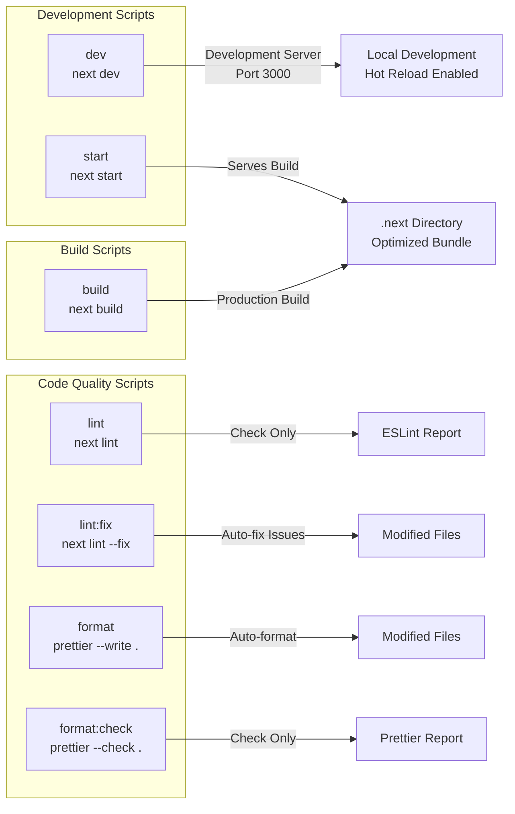
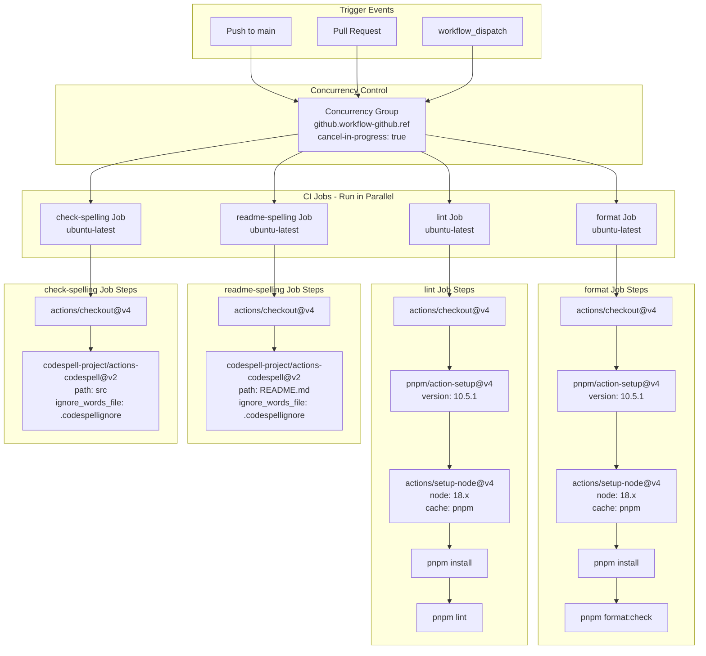
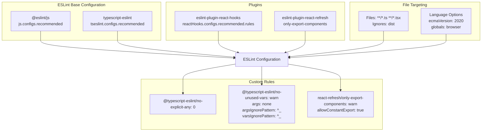
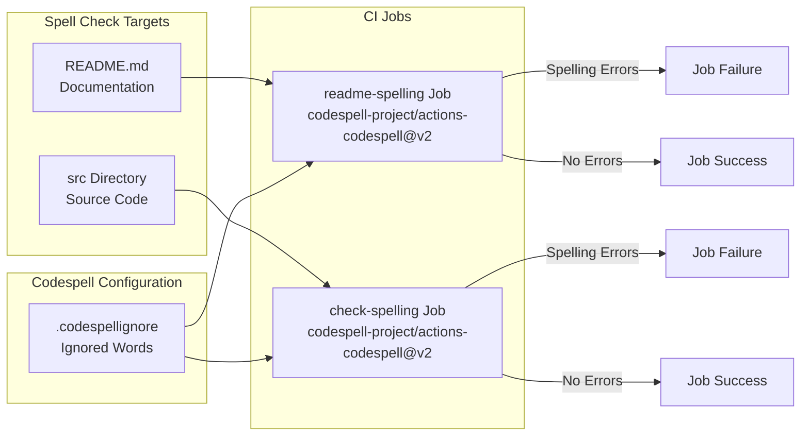
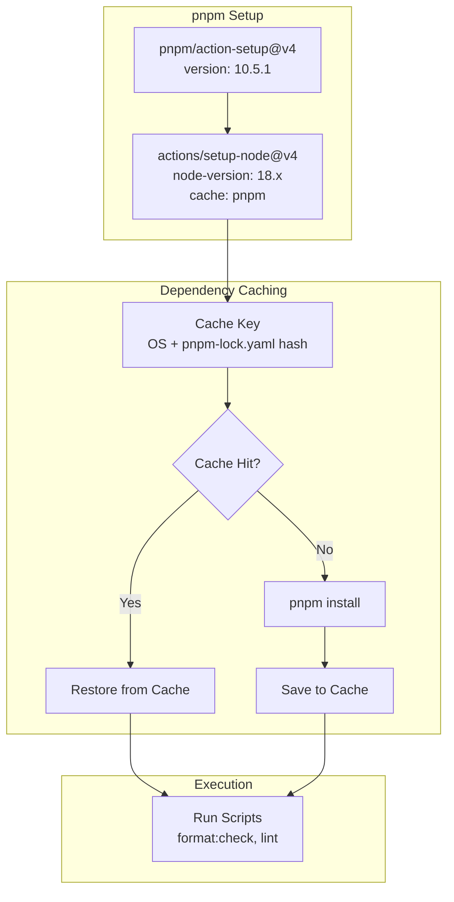
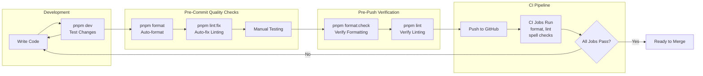

<!-- source: DeepWiki mcp.deepwiki.com · repo langchain-ai/agent-chat-ui · page 10.1 Build and CI System · fetched 2026-10-26 -->

# Build and CI System

<details>
<summary>Relevant source files</summary>

The following files were used as context for generating this wiki page:

- [.github/workflows/ci.yml](.github/workflows/ci.yml)
- [eslint.config.js](eslint.config.js)
- [package.json](package.json)

</details>


## Purpose and Scope

This document describes the build scripts, CI/CD pipeline, code quality tools, and development workflows for the agent-chat-ui project. It covers the npm scripts defined in `package.json`, the GitHub Actions workflows for continuous integration, and the configuration of linting, formatting, and spell-checking tools.

For information about TypeScript compilation configuration, see [TypeScript Configuration](#10.2). For dependency management with pnpm, see [Dependency Management](#10.3). For Next.js-specific configuration, see [Application Configuration](#10.4).

---

## Build Scripts Overview

The project uses pnpm as its package manager (specified via `packageManager` field) and defines seven primary scripts for development, building, and code quality.

**Build Scripts Flow**



**Sources**: [package.json:12-19]()

### Script Definitions

| Script | Command | Purpose |
|--------|---------|---------|
| `dev` | `next dev` | Starts Next.js development server with hot module replacement at `http://localhost:3000` |
| `build` | `next build` | Creates optimized production build in `.next` directory with static generation and bundling |
| `start` | `next start` | Serves the production build (requires `build` to run first) |
| `lint` | `next lint` | Runs ESLint checks without modifying files, exits with error code if violations found |
| `lint:fix` | `next lint --fix` | Runs ESLint and automatically fixes auto-fixable violations |
| `format` | `prettier --write .` | Formats all files in project according to Prettier configuration |
| `format:check` | `prettier --check .` | Verifies formatting without modifying files, used in CI pipeline |

**Sources**: [package.json:12-19]()

---

## CI/CD Pipeline Architecture

The project uses GitHub Actions for continuous integration, defined in `.github/workflows/ci.yml`. The pipeline runs on push to `main`, pull requests, and manual workflow dispatch.

**CI Workflow Structure**



**Sources**: [.github/workflows/ci.yml:1-75]()

### Concurrency Control

The workflow implements intelligent concurrency control to optimize CI resource usage:

- **Group**: `${{ github.workflow }}-${{ github.ref }}` - Groups runs by workflow name and git ref (branch/PR)
- **cancel-in-progress**: `true` - Automatically cancels older runs when new commits are pushed

This prevents wasting CI runners on outdated code versions, especially important for PRs with multiple rapid commits.

**Sources**: [.github/workflows/ci.yml:17-19]()

### Job: `format`

Verifies that all code is properly formatted according to Prettier rules.

**Configuration**:
- Runner: `ubuntu-latest`
- Node Version: `18.x`
- pnpm Version: `10.5.1` (pinned)
- Cache: pnpm dependencies

**Steps**:
1. Checkout repository with `actions/checkout@v4`
2. Setup pnpm with `pnpm/action-setup@v4`
3. Setup Node.js with `actions/setup-node@v4`, enabling pnpm cache
4. Install dependencies with `pnpm install`
5. Run `pnpm format:check` - fails if any files need formatting

**Sources**: [.github/workflows/ci.yml:22-37]()

### Job: `lint`

Validates code quality using ESLint rules.

**Configuration**:
- Runner: `ubuntu-latest`
- Node Version: `18.x`
- pnpm Version: `10.5.1` (pinned)
- Cache: pnpm dependencies

**Steps**:
1. Checkout repository with `actions/checkout@v4`
2. Setup pnpm with `pnpm/action-setup@v4`
3. Setup Node.js with `actions/setup-node@v4`, enabling pnpm cache
4. Install dependencies with `pnpm install`
5. Run `pnpm lint` - fails if ESLint violations found

**Sources**: [.github/workflows/ci.yml:39-54]()

### Job: `readme-spelling`

Checks README.md for spelling errors using codespell.

**Configuration**:
- Runner: `ubuntu-latest`
- Target: `README.md`
- Ignore Words: `.codespellignore`

**Steps**:
1. Checkout repository with `actions/checkout@v4`
2. Run `codespell-project/actions-codespell@v2` on README.md

This job does not require Node.js or dependency installation, making it faster than format/lint jobs.

**Sources**: [.github/workflows/ci.yml:56-64]()

### Job: `check-spelling`

Checks source code for spelling errors using codespell.

**Configuration**:
- Runner: `ubuntu-latest`
- Target: `src` directory
- Ignore Words: `.codespellignore`

**Steps**:
1. Checkout repository with `actions/checkout@v4`
2. Run `codespell-project/actions-codespell@v2` on src directory

**Sources**: [.github/workflows/ci.yml:66-75]()

---

## ESLint Configuration

The project uses a modern flat config format (`eslint.config.js`) with TypeScript support and React-specific rules.

**ESLint Architecture**



**Sources**: [eslint.config.js:1-34]()

### Configuration Details

**Base Configs**:
- `@eslint/js.configs.recommended` - JavaScript recommended rules
- `typescript-eslint.configs.recommended` - TypeScript recommended rules

**Plugins**:
- `eslint-plugin-react-hooks` - Enforces React Hooks rules (dependencies, hook call order)
- `eslint-plugin-react-refresh` - Ensures fast refresh compatibility

**File Targeting**:
- **Includes**: All `.ts` and `.tsx` files
- **Ignores**: `dist` directory (build output)

**Language Options**:
- ECMAScript Version: `2020`
- Globals: `browser` (enables browser APIs like `window`, `document`)

**Custom Rule Overrides**:

| Rule | Setting | Rationale |
|------|---------|-----------|
| `@typescript-eslint/no-explicit-any` | `0` (off) | Allows `any` type when necessary for flexibility |
| `@typescript-eslint/no-unused-vars` | `warn` | Warns on unused variables but ignores: function arguments (`args: "none"`), variables/args prefixed with `_` |
| `react-refresh/only-export-components` | `warn` | Ensures fast refresh works correctly, allows constant exports |

**Sources**: [eslint.config.js:1-34]()

---

## Prettier Configuration

Prettier is used for code formatting with two modes of operation:

### Format Check (CI)

Command: `prettier --check .`

- Checks all files in project
- Returns exit code 1 if any files need formatting
- Used in CI pipeline (`format` job)
- Does not modify files

**Sources**: [package.json:19](), [.github/workflows/ci.yml:37]()

### Format Write (Development)

Command: `prettier --write .`

- Formats all files in project
- Modifies files in place
- Used by developers to apply formatting
- Respects `.prettierignore` file

**Configuration**: The project includes `prettier-plugin-tailwindcss` as a dev dependency, which automatically sorts Tailwind CSS classes according to recommended order.

**Sources**: [package.json:18](), [package.json:78]()

---

## Spell Checking System

The project uses codespell for automated spell checking, running in two separate CI jobs for different targets.

**Spell Check Architecture**



**Sources**: [.github/workflows/ci.yml:56-75]()

### README Spell Check

- **Target**: `README.md` file only
- **Action**: `codespell-project/actions-codespell@v2`
- **Ignore Words**: `.codespellignore` file
- **Purpose**: Ensures documentation is free of spelling errors

This focused check helps maintain professional documentation quality.

**Sources**: [.github/workflows/ci.yml:56-64]()

### Code Spell Check

- **Target**: `src` directory (all source code)
- **Action**: `codespell-project/actions-codespell@v2`
- **Ignore Words**: `.codespellignore` file
- **Purpose**: Catches typos in code comments, string literals, and variable names

Running codespell on source code helps identify:
- Misspelled comments
- Typos in user-facing strings
- Incorrect variable/function names

**Sources**: [.github/workflows/ci.yml:66-75]()

### Ignore Words File

The `.codespellignore` file contains words that should not be flagged as misspellings. This typically includes:
- Technical terms
- Project-specific terminology
- Proper nouns
- Acronyms

Both spell check jobs reference this file to maintain consistency.

**Sources**: [.github/workflows/ci.yml:63](), [.github/workflows/ci.yml:73]()

---

## Dependency Management Integration

The CI pipeline tightly integrates with pnpm for efficient dependency management.

**pnpm CI Integration**



**Sources**: [.github/workflows/ci.yml:27-36](), [.github/workflows/ci.yml:44-53]()

### Version Pinning

**pnpm Version**: `10.5.1`

The pnpm version is explicitly pinned in two locations:
1. `.github/workflows/ci.yml` - GitHub Actions uses `pnpm/action-setup@v4` with `version: 10.5.1`
2. `package.json` - Specifies `"packageManager": "pnpm@10.5.1"`

This ensures consistent dependency resolution across local development and CI environments.

**Sources**: [package.json:87](), [.github/workflows/ci.yml:28-29](), [.github/workflows/ci.yml:45-46]()

### Node.js Version

**Node Version**: `18.x`

All CI jobs use Node.js 18.x, matching typical development environments. The `actions/setup-node@v4` action automatically caches pnpm dependencies based on the lockfile hash.

**Sources**: [.github/workflows/ci.yml:31-33](), [.github/workflows/ci.yml:48-50]()

### Dependency Installation

Command: `pnpm install`

Runs after cache restore or on cache miss. Installation is required for `format` and `lint` jobs but not for spell checking jobs (which don't need Node.js dependencies).

**Sources**: [.github/workflows/ci.yml:34-35](), [.github/workflows/ci.yml:51-52]()

---

## Development Workflow Summary

**Local Development Cycle**



**Recommended Developer Workflow**:

1. **Development**: Run `pnpm dev` for hot-reloading development server
2. **Pre-Commit**: Run `pnpm format` and `pnpm lint:fix` to auto-fix issues
3. **Pre-Push**: Run `pnpm format:check` and `pnpm lint` to verify no issues remain
4. **Push**: All CI checks run automatically
5. **Production**: Run `pnpm build` to verify production build succeeds

**Sources**: [package.json:12-19](), [.github/workflows/ci.yml:1-75]()

---

## Build Output and Artifacts

### Development Build

Command: `pnpm dev` → `next dev`

- Starts development server at `http://localhost:3000`
- Enables hot module replacement (HMR)
- Source maps enabled for debugging
- No optimization for faster rebuilds
- `.next` directory contains development build artifacts

**Sources**: [package.json:13]()

### Production Build

Command: `pnpm build` → `next build`

- Creates optimized production bundle in `.next` directory
- Performs static optimization where possible
- Minifies JavaScript and CSS
- Generates static HTML for static pages
- Creates optimized images
- Outputs build statistics (page sizes, bundle analysis)

**Build Output Structure**:
- `.next/static/` - Static assets (JS, CSS)
- `.next/server/` - Server-side code
- `.next/cache/` - Build cache for faster subsequent builds

**Sources**: [package.json:14]()

### Serving Production Build

Command: `pnpm start` → `next start`

- Serves the production build created by `pnpm build`
- Requires `pnpm build` to run first
- Runs on `http://localhost:3000` by default
- Uses optimized server-side rendering

**Sources**: [package.json:15]()

---

## Package Manager Configuration

The project enforces pnpm usage through the `packageManager` field:

```json
"packageManager": "pnpm@10.5.1"
```

This field:
- Specifies the exact pnpm version required
- Enables Corepack to automatically use the correct version
- Ensures consistency across all development environments
- Matches the version used in CI/CD pipeline

**Sources**: [package.json:87]()

---

