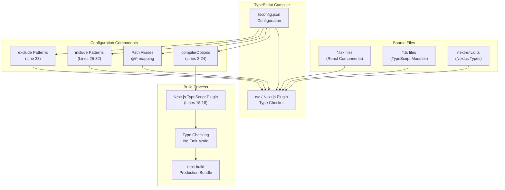
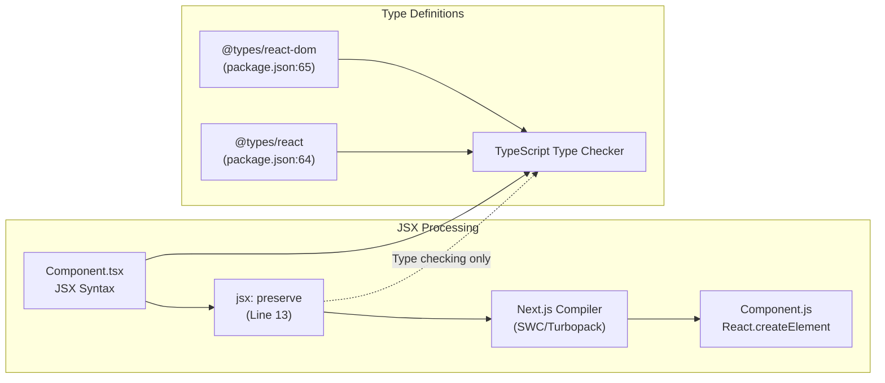
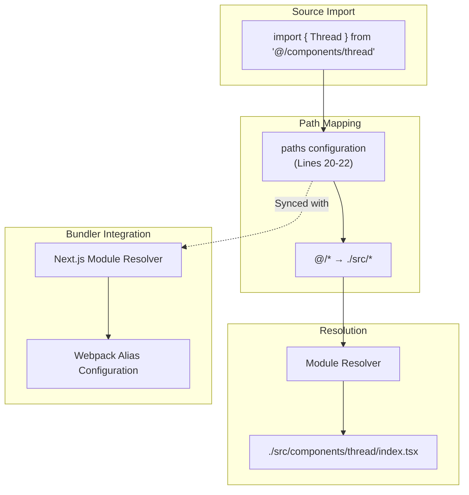
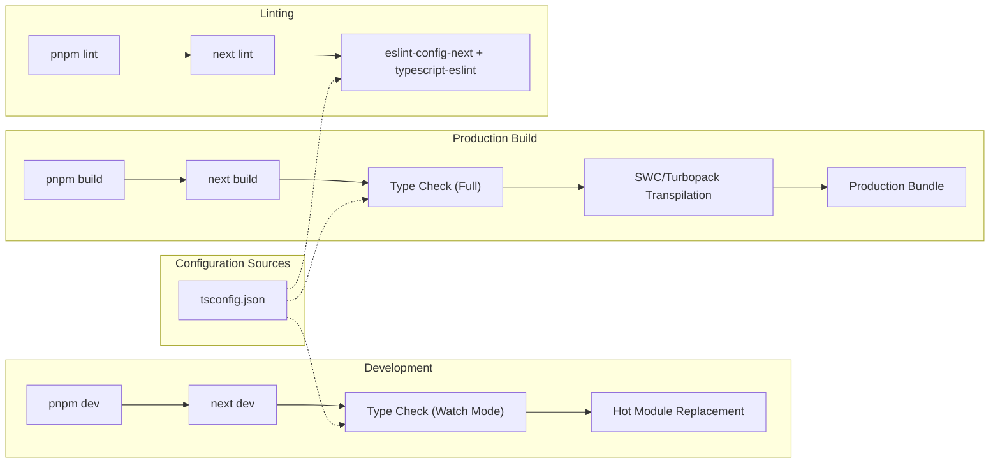

<!-- source: DeepWiki mcp.deepwiki.com · repo langchain-ai/agent-chat-ui · page 10.2 TypeScript Configuration · fetched 2026-10-26 -->

# TypeScript Configuration

<details>
<summary>Relevant source files</summary>

The following files were used as context for generating this wiki page:

- [package.json](package.json)
- [tsconfig.json](tsconfig.json)

</details>


## Purpose and Scope

This document covers the TypeScript compiler configuration for the agent-chat-ui application. It explains the settings in [tsconfig.json:1-34](), how the TypeScript compiler is configured to work with Next.js, and the module resolution strategy. For information about build processes and CI/CD, see [Build and CI System](#10.1). For Next.js-specific configuration beyond TypeScript, see [Application Configuration](#10.4).

**Sources:** [tsconfig.json:1-34]()

---

## Configuration Overview

The TypeScript configuration is defined in `tsconfig.json` at the project root. The application uses **TypeScript ~5.7.2** as specified in [package.json:81](). The configuration is optimized for a Next.js application with React 19, enabling strict type checking while maintaining compatibility with modern JavaScript features.



**Diagram:** TypeScript Configuration and Compilation Flow

The compiler operates in **no-emit mode** ([tsconfig.json:7]()), meaning it performs type checking without generating JavaScript output. The actual JavaScript emission is handled by the Next.js build system, which uses the TypeScript configuration for type checking but performs its own transpilation.

**Sources:** [tsconfig.json:1-34](), [package.json:81]()

---

## Compiler Options

### Target and Module Settings

| Option | Value | Purpose |
|--------|-------|---------|
| `target` | `"ES2017"` | JavaScript version for emitted code |
| `module` | `"esnext"` | Module system (latest ECMAScript modules) |
| `moduleResolution` | `"bundler"` | Resolution strategy optimized for bundlers |
| `lib` | `["dom", "dom.iterable", "esnext"]` | Available type definitions |

**Target:** The compilation target is **ES2017** ([tsconfig.json:23]()), which supports async/await, object spread, and other modern JavaScript features while maintaining broad browser compatibility.

**Module System:** The `module` option is set to `"esnext"` ([tsconfig.json:9]()), enabling the use of the latest ECMAScript module features including dynamic imports and top-level await.

**Module Resolution:** The `moduleResolution: "bundler"` setting ([tsconfig.json:10]()) uses the bundler resolution algorithm, which is optimized for tools like webpack and esbuild that perform their own module resolution. This strategy properly handles package.json `exports` fields and supports Node.js subpath patterns.

**Libraries:** The `lib` array ([tsconfig.json:3]()) includes:
- `"dom"` - DOM APIs (window, document, etc.)
- `"dom.iterable"` - Iterable DOM collections (NodeList, HTMLCollection)
- `"esnext"` - Latest ECMAScript features

**Sources:** [tsconfig.json:3](), [tsconfig.json:9-10](), [tsconfig.json:23]()

---

### JSX and React Configuration



**Diagram:** JSX Transformation Pipeline

The `jsx` option is set to `"preserve"` ([tsconfig.json:13]()), which means TypeScript leaves JSX syntax untransformed. The Next.js compiler (either SWC or Turbopack) handles the actual JSX-to-JavaScript transformation during the build process. This approach is standard for Next.js applications and allows the framework's compiler to optimize React component output.

React type definitions are provided by `@types/react` and `@types/react-dom` ([package.json:64-65]()), supporting React 19's type system.

**Sources:** [tsconfig.json:13](), [package.json:64-65]()

---

### Strict Mode and Type Safety

The configuration enables comprehensive type checking with the following settings:

| Option | Value | Effect |
|--------|-------|--------|
| `strict` | `true` | Enables all strict type-checking options |
| `skipLibCheck` | `true` | Skip type checking of declaration files |
| `isolatedModules` | `true` | Ensure each file can be transpiled independently |
| `esModuleInterop` | `true` | Emit helpers for CommonJS/ESM interop |
| `resolveJsonModule` | `true` | Allow importing JSON files |
| `allowJs` | `true` | Allow JavaScript files in the project |

**Strict Mode:** The `strict: true` flag ([tsconfig.json:6]()) enables all strict type-checking options, including:
- `strictNullChecks` - Null and undefined are not assignable to other types
- `strictFunctionTypes` - Contravariant function parameter checking
- `strictPropertyInitialization` - Class properties must be initialized
- `noImplicitAny` - Error on expressions with implied `any` type
- `noImplicitThis` - Error on `this` with implied `any` type

**Skip Lib Check:** The `skipLibCheck: true` option ([tsconfig.json:5]()) skips type checking of declaration files (`.d.ts`), significantly improving compilation performance. This is safe because library type definitions are pre-validated by their publishers.

**Isolated Modules:** The `isolatedModules: true` setting ([tsconfig.json:12]()) ensures each file can be transpiled without knowledge of other files. This is required for Next.js, which uses single-file transpilation for performance. It prevents TypeScript features that require cross-file information, such as `const enum`.

**ESM Interop:** The `esModuleInterop: true` option ([tsconfig.json:8]()) enables better compatibility between CommonJS and ES modules by emitting helper code for default imports from CommonJS modules.

**Sources:** [tsconfig.json:4-12]()

---

### Path Aliases and Module Resolution



**Diagram:** Path Alias Resolution

The `paths` configuration ([tsconfig.json:20-22]()) defines a single alias:

```json
"paths": {
  "@/*": ["./src/*"]
}
```

This maps the `@/` prefix to the `./src/` directory, enabling cleaner imports throughout the codebase. For example:
- `import { Thread } from '@/components/thread'` resolves to `./src/components/thread`
- `import { useStreamContext } from '@/providers/Stream'` resolves to `./src/providers/Stream`

The path mapping is automatically respected by the Next.js bundler, which synchronizes its module resolution with the TypeScript configuration.

**Sources:** [tsconfig.json:20-22]()

---

### Next.js Plugin Integration

The configuration includes the Next.js TypeScript plugin ([tsconfig.json:15-18]()):

```json
"plugins": [
  {
    "name": "next"
  }
]
```

This plugin provides:
- **Enhanced IDE Support:** Type checking for Next.js-specific features like `app/` directory routing
- **Server/Client Component Validation:** Ensures proper use of `"use client"` and `"use server"` directives
- **Route Type Generation:** Automatically generates types for dynamic routes
- **Metadata API Types:** Type checking for page metadata exports

The plugin works in conjunction with the `incremental: true` setting ([tsconfig.json:14]()), which enables incremental compilation by caching type information between builds.

**Sources:** [tsconfig.json:14-18]()

---

## Include and Exclude Patterns

### Included Files

The `include` array ([tsconfig.json:25-32]()) specifies which files are processed by the TypeScript compiler:

```json
"include": [
  "next-env.d.ts",
  "**/*.ts",
  "**/*.tsx",
  ".next/types/**/*.ts",
  "src/hooks/use-threads",
  "src/app/thread/[threadId]"
]
```

| Pattern | Purpose |
|---------|---------|
| `next-env.d.ts` | Next.js type definitions |
| `**/*.ts` | All TypeScript files |
| `**/*.tsx` | All TypeScript React files |
| `.next/types/**/*.ts` | Generated route types |
| `src/hooks/use-threads` | Specific hook directory (may contain JS files) |
| `src/app/thread/[threadId]` | Specific route directory |

The inclusion of `.next/types/**/*.ts` ([tsconfig.json:29]()) is particularly important as Next.js generates TypeScript definitions for routes at build time, providing type safety for dynamic routes and route parameters.

### Excluded Files

The `exclude` array ([tsconfig.json:33]()) specifies:

```json
"exclude": ["node_modules"]
```

This prevents the compiler from processing dependencies in `node_modules`, which is essential for compilation performance. Type definitions for dependencies are instead loaded from their packaged `.d.ts` files as needed.

**Sources:** [tsconfig.json:25-33]()

---

## Type Definitions and Dependencies

The project uses several TypeScript-related packages from [package.json:59-83]():

### Core TypeScript Packages

| Package | Version | Purpose |
|---------|---------|---------|
| `typescript` | `~5.7.2` | TypeScript compiler |
| `@types/node` | `^22.13.5` | Node.js type definitions |
| `@types/react` | `^19.0.8` | React type definitions |
| `@types/react-dom` | `^19.0.3` | React DOM type definitions |

### Additional Type Definitions

The project includes type definitions for third-party libraries:
- `@types/lodash` ([package.json:62]()) - Utility library types
- `@types/react-syntax-highlighter` ([package.json:66]()) - Code syntax highlighting types
- `@types/uuid` ([package.json:67]()) - UUID generation types

These type definition packages provide IntelliSense and type checking for JavaScript libraries that don't ship their own TypeScript definitions.

**Sources:** [package.json:59-83]()

---

## Build Integration



**Diagram:** TypeScript Integration in Build Pipeline

The TypeScript configuration integrates with the build system through several npm scripts defined in [package.json:12-19]():

- **`pnpm dev`** - Runs `next dev`, which includes watch-mode type checking
- **`pnpm build`** - Runs `next build`, which performs full type checking before production build
- **`pnpm lint`** - Runs `next lint` with TypeScript-aware ESLint rules

The Next.js build system automatically detects `tsconfig.json` and uses it for both type checking and module resolution configuration. The `noEmit: true` setting ([tsconfig.json:7]()) ensures TypeScript only performs type checking, leaving JavaScript emission to Next.js's optimized compiler.

**Sources:** [tsconfig.json:7](), [package.json:12-19]()

---

