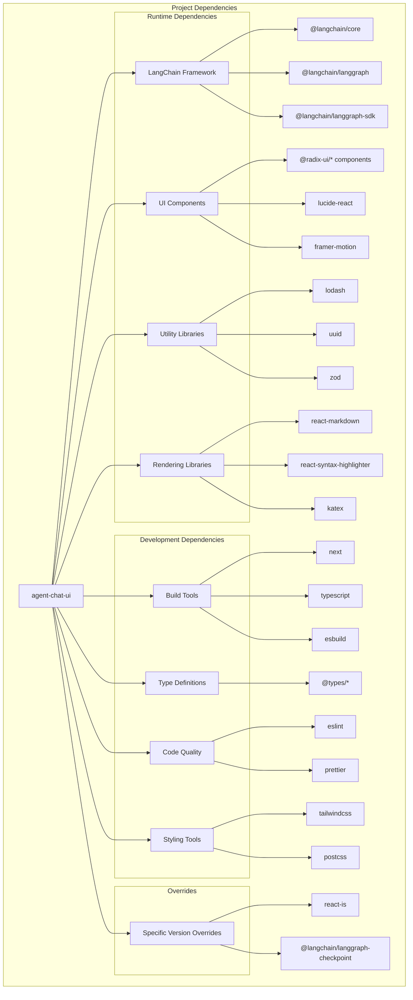
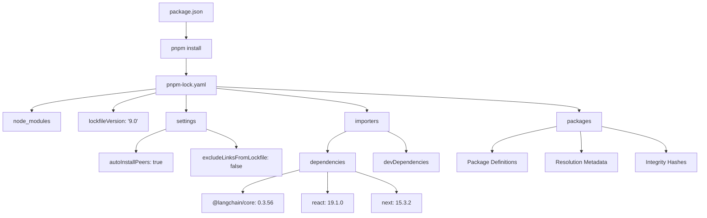
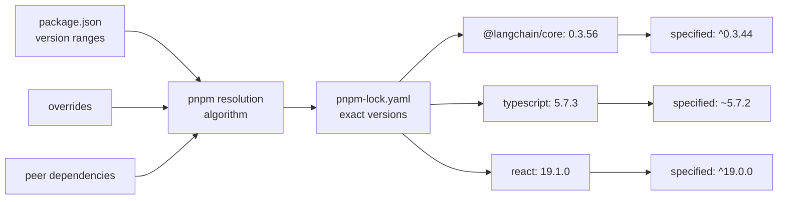

<!-- source: DeepWiki mcp.deepwiki.com · repo langchain-ai/agent-chat-ui · page 10.3 Dependency Management · fetched 2026-10-26 -->

# Dependency Management

<details>
<summary>Relevant source files</summary>

The following files were used as context for generating this wiki page:

- [package.json](package.json)
- [pnpm-lock.yaml](pnpm-lock.yaml)

</details>


This document details how dependencies are managed in the Agent Chat UI project, including package management tools, key dependencies, and best practices for maintaining dependencies. For information about the build and CI system, see [Build and CI System](#8.1).

## Package Manager

The Agent Chat UI project uses pnpm as its package manager. This decision is explicitly specified in package.json:

```json
"packageManager": "pnpm@10.5.1"
```

PNPM (pronounced "p-npm") offers several advantages over traditional npm:

1. **Efficient disk space usage**: Uses a content-addressable store to avoid duplication of packages
2. **Strict dependency management**: Prevents access to dependencies not explicitly declared
3. **Fast installation**: Generally faster than npm and yarn for installation operations
4. **Deterministic builds**: Ensures consistent installations across environments

Sources: [package.json:87-87]()

## Dependency Overview

The project dependencies are organized into three main categories:

1. Runtime dependencies (`dependencies`)
2. Development dependencies (`devDependencies`)
3. Dependency overrides (`overrides`)

### Diagram: Dependency Structure



Sources: [package.json:21-86]()

### Core Runtime Dependencies

The project relies on several key dependencies for its functionality:

| Category | Dependencies | Purpose |
|----------|--------------|---------|
| LangChain | `@langchain/core`, `@langchain/langgraph`, `@langchain/langgraph-sdk` | Core LLM integration and agent framework |
| UI Framework | React 19, React DOM 19 | Frontend rendering |
| UI Components | Radix UI components, Lucide React | Accessible UI components and icons |
| Styling | `class-variance-authority`, `clsx`, `tailwind-merge` | Tailwind CSS utilities |
| Markdown/Content | `react-markdown`, `rehype-katex`, `remark-gfm` | Content rendering |
| Data Visualization | `recharts` | Chart rendering |
| Utilities | `lodash`, `uuid`, `zod` | General utilities and validation |

Sources: [package.json:21-57]()

### Development Dependencies

These dependencies are used during development but are not included in the production build:

| Category | Dependencies | Purpose |
|----------|--------------|---------|
| Build System | Next.js, ESBuild | Framework and bundler |
| Types | TypeScript, various `@types/*` | Type definitions |
| Linting/Formatting | ESLint, Prettier | Code quality tools |
| Styling | Tailwind CSS, PostCSS, Autoprefixer | CSS utilities |

Sources: [package.json:59-81]()

### Version Overrides

The project uses dependency overrides to enforce specific versions:

```json
"overrides": {
  "react-is": "^19.0.0-rc-69d4b800-20241021"
}
```

This ensures compatibility with React 19 by overriding the `react-is` package version that may be pulled in by transitive dependencies.

Sources: [package.json:84-86]()

## Dependency Lockfile

The `pnpm-lock.yaml` file maintains the exact versions of all dependencies and their subdependencies, ensuring reproducible builds across different environments.

### Diagram: Lockfile Structure and Resolution



Sources: [pnpm-lock.yaml:1-10](), [pnpm-lock.yaml:190-368]()

The lockfile follows a structured format defined by pnpm version 9.0:

1. **`lockfileVersion`**: Set to `'9.0'`, indicating the lockfile format version
2. **`settings`**: Configuration options including:
   - `autoInstallPeers: true` - automatically install peer dependencies
   - `excludeLinksFromLockfile: false` - include workspace links in lockfile
3. **`importers`**: Root importer (`.`) contains resolved versions of all direct dependencies from package.json with their full dependency trees
4. **`packages`**: Comprehensive catalog of every package version used, including platform-specific binaries (e.g., `@esbuild/linux-x64`, `@next/swc-darwin-arm64`)

Sources: [pnpm-lock.yaml:1-6](), [pnpm-lock.yaml:7-189](), [pnpm-lock.yaml:190-368]()

## Dependency Management Commands

Common pnpm commands for working with dependencies in this project:

| Command | Description |
|---------|-------------|
| `pnpm install` | Install all dependencies from `pnpm-lock.yaml` |
| `pnpm add <package>` | Add a runtime dependency to `dependencies` |
| `pnpm add -D <package>` | Add a development dependency to `devDependencies` |
| `pnpm update` | Update dependencies based on semver rules in package.json |
| `pnpm remove <package>` | Remove a dependency and update lockfile |
| `pnpm outdated` | Check for outdated dependencies |
| `pnpm why <package>` | Explain why a package is installed (show dependency tree) |

The project also defines npm scripts that utilize these dependencies:

```json
{
  "dev": "next dev",
  "build": "next build",
  "start": "next start",
  "lint": "next lint",
  "lint:fix": "next lint --fix",
  "format": "prettier --write .",
  "format:check": "prettier --check ."
}
```

These scripts are executed via `pnpm run <script>` or the shorthand `pnpm <script>` for common commands like `dev`, `build`, and `start`.

Sources: [package.json:12-20]()

## Version Control and Dependencies

The `.gitignore` file specifies that `node_modules` should not be tracked in Git. This is standard practice as:

1. It would create enormous repositories
2. Dependencies can be reconstructed from package.json and the lockfile
3. Node modules may contain platform-specific binaries

```
node_modules
dist
dist-ssr
```

Sources: [.gitignore:10-13]()

## Core Dependency Relationships

### Diagram: Key Dependency Chains

```mermaid
graph TD
    subgraph "pnpm workspace root"
        A["."]
    end
    
    subgraph "Core Framework Dependencies"
        B["react@19.1.0"]
        C["react-dom@19.1.0"]
        D["next@15.3.2"]
    end
    
    subgraph "LangChain Ecosystem"
        E["@langchain/core@0.3.56"]
        F["@langchain/langgraph@0.2.72"]
        G["@langchain/langgraph-sdk@0.1.0"]
    end
    
    subgraph "UI Component Libraries"
        H["@radix-ui/react-avatar@1.1.9"]
        I["@radix-ui/react-dialog@1.1.13"]
        J["lucide-react@0.476.0"]
        K["framer-motion@12.12.1"]
    end
    
    subgraph "Build & Styling Tools"
        L["tailwindcss@4.1.7"]
        M["@tailwindcss/postcss@4.1.7"]
        N["esbuild@0.25.4"]
    end
    
    subgraph "Content Rendering"
        O["react-markdown@10.1.0"]
        P["react-syntax-highlighter@15.6.1"]
        Q["katex@0.16.22"]
        R["rehype-katex@7.0.1"]
    end
    
    A --> B
    A --> C
    A --> D
    A --> E
    A --> F
    A --> G
    A --> H
    A --> I
    A --> J
    A --> K
    A --> L
    A --> M
    A --> N
    A --> O
    A --> P
    A --> Q
    A --> R
    
    F --> E
    G --> E
    D --> B
    D --> C
    K --> B
    K --> C
    O --> B
    P --> B
```



Sources: [pnpm-lock.yaml:10-118](), [package.json:21-57]()

## Dependency Management Best Practices

### Managing Version Constraints

The project uses several versioning strategies for dependencies:

1. **Caret Ranges** (`^x.y.z`): Most dependencies use this, updating to minor and patch updates automatically
   - Example: `"@langchain/core": "^0.3.44"` resolves to `0.3.56` in lockfile

2. **Tilde Ranges** (`~x.y.z`): More restrictive, only allowing patch updates
   - Example: `"typescript": "~5.7.2"` resolves to `5.7.3` in lockfile

3. **Specific Versions** in overrides: Forces exact versions for specific packages
   - Example: `"react-is": "^19.0.0-rc-69d4b800-20241021"` overrides transitive dependencies

### Diagram: Version Resolution Flow



Sources: [package.json:21-86](), [pnpm-lock.yaml:10-118]()

### Handling TypeScript Types

The project effectively manages TypeScript typings with:

1. Core TypeScript configuration: `"typescript": "~5.7.2"`
2. Type definitions for third-party libraries: Various `@types/*` packages
3. TypeScript ESLint integration: `"typescript-eslint": "^8.22.0"`

This ensures type safety throughout the application's dependency ecosystem.

Sources: [package.json:62-66](), [package.json:80-81]()

### Updating Dependencies

When updating dependencies:

1. Use `pnpm outdated` to see which packages have newer versions
2. Consider the impact of updates to core dependencies like React, Next.js, or LangChain
3. Update incrementally, especially for major version changes
4. Run tests and verify functionality after updates
5. Update the lockfile by running `pnpm install` after changing package.json

## Conclusion

The Agent Chat UI project employs pnpm for efficient dependency management, with a well-structured approach to organizing runtime dependencies, development tools, and version overrides. The combination of package.json, pnpm-lock.yaml, and documented best practices ensures reproducible builds and maintainable dependencies throughout the project lifecycle.

---

