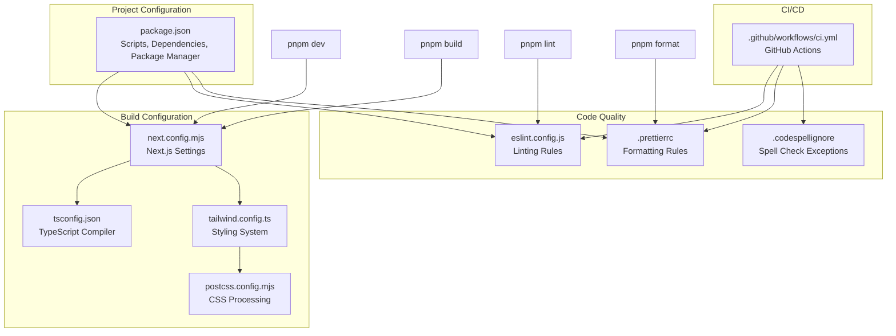
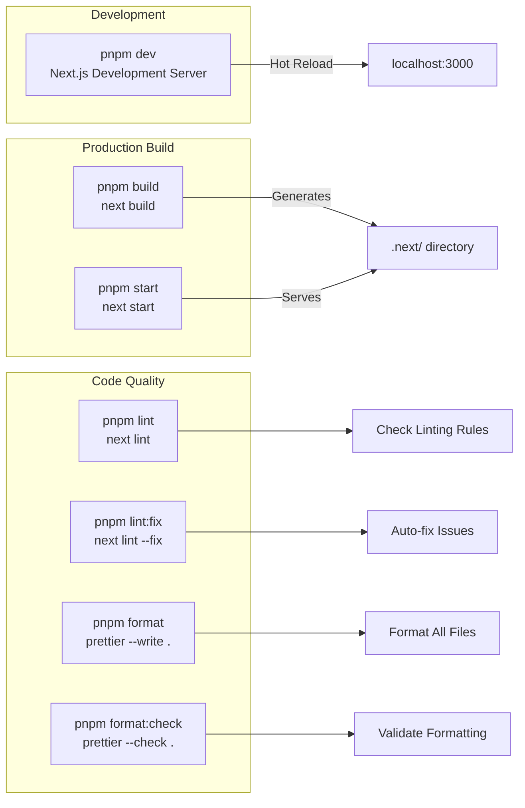
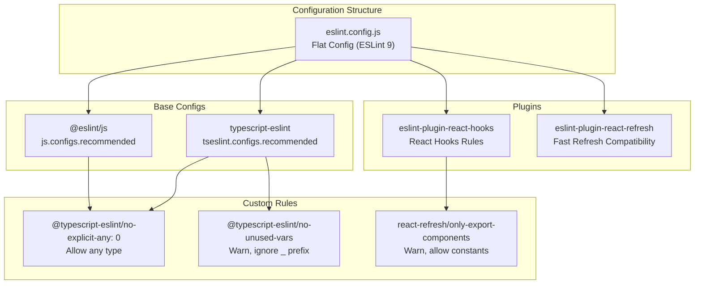
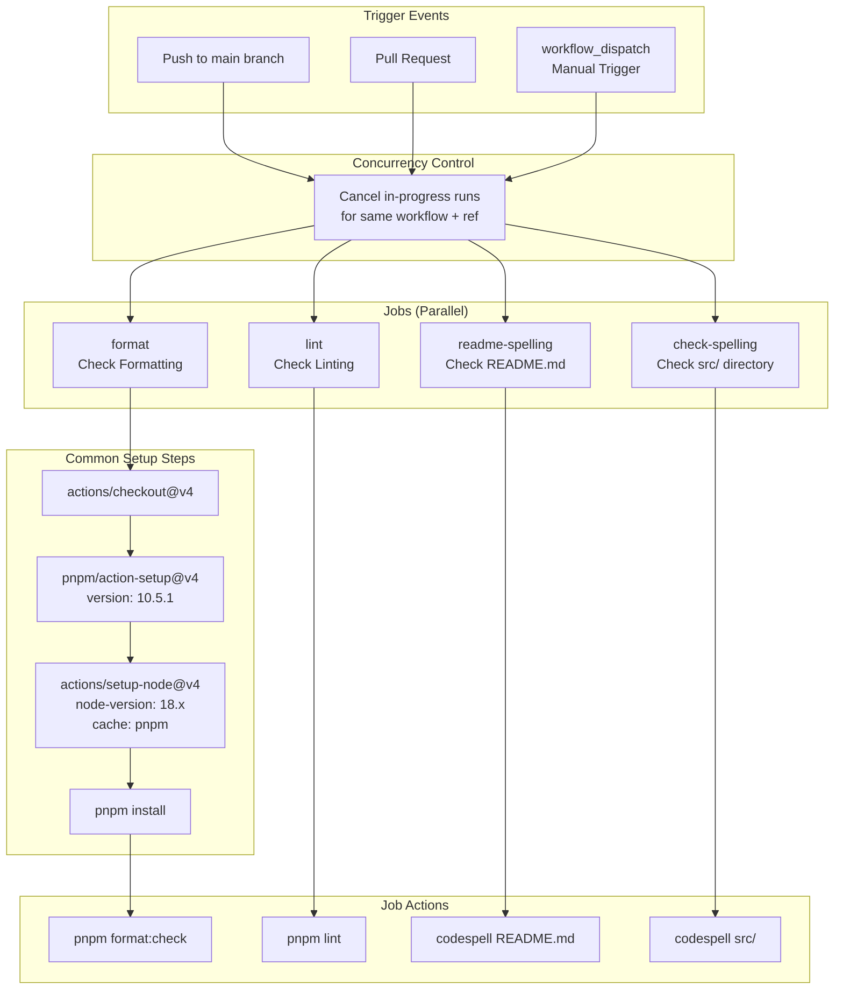
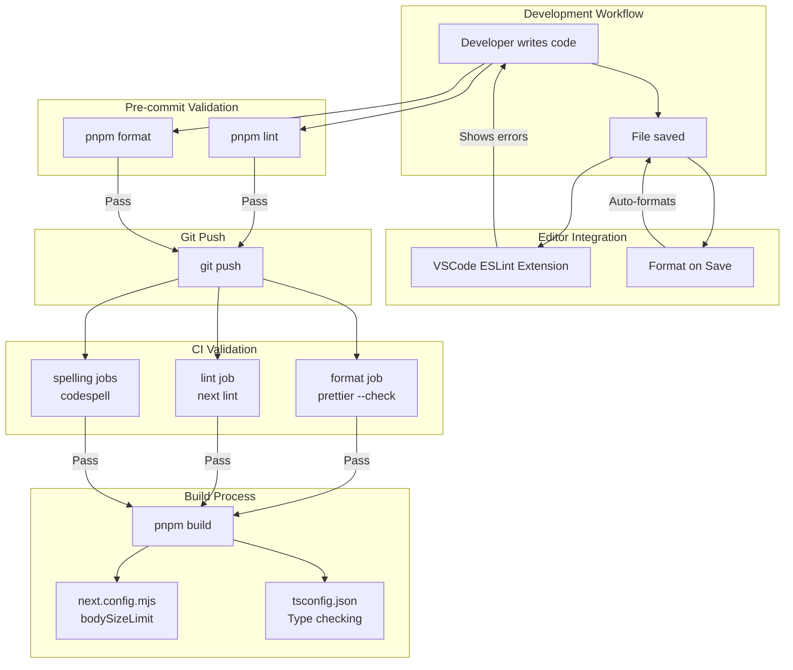

<!-- source: DeepWiki mcp.deepwiki.com · repo langchain-ai/agent-chat-ui · page 10.4 Application Configuration · fetched 2026-10-26 -->

# Application Configuration

<details>
<summary>Relevant source files</summary>

The following files were used as context for generating this wiki page:

- [.github/workflows/ci.yml](.github/workflows/ci.yml)
- [eslint.config.js](eslint.config.js)
- [next.config.mjs](next.config.mjs)
- [package.json](package.json)

</details>


This document covers application-level configuration files that control build behavior, code quality enforcement, development tooling, and runtime settings. This includes Next.js configuration, ESLint setup, npm scripts, and CI/CD pipelines. For information about LangGraph API configuration and deployment modes, see [Configuration System](#9.1). For TypeScript compiler settings, see [TypeScript Configuration](#10.2).

## Configuration Overview

The application uses multiple configuration files working together to define build behavior, code quality standards, and deployment settings. The configuration system is organized hierarchically with framework-level settings (Next.js), tooling configuration (ESLint, Prettier), and project management (package.json).



**Sources**: [package.json:1-88](), [next.config.mjs:1-11](), [eslint.config.js:1-34](), [.github/workflows/ci.yml:1-75]()

## Package.json Configuration

The [package.json:1-88]() file serves as the central project manifest, defining metadata, dependencies, scripts, and tooling configuration.

### Package Metadata

| Field | Value | Purpose |
|-------|-------|---------|
| `name` | `"agent-chat-ui"` | Package identifier |
| `version` | `"0.0.0"` | Semantic version (private package) |
| `type` | `"module"` | ES module system |
| `packageManager` | `"pnpm@10.5.1"` | Enforced package manager with version |
| `private` | `true` | Prevents accidental npm publication |

The `repository` and `homepage` fields [package.json:5-8]() provide links to the GitHub repository and deployment URL (https://agentchat.vercel.app).

### NPM Scripts

The scripts section [package.json:12-20]() defines the development workflow:



**Script Purposes**:
- **`dev`**: Starts Next.js development server with hot module replacement
- **`build`**: Creates production-optimized build in `.next/` directory
- **`start`**: Serves the production build
- **`lint`**: Runs ESLint checks without modifications
- **`lint:fix`**: Runs ESLint with automatic fixing enabled
- **`format`**: Formats all files using Prettier
- **`format:check`**: Validates formatting without making changes (used in CI)

### Dependencies

The application distinguishes between production dependencies [package.json:21-58]() and development dependencies [package.json:59-83]().

**Key Production Dependencies**:
- **`next@^15.2.3`**: Next.js framework (note: listed in devDependencies for peer resolution)
- **`react@^19.0.0`** / **`react-dom@^19.0.0`**: React 19 framework
- **`@langchain/langgraph-sdk@^0.1.0`**: LangGraph client SDK
- **`langgraph-nextjs-api-passthrough@^0.0.4`**: API proxy for LangGraph [next.config.mjs:1-11]()
- **`nuqs@^2.4.1`**: URL state management (see [State Management](#8))
- **`zod@^3.24.2`**: Schema validation
- **`sonner@^2.0.1`**: Toast notification system

**Key Development Dependencies**:
- **`@types/*`**: TypeScript type definitions for dependencies
- **`eslint@^9.19.0`** / **`@eslint/js@^9.19.0`**: ESLint v9 flat config
- **`prettier@^3.5.3`**: Code formatter
- **`typescript@~5.7.2`**: TypeScript compiler
- **`tailwindcss@^4.0.13`**: CSS framework

The `overrides` field [package.json:84-86]() forces `react-is` to use a React 19 compatible version for dependency resolution.

**Sources**: [package.json:1-88]()

## Next.js Configuration

The [next.config.mjs:1-11]() file configures the Next.js framework with minimal custom settings:

```javascript
experimental: {
  serverActions: {
    bodySizeLimit: "10mb"
  }
}
```

### Server Actions Body Size Limit

The `bodySizeLimit` setting increases the maximum payload size for Server Actions from the default 1MB to 10MB [next.config.mjs:5-6](). This is necessary to support file uploads in the multimodal content system (see [File Upload and Multimodal Content](#6)). The configuration allows users to upload larger images and PDF files through the chat interface without encountering payload size errors.

### Default Next.js Behavior

By using minimal configuration, the application relies on Next.js defaults:
- **App Router**: Uses the `src/app/` directory structure
- **React 19 Support**: Automatic through Next.js 15
- **Server Components**: Default rendering mode
- **Image Optimization**: Built-in via `next/image`
- **TypeScript**: Automatic detection via `tsconfig.json`

**Sources**: [next.config.mjs:1-11]()

## ESLint Configuration

The [eslint.config.js:1-34]() file uses ESLint 9's flat config format with TypeScript support and React-specific rules.



### Configuration Layers

**Base Configuration** [eslint.config.js:10]():
- **`js.configs.recommended`**: JavaScript best practices from `@eslint/js`
- **`tseslint.configs.recommended`**: TypeScript-specific rules from `typescript-eslint`

**Plugin Integration** [eslint.config.js:16-19]():
- **`react-hooks`**: Enforces Rules of Hooks (exhaustive dependencies, hook call order)
- **`react-refresh`**: Ensures components are export-compatible with Fast Refresh

### File Targeting

The configuration applies to TypeScript files only [eslint.config.js:11]():
```javascript
files: ["**/*.{ts,tsx}"]
```

The `dist` directory is ignored [eslint.config.js:8]() to prevent linting build output.

### Custom Rules

**TypeScript Rule Overrides** [eslint.config.js:22-26]():

| Rule | Setting | Reason |
|------|---------|--------|
| `@typescript-eslint/no-explicit-any` | `0` (off) | Allows `any` type for flexibility with LangGraph SDK types |
| `@typescript-eslint/no-unused-vars` | `warn` | Warns on unused variables but ignores `_`-prefixed names |

The unused vars rule configuration:
```javascript
{
  args: "none",              // Don't check function arguments
  argsIgnorePattern: "^_",   // Ignore args starting with _
  varsIgnorePattern: "^_"    // Ignore vars starting with _
}
```

**React Refresh Rule** [eslint.config.js:27-30]():
```javascript
"react-refresh/only-export-components": [
  "warn",
  { allowConstantExport: true }
]
```

This warns when files export non-component values alongside components, which can break Fast Refresh. The `allowConstantExport: true` option permits constant exports like configuration objects.

### Language Options

The configuration sets ECMAScript version and globals [eslint.config.js:12-15]():
```javascript
languageOptions: {
  ecmaVersion: 2020,
  globals: globals.browser
}
```

This enables modern JavaScript syntax and defines browser globals (`window`, `document`, etc.) to prevent false positive undefined variable errors.

**Sources**: [eslint.config.js:1-34]()

## CI/CD Pipeline

The [.github/workflows/ci.yml:1-75]() file defines a GitHub Actions workflow that runs code quality checks on every push and pull request.



### Workflow Configuration

**Triggers** [.github/workflows/ci.yml:5-9]():
- Push events to `main` branch
- All pull request events
- Manual dispatch via GitHub UI

**Concurrency Control** [.github/workflows/ci.yml:17-19]():
```yaml
concurrency:
  group: ${{ github.workflow }}-${{ github.ref }}
  cancel-in-progress: true
```

This cancels outdated workflow runs when new commits are pushed, conserving CI resources and providing faster feedback.

### Job Definitions

All jobs run on `ubuntu-latest` and execute in parallel unless one fails.

#### Format Job

The `format` job [.github/workflows/ci.yml:22-37]() validates code formatting using Prettier:

**Steps**:
1. Checkout repository (`actions/checkout@v4`)
2. Setup pnpm 10.5.1 (`pnpm/action-setup@v4`)
3. Setup Node.js 18.x with pnpm cache (`actions/setup-node@v4`)
4. Install dependencies (`pnpm install`)
5. Run format check (`pnpm format:check`)

The job fails if any files would be reformatted by Prettier.

#### Lint Job

The `lint` job [.github/workflows/ci.yml:39-54]() validates code against ESLint rules:

**Steps**: Identical to format job, but runs `pnpm lint` instead of format check.

The job fails if any ESLint errors are found or if warnings exceed configured thresholds.

#### Spelling Jobs

Two spelling jobs use `codespell` to catch typos:

**`readme-spelling`** [.github/workflows/ci.yml:56-64]():
- Checks `README.md` only
- Uses `.codespellignore` for exceptions
- No pnpm/Node.js setup required

**`check-spelling`** [.github/workflows/ci.yml:66-75]():
- Checks all files in `src/` directory
- Uses `.codespellignore` for exceptions
- Catches typos in component code, comments, and strings

Both jobs use `codespell-project/actions-codespell@v2` action directly without installing dependencies.

### CI Integration with Development

The CI pipeline enforces the same checks locally available via npm scripts:

| CI Job | Local Command | Purpose |
|--------|---------------|---------|
| `format` | `pnpm format:check` | Validate formatting |
| `lint` | `pnpm lint` | Validate linting |
| `readme-spelling` | `codespell README.md` | Check README spelling |
| `check-spelling` | `codespell src/` | Check code spelling |

Developers should run `pnpm format`, `pnpm lint:fix`, and fix spelling errors before pushing to avoid CI failures.

**Sources**: [.github/workflows/ci.yml:1-75](), [package.json:12-20]()

## Configuration File Interactions

The configuration files work together to create a cohesive development environment:



### Configuration Priority and Overrides

When multiple configuration sources affect the same behavior, the following priority applies:

**ESLint Rule Priority**:
1. Custom rules in `eslint.config.js` [eslint.config.js:20-31]()
2. Plugin recommended rules [eslint.config.js:21]()
3. Base recommended configs [eslint.config.js:10]()

**Build Configuration Priority**:
1. `next.config.mjs` overrides [next.config.mjs:2-8]()
2. Next.js defaults
3. Framework conventions (e.g., App Router based on directory structure)

**Package Resolution Priority**:
1. `overrides` field in `package.json` [package.json:84-86]()
2. Direct dependencies [package.json:21-58]()
3. Transitive dependencies from lockfile

**Sources**: [package.json:1-88](), [next.config.mjs:1-11](), [eslint.config.js:1-34](), [.github/workflows/ci.yml:1-75]()

## Related Configuration Files

While not provided in the source files, the following configuration files are referenced in the codebase and complete the application configuration:

| File | Purpose | Referenced By |
|------|---------|---------------|
| `.prettierrc` | Prettier formatting rules | [package.json:18-19]() |
| `.codespellignore` | Spelling exception words | [.github/workflows/ci.yml:63,73]() |
| `tailwind.config.ts` | Tailwind CSS customization | Implicit via `tailwindcss` dependency |
| `postcss.config.mjs` | PostCSS plugin configuration | Next.js build process |
| `.env.local` | Local environment variables | See [Configuration System](#9.1) |

These files follow standard formats for their respective tools and work alongside the documented configuration files to provide complete application configuration.

**Sources**: [package.json:1-88](), [.github/workflows/ci.yml:1-75]()