<!-- source: DeepWiki mcp.deepwiki.com · repo langchain-ai/agent-chat-ui · page 2 Core Architecture · fetched 2026-10-26 -->

# Core Architecture

Relevant source files

The following files were used as context for generating this wiki page:

- [package.json](package.json)
- [src/components/thread/index.tsx](src/components/thread/index.tsx)
- [src/providers/Stream.tsx](src/providers/Stream.tsx)

This document explains the high-level architecture of the Agent Chat UI system, including the component hierarchy, provider contexts, and data flow patterns. For detailed implementation specifics, see the component-specific pages: [Thread Component](#2.1), [Stream Provider](#2.2), [Thread Provider](#2.3), and [Artifact System](#2.4).

## System Overview

The Agent Chat UI is a Next.js application with a three-tier architecture:

1. **Client Layer**: React components and hooks built with Next.js 15.2.3
2. **Server Layer**: Next.js API routes that can optionally proxy requests to LangGraph
3. **Backend Layer**: LangGraph server providing AI agent runtime

The application supports two primary deployment modes:
- **API Passthrough Mode**: Next.js server proxies requests, injecting server-side authentication
- **Direct Connection Mode**: Client connects directly to LangGraph with client-provided credentials

### Three-Tier System Architecture

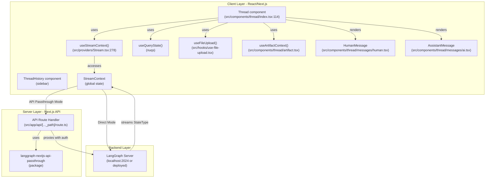

Sources: [src/components/thread/index.tsx:114-565](), [src/providers/Stream.tsx:1-286](), [package.json:1-88]()

The application follows a provider-based architecture where `StreamProvider` manages global streaming state and `Thread` orchestrates the user interface.

## Key Architectural Components

### 1. Thread Component

The `Thread` function at [src/components/thread/index.tsx:114]() serves as the primary UI controller, orchestrating the chat interface. It integrates multiple hooks and contexts:

| Hook/Context | Purpose | Return Value | Source |
|--------------|---------|--------------|--------|
| `useQueryState("threadId")` | URL-persisted thread ID | `[threadId, setThreadId]` | nuqs library |
| `useQueryState("chatHistoryOpen")` | Sidebar visibility state | `[boolean, setter]` | nuqs with default `false` |
| `useQueryState("hideToolCalls")` | Tool call display toggle | `[boolean, setter]` | nuqs with default `false` |
| `useStreamContext()` | Access streaming state | `StreamContextType` | StreamContext |
| `useFileUpload()` | File upload management | `{contentBlocks, handleFileUpload, ...}` | Local hook |
| `useArtifactContext()` | Artifact panel state | `[artifactContext, setArtifactContext]` | ArtifactProvider |

Sources: [src/components/thread/index.tsx:114-141]()

### 2. StreamProvider Architecture

The streaming architecture uses a two-component provider system defined in [src/providers/Stream.tsx:1-286]():

**Component Hierarchy:**

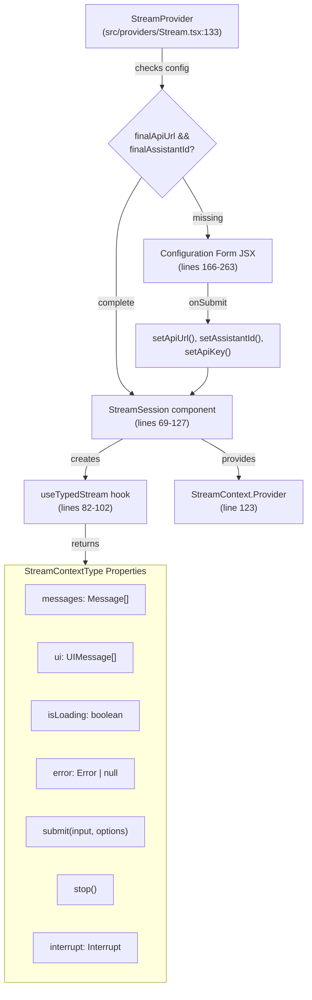

**Key Type Definitions:**

| Type | Definition | Location |
|------|------------|----------|
| `StateType` | `{ messages: Message[]; ui?: UIMessage[] }` | [src/providers/Stream.tsx:28]() |
| `useTypedStream` | Typed hook from `@langchain/langgraph-sdk/react` | [src/providers/Stream.tsx:30-40]() |
| `StreamContextType` | Return type of `useTypedStream` | [src/providers/Stream.tsx:42]() |

Sources: [src/providers/Stream.tsx:28-127](), [src/providers/Stream.tsx:133-274]()

### 3. Message Processing Pipeline

The core message handling follows this typed pipeline:

```mermaid
flowchart LR
    handleSubmit["handleSubmit(e: FormEvent)"] -->|"creates"| newHumanMessage["Message{id, type:'human', content}"]
    newHumanMessage -->|"processed by"| ensureToolCallsHaveResponses["ensureToolCallsHaveResponses()"]
    ensureToolCallsHaveResponses -->|"calls"| streamSubmit["stream.submit({messages, context})"]
    
    streamSubmit -->|"triggers"| useTypedStream["useTypedStream hook"]
    useTypedStream -->|"posts to"| apiUrl["/api endpoint"]
    apiUrl -->|"streams back"| StateType["StateType{messages, ui}"]
    StateType -->|"updates"| StreamContext["StreamContext"]
    StreamContext -->|"triggers rerender"| Thread["Thread component"]
```

Sources: [src/components/thread/index.tsx:198-236](), [src/providers/Stream.tsx:82-101]()

## State Management Architecture

### State Distribution Layers

The application distributes state across four layers with distinct responsibilities:

**State Distribution Diagram:**

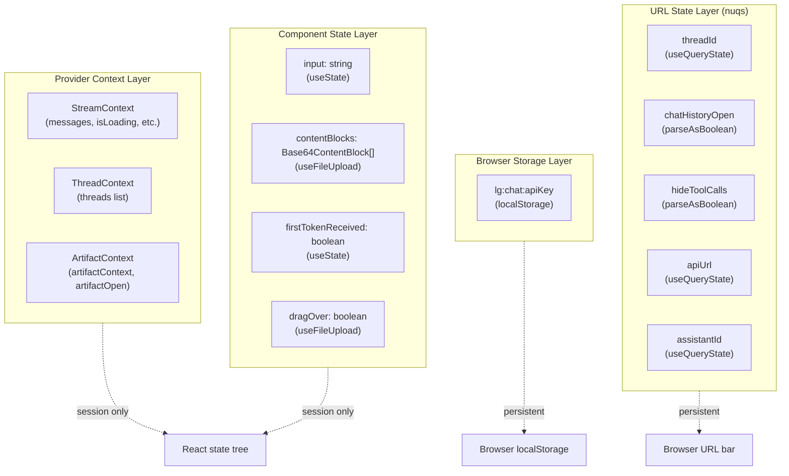

**Type Definitions:**

| Type | Definition | Import Source |
|------|------------|---------------|
| `Message` | `{id, type, content}` | `@langchain/langgraph-sdk` |
| `StateType` | `{messages: Message[], ui?: UIMessage[]}` | [src/providers/Stream.tsx:28]() |
| `UIMessage` | Custom UI messages from SDK | `@langchain/langgraph-sdk/react-ui` |
| `Base64ContentBlock` | `{type: "image" \| "document", source: {data, media_type}}` | `@langchain/core/messages` |

Sources: [src/components/thread/index.tsx:114-141](), [src/providers/Stream.tsx:1-40](), [src/providers/Stream.tsx:141-161]()

### Configuration Priority System

The StreamProvider implements a three-tier configuration resolution strategy at [src/providers/Stream.tsx:133-163]():

| Priority | Source | Parameters | Notes |
|----------|--------|------------|-------|
| **1 (Highest)** | URL query parameters | `apiUrl`, `assistantId` | Via `useQueryState` hooks |
| **2** | Environment variables | `NEXT_PUBLIC_API_URL`, `NEXT_PUBLIC_ASSISTANT_ID` | Server-side injection |
| **3 (Fallback)** | Local storage | API key only | Key: `lg:chat:apiKey` |

If `finalApiUrl` or `finalAssistantId` are missing, a configuration form is rendered at [src/providers/Stream.tsx:166-263]().

Sources: [src/providers/Stream.tsx:133-163]()

## Message Flow Architecture

### Complete Message Lifecycle

The message lifecycle flows through multiple layers from user input to rendered output:

**Message Submission Flow:**

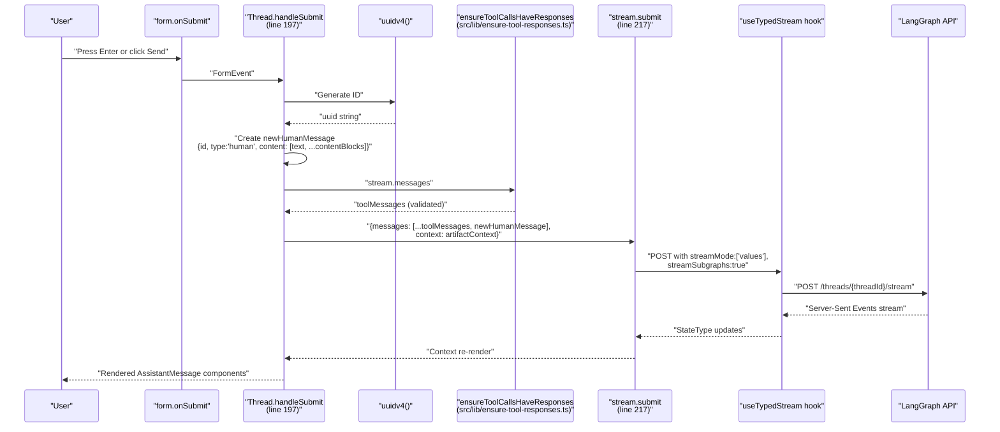

Sources: [src/components/thread/index.tsx:197-236](), [src/providers/Stream.tsx:82-102]()

### Message Rendering Logic

Messages are rendered conditionally based on type and state at [src/components/thread/index.tsx:402-432]():

**Message Rendering Pipeline:**

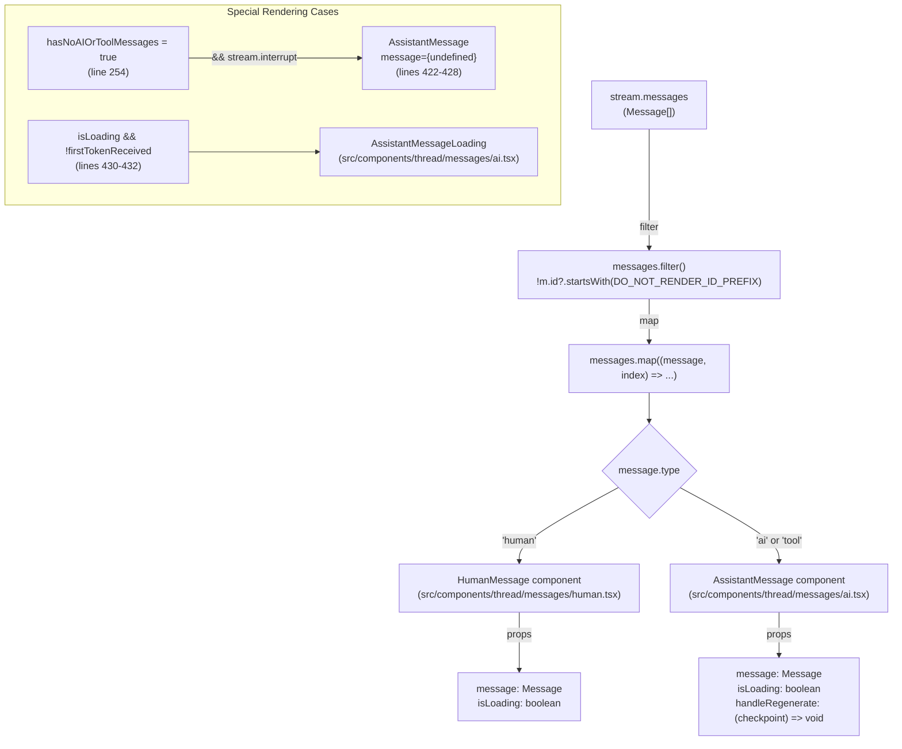

**DO_NOT_RENDER_ID_PREFIX Constant:**

The `DO_NOT_RENDER_ID_PREFIX` constant (imported from [src/lib/ensure-tool-responses.ts:12]()) is used to mark intermediate messages that should not be displayed to the user.

Sources: [src/components/thread/index.tsx:12-13](), [src/components/thread/index.tsx:254-256](), [src/components/thread/index.tsx:402-432]()

## Component Hierarchy and Layout

### Physical DOM Structure

The `Thread` component returns a multi-panel layout with responsive behavior:

**Layout Structure Diagram:**

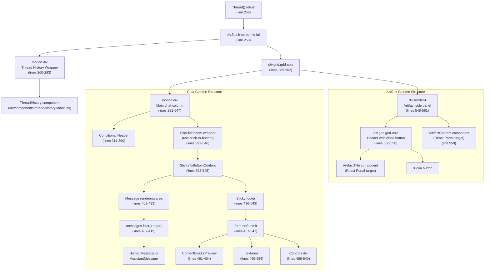

Sources: [src/components/thread/index.tsx:258-565]()

### Provider Context Dependencies

The `Thread` component integrates multiple contexts and hooks:

**Hook Dependency Graph:**

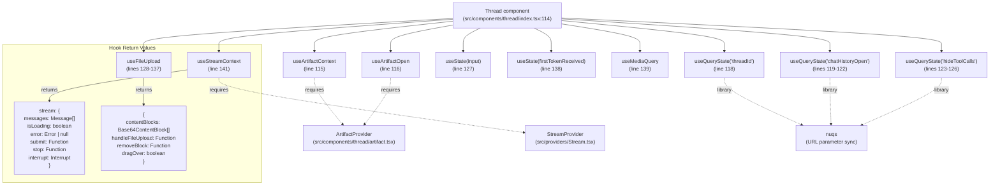

Sources: [src/components/thread/index.tsx:114-143]()

## Configuration and Authentication

### Configuration Resolution Strategy

The `StreamProvider` at [src/providers/Stream.tsx:133-274]() implements a three-tier configuration system:

**Configuration Priority Table:**

| Parameter | Priority 1 (Highest) | Priority 2 | Priority 3 | Storage Location |
|-----------|---------------------|------------|------------|------------------|
| `apiUrl` | URL query param | `process.env.NEXT_PUBLIC_API_URL` | `"http://localhost:2024"` (form default) | Query string via nuqs |
| `assistantId` | URL query param | `process.env.NEXT_PUBLIC_ASSISTANT_ID` | `"agent"` (form default) | Query string via nuqs |
| `apiKey` | Local storage | N/A | Empty string | `localStorage["lg:chat:apiKey"]` |

**Configuration Resolution Flow:**

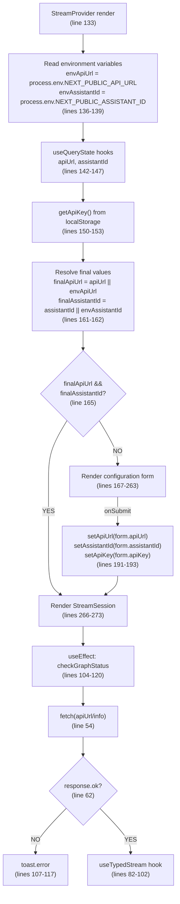

Sources: [src/providers/Stream.tsx:133-163](), [src/providers/Stream.tsx:49-67](), [src/providers/Stream.tsx:104-120]()

### Deployment Modes

The application supports multiple deployment architectures. While the client code doesn't explicitly handle different modes, the `useTypedStream` hook's `apiUrl` parameter determines the connection target:

| Mode | `apiUrl` Value | Authentication Method | Use Case |
|------|----------------|----------------------|----------|
| **Local Development** | `http://localhost:2024` | User-provided API key via form | Development with local LangGraph server |
| **API Passthrough** | `/api` (Next.js route) | Server-side `LANGSMITH_API_KEY` injection | Production deployments with hidden credentials |
| **Direct Connection** | Production LangGraph URL | Client-side API key from localStorage | Simple production deployments |

The API passthrough mode uses the `langgraph-nextjs-api-passthrough` package (see [package.json:39]()) in server-side routes to proxy requests while injecting authentication headers.

Sources: [src/providers/Stream.tsx:82-102](), [package.json:39]()

## Thread Lifecycle Management

### Thread Navigation and State Reset

Thread navigation is managed through a custom `setThreadId` wrapper at [src/components/thread/index.tsx:147-153]():

**Thread ID Management Flow:**

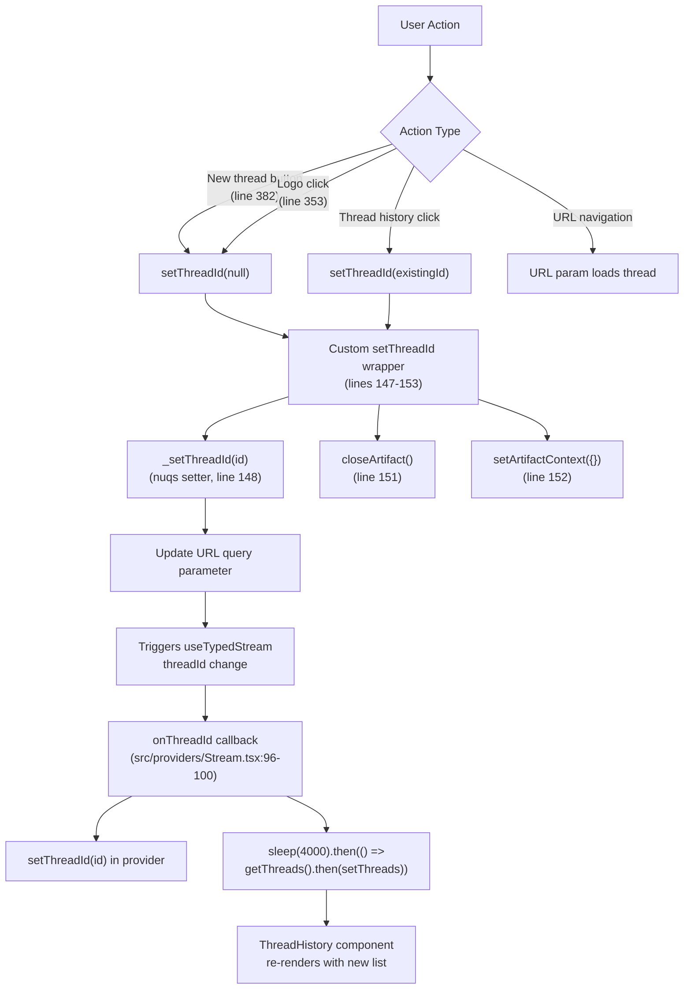

**Key Side Effects:**

When `setThreadId` is called, three actions occur atomically:
1. URL parameter updates via nuqs `_setThreadId`
2. Artifact panel closes via `closeArtifact()`
3. Artifact context clears via `setArtifactContext({})`

This ensures clean state when navigating between threads.

Sources: [src/components/thread/index.tsx:147-153](), [src/providers/Stream.tsx:96-100]()

## Package Dependencies

### Core Dependencies by Purpose

The application uses a focused set of packages organized by architectural concern:

**Dependency Table:**

| Package | Version | Purpose | Key Exports Used |
|---------|---------|---------|------------------|
| `@langchain/langgraph-sdk` | `^0.1.0` | LangGraph streaming and types | `useStream`, `Message`, `Checkpoint` |
| `@langchain/core` | `^0.3.44` | Message content types | `Base64ContentBlock` interface |
| `next` | `^15.2.3` | Application framework | App router, API routes |
| `react` / `react-dom` | `^19.0.0` | UI rendering | Hooks, components |
| `nuqs` | `^2.4.1` | URL state management | `useQueryState`, `parseAsBoolean` |
| `framer-motion` | `^12.4.9` | Layout animations | `motion` component, animation props |
| `use-stick-to-bottom` | `^1.0.46` | Chat scroll behavior | `StickToBottom`, `useStickToBottomContext` |
| `react-markdown` | `^10.0.1` | Markdown rendering | `ReactMarkdown` component |
| `react-syntax-highlighter` | `^15.5.0` | Code highlighting | `Prism` syntax highlighter |
| `sonner` | `^2.0.1` | Toast notifications | `toast` function |
| `uuid` | `^11.1.0` | ID generation | `v4` function |

**UI Component Libraries:**

| Package | Purpose |
|---------|---------|
| `@radix-ui/react-*` | Accessible UI primitives (Avatar, Dialog, Label, etc.) |
| `lucide-react` | Icon components |
| `tailwindcss` | Utility-first CSS framework |
| `class-variance-authority` | Component variant management |

**Optional Production Packages:**

| Package | Version | Purpose | Usage |
|---------|---------|---------|-------|
| `langgraph-nextjs-api-passthrough` | `^0.0.4` | API proxy for production | Server-side authentication injection |

Sources: [package.json:21-58]()

### External System Integration

The application integrates with external systems through well-defined interfaces:

**System Integration Diagram:**

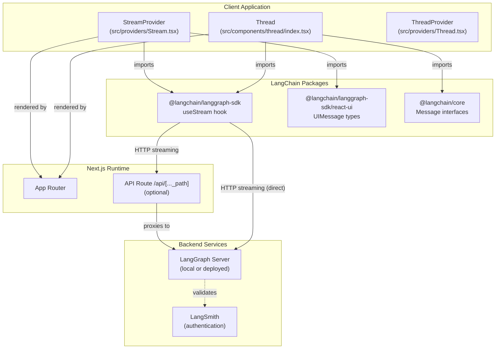

Sources: [src/components/thread/index.tsx:1-14](), [src/providers/Stream.tsx:1-26](), [package.json:21-58]()

## Error Handling

The architecture includes built-in error handling mechanisms:

1. Connection errors with the LangGraph server are detected and surfaced to the user
2. API errors during message streaming are captured and displayed
3. UI fallbacks are provided when data is not available

This ensures robustness and a good user experience even when issues occur.

Sources: [src/components/thread/index.tsx:122-150](), [src/providers/Stream.tsx:98-114]()

## Initialization Flow

The following diagram illustrates the initialization flow of the application:

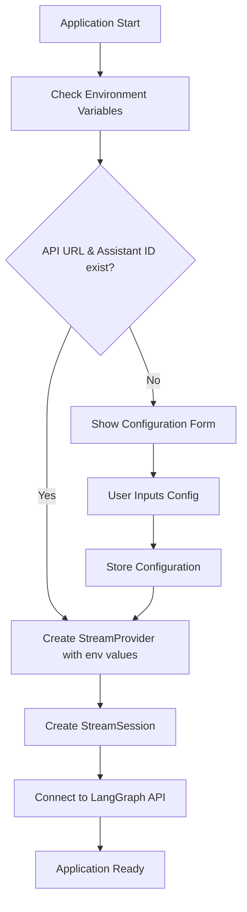

Sources: [src/providers/Stream.tsx:127-269]()

## Summary

The Agent Chat UI's core architecture follows a clean component-based approach with clear separation of concerns:

1. **UI Components**: Managed by the Thread component hierarchy
2. **Data and API Layer**: Handled by the StreamProvider
3. **State Management**: Distributed across contexts and component state
4. **Message Flow**: Clearly defined paths for data to move through the system

This architecture allows for a responsive, real-time chat experience while maintaining flexibility and extensibility for future enhancements.

---

