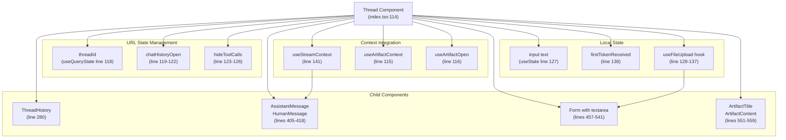
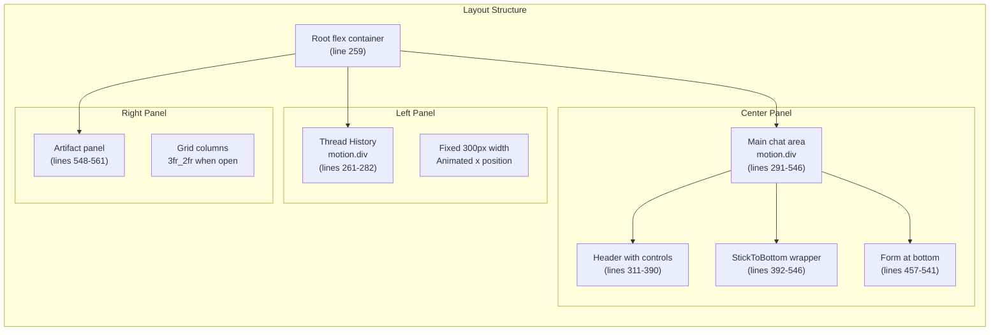
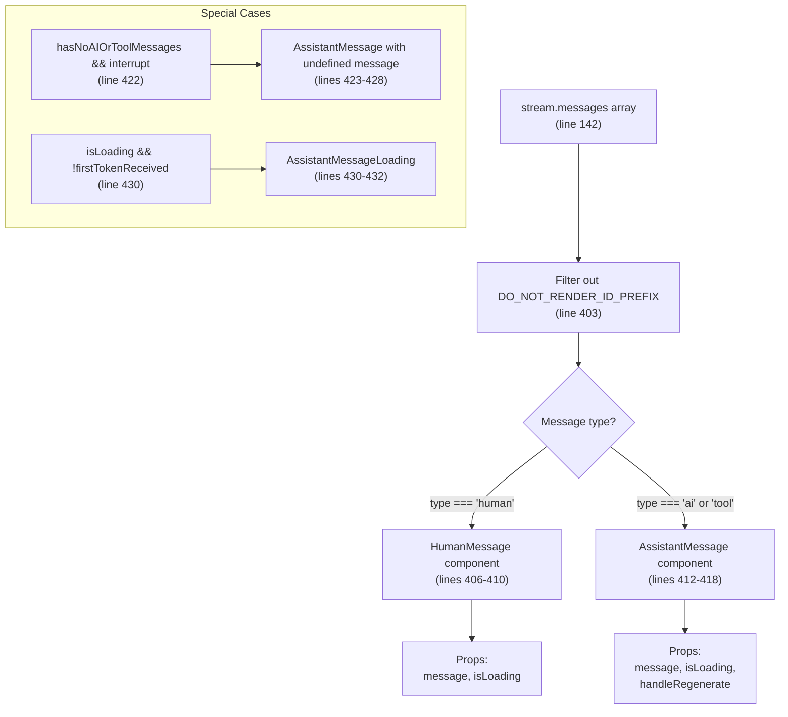
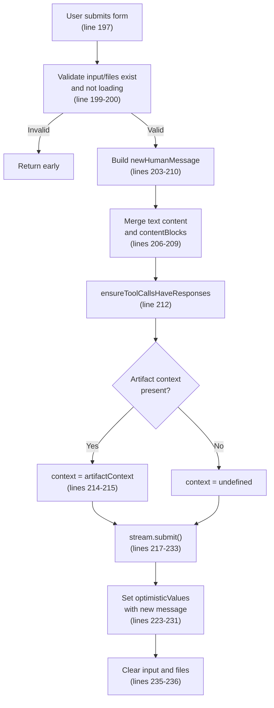
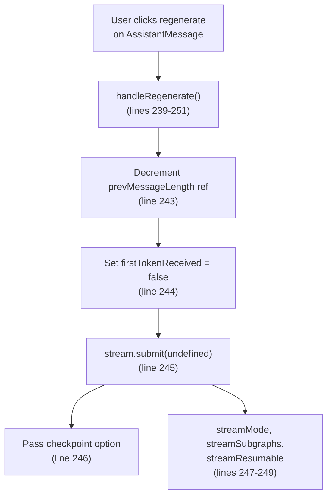
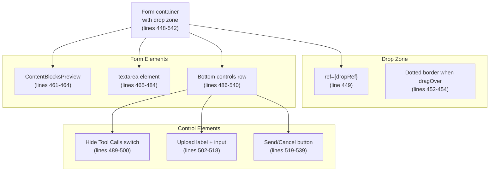
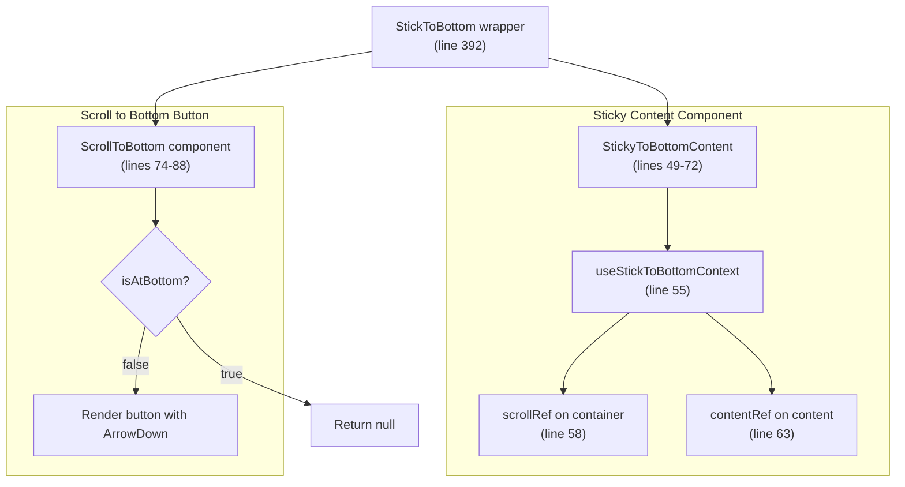
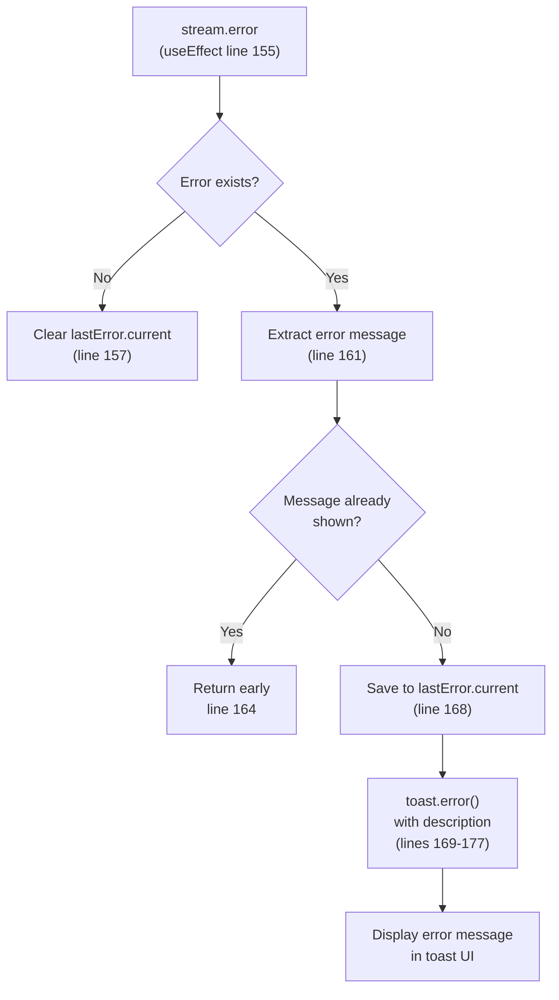
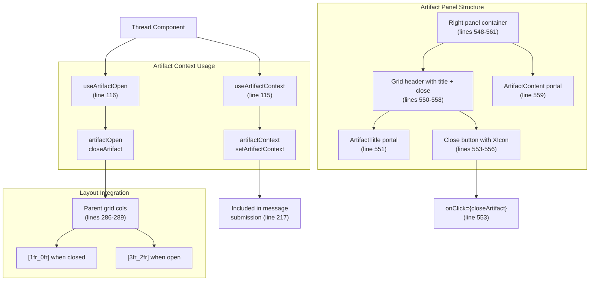
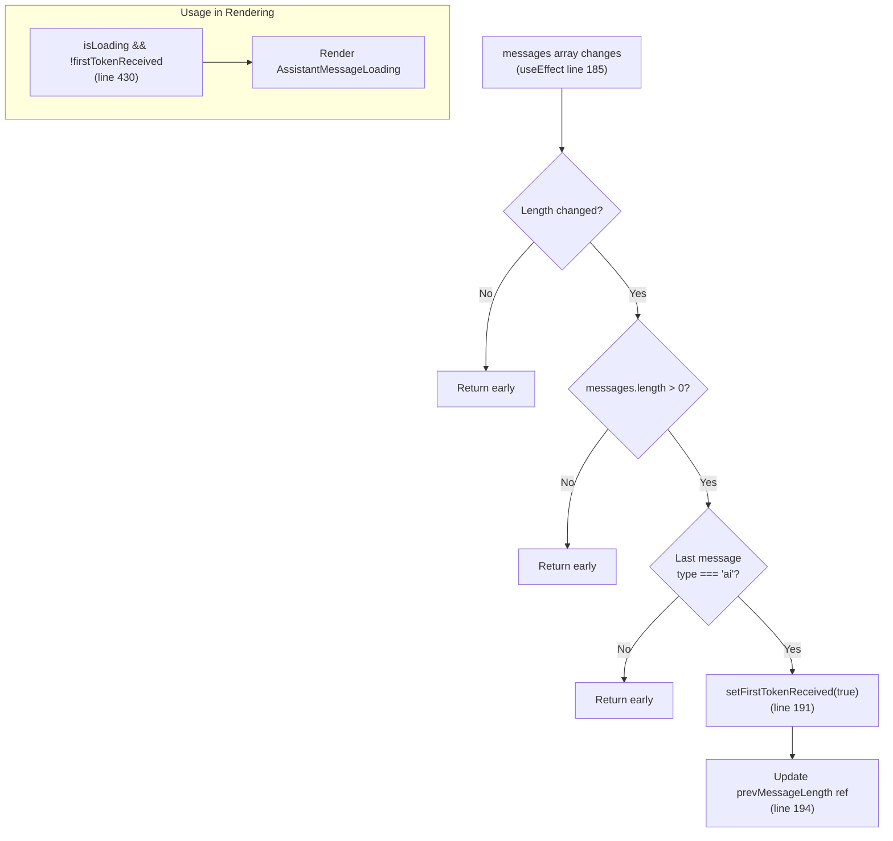

<!-- source: DeepWiki mcp.deepwiki.com · repo langchain-ai/agent-chat-ui · page 2.1 Thread Component · fetched 2026-10-26 -->

# Thread Component

<details>
<summary>Relevant source files</summary>

The following files were used as context for generating this wiki page:

- [src/components/thread/index.tsx](src/components/thread/index.tsx)
- [src/providers/Stream.tsx](src/providers/Stream.tsx)

</details>


The Thread component serves as the primary chat interface for the agent-chat-ui application. It orchestrates the integration of streaming messages, user input handling, file uploads, and layout management into a cohesive conversational UI. The component is responsible for rendering messages, managing the chat input form, coordinating with the artifact panel, and handling responsive layout behavior including the thread history sidebar.

For details on the streaming connection and configuration, see [Stream Provider](#2.2). For thread list management in the sidebar, see [Thread History and Management](#5). For message rendering internals, see [Message System](#3). For file upload mechanics, see [File Upload and Multimodal Content](#6). For artifact panel implementation, see [Artifact System](#2.4).

## Component Architecture

The Thread component is implemented in [src/components/thread/index.tsx:114-565]() as the exported `Thread` function. It integrates multiple concerns through a layered architecture:



**Sources**: [src/components/thread/index.tsx:114-565]()

## Layout and Responsive Behavior

The Thread component implements a sophisticated three-panel layout system with responsive breakpoints and animated transitions:



**Layout Implementation Details**

The layout uses CSS Grid for the main container [src/components/thread/index.tsx:286-289]():
- Default: `grid-cols-[1fr_0fr]` (artifact panel hidden)
- When artifact open: `grid-cols-[3fr_2fr]` (60/40 split)

The thread history sidebar uses `framer-motion` for smooth animations [src/components/thread/index.tsx:261-282]():
- Hidden: `x: -300` (off-screen left)
- Visible: `x: 0`
- Conditionally rendered on large screens only: `lg:flex` [src/components/thread/index.tsx:260]()

The main chat area adjusts margins dynamically [src/components/thread/index.tsx:297-309]():
- When history open on large screens: `marginLeft: 300px`, `width: calc(100% - 300px)`
- When history closed: `marginLeft: 0`, `width: 100%`
- Transitions use spring physics: `stiffness: 300, damping: 30`

**Sources**: [src/components/thread/index.tsx:259-562]()

## State Management

The Thread component manages state through three layers: URL query parameters, context providers, and local component state.

| State Layer | Variables | Purpose | Persistence |
|-------------|-----------|---------|-------------|
| **URL State** | `threadId`, `chatHistoryOpen`, `hideToolCalls` | Navigation, UI preferences | Browser history |
| **Context State** | `stream.messages`, `stream.isLoading`, `artifactContext`, `artifactOpen` | Global application state | Runtime only |
| **Local State** | `input`, `contentBlocks`, `firstTokenReceived` | Ephemeral UI state | Component lifetime |

### URL Query Parameters

The component uses `nuqs` for URL state management [src/components/thread/index.tsx:118-126]():

```typescript
const [threadId, _setThreadId] = useQueryState("threadId");
const [chatHistoryOpen, setChatHistoryOpen] = useQueryState(
  "chatHistoryOpen",
  parseAsBoolean.withDefault(false)
);
const [hideToolCalls, setHideToolCalls] = useQueryState(
  "hideToolCalls", 
  parseAsBoolean.withDefault(false)
);
```

The `threadId` setter is wrapped [src/components/thread/index.tsx:147-153]() to automatically close the artifact panel and reset artifact context when switching threads, ensuring clean state transitions.

### Context Integration

The component consumes three context providers:
- **StreamContext**: Accessed via `useStreamContext()` [src/components/thread/index.tsx:141]() to obtain `messages`, `isLoading`, `error`, `submit()`, and `stop()` methods
- **ArtifactContext**: Accessed via `useArtifactContext()` [src/components/thread/index.tsx:115]() to manage artifact data passed to the agent
- **ArtifactOpen**: Accessed via `useArtifactOpen()` [src/components/thread/index.tsx:116]() to control artifact panel visibility

### Local Component State

The component maintains ephemeral state for:
- Text input: `input` state managed by `useState` [src/components/thread/index.tsx:127]()
- File uploads: `contentBlocks` and related state from `useFileUpload` hook [src/components/thread/index.tsx:128-137]()
- Loading indicators: `firstTokenReceived` tracks when the first AI token arrives [src/components/thread/index.tsx:138]()
- Error tracking: `lastError` ref prevents duplicate error toasts [src/components/thread/index.tsx:145]()

**Sources**: [src/components/thread/index.tsx:115-145](), [src/components/thread/index.tsx:147-153]()

## Message Rendering Pipeline

The Thread component renders messages by iterating over `stream.messages` and delegating to specialized components:



**Message Filtering and Iteration**

Messages are filtered to exclude internal system messages [src/components/thread/index.tsx:402-403]():
```typescript
messages
  .filter((m) => !m.id?.startsWith(DO_NOT_RENDER_ID_PREFIX))
```

The `DO_NOT_RENDER_ID_PREFIX` constant is imported from [src/lib/ensure-tool-responses.ts]() and marks messages that should not be displayed (e.g., synthetic tool response messages).

**Component Selection Logic**

The rendering logic [src/components/thread/index.tsx:404-419]() maps message types:
- `type === "human"` → `HumanMessage` component with `message` and `isLoading` props
- All other types (including `"ai"` and `"tool"`) → `AssistantMessage` component with `message`, `isLoading`, and `handleRegenerate` props

**Special Rendering Cases**

Two edge cases receive special handling:
1. **No AI/Tool Messages with Interrupt**: When `hasNoAIOrToolMessages` is true but an interrupt exists [src/components/thread/index.tsx:422-429](), the component renders an `AssistantMessage` with `message={undefined}` to display the interrupt outside the normal message list.

2. **Loading Without First Token**: When `isLoading` is true but `firstTokenReceived` is false [src/components/thread/index.tsx:430-432](), the component renders `AssistantMessageLoading` to show a loading indicator before the first streaming token arrives.

**Sources**: [src/components/thread/index.tsx:142-143](), [src/components/thread/index.tsx:402-433](), [src/lib/ensure-tool-responses.ts:1-2]()

## Message Submission Flow

The Thread component handles message submission through a multi-step pipeline that integrates text input, file uploads, tool call validation, and artifact context:



**Submission Handler Implementation**

The `handleSubmit` function [src/components/thread/index.tsx:197-237]() implements the submission flow:

1. **Validation** [src/components/thread/index.tsx:199-200](): Prevents submission if input is empty, no files are attached, or stream is already loading
   
2. **Message Construction** [src/components/thread/index.tsx:203-210](): Creates a `Message` object with:
   - Generated UUID via `uuidv4()`
   - Type: `"human"`
   - Content array merging text (if non-empty) and `contentBlocks` from file uploads

3. **Tool Call Validation** [src/components/thread/index.tsx:212](): Calls `ensureToolCallsHaveResponses(stream.messages)` to ensure all tool calls have corresponding responses before submission (prevents rendering issues)

4. **Artifact Context Handling** [src/components/thread/index.tsx:214-215](): Includes `artifactContext` in submission if it contains data, otherwise passes `undefined`

5. **Stream Submission** [src/components/thread/index.tsx:217-233](): Calls `stream.submit()` with:
   - Messages array: existing tool messages + new human message
   - Context object (if present)
   - Options: `streamMode: ["values"]`, `streamSubgraphs: true`, `streamResumable: true`
   - Optimistic values for immediate UI update

6. **State Cleanup** [src/components/thread/index.tsx:235-236](): Resets `input` to empty string and clears `contentBlocks`

**Sources**: [src/components/thread/index.tsx:197-237]()

## Message Regeneration

The component supports regenerating AI responses from specific checkpoints in the conversation history:



**Regeneration Implementation**

The `handleRegenerate` function [src/components/thread/index.tsx:239-251]() accepts a `parentCheckpoint` parameter:

- **State Adjustment** [src/components/thread/index.tsx:243-244](): Decrements `prevMessageLength.current` to ensure loading state calculation is correct, and resets `firstTokenReceived` to show loading indicator

- **Checkpoint Submission** [src/components/thread/index.tsx:245-250](): Calls `stream.submit(undefined, {...})` with:
  - First argument: `undefined` (no new messages)
  - Options include `checkpoint: parentCheckpoint` to resume from that state
  - Same stream options as normal submission

This enables "time travel" through conversation states by regenerating from any previous checkpoint in the conversation history.

**Sources**: [src/components/thread/index.tsx:239-251]()

## Input Form and File Upload Integration

The Thread component renders a form at the bottom of the chat area that handles text input, file uploads, and tool call visibility:



**Form Structure**

The form [src/components/thread/index.tsx:457-541]() implements:

1. **Drop Zone Integration** [src/components/thread/index.tsx:449-455](): The form container receives `dropRef` from `useFileUpload` hook, enabling drag-and-drop file uploads. The border style changes when `dragOver` is true (dotted primary border vs. solid).

2. **Content Blocks Preview** [src/components/thread/index.tsx:461-464](): Displays uploaded files using `ContentBlocksPreview` component with `blocks={contentBlocks}` and `onRemove={removeBlock}`.

3. **Textarea Input** [src/components/thread/index.tsx:465-484](): Auto-resizing textarea with:
   - `field-sizing-content` class for automatic height
   - `onPaste` handler for clipboard paste
   - Enter key submission (line 471-480): Submits on Enter, allows Shift+Enter for newlines, ignores during IME composition

4. **Tool Call Visibility Switch** [src/components/thread/index.tsx:489-500](): Toggle switch bound to `hideToolCalls` URL state, allowing users to show/hide tool invocations in messages.

5. **File Upload Input** [src/components/thread/index.tsx:502-518](): Hidden file input with visible label, accepts `image/jpeg,image/png,image/gif,image/webp,application/pdf`, triggers `handleFileUpload` from `useFileUpload` hook.

6. **Submit/Cancel Button** [src/components/thread/index.tsx:519-539](): Dynamic button that shows:
   - When loading: Cancel button with spinning loader icon that calls `stream.stop()`
   - When not loading: Send button (disabled if no input/files or while loading)

**Sources**: [src/components/thread/index.tsx:448-542](), [src/hooks/use-file-upload.tsx]()

## Scroll Management

The Thread component uses the `use-stick-to-bottom` library to provide automatic scrolling behavior:



**Sticky Scroll Implementation**

The `StickToBottom` component [src/components/thread/index.tsx:392]() wraps the message container and provides context for scroll management.

The custom `StickyToBottomContent` component [src/components/thread/index.tsx:49-72]() bridges the wrapper and content:
- Receives `scrollRef` and `contentRef` from context
- Applies refs to container and content divs respectively
- Renders `content` (messages) and optional `footer` (form)

The `ScrollToBottom` component [src/components/thread/index.tsx:74-88]() provides user control:
- Consumes `isAtBottom` and `scrollToBottom` from context
- Returns `null` when already at bottom (auto-hides)
- Renders button with `ArrowDown` icon when scrolled up
- Positioned absolutely via `className` prop [src/components/thread/index.tsx:446]()

**Sources**: [src/components/thread/index.tsx:392-546](), [src/components/thread/index.tsx:49-88]()

## Error Handling

The component implements error handling with toast notifications and duplicate error prevention:



**Error Handling Implementation**

The error handling effect [src/components/thread/index.tsx:155-181]() runs whenever `stream.error` changes:

1. **Error Clearing** [src/components/thread/index.tsx:156-159](): If no error exists, clears `lastError.current` ref and returns early.

2. **Duplicate Prevention** [src/components/thread/index.tsx:160-165](): Extracts error message and compares to `lastError.current`. If the same message has already been shown, returns early without displaying a new toast.

3. **Error Display** [src/components/thread/index.tsx:168-177](): Saves the new error message to the ref, then calls `toast.error()` with:
   - Title: "An error occurred. Please try again."
   - Description: Rich content showing the error message in a `<code>` block
   - Duration: Default (auto-dismiss)
   - Features: `richColors`, `closeButton`

The ref-based duplicate prevention ensures users aren't spammed with repeated error notifications if the same error occurs multiple times.

**Sources**: [src/components/thread/index.tsx:155-181]()

## Header and Navigation

The Thread component renders different headers based on whether a chat has started:

### Pre-Chat Header

Before any messages exist [src/components/thread/index.tsx:311-331]():
- Positioned absolutely at top-left
- Shows sidebar toggle button (if history closed or on small screens)
- GitHub repo link in top-right corner
- Minimal UI to maximize space for the initial input form

### Active Chat Header

After messages exist [src/components/thread/index.tsx:333-390]():
- Fixed header with three sections:
  1. **Left Section** [src/components/thread/index.tsx:335-371](): Sidebar toggle + animated LangGraph logo/title that shifts when sidebar opens
  2. **Right Section** [src/components/thread/index.tsx:373-386](): GitHub link + "New thread" button with `SquarePen` icon
  3. **Gradient Fade** [src/components/thread/index.tsx:388](): Visual separation from scrolling content

The logo/title animation [src/components/thread/index.tsx:351-361]() uses `framer-motion` with:
- `marginLeft` animates from 48px to 0 when sidebar opens
- Spring transition with `stiffness: 300, damping: 30`
- Clicking logo/title triggers `setThreadId(null)` to start new thread

**Sources**: [src/components/thread/index.tsx:311-390]()

## Artifact Panel Integration

The Thread component manages the artifact panel (right side) through context and portal rendering:



**Artifact State Management**

The Thread component accesses artifact state through hooks:
- `useArtifactContext()` [src/components/thread/index.tsx:115](): Returns `[artifactContext, setArtifactContext]` tuple for managing artifact data
- `useArtifactOpen()` [src/components/thread/index.tsx:116](): Returns `[artifactOpen, closeArtifact]` tuple for panel visibility

**Artifact Context in Message Flow**

When submitting messages [src/components/thread/index.tsx:214-217](), the artifact context is conditionally included:
```typescript
const context =
  Object.keys(artifactContext).length > 0 ? artifactContext : undefined;
```
This context is passed to `stream.submit()` along with messages, allowing agents to reference artifact content in their responses.

**Thread ID Changes**

The wrapped `setThreadId` function [src/components/thread/index.tsx:147-153]() automatically:
1. Closes the artifact panel via `closeArtifact()`
2. Resets artifact context via `setArtifactContext({})`

This ensures clean state when switching between threads.

**Panel Layout**

The artifact panel [src/components/thread/index.tsx:548-561]() contains:
- Grid header with `ArtifactTitle` (portal target) and close button
- `ArtifactContent` (portal target) for rendered content
- Fixed `min-w-[30vw]` minimum width

Components within messages render into these portals using the artifact provider's refs. See [Artifact System](#2.4) for portal implementation details.

**Sources**: [src/components/thread/index.tsx:115-116](), [src/components/thread/index.tsx:147-153](), [src/components/thread/index.tsx:214-217](), [src/components/thread/index.tsx:286-289](), [src/components/thread/index.tsx:548-561]()

## Conditional Rendering Based on Chat State

The component adapts its UI based on whether a conversation has started:

```typescript
const chatStarted = !!threadId || !!messages.length;
```

[src/components/thread/index.tsx:253]()

This boolean controls:

| UI Element | Pre-Chat (chatStarted === false) | Active Chat (chatStarted === true) |
|------------|----------------------------------|-------------------------------------|
| **Header** | Minimal header, absolute positioned [lines 311-331]() | Full header with navigation [lines 333-390]() |
| **Message Area** | Centered vertically with `mt-[25vh]` [line 396]() | Normal grid layout [line 397]() |
| **Logo Display** | Large logo + "Agent Chat" heading in footer [lines 437-443]() | Small logo + title in header [lines 363-369]() |
| **First Message UI** | Prominent input form centered on page | Input form docked at bottom |

Additionally, the component tracks whether any AI or tool messages exist [src/components/thread/index.tsx:254-256]():
```typescript
const hasNoAIOrToolMessages = !messages.find(
  (m) => m.type === "ai" || m.type === "tool",
);
```

This enables special interrupt rendering when an agent emits an interrupt before any normal messages [src/components/thread/index.tsx:422-429]().

**Sources**: [src/components/thread/index.tsx:253-256](), [src/components/thread/index.tsx:311-443]()

## First Token Tracking

The component implements first token detection to control loading indicator visibility:



**First Token Detection Logic**

The effect [src/components/thread/index.tsx:184-195]() tracks when streaming begins:

1. Compares current `messages.length` to `prevMessageLength.current`
2. If length changed and messages exist:
   - Checks if last message is type `"ai"`
   - If true, sets `firstTokenReceived = true`
3. Updates `prevMessageLength.current` for next comparison

**Why This Matters**

The flag prevents showing a loading indicator after the AI has already started responding. The rendering logic [src/components/thread/index.tsx:430-432]() only shows `AssistantMessageLoading` when:
- `isLoading` is true (stream active)
- AND `firstTokenReceived` is false (no tokens yet)

This avoids redundant loading indicators once content begins streaming.

The flag is reset to `false` in two places:
1. Before submitting new messages [src/components/thread/index.tsx:201]()
2. Before regenerating [src/components/thread/index.tsx:244]()

**Sources**: [src/components/thread/index.tsx:138](), [src/components/thread/index.tsx:184-195](), [src/components/thread/index.tsx:201](), [src/components/thread/index.tsx:244](), [src/components/thread/index.tsx:430-432]()

---

