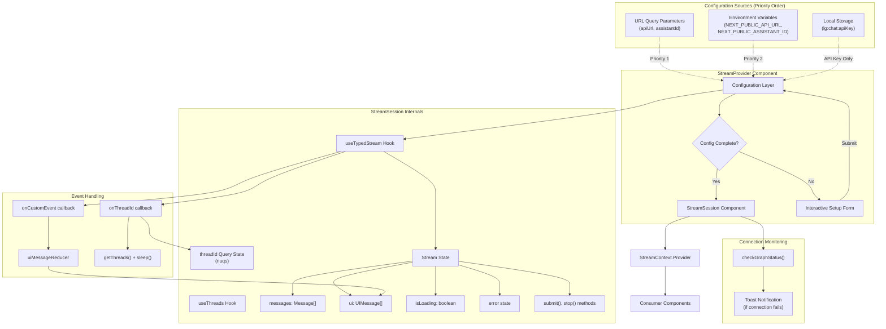
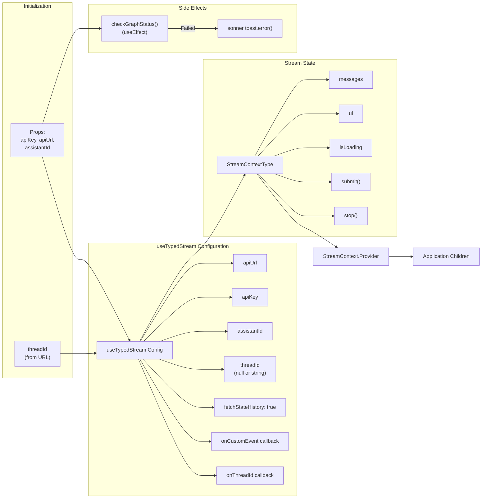

<!-- source: DeepWiki mcp.deepwiki.com · repo langchain-ai/agent-chat-ui · page 2.2 Stream Provider · fetched 2026-10-26 -->

# Stream Provider

<details>
<summary>Relevant source files</summary>

The following files were used as context for generating this wiki page:

- [.codespellignore](.codespellignore)
- [.env.example](.env.example)
- [README.md](README.md)
- [src/app/api/[..._path]/route.ts](src/app/api/[..._path]/route.ts)
- [src/providers/Stream.tsx](src/providers/Stream.tsx)

</details>


The Stream Provider is the core state management layer for real-time communication with LangGraph servers. It manages configuration resolution, establishes streaming connections, handles message state, and provides custom event processing capabilities. This provider wraps the `useStream` hook from `@langchain/langgraph-sdk/react` with application-specific configuration, type safety, and lifecycle management.

For information about how the Thread component consumes this provider, see [Thread Component](#2.1). For details on thread list management (separate from streaming), see [Thread Provider](#2.3).

## Architecture Overview

The Stream Provider implements a two-layer architecture with configuration resolution in the outer layer and streaming management in the inner layer:



**Sources**: [src/providers/Stream.tsx:1-287]()

## Configuration System

### Three-Tier Priority Resolution

The Stream Provider implements a configuration priority system that resolves values from three sources in order of precedence:

| Priority | Source | Variables | Storage Method | Use Case |
|----------|--------|-----------|----------------|----------|
| 1 (Highest) | URL Query Parameters | `apiUrl`, `assistantId` | `nuqs` library | Deep linking, testing |
| 2 | Environment Variables | `NEXT_PUBLIC_API_URL`, `NEXT_PUBLIC_ASSISTANT_ID` | Build-time | Production deployment |
| 3 (API Key Only) | Local Storage | `lg:chat:apiKey` | Browser storage | User credentials |

The resolution logic in `StreamProvider` [src/providers/Stream.tsx:136-163]():

```typescript
// URL params use nuqs with env var defaults
const [apiUrl, setApiUrl] = useQueryState("apiUrl", {
  defaultValue: envApiUrl || "",
});
const [assistantId, setAssistantId] = useQueryState("assistantId", {
  defaultValue: envAssistantId || "",
});

// API key uses localStorage with getApiKey() helper
const [apiKey, _setApiKey] = useState(() => {
  const storedKey = getApiKey();
  return storedKey || "";
});

// Final values prioritize URL params, then env vars
const finalApiUrl = apiUrl || envApiUrl;
const finalAssistantId = assistantId || envAssistantId;
```

**Sources**: [src/providers/Stream.tsx:136-163](), [README.md:51-69]()

### Interactive Setup Form

If required configuration is missing (`!finalApiUrl || !finalAssistantId`), the provider renders an interactive setup form instead of the application content [src/providers/Stream.tsx:165-264](). The form collects:

- **Deployment URL**: Required field, defaults to `http://localhost:2024`
- **Assistant/Graph ID**: Required field, defaults to `agent`
- **LangSmith API Key**: Optional field, only required for deployed LangGraph servers

Form submission updates all three state layers [src/providers/Stream.tsx:182-195]():
- Sets URL query parameters via `setApiUrl()` and `setAssistantId()`
- Stores API key in local storage via `setApiKey()`
- Triggers re-render, causing `StreamSession` to mount

**Sources**: [src/providers/Stream.tsx:165-264](), [README.md:43-49]()

## StreamSession Component

### Streaming Connection Lifecycle

The `StreamSession` component manages the actual streaming connection using the `useTypedStream` hook:



The configuration passed to `useTypedStream` [src/providers/Stream.tsx:82-102]():

**Sources**: [src/providers/Stream.tsx:69-127]()

### Custom Event Handling

The `onCustomEvent` callback processes UI-specific messages from LangGraph streams [src/providers/Stream.tsx:88-95]():

```typescript
onCustomEvent: (event, options) => {
  if (isUIMessage(event) || isRemoveUIMessage(event)) {
    options.mutate((prev) => {
      const ui = uiMessageReducer(prev.ui ?? [], event);
      return { ...prev, ui };
    });
  }
}
```

This handler:
1. Checks if the event is a `UIMessage` or `RemoveUIMessage` type
2. Uses `uiMessageReducer` from `@langchain/langgraph-sdk/react-ui` to update UI state
3. Mutates the stream state immutably via `options.mutate()`

**Sources**: [src/providers/Stream.tsx:88-95]()

### Thread ID Synchronization

The `onThreadId` callback synchronizes thread IDs between the stream and URL state [src/providers/Stream.tsx:96-101]():

```typescript
onThreadId: (id) => {
  setThreadId(id);
  // Wait before fetching so new thread is available
  sleep().then(() => getThreads().then(setThreads).catch(console.error));
}
```

When a new thread is created during message submission:
1. The thread ID is written to URL query parameters via `setThreadId()`
2. A 4-second delay (`sleep()`) allows the LangGraph server to persist the thread
3. The thread list is refreshed via `getThreads()` from `useThreads()`

**Sources**: [src/providers/Stream.tsx:96-101](), [src/providers/Stream.tsx:45-47]()

### Connection Status Monitoring

The `useEffect` hook monitors connection health [src/providers/Stream.tsx:104-120]():

```typescript
useEffect(() => {
  checkGraphStatus(apiUrl, apiKey).then((ok) => {
    if (!ok) {
      toast.error("Failed to connect to LangGraph server", {
        description: () => (
          <p>
            Please ensure your graph is running at <code>{apiUrl}</code>...
          </p>
        ),
        duration: 10000,
        richColors: true,
        closeButton: true,
      });
    }
  });
}, [apiKey, apiUrl]);
```

The `checkGraphStatus` function [src/providers/Stream.tsx:49-67]() attempts to fetch `/info` from the LangGraph server with optional authentication headers.

**Sources**: [src/providers/Stream.tsx:49-120]()

## Context API

### useStreamContext Hook

The `useStreamContext` hook provides type-safe access to the streaming context [src/providers/Stream.tsx:278-284]():

```typescript
export const useStreamContext = (): StreamContextType => {
  const context = useContext(StreamContext);
  if (context === undefined) {
    throw new Error("useStreamContext must be used within a StreamProvider");
  }
  return context;
};
```

This hook returns the `StreamContextType`, which is the return value of `useTypedStream`.

**Sources**: [src/providers/Stream.tsx:278-284]()

### Available State and Methods

The context provides the following interface:

| Property | Type | Description |
|----------|------|-------------|
| `messages` | `Message[]` | Array of standard LangGraph messages from state |
| `ui` | `UIMessage[]` | Array of UI-specific messages processed by `uiMessageReducer` |
| `isLoading` | `boolean` | Whether a stream is currently active |
| `error` | Error object | Stream error state, if any |
| `submit()` | Function | Submits a new message/run to the stream |
| `stop()` | Function | Cancels the current streaming operation |
| `thread` | Thread object | Current thread metadata and methods |
| `meta` | Metadata object | Custom metadata (e.g., artifact context) |

**Sources**: [src/providers/Stream.tsx:30-42]()

## Type System

### StateType Definition

The `StateType` interface defines the shape of the LangGraph state [src/providers/Stream.tsx:28]():

```typescript
export type StateType = { messages: Message[]; ui?: UIMessage[] };
```

This matches the standard LangGraph state schema with a required `messages` key and optional `ui` key for UI-specific messages.

**Sources**: [src/providers/Stream.tsx:28]()

### useTypedStream Configuration

The `useTypedStream` extends `useStream` with type parameters [src/providers/Stream.tsx:30-40]():

```typescript
const useTypedStream = useStream<
  StateType,
  {
    UpdateType: {
      messages?: Message[] | Message | string;
      ui?: (UIMessage | RemoveUIMessage)[] | UIMessage | RemoveUIMessage;
      context?: Record<string, unknown>;
    };
    CustomEventType: UIMessage | RemoveUIMessage;
  }
>;
```

Type parameters:
- **First parameter** (`StateType`): The shape of the graph state
- **Second parameter**: Configuration object with:
  - `UpdateType`: Shapes of incremental updates from the stream
  - `CustomEventType`: Types of custom events the stream can emit

**Sources**: [src/providers/Stream.tsx:30-40]()

## Integration with LangGraph SDK

### Direct vs. Proxied Connections

The Stream Provider supports two connection modes based on environment configuration:

**Development Mode** (Direct Connection):
- `NEXT_PUBLIC_API_URL` points to `http://localhost:2024`
- Client connects directly to local LangGraph server
- API key from local storage used for authentication

**Production Mode** (API Passthrough):
- `NEXT_PUBLIC_API_URL` points to `/api` endpoint
- Requests proxied through Next.js API routes [src/app/api/[..._path]/route.ts]()
- `LANGSMITH_API_KEY` injected server-side via `langgraph-nextjs-api-passthrough`

For details on production deployment, see [API Passthrough for Production](#9.2).

**Sources**: [README.md:188-218](), [.env.example:1-14](), [src/app/api/[..._path]/route.ts:1-11]()

### Custom Authentication Mode

For custom authentication deployments, the `useTypedStream` hook accepts a `defaultHeaders` option [README.md:231-242]():

```typescript
const streamValue = useTypedStream({
  apiUrl: process.env.NEXT_PUBLIC_API_URL,
  assistantId: process.env.NEXT_PUBLIC_ASSISTANT_ID,
  defaultHeaders: {
    Authentication: `Bearer ${token}`,
  },
});
```

This allows passing custom bearer tokens obtained from external authentication systems. For more details, see [Custom Authentication](#9.3).

**Sources**: [README.md:220-242]()

---

