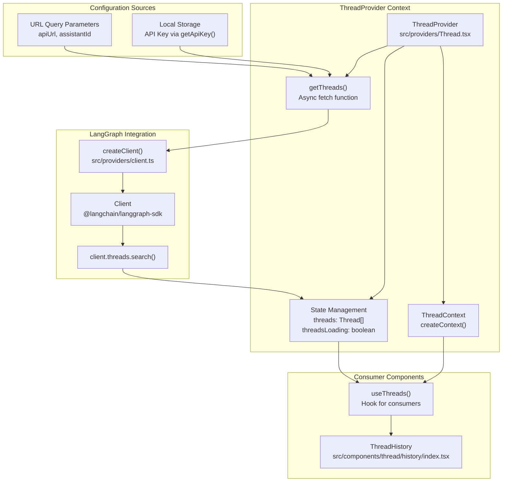
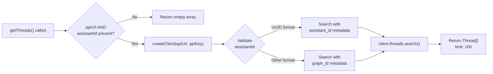
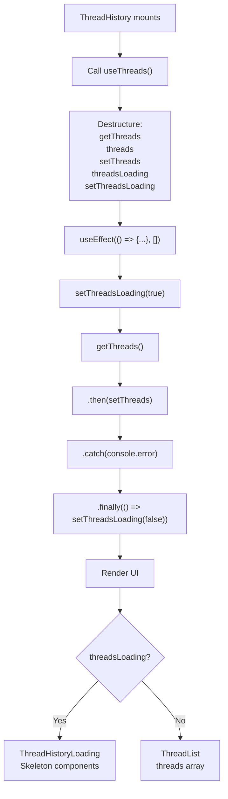

<!-- source: DeepWiki mcp.deepwiki.com · repo langchain-ai/agent-chat-ui · page 2.3 Thread Provider · fetched 2026-10-26 -->

# Thread Provider

Relevant source files

The following files were used as context for generating this wiki page:

- [src/components/thread/agent-inbox/hooks/use-interrupted-actions.tsx](src/components/thread/agent-inbox/hooks/use-interrupted-actions.tsx)
- [src/components/thread/history/index.tsx](src/components/thread/history/index.tsx)
- [src/components/thread/messages/tool-calls.tsx](src/components/thread/messages/tool-calls.tsx)
- [src/providers/Thread.tsx](src/providers/Thread.tsx)
- [src/providers/client.ts](src/providers/client.ts)

The Thread Provider is a React context that manages the state and fetching logic for thread lists in the application. It provides components with access to thread data from the LangGraph SDK, handles loading states, and coordinates with URL query parameters to determine which assistant's threads to fetch.

For information about the Thread UI component that displays individual conversations, see [Thread Component](#2.1). For the sidebar UI that displays the thread list, see [Thread History and Management](#5). For streaming message data within a thread, see [Stream Provider](#2.2).

## Architecture Overview

The Thread Provider follows a provider-consumer pattern typical of React Context API usage. It sits at a high level in the component tree and provides thread list data to any descendant components that need it.

**Thread Provider System Architecture**

**Sources:** [src/providers/Thread.tsx:1-76](), [src/providers/client.ts:1-9](), [src/components/thread/history/index.tsx:1-147]()

## ThreadProvider Component

The `ThreadProvider` component creates the context provider and manages the thread list state at the application level.

**Context Structure**

| Property | Type | Description |
|----------|------|-------------|
| `getThreads` | `() => Promise<Thread[]>` | Async function to fetch threads from LangGraph |
| `threads` | `Thread[]` | Current array of thread objects |
| `setThreads` | `Dispatch<SetStateAction<Thread[]>>` | State setter for updating thread list |
| `threadsLoading` | `boolean` | Loading state indicator |
| `setThreadsLoading` | `Dispatch<SetStateAction<boolean>>` | State setter for loading state |

The provider component is defined at [src/providers/Thread.tsx:36-67]() and creates the context at [src/providers/Thread.tsx:24](). It uses the `nuqs` library to read `apiUrl` and `assistantId` from URL query parameters.

**Sources:** [src/providers/Thread.tsx:16-67]()

## State Management

The Thread Provider manages two pieces of state using React's `useState` hook:

1. **threads**: An array of `Thread` objects from `@langchain/langgraph-sdk`. Initialized as an empty array at [src/providers/Thread.tsx:39]().

2. **threadsLoading**: A boolean flag indicating whether a fetch operation is in progress. Initialized as `false` at [src/providers/Thread.tsx:40]().

Both state values and their setters are exposed through the context, allowing consumer components to both read the current state and update it directly if needed.

**Sources:** [src/providers/Thread.tsx:39-40]()

## Thread Fetching Logic

The `getThreads` function is the core data fetching mechanism. It is memoized with `useCallback` to prevent unnecessary recreations, with dependencies on `apiUrl` and `assistantId`.

**Thread Fetching Flow**

**Sources:** [src/providers/Thread.tsx:42-54](), [src/providers/Thread.tsx:26-34]()

### Assistant ID Validation

The system supports two types of identifiers for filtering threads:

- **UUID Format**: If `assistantId` is a valid UUID (validated using the `uuid` package's `validate` function at [src/providers/Thread.tsx:29]()), it is treated as an `assistant_id` and passed to the search metadata.

- **Graph ID Format**: If `assistantId` is not a UUID, it is treated as a `graph_id` for backward compatibility or custom graph deployments.

The `getThreadSearchMetadata` helper function at [src/providers/Thread.tsx:26-34]() handles this logic and returns the appropriate metadata object for the search query.

**Sources:** [src/providers/Thread.tsx:26-34]()

### Client Creation

Thread fetching uses the LangGraph SDK `Client` class. The client is created via the `createClient` utility function at [src/providers/client.ts:3-8]() which constructs a new `Client` instance with:

- **apiUrl**: The base URL for the LangGraph deployment
- **apiKey**: Retrieved via `getApiKey()` at [src/providers/Thread.tsx:44](), which abstracts the logic for obtaining API keys from local storage or other sources

The client's `threads.search()` method is called at [src/providers/Thread.tsx:46-51]() with metadata filtering and a limit of 100 threads.

**Sources:** [src/providers/Thread.tsx:44](), [src/providers/client.ts:3-8]()

## useThreads Hook

The `useThreads` hook provides type-safe access to the Thread context. It is defined at [src/providers/Thread.tsx:69-75]() and follows the standard pattern for context consumption:

1. Calls `useContext(ThreadContext)` to access the context value
2. Throws an error if used outside a `ThreadProvider` (at [src/providers/Thread.tsx:71-73]())
3. Returns the context value with full type safety

This hook is used by any component that needs access to thread data, such as the `ThreadHistory` component at [src/components/thread/history/index.tsx:85-86]().

**Sources:** [src/providers/Thread.tsx:69-75]()

## Integration with Thread History UI

The Thread Provider's primary consumer is the `ThreadHistory` component, which displays the thread list in a sidebar. The integration pattern is:

**ThreadHistory Integration Pattern**

**Sources:** [src/components/thread/history/index.tsx:85-95]()

The `ThreadHistory` component at [src/components/thread/history/index.tsx:78-146]() demonstrates the usage pattern:

1. **Initialization** (lines 85-86): Calls `useThreads()` to get access to all context values
2. **Fetch on Mount** (lines 88-95): Uses a `useEffect` with empty dependencies to fetch threads when the component first mounts
3. **Loading State Management**: Explicitly sets `threadsLoading` to `true` before fetching and `false` in the finally block
4. **Conditional Rendering** (lines 116-120): Displays `ThreadHistoryLoading` skeleton UI when loading, or `ThreadList` with the actual threads when loaded

**Sources:** [src/components/thread/history/index.tsx:78-146]()

## Thread Object Structure

The `Thread` type is imported from `@langchain/langgraph-sdk` at [src/providers/Thread.tsx:3](). While the complete type definition is in the SDK, the application accesses these key properties:

- `thread_id`: Unique identifier for the thread
- `values`: Object containing thread state, including `messages` array
- `metadata`: Contains `graph_id` or `assistant_id` for filtering

The `ThreadList` component at [src/components/thread/history/index.tsx:18-63]() accesses these properties to display thread information, extracting the first message content as a preview using `getContentString` at [src/components/thread/history/index.tsx:39]().

**Sources:** [src/providers/Thread.tsx:3](), [src/components/thread/history/index.tsx:30-40]()

## Error Handling

The Thread Provider implements minimal error handling, delegating most error management to consumers:

- **Missing Configuration**: The `getThreads` function returns an empty array if `apiUrl` or `assistantId` are missing (at [src/providers/Thread.tsx:43]())
- **API Errors**: Errors from the LangGraph SDK are propagated to the caller, which the `ThreadHistory` component handles with `.catch(console.error)` at [src/components/thread/history/index.tsx:93]()

This approach allows consumer components to implement custom error handling strategies appropriate to their UI context.

**Sources:** [src/providers/Thread.tsx:42-54](), [src/components/thread/history/index.tsx:91-94]()

## Provider Placement in Component Tree

The `ThreadProvider` must be placed high enough in the component tree to wrap all components that need access to thread data. Typically, it wraps the main application layout alongside other providers like `StreamProvider` and `ArtifactProvider`, creating a layered context structure where each provider manages a distinct slice of application state.

**Sources:** [src/providers/Thread.tsx:36-67]()

---

