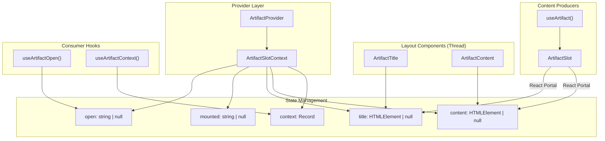
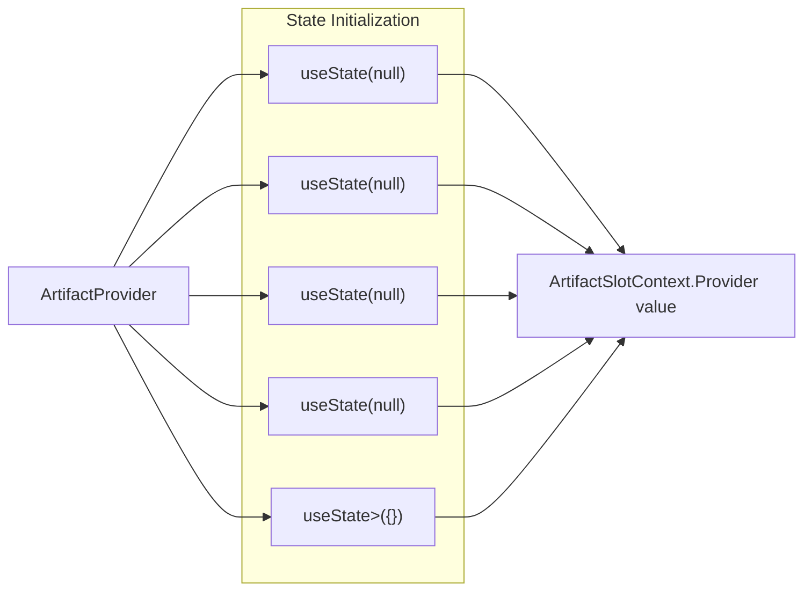
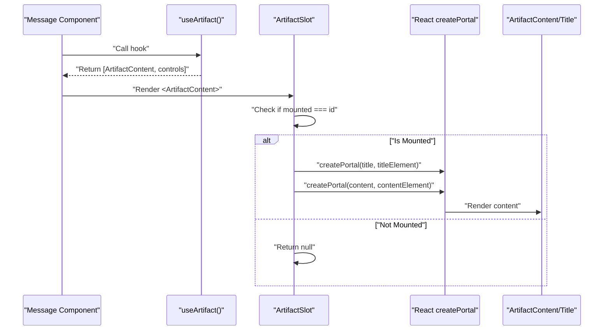
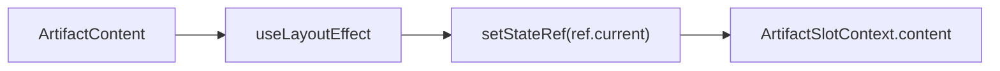
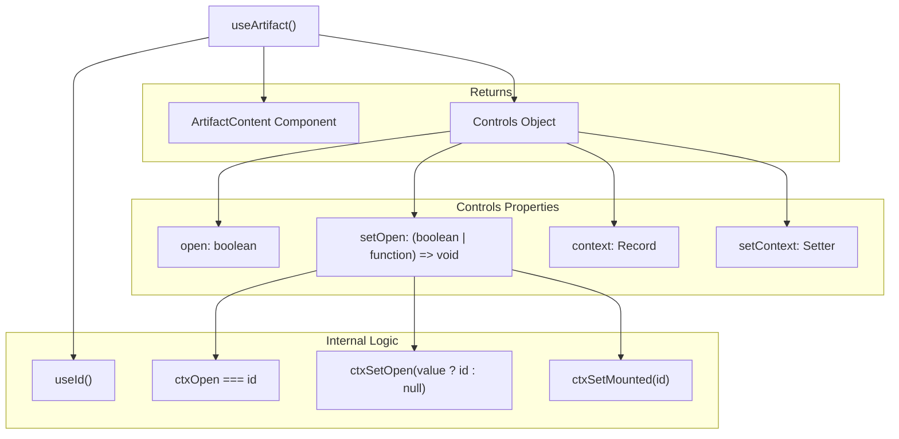
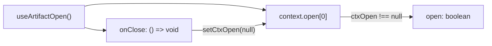
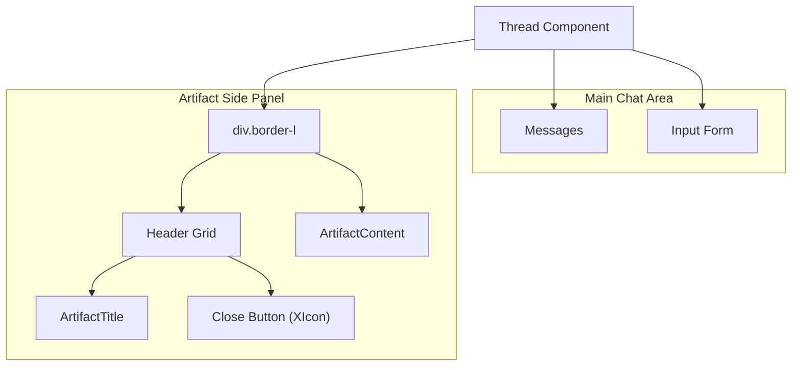
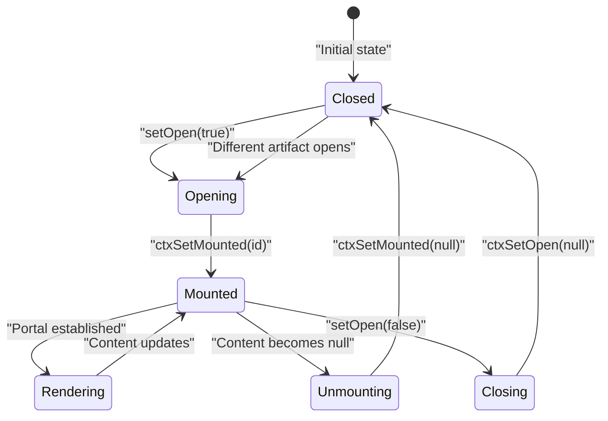
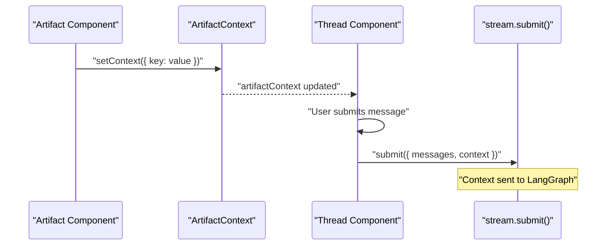
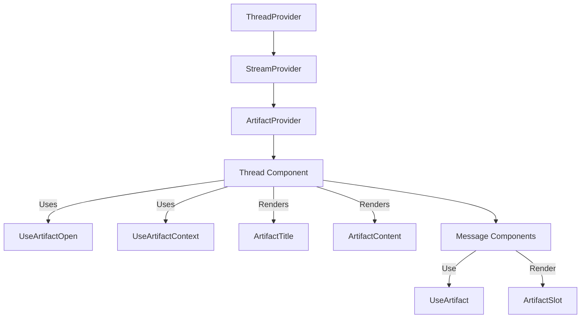

<!-- source: DeepWiki mcp.deepwiki.com · repo langchain-ai/agent-chat-ui · page 2.4 Artifact System · fetched 2026-10-26 -->

# Artifact System

<details>
<summary>Relevant source files</summary>

The following files were used as context for generating this wiki page:

- [src/app/page.tsx](src/app/page.tsx)
- [src/components/thread/artifact.tsx](src/components/thread/artifact.tsx)
- [src/components/thread/index.tsx](src/components/thread/index.tsx)

</details>


## Purpose and Scope

The Artifact System provides a mechanism for rendering supplementary content in a dedicated side panel alongside the main chat interface. This system allows AI-generated content or custom UI components to display extended information, visualizations, or interactive elements without disrupting the message flow. The system uses React Context and React Portals to enable flexible content rendering from deeply nested components into designated layout regions.

For information about custom UI components displayed within messages, see [AI Messages](#3.1). For information about the overall chat interface layout, see [Thread Component](#2.1).

---

## System Architecture

The artifact system consists of a context provider, portal target components, and hooks that enable components to render content into the side panel from anywhere in the component tree.

### Architecture Diagram



**Sources:** [src/components/thread/artifact.tsx:1-190]()

---

## Core Components and Context

### ArtifactProvider

The `ArtifactProvider` component establishes the context for artifact state management. It initializes state for tracking open/mounted artifacts, DOM element references, and shared context data.



**State Structure:**

| State Variable | Type | Purpose |
|---|---|---|
| `open` | `[string \| null, Setter]` | ID of the currently open artifact |
| `mounted` | `[string \| null, Setter]` | ID of the currently mounted artifact |
| `title` | `[HTMLElement \| null, Setter]` | Reference to title DOM element |
| `content` | `[HTMLElement \| null, Setter]` | Reference to content DOM element |
| `context` | `[Record<string, unknown>, Setter]` | Shared context data |

**Sources:** [src/components/thread/artifact.tsx:98-113](), [src/components/thread/artifact.tsx:17-25]()

---

## Portal Rendering Mechanism

The artifact system uses React Portals to render content into designated DOM locations. This allows components deep in the tree to render into the side panel without prop drilling.

### Portal Flow Diagram



### ArtifactSlot Component

The `ArtifactSlot` component is a headless component that manages portal rendering. It only renders when its ID matches the mounted artifact ID.

**Key Logic:**
- Checks if `ctxMounted === props.id` to determine if it should render
- Uses `createPortal` to inject title and children into target elements
- Automatically unmounts when content becomes empty

**Sources:** [src/components/thread/artifact.tsx:32-59]()

### Target Components

#### ArtifactContent

The `ArtifactContent` component provides the target DOM element for artifact content. It uses `useLayoutEffect` to register its ref with the context.



**Sources:** [src/components/thread/artifact.tsx:61-80]()

#### ArtifactTitle

The `ArtifactTitle` component provides the target DOM element for artifact titles. Similar to `ArtifactContent`, it registers its ref on mount.

**Sources:** [src/components/thread/artifact.tsx:82-96]()

---

## Hook APIs

### useArtifact()

The `useArtifact()` hook is the primary API for components to register and control artifacts. It returns an `ArtifactContent` component and a controls object.



**Return Type:**

```typescript
[
  ArtifactContent: (props: { title?: ReactNode; children: ReactNode }) => JSX.Element,
  {
    open: boolean,
    setOpen: (value: boolean | ((value: boolean) => boolean)) => void,
    context: Record<string, unknown>,
    setContext: (value: Record<string, unknown> | ((value: Record<string, unknown>) => Record<string, unknown>)) => void
  }
]
```

**Usage Example:**

Components call `useArtifact()` to obtain an `ArtifactContent` component that can render into the side panel:

```typescript
const [ArtifactContent, { open, setOpen, context, setContext }] = useArtifact();

// Later in render:
<ArtifactContent title="My Artifact">
  <div>Artifact content here</div>
</ArtifactContent>
```

**Sources:** [src/components/thread/artifact.tsx:120-167]()

### useArtifactOpen()

The `useArtifactOpen()` hook provides a way to detect if any artifact is currently open and to close it.



**Return Type:**

```typescript
readonly [open: boolean, onClose: () => void]
```

**Sources:** [src/components/thread/artifact.tsx:172-180]()

### useArtifactContext()

The `useArtifactContext()` hook provides access to the shared context data. This data can be set by artifacts and read by the chat system to influence new runs.

**Return Type:**

```typescript
[Record<string, unknown>, Setter<Record<string, unknown>>]
```

**Sources:** [src/components/thread/artifact.tsx:186-189]()

---

## Integration with Thread Component

The Thread component integrates the artifact system by including `ArtifactTitle` and `ArtifactContent` target components in its layout and managing the artifact state.

### Layout Structure



**Layout Implementation:**

The Thread component uses CSS Grid to manage the artifact panel visibility:

```typescript
className={cn(
  "grid w-full grid-cols-[1fr_0fr] transition-all duration-500",
  artifactOpen && "grid-cols-[3fr_2fr]",
)}
```

When `artifactOpen` is true, the grid columns change from `[1fr_0fr]` (hidden) to `[3fr_2fr]` (visible with 40% width).

**Sources:** [src/components/thread/index.tsx:285-290](), [src/components/thread/index.tsx:548-561]()

### State Management in Thread

The Thread component uses artifact hooks to manage panel state:

```typescript
const [artifactContext, setArtifactContext] = useArtifactContext();
const [artifactOpen, closeArtifact] = useArtifactOpen();
```

**State Reset on Thread Change:**

When the thread ID changes, the artifact state is reset:

```typescript
const setThreadId = (id: string | null) => {
  _setThreadId(id);
  
  // close artifact and reset artifact context
  closeArtifact();
  setArtifactContext({});
};
```

**Sources:** [src/components/thread/index.tsx:115-116](), [src/components/thread/index.tsx:147-153]()

---

## Artifact Lifecycle

The lifecycle of an artifact involves several state transitions managed by the context.

### Lifecycle State Machine



### State Transitions

| Transition | Trigger | State Changes |
|---|---|---|
| **Opening** | `setOpen(true)` called | `ctxOpen` = artifact ID, `ctxMounted` = artifact ID |
| **Rendering** | `ArtifactSlot` mounted | Portals created to title/content refs |
| **Unmounting** | Content becomes empty | `ctxMounted` = null if matches current ID |
| **Closing** | `closeArtifact()` called | `ctxOpen` = null |

**Sources:** [src/components/thread/artifact.tsx:128-139](), [src/components/thread/artifact.tsx:46-50]()

---

## Context Sharing Mechanism

Artifacts can provide additional context data that influences subsequent chat messages. This enables artifacts to share state back to the agent for follow-up interactions.

### Context Flow Diagram



### Implementation

**Setting Context from Artifact:**

Components using `useArtifact()` can set context data:

```typescript
const [ArtifactContent, { setContext }] = useArtifact();
setContext({ selectedItem: "example" });
```

**Reading Context in Thread:**

The Thread component reads context before submission:

```typescript
const context =
  Object.keys(artifactContext).length > 0 ? artifactContext : undefined;

stream.submit(
  { messages: [...toolMessages, newHumanMessage], context },
  { /* options */ }
);
```

**Sources:** [src/components/thread/index.tsx:214-218]()

---

## Provider Hierarchy

The `ArtifactProvider` is placed between `StreamProvider` and the `Thread` component in the provider hierarchy.



**Sources:** [src/app/page.tsx:1-24]()

---

## Key Design Patterns

### 1. Portal-Based Architecture

The system uses React Portals to decouple content generation from layout positioning. Components anywhere in the tree can render into the side panel without passing props through intermediate components.

### 2. ID-Based Mounting

Each artifact receives a unique ID from `useId()`. The context tracks which ID is "open" and "mounted", ensuring only one artifact renders at a time.

### 3. Ref-Based Targeting

`ArtifactContent` and `ArtifactTitle` register their DOM refs with the context using `useLayoutEffect`. This allows `ArtifactSlot` to target the correct elements for portal rendering.

### 4. Headless Component Pattern

`ArtifactSlot` is a headless component that handles portal logic without rendering its own DOM. It returns either the portal result or null, making it invisible in the component tree.

### 5. Context Data Sharing

The context mechanism allows bidirectional data flow: artifacts can set context that influences subsequent agent runs, creating a feedback loop between AI-generated content and user interactions.

**Sources:** [src/components/thread/artifact.tsx:1-190]()

---

