<!-- source: DeepWiki mcp.deepwiki.com · repo langchain-ai/agent-chat-ui · page 3 Message System · fetched 2026-10-26 -->

# Message System

Relevant source files

The following files were used as context for generating this wiki page:

- [src/components/thread/index.tsx](src/components/thread/index.tsx)
- [src/components/thread/messages/ai.tsx](src/components/thread/messages/ai.tsx)
- [src/components/thread/messages/generic-interrupt.tsx](src/components/thread/messages/generic-interrupt.tsx)
- [src/components/thread/messages/human.tsx](src/components/thread/messages/human.tsx)
- [src/components/thread/messages/shared.tsx](src/components/thread/messages/shared.tsx)

This document describes the message rendering system, which is responsible for displaying conversation messages from LangGraph agents, handling user input, and managing message-related interactions. The system processes streaming events from the LangGraph server and renders them as human messages, AI messages, and tool invocations/results.

For information about the streaming connection and message state management, see [Stream Provider](#2.2). For details about human-in-the-loop agent interrupts, see [Agent Inbox System](#4). For multimodal content handling, see [File Upload and Multimodal Content](#6).

## Message Types and Rendering Pipeline

The message system handles three primary message types, each with its own rendering component:

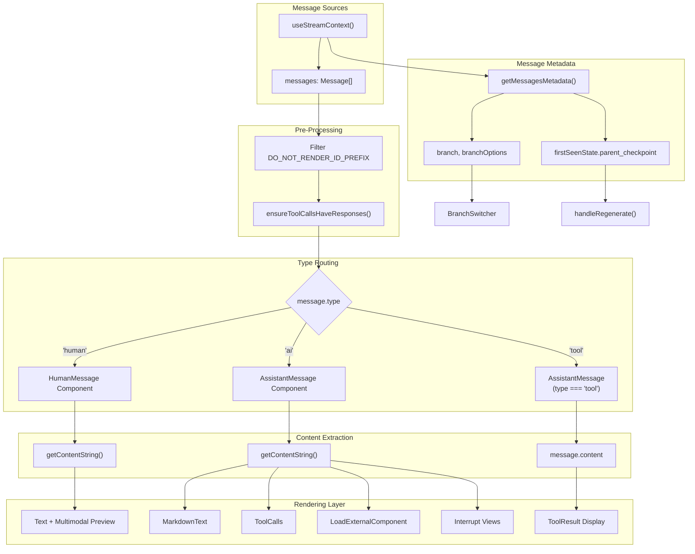

**Sources**: [src/components/thread/index.tsx:402-433](), [src/components/thread/messages/ai.tsx:96-212](), [src/components/thread/messages/human.tsx:37-151]()

## Message Type Implementations

### Core Message Interface

All messages conform to the `Message` type from `@langchain/langgraph-sdk`:

| Field | Type | Description |
|-------|------|-------------|
| `id` | `string \| undefined` | Unique message identifier |
| `type` | `'human' \| 'ai' \| 'tool'` | Message type discriminator |
| `content` | `string \| MessageContentComplex[]` | Message content (text or structured) |
| `tool_calls` | `ToolCall[]` (AI only) | Tool invocations from AI |

**Sources**: [src/components/thread/messages/ai.tsx:3](), [src/components/thread/messages/human.tsx:2]()

### HumanMessage Component

The `HumanMessage` component renders user messages with support for editing and multimodal content display:

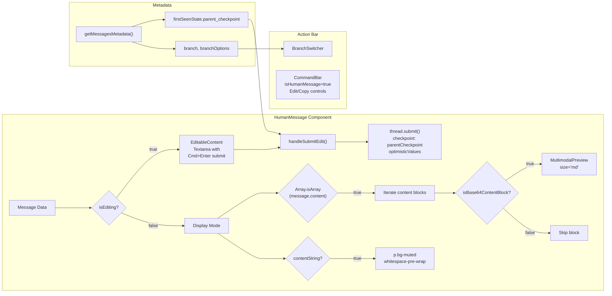

**Key features**:
- **Editable content**: Users can edit their messages using `Cmd+Enter` to submit [src/components/thread/messages/human.tsx:20-24]()
- **Multimodal display**: Images and PDFs are rendered using `MultimodalPreview` [src/components/thread/messages/human.tsx:93-110]()
- **Optimistic updates**: When editing, the UI updates immediately using `optimisticValues` [src/components/thread/messages/human.tsx:63-71]()
- **Right-aligned layout**: Human messages appear on the right with `.ml-auto` styling [src/components/thread/messages/human.tsx:79]()

**Sources**: [src/components/thread/messages/human.tsx:37-151](), [src/lib/multimodal-utils.ts]()

### AssistantMessage Component

The `AssistantMessage` component is the most complex, handling AI responses, tool calls, custom UI, and interrupts:

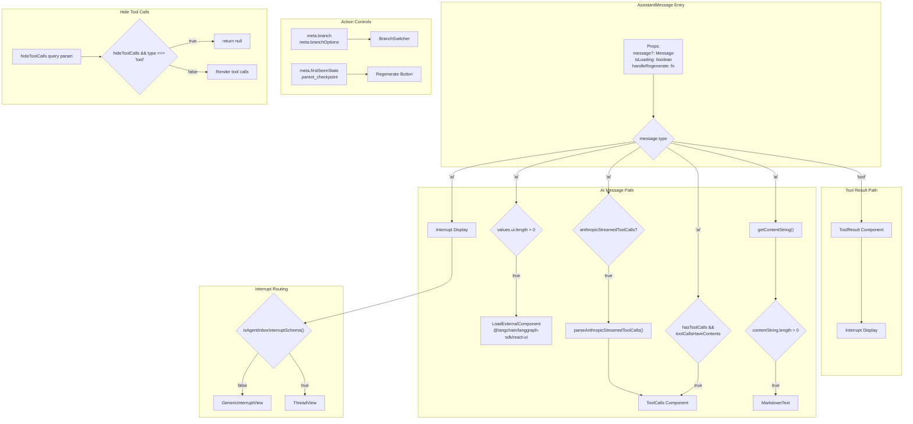

**Key features**:
- **Content rendering**: Text content is processed through `MarkdownText` with syntax highlighting [src/components/thread/messages/ai.tsx:157-161]()
- **Tool call handling**: Both standard OpenAI format and Anthropic streaming format are supported [src/components/thread/messages/ai.tsx:46-68]()
- **Custom components**: External React components from agents are loaded via `LoadExternalComponent` [src/components/thread/messages/ai.tsx:177-182]()
- **Interrupt display**: Interrupts route to either `ThreadView` or `GenericInterruptView` based on schema validation [src/components/thread/messages/ai.tsx:76-94]()
- **Branch switching**: Users can navigate between different conversation branches [src/components/thread/messages/ai.tsx:194-199]()
- **Message regeneration**: The regenerate button triggers re-execution from a parent checkpoint [src/components/thread/messages/ai.tsx:239-251]()
- **Hide tool calls**: The `hideToolCalls` query parameter controls tool visibility [src/components/thread/messages/ai.tsx:139-141]()

**Sources**: [src/components/thread/messages/ai.tsx:96-224]()

## Message Content Processing

### Content Extraction

The `getContentString()` utility extracts text from message content:

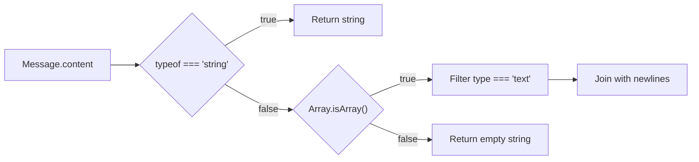

**Sources**: [src/components/thread/utils.ts]()

### Anthropic Tool Call Parsing

Anthropic models stream tool calls in a different format, requiring special parsing:

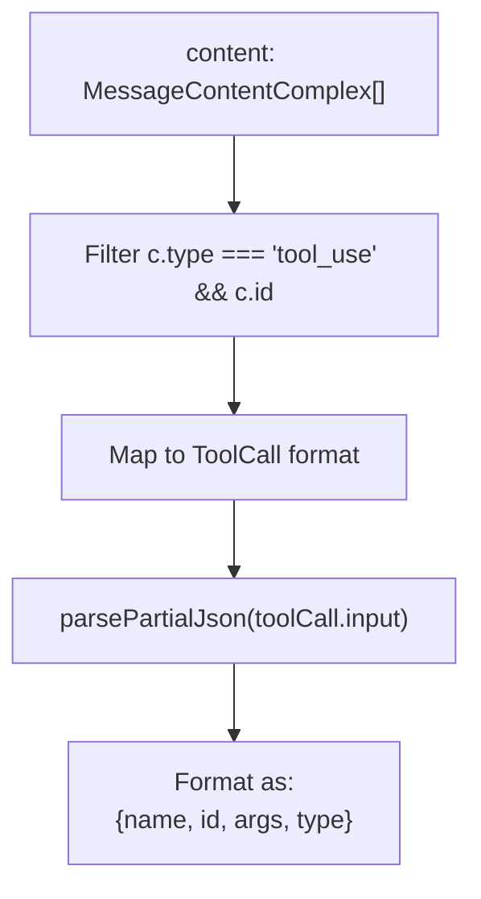

**Implementation details**:
- Uses `parsePartialJson` from `@langchain/core/output_parsers` to handle incomplete JSON [src/components/thread/messages/ai.tsx:54-57]()
- Filters for content blocks with `type === "tool_use"` and an `id` field [src/components/thread/messages/ai.tsx:49]()
- Gracefully handles parsing errors with empty object fallback [src/components/thread/messages/ai.tsx:58]()

**Sources**: [src/components/thread/messages/ai.tsx:46-68]()

## Tool Call Rendering

Tool calls and their results are rendered through specialized components defined in [src/components/thread/messages/tool-calls.tsx]():

### ToolCalls Component

Displays tool invocations with expandable argument details:

| Element | Purpose |
|---------|---------|
| Tool name badge | Shows tool name in a styled badge |
| Arguments table | Key-value pairs of tool arguments |
| Expand/collapse | Handles long content with animation |

**Sources**: [src/components/thread/messages/ai.tsx:165-174]()

### ToolResult Component

Displays tool execution results with JSON formatting and syntax highlighting:

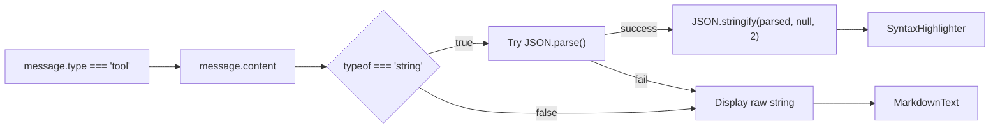

**Sources**: [src/components/thread/messages/ai.tsx:146-154]()

## Interrupt Handling

When agents require human input, they emit interrupts that are displayed conditionally:

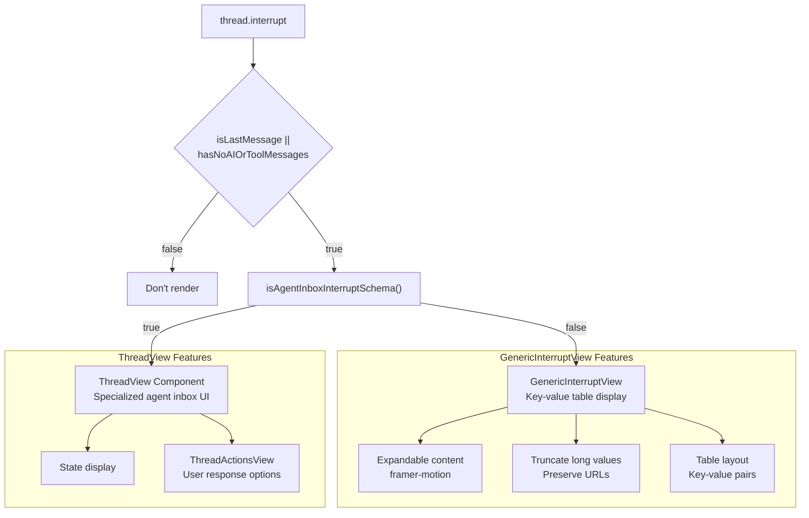

**Interrupt rendering conditions**:
- Only render if `isLastMessage || hasNoAIOrToolMessages` [src/components/thread/messages/ai.tsx:84]()
- This prevents interrupts from appearing mid-conversation
- Special case: If no AI/tool messages exist, render interrupt outside message list [src/components/thread/index.tsx:420-429]()

**Generic interrupt features**:
- Expandable/collapsible content with `framer-motion` animations [src/components/thread/messages/generic-interrupt.tsx:101-106]()
- Automatic truncation for values > 100 characters [src/components/thread/messages/generic-interrupt.tsx:55-61]()
- URL detection and clickable link rendering [src/components/thread/messages/generic-interrupt.tsx:9-17]()
- Table layout for key-value pairs [src/components/thread/messages/generic-interrupt.tsx:123-141]()

**Sources**: [src/components/thread/messages/ai.tsx:76-94](), [src/components/thread/messages/generic-interrupt.tsx:42-160]()

## Custom UI Components

The system supports loading external React components from agents using the `@langchain/langgraph-sdk/react-ui` package:

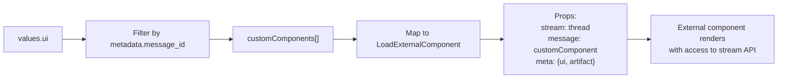

**Component discovery**:
1. Filter `values.ui` array for messages matching current `message.id` [src/components/thread/messages/ai.tsx:27-29]()
2. Each matching UI message is rendered via `LoadExternalComponent` [src/components/thread/messages/ai.tsx:35-40]()
3. Components receive stream context and artifact helpers as props [src/components/thread/messages/ai.tsx:36-39]()

**Sources**: [src/components/thread/messages/ai.tsx:18-44]()

## Message Actions and Controls

### BranchSwitcher Component

Enables navigation between conversation branches when checkpoints diverge:

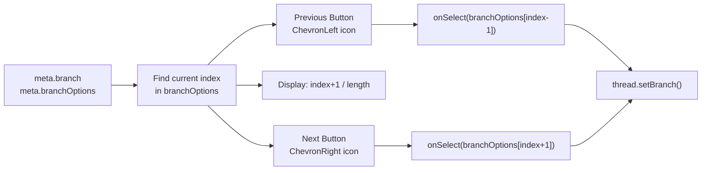

**Sources**: [src/components/thread/messages/shared.tsx:69-116]()

### CommandBar Component

Provides message-specific actions (copy, edit, regenerate):

| Action | Availability | Behavior |
|--------|-------------|----------|
| Copy | All messages | Copies content to clipboard, shows checkmark feedback |
| Edit | Human messages only | Enters edit mode with textarea |
| Submit | Human edit mode | Submits edited message with checkpoint context |
| Cancel | Human edit mode | Exits edit mode without changes |
| Regenerate | AI messages only | Re-executes from parent checkpoint |

**Edit mode flow**:
1. Click edit → Set `isEditing = true`, populate `value` with `contentString` [src/components/thread/messages/human.tsx:139-142]()
2. User modifies text in `EditableContent` textarea [src/components/thread/messages/human.tsx:11-35]()
3. `Cmd+Enter` triggers `handleSubmitEdit()` [src/components/thread/messages/human.tsx:20-24]()
4. New message submitted with `checkpoint: parentCheckpoint` for time-travel [src/components/thread/messages/human.tsx:52-74]()

**Sources**: [src/components/thread/messages/shared.tsx:118-221](), [src/components/thread/messages/human.tsx:48-74]()

## Message Validation

### ensureToolCallsHaveResponses()

Before submission, messages are validated to ensure all tool calls have corresponding tool messages:

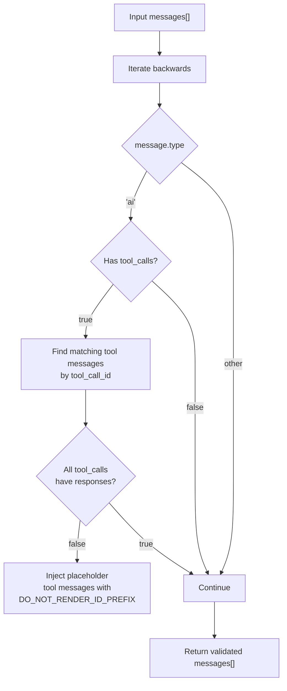

**Purpose**: Prevents errors when agents expect tool responses but none exist in message history.

**Implementation**:
- Placeholder tool messages use `DO_NOT_RENDER_ID_PREFIX` prefix [src/components/thread/index.tsx:12-13]()
- These messages are filtered out during rendering [src/components/thread/index.tsx:403]()
- Ensures the LangGraph agent receives properly structured message history [src/components/thread/index.tsx:212]()

**Sources**: [src/lib/ensure-tool-responses.ts](), [src/components/thread/index.tsx:212-233]()

## Message Submission Flow

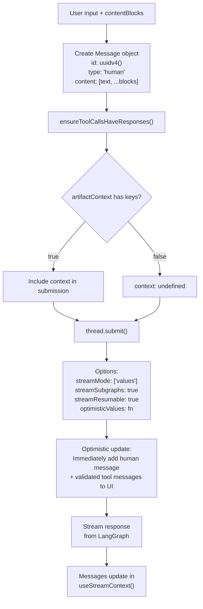

**Key aspects**:
- Messages are created with `uuidv4()` IDs [src/components/thread/index.tsx:204]()
- Content is array of text and multimodal blocks [src/components/thread/index.tsx:206-210]()
- Tool message validation happens before submission [src/components/thread/index.tsx:212]()
- Artifact context is conditionally included [src/components/thread/index.tsx:214-216]()
- Optimistic updates show messages immediately [src/components/thread/index.tsx:223-231]()
- Input and content blocks are cleared after submission [src/components/thread/index.tsx:235-236]()

**Sources**: [src/components/thread/index.tsx:197-237]()

## AssistantMessageLoading Component

During streaming, before the first token arrives, a loading indicator is displayed:

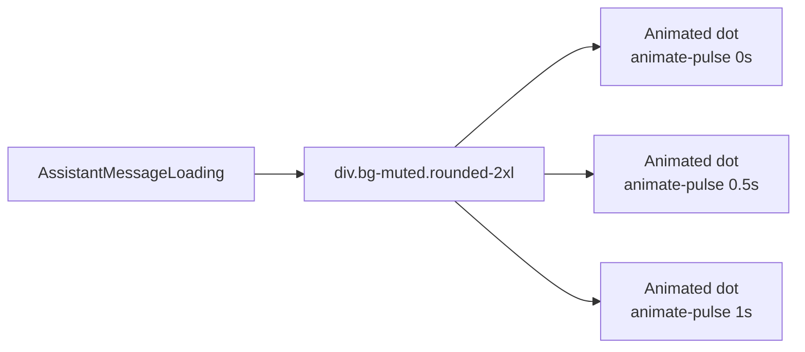

**Visibility control**:
- Show when `isLoading && !firstTokenReceived` [src/components/thread/index.tsx:430-432]()
- `firstTokenReceived` is set when first AI message appears [src/components/thread/index.tsx:185-195]()
- Prevents loading indicator from showing during branch switches

**Sources**: [src/components/thread/messages/ai.tsx:214-224](), [src/components/thread/index.tsx:430-432]()

## Message Styling and Layout

Messages use distinct styling based on type:

| Message Type | Alignment | Background | Special Features |
|-------------|-----------|------------|------------------|
| Human | Right (`.ml-auto`) | `.bg-muted` | Rounded corners, text-right |
| AI | Left (`.mr-auto`) | Transparent | Left-aligned, full width |
| Tool Result | Left | Border/background | Syntax highlighted code |

**Hover actions**:
- Action bars (BranchSwitcher, CommandBar) use opacity transitions [src/components/thread/messages/ai.tsx:189-192]()
- Default `opacity-0`, visible on `group-hover` or `group-focus-within` [src/components/thread/messages/human.tsx:122-126]()
- Edit mode forces `opacity-100` [src/components/thread/messages/human.tsx:125]()

**Sources**: [src/components/thread/messages/ai.tsx:144-211](), [src/components/thread/messages/human.tsx:76-149]()

---

