<!-- source: DeepWiki mcp.deepwiki.com · repo langchain-ai/agent-chat-ui · page 3.1 AI Messages · fetched 2026-10-26 -->

# AI Messages

<details>
<summary>Relevant source files</summary>

The following files were used as context for generating this wiki page:

- [src/components/thread/messages/ai.tsx](src/components/thread/messages/ai.tsx)
- [src/components/thread/messages/generic-interrupt.tsx](src/components/thread/messages/generic-interrupt.tsx)
- [src/components/thread/messages/shared.tsx](src/components/thread/messages/shared.tsx)
- [src/components/thread/utils.ts](src/components/thread/utils.ts)

</details>


This document details the AI Messages system within the Agent Chat UI, which is responsible for rendering and handling assistant (AI) messages in the chat interface. It covers the rendering of AI-generated content, tool calls, interrupts requiring human intervention, and custom UI elements.

For information about human messages, see [Human Messages](#3.2). For details on tool calls specifically, see [Tool Calls](#3.3).

## Architecture Overview

**AI Message Component Architecture**
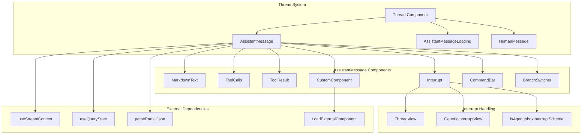

Sources: [src/components/thread/messages/ai.tsx:96-212](), [src/components/thread/messages/ai.tsx:214-224](), [src/components/thread/messages/shared.tsx:69-116](), [src/components/thread/messages/shared.tsx:118-221]()

## Key Components

### AssistantMessage Component

The `AssistantMessage` component is the primary renderer for AI-generated messages. Located at [src/components/thread/messages/ai.tsx:96-212](), it handles several key responsibilities:

- Extracting and formatting message content using `getContentString`
- Rendering tool calls made by the AI through `ToolCalls` and `ToolResult` components
- Displaying interrupts that require human intervention via the `Interrupt` component  
- Loading custom UI components through `LoadExternalComponent`
- Providing interaction controls (branch switching, regeneration)

**AssistantMessage Data Flow**
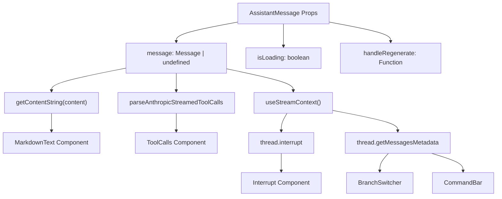

The component interface:
- `message`: Message object or undefined containing AI response data
- `isLoading`: Boolean indicating if the message is currently loading  
- `handleRegenerate`: Function accepting a `Checkpoint | null | undefined` parameter

Sources: [src/components/thread/messages/ai.tsx:96-104](), [src/components/thread/messages/ai.tsx:105-106]()

### Content Rendering

The component extracts content from the message object and processes it for display:

```typescript
const content = message?.content ?? [];
const contentString = getContentString(content);
```

When content is available, it's rendered using the `MarkdownText` component:

```jsx
{contentString.length > 0 && (
  <div className="py-1">
    <MarkdownText>{contentString}</MarkdownText>
  </div>
)}
```

Sources: [src/components/thread/messages/ai.tsx:104-105](), [src/components/thread/messages/ai.tsx:155-158]()

### Tool Calls Handling

The component includes sophisticated detection and rendering of tool calls with multiple format support:

**Tool Call Detection Process**
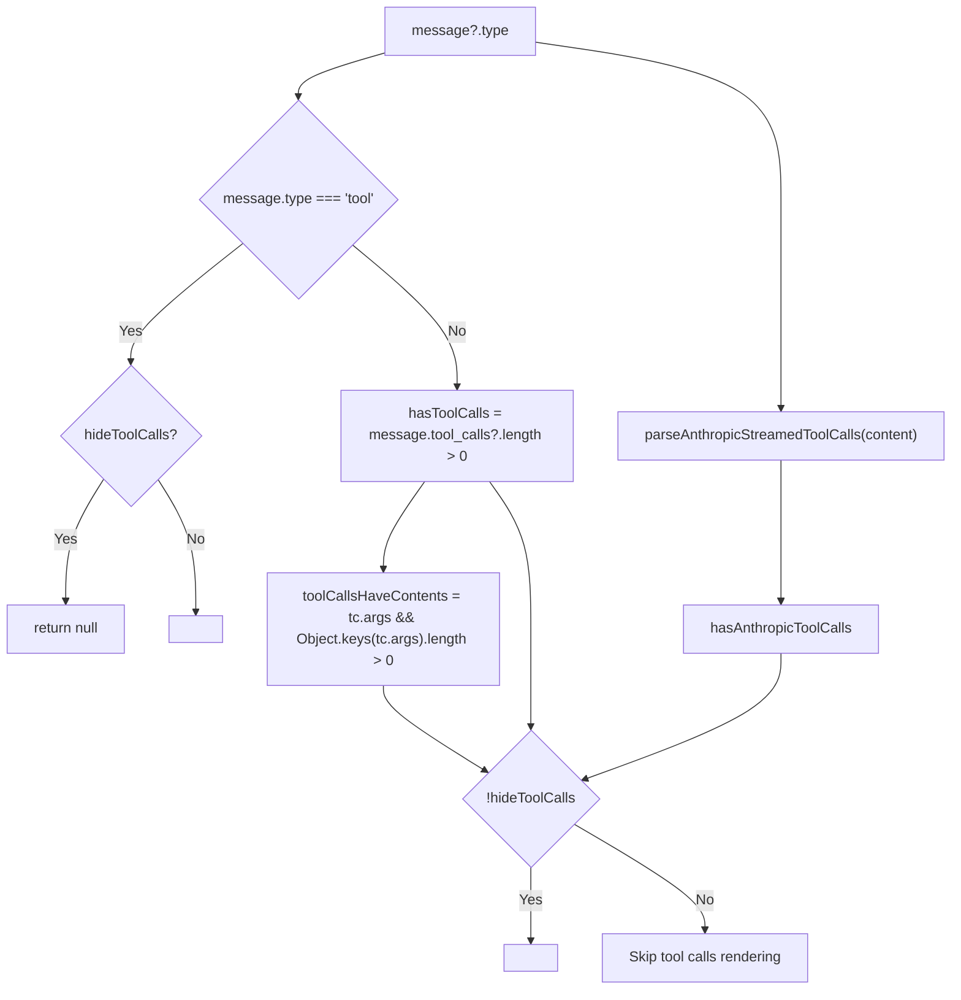

The `parseAnthropicStreamedToolCalls` function handles Anthropic's streaming format by:
1. Filtering content for `type === "tool_use"` with an `id`
2. Parsing partial JSON from `toolCall.input` using `parsePartialJson`
3. Converting to standard tool call format with `name`, `id`, `args`, and `type: "tool_call"`

Sources: [src/components/thread/messages/ai.tsx:126-175](), [src/components/thread/messages/ai.tsx:46-68](), [src/components/thread/messages/ai.tsx:137-141](), [src/components/thread/messages/ai.tsx:146-148]()

### Interrupt Handling

AI messages can trigger interrupts requiring human intervention. The `Interrupt` component at [src/components/thread/messages/ai.tsx:76-94]() handles these cases:

**Interrupt Handling Logic**
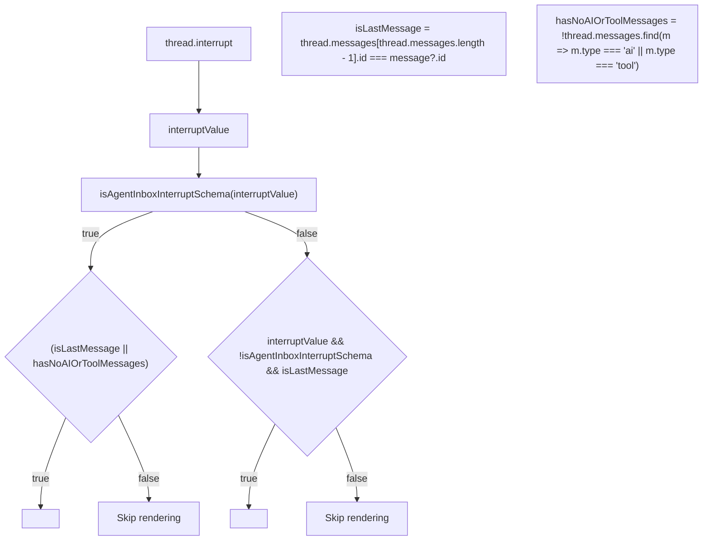

The interrupt system determines:
1. Whether the interrupt is an agent inbox interrupt using `isAgentInboxInterruptSchema`
2. If it should render based on message position (`isLastMessage`) or conversation state (`hasNoAIOrToolMessages`)
3. Which interrupt view component to use (`ThreadView` vs `GenericInterruptView`)

Sources: [src/components/thread/messages/ai.tsx:113-119](), [src/components/thread/messages/ai.tsx:82-91](), [src/components/thread/messages/ai.tsx:149-153](), [src/components/thread/messages/ai.tsx:183-187]()

### Custom Component Loading

The `CustomComponent` function at [src/components/thread/messages/ai.tsx:18-44]() loads custom UI components for specific messages:

**CustomComponent System**
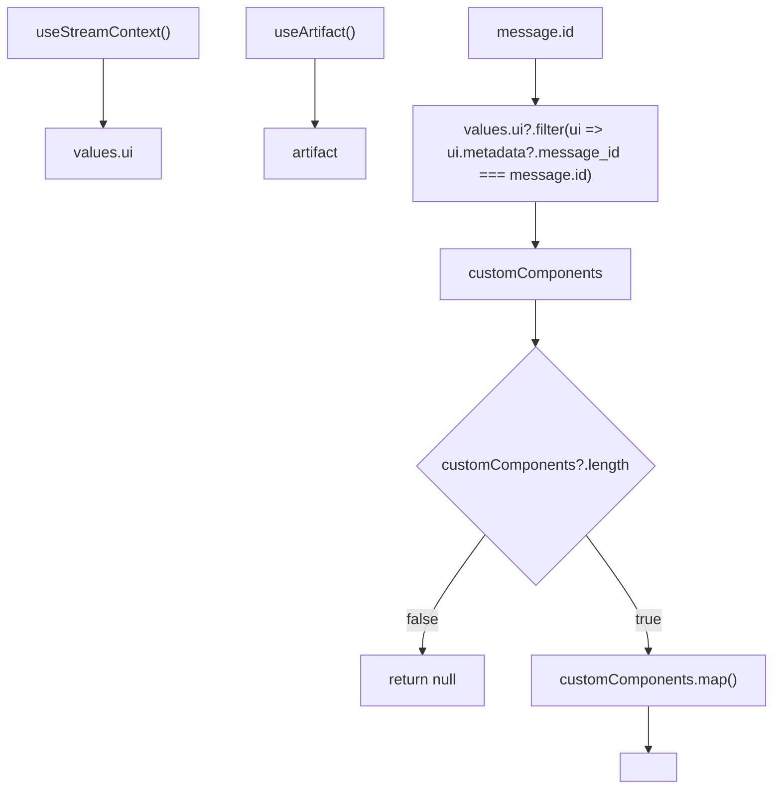

The system:
1. Retrieves custom UI components from `values.ui` filtered by `message_id`
2. Uses `LoadExternalComponent` from `@langchain/langgraph-sdk/react-ui`
3. Passes `stream`, `message`, and `meta` containing UI component and artifact data
4. Renders multiple components if associated with the same message

Sources: [src/components/thread/messages/ai.tsx:25-42](), [src/components/thread/messages/ai.tsx:177-182]()

## Content Rendering System

### MarkdownText Component

AI message content is rendered using the `MarkdownText` component, which leverages `react-markdown` to provide rich formatting capabilities:

**Markdown Rendering Pipeline**
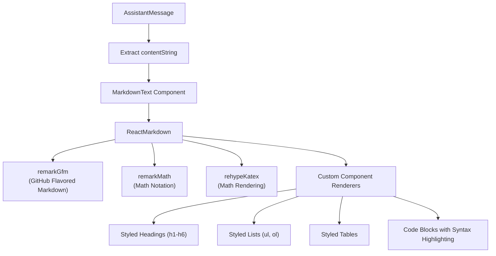

The `MarkdownText` component supports various formatting features:
- Headings (h1-h6)
- Lists (ordered and unordered)
- Tables
- Code blocks with syntax highlighting
- Mathematical notation (via KaTeX)
- Links and images
- Blockquotes

Sources: [src/components/thread/markdown-text.tsx:246-260]()

### Code Syntax Highlighting

Code blocks within AI messages are rendered with syntax highlighting using the `SyntaxHighlighter` component:

```jsx
<SyntaxHighlighter
  language={language}
  style={coldarkDark}
  customStyle={{
    margin: 0,
    width: "100%",
    background: "transparent",
    padding: "1.5rem 1rem",
  }}
  className={className}
>
  {code}
</SyntaxHighlighter>
```

The component supports multiple programming languages:
- JavaScript/TypeScript
- JSX/TSX
- Python

A copy-to-clipboard button is automatically added to all code blocks.

Sources: [src/components/thread/syntax-highlighter.tsx:20-39](), [src/components/thread/markdown-text.tsx:205-243]()

## Interaction Features

### Branch Switcher

The `BranchSwitcher` component from [src/components/thread/messages/shared.tsx:69-116]() allows users to switch between different conversation branches:

**BranchSwitcher Interface**
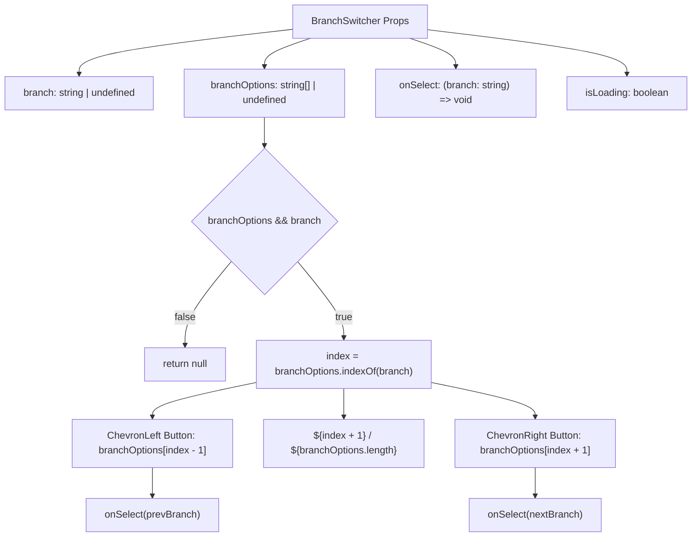

Usage in `AssistantMessage`:
```typescript
<BranchSwitcher
  branch={meta?.branch}
  branchOptions={meta?.branchOptions}
  onSelect={(branch) => thread.setBranch(branch)}
  isLoading={isLoading}
/>
```

Sources: [src/components/thread/messages/ai.tsx:194-199](), [src/components/thread/messages/shared.tsx:80-115]()

### Command Bar

The `CommandBar` component from [src/components/thread/messages/shared.tsx:118-221]() provides actions for AI messages:

**CommandBar for AI Messages**
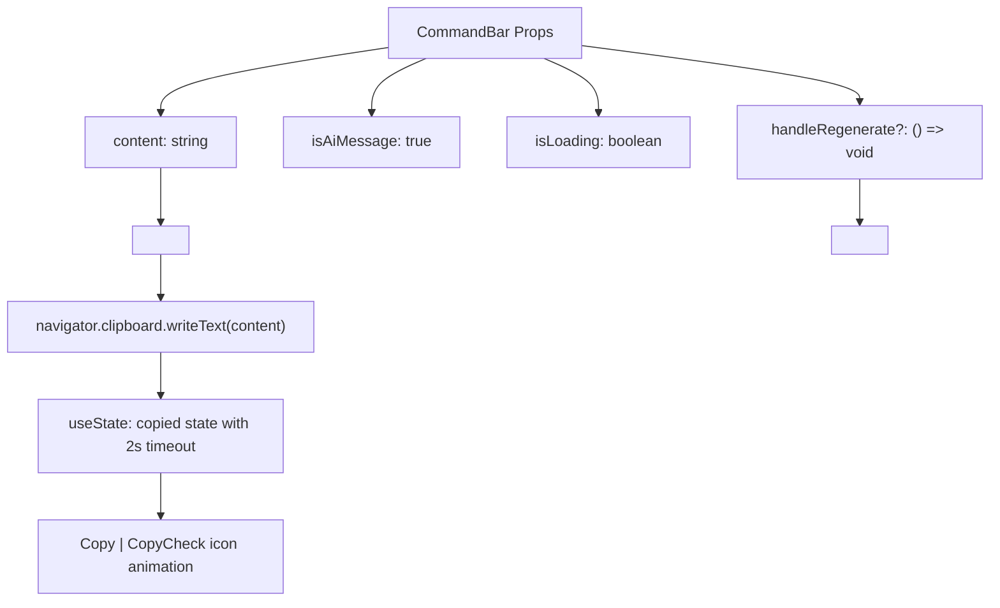

The `CommandBar` for AI messages includes:
- **Copy functionality**: Via `ContentCopyable` component with animated feedback
- **Regenerate button**: Calls `handleRegenerate(parentCheckpoint)` when provided
- **Loading state handling**: Disables interactions when `isLoading` is true

Usage in `AssistantMessage`:
```typescript
<CommandBar
  content={contentString}
  isLoading={isLoading}
  isAiMessage={true}
  handleRegenerate={() => handleRegenerate(parentCheckpoint)}
/>
```

Sources: [src/components/thread/messages/ai.tsx:200-205](), [src/components/thread/messages/shared.tsx:191-221](), [src/components/thread/messages/shared.tsx:16-67]()

## Generic Interrupt Handling

When an AI message triggers a generic interrupt, the `GenericInterruptView` component displays the interrupt data in a structured, collapsible format:

**Generic Interrupt View Structure**
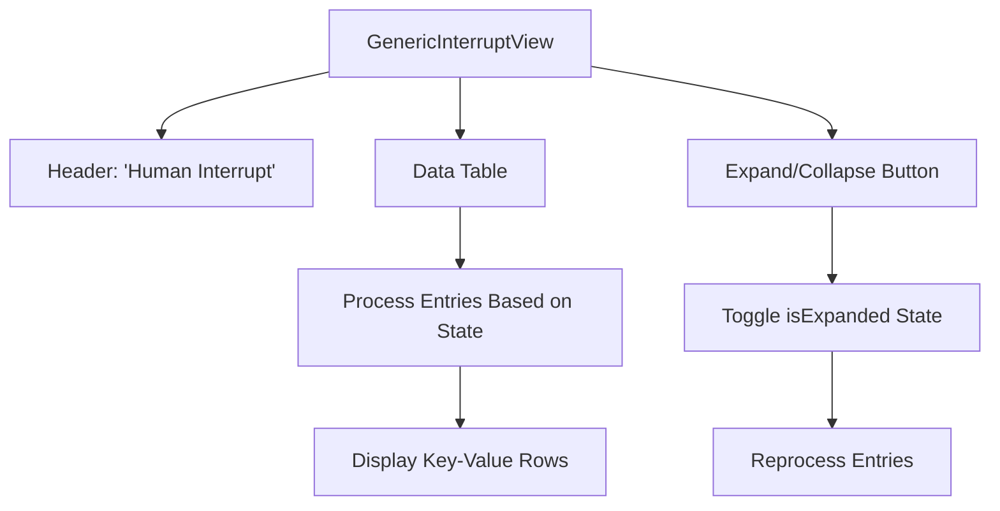

The component includes intelligent handling of complex data:
- Truncation of long string values
- Collapsing of complex objects and arrays
- JSON formatting for object values
- Expandable/collapsible view for large datasets

Sources: [src/components/thread/messages/generic-interrupt.tsx:9-129]()

## Loading State

The `AssistantMessageLoading` component at [src/components/thread/messages/ai.tsx:214-224]() displays an animated loading indicator:

**AssistantMessageLoading Structure**
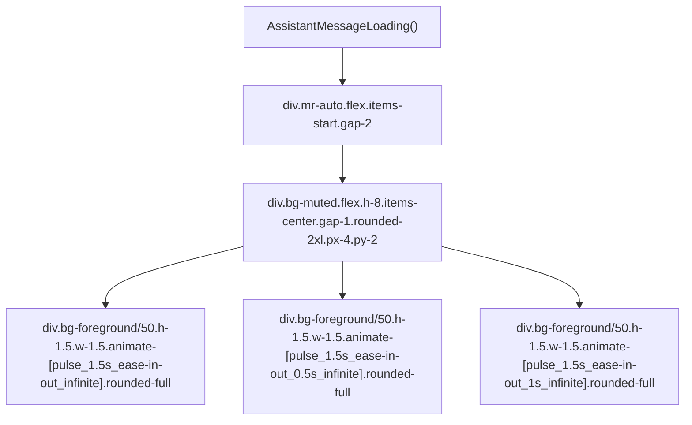

The component features:
- **Three animated dots**: Each 1.5x1.5 units with `rounded-full` styling
- **Staggered animation**: 0s, 0.5s, and 1s delays for wave effect
- **Pulse animation**: 1.5s duration with `ease-in-out` timing
- **Consistent styling**: Matches the AI message layout with `mr-auto` alignment

Sources: [src/components/thread/messages/ai.tsx:214-224]()

## Technical Implementation Details

### Stream Context Integration

The `AssistantMessage` component integrates with `useStreamContext` from [src/providers/Stream]() to:
- Access the current message list via `thread.messages`
- Check if the current message is the last in the thread  
- Retrieve message metadata through `thread.getMessagesMetadata(message)`
- Access thread interrupt data and custom UI components

**Stream Context Usage Pattern**
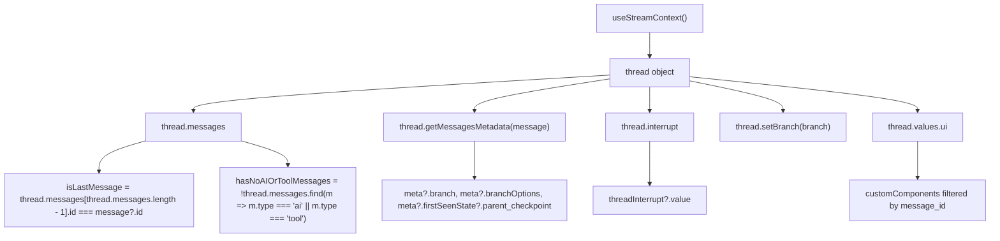

Key integrations:
```typescript
const thread = useStreamContext();
const isLastMessage = thread.messages[thread.messages.length - 1].id === message?.id;
const hasNoAIOrToolMessages = !thread.messages.find(m => m.type === "ai" || m.type === "tool");
const meta = message ? thread.getMessagesMetadata(message) : undefined;
const threadInterrupt = thread.interrupt;
```

Sources: [src/components/thread/messages/ai.tsx:112-119](), [src/components/thread/messages/ai.tsx:2](), [src/components/thread/messages/ai.tsx:26]()

### Query Parameter Support

The component uses `useQueryState` from the `nuqs` library to access URL query parameters:

**Query State Integration**
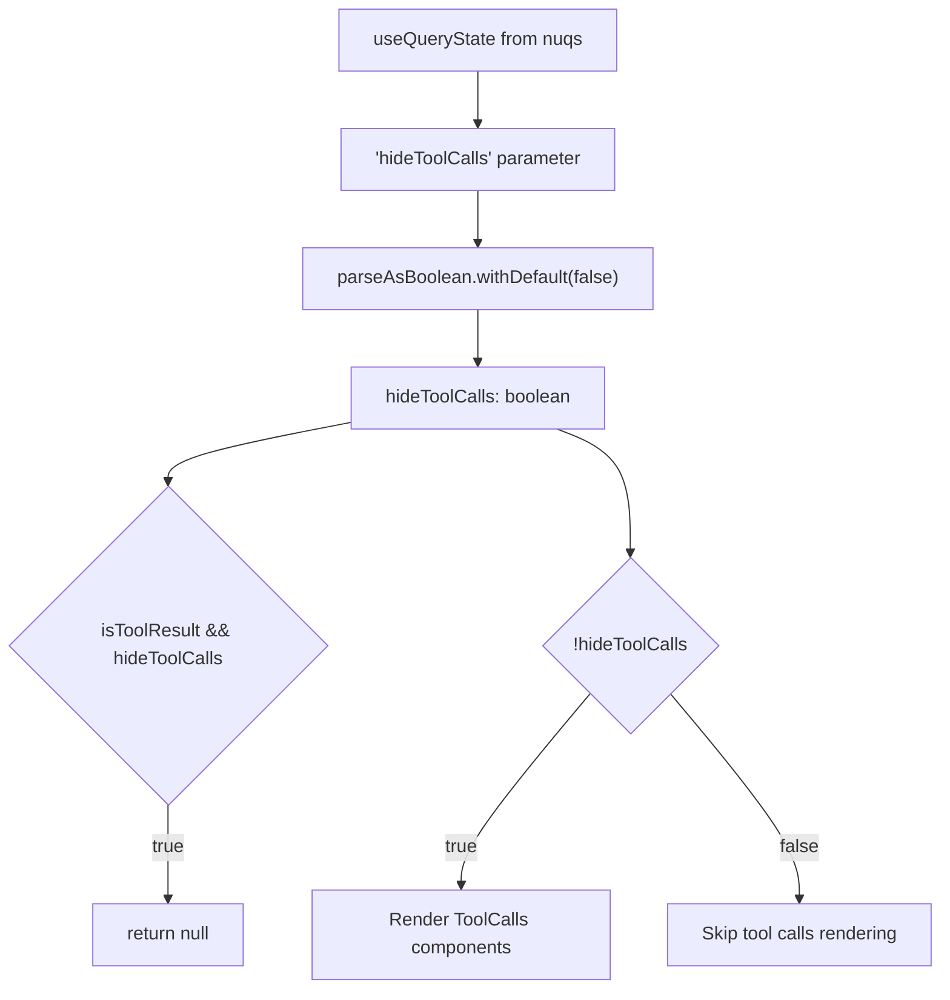

Usage:
```typescript
const [hideToolCalls] = useQueryState(
  "hideToolCalls", 
  parseAsBoolean.withDefault(false),
);
```

This enables URL-based control of tool call visibility, allowing users to toggle tool call display through query parameters like `?hideToolCalls=true`.

Sources: [src/components/thread/messages/ai.tsx:107-110](), [src/components/thread/messages/ai.tsx:14](), [src/components/thread/messages/ai.tsx:139-141](), [src/components/thread/messages/ai.tsx:163-175]()

## Summary

The AI Messages system provides a rich, interactive rendering layer for AI-generated content in the Agent Chat UI. It handles various content types, tool interactions, and human intervention points through a modular architecture of specialized components. The system's flexibility enables it to adapt to different AI response formats and provide users with powerful control over the conversation flow.

---

