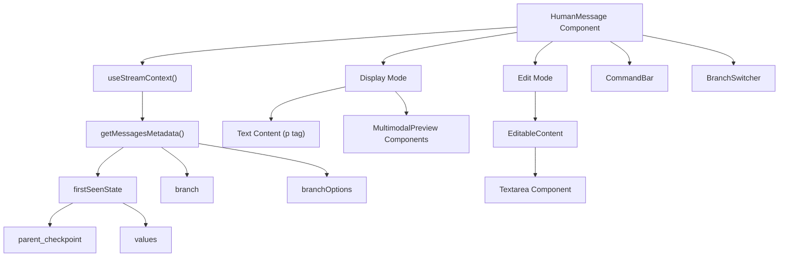
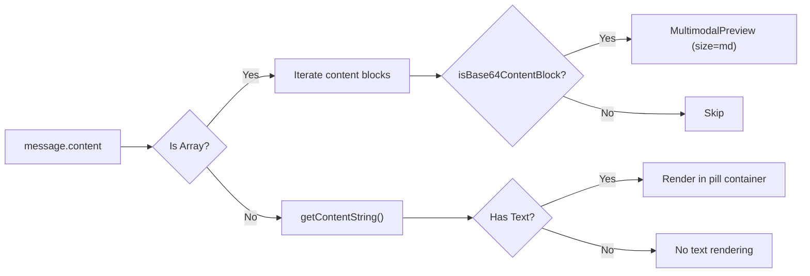
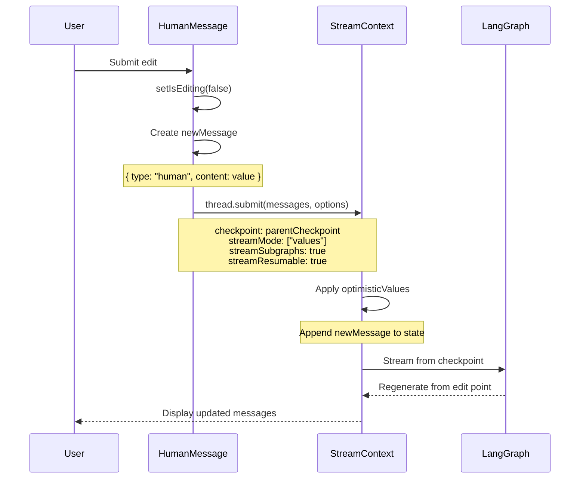
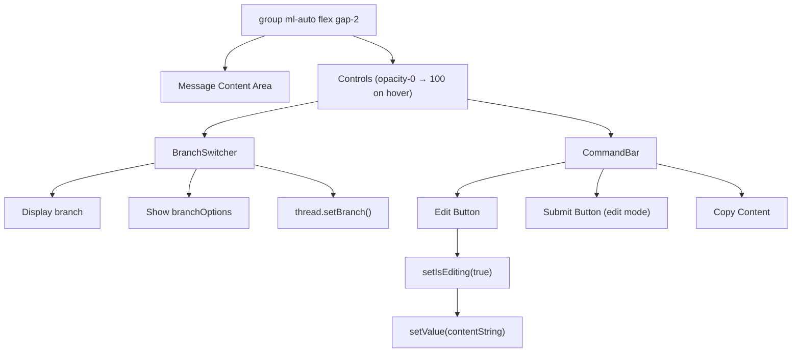

<!-- source: DeepWiki mcp.deepwiki.com · repo langchain-ai/agent-chat-ui · page 3.2 Human Messages · fetched 2026-10-26 -->

# Human Messages

<details>
<summary>Relevant source files</summary>

The following files were used as context for generating this wiki page:

- [src/components/thread/messages/human.tsx](src/components/thread/messages/human.tsx)
- [src/components/thread/utils.ts](src/components/thread/utils.ts)

</details>


## Purpose and Scope

This document covers the `HumanMessage` component, which renders user-submitted messages in the chat interface. The component handles text display, multimodal content (images, PDFs), message editing with checkpoint-based regeneration, and branch navigation. For AI-generated messages, see [AI Messages](#3.1). For the file upload system that produces the multimodal content, see [File Upload and Multimodal Content](#6).

## Component Overview

The `HumanMessage` component is defined in [src/components/thread/messages/human.tsx:37-151]() and accepts two props:
- `message: Message` - The message object from LangGraph SDK containing content and metadata
- `isLoading: boolean` - Indicates whether the stream is currently processing

The component integrates with `useStreamContext` to access thread operations and message metadata, including branch information and checkpoint states required for message editing.



**Sources**: [src/components/thread/messages/human.tsx:37-151]()

## Message Display States

The component operates in two distinct states controlled by the `isEditing` boolean: display mode and edit mode.

### Display Mode

In display mode, the component renders the message content using a two-phase approach:

1. **Multimodal Content Rendering** [src/components/thread/messages/human.tsx:93-111](): If the message content is an array, the component iterates through content blocks, filtering for Base64ContentBlock types using `isBase64ContentBlock()` and rendering each as a `MultimodalPreview` component with size "md". These are displayed in a flex-wrapped container aligned to the right.

2. **Text Content Rendering** [src/components/thread/messages/human.tsx:113-117](): The `getContentString()` utility extracts text content from the message. If text exists, it's rendered in a pill-shaped container with muted background, right-aligned with `whitespace-pre-wrap` to preserve formatting.

### Edit Mode

Edit mode replaces the display with the `EditableContent` component, which renders a `Textarea` for message modification. The textarea supports Cmd/Ctrl+Enter keyboard shortcuts for quick submission [src/components/thread/messages/human.tsx:20-24]().



**Sources**: [src/components/thread/messages/human.tsx:91-118]()

## Content Extraction Utility

The `getContentString` function [src/components/thread/utils.ts:9-15]() provides a standardized way to extract displayable text from message content:

| Input Type | Behavior |
|------------|----------|
| `string` | Returns the string directly |
| `Array` | Filters for `type: "text"` blocks, extracts `text` properties, joins with spaces |

This utility handles the dual nature of LangGraph message content, which can be either a simple string or a complex array of typed content blocks for multimodal messages.

**Sources**: [src/components/thread/utils.ts:9-15]()

## Message Editing Flow

The editing system allows users to modify previous messages and regenerate agent responses from that point in the conversation using checkpoint-based time travel.

### Edit Initiation

When the user clicks the edit button in the `CommandBar`, the component:
1. Sets `isEditing` to `true` [src/components/thread/messages/human.tsx:142]()
2. Copies `contentString` into the `value` state [src/components/thread/messages/human.tsx:140]()
3. Renders the `EditableContent` component

### Edit Submission

The `handleSubmitEdit` function [src/components/thread/messages/human.tsx:52-74]() executes when the user submits an edited message:



**Sources**: [src/components/thread/messages/human.tsx:52-74]()

### Checkpoint-Based Regeneration

The submission options passed to `thread.submit` are critical for proper regeneration:

| Option | Value | Purpose |
|--------|-------|---------|
| `checkpoint` | `parentCheckpoint` | Specifies the graph state before this message was originally submitted |
| `streamMode` | `["values"]` | Requests full state values in streaming events |
| `streamSubgraphs` | `true` | Enables streaming from nested subgraphs |
| `streamResumable` | `true` | Allows future resumption from new checkpoints |

The `parentCheckpoint` is extracted from message metadata [src/components/thread/messages/human.tsx:46]():
```
const parentCheckpoint = meta?.firstSeenState?.parent_checkpoint;
```

### Optimistic UI Updates

The `optimisticValues` callback [src/components/thread/messages/human.tsx:63-71]() provides immediate UI feedback before the server responds. It reconstructs the state by:
1. Retrieving the original state values from `meta?.firstSeenState?.values`
2. Appending the new message to the existing messages array
3. Returning the updated state object

This pattern prevents UI flickering by immediately showing the edited message while the agent processes the regeneration.

**Sources**: [src/components/thread/messages/human.tsx:52-74]()

## Interaction Controls

The component provides two interaction elements that appear on hover or focus:

### BranchSwitcher Component

The `BranchSwitcher` [src/components/thread/messages/human.tsx:128-133]() enables navigation between alternative conversation branches when checkpoints create branching histories. It receives:
- `branch`: Current branch identifier from message metadata
- `branchOptions`: Available branches from metadata
- `onSelect`: Callback that invokes `thread.setBranch(branch)`
- `isLoading`: Disables interaction during streaming

### CommandBar Component

The `CommandBar` [src/components/thread/messages/human.tsx:134-146]() provides editing controls. For human messages (`isHumanMessage={true}`), it offers:
- Edit button to enter edit mode
- Submit button (visible in edit mode) to apply changes
- Copy content functionality

The command bar manages edit state through the `setIsEditing` callback, which initializes the `value` state when entering edit mode.



**Sources**: [src/components/thread/messages/human.tsx:121-147]()

## Layout and Styling

The component uses a right-aligned layout to visually distinguish user messages from AI responses:

| Element | Classes | Purpose |
|---------|---------|---------|
| Container | `ml-auto flex items-center gap-2` | Right alignment with flex gap |
| Editing Container | `w-full max-w-xl` | Constrained width in edit mode |
| Text Bubble | `bg-muted ml-auto w-fit rounded-3xl px-4 py-2` | Pill-shaped background, right-aligned |
| Multimodal Container | `flex flex-wrap items-end justify-end gap-2` | Right-aligned, wrapped multimodal items |
| Controls | `opacity-0 group-focus-within:opacity-100 group-hover:opacity-100` | Hidden until hover/focus |

The `group` class on the container enables child elements to respond to hover state, revealing controls only when needed [src/components/thread/messages/human.tsx:78-126]().

**Sources**: [src/components/thread/messages/human.tsx:76-149]()

## Integration Points

The `HumanMessage` component integrates with several system-wide concerns:

1. **StreamProvider Context** [src/components/thread/messages/human.tsx:44](): Provides `thread.submit`, `thread.setBranch`, and `thread.getMessagesMetadata` methods for all message operations.

2. **MultimodalPreview Component** [src/components/thread/messages/human.tsx:99-103](): Renders individual images or PDF file representations for content blocks.

3. **Message Metadata System**: The `getMessagesMetadata` function returns branch information, checkpoint states, and first-seen state values used throughout editing and branch switching.

4. **Shared Components**: `BranchSwitcher` and `CommandBar` are shared with the `AssistantMessage` component (see [AI Messages](#3.1)) to provide consistent interaction patterns across message types.

**Sources**: [src/components/thread/messages/human.tsx:1-151]()

---

