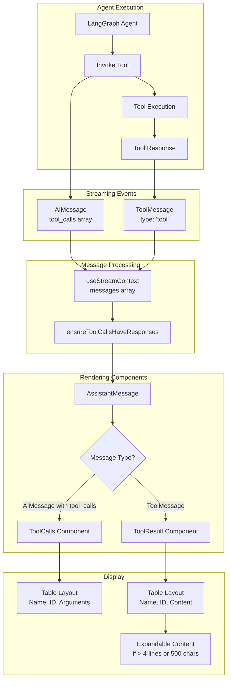
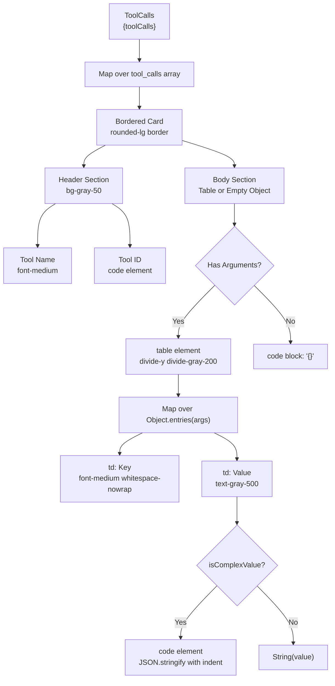
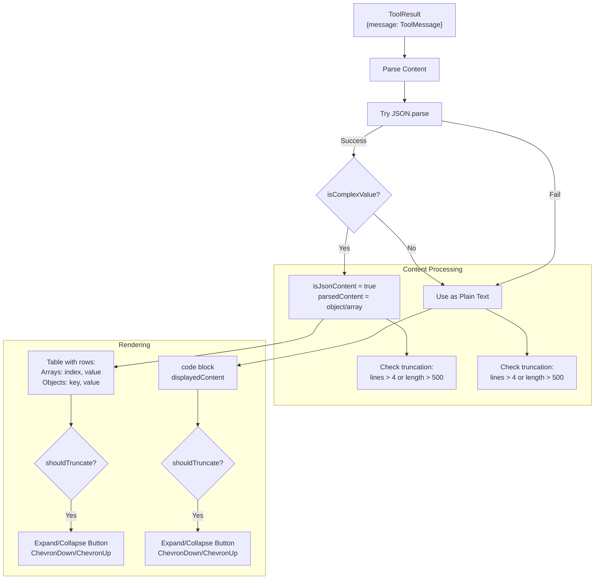
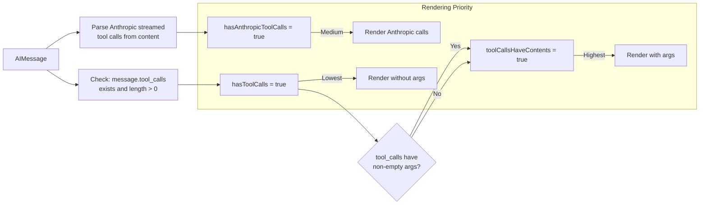

<!-- source: DeepWiki mcp.deepwiki.com · repo langchain-ai/agent-chat-ui · page 3.3 Tool Calls and Results · fetched 2026-10-26 -->

# Tool Calls and Results

<details>
<summary>Relevant source files</summary>

The following files were used as context for generating this wiki page:

- [src/components/thread/history/index.tsx](src/components/thread/history/index.tsx)
- [src/components/thread/messages/ai.tsx](src/components/thread/messages/ai.tsx)
- [src/components/thread/messages/generic-interrupt.tsx](src/components/thread/messages/generic-interrupt.tsx)
- [src/components/thread/messages/shared.tsx](src/components/thread/messages/shared.tsx)
- [src/components/thread/messages/tool-calls.tsx](src/components/thread/messages/tool-calls.tsx)

</details>


This document explains how tool invocations and their results are rendered in the chat interface. Tool calls occur when AI agents invoke external tools during execution, and tool results represent the responses from those invocations. This page covers the `ToolCalls` and `ToolResult` components, their data structures, expansion behavior, and integration with AI messages.

For information about the broader AI message rendering system, see [AI Messages](#3.1). For details on the overall message system architecture, see [Message System](#3).

## Purpose and Scope

Tool calls and tool results are specialized message types in the LangGraph SDK that represent agent actions. The system provides dedicated UI components to render these in a structured, readable format with support for:

- Display of tool name, ID, and arguments
- Automatic JSON formatting for complex argument values
- Expandable/collapsible content for long results
- Key-value table layouts for structured data
- Integration with streaming events from LangGraph agents

## Tool Execution Flow

The following diagram illustrates how tool calls flow from agent execution through streaming to UI rendering:



**Sources:**
- [src/components/thread/messages/ai.tsx:1-212]()
- [src/components/thread/messages/tool-calls.tsx:1-191]()

## Data Structures

Tool calls and tool results follow specific data structures from the LangGraph SDK:

| Type | Structure | Key Fields |
|------|-----------|------------|
| **Tool Call** | `AIMessage["tool_calls"]` | `name`: Tool identifier<br/>`id`: Unique call ID<br/>`args`: Arguments object<br/>`type`: Always `"tool_call"` |
| **Tool Result** | `ToolMessage` | `name`: Tool identifier<br/>`content`: Result data (string or JSON)<br/>`tool_call_id`: References call ID<br/>`type`: Always `"tool"` |

**Sources:**
- [src/components/thread/messages/tool-calls.tsx:1-15]()
- [src/components/thread/messages/ai.tsx:126-137]()

## ToolCalls Component

The `ToolCalls` component renders tool invocations from AI messages. It displays each tool call in a structured card format with the tool name, ID, and arguments.

### Component Structure



**Sources:**
- [src/components/thread/messages/tool-calls.tsx:10-66]()

### Value Type Handling

The component uses the `isComplexValue` helper to determine rendering strategy:

```typescript
function isComplexValue(value: any): boolean {
  return Array.isArray(value) || (typeof value === "object" && value !== null);
}
```

- **Simple values** (strings, numbers, booleans): Rendered as plain text via `String(value)`
- **Complex values** (objects, arrays): Formatted as JSON with 2-space indentation in a monospace code element

**Sources:**
- [src/components/thread/messages/tool-calls.tsx:6-8]()
- [src/components/thread/messages/tool-calls.tsx:40-54]()

### Layout Specification

The component uses a max-width grid layout with card-based styling:

- **Container**: `mx-auto grid max-w-3xl grid-rows-[1fr_auto] gap-2`
- **Card**: `rounded-lg border border-gray-200`
- **Header**: `border-b border-gray-200 bg-gray-50 px-4 py-2`
- **Table**: `min-w-full divide-y divide-gray-200`

**Sources:**
- [src/components/thread/messages/tool-calls.tsx:18-64]()

## ToolResult Component

The `ToolResult` component renders tool execution results with automatic content expansion for long outputs. It supports both plain text and JSON content with structured table rendering.

### Component Architecture



**Sources:**
- [src/components/thread/messages/tool-calls.tsx:68-191]()

### Content Parsing Logic

The component attempts to parse message content as JSON:

1. **JSON parsing**: `JSON.parse(message.content)` wrapped in try-catch
2. **Type detection**: Uses `isComplexValue` to check if parsed result is an object/array
3. **Fallback**: On parse failure or simple values, treat as plain text

**Sources:**
- [src/components/thread/messages/tool-calls.tsx:71-82]()

### Truncation and Expansion

Content is truncated based on these thresholds:

| Metric | Threshold | Behavior |
|--------|-----------|----------|
| Line count | > 4 lines | Truncate to first 4 lines + "..." |
| Character count | > 500 chars | Truncate to first 500 chars + "..." |
| Array length (JSON) | > 5 items | Show only first 5 items when collapsed |

The expansion state is managed with a local `isExpanded` state variable. The toggle button uses framer-motion animations for smooth transitions.

**Sources:**
- [src/components/thread/messages/tool-calls.tsx:84-94]()
- [src/components/thread/messages/tool-calls.tsx:173-186]()

### JSON Table Rendering

For JSON content, the component renders a structured table:

**For objects**:
- Each row represents a key-value pair
- Left column: Object key (font-medium, whitespace-nowrap)
- Right column: Value (formatted based on type)

**For arrays**:
- Each row represents an array item
- Left column: Array index
- Right column: Item value (formatted based on type)

Nested complex values within the table are rendered as indented JSON strings.

**Sources:**
- [src/components/thread/messages/tool-calls.tsx:137-166]()

### Animation System

The component uses framer-motion for smooth content transitions:

- **Container**: `motion.div` with `height: "auto"` animation
- **Content**: `AnimatePresence` with mode="wait" for expand/collapse
- **Button**: `motion.button` with scale animations on hover/tap
- **Transitions**: 0.3s for container, 0.2s for content, instant for button

**Sources:**
- [src/components/thread/messages/tool-calls.tsx:118-187]()

## Integration with AI Messages

Tool calls and results are integrated into the `AssistantMessage` component through conditional rendering based on message type and content.

### Tool Call Detection

The `AssistantMessage` component uses multiple detection strategies:



**Sources:**
- [src/components/thread/messages/ai.tsx:126-137]()

### Anthropic Streaming Support

The system handles Anthropic-specific streaming tool calls through the `parseAnthropicStreamedToolCalls` function:

**Input**: `MessageContentComplex[]` array with items of type `"tool_use"`

**Process**:
1. Filter content items where `type === "tool_use"` and `id` exists
2. For each tool use, parse the `input` field as partial JSON using `parsePartialJson`
3. Map to standard tool call format with `name`, `id`, `args`, and `type: "tool_call"`

This allows the system to render tool calls while they are still being streamed, even if the JSON is incomplete.

**Sources:**
- [src/components/thread/messages/ai.tsx:46-68]()

### Rendering Logic

The AssistantMessage component renders tool calls with this conditional logic:

```typescript
// Tool result rendering
if (isToolResult && hideToolCalls) {
  return null;
}

if (isToolResult) {
  return <ToolResult message={message} />;
}

// Tool call rendering (when not hidden)
if (!hideToolCalls) {
  if (hasToolCalls && toolCallsHaveContents) {
    return <ToolCalls toolCalls={message.tool_calls} />;
  }
  if (hasAnthropicToolCalls) {
    return <ToolCalls toolCalls={anthropicStreamedToolCalls} />;
  }
  if (hasToolCalls) {
    return <ToolCalls toolCalls={message.tool_calls} />;
  }
}
```

The `hideToolCalls` query parameter allows users to hide tool-related messages from the UI.

**Sources:**
- [src/components/thread/messages/ai.tsx:139-175]()

## Hide Tool Calls Feature

Users can toggle tool call visibility using the `hideToolCalls` URL query parameter:

| Parameter | Type | Default | Effect |
|-----------|------|---------|--------|
| `hideToolCalls` | boolean | `false` | When `true`, hides both ToolCalls and ToolResult components |

This is managed through the `nuqs` library with `parseAsBoolean`:

```typescript
const [hideToolCalls] = useQueryState(
  "hideToolCalls",
  parseAsBoolean.withDefault(false)
);
```

When enabled, messages of type `"tool"` return `null` immediately, and the tool calls rendering block is skipped entirely.

**Sources:**
- [src/components/thread/messages/ai.tsx:107-110]()
- [src/components/thread/messages/ai.tsx:139-175]()

## Component Styling Reference

Both `ToolCalls` and `ToolResult` share consistent styling patterns:

| Element | Classes | Purpose |
|---------|---------|---------|
| Container | `mx-auto max-w-3xl` | Center with max width |
| Card | `rounded-lg border border-gray-200` | Bordered card appearance |
| Header | `border-b bg-gray-50 px-4 py-2` | Light background header |
| Tool Name | `font-medium text-gray-900` | Emphasized text |
| Tool ID | `rounded bg-gray-100 px-2 py-1 text-sm` | Monospace badge |
| Table | `min-w-full divide-y divide-gray-200` | Full-width divided table |
| Table Cell (Key) | `px-4 py-2 text-sm font-medium whitespace-nowrap` | Non-wrapping key column |
| Table Cell (Value) | `px-4 py-2 text-sm text-gray-500` | Wrapping value column |
| Code Block | `rounded bg-gray-50 px-2 py-1 font-mono text-sm` | Monospace with background |

**Sources:**
- [src/components/thread/messages/tool-calls.tsx:23-60]()
- [src/components/thread/messages/tool-calls.tsx:95-189]()

---

