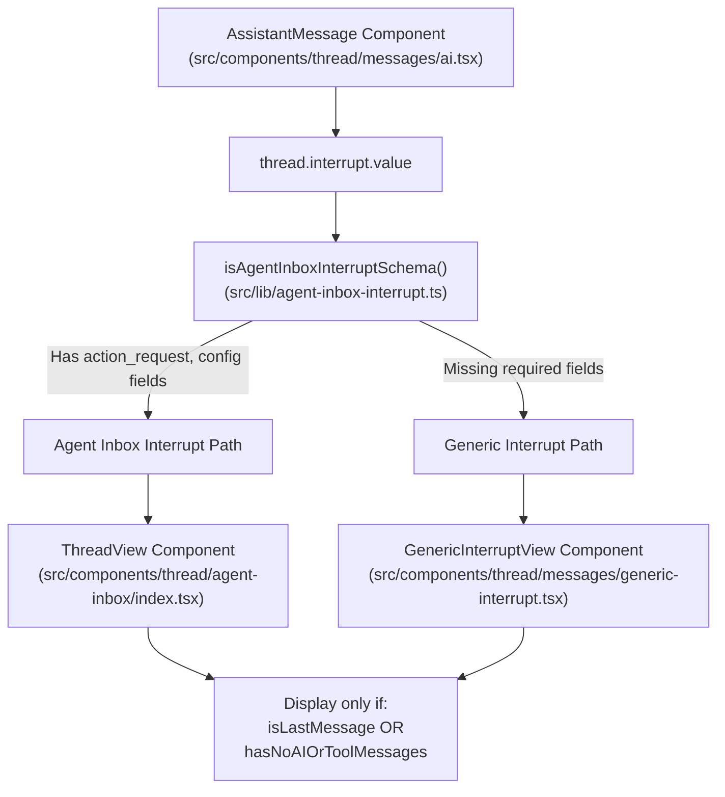
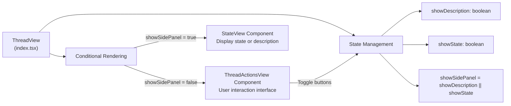
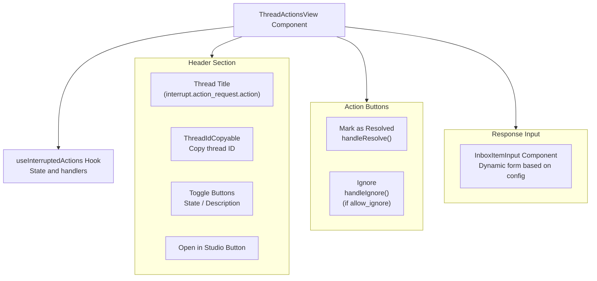
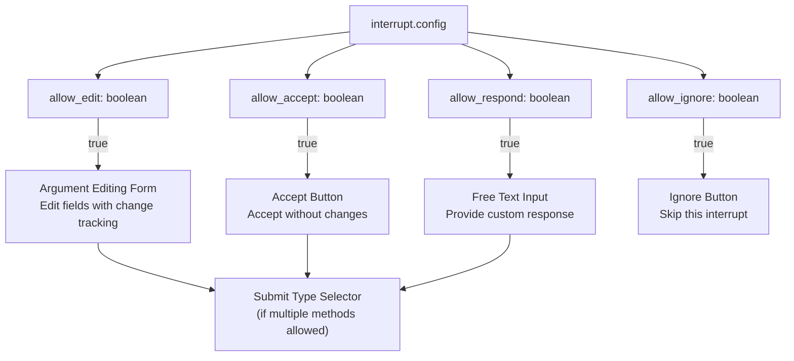
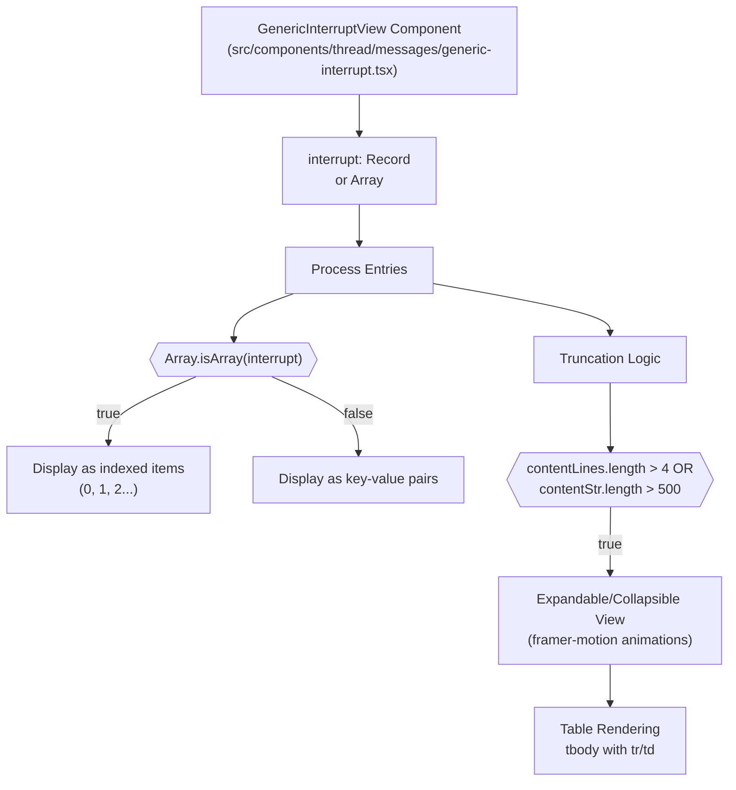
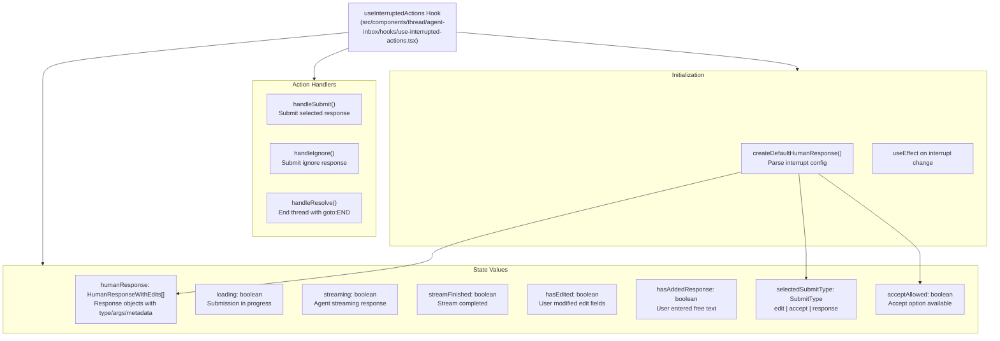
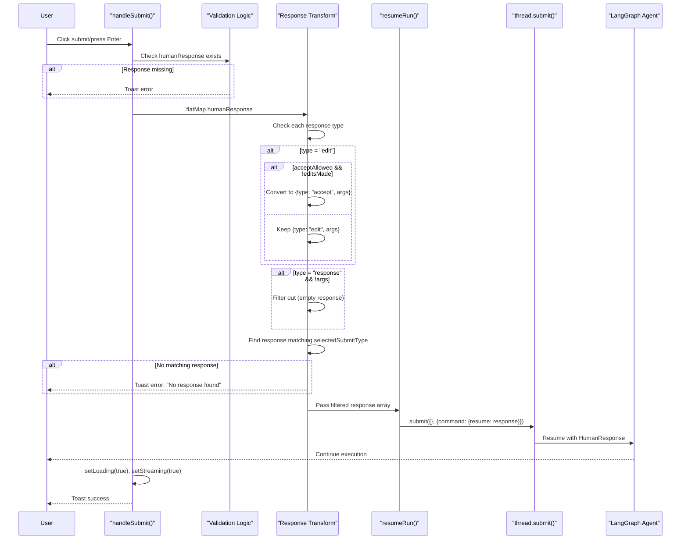
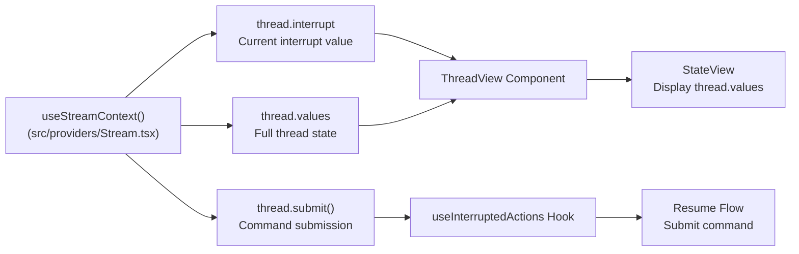

<!-- source: DeepWiki mcp.deepwiki.com · repo langchain-ai/agent-chat-ui · page 4 Agent Inbox System · fetched 2026-10-26 -->

# Agent Inbox System

<details>
<summary>Relevant source files</summary>

The following files were used as context for generating this wiki page:

- [src/components/thread/agent-inbox/components/thread-actions-view.tsx](src/components/thread/agent-inbox/components/thread-actions-view.tsx)
- [src/components/thread/agent-inbox/hooks/use-interrupted-actions.tsx](src/components/thread/agent-inbox/hooks/use-interrupted-actions.tsx)
- [src/components/thread/agent-inbox/index.tsx](src/components/thread/agent-inbox/index.tsx)
- [src/components/thread/messages/ai.tsx](src/components/thread/messages/ai.tsx)
- [src/components/thread/messages/generic-interrupt.tsx](src/components/thread/messages/generic-interrupt.tsx)
- [src/components/thread/messages/shared.tsx](src/components/thread/messages/shared.tsx)
- [src/lib/agent-inbox-interrupt.ts](src/lib/agent-inbox-interrupt.ts)
- [src/providers/Thread.tsx](src/providers/Thread.tsx)
- [src/providers/client.ts](src/providers/client.ts)

</details>


The Agent Inbox System provides human-in-the-loop capabilities for LangGraph agents by handling interrupt events that require human input. When a LangGraph agent emits a `HumanInterrupt`, this system detects the interrupt type, renders an appropriate user interface for collecting human responses, and submits those responses back to the agent to resume execution.

This document covers interrupt detection, specialized UI components for agent inbox interrupts, generic interrupt fallback handling, and the response submission flow. For information about the overall streaming architecture, see [Stream Provider](#2.2). For details on message rendering, see [AI Messages](#3.1).

## Interrupt Detection and Routing

When an AI message contains interrupt data, the system performs schema validation to determine the appropriate rendering approach. The interrupt routing logic is implemented in the `Interrupt` component within the `AssistantMessage` renderer.



**Interrupt Validation Schema**

The `isAgentInboxInterruptSchema` function validates whether an interrupt value conforms to the `HumanInterrupt` type from `@langchain/langgraph/prebuilt`. The validation checks for:

| Required Field | Type | Description |
|---------------|------|-------------|
| `action_request` | `object` | Contains the action being requested |
| `config` | `object` | Configuration controlling allowed responses |
| `config.allow_respond` | `boolean` | Whether free-text responses are allowed |
| `config.allow_accept` | `boolean` | Whether accepting without changes is allowed |
| `config.allow_edit` | `boolean` | Whether editing arguments is allowed |
| `config.allow_ignore` | `boolean` | Whether ignoring the interrupt is allowed |

**Sources:** [src/lib/agent-inbox-interrupt.ts:1-19](), [src/components/thread/messages/ai.tsx:70-94]()

### Rendering Conditions

Interrupts are only displayed when they represent the current state of agent execution. The display logic enforces two conditions:

1. **Last Message Rule**: The interrupt is attached to the last message in the thread (`isLastMessage`)
2. **No Subsequent Messages Rule**: No AI or tool messages exist after this point (`hasNoAIOrToolMessages`)

These conditions prevent stale interrupts from displaying when the agent has already resumed execution.

**Sources:** [src/components/thread/messages/ai.tsx:113-117](), [src/components/thread/messages/ai.tsx:149-153]()

## Agent Inbox Components

### ThreadView Component

The `ThreadView` component serves as the main container for agent inbox interrupts, managing the layout between the action interface and optional side panels for state/description viewing.



**Layout Structure**

The component renders a scrollable container with:
- Fixed height of `80vh`
- Responsive layout: `flex-col` on mobile, `flex-row` on large screens (`lg:flex-row`)
- Custom scrollbar styling with thin track and rounded thumb
- Background color `bg-gray-50/50` with padding and rounded corners

**Sources:** [src/components/thread/agent-inbox/index.tsx:1-58]()

### ThreadActionsView Component

The `ThreadActionsView` component provides the primary user interface for interacting with agent interrupts. It displays action metadata, provides toggle buttons for viewing state/description, and renders the response input interface.



**Action Button Handlers**

The component provides three primary action handlers:

| Button | Handler | Behavior |
|--------|---------|----------|
| Mark as Resolved | `handleResolve()` | Submits command `{goto: END}` to terminate thread |
| Ignore | `handleIgnore()` | Submits ignore response (only if `allow_ignore=true`) |
| Studio | `handleOpenInStudio()` | Opens LangGraph Studio with constructed URL |

**Studio Integration**

The "Open in Studio" button uses `constructOpenInStudioURL` to build a URL pointing to the LangGraph Studio environment:
- Requires `apiUrl` to be configured
- Includes `threadId` in the URL
- Opens in a new browser tab

**Sources:** [src/components/thread/agent-inbox/components/thread-actions-view.tsx:1-174]()

### Response Type Configuration

The `InboxItemInput` component dynamically renders input controls based on the interrupt's configuration flags:



**Sources:** [src/components/thread/agent-inbox/components/inbox-item-input.tsx]() (referenced), [src/components/thread/agent-inbox/components/thread-actions-view.tsx:155-170]()

## Generic Interrupt Handling

When an interrupt does not conform to the agent inbox schema, the system falls back to the `GenericInterruptView` component, which provides a flexible key-value display for arbitrary interrupt data.



**Value Rendering Logic**

The `renderInterruptStateItem` function handles different value types:

| Value Type | Rendering Approach |
|-----------|-------------------|
| Object/Array | `<code>` block with `JSON.stringify(value, null, 2)` |
| URL string | `<a>` tag with `target="_blank"` and `rel="noopener noreferrer"` |
| Other | `String(value)` conversion |

**Truncation Strategy**

The component implements intelligent truncation:
- Long strings (>100 chars): Truncated to 100 chars + "..." (except URLs)
- Arrays (when collapsed): Limited to first 2 items
- Complex objects (>100 chars): Replaced with "Truncated X characters..."
- Array items (when collapsed): Limited to first 5 items

**Animation System**

Uses `framer-motion` for expand/collapse animations:
- `AnimatePresence` with `mode="wait"` for smooth transitions
- Initial/animate/exit states with opacity and y-axis transforms
- Duration: 0.2s for content, 0.3s for height
- Expand/collapse button with scale animations on hover/tap

**Sources:** [src/components/thread/messages/generic-interrupt.tsx:1-161]()

## User Response Management

The `useInterruptedActions` hook centralizes all state management and submission logic for handling user responses to interrupts.



**Response Type Structure**

The `HumanResponseWithEdits` type extends the base `HumanResponse` with additional metadata:

| Field | Type | Purpose |
|-------|------|---------|
| `type` | `"edit" \| "accept" \| "response" \| "ignore"` | Response method |
| `args` | `any` | Response payload |
| `acceptAllowed` | `boolean` (edit only) | Whether accept is available |
| `editsMade` | `boolean` (edit only) | Whether user changed values |

**Sources:** [src/components/thread/agent-inbox/hooks/use-interrupted-actions.tsx:1-306](), [src/components/thread/agent-inbox/types.ts]() (referenced)

### Initialization Flow

When the component receives an interrupt, the initialization process:

1. **Parse Config**: Calls `createDefaultHumanResponse(interrupt, initialHumanInterruptEditValue)`
2. **Build Response Objects**: Creates `HumanResponseWithEdits[]` array based on allowed methods
3. **Set Default Submit Type**: Determines which submit type to pre-select
4. **Check Accept Availability**: Sets `acceptAllowed` flag
5. **Store Initial Values**: Saves original edit values in `initialHumanInterruptEditValue.current` ref

**Sources:** [src/components/thread/agent-inbox/hooks/use-interrupted-actions.tsx:71-81]()

## Response Submission Flow

The submission flow transforms user input into `HumanResponse` objects and sends them to the agent via the streaming context.



**Edit-to-Accept Conversion**

When submitting an edit response, the system performs automatic conversion:
- If `acceptAllowed = true` and `editsMade = false`: Convert `type: "edit"` to `type: "accept"`
- This optimization allows the agent to distinguish between "user reviewed but didn't change" vs "user modified values"

**Sources:** [src/components/thread/agent-inbox/hooks/use-interrupted-actions.tsx:100-220]()

### Resume Command Structure

The `resumeRun` function wraps the response in a LangGraph command:

```typescript
thread.submit(
  {},
  {
    command: {
      resume: response  // HumanResponse[]
    }
  }
)
```

This command structure tells the LangGraph agent to:
1. Resume execution from the interrupted checkpoint
2. Use the provided `HumanResponse` as input
3. Continue processing with the human-provided context

**Sources:** [src/components/thread/agent-inbox/hooks/use-interrupted-actions.tsx:83-98]()

### Ignore and Resolve Actions

**Ignore Action**

When the user clicks "Ignore":
1. Finds the `{type: "ignore"}` response in `humanResponse` array
2. Validates that ignoring is allowed
3. Calls `resumeRun([ignoreResponse])`
4. Resets `initialHumanInterruptEditValue.current`

**Resolve Action**

When the user clicks "Mark as Resolved":
1. Submits a special command: `{command: {goto: END}}`
2. This terminates the thread execution
3. No resume value is needed
4. Uses `END` symbol from `@langchain/langgraph/web`

**Sources:** [src/components/thread/agent-inbox/hooks/use-interrupted-actions.tsx:222-280]()

## Integration with Stream Provider

The Agent Inbox System integrates deeply with the Stream Provider to access thread state and submission capabilities:



The system retrieves:
- `thread.interrupt`: The current interrupt object (if any)
- `thread.values`: Full thread state for display in StateView
- `thread.submit()`: Method to send commands/responses back to agent

After successful submission, the agent resumes execution and new streaming events flow through the same Stream Provider, potentially clearing the interrupt state or emitting new messages.

**Sources:** [src/components/thread/agent-inbox/index.tsx:11-16](), [src/components/thread/agent-inbox/hooks/use-interrupted-actions.tsx:56](), [src/providers/Stream.tsx]() (referenced)

---

