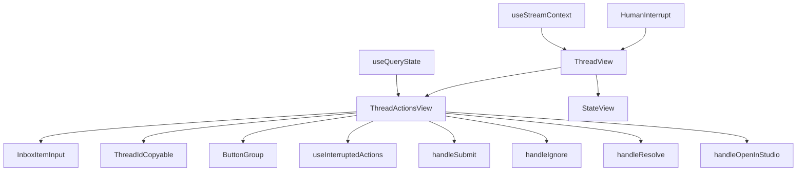
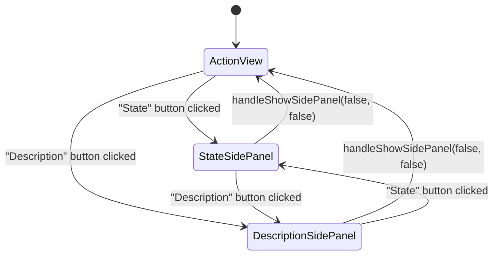
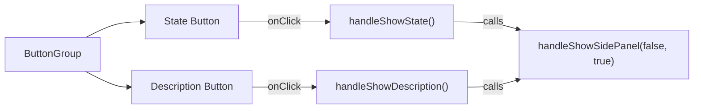
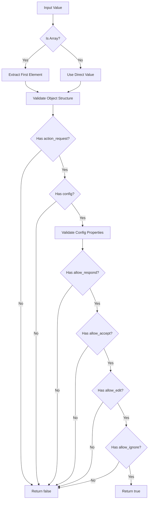
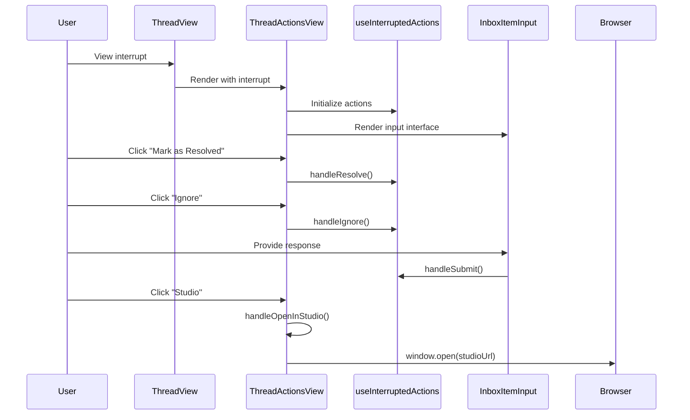

<!-- source: DeepWiki mcp.deepwiki.com · repo langchain-ai/agent-chat-ui · page 4.1 Agent Interaction Components · fetched 2026-10-26 -->

# Agent Interaction Components

Relevant source files

The following files were used as context for generating this wiki page:

- [src/components/thread/agent-inbox/components/inbox-item-input.tsx](src/components/thread/agent-inbox/components/inbox-item-input.tsx)
- [src/components/thread/agent-inbox/components/thread-actions-view.tsx](src/components/thread/agent-inbox/components/thread-actions-view.tsx)
- [src/components/thread/agent-inbox/index.tsx](src/components/thread/agent-inbox/index.tsx)
- [src/lib/agent-inbox-interrupt.ts](src/lib/agent-inbox-interrupt.ts)

This document covers the UI components responsible for displaying and managing human interrupts from LangGraph agents. These components provide the interface for users to respond to agent requests, view agent state, and control agent execution flow. For information about the hooks and logic that process user responses to interrupts, see [Handling Interrupted Actions](#4.2).

## Component Architecture

The agent interaction system consists of several interconnected components that work together to present agent interrupts to users and capture their responses.

Sources: [src/components/thread/agent-inbox/index.tsx:1-57](), [src/components/thread/agent-inbox/components/thread-actions-view.tsx:1-173]()

## ThreadView Component

The `ThreadView` component serves as the main orchestrator for agent interrupt display. It manages the layout between action controls and state viewing panels.

### Core Functionality

| Property | Type | Description |
|----------|------|-------------|
| `interrupt` | `HumanInterrupt \| HumanInterrupt[]` | The interrupt data from the agent |
| `showDescription` | `boolean` | Controls display of interrupt description |
| `showState` | `boolean` | Controls display of agent state |

The component implements a responsive layout that switches between:
- **Action View**: Primary interface for responding to interrupts via `ThreadActionsView`
- **Side Panel View**: Displays agent state or interrupt description via `StateView`

The layout uses CSS classes for responsive design and custom scrollbar styling:
- Container: `flex h-[80vh] w-full flex-col overflow-y-scroll rounded-2xl bg-gray-50/50 p-8 lg:flex-row`
- Custom scrollbar: `[&::-webkit-scrollbar]:w-1.5 [&::-webkit-scrollbar-thumb]:rounded-full`

Sources: [src/components/thread/agent-inbox/index.tsx:11-56]()

## ThreadActionsView Component

The `ThreadActionsView` component provides the primary interface for users to interact with agent interrupts. It displays interrupt information and action controls.

### Component Structure

The component is organized into three main sections:

#### Header Section
- **Thread Title**: Displays the interrupt action name from `interrupt.action_request.action`
- **Thread ID**: Copyable thread identifier via `ThreadIdCopyable` component
- **Control Buttons**: Studio link and State/Description toggles

#### Action Buttons Section
- **Mark as Resolved**: Always available action button
- **Ignore**: Conditional button based on `interrupt.config.allow_ignore`

#### Input Section
- **InboxItemInput**: Main interaction component for handling user responses

### Button State Management

The component uses the `ButtonGroup` sub-component to manage State/Description toggle buttons:

### Integration Points

The component integrates with several external systems:

| Integration | Purpose | Implementation |
|-------------|---------|----------------|
| `useQueryState("threadId")` | Thread identification | URL state management |
| `useQueryState("apiUrl")` | Studio integration | LangGraph Studio linking |
| `useInterruptedActions` | Action handling | Hook for interrupt responses |
| `constructOpenInStudioURL` | External tooling | Studio URL generation |

Sources: [src/components/thread/agent-inbox/components/thread-actions-view.tsx:57-173](), [src/components/thread/agent-inbox/components/thread-actions-view.tsx:18-54]()

## HumanInterrupt Data Structure

The components work with the `HumanInterrupt` type from the LangChain LangGraph library. The interrupt validation logic ensures proper data structure:

### Validation Schema

The `isAgentInboxInterruptSchema` function validates interrupt objects:

### Required Properties

| Property Path | Type | Description |
|---------------|------|-------------|
| `action_request` | `object` | Contains the requested action details |
| `config.allow_respond` | `boolean` | Whether user can provide text response |
| `config.allow_accept` | `boolean` | Whether user can accept proposed action |
| `config.allow_edit` | `boolean` | Whether user can edit action parameters |
| `config.allow_ignore` | `boolean` | Whether user can ignore the interrupt |

Sources: [src/lib/agent-inbox-interrupt.ts:3-19]()

## Component Flow and User Actions

The following diagram shows how user interactions flow through the component system:

The component system provides a complete interface for human-agent collaboration, allowing users to understand agent state, respond to requests, and control execution flow through a responsive and accessible UI.

Sources: [src/components/thread/agent-inbox/components/thread-actions-view.tsx:64-83](), [src/components/thread/agent-inbox/components/thread-actions-view.tsx:86-99](), [src/components/thread/agent-inbox/components/thread-actions-view.tsx:155-170]()

---

