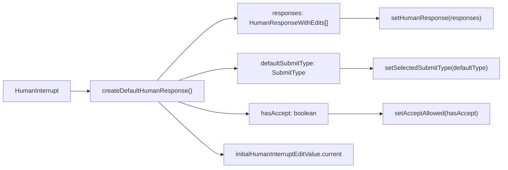
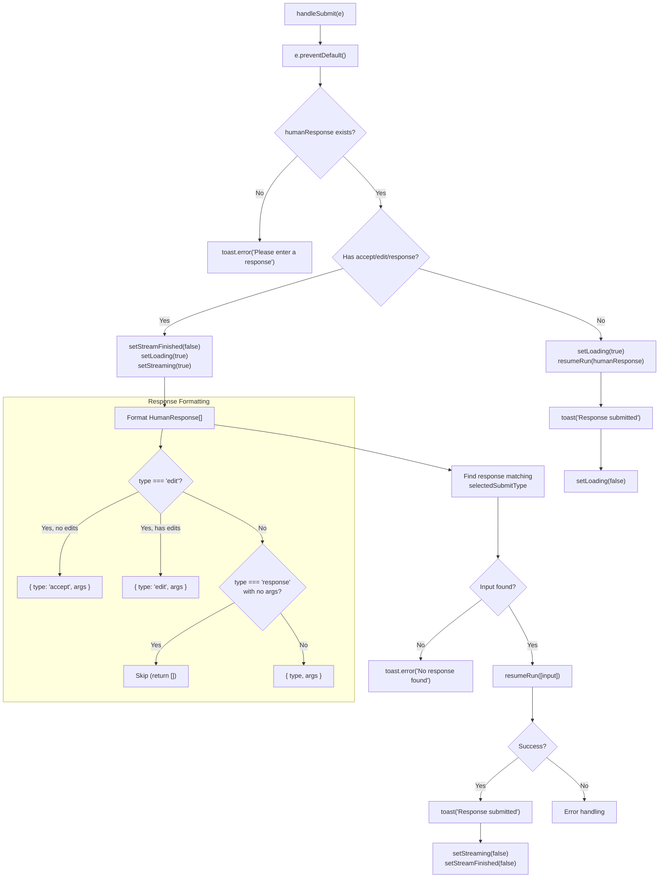
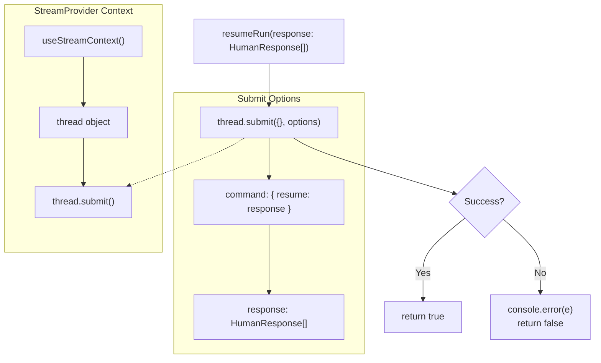
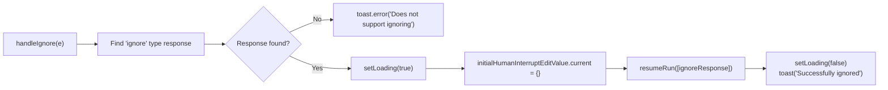
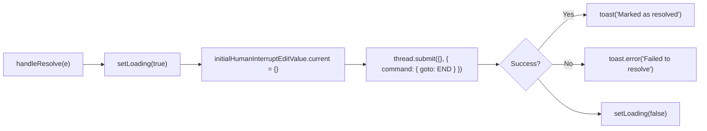
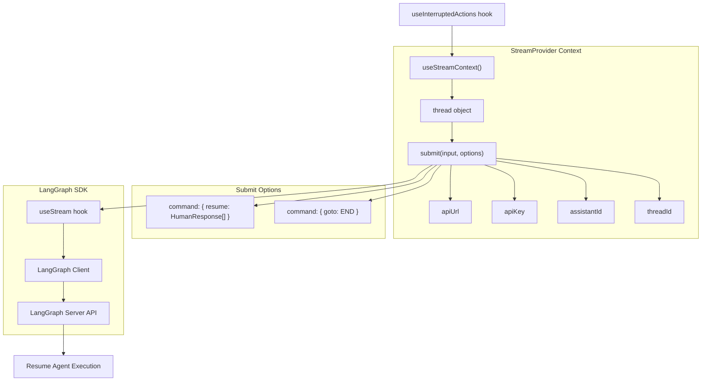

<!-- source: DeepWiki mcp.deepwiki.com · repo langchain-ai/agent-chat-ui · page 4.2 Handling Interrupted Actions · fetched 2026-10-26 -->

# Handling Interrupted Actions

Relevant source files

The following files were used as context for generating this wiki page:

- [src/components/thread/agent-inbox/hooks/use-interrupted-actions.tsx](src/components/thread/agent-inbox/hooks/use-interrupted-actions.tsx)
- [src/providers/Stream.tsx](src/providers/Stream.tsx)
- [src/providers/Thread.tsx](src/providers/Thread.tsx)
- [src/providers/client.ts](src/providers/client.ts)

## Purpose and Scope

This document explains the `useInterruptedActions` hook and its role in managing user responses to agent interrupts. When a LangGraph agent emits a `HumanInterrupt`, this system handles the collection, validation, formatting, and submission of human responses to resume agent execution.

For information about rendering interrupt UI components, see [Agent Interaction Components](#4.1). For the broader interrupt system architecture, see [Agent Inbox System](#4).

**Sources:** [src/components/thread/agent-inbox/hooks/use-interrupted-actions.tsx:1-306]()

---

## Hook Interface and Return Value

The `useInterruptedActions` hook accepts a single `interrupt` parameter of type `HumanInterrupt` and returns an object containing action handlers, state values, state setters, and refs for managing the interrupt response lifecycle.

### Input and Output Types

```mermaid
graph TB
    Input["useInterruptedActions Input"]
    Input --> Interrupt["interrupt: HumanInterrupt"]
    
    Output["UseInterruptedActionsValue"]
    
    subgraph "Action Handlers"
        HandleSubmit["handleSubmit()"]
        HandleIgnore["handleIgnore()"]
        HandleResolve["handleResolve()"]
    end
    
    subgraph "State Values"
        Streaming["streaming: boolean"]
        StreamFinished["streamFinished: boolean"]
        Loading["loading: boolean"]
        SupportsMultiple["supportsMultipleMethods: boolean"]
        HasEdited["hasEdited: boolean"]
        HasAddedResponse["hasAddedResponse: boolean"]
        AcceptAllowed["acceptAllowed: boolean"]
        HumanResponse["humanResponse: HumanResponseWithEdits[]"]
    end
    
    subgraph "State Setters"
        SetSubmitType["setSelectedSubmitType()"]
        SetHumanResponse["setHumanResponse()"]
        SetHasAddedResponse["setHasAddedResponse()"]
        SetHasEdited["setHasEdited()"]
    end
    
    subgraph "Refs"
        InitialValue["initialHumanInterruptEditValue: MutableRefObject"]
    end
    
    Output --> HandleSubmit
    Output --> HandleIgnore
    Output --> HandleResolve
    Output --> Streaming
    Output --> StreamFinished
    Output --> Loading
    Output --> SupportsMultiple
    Output --> HasEdited
    Output --> HasAddedResponse
    Output --> AcceptAllowed
    Output --> HumanResponse
    Output --> SetSubmitType
    Output --> SetHumanResponse
    Output --> SetHasAddedResponse
    Output --> SetHasEdited
    Output --> InitialValue
```

**Sources:** [src/components/thread/agent-inbox/hooks/use-interrupted-actions.tsx:17-51]()

---

## State Initialization

On mount or when the `interrupt` changes, the hook calls `createDefaultHumanResponse` to initialize response state. This utility function analyzes the interrupt configuration to determine available response types and default values.

The initialization logic runs in a `useEffect` with the `interrupt` as a dependency, ensuring state is properly reset when switching between interrupts.

**Sources:** [src/components/thread/agent-inbox/hooks/use-interrupted-actions.tsx:71-81]()

---

## Response Types and Data Structure

The `HumanResponseWithEdits` type extends `HumanResponse` with additional metadata for tracking user edits. The system supports four response types:

| Response Type | Description | Fields |
|--------------|-------------|--------|
| `accept` | Accept the proposed action without modifications | `type: "accept"`, `args: unknown` |
| `edit` | Modify the proposed action arguments | `type: "edit"`, `args: unknown`, `editsMade: boolean`, `acceptAllowed: boolean` |
| `response` | Provide free-text response | `type: "response"`, `args: string \| undefined` |
| `ignore` | Ignore the interrupt | `type: "ignore"`, `args: unknown` |

The `supportsMultipleMethods` computed value indicates whether the interrupt configuration allows multiple response types (edit, accept, or response).

**Sources:** [src/components/thread/agent-inbox/hooks/use-interrupted-actions.tsx:1-2](), [src/components/thread/agent-inbox/hooks/use-interrupted-actions.tsx:282-285]()

---

## Submission Flow

### Main Submission Handler

The `handleSubmit` function orchestrates the submission process. It performs validation, formats the response payload, and invokes the `resumeRun` helper.

Key aspects of the submission logic:

1. **Validation**: Ensures `humanResponse` exists before proceeding
2. **Conditional Logic**: Different paths for multi-method vs single-method responses
3. **Format Transformation**: Converts `HumanResponseWithEdits[]` to `HumanResponse[]`, handling special cases like edit-without-changes converting to accept
4. **Selected Type**: Only the response matching `selectedSubmitType` is submitted
5. **Cleanup**: Resets `initialHumanInterruptEditValue.current` after submission

**Sources:** [src/components/thread/agent-inbox/hooks/use-interrupted-actions.tsx:100-220]()

---

## Resume Run Command Structure

The `resumeRun` helper invokes `thread.submit` with a command structure containing the human response. This integrates with the LangGraph checkpoint system to resume agent execution.

The `thread` object comes from `useStreamContext()`, which provides the streaming connection to the LangGraph server. The submit method sends the resume command with the formatted human response, triggering agent execution continuation from the interrupted checkpoint.

**Sources:** [src/components/thread/agent-inbox/hooks/use-interrupted-actions.tsx:83-98](), [src/components/thread/agent-inbox/hooks/use-interrupted-actions.tsx:56]()

---

## Special Actions

### Ignore Action

The `handleIgnore` function allows users to bypass an interrupt without providing substantive input. It searches for an `ignore` type response in the `humanResponse` array and submits it.

**Sources:** [src/components/thread/agent-inbox/hooks/use-interrupted-actions.tsx:222-245]()

### Resolve Action

The `handleResolve` function marks a thread as complete by sending a `goto: END` command. This terminates the agent graph execution at the END node.

The `END` constant is imported from `@langchain/langgraph/web` and represents the terminal node in a LangGraph state graph.

**Sources:** [src/components/thread/agent-inbox/hooks/use-interrupted-actions.tsx:247-280](), [src/components/thread/agent-inbox/hooks/use-interrupted-actions.tsx:14]()

---

## Error Handling

The hook implements comprehensive error handling with user-facing toast notifications:

### Error Categories

| Error Type | Detection | User Message |
|-----------|-----------|--------------|
| Missing Response | `!humanResponse` check | "Please enter a response." |
| No Matching Response | `!input` after type filtering | "No response found." |
| Invalid Assistant ID | Exception message check | "The provided assistant ID was not found in this graph." |
| Generic Submission Error | Catch block | "Failed to submit response." |
| Ignore Not Supported | Missing ignore response | "The selected thread does not support ignoring." |
| Resolve Error | Exception during goto END | "Failed to mark thread as resolved." |

All error handlers use the `toast` API from the `sonner` package to display notifications with `richColors: true` and `closeButton: true` for dismissal.

### Error State Management

When errors occur during submission:
1. `errorOccurred` flag is set to `true`
2. `setStreaming(false)` resets streaming state
3. `setStreamFinished(false)` prevents UI from showing completion
4. Error is logged to console with `console.error()`

**Sources:** [src/components/thread/agent-inbox/hooks/use-interrupted-actions.tsx:104-110](), [src/components/thread/agent-inbox/hooks/use-interrupted-actions.tsx:154-161](), [src/components/thread/agent-inbox/hooks/use-interrupted-actions.tsx:180-203](), [src/components/thread/agent-inbox/hooks/use-interrupted-actions.tsx:222-234](), [src/components/thread/agent-inbox/hooks/use-interrupted-actions.tsx:269-276]()

---

## Integration with StreamProvider

The hook depends on the `StreamProvider` context for submitting responses:

The `thread.submit` method signature is:
- First parameter: Input object (empty `{}` for resume/goto commands)
- Second parameter: Options object containing the command

The StreamProvider handles:
- Maintaining the streaming connection
- Managing authentication via `apiKey`
- Routing to the correct assistant via `assistantId`
- Maintaining thread context via `threadId`

**Sources:** [src/components/thread/agent-inbox/hooks/use-interrupted-actions.tsx:15](), [src/components/thread/agent-inbox/hooks/use-interrupted-actions.tsx:56](), [src/components/thread/agent-inbox/hooks/use-interrupted-actions.tsx:85-92](), [src/components/thread/agent-inbox/hooks/use-interrupted-actions.tsx:256-263]()

---

