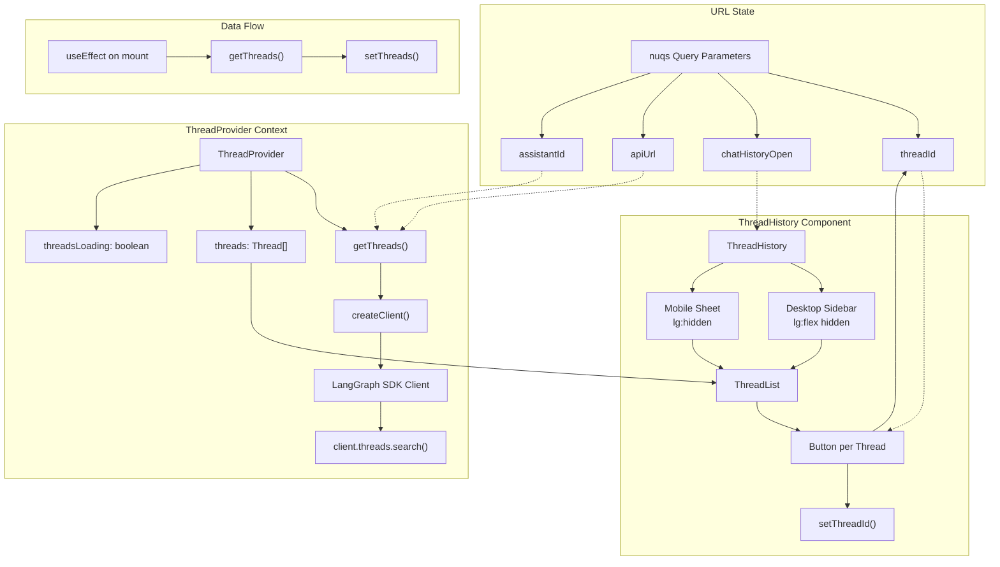
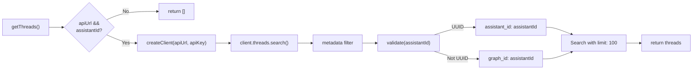
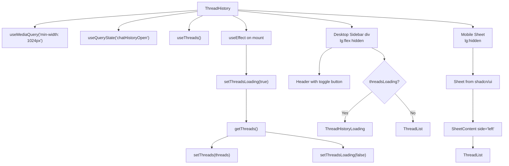
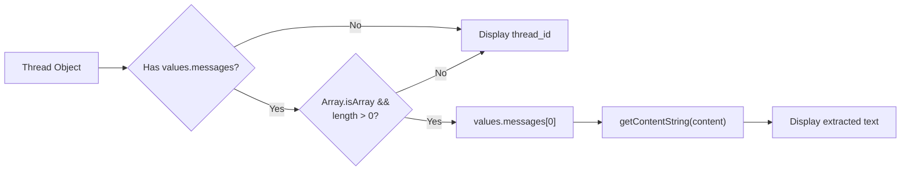
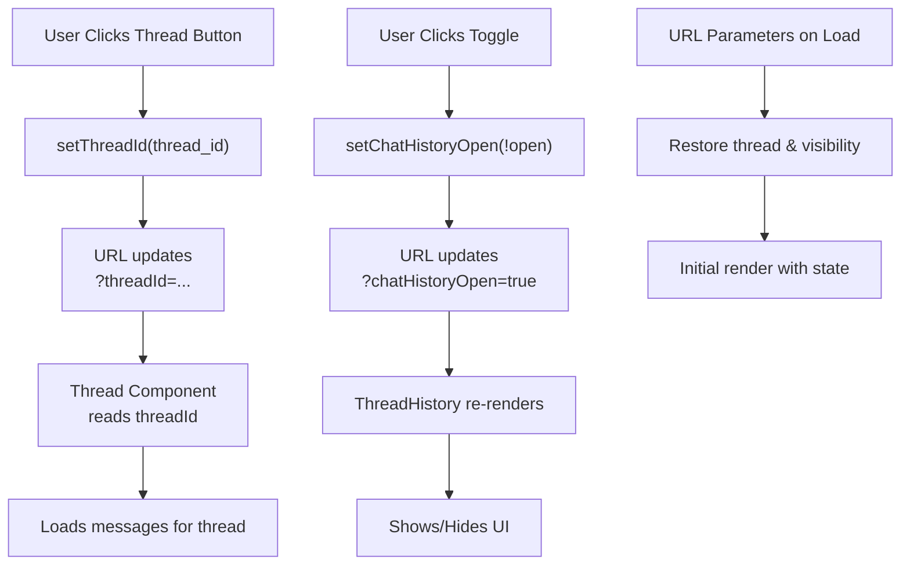

<!-- source: DeepWiki mcp.deepwiki.com · repo langchain-ai/agent-chat-ui · page 5 Thread History and Management · fetched 2026-10-26 -->

# Thread History and Management

Relevant source files

The following files were used as context for generating this wiki page:

- [src/components/thread/agent-inbox/hooks/use-interrupted-actions.tsx](src/components/thread/agent-inbox/hooks/use-interrupted-actions.tsx)
- [src/components/thread/history/index.tsx](src/components/thread/history/index.tsx)
- [src/components/thread/messages/tool-calls.tsx](src/components/thread/messages/tool-calls.tsx)
- [src/providers/Thread.tsx](src/providers/Thread.tsx)
- [src/providers/client.ts](src/providers/client.ts)

This document covers the thread history sidebar system, which displays a list of previous conversation threads and enables users to navigate between them. The system includes the `ThreadHistory` component for UI rendering and the `ThreadProvider` context for managing thread data fetching and state.

For information about the main chat interface where messages are displayed, see [Thread Component](#2.1). For streaming message data and real-time updates, see [Stream Provider](#2.2).

## Architecture Overview

The thread history system consists of two primary layers: a provider context that manages thread data fetching and state, and UI components that render the thread list with responsive layout handling.

**Sources**: [src/components/thread/history/index.tsx:1-146](), [src/providers/Thread.tsx:1-76]()

## ThreadProvider Context

The `ThreadProvider` creates a React context that manages thread list data and provides methods for fetching threads from the LangGraph server. It serves as the central state manager for all thread-related operations.

### Context Structure

The `ThreadProvider` exposes the following interface through the `useThreads` hook:

| Property | Type | Description |
|----------|------|-------------|
| `getThreads` | `() => Promise<Thread[]>` | Async function to fetch threads from LangGraph server |
| `threads` | `Thread[]` | Current array of thread objects |
| `setThreads` | `Dispatch<SetStateAction<Thread[]>>` | State setter for updating thread list |
| `threadsLoading` | `boolean` | Loading state indicator |
| `setThreadsLoading` | `Dispatch<SetStateAction<boolean>>` | State setter for loading state |

The `Thread` type is imported from `@langchain/langgraph-sdk` and contains properties including `thread_id`, `values`, and other metadata.

**Sources**: [src/providers/Thread.tsx:16-22]()

### Thread Fetching Logic

The `getThreads` method creates a LangGraph SDK client and performs a thread search with metadata filtering:

The `getThreadSearchMetadata` helper function [src/providers/Thread.tsx:26-34]() determines whether to search by `assistant_id` or `graph_id` based on UUID validation of the `assistantId` parameter. If the `assistantId` is a valid UUID, it searches by `assistant_id`; otherwise, it searches by `graph_id`.

**Sources**: [src/providers/Thread.tsx:42-54](), [src/providers/Thread.tsx:26-34](), [src/providers/client.ts:1-8]()

### Configuration Dependencies

The `ThreadProvider` depends on two URL query parameters managed by `nuqs`:

- **`apiUrl`**: The LangGraph server URL endpoint
- **`assistantId`**: The assistant or graph identifier for filtering threads

These parameters are read directly from the URL state [src/providers/Thread.tsx:37-38]() and used in the `getThreads` callback. The callback is memoized with these dependencies, ensuring it updates when the URL parameters change.

**Sources**: [src/providers/Thread.tsx:37-54]()

## ThreadHistory Component

The `ThreadHistory` component [src/components/thread/history/index.tsx:78-146]() renders the thread list with responsive behavior: a fixed sidebar on large screens (`lg:` breakpoint and above) and a sheet overlay on mobile devices.

### Component Structure

**Sources**: [src/components/thread/history/index.tsx:78-146]()

### Desktop Sidebar Layout

The desktop sidebar [src/components/thread/history/index.tsx:99-121]() is a fixed-width (300px) column with the following characteristics:

- **Visibility**: Hidden below `lg` breakpoint, visible on large screens using `lg:flex` and `hidden` classes
- **Styling**: Border on right side, shadow effect using `shadow-inner-right` class
- **Header**: Contains a toggle button (using `PanelRightOpen`/`PanelRightClose` icons) and "Thread History" title
- **Content Area**: Either displays `ThreadHistoryLoading` skeleton or `ThreadList` based on `threadsLoading` state

The toggle button updates the `chatHistoryOpen` URL parameter using `setChatHistoryOpen`, which controls whether the sidebar content is visible (though the sidebar container itself remains in the layout on desktop).

**Sources**: [src/components/thread/history/index.tsx:99-121]()

### Mobile Sheet Overlay

The mobile view [src/components/thread/history/index.tsx:122-143]() uses the `Sheet` component from shadcn/ui to create a slide-in overlay:

- **Conditional Rendering**: Only rendered on screens below `lg` breakpoint using `lg:hidden`
- **Open State**: Controlled by `chatHistoryOpen && !isLargeScreen` to prevent conflicts with desktop sidebar
- **Sheet Properties**: 
  - `side="left"`: Slides in from the left
  - Auto-closes when thread is clicked via `onThreadClick` callback
  - Includes `SheetHeader` with `SheetTitle` component

The `useMediaQuery` hook [src/components/thread/history/index.tsx:79]() determines the screen size, ensuring the sheet only opens on mobile devices even if `chatHistoryOpen` is true.

**Sources**: [src/components/thread/history/index.tsx:79-143]()

## ThreadList Component

The `ThreadList` component [src/components/thread/history/index.tsx:18-63]() renders individual thread items as clickable buttons in a scrollable container.

### Thread Display Logic

Each thread is displayed with text content derived from the thread's first message:

The `getContentString` utility function [src/components/thread/history/index.tsx:6]() extracts readable text from the message content, handling various content formats from LangGraph messages.

**Sources**: [src/components/thread/history/index.tsx:29-40]()

### Thread Selection

Each thread button [src/components/thread/history/index.tsx:46-58]() handles click events with the following behavior:

1. **Prevent Default**: Calls `e.preventDefault()` to avoid navigation
2. **Optional Callback**: Invokes `onThreadClick?.(t.thread_id)` if provided (used in mobile to close sheet)
3. **Duplicate Check**: Compares with current `threadId` from URL state; returns early if same
4. **URL Update**: Calls `setThreadId(t.thread_id)` to update the URL query parameter

The `threadId` query parameter is managed by `nuqs` [src/components/thread/history/index.tsx:25]() and serves as the source of truth for which thread is currently active.

**Sources**: [src/components/thread/history/index.tsx:18-63](), [src/components/thread/history/index.tsx:25]()

### Scrollable Container Styling

The thread list container [src/components/thread/history/index.tsx:28]() includes custom scrollbar styling using Tailwind arbitrary value syntax:

- `overflow-y-scroll`: Enables vertical scrolling
- `[&::-webkit-scrollbar]:w-1.5`: Sets scrollbar width to 1.5 units
- `[&::-webkit-scrollbar-thumb]:rounded-full`: Rounds the scrollbar thumb
- `[&::-webkit-scrollbar-thumb]:bg-gray-300`: Colors the scrollbar thumb gray
- `[&::-webkit-scrollbar-track]:bg-transparent`: Makes the track transparent

**Sources**: [src/components/thread/history/index.tsx:28]()

## Loading States

The system implements skeleton loading states while fetching threads from the server.

### ThreadHistoryLoading Component

The `ThreadHistoryLoading` component [src/components/thread/history/index.tsx:65-76]() renders 30 skeleton placeholders using the `Skeleton` component from shadcn/ui. Each skeleton has dimensions matching the thread button size (`h-10 w-[280px]`).

The skeleton count of 30 is hardcoded and provides visual feedback for the typical thread list size, even though the actual fetch limit is 100 threads [src/providers/Thread.tsx:50]().

**Sources**: [src/components/thread/history/index.tsx:65-76]()

### Loading State Management

The loading flow in `ThreadHistory` [src/components/thread/history/index.tsx:88-95]():

1. **Initial State**: Set `threadsLoading` to `true` immediately
2. **Fetch**: Call `getThreads()` asynchronously
3. **Success**: Update `threads` state via `setThreads()`
4. **Cleanup**: Set `threadsLoading` to `false` in `finally` block
5. **Error Handling**: Logs errors to console via `.catch(console.error)`

This pattern ensures the loading state is cleared even if the fetch fails.

**Sources**: [src/components/thread/history/index.tsx:88-95]()

## URL State Integration

The thread history system integrates tightly with URL query parameters managed by the `nuqs` library, enabling deep linking and persistence of navigation state.

### Query Parameters

| Parameter | Type | Default | Purpose |
|-----------|------|---------|---------|
| `threadId` | `string \| null` | `null` | Currently active thread identifier |
| `chatHistoryOpen` | `boolean` | `false` | Visibility state of thread history UI |
| `apiUrl` | `string \| null` | - | LangGraph server URL for thread fetching |
| `assistantId` | `string \| null` | - | Assistant/graph ID for filtering threads |

The `chatHistoryOpen` parameter uses `parseAsBoolean.withDefault(false)` [src/components/thread/history/index.tsx:80-83]() to ensure a boolean value even when the parameter is absent from the URL.

**Sources**: [src/components/thread/history/index.tsx:80-83](), [src/components/thread/history/index.tsx:25]()

### State Synchronization Flow

The `nuqs` library automatically synchronizes between URL parameters and component state, enabling users to bookmark or share URLs that restore both the active thread and the sidebar visibility state.

**Sources**: [src/components/thread/history/index.tsx:80-83](), [src/components/thread/history/index.tsx:25](), [src/components/thread/history/index.tsx:49-54]()

## Integration Points

The thread history system integrates with several other parts of the application:

### LangGraph SDK Client

Thread fetching uses the LangGraph SDK's `Client` class [src/providers/client.ts:3-8](). The `createClient` function accepts:
- `apiUrl`: The LangGraph server endpoint
- `apiKey`: Optional API key from `getApiKey()` utility

The client's `threads.search()` method [src/providers/Thread.tsx:46-51]() supports metadata filtering and limit parameters. The search returns `Thread` objects with properties including `thread_id`, `values`, `created_at`, and `updated_at`.

**Sources**: [src/providers/Thread.tsx:42-54](), [src/providers/client.ts:1-8]()

### Content String Extraction

The `getContentString` utility [src/components/thread/history/index.tsx:6]() is imported from `../utils` and handles extracting displayable text from LangGraph message content, which can be a string, array of content blocks, or other formats.

This utility is critical for deriving readable preview text from the first message in each thread [src/components/thread/history/index.tsx:39]().

**Sources**: [src/components/thread/history/index.tsx:6](), [src/components/thread/history/index.tsx:39]()

### Responsive Design System

The `useMediaQuery` hook [src/components/thread/history/index.tsx:16]() provides a React-friendly way to detect screen size breakpoints. The `(min-width: 1024px)` query matches Tailwind's `lg:` breakpoint.

This hook ensures the mobile sheet only activates on small screens [src/components/thread/history/index.tsx:124]() by checking `!!chatHistoryOpen && !isLargeScreen`.

**Sources**: [src/components/thread/history/index.tsx:79](), [src/components/thread/history/index.tsx:124-127]()

---

