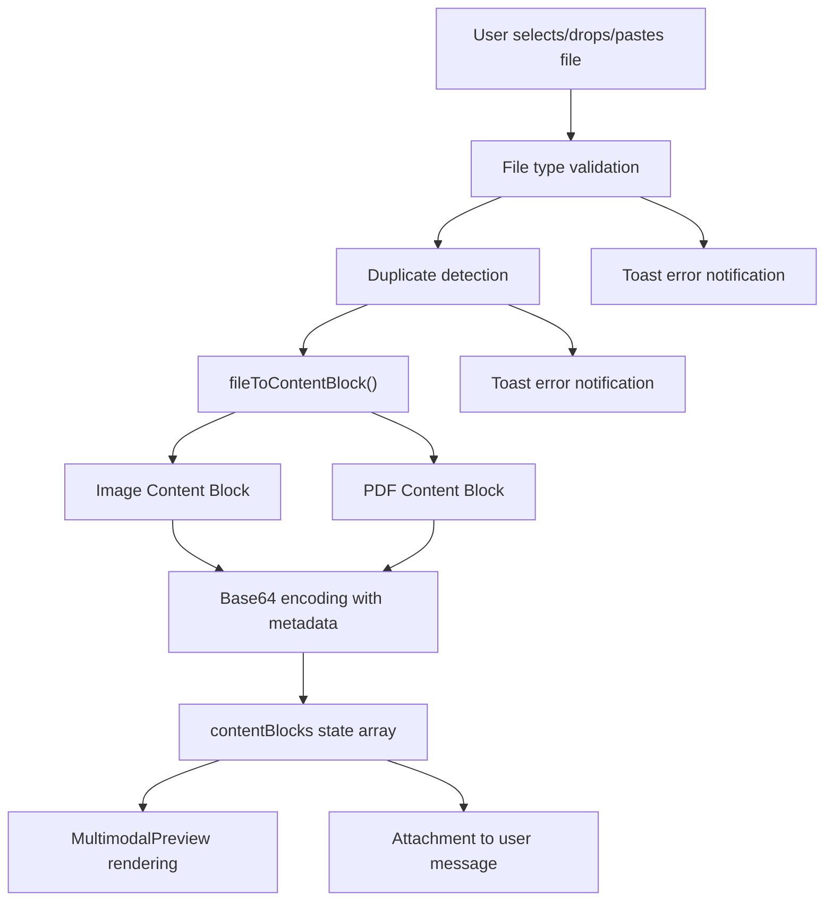
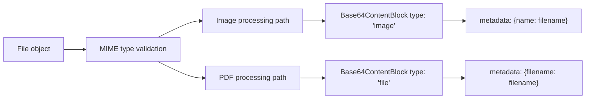
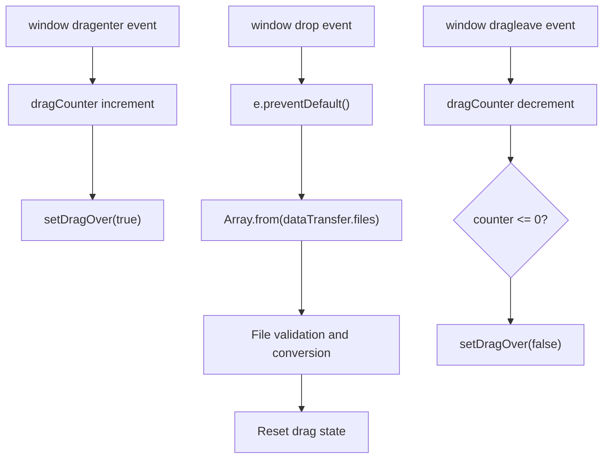
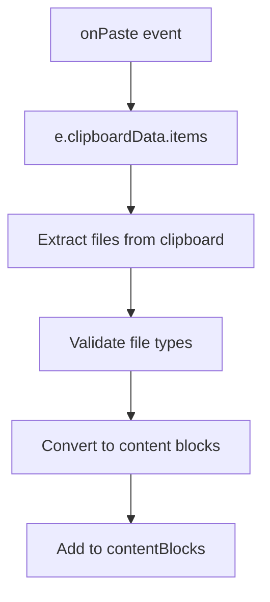
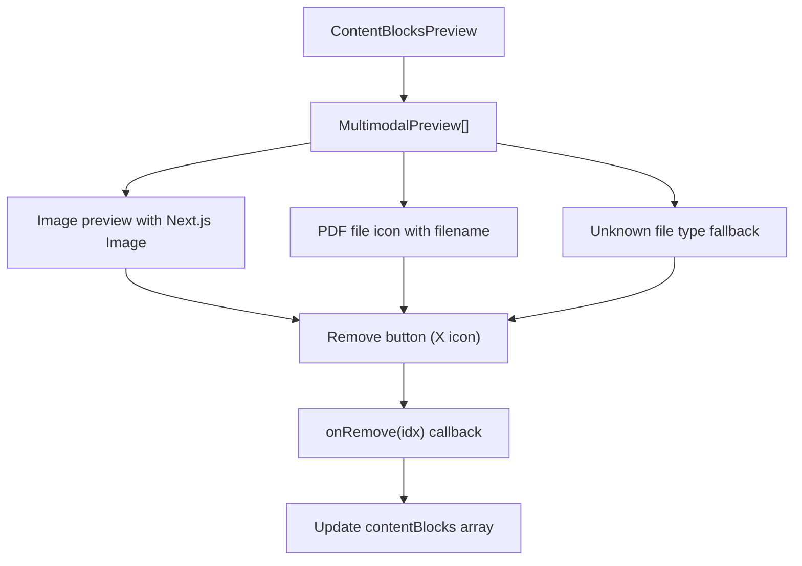
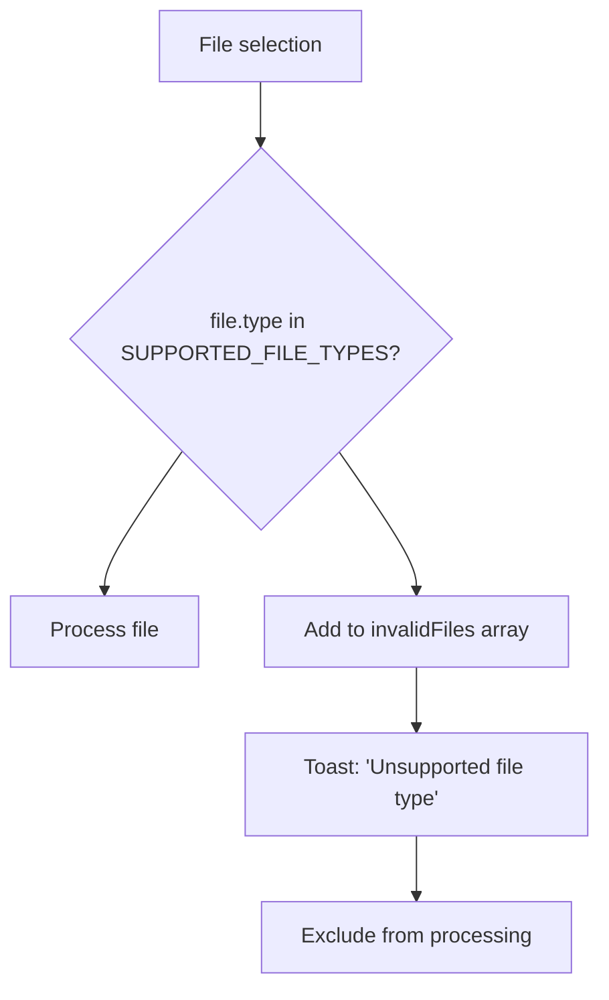
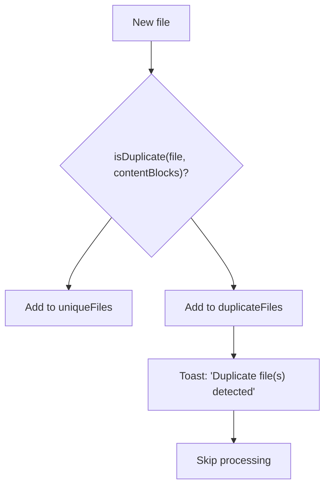
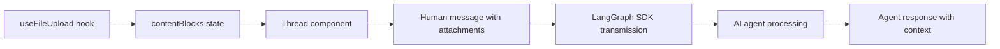

<!-- source: DeepWiki mcp.deepwiki.com · repo langchain-ai/agent-chat-ui · page 6 File Upload and Multimodal Content · fetched 2026-10-26 -->

# File Upload and Multimodal Content

<details>
<summary>Relevant source files</summary>

The following files were used as context for generating this wiki page:

- [src/components/thread/ContentBlocksPreview.tsx](src/components/thread/ContentBlocksPreview.tsx)
- [src/components/thread/MultimodalPreview.tsx](src/components/thread/MultimodalPreview.tsx)
- [src/hooks/use-file-upload.tsx](src/hooks/use-file-upload.tsx)
- [src/lib/multimodal-utils.ts](src/lib/multimodal-utils.ts)

</details>


This document covers the file upload system and multimodal content handling within the Agent Chat UI. The system enables users to attach images and PDF files to their messages, which are then processed, encoded, and displayed within the chat interface.

For information about how multimodal content is rendered within messages, see [Message System](#3). For details on thread management and message display, see [Thread Component](#2.1).

## Overview

The multimodal content system provides comprehensive support for file uploads through multiple input methods: traditional file selection, drag-and-drop, and clipboard paste operations. The system converts uploaded files into `Base64ContentBlock` objects that conform to LangChain's message format standards, enabling seamless integration with AI agents that support multimodal inputs.

**Supported File Types:**
- Images: JPEG, PNG, GIF, WEBP
- Documents: PDF

Sources: [src/lib/multimodal-utils.ts:8-14](), [src/hooks/use-file-upload.tsx:6-12]()

## File Processing Pipeline

The file upload system follows a structured pipeline that converts raw files into standardized content blocks suitable for AI processing.



### Core Processing Function

The `fileToContentBlock` function in [src/lib/multimodal-utils.ts:5-43]() serves as the central conversion utility:



The function creates different content block structures based on file type:
- **Images**: `type: "image"` with `metadata.name`
- **PDFs**: `type: "file"` with `metadata.filename`

Sources: [src/lib/multimodal-utils.ts:25-42]()

## Upload Mechanisms

The `useFileUpload` hook provides three distinct upload mechanisms, each with comprehensive validation and error handling.

### File Input Upload

Traditional file selection through HTML input elements:

```mermaid
graph TD
    FileInput["<input type='file'>"] --> HandleFileUpload["handleFileUpload()"]
    HandleFileUpload --> FileArray["Array.from(files)"]
    FileArray --> ValidationSplit["Split valid/invalid files"]
    ValidationSplit --> DuplicateFilter["Filter duplicates"]
    DuplicateFilter --> BatchConversion["Promise.all(fileToContentBlock)"]
    BatchConversion --> StateUpdate["setContentBlocks()"]
```



Sources: [src/hooks/use-file-upload.tsx:47-80]()

### Drag and Drop System

A sophisticated drag and drop implementation with global event handling:



The drag and drop system uses a counter-based approach to handle complex drag operations across multiple elements and windows.

Sources: [src/hooks/use-file-upload.tsx:87-147]()

### Clipboard Paste Integration

Paste functionality integrated with text input elements:



Sources: [src/hooks/use-file-upload.tsx:200-258]()

## Content Block Structure

Content blocks follow the LangChain `Base64ContentBlock` interface with specific structures for different file types.

### Image Content Blocks

```typescript
{
  type: "image",
  source_type: "base64",
  mime_type: string, // e.g., "image/jpeg"
  data: string,      // Base64 encoded image data
  metadata: {
    name: string     // Original filename
  }
}
```

### PDF Content Blocks

```typescript
{
  type: "file",
  source_type: "base64", 
  mime_type: "application/pdf",
  data: string,      // Base64 encoded PDF data
  metadata: {
    filename: string // Original filename
  }
}
```

### Type Guard Function

The `isBase64ContentBlock` function [src/lib/multimodal-utils.ts:60-89]() provides runtime type checking for content blocks, supporting both legacy "file" type and newer "image" type blocks.

Sources: [src/lib/multimodal-utils.ts:26-42](), [src/lib/multimodal-utils.ts:60-89]()

## Preview Components

The system provides a hierarchical component structure for displaying uploaded content.



### MultimodalPreview Component

The `MultimodalPreview` component [src/components/thread/MultimodalPreview.tsx:14-120]() handles rendering of individual content blocks:

- **Images**: Rendered using Next.js `Image` component with proper sizing and aspect ratio
- **PDFs**: Displayed as file icons with filename labels
- **Unknown types**: Fallback display with generic file icon

### ContentBlocksPreview Component  

The `ContentBlocksPreview` wrapper [src/components/thread/ContentBlocksPreview.tsx:17-37]() manages collections of content blocks with consistent spacing and removal functionality.

Sources: [src/components/thread/MultimodalPreview.tsx:14-120](), [src/components/thread/ContentBlocksPreview.tsx:17-37]()

## Validation and Error Handling

The system implements comprehensive validation with user-friendly error messaging.

### File Type Validation



### Duplicate Detection

The system prevents duplicate uploads using filename and MIME type comparison:



The duplicate detection logic [src/hooks/use-file-upload.tsx:27-45]() compares:
- **PDFs**: `filename` and `mime_type`
- **Images**: `name`, `mime_type` matching

Sources: [src/hooks/use-file-upload.tsx:27-45](), [src/hooks/use-file-upload.tsx:64-73](), [src/hooks/use-file-upload.tsx:124-133]()

## Integration with Thread System

Multimodal content integrates seamlessly with the broader thread and message system through standardized content block arrays.



The `getContentString` utility [src/components/thread/utils.ts:9-15]() extracts text summaries from multimodal messages for display in thread history and navigation contexts.

Sources: [src/components/thread/utils.ts:9-15]()

---

