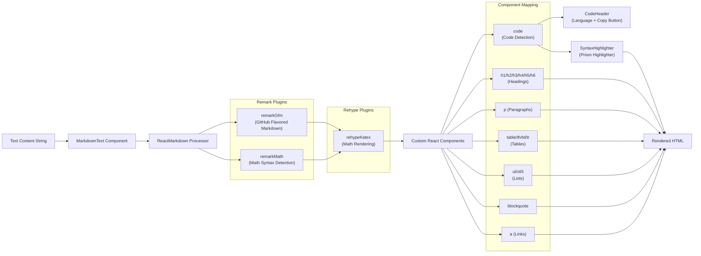
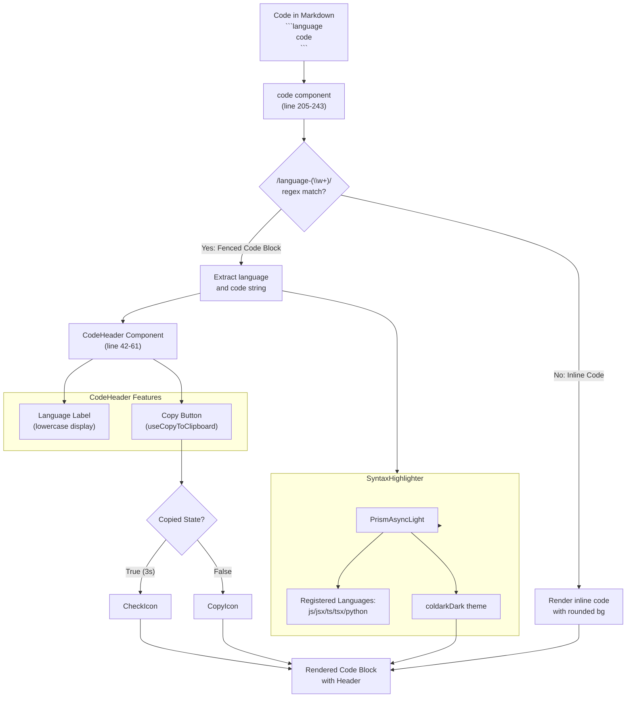
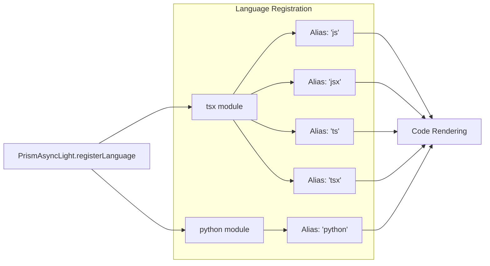
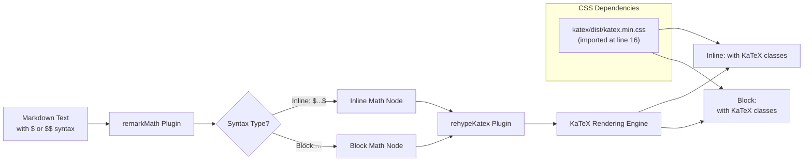
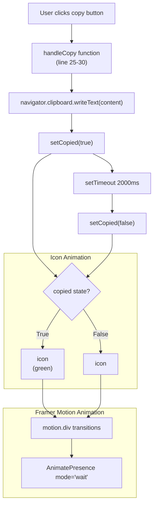

<!-- source: DeepWiki mcp.deepwiki.com · repo langchain-ai/agent-chat-ui · page 7 Content Rendering · fetched 2026-10-26 -->

# Content Rendering

<details>
<summary>Relevant source files</summary>

The following files were used as context for generating this wiki page:

- [src/components/thread/markdown-styles.css](src/components/thread/markdown-styles.css)
- [src/components/thread/markdown-text.tsx](src/components/thread/markdown-text.tsx)
- [src/components/thread/messages/ai.tsx](src/components/thread/messages/ai.tsx)
- [src/components/thread/messages/generic-interrupt.tsx](src/components/thread/messages/generic-interrupt.tsx)
- [src/components/thread/messages/shared.tsx](src/components/thread/messages/shared.tsx)
- [src/components/thread/syntax-highlighter.tsx](src/components/thread/syntax-highlighter.tsx)
- [src/components/ui/skeleton.tsx](src/components/ui/skeleton.tsx)

</details>


## Purpose and Scope

This document covers the content rendering pipeline for text, markdown, code blocks, syntax highlighting, and mathematical expressions within chat messages. The system transforms raw text content from AI and human messages into styled, interactive HTML elements.

For information about message types and their overall structure, see [Message System](#3). For multimodal content (images, PDFs), see [File Upload and Multimodal Content](#6). For tool call rendering, see [Tool Calls and Results](#3.3).

## Markdown Rendering Pipeline

The content rendering system uses the `MarkdownText` component as the primary entry point for transforming markdown-formatted text into styled HTML. The component integrates multiple processing plugins and custom React components to handle various content types.

### Markdown Processing Flow



**Sources:** [src/components/thread/markdown-text.tsx:1-261]()

The `MarkdownText` component [src/components/thread/markdown-text.tsx:246-260]() wraps `ReactMarkdown` with three processing layers:

1. **remarkGfm** - Enables GitHub Flavored Markdown features (tables, task lists, strikethrough)
2. **remarkMath** - Detects mathematical notation in `$...$` (inline) and `$$...$$` (block) formats
3. **rehypeKatex** - Transforms detected math syntax into rendered mathematical expressions using KaTeX

### Custom Component Mapping

The system maps standard HTML elements to custom React components with Tailwind CSS styling. The mapping is defined in the `defaultComponents` object [src/components/thread/markdown-text.tsx:63-244]():

| HTML Element | Custom Styling | Key Features |
|-------------|----------------|--------------|
| `h1` | `text-4xl font-extrabold` | Scroll margin for anchor links |
| `h2` | `text-3xl font-semibold` | Top/bottom margin with `first:mt-0` |
| `h3` | `text-2xl font-semibold` | Progressive sizing hierarchy |
| `h4-h6` | `text-xl` to base size | Consistent semantic structure |
| `p` | `leading-7` | Vertical spacing control |
| `a` | `text-primary underline` | Primary color with offset underline |
| `blockquote` | `border-l-2 pl-6 italic` | Left border visual indicator |
| `ul/ol` | `list-disc/decimal ml-6` | Nested list support |
| `table` | `border-separate` | Rounded corners on first/last cells |
| `code` | Custom logic | Routes to inline or block rendering |

**Sources:** [src/components/thread/markdown-text.tsx:63-244]()

### Usage in Message Components

The `MarkdownText` component is used by `AssistantMessage` to render AI response content [src/components/thread/messages/ai.tsx:157-161]():

```typescript
{contentString.length > 0 && (
  <div className="py-1">
    <MarkdownText>{contentString}</MarkdownText>
  </div>
)}
```

**Sources:** [src/components/thread/messages/ai.tsx:96-212]()

## Code Block Rendering System

The code block rendering system provides syntax highlighting with language detection, header bars showing the language name, and copy-to-clipboard functionality.

### Code Block Detection and Rendering Flow



**Sources:** [src/components/thread/markdown-text.tsx:205-243](), [src/components/thread/syntax-highlighter.tsx:1-41]()

### Language Detection

The `code` component uses regex pattern matching to detect fenced code blocks [src/components/thread/markdown-text.tsx:205-243]():

1. Checks className for pattern `/language-(\w+)/`
2. Extracts language identifier (e.g., `"typescript"`, `"python"`)
3. Strips trailing newline from code content
4. Routes to `CodeHeader` + `SyntaxHighlighter` for blocks
5. Falls back to inline `<code>` element for non-fenced code

**Sources:** [src/components/thread/markdown-text.tsx:213-243]()

### Copy-to-Clipboard Functionality

The `useCopyToClipboard` hook [src/components/thread/markdown-text.tsx:23-40]() implements temporary state management for copy operations:

| Feature | Implementation |
|---------|---------------|
| Duration | Configurable `copiedDuration` (default: 3000ms) |
| API | `navigator.clipboard.writeText()` |
| State | `isCopied` boolean flag |
| Reset | Automatic timeout-based reset |

The `CodeHeader` component displays the copy button with icon transitions [src/components/thread/markdown-text.tsx:42-61]():

- Default state: `CopyIcon` from lucide-react
- Copied state: `CheckIcon` (shown for 3 seconds)
- Positioned in header bar alongside language label

**Sources:** [src/components/thread/markdown-text.tsx:23-61]()

## Syntax Highlighting Configuration

The `SyntaxHighlighter` component [src/components/thread/syntax-highlighter.tsx:1-41]() wraps `react-syntax-highlighter` with pre-registered language support and consistent theming.

### Registered Languages



**Sources:** [src/components/thread/syntax-highlighter.tsx:7-12]()

Language registration happens at module import time [src/components/thread/syntax-highlighter.tsx:8-12]():

```typescript
SyntaxHighlighterPrism.registerLanguage("js", tsx);
SyntaxHighlighterPrism.registerLanguage("jsx", tsx);
SyntaxHighlighterPrism.registerLanguage("ts", tsx);
SyntaxHighlighterPrism.registerLanguage("tsx", tsx);
SyntaxHighlighterPrism.registerLanguage("python", python);
```

### Theming and Styling

The component uses the `coldarkDark` theme [src/components/thread/syntax-highlighter.tsx:4]() with custom styling overrides [src/components/thread/syntax-highlighter.tsx:29-34]():

| Style Property | Value | Purpose |
|---------------|-------|---------|
| `margin` | `0` | Remove default margins |
| `width` | `100%` | Full container width |
| `background` | `transparent` | Header provides background |
| `padding` | `1.5rem 1rem` | Consistent internal spacing |

The transparent background allows the `CodeHeader` component's `bg-zinc-900` to provide the dark background for the entire code block.

**Sources:** [src/components/thread/syntax-highlighter.tsx:20-40]()

## Mathematical Expression Support

The content rendering system supports mathematical expressions through the `remark-math` and `rehype-katex` plugin pipeline.

### Math Rendering Configuration



**Sources:** [src/components/thread/markdown-text.tsx:6-16](), [src/components/thread/markdown-text.tsx:250-252]()

The `MarkdownText` component imports KaTeX CSS [src/components/thread/markdown-text.tsx:16]() and configures the plugins [src/components/thread/markdown-text.tsx:250-252]():

```typescript
<ReactMarkdown
  remarkPlugins={[remarkGfm, remarkMath]}
  rehypePlugins={[rehypeKatex]}
  components={defaultComponents}
>
```

This enables rendering of:
- Inline math: `$E = mc^2$` → $E = mc^2$
- Block math: `$$\int_0^\infty e^{-x^2} dx = \frac{\sqrt{\pi}}{2}$$`

**Sources:** [src/components/thread/markdown-text.tsx:246-258]()

## Additional Styling and CSS

The content rendering system uses supplementary CSS for markdown-specific styling that complements the React component styles.

### Markdown-Specific CSS Rules

The `markdown-styles.css` file [src/components/thread/markdown-styles.css:1-46]() provides additional styling:

| Selector | Styling | Purpose |
|----------|---------|---------|
| `.markdown-content code:not(pre code)` | `background-color: rgba(0,0,0,0.05)` | Inline code background |
| `.markdown-content a` | `color: #0070f3` | Link color |
| `.markdown-content a:hover` | `text-decoration: underline` | Hover state |
| `.markdown-content blockquote` | `border-left: 4px solid #ddd` | Left border emphasis |
| `.markdown-content table` | `border-collapse: collapse` | Clean table borders |
| `.markdown-content tr:nth-child(even)` | `background-color: #f9f9f9` | Zebra striping |

The CSS is imported at the top of the `MarkdownText` component [src/components/thread/markdown-text.tsx:3]() and the rendered content is wrapped in a `div` with class `markdown-content` [src/components/thread/markdown-text.tsx:248]().

**Sources:** [src/components/thread/markdown-styles.css:1-46](), [src/components/thread/markdown-text.tsx:3](), [src/components/thread/markdown-text.tsx:248]()

## Content Copy Functionality

The `CommandBar` component provides content copying functionality across message types through the `ContentCopyable` sub-component.

### Copy State Management



**Sources:** [src/components/thread/messages/shared.tsx:16-67]()

The `ContentCopyable` component [src/components/thread/messages/shared.tsx:16-67]() implements:

1. **Clipboard API** - Uses `navigator.clipboard.writeText()` for copy operations
2. **Temporary State** - Maintains `copied` boolean with 2-second timeout
3. **Icon Transition** - Switches between `Copy` and `CopyCheck` icons using framer-motion
4. **Animation** - `AnimatePresence` with scale and opacity transitions (0.15s duration)
5. **Visual Feedback** - Green color on `CopyCheck` icon during copied state

The component is used in the `CommandBar` [src/components/thread/messages/shared.tsx:193-196]() which appears in both AI and human messages for content copying.

**Sources:** [src/components/thread/messages/shared.tsx:16-67](), [src/components/thread/messages/shared.tsx:118-221]()

## Component Memory Optimization

The `MarkdownText` component uses React's `memo` higher-order component to prevent unnecessary re-renders [src/components/thread/markdown-text.tsx:260]():

```typescript
export const MarkdownText = memo(MarkdownTextImpl);
```

This optimization is important because:
- Message content rarely changes after initial render
- Markdown parsing and rendering is computationally expensive
- Messages remain visible as conversation grows
- Prevents re-processing when parent components update

**Sources:** [src/components/thread/markdown-text.tsx:246-260]()

---

