<!-- source: DeepWiki mcp.deepwiki.com · repo langchain-ai/agent-chat-ui · page 8 State Management · fetched 2026-10-26 -->

# State Management

<details>
<summary>Relevant source files</summary>

The following files were used as context for generating this wiki page:

- [src/app/page.tsx](src/app/page.tsx)
- [src/components/thread/artifact.tsx](src/components/thread/artifact.tsx)
- [src/components/thread/index.tsx](src/components/thread/index.tsx)
- [src/providers/Stream.tsx](src/providers/Stream.tsx)

</details>


This document explains the state management architecture of the agent-chat-ui application. The system employs a layered approach with distinct state management mechanisms for different concerns: URL query parameters for navigation and persistence, React Context providers for global application state, and local component state for ephemeral UI interactions.

For detailed information about individual provider implementations, see [Stream Provider](#2.2), [Thread Provider](#2.3), and [Artifact System](#2.4). For overall architectural context, see [Core Architecture](#2).

## State Management Layers

The application uses four distinct layers of state management, each with specific responsibilities and scopes:

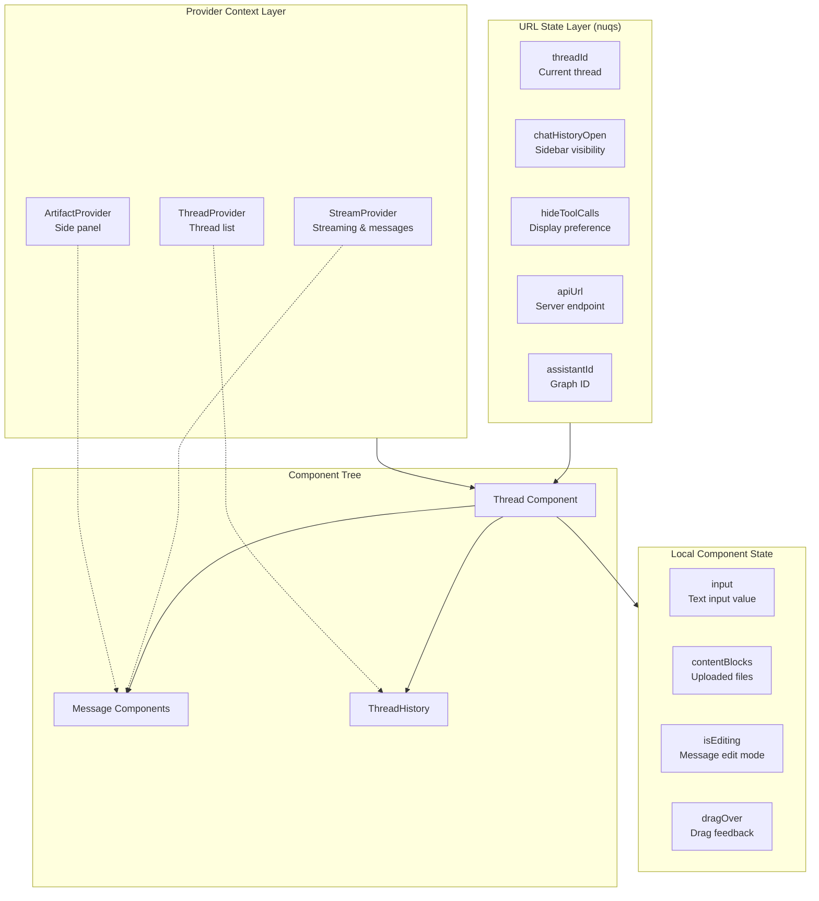

**Sources**: [src/components/thread/index.tsx:1-565](), [src/providers/Stream.tsx:1-287](), [src/components/thread/artifact.tsx:1-190](), [src/app/page.tsx:1-24]()

## URL State Management

The application uses the `nuqs` library to manage state in URL query parameters, providing persistent, shareable state that survives page refreshes and enables deep linking.

### Managed Parameters

| Parameter | Type | Default | Purpose | Component |
|-----------|------|---------|---------|-----------|
| `threadId` | string \| null | null | Current conversation thread | Thread |
| `chatHistoryOpen` | boolean | false | Sidebar visibility state | Thread |
| `hideToolCalls` | boolean | false | Tool call display toggle | Thread |
| `apiUrl` | string | env var | LangGraph server URL | StreamProvider |
| `assistantId` | string | env var | Graph/assistant identifier | StreamProvider |

### Implementation Pattern

URL state is managed using `useQueryState` hook from nuqs:

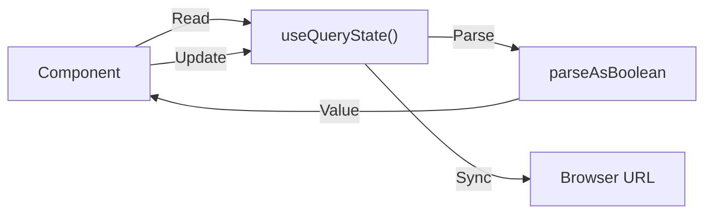

**Example usage from Thread component** [src/components/thread/index.tsx:118-126]():
```typescript
const [threadId, _setThreadId] = useQueryState("threadId");
const [chatHistoryOpen, setChatHistoryOpen] = useQueryState(
  "chatHistoryOpen",
  parseAsBoolean.withDefault(false),
);
const [hideToolCalls, setHideToolCalls] = useQueryState(
  "hideToolCalls",
  parseAsBoolean.withDefault(false),
);
```

### Thread ID Management

The Thread component wraps the `setThreadId` function to perform cleanup operations when switching threads [src/components/thread/index.tsx:147-153]():

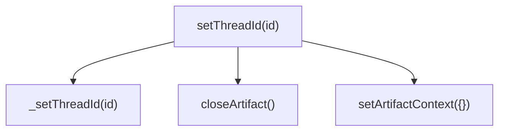

This ensures the artifact panel is closed and artifact context is cleared when navigating between threads.

**Sources**: [src/components/thread/index.tsx:118-153]()

## Provider Context Architecture

The application uses three React Context providers, nested in a specific order to establish dependency relationships:

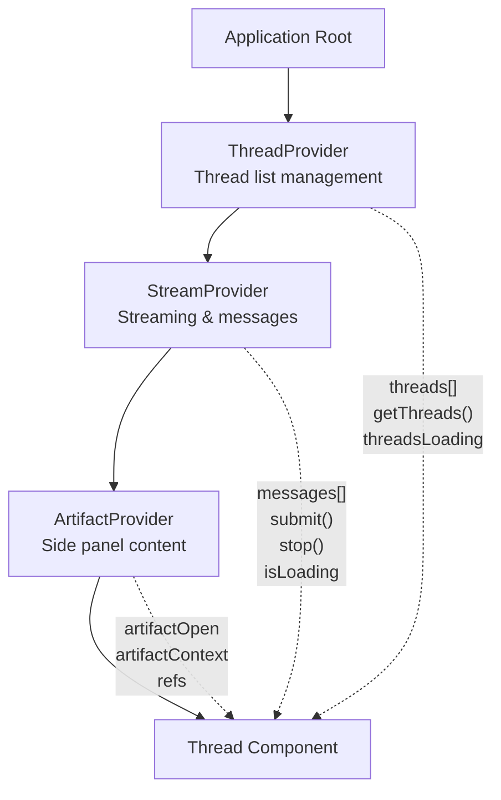

**Provider nesting order** [src/app/page.tsx:10-23]():
```typescript
<ThreadProvider>
  <StreamProvider>
    <ArtifactProvider>
      <Thread />
    </ArtifactProvider>
  </StreamProvider>
</ThreadProvider>
```

**Sources**: [src/app/page.tsx:10-23]()

### StreamProvider State

The StreamProvider manages the most critical application state related to LangGraph streaming connections. It uses the `useStream` hook from `@langchain/langgraph-sdk/react` with custom type parameters.

**Type definition** [src/providers/Stream.tsx:28-40]():

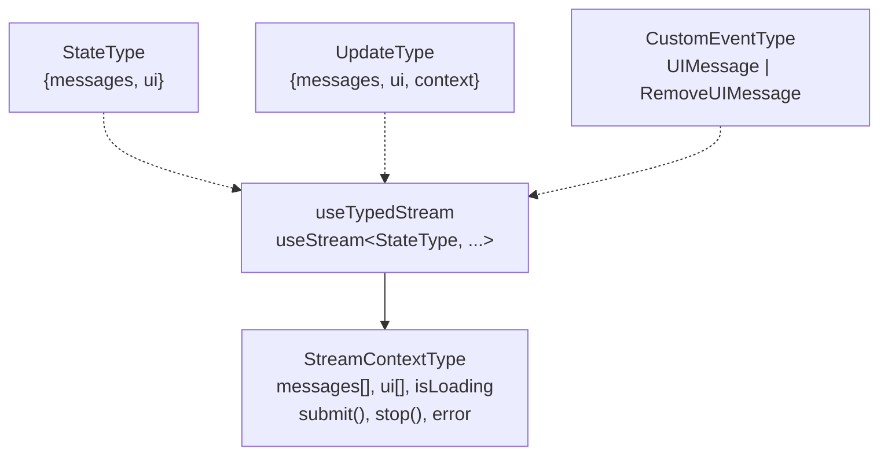

Key state elements exposed by StreamProvider:
- `messages: Message[]` - LangGraph message history
- `ui: UIMessage[]` - UI-specific messages processed by `uiMessageReducer`
- `isLoading: boolean` - Stream activity indicator
- `error: unknown` - Stream error state
- `submit(input, options)` - Initiate stream with input
- `stop()` - Cancel active stream
- `interrupt` - Current agent interrupt state

**Sources**: [src/providers/Stream.tsx:28-43](), [src/providers/Stream.tsx:69-127]()

### ThreadProvider State

The ThreadProvider manages the list of conversation threads, enabling the thread history sidebar functionality. While not included in the provided files, it exposes:
- `threads: Thread[]` - List of available threads
- `getThreads()` - Fetch thread list from server
- `setThreads(threads)` - Update thread list state
- `threadsLoading: boolean` - Loading indicator

The StreamProvider integrates with ThreadProvider to refresh the thread list when new threads are created [src/providers/Stream.tsx:96-101]().

**Sources**: [src/providers/Stream.tsx:81](), [src/providers/Stream.tsx:96-101]()

### ArtifactProvider State

The ArtifactProvider uses React Portals to render artifact content in a side panel. Its state structure uses tuples of `[value, setter]`:

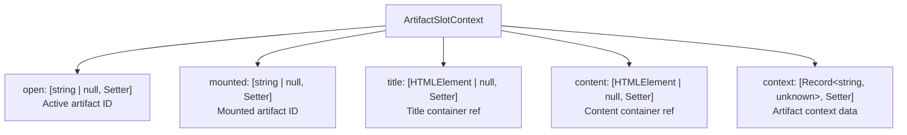

**Context definition** [src/components/thread/artifact.tsx:17-25]():

The provider maintains refs to DOM elements where artifact title and content should be rendered, enabling flexible portal-based rendering from any component in the tree.

**Sources**: [src/components/thread/artifact.tsx:17-25](), [src/components/thread/artifact.tsx:98-113]()

## Local Component State

Local component state is used for ephemeral UI concerns that don't need to be shared across the application or persisted. The Thread component manages several pieces of local state:

### Input and File Upload State

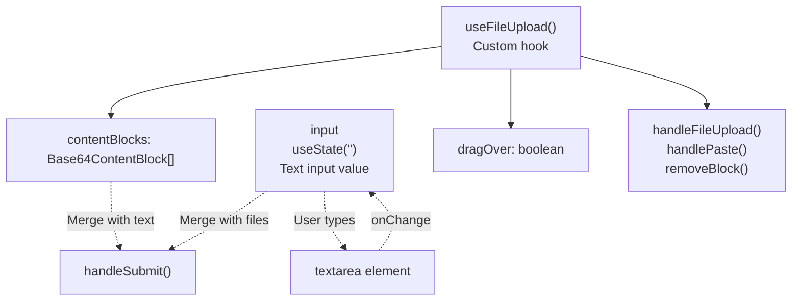

**State declarations** [src/components/thread/index.tsx:127-137]():
- `input` - Controlled text input state
- `contentBlocks` - Array of uploaded file blocks
- `dragOver` - Drag-and-drop UI feedback
- File upload handlers (from `useFileUpload` hook)

**Sources**: [src/components/thread/index.tsx:127-137]()

### Loading and Error State

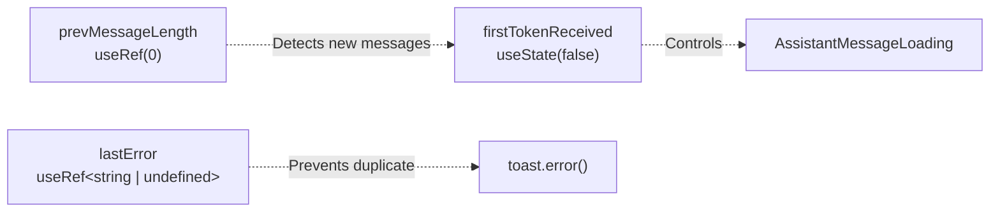

**Loading state tracking** [src/components/thread/index.tsx:138]():
- `firstTokenReceived` - Tracks whether the first token of a streaming response has arrived
- Controls display of loading indicator while waiting for initial response

**Error state tracking** [src/components/thread/index.tsx:145]():
- `lastError` - Ref storing last error message to prevent duplicate toasts
- Used in effect that monitors `stream.error` [src/components/thread/index.tsx:155-181]()

**Message length tracking** [src/components/thread/index.tsx:184-195]():
- `prevMessageLength` - Ref tracking previous message count
- Effect detects new AI messages to set `firstTokenReceived` flag

**Sources**: [src/components/thread/index.tsx:138](), [src/components/thread/index.tsx:145](), [src/components/thread/index.tsx:184-195]()

### Media Query State

The Thread component uses a media query hook to detect screen size [src/components/thread/index.tsx:139]():
```typescript
const isLargeScreen = useMediaQuery("(min-width: 1024px)");
```

This controls responsive behavior, particularly animation timing for the chat history sidebar [src/components/thread/index.tsx:270-274]().

**Sources**: [src/components/thread/index.tsx:139](), [src/components/thread/index.tsx:270-274]()

## Configuration Priority System

The StreamProvider implements a three-tier priority system for configuration values:

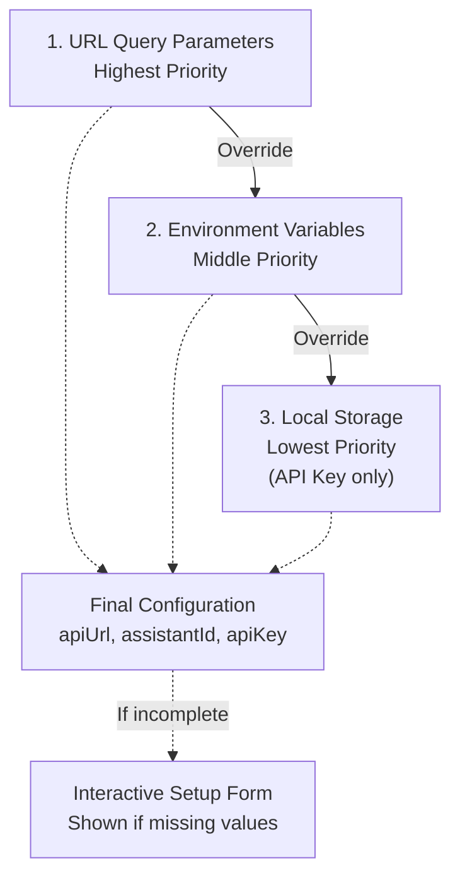

### Priority Implementation

**URL parameters with environment variable fallbacks** [src/providers/Stream.tsx:136-147]():
```typescript
const envApiUrl = process.env.NEXT_PUBLIC_API_URL;
const envAssistantId = process.env.NEXT_PUBLIC_ASSISTANT_ID;

const [apiUrl, setApiUrl] = useQueryState("apiUrl", {
  defaultValue: envApiUrl || "",
});
const [assistantId, setAssistantId] = useQueryState("assistantId", {
  defaultValue: envAssistantId || "",
});
```

**API key from local storage** [src/providers/Stream.tsx:150-158]():
```typescript
const [apiKey, _setApiKey] = useState(() => {
  const storedKey = getApiKey();
  return storedKey || "";
});

const setApiKey = (key: string) => {
  window.localStorage.setItem("lg:chat:apiKey", key);
  _setApiKey(key);
};
```

**Final value resolution** [src/providers/Stream.tsx:160-162]():
```typescript
const finalApiUrl = apiUrl || envApiUrl;
const finalAssistantId = assistantId || envAssistantId;
```

### Setup Form

When required configuration is missing, the StreamProvider renders an interactive setup form [src/providers/Stream.tsx:165-264](). The form allows users to input:
- **Deployment URL** - Required, defaults to `http://localhost:2024`
- **Assistant/Graph ID** - Required, defaults to `agent`
- **LangSmith API Key** - Optional for local development

Form submission updates all three state layers simultaneously [src/providers/Stream.tsx:182-196]().

**Sources**: [src/providers/Stream.tsx:136-162](), [src/providers/Stream.tsx:165-264]()

## State Flow Patterns

### Message Submission Flow

The message submission process coordinates multiple state layers:

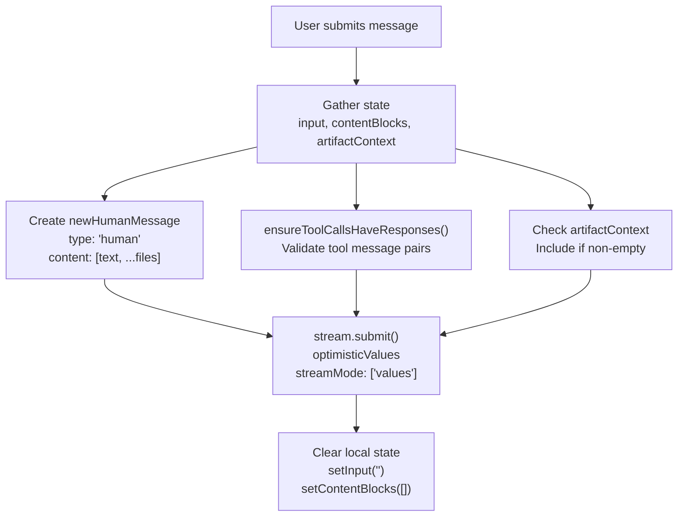

**Implementation** [src/components/thread/index.tsx:197-237]():
1. Prevent submission if input is empty and no files are attached
2. Create a new `Message` object with UUID
3. Merge text and content blocks into message content array
4. Validate tool messages using `ensureToolCallsHaveResponses`
5. Include artifact context if present
6. Submit to stream with optimistic UI updates
7. Clear local input and file state

**Sources**: [src/components/thread/index.tsx:197-237]()

### Thread Navigation Flow

When switching threads, multiple cleanup operations occur:

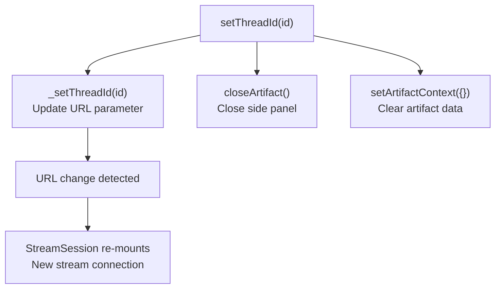

**Cleanup wrapper** [src/components/thread/index.tsx:147-153]():
The Thread component wraps the URL state setter to perform necessary cleanup operations when the thread ID changes.

**Sources**: [src/components/thread/index.tsx:147-153]()

### Thread List Refresh Flow

The StreamProvider coordinates with ThreadProvider to refresh the thread list when new threads are created:

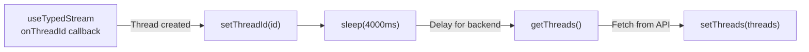

**Implementation** [src/providers/Stream.tsx:96-101]():
The `onThreadId` callback includes a 4-second delay before fetching threads to ensure the backend has processed the new thread creation.

**Sources**: [src/providers/Stream.tsx:96-101]()

### Artifact Context Flow

Artifact context is passed through the message submission pipeline:

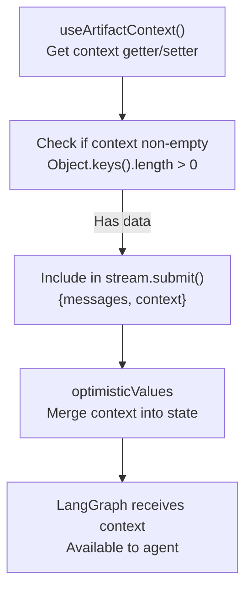

**Context usage in submission** [src/components/thread/index.tsx:214-216]():
```typescript
const context =
  Object.keys(artifactContext).length > 0 ? artifactContext : undefined;
```

The context is only included if it contains data, preventing empty object submission.

**Sources**: [src/components/thread/index.tsx:115](), [src/components/thread/index.tsx:214-233]()

## State Persistence

The application uses different persistence strategies for different state types:

| State Type | Persistence Mechanism | Lifetime | Use Case |
|------------|----------------------|----------|----------|
| URL Parameters | Browser history & bookmarks | Session + shareable | Navigation, preferences |
| API Key | localStorage | Persistent across sessions | Authentication |
| Environment Variables | Build-time configuration | Application lifetime | Deployment defaults |
| Provider Contexts | React component tree | Current session | Runtime application state |
| Local Component State | Component lifecycle | Component mount lifetime | Ephemeral UI state |

**LocalStorage usage** [src/providers/Stream.tsx:150-158]():
Only the API key is stored in localStorage, retrieved via `getApiKey()` utility and set via `window.localStorage.setItem()`.

**URL persistence** [src/components/thread/index.tsx:118-126]():
All URL parameters automatically persist to browser history and can be bookmarked for deep linking.

**Sources**: [src/providers/Stream.tsx:150-158](), [src/components/thread/index.tsx:118-126]()

---

