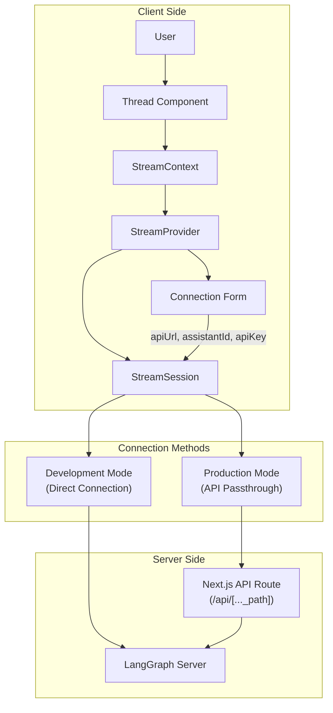
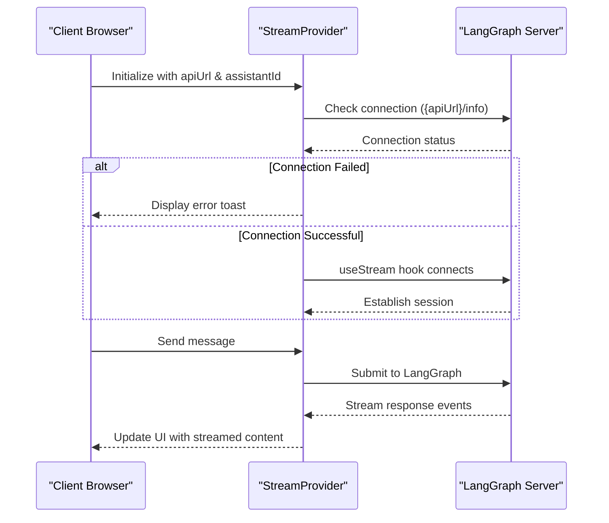
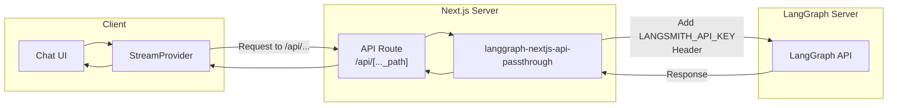
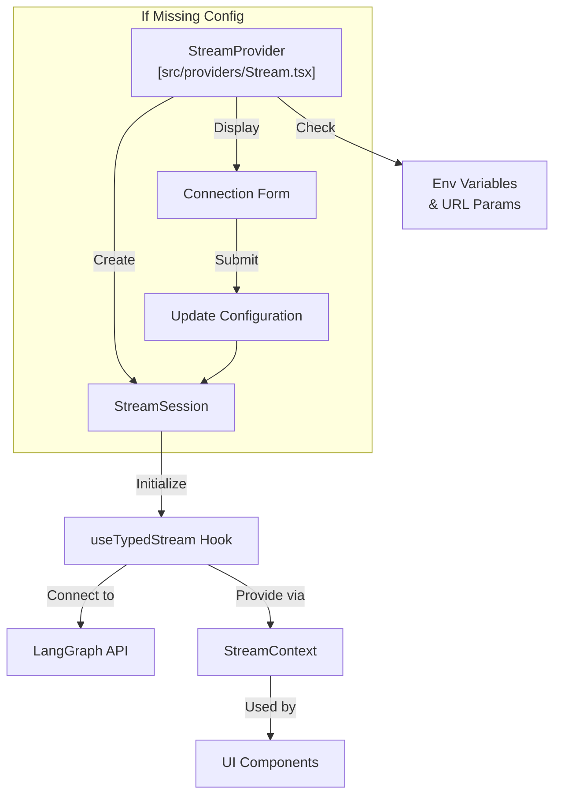

<!-- source: DeepWiki mcp.deepwiki.com · repo langchain-ai/agent-chat-ui · page 9 API Integration · fetched 2026-10-26 -->

# API Integration

<details>
<summary>Relevant source files</summary>

The following files were used as context for generating this wiki page:

- [.codespellignore](.codespellignore)
- [.env.example](.env.example)
- [README.md](README.md)
- [src/app/api/[..._path]/route.ts](src/app/api/[..._path]/route.ts)
- [src/providers/Stream.tsx](src/providers/Stream.tsx)

</details>


This page documents how the Agent Chat UI integrates with LangGraph servers, including both development and production setups. It covers the core architecture for API communication, authentication methods, and deployment configurations. For details on the Stream Provider component itself, see [Stream Provider](#2.2).

## Overview

Agent Chat UI connects to a LangGraph server to provide chat functionality. The application supports two primary integration modes:

1. **Development Mode**: Direct client-to-server connection (default)
2. **Production Mode**: Server-side API passthrough or custom authentication

The integration relies on the `@langchain/langgraph-sdk` package to establish connections and manage message streaming between the UI and LangGraph servers.

Sources: [src/providers/Stream.tsx:8-9](), [src/providers/Stream.tsx:26-37]()

## Connection Architecture

The API integration centers around the StreamProvider component, which establishes and maintains the connection to the LangGraph server. This provider makes the connection available throughout the application via React context.



### Connection Flow

1. The StreamProvider checks for environment variables or URL parameters for configuration
2. If configuration is missing, it displays a connection form to collect:
   - LangGraph server URL
   - Assistant/Graph ID
   - API key (if needed)
3. Once configured, it establishes a connection through the StreamSession component
4. The session uses `useStream` from the LangGraph SDK to connect to the server
5. All API communication is managed through this connection

Sources: [src/providers/Stream.tsx:126-269](), [README.md:40-51]()

## Environment Configuration

The application can be configured using environment variables or URL parameters:

| Variable | Purpose | Example |
|----------|---------|---------|
| `NEXT_PUBLIC_API_URL` | LangGraph server URL (or API proxy in production) | `http://localhost:2024` or `https://my-website.com/api` |
| `NEXT_PUBLIC_ASSISTANT_ID` | Assistant/Graph ID to connect with | `agent` |
| `LANGSMITH_API_KEY` | API key for authentication (server-side only) | `lsv2_...` |
| `LANGGRAPH_API_URL` | Production LangGraph URL (when using API passthrough) | `https://my-agent.default.us.langgraph.app` |

Sources: [.env.example:1-13](), [src/providers/Stream.tsx:131-141]()

## Development Mode

In development mode, the client browser connects directly to the LangGraph server.



### Configuration

Development mode requires:
- LangGraph server running locally (default: `http://localhost:2024`)
- Assistant ID (default: `agent`)
- No API key required for local development servers

### Limitations

Development mode is suitable for local testing but has several limitations:
- Requires the LangGraph server to be publicly accessible if not running locally
- Cannot be used for production deployments requiring authentication
- CORS issues may arise when connecting directly from client to server

Sources: [src/providers/Stream.tsx:124-125](), [README.md:51-69]()

## Production Mode

For production deployments, Agent Chat UI offers two authentication approaches:

### API Passthrough Method

This method uses Next.js API routes to proxy requests to the LangGraph server, allowing server-side authentication.



The API passthrough method:
1. Redirects client requests to a Next.js API route
2. Adds authentication headers on the server side
3. Proxies the authenticated request to the LangGraph server
4. Returns the response to the client

Implementation is provided through the `langgraph-nextjs-api-passthrough` package configured in the API route file.

Sources: [src/app/api/[..._path]/route.ts:1-11](), [README.md:134-158]()

### Custom Authentication Method

For more advanced scenarios, custom authentication can be implemented:

1. Configure custom authentication in LangGraph deployment
2. Modify the frontend to fetch and use authentication tokens
3. Pass authentication tokens via custom headers in the `useTypedStream` hook

This method provides more control over authentication and can implement custom access controls.

Sources: [README.md:159-181]()

## Implementation Details

### StreamProvider Component

The `StreamProvider` component serves as the entry point for API integration:

1. It checks for configuration from environment variables or URL parameters
2. If configuration is missing, it displays a form to collect required information
3. Once configured, it initializes the `StreamSession` component with:
   - API URL
   - Assistant ID
   - API key (if provided)



The StreamProvider also validates the connection by making a health check request to the LangGraph server's `/info` endpoint.

Sources: [src/providers/Stream.tsx:46-64](), [src/providers/Stream.tsx:126-268]()

### Connection Verification

The system verifies connectivity to the LangGraph server before proceeding:

1. Makes a request to the `{apiUrl}/info` endpoint
2. Adds API key header if provided
3. Displays an error toast if connection fails

This helps users quickly identify configuration issues.

Sources: [src/providers/Stream.tsx:46-64](), [src/providers/Stream.tsx:98-114]()

### Thread ID Management

The StreamProvider manages thread IDs through URL parameters:

1. Reads and updates the `threadId` URL parameter
2. Synchronizes it with the LangGraph server
3. Updates thread history when thread ID changes

This allows for bookmarking specific conversations and maintaining conversation context across page reloads.

Sources: [src/providers/Stream.tsx:77-96]()

## Customization Options

### Custom Headers

For advanced use cases such as custom authentication, you can modify the `useTypedStream` hook to include custom headers:

```typescript
const streamValue = useTypedStream({
  apiUrl,
  apiKey: apiKey ?? undefined,
  assistantId,
  threadId: threadId ?? null,
  // Add custom headers for authentication
  defaultHeaders: {
    Authentication: `Bearer ${yourAuthToken}`,
    // Other custom headers as needed
  },
  // ... other configuration
});
```

### Production API URL Structure

When using the API passthrough method, the API URL structure changes:

1. Development: Points directly to LangGraph server (e.g., `http://localhost:2024`)
2. Production: Points to your Next.js API route (e.g., `https://your-site.com/api`)

This change in URL structure is transparent to the application components that use the StreamContext.

Sources: [README.md:142-155](), [.env.example:7-13]()

## Security Considerations

When integrating with LangGraph servers, consider these security practices:

1. Never expose API keys to the client in production:
   - Don't prefix sensitive environment variables with `NEXT_PUBLIC_`
   - Use the API passthrough method to keep keys server-side

2. For custom authentication implementations:
   - Use short-lived tokens
   - Implement token refresh mechanisms
   - Consider rate limiting on authentication endpoints

3. CORS configuration:
   - Ensure your LangGraph server has proper CORS configuration if using direct connection

Sources: [.env.example:4-5](), [README.md:142-155]()

---

