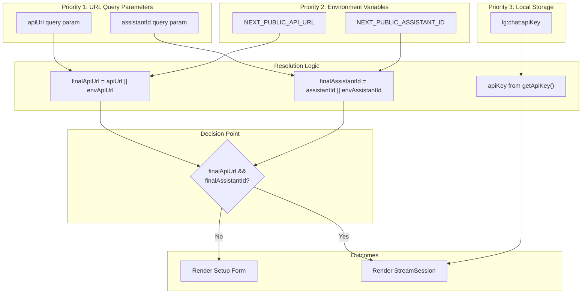
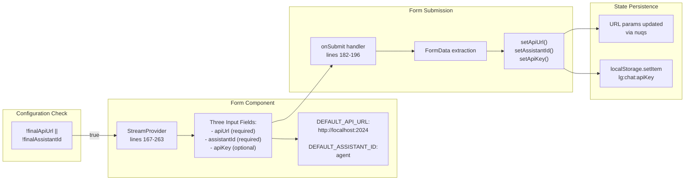
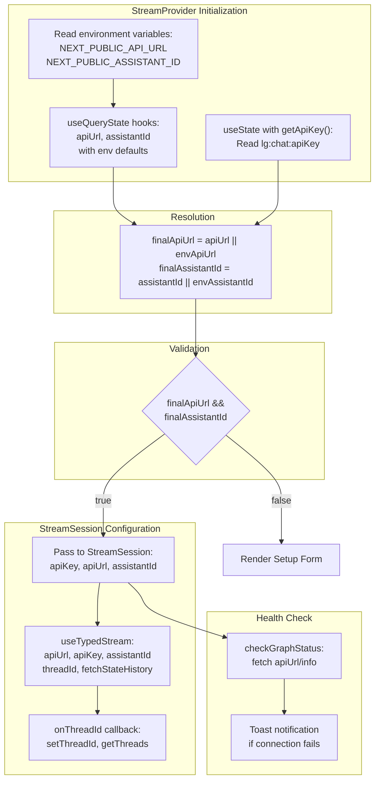
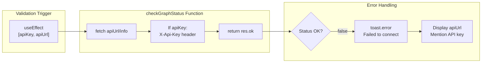

<!-- source: DeepWiki mcp.deepwiki.com · repo langchain-ai/agent-chat-ui · page 9.1 Configuration System · fetched 2026-10-26 -->

# Configuration System

<details>
<summary>Relevant source files</summary>

The following files were used as context for generating this wiki page:

- [.codespellignore](.codespellignore)
- [.env.example](.env.example)
- [README.md](README.md)
- [src/app/api/[..._path]/route.ts](src/app/api/[..._path]/route.ts)
- [src/providers/Stream.tsx](src/providers/Stream.tsx)

</details>


## Purpose and Scope

The Configuration System manages the connection parameters required to communicate with LangGraph servers. It implements a three-tier priority system that resolves configuration from URL query parameters, environment variables, and local storage, providing flexibility for different deployment scenarios while maintaining security. This page documents how configuration values are collected, resolved, and validated.

For information about how these configuration values are used to establish streaming connections, see [Stream Provider](#2.2). For deployment-specific configuration strategies, see [API Passthrough for Production](#9.2) and [Custom Authentication](#9.3).

## Configuration Parameters

The system requires three primary configuration parameters to establish connections with LangGraph servers:

| Parameter | Description | Required | Storage Locations |
|-----------|-------------|----------|-------------------|
| **Deployment URL** | URL of the LangGraph server endpoint | Yes | URL param: `apiUrl`<br/>Env var: `NEXT_PUBLIC_API_URL` |
| **Assistant/Graph ID** | Identifier for the graph or assistant to invoke | Yes | URL param: `assistantId`<br/>Env var: `NEXT_PUBLIC_ASSISTANT_ID` |
| **LangSmith API Key** | Authentication credential for LangGraph Cloud | No (local dev) | Local storage: `lg:chat:apiKey` |

Additionally, for API passthrough deployments, server-side configuration is required:

| Parameter | Description | Usage |
|-----------|-------------|-------|
| `LANGGRAPH_API_URL` | Production LangGraph deployment URL | Server-side proxy only |
| `LANGSMITH_API_KEY` | Server-side API key for injection | Server-side proxy only |

**Sources**: [src/providers/Stream.tsx:136-147](), [README.md:51-58](), [.env.example:1-14]()

## Three-Tier Priority System



The configuration priority system follows a strict hierarchy where URL query parameters override environment variables, which in turn override local storage values. This design allows developers to set defaults via environment variables while enabling users to customize settings via URL parameters or the setup form.

### Priority Resolution

The resolution logic is implemented in the `StreamProvider` component:

1. **URL Parameters** (Highest Priority): The `useQueryState` hook from `nuqs` manages `apiUrl` and `assistantId` query parameters, with environment variable fallbacks as default values [src/providers/Stream.tsx:142-147]().

2. **Environment Variables** (Middle Priority): During component initialization, `process.env.NEXT_PUBLIC_API_URL` and `process.env.NEXT_PUBLIC_ASSISTANT_ID` are read and used as defaults if URL parameters are not set [src/providers/Stream.tsx:136-139]().

3. **Local Storage** (API Key Only): The API key is retrieved from `localStorage` using the `getApiKey()` utility function, reading the `lg:chat:apiKey` key [src/providers/Stream.tsx:150-153]().

The final resolution uses JavaScript's OR operator for fallback behavior:

```typescript
const finalApiUrl = apiUrl || envApiUrl;
const finalAssistantId = assistantId || envAssistantId;
```

This ensures that if a URL parameter is present, it takes precedence; otherwise, the environment variable is used [src/providers/Stream.tsx:161-162]().

**Sources**: [src/providers/Stream.tsx:133-163](), [README.md:51-69]()

## Interactive Setup Form

### Setup Form: Configuration to UI Flow



When required configuration is missing, the `StreamProvider` renders an interactive setup form instead of the main application [src/providers/Stream.tsx:165-264](). The form provides a user-friendly interface for collecting connection parameters.

### Form Structure

The setup form contains three input fields:

1. **Deployment URL**: A required text input with default value from `DEFAULT_API_URL` constant (`"http://localhost:2024"`) [src/providers/Stream.tsx:207-213]().

2. **Assistant / Graph ID**: A required text input with default value from `DEFAULT_ASSISTANT_ID` constant (`"agent"`) [src/providers/Stream.tsx:226-231]().

3. **LangSmith API Key**: An optional password input using the `PasswordInput` component, with descriptive text explaining it's not required for local development [src/providers/Stream.tsx:242-248]().

### Form Submission Process

When the form is submitted, the `onSubmit` handler:

1. Prevents default form submission behavior [src/providers/Stream.tsx:183]()
2. Extracts values using `FormData` API [src/providers/Stream.tsx:185-189]()
3. Updates URL parameters via `setApiUrl()` and `setAssistantId()` [src/providers/Stream.tsx:191-193]()
4. Persists the API key to local storage via `setApiKey()` [src/providers/Stream.tsx:192]()
5. Resets the form [src/providers/Stream.tsx:195]()

The component re-renders after state updates, and since `finalApiUrl` and `finalAssistantId` are now set, the application proceeds to render `StreamSession` instead of the form.

**Sources**: [src/providers/Stream.tsx:165-264](), [src/providers/Stream.tsx:130-131]()

## Configuration Resolution Process

### StreamProvider Configuration Flow



The `StreamProvider` component orchestrates the entire configuration resolution process, serving as the top-level configuration manager for the application.

### Initialization Phase

1. **Environment Variable Retrieval**: The component reads `process.env.NEXT_PUBLIC_API_URL` and `process.env.NEXT_PUBLIC_ASSISTANT_ID` during render [src/providers/Stream.tsx:137-139]().

2. **URL State Initialization**: Two `useQueryState` hooks manage URL parameters with environment variable fallbacks:
   - `apiUrl` query parameter with `envApiUrl` default [src/providers/Stream.tsx:142-144]()
   - `assistantId` query parameter with `envAssistantId` default [src/providers/Stream.tsx:145-147]()

3. **API Key Retrieval**: A `useState` hook initializes with the result of `getApiKey()`, which reads from local storage [src/providers/Stream.tsx:150-153]().

### StreamSession Configuration

When valid configuration is present, the `StreamSession` component receives resolved values and:

1. **Creates Streaming Connection**: Initializes `useTypedStream` with the resolved configuration [src/providers/Stream.tsx:82-102]():
   - `apiUrl`: The LangGraph server URL
   - `apiKey`: Optional authentication credential (undefined if null)
   - `assistantId`: The graph/assistant identifier
   - `threadId`: Current thread from URL query parameter
   - `fetchStateHistory`: Set to `true` for checkpoint retrieval

2. **Manages Thread State**: The `onThreadId` callback updates the URL parameter and triggers thread list refresh [src/providers/Stream.tsx:96-101]().

3. **Validates Connection**: An `useEffect` hook calls `checkGraphStatus()` to verify the LangGraph server is accessible, displaying a toast notification if the connection fails [src/providers/Stream.tsx:104-120]().

**Sources**: [src/providers/Stream.tsx:69-127](), [src/providers/Stream.tsx:133-274]()

## Server-Side vs Client-Side Configuration

The application uses different configuration strategies depending on the deployment mode:

### Client-Side Configuration

Client-side configuration parameters use the `NEXT_PUBLIC_` prefix, making them available in the browser:

- `NEXT_PUBLIC_API_URL`: Accessible via `process.env.NEXT_PUBLIC_API_URL` in client code
- `NEXT_PUBLIC_ASSISTANT_ID`: Accessible via `process.env.NEXT_PUBLIC_ASSISTANT_ID` in client code

These values are embedded in the JavaScript bundle during build time and are visible to end users. They're used directly in the `StreamProvider` to establish connections [src/providers/Stream.tsx:137-139]().

### Server-Side Configuration

Server-side configuration parameters do **not** use the `NEXT_PUBLIC_` prefix, keeping them secure:

- `LANGSMITH_API_KEY`: Used only in API routes for authentication
- `LANGGRAPH_API_URL`: Used only in API routes for proxying

These values are accessed in the API passthrough route [src/app/api/[..._path]/route.ts:8-9]() and never exposed to the client. The `.env.example` file explicitly warns against prefixing `LANGSMITH_API_KEY` with `NEXT_PUBLIC_` [.env.example:4]().

### Configuration Usage Matrix

| Parameter | Client Usage | Server Usage | Security Level |
|-----------|--------------|--------------|----------------|
| `NEXT_PUBLIC_API_URL` | Direct connection URL | N/A | Public |
| `NEXT_PUBLIC_ASSISTANT_ID` | Graph/assistant ID | N/A | Public |
| API Key (localStorage) | Direct auth | N/A | User-scoped |
| `LANGGRAPH_API_URL` | N/A | Proxy destination | Private |
| `LANGSMITH_API_KEY` | N/A | Injected auth | Private |

**Sources**: [src/providers/Stream.tsx:137-139](), [src/app/api/[..._path]/route.ts:8-9](), [.env.example:1-14](), [README.md:201-217]()

## Configuration Validation

### Health Check System



The `StreamSession` component performs automatic health checks to validate configuration correctness and server connectivity.

### checkGraphStatus Function

The `checkGraphStatus` function validates that a LangGraph server is accessible at the configured URL [src/providers/Stream.tsx:49-67]():

1. **Info Endpoint Request**: Makes a fetch request to `${apiUrl}/info`
2. **Conditional Authentication**: If an API key is provided, includes it in the `X-Api-Key` header [src/providers/Stream.tsx:55-59]()
3. **Status Validation**: Returns `true` if the response is OK, `false` otherwise
4. **Error Handling**: Catches network errors and returns `false` [src/providers/Stream.tsx:63-65]()

### User Notification

When validation fails, a rich toast notification appears [src/providers/Stream.tsx:107-117]():

- **Duration**: 10 seconds with close button
- **Message**: "Failed to connect to LangGraph server"
- **Description**: Displays the attempted `apiUrl` and advises checking API key if connecting to a deployed graph
- **Styling**: Uses `richColors` for visual emphasis

This validation occurs whenever `apiKey` or `apiUrl` changes, as specified in the `useEffect` dependency array [src/providers/Stream.tsx:120]().

**Sources**: [src/providers/Stream.tsx:49-67](), [src/providers/Stream.tsx:104-120]()

## Configuration Persistence

### API Key Storage

The API key persistence mechanism uses browser local storage with a custom setter wrapper:

```
setApiKey(key) -> localStorage.setItem('lg:chat:apiKey', key) -> _setApiKey(key)
```

The `setApiKey` function [src/providers/Stream.tsx:155-158]():
1. Writes the key to local storage under the `lg:chat:apiKey` key
2. Updates the React state via the internal `_setApiKey` setter

This dual-update pattern ensures both persistence across sessions and immediate UI updates.

### URL Parameter Persistence

URL parameters are persisted automatically by the `nuqs` library through its `useQueryState` hook. When `setApiUrl()` or `setAssistantId()` is called, the URL is updated using the History API, creating a shareable, bookmarkable application state.

The `defaultValue` option ensures that environment variables populate the URL on first load if no query parameter is present [src/providers/Stream.tsx:142-147]().

**Sources**: [src/providers/Stream.tsx:142-158](), [src/lib/api-key.ts]()

---

