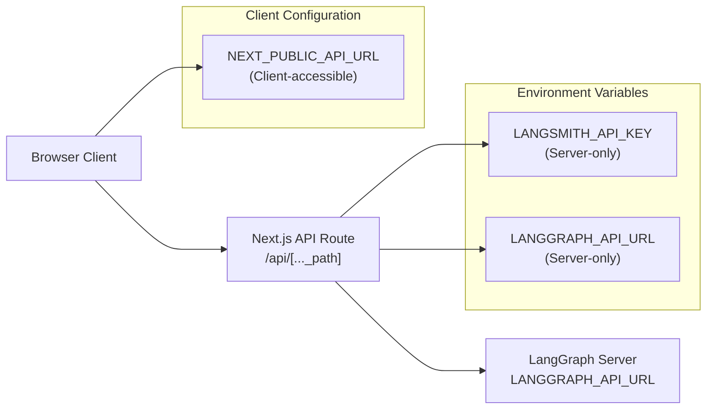
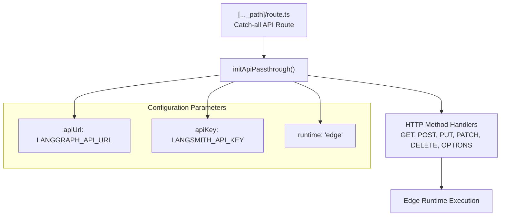
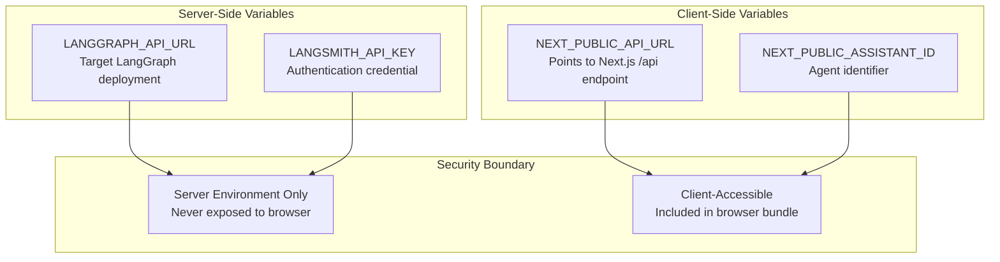
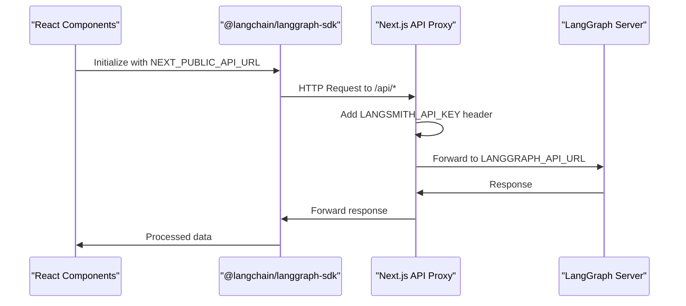

<!-- source: DeepWiki mcp.deepwiki.com · repo langchain-ai/agent-chat-ui · page 9.2 API Passthrough for Production · fetched 2026-10-26 -->

# API Passthrough for Production

Relevant source files

The following files were used as context for generating this wiki page:

- [.codespellignore](.codespellignore)
- [.env.example](.env.example)
- [README.md](README.md)
- [src/app/api/[..._path]/route.ts](src/app/api/[..._path]/route.ts)
- [src/providers/Stream.tsx](src/providers/Stream.tsx)

This document explains the Next.js API proxy setup that enables secure communication between the Agent Chat UI frontend and LangGraph servers in production environments. The API passthrough acts as a secure intermediary that handles authentication and request forwarding to external LangGraph services.

For information about the broader API integration patterns, see [API Integration](#8). For custom authentication configurations beyond the standard passthrough, see [Custom Authentication](#8.2).

## Purpose and Architecture

The API passthrough system solves the security challenge of connecting a client-side React application to external LangGraph servers. Rather than exposing LangGraph API credentials directly to the browser, the passthrough creates a secure server-side proxy that handles authentication and forwards requests.

### Production API Flow

*Sources: [src/app/api/[..._path]/route.ts:1-11](), [.env.example:7-13]()*

### Development vs Production Configuration

The system supports two distinct configuration modes:

| Mode | Client API URL | Server Target | Authentication |
|------|---------------|---------------|----------------|
| Development | `http://localhost:2024` | Direct to local LangGraph | None required |
| Production | `https://my-website.com/api` | Via Next.js proxy | Server-side API key |

*Sources: [.env.example:1-13]()*

## Implementation Details

The core implementation uses the `langgraph-nextjs-api-passthrough` package to create a catch-all API route that forwards requests to the configured LangGraph server.

### Route Handler Implementation

The `initApiPassthrough` function creates HTTP method handlers that automatically forward requests while injecting the appropriate authentication headers.

*Sources: [src/app/api/[..._path]/route.ts:6-11]()*

### Environment Variable Configuration

The passthrough requires specific environment variables for production deployment:

*Sources: [.env.example:7-13]()*

## Security Considerations

The API passthrough implements several security patterns:

### Credential Protection
- API keys are never exposed to the client browser
- Authentication headers are added server-side during request forwarding
- The `LANGSMITH_API_KEY` environment variable lacks the `NEXT_PUBLIC_` prefix, ensuring it remains server-only

### Edge Runtime Deployment
The route uses Edge Runtime for improved performance and security:
- Reduced cold start times for API requests
- Automatic scaling based on request volume
- Enhanced security isolation

*Sources: [src/app/api/[..._path]/route.ts:10-11](), [.env.example:4-5]()*

## Integration with Client-Side Code

The client-side code connects to the passthrough through the `NEXT_PUBLIC_API_URL` configuration, which points to the Next.js API routes rather than directly to the LangGraph server.

### Client Configuration Flow

This configuration ensures that all LangGraph communication flows through the secure proxy, maintaining credential security while providing seamless client functionality.

*Sources: [.env.example:11-12](), [src/app/api/[..._path]/route.ts:3-4]()*

---

