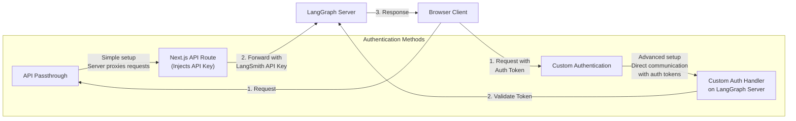
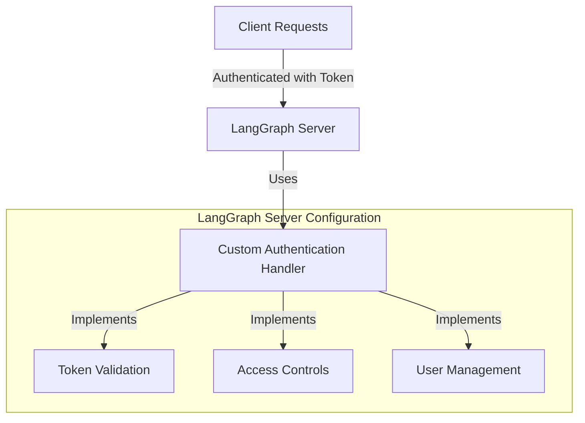
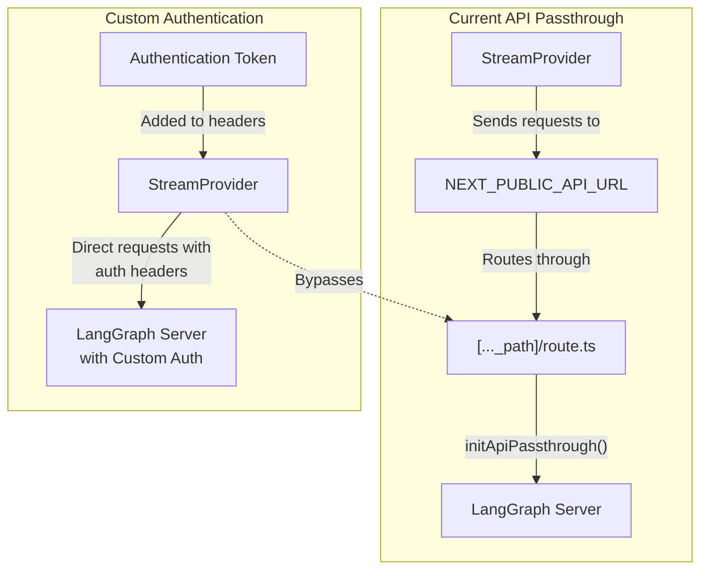
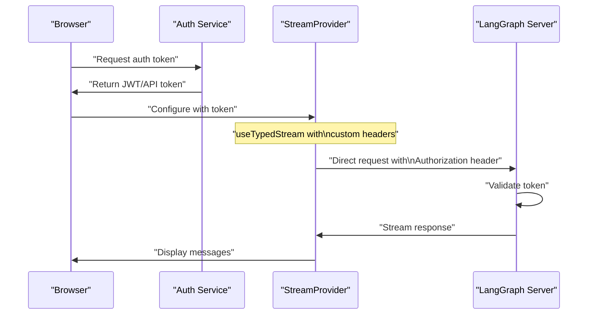
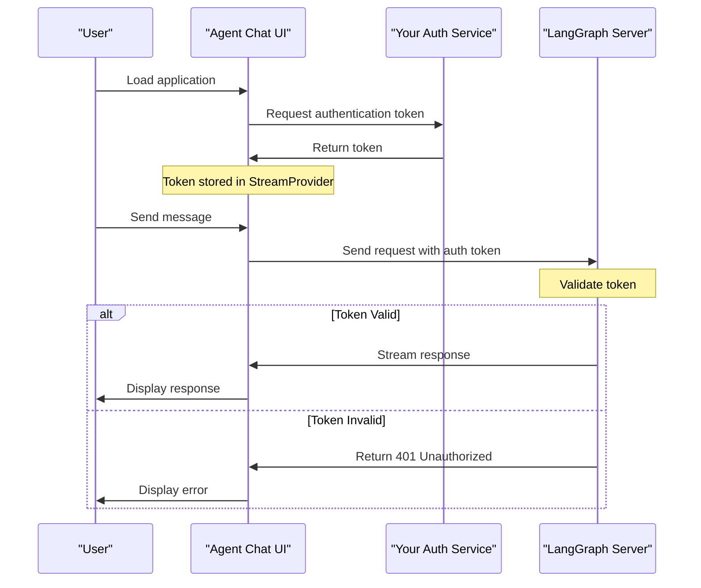
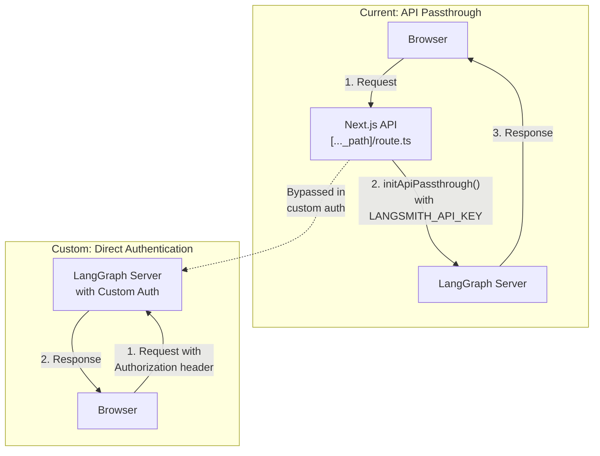

<!-- source: DeepWiki mcp.deepwiki.com · repo langchain-ai/agent-chat-ui · page 9.3 Custom Authentication · fetched 2026-10-26 -->

# Custom Authentication

<details>
<summary>Relevant source files</summary>

The following files were used as context for generating this wiki page:

- [.codespellignore](.codespellignore)
- [.env.example](.env.example)
- [README.md](README.md)
- [src/app/api/[..._path]/route.ts](src/app/api/[..._path]/route.ts)
- [src/providers/Stream.tsx](src/providers/Stream.tsx)

</details>


## Purpose and Scope

This document explains how to implement custom authentication with your LangGraph server in the Agent Chat UI application. Custom authentication provides a more robust security mechanism compared to the standard API passthrough method. For information about the simpler API passthrough approach, see [API Passthrough for Production](#6.1).

Custom authentication allows your Agent Chat UI application to:
- Connect directly to your LangGraph server without requiring a LangSmith API key
- Implement tailored access controls for requests
- Provide a more robust security architecture for production deployments

Sources: Based on production deployment patterns for LangGraph applications

## Understanding Authentication Methods

The Agent Chat UI supports two main approaches for authenticating with LangGraph servers in production environments:

1. **API Passthrough** (easier): Proxies requests through your Next.js server, which injects the LangSmith API key before forwarding to your LangGraph server.
2. **Custom Authentication** (more robust): Configures your LangGraph server with custom authentication mechanisms, allowing direct client-to-LangGraph communication with secure tokens.

This document focuses on the second approach, which provides greater flexibility and security.


**Authentication Methods Comparison**

Sources: [src/app/api/[..._path]/route.ts:1-11]()

## Setting Up Custom Authentication

### 1. Configure Your LangGraph Server

First, you need to configure your LangGraph server to use custom authentication. This is done on the server side of your LangGraph deployment.


**LangGraph Server Authentication Configuration**

The custom authentication handler would need to be implemented in your LangGraph server configuration. This involves setting up middleware or authentication decorators that validate tokens before processing agent requests.

Sources: Based on LangGraph server authentication patterns

### 2. Configure the Agent Chat UI

After setting up authentication on your LangGraph server, you need to modify the Agent Chat UI to work with your custom authentication system.

#### 2.1 Environment Variables

Update your environment variables to point to your production LangGraph deployment:

```
NEXT_PUBLIC_API_URL=https://your-langgraph-deployment-url.com
NEXT_PUBLIC_ASSISTANT_ID=your-assistant-id
```

Note that you no longer need the `LANGSMITH_API_KEY` environment variable since authentication will be handled through custom tokens.

Sources: [.env.example:2-13]()

#### 2.2 Modify the StreamProvider Component

The key modification is to bypass the API passthrough system and directly configure the `StreamProvider` component to communicate with your LangGraph server using custom authentication headers.

**StreamProvider Authentication Integration**


For custom authentication, you'll need to modify how the `StreamProvider` component configures its API requests to include authentication tokens directly in the headers.

Sources: [src/app/api/[..._path]/route.ts:6-11]()

## Implementation Example

### Token Fetching Logic

First, you'll need to implement logic to fetch the authentication token from your backend. This could be a separate API endpoint in your Next.js application that communicates with your authentication service.

### Implementation Approach

To implement custom authentication, you would need to:

1. **Remove the API Passthrough**: Instead of using `NEXT_PUBLIC_API_URL` pointing to your Next.js `/api` route, point it directly to your LangGraph server.

2. **Modify Environment Configuration**:
```
# Point directly to your LangGraph server
NEXT_PUBLIC_API_URL=https://your-langgraph-deployment-url.com
NEXT_PUBLIC_ASSISTANT_ID=your-assistant-id
# Remove LANGSMITH_API_KEY as it won't be used
```

3. **Add Authentication Headers**: The `StreamProvider` component would need modification to include authentication headers when making requests to the LangGraph server. This involves customizing how the streaming SDK is configured.

4. **Disable API Route**: The `initApiPassthrough` function in `src/app/api/[..._path]/route.ts` would no longer be used since requests go directly to your LangGraph server.

**Custom Authentication Flow**


Sources: [src/app/api/[..._path]/route.ts:1-11](), [.env.example:2-13]()

## Authentication Flow

The complete authentication flow for custom authentication involves:

1. User loads the Agent Chat UI application
2. Application fetches an authentication token from your authentication service
3. Token is added to requests made to the LangGraph server via the `useTypedStream` hook
4. LangGraph server validates the token and processes the request
5. Response is streamed back to the client


**Complete Authentication Flow**

Sources: Based on LangGraph streaming SDK authentication patterns

## Considerations and Best Practices

When implementing custom authentication, consider the following best practices:

| Consideration | Description | Best Practice |
|---------------|-------------|---------------|
| Token Storage | Where and how authentication tokens are stored | Store tokens securely, preferably in memory or secure HTTP-only cookies |
| Token Refresh | How to handle expired tokens | Implement token refresh logic to seamlessly renew expired tokens |
| Error Handling | Handling authentication failures | Add graceful error handling for authentication errors |
| Security | Ensuring secure communications | Use HTTPS for all communications with your LangGraph server |
| Permissions | User-specific permissions | Consider implementing role-based access controls in your authentication system |

Sources: [src/app/api/[..._path]/route.ts:1-11](), [.env.example:7-13]()

## Common Issues and Troubleshooting

- **401 Unauthorized errors**: Check that your token is being correctly passed in the headers and that it's valid.
- **CORS issues**: Ensure your LangGraph server is configured to accept requests from your Agent Chat UI domain.
- **Token expiration**: Implement token refresh logic to handle expired tokens.

**API Passthrough vs Custom Authentication**


When implementing custom authentication, you'll need to handle authentication-specific error cases such as token expiration and invalid credentials.

Sources: [src/app/api/[..._path]/route.ts:6-11]()

## Conclusion

Custom authentication provides a robust method for securing your Agent Chat UI and LangGraph server in production environments. While it requires more setup than the API passthrough method, it offers greater flexibility, security, and control over how authentication is handled.

For larger or more security-sensitive deployments, custom authentication is the recommended approach. For simpler deployments or quick prototypes, the API passthrough method may be sufficient.

Sources: [README.md:159-181]()

---

