# Page: Overview

# Overview

<details>
<summary>Relevant source files</summary>

The following files were used as context for generating this wiki page:

- [.codespellignore](.codespellignore)
- [.env.example](.env.example)
- [README.md](README.md)
- [package.json](package.json)
- [src/app/api/[..._path]/route.ts](src/app/api/[..._path]/route.ts)

</details>


This document provides a high-level introduction to the agent-chat-ui repository, explaining its purpose, key features, architecture, and core systems. For installation and configuration details, see [Installation and Setup](#1.1). For information about specific subsystems, refer to the appropriate section: [Core Architecture](#2), [Message System](#3), [Agent Inbox System](#4), or [API Integration](#9).

## Purpose and Scope

Agent Chat UI is a Next.js-based web application that provides a chat interface for interacting with LangGraph agents. The application connects to LangGraph servers (local or deployed) and enables real-time conversation with AI agents that have a `messages` key in their state. The system supports advanced features including streaming responses, multimodal content (images, PDFs), file uploads, tool call visualization, human-in-the-loop interrupts, and thread management.

**Sources**: [README.md:1-3](), [package.json:1-10]()

## Application Identity

The repository is named `agent-chat-ui` and is maintained at https://github.com/langchain-ai/agent-chat-ui. A production deployment is available at https://agentchat.vercel.app. The application can be quickly bootstrapped using the `create-agent-chat-app` npx command.

```
Repository: git+https://github.com/langchain-ai/agent-chat-ui.git
Homepage: https://agentchat.vercel.app
Package Manager: pnpm@10.5.1
```

**Sources**: [package.json:2-8](), [package.json:87](), [README.md:13-17]()

## Key Features

### Real-Time Streaming Communication

The application establishes streaming connections to LangGraph servers using the `@langchain/langgraph-sdk` package. Messages stream in real-time as the agent processes them, providing immediate feedback to users. The system handles multiple event types including standard messages, UI-specific events, tool calls, and agent interrupts.

### Multimodal Content Support

Users can upload images (JPEG, PNG, GIF, WebP) and PDF files through three input methods: file selection, drag-and-drop, and clipboard paste. Files are converted to Base64-encoded content blocks and transmitted alongside text messages. The system displays uploaded content with appropriate preview components.

**Sources**: [package.json:22-24](), [README.md:3]()

### Agent Inbox and Human-in-the-Loop

When agents require human input, the system displays specialized interrupt interfaces. The Agent Inbox feature provides structured interaction options including accepting proposals, editing arguments, providing free-text responses, or ignoring interrupts. This enables sophisticated human-AI collaboration workflows.

For details, see [Agent Inbox System](#4).

### Thread Management and History

The application maintains conversation threads with persistent storage. Users can view thread history, switch between conversations, and resume previous interactions. The system automatically synchronizes thread lists when new conversations are created.

For details, see [Thread History and Management](#5).

### Artifact Rendering

The system supports rendering supplementary content in a side panel separate from the main chat interface. Agents can trigger artifact display for extended content like documents, code editors, or custom visualizations using React Portal-based rendering.

For details, see [Artifact System](#2.4).

**Sources**: [README.md:126-186]()

## System Architecture

The following diagram shows the complete application architecture, mapping high-level concepts to specific code entities:

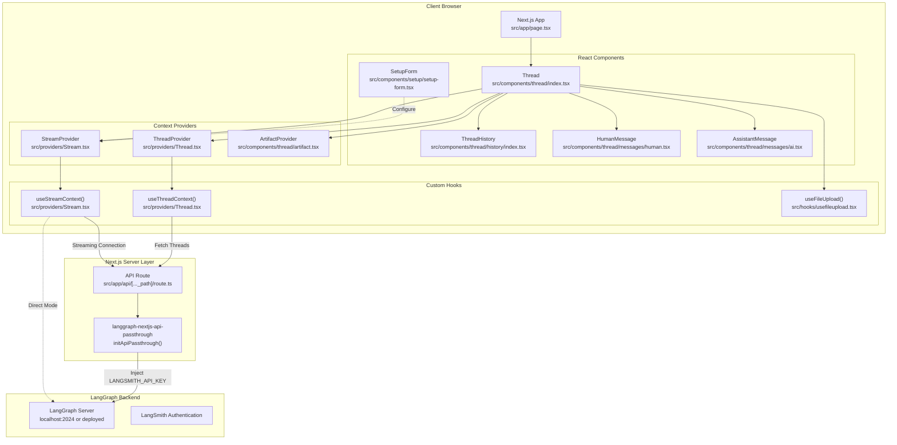

**Architecture Overview:**

The application follows a three-tier architecture:

1. **Client Layer**: React components managed by Next.js handle UI rendering and user interactions. The `Thread` component at [src/components/thread/index.tsx]() serves as the primary interface.

2. **Server Layer**: Next.js API routes at [src/app/api/[..._path]/route.ts]() provide optional server-side proxying using the `langgraph-nextjs-api-passthrough` package.

3. **Backend Layer**: LangGraph servers (local development at `localhost:2024` or deployed instances) execute agent logic and stream responses.

The system uses React Context for state management, with three primary providers: `StreamProvider` for message streaming, `ThreadProvider` for conversation management, and `ArtifactProvider` for side panel content.

**Sources**: [package.json:21-57](), [src/app/api/[..._path]/route.ts:1-11](), [README.md:41-49]()

## Core Systems Overview

The application is organized into several interconnected systems:

### Component Hierarchy

The `Thread` component is the main interface, integrating message display, user input, file uploads, and thread history. It orchestrates interactions between multiple child components and context providers. See [Thread Component](#2.1) for details.

Message rendering is handled by specialized components: `HumanMessage` for user messages with editing capabilities, and `AssistantMessage` for AI responses with support for tool calls, custom UI, and interrupts. See [Message System](#3) for details.

### State Management Architecture

State is distributed across multiple layers:

- **URL State**: Query parameters managed by the `nuqs` library provide persistence for navigation (thread IDs, API URLs, assistant IDs)
- **Context State**: Three React Context providers manage global state for streaming, threads, and artifacts
- **Local State**: Component-specific state handles ephemeral concerns like text input and file uploads

See [State Management](#8) for details.

**Sources**: [package.json:43]()

### API Integration Patterns

The system supports three deployment modes:

1. **API Passthrough** (production-recommended): Next.js routes proxy requests, injecting server-side credentials
2. **Direct Connection**: Client communicates directly with LangGraph using user-provided credentials
3. **Custom Authentication**: Bearer token-based authentication with custom handlers

Configuration follows a three-tier priority: URL parameters → environment variables → local storage. See [API Integration](#9) for details.

**Sources**: [README.md:186-242](), [.env.example:1-14]()

## Deployment Modes Comparison

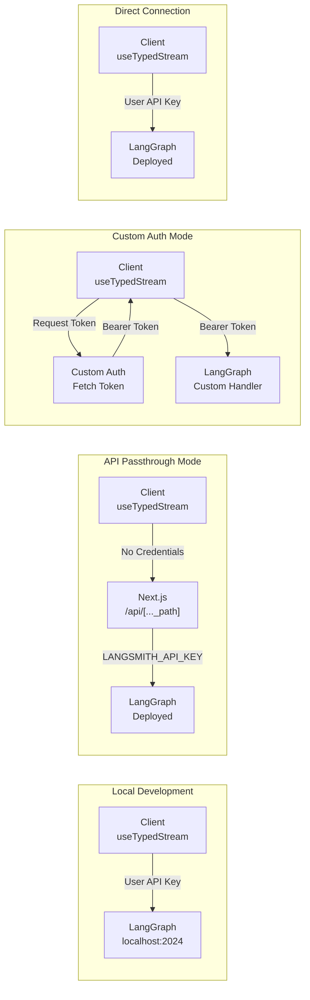

**Deployment Mode Summary:**

| Mode | Authentication | Credentials Exposed | Use Case |
|------|----------------|---------------------|----------|
| Local Development | User-provided API key | Client-side | Development with `localhost:2024` |
| API Passthrough | Server-injected | Server-side only | Production (recommended) |
| Direct Connection | User-provided API key | Client-side | Simple deployments |
| Custom Auth | Bearer tokens | Token only | Enterprise with custom auth |

**Configuration Priority:**
1. URL query parameters (`?apiUrl=...&assistantId=...`)
2. Environment variables (`NEXT_PUBLIC_API_URL`, `NEXT_PUBLIC_ASSISTANT_ID`)
3. Local storage (API key only)

If configuration is incomplete, the `SetupForm` component prompts users for required values.

**Sources**: [README.md:186-242](), [.env.example:1-14](), [src/app/api/[..._path]/route.ts:1-11]()

## Technology Stack

The application is built with modern web technologies:

### Framework and Language

- **Next.js 15.2.3**: React framework providing server-side rendering, API routes, and build optimization
- **React 19.0.0**: UI library with concurrent features and new hooks
- **TypeScript 5.7.2**: Type-safe JavaScript with strict compiler options

**Sources**: [package.json:75](), [package.json:44](), [package.json:81]()

### LangGraph Integration

- **@langchain/langgraph 0.2.63**: LangGraph client library for TypeScript
- **@langchain/langgraph-sdk 0.1.0**: SDK with streaming support and React UI components
- **@langchain/core 0.3.44**: Core LangChain primitives and message types
- **langgraph-nextjs-api-passthrough 0.0.4**: Next.js API proxy for production deployments

**Sources**: [package.json:22-24](), [package.json:39]()

### UI Components and Styling

- **Radix UI**: Accessible component primitives (Avatar, Dialog, Label, Separator, Slot, Switch, Tooltip)
- **Tailwind CSS 4.0.13**: Utility-first CSS framework with JIT compilation
- **lucide-react 0.476.0**: Icon library with consistent design
- **framer-motion 12.4.9**: Animation library for smooth transitions
- **sonner 2.0.1**: Toast notification system

**Sources**: [package.json:25-32](), [package.json:41](), [package.json:37](), [package.json:52](), [package.json:80]()

### Content Rendering

- **react-markdown 10.0.1**: Markdown parsing and rendering
- **react-syntax-highlighter 15.5.0**: Code block syntax highlighting
- **remark-gfm 4.0.1**: GitHub Flavored Markdown support
- **remark-math 6.0.0**: Mathematical expression parsing
- **rehype-katex 7.0.1**: LaTeX math rendering with KaTeX
- **katex 0.16.21**: Fast math typesetting library

**Sources**: [package.json:46-51](), [package.json:38]()

### State Management

- **nuqs 2.4.1**: Type-safe URL query parameter state management with Next.js App Router support
- **React Context API**: Built-in state management for providers

**Sources**: [package.json:43]()

### Development Tools

- **ESLint 9.19.0**: Linting with Next.js and React Hooks plugins
- **Prettier 3.5.3**: Code formatting with Tailwind CSS plugin
- **pnpm 10.5.1**: Fast, disk-efficient package manager

**Sources**: [package.json:70-72](), [package.json:77](), [package.json:87]()

## Project Structure

The codebase follows Next.js App Router conventions:

```
src/
├── app/                    # Next.js App Router
│   ├── page.tsx           # Main application page
│   └── api/               # API routes
│       └── [..._path]/    # LangGraph proxy
├── components/            # React components
│   ├── thread/           # Chat interface components
│   ├── setup/            # Configuration forms
│   └── ui/               # Reusable UI primitives
├── providers/            # React Context providers
│   ├── Stream.tsx        # Streaming state management
│   └── Thread.tsx        # Thread list management
├── hooks/                # Custom React hooks
└── lib/                  # Utility functions
```

**Sources**: [package.json:2]()

## Getting Started

To begin using the application:

1. **Installation**: Use `npx create-agent-chat-app` or clone the repository and run `pnpm install`
2. **Configuration**: Set environment variables or use the interactive setup form (see [Installation and Setup](#1.1))
3. **Development**: Run `pnpm dev` to start the development server at `http://localhost:3000`
4. **Production**: Configure API passthrough or custom authentication (see [API Integration](#9))

The deployed version is available at https://agentchat.vercel.app for immediate use without local setup.

**Sources**: [README.md:13-40](), [README.md:10-11]()

---

# Page: Installation and Setup

# Installation and Setup

<details>
<summary>Relevant source files</summary>

The following files were used as context for generating this wiki page:

- [.codespellignore](.codespellignore)
- [.env.example](.env.example)
- [README.md](README.md)
- [package.json](package.json)
- [pnpm-lock.yaml](pnpm-lock.yaml)
- [src/app/api/[..._path]/route.ts](src/app/api/[..._path]/route.ts)

</details>


This document covers the installation and initial configuration of the agent-chat-ui application. It provides step-by-step instructions for installing dependencies, configuring environment variables, and running the application in development mode. For production deployment configuration, see [API Integration](#9) and [API Passthrough for Production](#9.2).

## Purpose and Scope

This page guides developers through:
- Installing the application and its dependencies
- Configuring the development environment
- Running the application locally
- Understanding the configuration priority system

For information about connecting to production LangGraph deployments, see [API Passthrough for Production](#9.2). For custom authentication setups, see [Custom Authentication](#9.3).

---

## Prerequisites

The agent-chat-ui application requires the following tools:

| Tool | Version | Purpose |
|------|---------|---------|
| Node.js | ≥18.0.0 | JavaScript runtime |
| pnpm | 10.5.1 | Package manager |

The application uses **pnpm** as its package manager, as specified in [package.json:87](). While npm or yarn may work, pnpm is the officially supported package manager.

**Sources:** [package.json:87](), [pnpm-lock.yaml:1-6]()

---

## Installation Methods

### Installation Flow

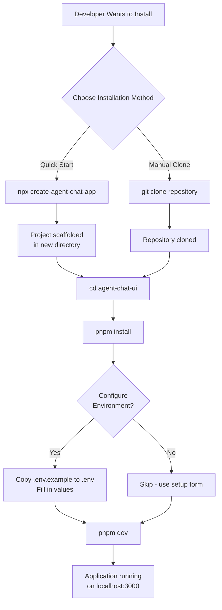

### Method 1: Using npx (Recommended)

The quickest way to create a new instance is using the `create-agent-chat-app` scaffolding tool:

```bash
npx create-agent-chat-app
```

This command creates a new directory with the application pre-configured.

### Method 2: Clone Repository

For direct repository access or contributing to the project:

```bash
git clone https://github.com/langchain-ai/agent-chat-ui.git
cd agent-chat-ui
```

Both methods result in the same application structure.

**Sources:** [README.md:13-25]()

---

## Dependency Installation

After obtaining the application, install dependencies using pnpm:

```bash
pnpm install
```

This command:
1. Reads [package.json:21-57]() for production dependencies
2. Reads [package.json:59-82]() for development dependencies
3. Resolves and installs all transitive dependencies
4. Creates `node_modules/` directory
5. Updates [pnpm-lock.yaml:1]() lockfile

### Key Dependencies Installed

| Category | Package | Version | Purpose |
|----------|---------|---------|---------|
| Framework | `next` | ^15.2.3 | Next.js application framework |
| LangGraph | `@langchain/langgraph-sdk` | ^0.1.0 | LangGraph client SDK |
| LangGraph | `@langchain/langgraph` | ^0.2.63 | LangGraph runtime |
| LangGraph | `@langchain/core` | ^0.3.44 | LangChain core abstractions |
| Proxy | `langgraph-nextjs-api-passthrough` | ^0.0.4 | API passthrough for production |
| State Management | `nuqs` | ^2.4.1 | URL-based state management |
| UI Components | `@radix-ui/*` | Various | Accessible UI primitives |
| Styling | `tailwindcss` | ^4.0.13 | CSS framework |

The `pnpm-lock.yaml` file ensures reproducible builds by locking exact versions of all dependencies and their transitive dependencies.

**Sources:** [package.json:21-57](), [package.json:59-82](), [pnpm-lock.yaml:1-189]()

---

## Running the Application

### Development Mode

Start the development server:

```bash
pnpm dev
```

This executes the `dev` script defined in [package.json:13](), which runs `next dev`. The application will be available at:

```
http://localhost:3000
```

The Next.js development server provides:
- Hot module replacement (HMR)
- Fast refresh for React components
- TypeScript compilation
- Error overlay for debugging

### Available Scripts

The [package.json:12-19]() defines several utility scripts:

| Script | Command | Purpose |
|--------|---------|---------|
| `pnpm dev` | `next dev` | Start development server |
| `pnpm build` | `next build` | Build production bundle |
| `pnpm start` | `next start` | Start production server |
| `pnpm lint` | `next lint` | Run ESLint checks |
| `pnpm lint:fix` | `next lint --fix` | Fix ESLint issues |
| `pnpm format` | `prettier --write .` | Format all files |
| `pnpm format:check` | `prettier --check .` | Check formatting |

**Sources:** [package.json:12-19](), [README.md:33-39]()

---

## Configuration System

### Configuration Priority

The application uses a three-tier configuration priority system:

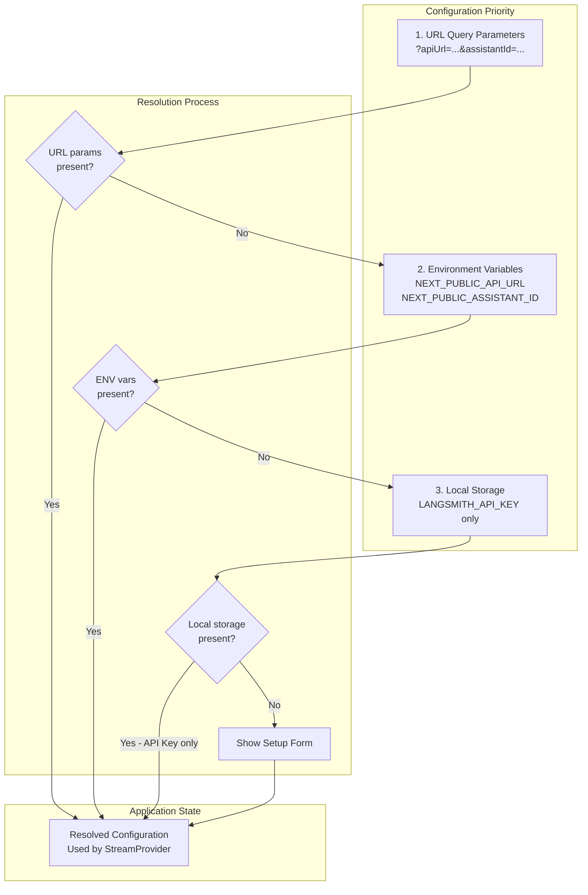

### Environment Variables

Create a `.env` file in the project root using [.env.example:1-14]() as a template:

```bash
cp .env.example .env
```

#### Development Configuration

For local development with a LangGraph server running on `localhost:2024`:

```bash
# .env file
NEXT_PUBLIC_API_URL=http://localhost:2024
NEXT_PUBLIC_ASSISTANT_ID=agent
```

These variables are defined in [.env.example:1-3]().

#### Variable Definitions

| Variable | Prefix | Purpose | Required |
|----------|--------|---------|----------|
| `NEXT_PUBLIC_API_URL` | `NEXT_PUBLIC_` | LangGraph server URL | Yes |
| `NEXT_PUBLIC_ASSISTANT_ID` | `NEXT_PUBLIC_` | Graph/Assistant identifier | Yes |
| `LANGSMITH_API_KEY` | None | LangSmith authentication (server-only) | Production only |
| `LANGGRAPH_API_URL` | None | Production deployment URL (server-only) | Production only |

The `NEXT_PUBLIC_` prefix makes variables accessible in the browser via `process.env.NEXT_PUBLIC_*`. Variables without this prefix are server-only and remain secure.

**Important:** Never prefix `LANGSMITH_API_KEY` with `NEXT_PUBLIC_` as it is a secret credential. It is used only in [src/app/api/[..._path]/route.ts:9]() for server-side API passthrough.

### Setup Form Behavior

When environment variables are not set, the application displays an interactive setup form on first load. This form collects:

1. **Deployment URL** - The LangGraph server endpoint
2. **Assistant/Graph ID** - The graph identifier
3. **LangSmith API Key** - Authentication for deployed servers (optional for localhost)

Form values are stored in local storage and used for subsequent sessions until explicitly cleared.

### Environment Variable Processing

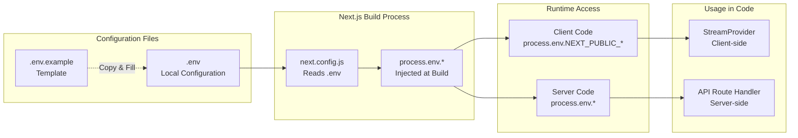

**Sources:** [.env.example:1-14](), [README.md:51-69](), [src/app/api/[..._path]/route.ts:8-9]()

---

## Production Environment Setup

For production deployments, additional configuration is required. There are two primary approaches:

### API Passthrough Configuration

Configure the following environment variables in your deployment environment:

```bash
NEXT_PUBLIC_ASSISTANT_ID="agent"
LANGGRAPH_API_URL="https://my-agent.default.us.langgraph.app"
NEXT_PUBLIC_API_URL="https://my-website.com/api"
LANGSMITH_API_KEY="lsv2_..."
```

These variables are used by [src/app/api/[..._path]/route.ts:6-11]() to proxy requests with injected authentication.

### Variable Usage by Component

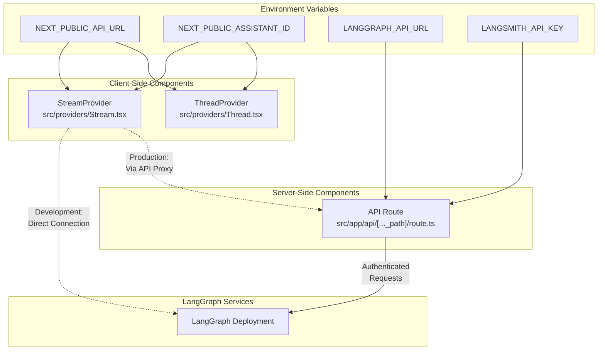

For detailed production setup instructions, see [API Passthrough for Production](#9.2).

**Sources:** [README.md:187-217](), [.env.example:7-13](), [src/app/api/[..._path]/route.ts:1-11]()

---

## Post-Installation File Structure

After successful installation, the project structure includes:

```
agent-chat-ui/
├── .env                    # Local environment variables (created by you)
├── .env.example            # Template for environment variables
├── package.json            # Dependencies and scripts
├── pnpm-lock.yaml          # Locked dependency versions
├── node_modules/           # Installed dependencies (created by pnpm)
├── src/
│   ├── app/
│   │   └── api/
│   │       └── [..._path]/
│   │           └── route.ts  # API passthrough handler
│   ├── providers/
│   │   ├── Stream.tsx       # StreamProvider configuration
│   │   └── Thread.tsx       # ThreadProvider configuration
│   └── components/          # UI components
└── ...
```

The application is now ready for development. Start the server with `pnpm dev` and navigate to `http://localhost:3000`.

**Sources:** [package.json:1-88](), [pnpm-lock.yaml:1](), [.env.example:1-14](), [src/app/api/[..._path]/route.ts:1]()

---

## Verification Steps

After installation, verify the setup:

1. **Check Node.js version:**
   ```bash
   node --version  # Should be ≥18.0.0
   ```

2. **Check pnpm installation:**
   ```bash
   pnpm --version  # Should be 10.5.1 or compatible
   ```

3. **Verify dependencies installed:**
   ```bash
   ls node_modules/@langchain  # Should list langgraph packages
   ```

4. **Test development server:**
   ```bash
   pnpm dev
   # Navigate to http://localhost:3000
   # Should see either setup form or chat interface
   ```

If any step fails, ensure:
- Node.js and pnpm are correctly installed
- `.env` file matches [.env.example:1-14]() structure
- No conflicting processes on port 3000
- Internet connection for dependency downloads

**Sources:** [package.json:13](), [README.md:33-49]()

---

## Next Steps

After successful installation and setup:

1. Configure your LangGraph server connection (see [Configuration System](#9.1))
2. Understand the core architecture (see [Core Architecture](#2))
3. Explore the Stream Provider (see [Stream Provider](#2.2))
4. Learn about message rendering (see [Message System](#3))
5. Set up production deployment (see [API Passthrough for Production](#9.2))

The application is now ready for local development and testing with LangGraph agents.

**Sources:** [README.md:41-49]()

---

# Page: Core Architecture

# Core Architecture

<details>
<summary>Relevant source files</summary>

The following files were used as context for generating this wiki page:

- [package.json](package.json)
- [src/components/thread/index.tsx](src/components/thread/index.tsx)
- [src/providers/Stream.tsx](src/providers/Stream.tsx)

</details>


This document explains the high-level architecture of the Agent Chat UI system, including the component hierarchy, provider contexts, and data flow patterns. For detailed implementation specifics, see the component-specific pages: [Thread Component](#2.1), [Stream Provider](#2.2), [Thread Provider](#2.3), and [Artifact System](#2.4).

## System Overview

The Agent Chat UI is a Next.js application with a three-tier architecture:

1. **Client Layer**: React components and hooks built with Next.js 15.2.3
2. **Server Layer**: Next.js API routes that can optionally proxy requests to LangGraph
3. **Backend Layer**: LangGraph server providing AI agent runtime

The application supports two primary deployment modes:
- **API Passthrough Mode**: Next.js server proxies requests, injecting server-side authentication
- **Direct Connection Mode**: Client connects directly to LangGraph with client-provided credentials

### Three-Tier System Architecture

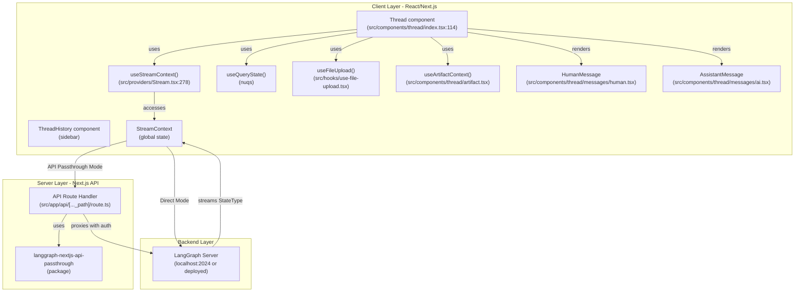

Sources: [src/components/thread/index.tsx:114-565](), [src/providers/Stream.tsx:1-286](), [package.json:1-88]()

The application follows a provider-based architecture where `StreamProvider` manages global streaming state and `Thread` orchestrates the user interface.

## Key Architectural Components

### 1. Thread Component

The `Thread` function at [src/components/thread/index.tsx:114]() serves as the primary UI controller, orchestrating the chat interface. It integrates multiple hooks and contexts:

| Hook/Context | Purpose | Return Value | Source |
|--------------|---------|--------------|--------|
| `useQueryState("threadId")` | URL-persisted thread ID | `[threadId, setThreadId]` | nuqs library |
| `useQueryState("chatHistoryOpen")` | Sidebar visibility state | `[boolean, setter]` | nuqs with default `false` |
| `useQueryState("hideToolCalls")` | Tool call display toggle | `[boolean, setter]` | nuqs with default `false` |
| `useStreamContext()` | Access streaming state | `StreamContextType` | StreamContext |
| `useFileUpload()` | File upload management | `{contentBlocks, handleFileUpload, ...}` | Local hook |
| `useArtifactContext()` | Artifact panel state | `[artifactContext, setArtifactContext]` | ArtifactProvider |

Sources: [src/components/thread/index.tsx:114-141]()

### 2. StreamProvider Architecture

The streaming architecture uses a two-component provider system defined in [src/providers/Stream.tsx:1-286]():

**Component Hierarchy:**

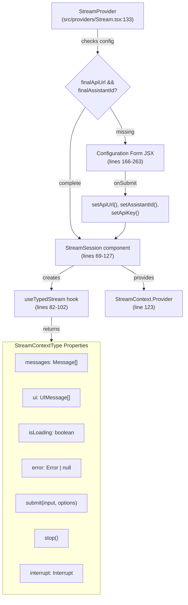

**Key Type Definitions:**

| Type | Definition | Location |
|------|------------|----------|
| `StateType` | `{ messages: Message[]; ui?: UIMessage[] }` | [src/providers/Stream.tsx:28]() |
| `useTypedStream` | Typed hook from `@langchain/langgraph-sdk/react` | [src/providers/Stream.tsx:30-40]() |
| `StreamContextType` | Return type of `useTypedStream` | [src/providers/Stream.tsx:42]() |

Sources: [src/providers/Stream.tsx:28-127](), [src/providers/Stream.tsx:133-274]()

### 3. Message Processing Pipeline

The core message handling follows this typed pipeline:

```mermaid
flowchart LR
    handleSubmit["handleSubmit(e: FormEvent)"] -->|"creates"| newHumanMessage["Message{id, type:'human', content}"]
    newHumanMessage -->|"processed by"| ensureToolCallsHaveResponses["ensureToolCallsHaveResponses()"]
    ensureToolCallsHaveResponses -->|"calls"| streamSubmit["stream.submit({messages, context})"]
    
    streamSubmit -->|"triggers"| useTypedStream["useTypedStream hook"]
    useTypedStream -->|"posts to"| apiUrl["/api endpoint"]
    apiUrl -->|"streams back"| StateType["StateType{messages, ui}"]
    StateType -->|"updates"| StreamContext["StreamContext"]
    StreamContext -->|"triggers rerender"| Thread["Thread component"]
```

Sources: [src/components/thread/index.tsx:198-236](), [src/providers/Stream.tsx:82-101]()

## State Management Architecture

### State Distribution Layers

The application distributes state across four layers with distinct responsibilities:

**State Distribution Diagram:**

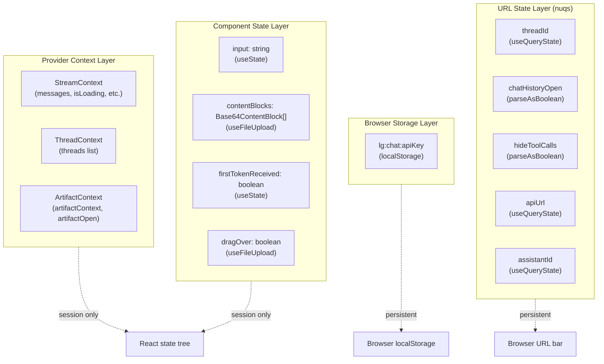

**Type Definitions:**

| Type | Definition | Import Source |
|------|------------|---------------|
| `Message` | `{id, type, content}` | `@langchain/langgraph-sdk` |
| `StateType` | `{messages: Message[], ui?: UIMessage[]}` | [src/providers/Stream.tsx:28]() |
| `UIMessage` | Custom UI messages from SDK | `@langchain/langgraph-sdk/react-ui` |
| `Base64ContentBlock` | `{type: "image" \| "document", source: {data, media_type}}` | `@langchain/core/messages` |

Sources: [src/components/thread/index.tsx:114-141](), [src/providers/Stream.tsx:1-40](), [src/providers/Stream.tsx:141-161]()

### Configuration Priority System

The StreamProvider implements a three-tier configuration resolution strategy at [src/providers/Stream.tsx:133-163]():

| Priority | Source | Parameters | Notes |
|----------|--------|------------|-------|
| **1 (Highest)** | URL query parameters | `apiUrl`, `assistantId` | Via `useQueryState` hooks |
| **2** | Environment variables | `NEXT_PUBLIC_API_URL`, `NEXT_PUBLIC_ASSISTANT_ID` | Server-side injection |
| **3 (Fallback)** | Local storage | API key only | Key: `lg:chat:apiKey` |

If `finalApiUrl` or `finalAssistantId` are missing, a configuration form is rendered at [src/providers/Stream.tsx:166-263]().

Sources: [src/providers/Stream.tsx:133-163]()

## Message Flow Architecture

### Complete Message Lifecycle

The message lifecycle flows through multiple layers from user input to rendered output:

**Message Submission Flow:**

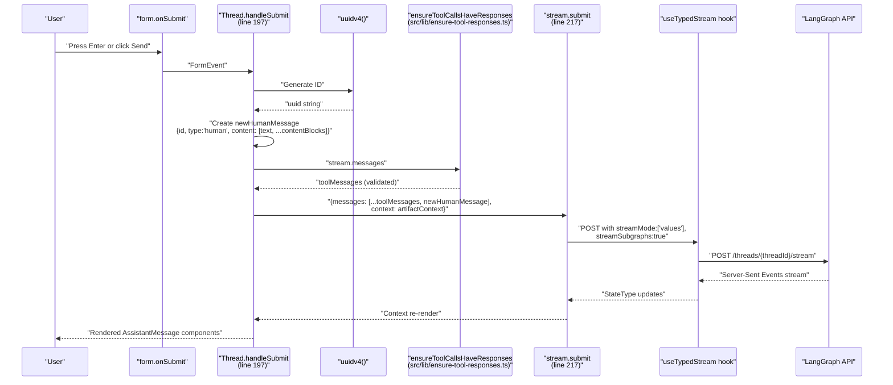

Sources: [src/components/thread/index.tsx:197-236](), [src/providers/Stream.tsx:82-102]()

### Message Rendering Logic

Messages are rendered conditionally based on type and state at [src/components/thread/index.tsx:402-432]():

**Message Rendering Pipeline:**

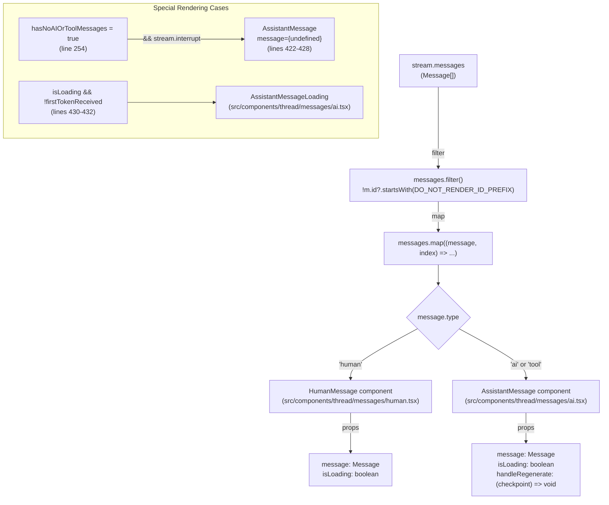

**DO_NOT_RENDER_ID_PREFIX Constant:**

The `DO_NOT_RENDER_ID_PREFIX` constant (imported from [src/lib/ensure-tool-responses.ts:12]()) is used to mark intermediate messages that should not be displayed to the user.

Sources: [src/components/thread/index.tsx:12-13](), [src/components/thread/index.tsx:254-256](), [src/components/thread/index.tsx:402-432]()

## Component Hierarchy and Layout

### Physical DOM Structure

The `Thread` component returns a multi-panel layout with responsive behavior:

**Layout Structure Diagram:**

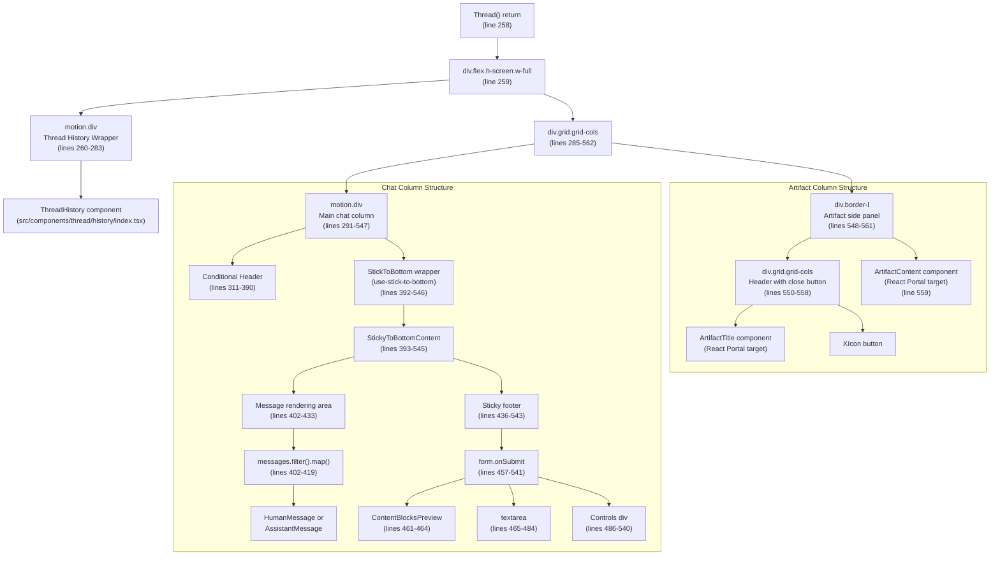

Sources: [src/components/thread/index.tsx:258-565]()

### Provider Context Dependencies

The `Thread` component integrates multiple contexts and hooks:

**Hook Dependency Graph:**

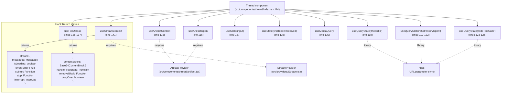

Sources: [src/components/thread/index.tsx:114-143]()

## Configuration and Authentication

### Configuration Resolution Strategy

The `StreamProvider` at [src/providers/Stream.tsx:133-274]() implements a three-tier configuration system:

**Configuration Priority Table:**

| Parameter | Priority 1 (Highest) | Priority 2 | Priority 3 | Storage Location |
|-----------|---------------------|------------|------------|------------------|
| `apiUrl` | URL query param | `process.env.NEXT_PUBLIC_API_URL` | `"http://localhost:2024"` (form default) | Query string via nuqs |
| `assistantId` | URL query param | `process.env.NEXT_PUBLIC_ASSISTANT_ID` | `"agent"` (form default) | Query string via nuqs |
| `apiKey` | Local storage | N/A | Empty string | `localStorage["lg:chat:apiKey"]` |

**Configuration Resolution Flow:**

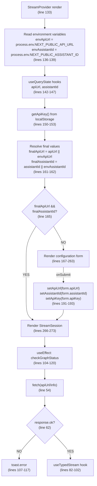

Sources: [src/providers/Stream.tsx:133-163](), [src/providers/Stream.tsx:49-67](), [src/providers/Stream.tsx:104-120]()

### Deployment Modes

The application supports multiple deployment architectures. While the client code doesn't explicitly handle different modes, the `useTypedStream` hook's `apiUrl` parameter determines the connection target:

| Mode | `apiUrl` Value | Authentication Method | Use Case |
|------|----------------|----------------------|----------|
| **Local Development** | `http://localhost:2024` | User-provided API key via form | Development with local LangGraph server |
| **API Passthrough** | `/api` (Next.js route) | Server-side `LANGSMITH_API_KEY` injection | Production deployments with hidden credentials |
| **Direct Connection** | Production LangGraph URL | Client-side API key from localStorage | Simple production deployments |

The API passthrough mode uses the `langgraph-nextjs-api-passthrough` package (see [package.json:39]()) in server-side routes to proxy requests while injecting authentication headers.

Sources: [src/providers/Stream.tsx:82-102](), [package.json:39]()

## Thread Lifecycle Management

### Thread Navigation and State Reset

Thread navigation is managed through a custom `setThreadId` wrapper at [src/components/thread/index.tsx:147-153]():

**Thread ID Management Flow:**

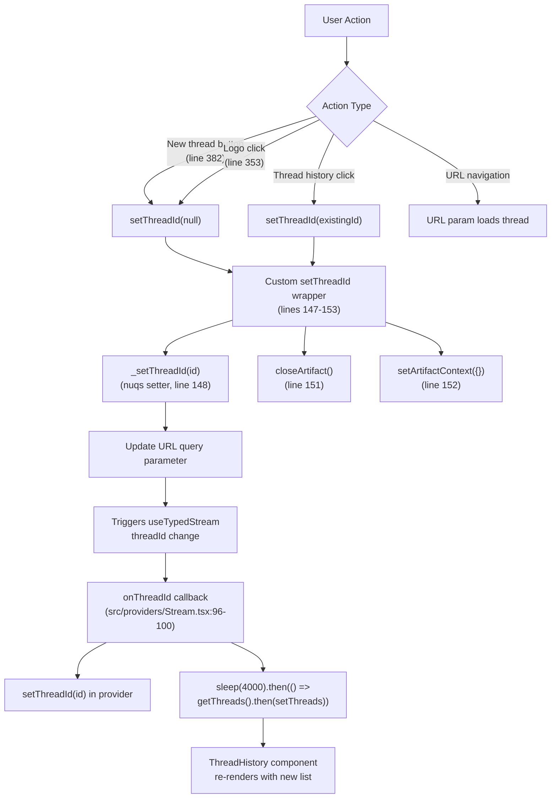

**Key Side Effects:**

When `setThreadId` is called, three actions occur atomically:
1. URL parameter updates via nuqs `_setThreadId`
2. Artifact panel closes via `closeArtifact()`
3. Artifact context clears via `setArtifactContext({})`

This ensures clean state when navigating between threads.

Sources: [src/components/thread/index.tsx:147-153](), [src/providers/Stream.tsx:96-100]()

## Package Dependencies

### Core Dependencies by Purpose

The application uses a focused set of packages organized by architectural concern:

**Dependency Table:**

| Package | Version | Purpose | Key Exports Used |
|---------|---------|---------|------------------|
| `@langchain/langgraph-sdk` | `^0.1.0` | LangGraph streaming and types | `useStream`, `Message`, `Checkpoint` |
| `@langchain/core` | `^0.3.44` | Message content types | `Base64ContentBlock` interface |
| `next` | `^15.2.3` | Application framework | App router, API routes |
| `react` / `react-dom` | `^19.0.0` | UI rendering | Hooks, components |
| `nuqs` | `^2.4.1` | URL state management | `useQueryState`, `parseAsBoolean` |
| `framer-motion` | `^12.4.9` | Layout animations | `motion` component, animation props |
| `use-stick-to-bottom` | `^1.0.46` | Chat scroll behavior | `StickToBottom`, `useStickToBottomContext` |
| `react-markdown` | `^10.0.1` | Markdown rendering | `ReactMarkdown` component |
| `react-syntax-highlighter` | `^15.5.0` | Code highlighting | `Prism` syntax highlighter |
| `sonner` | `^2.0.1` | Toast notifications | `toast` function |
| `uuid` | `^11.1.0` | ID generation | `v4` function |

**UI Component Libraries:**

| Package | Purpose |
|---------|---------|
| `@radix-ui/react-*` | Accessible UI primitives (Avatar, Dialog, Label, etc.) |
| `lucide-react` | Icon components |
| `tailwindcss` | Utility-first CSS framework |
| `class-variance-authority` | Component variant management |

**Optional Production Packages:**

| Package | Version | Purpose | Usage |
|---------|---------|---------|-------|
| `langgraph-nextjs-api-passthrough` | `^0.0.4` | API proxy for production | Server-side authentication injection |

Sources: [package.json:21-58]()

### External System Integration

The application integrates with external systems through well-defined interfaces:

**System Integration Diagram:**

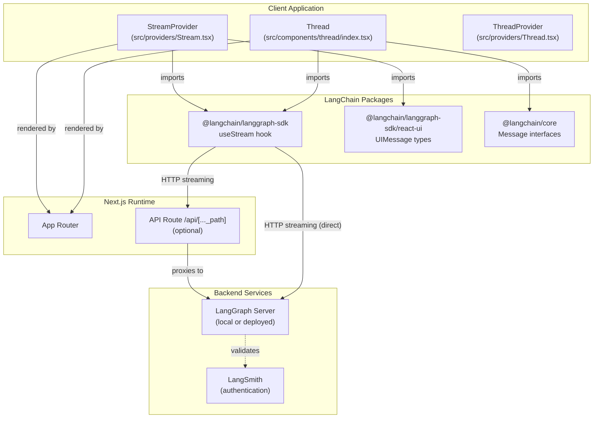

Sources: [src/components/thread/index.tsx:1-14](), [src/providers/Stream.tsx:1-26](), [package.json:21-58]()

## Error Handling

The architecture includes built-in error handling mechanisms:

1. Connection errors with the LangGraph server are detected and surfaced to the user
2. API errors during message streaming are captured and displayed
3. UI fallbacks are provided when data is not available

This ensures robustness and a good user experience even when issues occur.

Sources: [src/components/thread/index.tsx:122-150](), [src/providers/Stream.tsx:98-114]()

## Initialization Flow

The following diagram illustrates the initialization flow of the application:

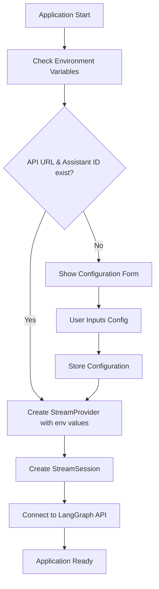

Sources: [src/providers/Stream.tsx:127-269]()

## Summary

The Agent Chat UI's core architecture follows a clean component-based approach with clear separation of concerns:

1. **UI Components**: Managed by the Thread component hierarchy
2. **Data and API Layer**: Handled by the StreamProvider
3. **State Management**: Distributed across contexts and component state
4. **Message Flow**: Clearly defined paths for data to move through the system

This architecture allows for a responsive, real-time chat experience while maintaining flexibility and extensibility for future enhancements.

---

# Page: Thread Component

# Thread Component

<details>
<summary>Relevant source files</summary>

The following files were used as context for generating this wiki page:

- [src/components/thread/index.tsx](src/components/thread/index.tsx)
- [src/providers/Stream.tsx](src/providers/Stream.tsx)

</details>


The Thread component serves as the primary chat interface for the agent-chat-ui application. It orchestrates the integration of streaming messages, user input handling, file uploads, and layout management into a cohesive conversational UI. The component is responsible for rendering messages, managing the chat input form, coordinating with the artifact panel, and handling responsive layout behavior including the thread history sidebar.

For details on the streaming connection and configuration, see [Stream Provider](#2.2). For thread list management in the sidebar, see [Thread History and Management](#5). For message rendering internals, see [Message System](#3). For file upload mechanics, see [File Upload and Multimodal Content](#6). For artifact panel implementation, see [Artifact System](#2.4).

## Component Architecture

The Thread component is implemented in [src/components/thread/index.tsx:114-565]() as the exported `Thread` function. It integrates multiple concerns through a layered architecture:

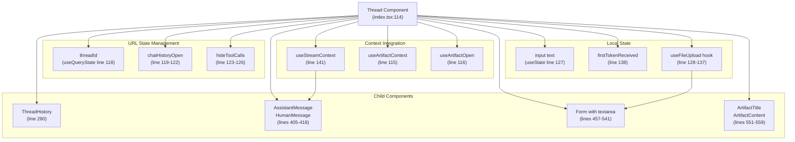

**Sources**: [src/components/thread/index.tsx:114-565]()

## Layout and Responsive Behavior

The Thread component implements a sophisticated three-panel layout system with responsive breakpoints and animated transitions:

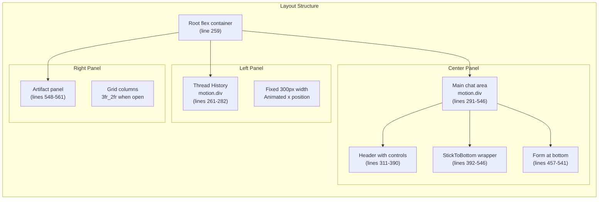

**Layout Implementation Details**

The layout uses CSS Grid for the main container [src/components/thread/index.tsx:286-289]():
- Default: `grid-cols-[1fr_0fr]` (artifact panel hidden)
- When artifact open: `grid-cols-[3fr_2fr]` (60/40 split)

The thread history sidebar uses `framer-motion` for smooth animations [src/components/thread/index.tsx:261-282]():
- Hidden: `x: -300` (off-screen left)
- Visible: `x: 0`
- Conditionally rendered on large screens only: `lg:flex` [src/components/thread/index.tsx:260]()

The main chat area adjusts margins dynamically [src/components/thread/index.tsx:297-309]():
- When history open on large screens: `marginLeft: 300px`, `width: calc(100% - 300px)`
- When history closed: `marginLeft: 0`, `width: 100%`
- Transitions use spring physics: `stiffness: 300, damping: 30`

**Sources**: [src/components/thread/index.tsx:259-562]()

## State Management

The Thread component manages state through three layers: URL query parameters, context providers, and local component state.

| State Layer | Variables | Purpose | Persistence |
|-------------|-----------|---------|-------------|
| **URL State** | `threadId`, `chatHistoryOpen`, `hideToolCalls` | Navigation, UI preferences | Browser history |
| **Context State** | `stream.messages`, `stream.isLoading`, `artifactContext`, `artifactOpen` | Global application state | Runtime only |
| **Local State** | `input`, `contentBlocks`, `firstTokenReceived` | Ephemeral UI state | Component lifetime |

### URL Query Parameters

The component uses `nuqs` for URL state management [src/components/thread/index.tsx:118-126]():

```typescript
const [threadId, _setThreadId] = useQueryState("threadId");
const [chatHistoryOpen, setChatHistoryOpen] = useQueryState(
  "chatHistoryOpen",
  parseAsBoolean.withDefault(false)
);
const [hideToolCalls, setHideToolCalls] = useQueryState(
  "hideToolCalls", 
  parseAsBoolean.withDefault(false)
);
```

The `threadId` setter is wrapped [src/components/thread/index.tsx:147-153]() to automatically close the artifact panel and reset artifact context when switching threads, ensuring clean state transitions.

### Context Integration

The component consumes three context providers:
- **StreamContext**: Accessed via `useStreamContext()` [src/components/thread/index.tsx:141]() to obtain `messages`, `isLoading`, `error`, `submit()`, and `stop()` methods
- **ArtifactContext**: Accessed via `useArtifactContext()` [src/components/thread/index.tsx:115]() to manage artifact data passed to the agent
- **ArtifactOpen**: Accessed via `useArtifactOpen()` [src/components/thread/index.tsx:116]() to control artifact panel visibility

### Local Component State

The component maintains ephemeral state for:
- Text input: `input` state managed by `useState` [src/components/thread/index.tsx:127]()
- File uploads: `contentBlocks` and related state from `useFileUpload` hook [src/components/thread/index.tsx:128-137]()
- Loading indicators: `firstTokenReceived` tracks when the first AI token arrives [src/components/thread/index.tsx:138]()
- Error tracking: `lastError` ref prevents duplicate error toasts [src/components/thread/index.tsx:145]()

**Sources**: [src/components/thread/index.tsx:115-145](), [src/components/thread/index.tsx:147-153]()

## Message Rendering Pipeline

The Thread component renders messages by iterating over `stream.messages` and delegating to specialized components:

```mermaid
graph TD
    StreamMessages["stream.messages array<br/>(line 142)"]
    Filter["Filter out DO_NOT_RENDER_ID_PREFIX<br/>(line 403)"]
    
    StreamMessages --> Filter
    
    Filter --> MapCheck{"Message type?"}
    
    MapCheck -->|"type === 'human'"| HumanMsg["HumanMessage component<br/>(lines 406-410)"]
    MapCheck -->|"type === 'ai' or 'tool'"| AIMsg["AssistantMessage component<br/>(lines 412-418)"]
    
    subgraph "Special Cases"
        NoAIMessages["hasNoAIOrToolMessages && interrupt<br/>(line 422)"]
        LoadingState["isLoading && !firstTokenReceived<br/>(line 430)"]
        
        NoAIMessages --> AIMsg2["AssistantMessage with undefined message<br/>(lines 423-428)"]
        LoadingState --> LoadingMsg["AssistantMessageLoading<br/>(lines 430-432)"]
    end
    
    HumanMsg --> Props1["Props:<br/>message, isLoading"]
    AIMsg --> Props2["Props:<br/>message, isLoading,<br/>handleRegenerate"]
```

**Message Filtering and Iteration**

Messages are filtered to exclude internal system messages [src/components/thread/index.tsx:402-403]():
```typescript
messages
  .filter((m) => !m.id?.startsWith(DO_NOT_RENDER_ID_PREFIX))
```

The `DO_NOT_RENDER_ID_PREFIX` constant is imported from [src/lib/ensure-tool-responses.ts]() and marks messages that should not be displayed (e.g., synthetic tool response messages).

**Component Selection Logic**

The rendering logic [src/components/thread/index.tsx:404-419]() maps message types:
- `type === "human"` → `HumanMessage` component with `message` and `isLoading` props
- All other types (including `"ai"` and `"tool"`) → `AssistantMessage` component with `message`, `isLoading`, and `handleRegenerate` props

**Special Rendering Cases**

Two edge cases receive special handling:
1. **No AI/Tool Messages with Interrupt**: When `hasNoAIOrToolMessages` is true but an interrupt exists [src/components/thread/index.tsx:422-429](), the component renders an `AssistantMessage` with `message={undefined}` to display the interrupt outside the normal message list.

2. **Loading Without First Token**: When `isLoading` is true but `firstTokenReceived` is false [src/components/thread/index.tsx:430-432](), the component renders `AssistantMessageLoading` to show a loading indicator before the first streaming token arrives.

**Sources**: [src/components/thread/index.tsx:142-143](), [src/components/thread/index.tsx:402-433](), [src/lib/ensure-tool-responses.ts:1-2]()

## Message Submission Flow

The Thread component handles message submission through a multi-step pipeline that integrates text input, file uploads, tool call validation, and artifact context:

```mermaid
graph TD
    UserAction["User submits form<br/>(line 197)"]
    Validate["Validate input/files exist<br/>and not loading<br/>(line 199-200)"]
    
    UserAction --> Validate
    
    Validate -->|Invalid| Return[Return early]
    Validate -->|Valid| Build["Build newHumanMessage<br/>(lines 203-210)"]
    
    Build --> MessageContent["Merge text content<br/>and contentBlocks<br/>(lines 206-209)"]
    
    MessageContent --> EnsureTool["ensureToolCallsHaveResponses<br/>(line 212)"]
    
    EnsureTool --> CheckArtifact{"Artifact context<br/>present?"}
    
    CheckArtifact -->|Yes| SetContext["context = artifactContext<br/>(lines 214-215)"]
    CheckArtifact -->|No| SetUndefined["context = undefined"]
    
    SetContext --> Submit["stream.submit()<br/>(lines 217-233)"]
    SetUndefined --> Submit
    
    Submit --> Optimistic["Set optimisticValues<br/>with new message<br/>(lines 223-231)"]
    
    Optimistic --> Clear["Clear input and files<br/>(lines 235-236)"]
```

**Submission Handler Implementation**

The `handleSubmit` function [src/components/thread/index.tsx:197-237]() implements the submission flow:

1. **Validation** [src/components/thread/index.tsx:199-200](): Prevents submission if input is empty, no files are attached, or stream is already loading
   
2. **Message Construction** [src/components/thread/index.tsx:203-210](): Creates a `Message` object with:
   - Generated UUID via `uuidv4()`
   - Type: `"human"`
   - Content array merging text (if non-empty) and `contentBlocks` from file uploads

3. **Tool Call Validation** [src/components/thread/index.tsx:212](): Calls `ensureToolCallsHaveResponses(stream.messages)` to ensure all tool calls have corresponding responses before submission (prevents rendering issues)

4. **Artifact Context Handling** [src/components/thread/index.tsx:214-215](): Includes `artifactContext` in submission if it contains data, otherwise passes `undefined`

5. **Stream Submission** [src/components/thread/index.tsx:217-233](): Calls `stream.submit()` with:
   - Messages array: existing tool messages + new human message
   - Context object (if present)
   - Options: `streamMode: ["values"]`, `streamSubgraphs: true`, `streamResumable: true`
   - Optimistic values for immediate UI update

6. **State Cleanup** [src/components/thread/index.tsx:235-236](): Resets `input` to empty string and clears `contentBlocks`

**Sources**: [src/components/thread/index.tsx:197-237]()

## Message Regeneration

The component supports regenerating AI responses from specific checkpoints in the conversation history:

```mermaid
graph TD
    UserClicksRegen["User clicks regenerate<br/>on AssistantMessage"]
    HandleRegen["handleRegenerate()<br/>(lines 239-251)"]
    
    UserClicksRegen --> HandleRegen
    
    HandleRegen --> AdjustLength["Decrement prevMessageLength ref<br/>(line 243)"]
    AdjustLength --> ResetToken["Set firstTokenReceived = false<br/>(line 244)"]
    ResetToken --> Submit["stream.submit(undefined)<br/>(line 245)"]
    
    Submit --> CheckpointOpt["Pass checkpoint option<br/>(line 246)"]
    Submit --> StreamOpts["streamMode, streamSubgraphs,<br/>streamResumable<br/>(lines 247-249)"]
```

**Regeneration Implementation**

The `handleRegenerate` function [src/components/thread/index.tsx:239-251]() accepts a `parentCheckpoint` parameter:

- **State Adjustment** [src/components/thread/index.tsx:243-244](): Decrements `prevMessageLength.current` to ensure loading state calculation is correct, and resets `firstTokenReceived` to show loading indicator

- **Checkpoint Submission** [src/components/thread/index.tsx:245-250](): Calls `stream.submit(undefined, {...})` with:
  - First argument: `undefined` (no new messages)
  - Options include `checkpoint: parentCheckpoint` to resume from that state
  - Same stream options as normal submission

This enables "time travel" through conversation states by regenerating from any previous checkpoint in the conversation history.

**Sources**: [src/components/thread/index.tsx:239-251]()

## Input Form and File Upload Integration

The Thread component renders a form at the bottom of the chat area that handles text input, file uploads, and tool call visibility:

```mermaid
graph TB
    FormContainer["Form container<br/>with drop zone<br/>(lines 448-542)"]
    
    subgraph "Drop Zone"
        DropRef["ref={dropRef}<br/>(line 449)"]
        DragOverStyle["Dotted border when dragOver<br/>(lines 452-454)"]
    end
    
    subgraph "Form Elements"
        Preview["ContentBlocksPreview<br/>(lines 461-464)"]
        Textarea["textarea element<br/>(lines 465-484)"]
        Controls["Bottom controls row<br/>(lines 486-540)"]
    end
    
    subgraph "Control Elements"
        ToolSwitch["Hide Tool Calls switch<br/>(lines 489-500)"]
        FileLabel["Upload label + input<br/>(lines 502-518)"]
        SubmitButton["Send/Cancel button<br/>(lines 519-539)"]
    end
    
    FormContainer --> DropRef
    FormContainer --> Preview
    FormContainer --> Textarea
    FormContainer --> Controls
    
    Controls --> ToolSwitch
    Controls --> FileLabel
    Controls --> SubmitButton
```

**Form Structure**

The form [src/components/thread/index.tsx:457-541]() implements:

1. **Drop Zone Integration** [src/components/thread/index.tsx:449-455](): The form container receives `dropRef` from `useFileUpload` hook, enabling drag-and-drop file uploads. The border style changes when `dragOver` is true (dotted primary border vs. solid).

2. **Content Blocks Preview** [src/components/thread/index.tsx:461-464](): Displays uploaded files using `ContentBlocksPreview` component with `blocks={contentBlocks}` and `onRemove={removeBlock}`.

3. **Textarea Input** [src/components/thread/index.tsx:465-484](): Auto-resizing textarea with:
   - `field-sizing-content` class for automatic height
   - `onPaste` handler for clipboard paste
   - Enter key submission (line 471-480): Submits on Enter, allows Shift+Enter for newlines, ignores during IME composition

4. **Tool Call Visibility Switch** [src/components/thread/index.tsx:489-500](): Toggle switch bound to `hideToolCalls` URL state, allowing users to show/hide tool invocations in messages.

5. **File Upload Input** [src/components/thread/index.tsx:502-518](): Hidden file input with visible label, accepts `image/jpeg,image/png,image/gif,image/webp,application/pdf`, triggers `handleFileUpload` from `useFileUpload` hook.

6. **Submit/Cancel Button** [src/components/thread/index.tsx:519-539](): Dynamic button that shows:
   - When loading: Cancel button with spinning loader icon that calls `stream.stop()`
   - When not loading: Send button (disabled if no input/files or while loading)

**Sources**: [src/components/thread/index.tsx:448-542](), [src/hooks/use-file-upload.tsx]()

## Scroll Management

The Thread component uses the `use-stick-to-bottom` library to provide automatic scrolling behavior:

```mermaid
graph TD
    StickToBottom["StickToBottom wrapper<br/>(line 392)"]
    
    subgraph "Sticky Content Component"
        StickyContent["StickyToBottomContent<br/>(lines 49-72)"]
        Context["useStickToBottomContext<br/>(line 55)"]
        ScrollRef["scrollRef on container<br/>(line 58)"]
        ContentRef["contentRef on content<br/>(line 63)"]
    end
    
    subgraph "Scroll to Bottom Button"
        ScrollBtn["ScrollToBottom component<br/>(lines 74-88)"]
        CheckBottom{"isAtBottom?"}
        ShowButton["Render button with ArrowDown"]
    end
    
    StickToBottom --> StickyContent
    StickToBottom --> ScrollBtn
    
    StickyContent --> Context
    Context --> ScrollRef
    Context --> ContentRef
    
    ScrollBtn --> CheckBottom
    CheckBottom -->|false| ShowButton
    CheckBottom -->|true| Hide[Return null]
```

**Sticky Scroll Implementation**

The `StickToBottom` component [src/components/thread/index.tsx:392]() wraps the message container and provides context for scroll management.

The custom `StickyToBottomContent` component [src/components/thread/index.tsx:49-72]() bridges the wrapper and content:
- Receives `scrollRef` and `contentRef` from context
- Applies refs to container and content divs respectively
- Renders `content` (messages) and optional `footer` (form)

The `ScrollToBottom` component [src/components/thread/index.tsx:74-88]() provides user control:
- Consumes `isAtBottom` and `scrollToBottom` from context
- Returns `null` when already at bottom (auto-hides)
- Renders button with `ArrowDown` icon when scrolled up
- Positioned absolutely via `className` prop [src/components/thread/index.tsx:446]()

**Sources**: [src/components/thread/index.tsx:392-546](), [src/components/thread/index.tsx:49-88]()

## Error Handling

The component implements error handling with toast notifications and duplicate error prevention:

```mermaid
graph TD
    StreamError["stream.error<br/>(useEffect line 155)"]
    
    CheckError{"Error exists?"}
    StreamError --> CheckError
    
    CheckError -->|No| ClearRef["Clear lastError.current<br/>(line 157)"]
    CheckError -->|Yes| ExtractMsg["Extract error message<br/>(line 161)"]
    
    ExtractMsg --> CheckDupe{"Message already<br/>shown?"}
    
    CheckDupe -->|Yes| Return[Return early<br/>line 164]
    CheckDupe -->|No| SaveMsg["Save to lastError.current<br/>(line 168)"]
    
    SaveMsg --> ShowToast["toast.error()<br/>with description<br/>(lines 169-177)"]
    
    ShowToast --> Display["Display error message<br/>in toast UI"]
```

**Error Handling Implementation**

The error handling effect [src/components/thread/index.tsx:155-181]() runs whenever `stream.error` changes:

1. **Error Clearing** [src/components/thread/index.tsx:156-159](): If no error exists, clears `lastError.current` ref and returns early.

2. **Duplicate Prevention** [src/components/thread/index.tsx:160-165](): Extracts error message and compares to `lastError.current`. If the same message has already been shown, returns early without displaying a new toast.

3. **Error Display** [src/components/thread/index.tsx:168-177](): Saves the new error message to the ref, then calls `toast.error()` with:
   - Title: "An error occurred. Please try again."
   - Description: Rich content showing the error message in a `<code>` block
   - Duration: Default (auto-dismiss)
   - Features: `richColors`, `closeButton`

The ref-based duplicate prevention ensures users aren't spammed with repeated error notifications if the same error occurs multiple times.

**Sources**: [src/components/thread/index.tsx:155-181]()

## Header and Navigation

The Thread component renders different headers based on whether a chat has started:

### Pre-Chat Header

Before any messages exist [src/components/thread/index.tsx:311-331]():
- Positioned absolutely at top-left
- Shows sidebar toggle button (if history closed or on small screens)
- GitHub repo link in top-right corner
- Minimal UI to maximize space for the initial input form

### Active Chat Header

After messages exist [src/components/thread/index.tsx:333-390]():
- Fixed header with three sections:
  1. **Left Section** [src/components/thread/index.tsx:335-371](): Sidebar toggle + animated LangGraph logo/title that shifts when sidebar opens
  2. **Right Section** [src/components/thread/index.tsx:373-386](): GitHub link + "New thread" button with `SquarePen` icon
  3. **Gradient Fade** [src/components/thread/index.tsx:388](): Visual separation from scrolling content

The logo/title animation [src/components/thread/index.tsx:351-361]() uses `framer-motion` with:
- `marginLeft` animates from 48px to 0 when sidebar opens
- Spring transition with `stiffness: 300, damping: 30`
- Clicking logo/title triggers `setThreadId(null)` to start new thread

**Sources**: [src/components/thread/index.tsx:311-390]()

## Artifact Panel Integration

The Thread component manages the artifact panel (right side) through context and portal rendering:

```mermaid
graph TD
    Thread["Thread Component"]
    
    subgraph "Artifact Context Usage"
        GetContext["useArtifactContext<br/>(line 115)"]
        GetOpen["useArtifactOpen<br/>(line 116)"]
        
        GetContext --> ArtifactData["artifactContext<br/>setArtifactContext"]
        GetOpen --> OpenState["artifactOpen<br/>closeArtifact"]
    end
    
    subgraph "Artifact Panel Structure"
        Container["Right panel container<br/>(lines 548-561)"]
        Header["Grid header with title + close<br/>(lines 550-558)"]
        TitlePortal["ArtifactTitle portal<br/>(line 551)"]
        CloseBtn["Close button with XIcon<br/>(lines 553-556)"]
        ContentPortal["ArtifactContent portal<br/>(line 559)"]
    end
    
    subgraph "Layout Integration"
        GridCols["Parent grid cols<br/>(lines 286-289)"]
        GridCols --> Closed["[1fr_0fr] when closed"]
        GridCols --> Open["[3fr_2fr] when open"]
    end
    
    Thread --> GetContext
    Thread --> GetOpen
    
    ArtifactData --> SubmitFlow["Included in message<br/>submission (line 217)"]
    OpenState --> GridCols
    
    Container --> Header
    Header --> TitlePortal
    Header --> CloseBtn
    Container --> ContentPortal
    
    CloseBtn --> ClickHandler["onClick={closeArtifact}<br/>(line 553)"]
```

**Artifact State Management**

The Thread component accesses artifact state through hooks:
- `useArtifactContext()` [src/components/thread/index.tsx:115](): Returns `[artifactContext, setArtifactContext]` tuple for managing artifact data
- `useArtifactOpen()` [src/components/thread/index.tsx:116](): Returns `[artifactOpen, closeArtifact]` tuple for panel visibility

**Artifact Context in Message Flow**

When submitting messages [src/components/thread/index.tsx:214-217](), the artifact context is conditionally included:
```typescript
const context =
  Object.keys(artifactContext).length > 0 ? artifactContext : undefined;
```
This context is passed to `stream.submit()` along with messages, allowing agents to reference artifact content in their responses.

**Thread ID Changes**

The wrapped `setThreadId` function [src/components/thread/index.tsx:147-153]() automatically:
1. Closes the artifact panel via `closeArtifact()`
2. Resets artifact context via `setArtifactContext({})`

This ensures clean state when switching between threads.

**Panel Layout**

The artifact panel [src/components/thread/index.tsx:548-561]() contains:
- Grid header with `ArtifactTitle` (portal target) and close button
- `ArtifactContent` (portal target) for rendered content
- Fixed `min-w-[30vw]` minimum width

Components within messages render into these portals using the artifact provider's refs. See [Artifact System](#2.4) for portal implementation details.

**Sources**: [src/components/thread/index.tsx:115-116](), [src/components/thread/index.tsx:147-153](), [src/components/thread/index.tsx:214-217](), [src/components/thread/index.tsx:286-289](), [src/components/thread/index.tsx:548-561]()

## Conditional Rendering Based on Chat State

The component adapts its UI based on whether a conversation has started:

```typescript
const chatStarted = !!threadId || !!messages.length;
```

[src/components/thread/index.tsx:253]()

This boolean controls:

| UI Element | Pre-Chat (chatStarted === false) | Active Chat (chatStarted === true) |
|------------|----------------------------------|-------------------------------------|
| **Header** | Minimal header, absolute positioned [lines 311-331]() | Full header with navigation [lines 333-390]() |
| **Message Area** | Centered vertically with `mt-[25vh]` [line 396]() | Normal grid layout [line 397]() |
| **Logo Display** | Large logo + "Agent Chat" heading in footer [lines 437-443]() | Small logo + title in header [lines 363-369]() |
| **First Message UI** | Prominent input form centered on page | Input form docked at bottom |

Additionally, the component tracks whether any AI or tool messages exist [src/components/thread/index.tsx:254-256]():
```typescript
const hasNoAIOrToolMessages = !messages.find(
  (m) => m.type === "ai" || m.type === "tool",
);
```

This enables special interrupt rendering when an agent emits an interrupt before any normal messages [src/components/thread/index.tsx:422-429]().

**Sources**: [src/components/thread/index.tsx:253-256](), [src/components/thread/index.tsx:311-443]()

## First Token Tracking

The component implements first token detection to control loading indicator visibility:

```mermaid
graph TD
    MessagesChange["messages array changes<br/>(useEffect line 185)"]
    
    CheckLength{"Length changed?"}
    MessagesChange --> CheckLength
    
    CheckLength -->|No| Return[Return early]
    CheckLength -->|Yes| CheckMessages{"messages.length > 0?"}
    
    CheckMessages -->|No| Return2[Return early]
    CheckMessages -->|Yes| CheckLastType{"Last message<br/>type === 'ai'?"}
    
    CheckLastType -->|No| Return3[Return early]
    CheckLastType -->|Yes| SetTrue["setFirstTokenReceived(true)<br/>(line 191)"]
    
    SetTrue --> UpdateRef["Update prevMessageLength ref<br/>(line 194)"]
    
    subgraph "Usage in Rendering"
        LoadingCheck["isLoading && !firstTokenReceived<br/>(line 430)"]
        LoadingCheck --> ShowLoader["Render AssistantMessageLoading"]
    end
```

**First Token Detection Logic**

The effect [src/components/thread/index.tsx:184-195]() tracks when streaming begins:

1. Compares current `messages.length` to `prevMessageLength.current`
2. If length changed and messages exist:
   - Checks if last message is type `"ai"`
   - If true, sets `firstTokenReceived = true`
3. Updates `prevMessageLength.current` for next comparison

**Why This Matters**

The flag prevents showing a loading indicator after the AI has already started responding. The rendering logic [src/components/thread/index.tsx:430-432]() only shows `AssistantMessageLoading` when:
- `isLoading` is true (stream active)
- AND `firstTokenReceived` is false (no tokens yet)

This avoids redundant loading indicators once content begins streaming.

The flag is reset to `false` in two places:
1. Before submitting new messages [src/components/thread/index.tsx:201]()
2. Before regenerating [src/components/thread/index.tsx:244]()

**Sources**: [src/components/thread/index.tsx:138](), [src/components/thread/index.tsx:184-195](), [src/components/thread/index.tsx:201](), [src/components/thread/index.tsx:244](), [src/components/thread/index.tsx:430-432]()

---

# Page: Stream Provider

# Stream Provider

<details>
<summary>Relevant source files</summary>

The following files were used as context for generating this wiki page:

- [.codespellignore](.codespellignore)
- [.env.example](.env.example)
- [README.md](README.md)
- [src/app/api/[..._path]/route.ts](src/app/api/[..._path]/route.ts)
- [src/providers/Stream.tsx](src/providers/Stream.tsx)

</details>


The Stream Provider is the core state management layer for real-time communication with LangGraph servers. It manages configuration resolution, establishes streaming connections, handles message state, and provides custom event processing capabilities. This provider wraps the `useStream` hook from `@langchain/langgraph-sdk/react` with application-specific configuration, type safety, and lifecycle management.

For information about how the Thread component consumes this provider, see [Thread Component](#2.1). For details on thread list management (separate from streaming), see [Thread Provider](#2.3).

## Architecture Overview

The Stream Provider implements a two-layer architecture with configuration resolution in the outer layer and streaming management in the inner layer:

```mermaid
graph TB
    subgraph "StreamProvider Component"
        ConfigLayer["Configuration Layer"]
        ConfigLayer --> EnvCheck{"Config Complete?"}
        EnvCheck --> |"Yes"| StreamSession["StreamSession Component"]
        EnvCheck --> |"No"| SetupForm["Interactive Setup Form"]
        SetupForm --> |"Submit"| ConfigLayer
    end
    
    subgraph "Configuration Sources (Priority Order)"
        URLParams["URL Query Parameters<br/>(apiUrl, assistantId)"]
        EnvVars["Environment Variables<br/>(NEXT_PUBLIC_API_URL,<br/>NEXT_PUBLIC_ASSISTANT_ID)"]
        LocalStorage["Local Storage<br/>(lg:chat:apiKey)"]
    end
    
    subgraph "StreamSession Internals"
        UseTypedStream["useTypedStream Hook"]
        ThreadIdState["threadId Query State<br/>(nuqs)"]
        ThreadsContext["useThreads Hook"]
        
        UseTypedStream --> StreamState["Stream State"]
        StreamState --> Messages["messages: Message[]"]
        StreamState --> UI["ui: UIMessage[]"]
        StreamState --> Loading["isLoading: boolean"]
        StreamState --> Error["error state"]
        StreamState --> Methods["submit(), stop() methods"]
    end
    
    subgraph "Event Handling"
        CustomEvents["onCustomEvent callback"]
        ThreadIdUpdate["onThreadId callback"]
        
        CustomEvents --> UIReducer["uiMessageReducer"]
        UIReducer --> UI
        
        ThreadIdUpdate --> ThreadIdState
        ThreadIdUpdate --> RefetchThreads["getThreads() + sleep()"]
    end
    
    subgraph "Connection Monitoring"
        CheckStatus["checkGraphStatus()"]
        CheckStatus --> ToastError["Toast Notification<br/>(if connection fails)"]
    end
    
    URLParams -.-> |"Priority 1"| ConfigLayer
    EnvVars -.-> |"Priority 2"| ConfigLayer
    LocalStorage -.-> |"API Key Only"| ConfigLayer
    
    ConfigLayer --> UseTypedStream
    
    StreamSession --> StreamContext["StreamContext.Provider"]
    StreamContext --> Consumers["Consumer Components"]
    
    UseTypedStream --> CustomEvents
    UseTypedStream --> ThreadIdUpdate
    
    StreamSession --> CheckStatus
```

**Sources**: [src/providers/Stream.tsx:1-287]()

## Configuration System

### Three-Tier Priority Resolution

The Stream Provider implements a configuration priority system that resolves values from three sources in order of precedence:

| Priority | Source | Variables | Storage Method | Use Case |
|----------|--------|-----------|----------------|----------|
| 1 (Highest) | URL Query Parameters | `apiUrl`, `assistantId` | `nuqs` library | Deep linking, testing |
| 2 | Environment Variables | `NEXT_PUBLIC_API_URL`, `NEXT_PUBLIC_ASSISTANT_ID` | Build-time | Production deployment |
| 3 (API Key Only) | Local Storage | `lg:chat:apiKey` | Browser storage | User credentials |

The resolution logic in `StreamProvider` [src/providers/Stream.tsx:136-163]():

```typescript
// URL params use nuqs with env var defaults
const [apiUrl, setApiUrl] = useQueryState("apiUrl", {
  defaultValue: envApiUrl || "",
});
const [assistantId, setAssistantId] = useQueryState("assistantId", {
  defaultValue: envAssistantId || "",
});

// API key uses localStorage with getApiKey() helper
const [apiKey, _setApiKey] = useState(() => {
  const storedKey = getApiKey();
  return storedKey || "";
});

// Final values prioritize URL params, then env vars
const finalApiUrl = apiUrl || envApiUrl;
const finalAssistantId = assistantId || envAssistantId;
```

**Sources**: [src/providers/Stream.tsx:136-163](), [README.md:51-69]()

### Interactive Setup Form

If required configuration is missing (`!finalApiUrl || !finalAssistantId`), the provider renders an interactive setup form instead of the application content [src/providers/Stream.tsx:165-264](). The form collects:

- **Deployment URL**: Required field, defaults to `http://localhost:2024`
- **Assistant/Graph ID**: Required field, defaults to `agent`
- **LangSmith API Key**: Optional field, only required for deployed LangGraph servers

Form submission updates all three state layers [src/providers/Stream.tsx:182-195]():
- Sets URL query parameters via `setApiUrl()` and `setAssistantId()`
- Stores API key in local storage via `setApiKey()`
- Triggers re-render, causing `StreamSession` to mount

**Sources**: [src/providers/Stream.tsx:165-264](), [README.md:43-49]()

## StreamSession Component

### Streaming Connection Lifecycle

The `StreamSession` component manages the actual streaming connection using the `useTypedStream` hook:

```mermaid
graph LR
    subgraph "Initialization"
        Props["Props:<br/>apiKey, apiUrl,<br/>assistantId"]
        ThreadIdQuery["threadId<br/>(from URL)"]
    end
    
    subgraph "useTypedStream Configuration"
        Config["useTypedStream Config"]
        Config --> APIUrl["apiUrl"]
        Config --> APIKey["apiKey"]
        Config --> AssistantId["assistantId"]
        Config --> ThreadId["threadId<br/>(null or string)"]
        Config --> FetchHistory["fetchStateHistory: true"]
        Config --> CustomEventHandler["onCustomEvent callback"]
        Config --> ThreadIdHandler["onThreadId callback"]
    end
    
    subgraph "Stream State"
        StreamValue["StreamContextType"]
        StreamValue --> Messages["messages"]
        StreamValue --> UI["ui"]
        StreamValue --> Loading["isLoading"]
        StreamValue --> Submit["submit()"]
        StreamValue --> Stop["stop()"]
    end
    
    subgraph "Side Effects"
        ConnectionCheck["checkGraphStatus()<br/>(useEffect)"]
        ConnectionCheck --> |"Failed"| Toast["sonner toast.error()"]
    end
    
    Props --> Config
    ThreadIdQuery --> Config
    Config --> StreamValue
    StreamValue --> Context["StreamContext.Provider"]
    Context --> Children["Application Children"]
    
    Props --> ConnectionCheck
```

The configuration passed to `useTypedStream` [src/providers/Stream.tsx:82-102]():

**Sources**: [src/providers/Stream.tsx:69-127]()

### Custom Event Handling

The `onCustomEvent` callback processes UI-specific messages from LangGraph streams [src/providers/Stream.tsx:88-95]():

```typescript
onCustomEvent: (event, options) => {
  if (isUIMessage(event) || isRemoveUIMessage(event)) {
    options.mutate((prev) => {
      const ui = uiMessageReducer(prev.ui ?? [], event);
      return { ...prev, ui };
    });
  }
}
```

This handler:
1. Checks if the event is a `UIMessage` or `RemoveUIMessage` type
2. Uses `uiMessageReducer` from `@langchain/langgraph-sdk/react-ui` to update UI state
3. Mutates the stream state immutably via `options.mutate()`

**Sources**: [src/providers/Stream.tsx:88-95]()

### Thread ID Synchronization

The `onThreadId` callback synchronizes thread IDs between the stream and URL state [src/providers/Stream.tsx:96-101]():

```typescript
onThreadId: (id) => {
  setThreadId(id);
  // Wait before fetching so new thread is available
  sleep().then(() => getThreads().then(setThreads).catch(console.error));
}
```

When a new thread is created during message submission:
1. The thread ID is written to URL query parameters via `setThreadId()`
2. A 4-second delay (`sleep()`) allows the LangGraph server to persist the thread
3. The thread list is refreshed via `getThreads()` from `useThreads()`

**Sources**: [src/providers/Stream.tsx:96-101](), [src/providers/Stream.tsx:45-47]()

### Connection Status Monitoring

The `useEffect` hook monitors connection health [src/providers/Stream.tsx:104-120]():

```typescript
useEffect(() => {
  checkGraphStatus(apiUrl, apiKey).then((ok) => {
    if (!ok) {
      toast.error("Failed to connect to LangGraph server", {
        description: () => (
          <p>
            Please ensure your graph is running at <code>{apiUrl}</code>...
          </p>
        ),
        duration: 10000,
        richColors: true,
        closeButton: true,
      });
    }
  });
}, [apiKey, apiUrl]);
```

The `checkGraphStatus` function [src/providers/Stream.tsx:49-67]() attempts to fetch `/info` from the LangGraph server with optional authentication headers.

**Sources**: [src/providers/Stream.tsx:49-120]()

## Context API

### useStreamContext Hook

The `useStreamContext` hook provides type-safe access to the streaming context [src/providers/Stream.tsx:278-284]():

```typescript
export const useStreamContext = (): StreamContextType => {
  const context = useContext(StreamContext);
  if (context === undefined) {
    throw new Error("useStreamContext must be used within a StreamProvider");
  }
  return context;
};
```

This hook returns the `StreamContextType`, which is the return value of `useTypedStream`.

**Sources**: [src/providers/Stream.tsx:278-284]()

### Available State and Methods

The context provides the following interface:

| Property | Type | Description |
|----------|------|-------------|
| `messages` | `Message[]` | Array of standard LangGraph messages from state |
| `ui` | `UIMessage[]` | Array of UI-specific messages processed by `uiMessageReducer` |
| `isLoading` | `boolean` | Whether a stream is currently active |
| `error` | Error object | Stream error state, if any |
| `submit()` | Function | Submits a new message/run to the stream |
| `stop()` | Function | Cancels the current streaming operation |
| `thread` | Thread object | Current thread metadata and methods |
| `meta` | Metadata object | Custom metadata (e.g., artifact context) |

**Sources**: [src/providers/Stream.tsx:30-42]()

## Type System

### StateType Definition

The `StateType` interface defines the shape of the LangGraph state [src/providers/Stream.tsx:28]():

```typescript
export type StateType = { messages: Message[]; ui?: UIMessage[] };
```

This matches the standard LangGraph state schema with a required `messages` key and optional `ui` key for UI-specific messages.

**Sources**: [src/providers/Stream.tsx:28]()

### useTypedStream Configuration

The `useTypedStream` extends `useStream` with type parameters [src/providers/Stream.tsx:30-40]():

```typescript
const useTypedStream = useStream<
  StateType,
  {
    UpdateType: {
      messages?: Message[] | Message | string;
      ui?: (UIMessage | RemoveUIMessage)[] | UIMessage | RemoveUIMessage;
      context?: Record<string, unknown>;
    };
    CustomEventType: UIMessage | RemoveUIMessage;
  }
>;
```

Type parameters:
- **First parameter** (`StateType`): The shape of the graph state
- **Second parameter**: Configuration object with:
  - `UpdateType`: Shapes of incremental updates from the stream
  - `CustomEventType`: Types of custom events the stream can emit

**Sources**: [src/providers/Stream.tsx:30-40]()

## Integration with LangGraph SDK

### Direct vs. Proxied Connections

The Stream Provider supports two connection modes based on environment configuration:

**Development Mode** (Direct Connection):
- `NEXT_PUBLIC_API_URL` points to `http://localhost:2024`
- Client connects directly to local LangGraph server
- API key from local storage used for authentication

**Production Mode** (API Passthrough):
- `NEXT_PUBLIC_API_URL` points to `/api` endpoint
- Requests proxied through Next.js API routes [src/app/api/[..._path]/route.ts]()
- `LANGSMITH_API_KEY` injected server-side via `langgraph-nextjs-api-passthrough`

For details on production deployment, see [API Passthrough for Production](#9.2).

**Sources**: [README.md:188-218](), [.env.example:1-14](), [src/app/api/[..._path]/route.ts:1-11]()

### Custom Authentication Mode

For custom authentication deployments, the `useTypedStream` hook accepts a `defaultHeaders` option [README.md:231-242]():

```typescript
const streamValue = useTypedStream({
  apiUrl: process.env.NEXT_PUBLIC_API_URL,
  assistantId: process.env.NEXT_PUBLIC_ASSISTANT_ID,
  defaultHeaders: {
    Authentication: `Bearer ${token}`,
  },
});
```

This allows passing custom bearer tokens obtained from external authentication systems. For more details, see [Custom Authentication](#9.3).

**Sources**: [README.md:220-242]()

---

# Page: Thread Provider

# Thread Provider

<details>
<summary>Relevant source files</summary>

The following files were used as context for generating this wiki page:

- [src/components/thread/agent-inbox/hooks/use-interrupted-actions.tsx](src/components/thread/agent-inbox/hooks/use-interrupted-actions.tsx)
- [src/components/thread/history/index.tsx](src/components/thread/history/index.tsx)
- [src/components/thread/messages/tool-calls.tsx](src/components/thread/messages/tool-calls.tsx)
- [src/providers/Thread.tsx](src/providers/Thread.tsx)
- [src/providers/client.ts](src/providers/client.ts)

</details>


The Thread Provider is a React context that manages the state and fetching logic for thread lists in the application. It provides components with access to thread data from the LangGraph SDK, handles loading states, and coordinates with URL query parameters to determine which assistant's threads to fetch.

For information about the Thread UI component that displays individual conversations, see [Thread Component](#2.1). For the sidebar UI that displays the thread list, see [Thread History and Management](#5). For streaming message data within a thread, see [Stream Provider](#2.2).

## Architecture Overview

The Thread Provider follows a provider-consumer pattern typical of React Context API usage. It sits at a high level in the component tree and provides thread list data to any descendant components that need it.

**Thread Provider System Architecture**

```mermaid
graph TB
    subgraph "Configuration Sources"
        URLParams["URL Query Parameters<br/>apiUrl, assistantId"]
        LocalStorage["Local Storage<br/>API Key via getApiKey()"]
    end
    
    subgraph "ThreadProvider Context"
        Provider["ThreadProvider<br/>src/providers/Thread.tsx"]
        Context["ThreadContext<br/>createContext()"]
        State["State Management<br/>threads: Thread[]<br/>threadsLoading: boolean"]
        GetThreads["getThreads()<br/>Async fetch function"]
    end
    
    subgraph "LangGraph Integration"
        ClientFactory["createClient()<br/>src/providers/client.ts"]
        SDKClient["Client<br/>@langchain/langgraph-sdk"]
        ThreadsAPI["client.threads.search()"]
    end
    
    subgraph "Consumer Components"
        UseThreadsHook["useThreads()<br/>Hook for consumers"]
        ThreadHistory["ThreadHistory<br/>src/components/thread/history/index.tsx"]
    end
    
    URLParams --> GetThreads
    LocalStorage --> GetThreads
    
    Provider --> Context
    Provider --> State
    Provider --> GetThreads
    
    GetThreads --> ClientFactory
    ClientFactory --> SDKClient
    SDKClient --> ThreadsAPI
    ThreadsAPI --> State
    
    Context --> UseThreadsHook
    UseThreadsHook --> ThreadHistory
    
    State --> UseThreadsHook
```

**Sources:** [src/providers/Thread.tsx:1-76](), [src/providers/client.ts:1-9](), [src/components/thread/history/index.tsx:1-147]()

## ThreadProvider Component

The `ThreadProvider` component creates the context provider and manages the thread list state at the application level.

**Context Structure**

| Property | Type | Description |
|----------|------|-------------|
| `getThreads` | `() => Promise<Thread[]>` | Async function to fetch threads from LangGraph |
| `threads` | `Thread[]` | Current array of thread objects |
| `setThreads` | `Dispatch<SetStateAction<Thread[]>>` | State setter for updating thread list |
| `threadsLoading` | `boolean` | Loading state indicator |
| `setThreadsLoading` | `Dispatch<SetStateAction<boolean>>` | State setter for loading state |

The provider component is defined at [src/providers/Thread.tsx:36-67]() and creates the context at [src/providers/Thread.tsx:24](). It uses the `nuqs` library to read `apiUrl` and `assistantId` from URL query parameters.

**Sources:** [src/providers/Thread.tsx:16-67]()

## State Management

The Thread Provider manages two pieces of state using React's `useState` hook:

1. **threads**: An array of `Thread` objects from `@langchain/langgraph-sdk`. Initialized as an empty array at [src/providers/Thread.tsx:39]().

2. **threadsLoading**: A boolean flag indicating whether a fetch operation is in progress. Initialized as `false` at [src/providers/Thread.tsx:40]().

Both state values and their setters are exposed through the context, allowing consumer components to both read the current state and update it directly if needed.

**Sources:** [src/providers/Thread.tsx:39-40]()

## Thread Fetching Logic

The `getThreads` function is the core data fetching mechanism. It is memoized with `useCallback` to prevent unnecessary recreations, with dependencies on `apiUrl` and `assistantId`.

**Thread Fetching Flow**

```mermaid
graph LR
    Start["getThreads() called"] --> CheckConfig{"apiUrl AND<br/>assistantId present?"}
    CheckConfig -->|No| ReturnEmpty["Return empty array"]
    CheckConfig -->|Yes| CreateClient["createClient(apiUrl, apiKey)"]
    
    CreateClient --> ValidateAssistant{"Validate<br/>assistantId"}
    ValidateAssistant -->|"UUID format"| UseAssistantID["Search with<br/>assistant_id metadata"]
    ValidateAssistant -->|"Other format"| UseGraphID["Search with<br/>graph_id metadata"]
    
    UseAssistantID --> CallAPI["client.threads.search()"]
    UseGraphID --> CallAPI
    
    CallAPI --> ReturnThreads["Return Thread[]<br/>limit: 100"]
```

**Sources:** [src/providers/Thread.tsx:42-54](), [src/providers/Thread.tsx:26-34]()

### Assistant ID Validation

The system supports two types of identifiers for filtering threads:

- **UUID Format**: If `assistantId` is a valid UUID (validated using the `uuid` package's `validate` function at [src/providers/Thread.tsx:29]()), it is treated as an `assistant_id` and passed to the search metadata.

- **Graph ID Format**: If `assistantId` is not a UUID, it is treated as a `graph_id` for backward compatibility or custom graph deployments.

The `getThreadSearchMetadata` helper function at [src/providers/Thread.tsx:26-34]() handles this logic and returns the appropriate metadata object for the search query.

**Sources:** [src/providers/Thread.tsx:26-34]()

### Client Creation

Thread fetching uses the LangGraph SDK `Client` class. The client is created via the `createClient` utility function at [src/providers/client.ts:3-8]() which constructs a new `Client` instance with:

- **apiUrl**: The base URL for the LangGraph deployment
- **apiKey**: Retrieved via `getApiKey()` at [src/providers/Thread.tsx:44](), which abstracts the logic for obtaining API keys from local storage or other sources

The client's `threads.search()` method is called at [src/providers/Thread.tsx:46-51]() with metadata filtering and a limit of 100 threads.

**Sources:** [src/providers/Thread.tsx:44](), [src/providers/client.ts:3-8]()

## useThreads Hook

The `useThreads` hook provides type-safe access to the Thread context. It is defined at [src/providers/Thread.tsx:69-75]() and follows the standard pattern for context consumption:

1. Calls `useContext(ThreadContext)` to access the context value
2. Throws an error if used outside a `ThreadProvider` (at [src/providers/Thread.tsx:71-73]())
3. Returns the context value with full type safety

This hook is used by any component that needs access to thread data, such as the `ThreadHistory` component at [src/components/thread/history/index.tsx:85-86]().

**Sources:** [src/providers/Thread.tsx:69-75]()

## Integration with Thread History UI

The Thread Provider's primary consumer is the `ThreadHistory` component, which displays the thread list in a sidebar. The integration pattern is:

**ThreadHistory Integration Pattern**

```mermaid
graph TD
    Mount["ThreadHistory mounts"] --> UseThreadsHook["Call useThreads()"]
    UseThreadsHook --> Destructure["Destructure:<br/>getThreads<br/>threads<br/>setThreads<br/>threadsLoading<br/>setThreadsLoading"]
    
    Destructure --> UseEffect["useEffect(() => {...}, [])"]
    UseEffect --> SetLoading["setThreadsLoading(true)"]
    SetLoading --> CallGetThreads["getThreads()"]
    
    CallGetThreads --> ThenBlock[".then(setThreads)"]
    ThenBlock --> CatchBlock[".catch(console.error)"]
    CatchBlock --> FinallyBlock[".finally(() => setThreadsLoading(false))"]
    
    FinallyBlock --> Render["Render UI"]
    Render --> CheckLoading{"threadsLoading?"}
    CheckLoading -->|Yes| ShowSkeleton["ThreadHistoryLoading<br/>Skeleton components"]
    CheckLoading -->|No| ShowThreads["ThreadList<br/>threads array"]
```

**Sources:** [src/components/thread/history/index.tsx:85-95]()

The `ThreadHistory` component at [src/components/thread/history/index.tsx:78-146]() demonstrates the usage pattern:

1. **Initialization** (lines 85-86): Calls `useThreads()` to get access to all context values
2. **Fetch on Mount** (lines 88-95): Uses a `useEffect` with empty dependencies to fetch threads when the component first mounts
3. **Loading State Management**: Explicitly sets `threadsLoading` to `true` before fetching and `false` in the finally block
4. **Conditional Rendering** (lines 116-120): Displays `ThreadHistoryLoading` skeleton UI when loading, or `ThreadList` with the actual threads when loaded

**Sources:** [src/components/thread/history/index.tsx:78-146]()

## Thread Object Structure

The `Thread` type is imported from `@langchain/langgraph-sdk` at [src/providers/Thread.tsx:3](). While the complete type definition is in the SDK, the application accesses these key properties:

- `thread_id`: Unique identifier for the thread
- `values`: Object containing thread state, including `messages` array
- `metadata`: Contains `graph_id` or `assistant_id` for filtering

The `ThreadList` component at [src/components/thread/history/index.tsx:18-63]() accesses these properties to display thread information, extracting the first message content as a preview using `getContentString` at [src/components/thread/history/index.tsx:39]().

**Sources:** [src/providers/Thread.tsx:3](), [src/components/thread/history/index.tsx:30-40]()

## Error Handling

The Thread Provider implements minimal error handling, delegating most error management to consumers:

- **Missing Configuration**: The `getThreads` function returns an empty array if `apiUrl` or `assistantId` are missing (at [src/providers/Thread.tsx:43]())
- **API Errors**: Errors from the LangGraph SDK are propagated to the caller, which the `ThreadHistory` component handles with `.catch(console.error)` at [src/components/thread/history/index.tsx:93]()

This approach allows consumer components to implement custom error handling strategies appropriate to their UI context.

**Sources:** [src/providers/Thread.tsx:42-54](), [src/components/thread/history/index.tsx:91-94]()

## Provider Placement in Component Tree

The `ThreadProvider` must be placed high enough in the component tree to wrap all components that need access to thread data. Typically, it wraps the main application layout alongside other providers like `StreamProvider` and `ArtifactProvider`, creating a layered context structure where each provider manages a distinct slice of application state.

**Sources:** [src/providers/Thread.tsx:36-67]()

---

# Page: Artifact System

# Artifact System

<details>
<summary>Relevant source files</summary>

The following files were used as context for generating this wiki page:

- [src/app/page.tsx](src/app/page.tsx)
- [src/components/thread/artifact.tsx](src/components/thread/artifact.tsx)
- [src/components/thread/index.tsx](src/components/thread/index.tsx)

</details>


## Purpose and Scope

The Artifact System provides a mechanism for rendering supplementary content in a dedicated side panel alongside the main chat interface. This system allows AI-generated content or custom UI components to display extended information, visualizations, or interactive elements without disrupting the message flow. The system uses React Context and React Portals to enable flexible content rendering from deeply nested components into designated layout regions.

For information about custom UI components displayed within messages, see [AI Messages](#3.1). For information about the overall chat interface layout, see [Thread Component](#2.1).

---

## System Architecture

The artifact system consists of a context provider, portal target components, and hooks that enable components to render content into the side panel from anywhere in the component tree.

### Architecture Diagram

```mermaid
graph TB
    subgraph "Provider Layer"
        ArtifactProvider["ArtifactProvider"]
        ArtifactSlotContext["ArtifactSlotContext"]
        
        ArtifactProvider --> ArtifactSlotContext
    end
    
    subgraph "State Management"
        OpenState["open: string | null"]
        MountedState["mounted: string | null"]
        TitleRef["title: HTMLElement | null"]
        ContentRef["content: HTMLElement | null"]
        ContextData["context: Record<string, unknown>"]
        
        ArtifactSlotContext --> OpenState
        ArtifactSlotContext --> MountedState
        ArtifactSlotContext --> TitleRef
        ArtifactSlotContext --> ContentRef
        ArtifactSlotContext --> ContextData
    end
    
    subgraph "Layout Components (Thread)"
        ArtifactTitle["ArtifactTitle"]
        ArtifactContent["ArtifactContent"]
        
        ArtifactTitle --> TitleRef
        ArtifactContent --> ContentRef
    end
    
    subgraph "Content Producers"
        UseArtifact["useArtifact()"]
        ArtifactSlot["ArtifactSlot"]
        
        UseArtifact --> ArtifactSlot
        ArtifactSlot --> |"React Portal"| TitleRef
        ArtifactSlot --> |"React Portal"| ContentRef
    end
    
    subgraph "Consumer Hooks"
        UseArtifactOpen["useArtifactOpen()"]
        UseArtifactContext["useArtifactContext()"]
        
        UseArtifactOpen --> OpenState
        UseArtifactContext --> ContextData
    end
```

**Sources:** [src/components/thread/artifact.tsx:1-190]()

---

## Core Components and Context

### ArtifactProvider

The `ArtifactProvider` component establishes the context for artifact state management. It initializes state for tracking open/mounted artifacts, DOM element references, and shared context data.

```mermaid
graph LR
    ArtifactProvider["ArtifactProvider"]
    
    subgraph "State Initialization"
        ContentState["useState<HTMLElement | null>(null)"]
        TitleState["useState<HTMLElement | null>(null)"]
        OpenState["useState<string | null>(null)"]
        MountedState["useState<string | null>(null)"]
        ContextState["useState<Record<string, unknown>>({})"]
    end
    
    ArtifactProvider --> ContentState
    ArtifactProvider --> TitleState
    ArtifactProvider --> OpenState
    ArtifactProvider --> MountedState
    ArtifactProvider --> ContextState
    
    ContentState --> ContextValue["ArtifactSlotContext.Provider value"]
    TitleState --> ContextValue
    OpenState --> ContextValue
    MountedState --> ContextValue
    ContextState --> ContextValue
```

**State Structure:**

| State Variable | Type | Purpose |
|---|---|---|
| `open` | `[string \| null, Setter]` | ID of the currently open artifact |
| `mounted` | `[string \| null, Setter]` | ID of the currently mounted artifact |
| `title` | `[HTMLElement \| null, Setter]` | Reference to title DOM element |
| `content` | `[HTMLElement \| null, Setter]` | Reference to content DOM element |
| `context` | `[Record<string, unknown>, Setter]` | Shared context data |

**Sources:** [src/components/thread/artifact.tsx:98-113](), [src/components/thread/artifact.tsx:17-25]()

---

## Portal Rendering Mechanism

The artifact system uses React Portals to render content into designated DOM locations. This allows components deep in the tree to render into the side panel without prop drilling.

### Portal Flow Diagram

```mermaid
sequenceDiagram
    participant Component as "Message Component"
    participant UseArtifact as "useArtifact()"
    participant ArtifactSlot as "ArtifactSlot"
    participant Portal as "React createPortal"
    participant Target as "ArtifactContent/Title"
    
    Component->>UseArtifact: "Call hook"
    UseArtifact-->>Component: "Return [ArtifactContent, controls]"
    Component->>ArtifactSlot: "Render <ArtifactContent>"
    ArtifactSlot->>ArtifactSlot: "Check if mounted === id"
    alt "Is Mounted"
        ArtifactSlot->>Portal: "createPortal(title, titleElement)"
        ArtifactSlot->>Portal: "createPortal(content, contentElement)"
        Portal->>Target: "Render content"
    else "Not Mounted"
        ArtifactSlot->>ArtifactSlot: "Return null"
    end
```

### ArtifactSlot Component

The `ArtifactSlot` component is a headless component that manages portal rendering. It only renders when its ID matches the mounted artifact ID.

**Key Logic:**
- Checks if `ctxMounted === props.id` to determine if it should render
- Uses `createPortal` to inject title and children into target elements
- Automatically unmounts when content becomes empty

**Sources:** [src/components/thread/artifact.tsx:32-59]()

### Target Components

#### ArtifactContent

The `ArtifactContent` component provides the target DOM element for artifact content. It uses `useLayoutEffect` to register its ref with the context.

```mermaid
graph LR
    ArtifactContent["ArtifactContent"]
    UseLayoutEffect["useLayoutEffect"]
    SetStateRef["setStateRef(ref.current)"]
    Context["ArtifactSlotContext.content"]
    
    ArtifactContent --> UseLayoutEffect
    UseLayoutEffect --> SetStateRef
    SetStateRef --> Context
```

**Sources:** [src/components/thread/artifact.tsx:61-80]()

#### ArtifactTitle

The `ArtifactTitle` component provides the target DOM element for artifact titles. Similar to `ArtifactContent`, it registers its ref on mount.

**Sources:** [src/components/thread/artifact.tsx:82-96]()

---

## Hook APIs

### useArtifact()

The `useArtifact()` hook is the primary API for components to register and control artifacts. It returns an `ArtifactContent` component and a controls object.

```mermaid
graph TB
    UseArtifact["useArtifact()"]
    
    subgraph "Returns"
        ArtifactContentComponent["ArtifactContent Component"]
        Controls["Controls Object"]
    end
    
    UseArtifact --> ArtifactContentComponent
    UseArtifact --> Controls
    
    subgraph "Controls Properties"
        Open["open: boolean"]
        SetOpen["setOpen: (boolean | function) => void"]
        Context["context: Record<string, unknown>"]
        SetContext["setContext: Setter"]
    end
    
    Controls --> Open
    Controls --> SetOpen
    Controls --> Context
    Controls --> SetContext
    
    subgraph "Internal Logic"
        UseId["useId()"]
        CompareID["ctxOpen === id"]
        UpdateOpen["ctxSetOpen(value ? id : null)"]
        UpdateMounted["ctxSetMounted(id)"]
    end
    
    UseArtifact --> UseId
    SetOpen --> CompareID
    SetOpen --> UpdateOpen
    SetOpen --> UpdateMounted
```

**Return Type:**

```typescript
[
  ArtifactContent: (props: { title?: ReactNode; children: ReactNode }) => JSX.Element,
  {
    open: boolean,
    setOpen: (value: boolean | ((value: boolean) => boolean)) => void,
    context: Record<string, unknown>,
    setContext: (value: Record<string, unknown> | ((value: Record<string, unknown>) => Record<string, unknown>)) => void
  }
]
```

**Usage Example:**

Components call `useArtifact()` to obtain an `ArtifactContent` component that can render into the side panel:

```typescript
const [ArtifactContent, { open, setOpen, context, setContext }] = useArtifact();

// Later in render:
<ArtifactContent title="My Artifact">
  <div>Artifact content here</div>
</ArtifactContent>
```

**Sources:** [src/components/thread/artifact.tsx:120-167]()

### useArtifactOpen()

The `useArtifactOpen()` hook provides a way to detect if any artifact is currently open and to close it.

```mermaid
graph LR
    UseArtifactOpen["useArtifactOpen()"]
    CtxOpen["context.open[0]"]
    Open["open: boolean"]
    OnClose["onClose: () => void"]
    
    UseArtifactOpen --> CtxOpen
    CtxOpen --> |"ctxOpen !== null"| Open
    UseArtifactOpen --> OnClose
    OnClose --> |"setCtxOpen(null)"| CtxOpen
```

**Return Type:**

```typescript
readonly [open: boolean, onClose: () => void]
```

**Sources:** [src/components/thread/artifact.tsx:172-180]()

### useArtifactContext()

The `useArtifactContext()` hook provides access to the shared context data. This data can be set by artifacts and read by the chat system to influence new runs.

**Return Type:**

```typescript
[Record<string, unknown>, Setter<Record<string, unknown>>]
```

**Sources:** [src/components/thread/artifact.tsx:186-189]()

---

## Integration with Thread Component

The Thread component integrates the artifact system by including `ArtifactTitle` and `ArtifactContent` target components in its layout and managing the artifact state.

### Layout Structure

```mermaid
graph TB
    Thread["Thread Component"]
    
    subgraph "Main Chat Area"
        Messages["Messages"]
        Input["Input Form"]
    end
    
    subgraph "Artifact Side Panel"
        PanelContainer["div.border-l"]
        Header["Header Grid"]
        ArtifactTitle["ArtifactTitle"]
        CloseButton["Close Button (XIcon)"]
        ArtifactContent["ArtifactContent"]
    end
    
    Thread --> Messages
    Thread --> Input
    Thread --> PanelContainer
    
    PanelContainer --> Header
    Header --> ArtifactTitle
    Header --> CloseButton
    PanelContainer --> ArtifactContent
```

**Layout Implementation:**

The Thread component uses CSS Grid to manage the artifact panel visibility:

```typescript
className={cn(
  "grid w-full grid-cols-[1fr_0fr] transition-all duration-500",
  artifactOpen && "grid-cols-[3fr_2fr]",
)}
```

When `artifactOpen` is true, the grid columns change from `[1fr_0fr]` (hidden) to `[3fr_2fr]` (visible with 40% width).

**Sources:** [src/components/thread/index.tsx:285-290](), [src/components/thread/index.tsx:548-561]()

### State Management in Thread

The Thread component uses artifact hooks to manage panel state:

```typescript
const [artifactContext, setArtifactContext] = useArtifactContext();
const [artifactOpen, closeArtifact] = useArtifactOpen();
```

**State Reset on Thread Change:**

When the thread ID changes, the artifact state is reset:

```typescript
const setThreadId = (id: string | null) => {
  _setThreadId(id);
  
  // close artifact and reset artifact context
  closeArtifact();
  setArtifactContext({});
};
```

**Sources:** [src/components/thread/index.tsx:115-116](), [src/components/thread/index.tsx:147-153]()

---

## Artifact Lifecycle

The lifecycle of an artifact involves several state transitions managed by the context.

### Lifecycle State Machine

```mermaid
stateDiagram-v2
    [*] --> Closed: "Initial state"
    Closed --> Opening: "setOpen(true)"
    Opening --> Mounted: "ctxSetMounted(id)"
    Mounted --> Rendering: "Portal established"
    Rendering --> Mounted: "Content updates"
    Mounted --> Unmounting: "Content becomes null"
    Mounted --> Closing: "setOpen(false)"
    Unmounting --> Closed: "ctxSetMounted(null)"
    Closing --> Closed: "ctxSetOpen(null)"
    Closed --> Opening: "Different artifact opens"
```

### State Transitions

| Transition | Trigger | State Changes |
|---|---|---|
| **Opening** | `setOpen(true)` called | `ctxOpen` = artifact ID, `ctxMounted` = artifact ID |
| **Rendering** | `ArtifactSlot` mounted | Portals created to title/content refs |
| **Unmounting** | Content becomes empty | `ctxMounted` = null if matches current ID |
| **Closing** | `closeArtifact()` called | `ctxOpen` = null |

**Sources:** [src/components/thread/artifact.tsx:128-139](), [src/components/thread/artifact.tsx:46-50]()

---

## Context Sharing Mechanism

Artifacts can provide additional context data that influences subsequent chat messages. This enables artifacts to share state back to the agent for follow-up interactions.

### Context Flow Diagram

```mermaid
sequenceDiagram
    participant Artifact as "Artifact Component"
    participant Context as "ArtifactContext"
    participant Thread as "Thread Component"
    participant Stream as "stream.submit()"
    
    Artifact->>Context: "setContext({ key: value })"
    Context-->>Thread: "artifactContext updated"
    Thread->>Thread: "User submits message"
    Thread->>Stream: "submit({ messages, context })"
    Note over Stream: "Context sent to LangGraph"
```

### Implementation

**Setting Context from Artifact:**

Components using `useArtifact()` can set context data:

```typescript
const [ArtifactContent, { setContext }] = useArtifact();
setContext({ selectedItem: "example" });
```

**Reading Context in Thread:**

The Thread component reads context before submission:

```typescript
const context =
  Object.keys(artifactContext).length > 0 ? artifactContext : undefined;

stream.submit(
  { messages: [...toolMessages, newHumanMessage], context },
  { /* options */ }
);
```

**Sources:** [src/components/thread/index.tsx:214-218]()

---

## Provider Hierarchy

The `ArtifactProvider` is placed between `StreamProvider` and the `Thread` component in the provider hierarchy.

```mermaid
graph TB
    ThreadProvider["ThreadProvider"]
    StreamProvider["StreamProvider"]
    ArtifactProvider["ArtifactProvider"]
    Thread["Thread Component"]
    
    ThreadProvider --> StreamProvider
    StreamProvider --> ArtifactProvider
    ArtifactProvider --> Thread
    
    Thread --> |"Uses"| UseArtifactOpen
    Thread --> |"Uses"| UseArtifactContext
    Thread --> |"Renders"| ArtifactTitle
    Thread --> |"Renders"| ArtifactContent
    
    Messages["Message Components"] --> |"Use"| UseArtifact
    Messages --> |"Render"| ArtifactSlot
    
    Thread --> Messages
```

**Sources:** [src/app/page.tsx:1-24]()

---

## Key Design Patterns

### 1. Portal-Based Architecture

The system uses React Portals to decouple content generation from layout positioning. Components anywhere in the tree can render into the side panel without passing props through intermediate components.

### 2. ID-Based Mounting

Each artifact receives a unique ID from `useId()`. The context tracks which ID is "open" and "mounted", ensuring only one artifact renders at a time.

### 3. Ref-Based Targeting

`ArtifactContent` and `ArtifactTitle` register their DOM refs with the context using `useLayoutEffect`. This allows `ArtifactSlot` to target the correct elements for portal rendering.

### 4. Headless Component Pattern

`ArtifactSlot` is a headless component that handles portal logic without rendering its own DOM. It returns either the portal result or null, making it invisible in the component tree.

### 5. Context Data Sharing

The context mechanism allows bidirectional data flow: artifacts can set context that influences subsequent agent runs, creating a feedback loop between AI-generated content and user interactions.

**Sources:** [src/components/thread/artifact.tsx:1-190]()

---

# Page: Message System

# Message System

<details>
<summary>Relevant source files</summary>

The following files were used as context for generating this wiki page:

- [src/components/thread/index.tsx](src/components/thread/index.tsx)
- [src/components/thread/messages/ai.tsx](src/components/thread/messages/ai.tsx)
- [src/components/thread/messages/generic-interrupt.tsx](src/components/thread/messages/generic-interrupt.tsx)
- [src/components/thread/messages/human.tsx](src/components/thread/messages/human.tsx)
- [src/components/thread/messages/shared.tsx](src/components/thread/messages/shared.tsx)

</details>


This document describes the message rendering system, which is responsible for displaying conversation messages from LangGraph agents, handling user input, and managing message-related interactions. The system processes streaming events from the LangGraph server and renders them as human messages, AI messages, and tool invocations/results.

For information about the streaming connection and message state management, see [Stream Provider](#2.2). For details about human-in-the-loop agent interrupts, see [Agent Inbox System](#4). For multimodal content handling, see [File Upload and Multimodal Content](#6).

## Message Types and Rendering Pipeline

The message system handles three primary message types, each with its own rendering component:

```mermaid
graph TB
    subgraph "Message Sources"
        StreamContext["useStreamContext()"]
        StreamContext --> Messages["messages: Message[]"]
    end
    
    subgraph "Pre-Processing"
        Messages --> Filter["Filter DO_NOT_RENDER_ID_PREFIX"]
        Filter --> Ensure["ensureToolCallsHaveResponses()"]
    end
    
    subgraph "Type Routing"
        Ensure --> TypeCheck{"message.type"}
        TypeCheck -->|"'human'"| HumanRoute["HumanMessage Component"]
        TypeCheck -->|"'ai'"| AIRoute["AssistantMessage Component"]
        TypeCheck -->|"'tool'"| ToolRoute["AssistantMessage<br/>(type === 'tool')"]
    end
    
    subgraph "Content Extraction"
        HumanRoute --> GetContent1["getContentString()"]
        AIRoute --> GetContent2["getContentString()"]
        ToolRoute --> GetContent3["message.content"]
    end
    
    subgraph "Rendering Layer"
        GetContent1 --> HumanUI["Text + Multimodal Preview"]
        GetContent2 --> AIText["MarkdownText"]
        GetContent2 --> AITools["ToolCalls"]
        GetContent2 --> AICustom["LoadExternalComponent"]
        GetContent2 --> AIInterrupt["Interrupt Views"]
        GetContent3 --> ToolResult["ToolResult Display"]
    end
    
    subgraph "Message Metadata"
        StreamContext --> MetaAPI["getMessagesMetadata()"]
        MetaAPI --> BranchInfo["branch, branchOptions"]
        MetaAPI --> CheckpointInfo["firstSeenState.parent_checkpoint"]
    end
    
    BranchInfo --> BranchSwitcher["BranchSwitcher"]
    CheckpointInfo --> Regenerate["handleRegenerate()"]
```

**Sources**: [src/components/thread/index.tsx:402-433](), [src/components/thread/messages/ai.tsx:96-212](), [src/components/thread/messages/human.tsx:37-151]()

## Message Type Implementations

### Core Message Interface

All messages conform to the `Message` type from `@langchain/langgraph-sdk`:

| Field | Type | Description |
|-------|------|-------------|
| `id` | `string \| undefined` | Unique message identifier |
| `type` | `'human' \| 'ai' \| 'tool'` | Message type discriminator |
| `content` | `string \| MessageContentComplex[]` | Message content (text or structured) |
| `tool_calls` | `ToolCall[]` (AI only) | Tool invocations from AI |

**Sources**: [src/components/thread/messages/ai.tsx:3](), [src/components/thread/messages/human.tsx:2]()

### HumanMessage Component

The `HumanMessage` component renders user messages with support for editing and multimodal content display:

```mermaid
graph LR
    subgraph "HumanMessage Component"
        Message["Message Data"]
        Message --> EditCheck{"isEditing?"}
        
        EditCheck -->|"true"| EditMode["EditableContent<br/>Textarea with<br/>Cmd+Enter submit"]
        EditCheck -->|"false"| DisplayMode["Display Mode"]
        
        DisplayMode --> ContentArray{"Array.isArray<br/>(message.content)"}
        ContentArray -->|"true"| ProcessBlocks["Iterate content blocks"]
        ProcessBlocks --> BlockCheck{"isBase64ContentBlock?"}
        BlockCheck -->|"true"| MultiModal["MultimodalPreview<br/>size='md'"]
        BlockCheck -->|"false"| Skip["Skip block"]
        
        DisplayMode --> TextCheck{"contentString?"}
        TextCheck -->|"true"| TextDisplay["p.bg-muted<br/>whitespace-pre-wrap"]
        
        EditMode --> Submit["handleSubmitEdit()"]
        Submit --> ThreadSubmit["thread.submit()<br/>checkpoint: parentCheckpoint<br/>optimisticValues"]
    end
    
    subgraph "Metadata"
        Meta["getMessagesMetadata()"]
        Meta --> ParentCP["firstSeenState.parent_checkpoint"]
        Meta --> BranchData["branch, branchOptions"]
    end
    
    subgraph "Action Bar"
        BranchData --> BS["BranchSwitcher"]
        CommandBar["CommandBar<br/>isHumanMessage=true<br/>Edit/Copy controls"]
    end
    
    ParentCP --> Submit
```

**Key features**:
- **Editable content**: Users can edit their messages using `Cmd+Enter` to submit [src/components/thread/messages/human.tsx:20-24]()
- **Multimodal display**: Images and PDFs are rendered using `MultimodalPreview` [src/components/thread/messages/human.tsx:93-110]()
- **Optimistic updates**: When editing, the UI updates immediately using `optimisticValues` [src/components/thread/messages/human.tsx:63-71]()
- **Right-aligned layout**: Human messages appear on the right with `.ml-auto` styling [src/components/thread/messages/human.tsx:79]()

**Sources**: [src/components/thread/messages/human.tsx:37-151](), [src/lib/multimodal-utils.ts]()

### AssistantMessage Component

The `AssistantMessage` component is the most complex, handling AI responses, tool calls, custom UI, and interrupts:

```mermaid
graph TB
    subgraph "AssistantMessage Entry"
        Props["Props:<br/>message?: Message<br/>isLoading: boolean<br/>handleRegenerate: fn"]
        Props --> TypeCheck{"message.type"}
    end
    
    subgraph "Tool Result Path"
        TypeCheck -->|"'tool'"| ToolResult["ToolResult Component"]
        ToolResult --> InterruptCheck1["Interrupt Display"]
    end
    
    subgraph "AI Message Path"
        TypeCheck -->|"'ai'"| ContentString["getContentString()"]
        ContentString --> TextRender{"contentString.length > 0"}
        TextRender -->|"true"| Markdown["MarkdownText"]
        
        TypeCheck -->|"'ai'"| ToolCallCheck{"hasToolCalls &&<br/>toolCallsHaveContents"}
        ToolCallCheck -->|"true"| ToolCalls["ToolCalls Component"]
        
        TypeCheck -->|"'ai'"| AnthropicCheck{"anthropicStreamedToolCalls?"}
        AnthropicCheck -->|"true"| ParseAnthropic["parseAnthropicStreamedToolCalls()"]
        ParseAnthropic --> ToolCalls
        
        TypeCheck -->|"'ai'"| CustomCheck{"values.ui.length > 0"}
        CustomCheck -->|"true"| LoadExternal["LoadExternalComponent<br/>@langchain/langgraph-sdk/react-ui"]
        
        TypeCheck -->|"'ai'"| InterruptCheck2["Interrupt Display"]
    end
    
    subgraph "Interrupt Routing"
        InterruptCheck2 --> Schema{"isAgentInboxInterruptSchema()"}
        Schema -->|"true"| AgentInbox["ThreadView"]
        Schema -->|"false"| Generic["GenericInterruptView"]
    end
    
    subgraph "Action Controls"
        BranchMeta["meta.branch<br/>meta.branchOptions"]
        BranchMeta --> BranchSwitch["BranchSwitcher"]
        
        ParentCP["meta.firstSeenState<br/>.parent_checkpoint"]
        ParentCP --> RegenerateBtn["Regenerate Button"]
    end
    
    subgraph "Hide Tool Calls"
        HideFlag["hideToolCalls query param"]
        HideFlag --> HideCheck{"hideToolCalls && type === 'tool'"}
        HideCheck -->|"true"| ReturnNull["return null"]
        HideCheck -->|"false"| Render["Render tool calls"]
    end
```

**Key features**:
- **Content rendering**: Text content is processed through `MarkdownText` with syntax highlighting [src/components/thread/messages/ai.tsx:157-161]()
- **Tool call handling**: Both standard OpenAI format and Anthropic streaming format are supported [src/components/thread/messages/ai.tsx:46-68]()
- **Custom components**: External React components from agents are loaded via `LoadExternalComponent` [src/components/thread/messages/ai.tsx:177-182]()
- **Interrupt display**: Interrupts route to either `ThreadView` or `GenericInterruptView` based on schema validation [src/components/thread/messages/ai.tsx:76-94]()
- **Branch switching**: Users can navigate between different conversation branches [src/components/thread/messages/ai.tsx:194-199]()
- **Message regeneration**: The regenerate button triggers re-execution from a parent checkpoint [src/components/thread/messages/ai.tsx:239-251]()
- **Hide tool calls**: The `hideToolCalls` query parameter controls tool visibility [src/components/thread/messages/ai.tsx:139-141]()

**Sources**: [src/components/thread/messages/ai.tsx:96-224]()

## Message Content Processing

### Content Extraction

The `getContentString()` utility extracts text from message content:

```mermaid
graph LR
    Content["Message.content"]
    Content --> IsString{"typeof === 'string'"}
    IsString -->|"true"| ReturnDirect["Return string"]
    IsString -->|"false"| IsArray{"Array.isArray()"}
    IsArray -->|"true"| FilterText["Filter type === 'text'"]
    FilterText --> JoinText["Join with newlines"]
    IsArray -->|"false"| ReturnEmpty["Return empty string"]
```

**Sources**: [src/components/thread/utils.ts]()

### Anthropic Tool Call Parsing

Anthropic models stream tool calls in a different format, requiring special parsing:

```mermaid
graph TB
    Content["content: MessageContentComplex[]"]
    Content --> Filter["Filter c.type === 'tool_use' && c.id"]
    Filter --> Map["Map to ToolCall format"]
    Map --> ParseArgs["parsePartialJson(toolCall.input)"]
    ParseArgs --> Format["Format as:<br/>{name, id, args, type}"]
```

**Implementation details**:
- Uses `parsePartialJson` from `@langchain/core/output_parsers` to handle incomplete JSON [src/components/thread/messages/ai.tsx:54-57]()
- Filters for content blocks with `type === "tool_use"` and an `id` field [src/components/thread/messages/ai.tsx:49]()
- Gracefully handles parsing errors with empty object fallback [src/components/thread/messages/ai.tsx:58]()

**Sources**: [src/components/thread/messages/ai.tsx:46-68]()

## Tool Call Rendering

Tool calls and their results are rendered through specialized components defined in [src/components/thread/messages/tool-calls.tsx]():

### ToolCalls Component

Displays tool invocations with expandable argument details:

| Element | Purpose |
|---------|---------|
| Tool name badge | Shows tool name in a styled badge |
| Arguments table | Key-value pairs of tool arguments |
| Expand/collapse | Handles long content with animation |

**Sources**: [src/components/thread/messages/ai.tsx:165-174]()

### ToolResult Component

Displays tool execution results with JSON formatting and syntax highlighting:

```mermaid
graph LR
    ToolMessage["message.type === 'tool'"]
    ToolMessage --> ExtractContent["message.content"]
    ExtractContent --> IsString{"typeof === 'string'"}
    IsString -->|"true"| TryParse["Try JSON.parse()"]
    TryParse -->|"success"| FormatJSON["JSON.stringify(parsed, null, 2)"]
    TryParse -->|"fail"| DisplayRaw["Display raw string"]
    IsString -->|"false"| DisplayRaw
    FormatJSON --> Highlight["SyntaxHighlighter"]
    DisplayRaw --> Markdown["MarkdownText"]
```

**Sources**: [src/components/thread/messages/ai.tsx:146-154]()

## Interrupt Handling

When agents require human input, they emit interrupts that are displayed conditionally:

```mermaid
graph TB
    ThreadInterrupt["thread.interrupt"]
    ThreadInterrupt --> CheckConditions{"isLastMessage ||<br/>hasNoAIOrToolMessages"}
    
    CheckConditions -->|"false"| NoRender["Don't render"]
    CheckConditions -->|"true"| ValidateSchema["isAgentInboxInterruptSchema()"]
    
    ValidateSchema -->|"true"| AgentInbox["ThreadView Component<br/>Specialized agent inbox UI"]
    ValidateSchema -->|"false"| GenericView["GenericInterruptView<br/>Key-value table display"]
    
    subgraph "GenericInterruptView Features"
        GenericView --> Expandable["Expandable content<br/>framer-motion"]
        GenericView --> Truncate["Truncate long values<br/>Preserve URLs"]
        GenericView --> Table["Table layout<br/>Key-value pairs"]
    end
    
    subgraph "ThreadView Features"
        AgentInbox --> StateView["State display"]
        AgentInbox --> ActionsView["ThreadActionsView<br/>User response options"]
    end
```

**Interrupt rendering conditions**:
- Only render if `isLastMessage || hasNoAIOrToolMessages` [src/components/thread/messages/ai.tsx:84]()
- This prevents interrupts from appearing mid-conversation
- Special case: If no AI/tool messages exist, render interrupt outside message list [src/components/thread/index.tsx:420-429]()

**Generic interrupt features**:
- Expandable/collapsible content with `framer-motion` animations [src/components/thread/messages/generic-interrupt.tsx:101-106]()
- Automatic truncation for values > 100 characters [src/components/thread/messages/generic-interrupt.tsx:55-61]()
- URL detection and clickable link rendering [src/components/thread/messages/generic-interrupt.tsx:9-17]()
- Table layout for key-value pairs [src/components/thread/messages/generic-interrupt.tsx:123-141]()

**Sources**: [src/components/thread/messages/ai.tsx:76-94](), [src/components/thread/messages/generic-interrupt.tsx:42-160]()

## Custom UI Components

The system supports loading external React components from agents using the `@langchain/langgraph-sdk/react-ui` package:

```mermaid
graph LR
    Values["values.ui"]
    Values --> Filter["Filter by metadata.message_id"]
    Filter --> UIMessages["customComponents[]"]
    UIMessages --> Map["Map to LoadExternalComponent"]
    
    Map --> Props["Props:<br/>stream: thread<br/>message: customComponent<br/>meta: {ui, artifact}"]
    Props --> Render["External component renders<br/>with access to stream API"]
```

**Component discovery**:
1. Filter `values.ui` array for messages matching current `message.id` [src/components/thread/messages/ai.tsx:27-29]()
2. Each matching UI message is rendered via `LoadExternalComponent` [src/components/thread/messages/ai.tsx:35-40]()
3. Components receive stream context and artifact helpers as props [src/components/thread/messages/ai.tsx:36-39]()

**Sources**: [src/components/thread/messages/ai.tsx:18-44]()

## Message Actions and Controls

### BranchSwitcher Component

Enables navigation between conversation branches when checkpoints diverge:

```mermaid
graph LR
    BranchMeta["meta.branch<br/>meta.branchOptions"]
    BranchMeta --> Index["Find current index<br/>in branchOptions"]
    
    Index --> PrevBtn["Previous Button<br/>ChevronLeft icon"]
    Index --> Display["Display: index+1 / length"]
    Index --> NextBtn["Next Button<br/>ChevronRight icon"]
    
    PrevBtn --> OnSelect["onSelect(branchOptions[index-1])"]
    NextBtn --> OnSelect2["onSelect(branchOptions[index+1])"]
    OnSelect --> SetBranch["thread.setBranch()"]
    OnSelect2 --> SetBranch
```

**Sources**: [src/components/thread/messages/shared.tsx:69-116]()

### CommandBar Component

Provides message-specific actions (copy, edit, regenerate):

| Action | Availability | Behavior |
|--------|-------------|----------|
| Copy | All messages | Copies content to clipboard, shows checkmark feedback |
| Edit | Human messages only | Enters edit mode with textarea |
| Submit | Human edit mode | Submits edited message with checkpoint context |
| Cancel | Human edit mode | Exits edit mode without changes |
| Regenerate | AI messages only | Re-executes from parent checkpoint |

**Edit mode flow**:
1. Click edit → Set `isEditing = true`, populate `value` with `contentString` [src/components/thread/messages/human.tsx:139-142]()
2. User modifies text in `EditableContent` textarea [src/components/thread/messages/human.tsx:11-35]()
3. `Cmd+Enter` triggers `handleSubmitEdit()` [src/components/thread/messages/human.tsx:20-24]()
4. New message submitted with `checkpoint: parentCheckpoint` for time-travel [src/components/thread/messages/human.tsx:52-74]()

**Sources**: [src/components/thread/messages/shared.tsx:118-221](), [src/components/thread/messages/human.tsx:48-74]()

## Message Validation

### ensureToolCallsHaveResponses()

Before submission, messages are validated to ensure all tool calls have corresponding tool messages:

```mermaid
graph TB
    Messages["Input messages[]"]
    Messages --> Iterate["Iterate backwards"]
    Iterate --> CheckType{"message.type"}
    
    CheckType -->|"'ai'"| HasToolCalls{"Has tool_calls?"}
    HasToolCalls -->|"true"| FindResponses["Find matching tool messages<br/>by tool_call_id"]
    FindResponses --> CheckMatches{"All tool_calls<br/>have responses?"}
    CheckMatches -->|"false"| Inject["Inject placeholder<br/>tool messages with<br/>DO_NOT_RENDER_ID_PREFIX"]
    CheckMatches -->|"true"| Continue["Continue"]
    
    CheckType -->|"other"| Continue
    HasToolCalls -->|"false"| Continue
    Continue --> Done["Return validated messages[]"]
```

**Purpose**: Prevents errors when agents expect tool responses but none exist in message history.

**Implementation**:
- Placeholder tool messages use `DO_NOT_RENDER_ID_PREFIX` prefix [src/components/thread/index.tsx:12-13]()
- These messages are filtered out during rendering [src/components/thread/index.tsx:403]()
- Ensures the LangGraph agent receives properly structured message history [src/components/thread/index.tsx:212]()

**Sources**: [src/lib/ensure-tool-responses.ts](), [src/components/thread/index.tsx:212-233]()

## Message Submission Flow

```mermaid
graph TB
    UserInput["User input + contentBlocks"]
    UserInput --> CreateMsg["Create Message object<br/>id: uuidv4()<br/>type: 'human'<br/>content: [text, ...blocks]"]
    
    CreateMsg --> Validate["ensureToolCallsHaveResponses()"]
    Validate --> CheckContext{"artifactContext has keys?"}
    CheckContext -->|"true"| AddContext["Include context in submission"]
    CheckContext -->|"false"| NoContext["context: undefined"]
    
    AddContext --> Submit["thread.submit()"]
    NoContext --> Submit
    
    Submit --> Options["Options:<br/>streamMode: ['values']<br/>streamSubgraphs: true<br/>streamResumable: true<br/>optimisticValues: fn"]
    
    Options --> Optimistic["Optimistic update:<br/>Immediately add human message<br/>+ validated tool messages to UI"]
    
    Optimistic --> Stream["Stream response<br/>from LangGraph"]
    Stream --> UpdateMessages["Messages update in<br/>useStreamContext()"]
```

**Key aspects**:
- Messages are created with `uuidv4()` IDs [src/components/thread/index.tsx:204]()
- Content is array of text and multimodal blocks [src/components/thread/index.tsx:206-210]()
- Tool message validation happens before submission [src/components/thread/index.tsx:212]()
- Artifact context is conditionally included [src/components/thread/index.tsx:214-216]()
- Optimistic updates show messages immediately [src/components/thread/index.tsx:223-231]()
- Input and content blocks are cleared after submission [src/components/thread/index.tsx:235-236]()

**Sources**: [src/components/thread/index.tsx:197-237]()

## AssistantMessageLoading Component

During streaming, before the first token arrives, a loading indicator is displayed:

```mermaid
graph LR
    Loading["AssistantMessageLoading"]
    Loading --> Container["div.bg-muted.rounded-2xl"]
    Container --> Dot1["Animated dot<br/>animate-pulse 0s"]
    Container --> Dot2["Animated dot<br/>animate-pulse 0.5s"]
    Container --> Dot3["Animated dot<br/>animate-pulse 1s"]
```

**Visibility control**:
- Show when `isLoading && !firstTokenReceived` [src/components/thread/index.tsx:430-432]()
- `firstTokenReceived` is set when first AI message appears [src/components/thread/index.tsx:185-195]()
- Prevents loading indicator from showing during branch switches

**Sources**: [src/components/thread/messages/ai.tsx:214-224](), [src/components/thread/index.tsx:430-432]()

## Message Styling and Layout

Messages use distinct styling based on type:

| Message Type | Alignment | Background | Special Features |
|-------------|-----------|------------|------------------|
| Human | Right (`.ml-auto`) | `.bg-muted` | Rounded corners, text-right |
| AI | Left (`.mr-auto`) | Transparent | Left-aligned, full width |
| Tool Result | Left | Border/background | Syntax highlighted code |

**Hover actions**:
- Action bars (BranchSwitcher, CommandBar) use opacity transitions [src/components/thread/messages/ai.tsx:189-192]()
- Default `opacity-0`, visible on `group-hover` or `group-focus-within` [src/components/thread/messages/human.tsx:122-126]()
- Edit mode forces `opacity-100` [src/components/thread/messages/human.tsx:125]()

**Sources**: [src/components/thread/messages/ai.tsx:144-211](), [src/components/thread/messages/human.tsx:76-149]()

---

# Page: AI Messages

# AI Messages

<details>
<summary>Relevant source files</summary>

The following files were used as context for generating this wiki page:

- [src/components/thread/messages/ai.tsx](src/components/thread/messages/ai.tsx)
- [src/components/thread/messages/generic-interrupt.tsx](src/components/thread/messages/generic-interrupt.tsx)
- [src/components/thread/messages/shared.tsx](src/components/thread/messages/shared.tsx)
- [src/components/thread/utils.ts](src/components/thread/utils.ts)

</details>


This document details the AI Messages system within the Agent Chat UI, which is responsible for rendering and handling assistant (AI) messages in the chat interface. It covers the rendering of AI-generated content, tool calls, interrupts requiring human intervention, and custom UI elements.

For information about human messages, see [Human Messages](#3.2). For details on tool calls specifically, see [Tool Calls](#3.3).

## Architecture Overview

**AI Message Component Architecture**
```mermaid
graph TD
    subgraph "Thread System"
        Thread["Thread Component"]
        Thread --> AssistantMessage["AssistantMessage"]
        Thread --> AssistantMessageLoading["AssistantMessageLoading"] 
        Thread --> HumanMessage["HumanMessage"]
    end
    
    subgraph "AssistantMessage Components"
        AssistantMessage --> MarkdownText["MarkdownText"]
        AssistantMessage --> ToolCalls["ToolCalls"] 
        AssistantMessage --> ToolResult["ToolResult"]
        AssistantMessage --> Interrupt["Interrupt"]
        AssistantMessage --> CustomComponent["CustomComponent"]
        AssistantMessage --> CommandBar["CommandBar"]
        AssistantMessage --> BranchSwitcher["BranchSwitcher"]
    end
    
    subgraph "Interrupt Handling"
        Interrupt --> ThreadView["ThreadView"]
        Interrupt --> GenericInterruptView["GenericInterruptView"]
        Interrupt --> isAgentInboxInterruptSchema["isAgentInboxInterruptSchema"]
    end
    
    subgraph "External Dependencies"
        AssistantMessage --> useStreamContext["useStreamContext"]
        AssistantMessage --> useQueryState["useQueryState"]
        AssistantMessage --> parsePartialJson["parsePartialJson"]
        CustomComponent --> LoadExternalComponent["LoadExternalComponent"]
    end
```

Sources: [src/components/thread/messages/ai.tsx:96-212](), [src/components/thread/messages/ai.tsx:214-224](), [src/components/thread/messages/shared.tsx:69-116](), [src/components/thread/messages/shared.tsx:118-221]()

## Key Components

### AssistantMessage Component

The `AssistantMessage` component is the primary renderer for AI-generated messages. Located at [src/components/thread/messages/ai.tsx:96-212](), it handles several key responsibilities:

- Extracting and formatting message content using `getContentString`
- Rendering tool calls made by the AI through `ToolCalls` and `ToolResult` components
- Displaying interrupts that require human intervention via the `Interrupt` component  
- Loading custom UI components through `LoadExternalComponent`
- Providing interaction controls (branch switching, regeneration)

**AssistantMessage Data Flow**
```mermaid
flowchart TD
    Props["AssistantMessage Props"] --> message["message: Message | undefined"]
    Props --> isLoading["isLoading: boolean"] 
    Props --> handleRegenerate["handleRegenerate: Function"]
    
    message --> getContentString["getContentString(content)"]
    message --> parseAnthropicStreamedToolCalls["parseAnthropicStreamedToolCalls"]
    message --> useStreamContext["useStreamContext()"]
    
    getContentString --> MarkdownText["MarkdownText Component"]
    parseAnthropicStreamedToolCalls --> ToolCalls["ToolCalls Component"]
    useStreamContext --> threadInterrupt["thread.interrupt"]
    useStreamContext --> getMessagesMetadata["thread.getMessagesMetadata"]
    
    threadInterrupt --> Interrupt["Interrupt Component"]
    getMessagesMetadata --> BranchSwitcher["BranchSwitcher"]
    getMessagesMetadata --> CommandBar["CommandBar"]
```

The component interface:
- `message`: Message object or undefined containing AI response data
- `isLoading`: Boolean indicating if the message is currently loading  
- `handleRegenerate`: Function accepting a `Checkpoint | null | undefined` parameter

Sources: [src/components/thread/messages/ai.tsx:96-104](), [src/components/thread/messages/ai.tsx:105-106]()

### Content Rendering

The component extracts content from the message object and processes it for display:

```typescript
const content = message?.content ?? [];
const contentString = getContentString(content);
```

When content is available, it's rendered using the `MarkdownText` component:

```jsx
{contentString.length > 0 && (
  <div className="py-1">
    <MarkdownText>{contentString}</MarkdownText>
  </div>
)}
```

Sources: [src/components/thread/messages/ai.tsx:104-105](), [src/components/thread/messages/ai.tsx:155-158]()

### Tool Calls Handling

The component includes sophisticated detection and rendering of tool calls with multiple format support:

**Tool Call Detection Process**
```mermaid
flowchart TD
    messageType["message?.type"] --> isToolResult{"message.type === 'tool'"}
    isToolResult -->|Yes| hideToolCallsCheck{"hideToolCalls?"}
    hideToolCallsCheck -->|Yes| returnNull["return null"]
    hideToolCallsCheck -->|No| renderToolResult["<ToolResult message={message} />"]
    
    isToolResult -->|No| hasToolCalls["hasToolCalls = message.tool_calls?.length > 0"]
    hasToolCalls --> toolCallsHaveContents["toolCallsHaveContents = tc.args && Object.keys(tc.args).length > 0"]
    
    messageType --> parseAnthropicStreamedToolCalls["parseAnthropicStreamedToolCalls(content)"]
    parseAnthropicStreamedToolCalls --> hasAnthropicToolCalls["hasAnthropicToolCalls"]
    
    toolCallsHaveContents --> hideToolCallsQuery{"!hideToolCalls"}
    hasAnthropicToolCalls --> hideToolCallsQuery
    hasToolCalls --> hideToolCallsQuery
    
    hideToolCallsQuery -->|Yes| renderToolCalls["<ToolCalls toolCalls={...} />"]
    hideToolCallsQuery -->|No| skipToolCalls["Skip tool calls rendering"]
```

The `parseAnthropicStreamedToolCalls` function handles Anthropic's streaming format by:
1. Filtering content for `type === "tool_use"` with an `id`
2. Parsing partial JSON from `toolCall.input` using `parsePartialJson`
3. Converting to standard tool call format with `name`, `id`, `args`, and `type: "tool_call"`

Sources: [src/components/thread/messages/ai.tsx:126-175](), [src/components/thread/messages/ai.tsx:46-68](), [src/components/thread/messages/ai.tsx:137-141](), [src/components/thread/messages/ai.tsx:146-148]()

### Interrupt Handling

AI messages can trigger interrupts requiring human intervention. The `Interrupt` component at [src/components/thread/messages/ai.tsx:76-94]() handles these cases:

**Interrupt Handling Logic**
```mermaid
flowchart TD
    threadInterrupt["thread.interrupt"] --> interruptValue["interruptValue"]
    isLastMessage["isLastMessage = thread.messages[thread.messages.length - 1].id === message?.id"]
    hasNoAIOrToolMessages["hasNoAIOrToolMessages = !thread.messages.find(m => m.type === 'ai' || m.type === 'tool')"]
    
    interruptValue --> isAgentInboxInterruptSchema["isAgentInboxInterruptSchema(interruptValue)"]
    isAgentInboxInterruptSchema -->|true| checkConditions{"(isLastMessage || hasNoAIOrToolMessages)"}
    checkConditions -->|true| ThreadView["<ThreadView interrupt={interruptValue} />"]
    checkConditions -->|false| skipRender1["Skip rendering"]
    
    isAgentInboxInterruptSchema -->|false| checkGeneric{"interruptValue && !isAgentInboxInterruptSchema && isLastMessage"}
    checkGeneric -->|true| GenericInterruptView["<GenericInterruptView interrupt={interruptValue} />"]
    checkGeneric -->|false| skipRender2["Skip rendering"]
```

The interrupt system determines:
1. Whether the interrupt is an agent inbox interrupt using `isAgentInboxInterruptSchema`
2. If it should render based on message position (`isLastMessage`) or conversation state (`hasNoAIOrToolMessages`)
3. Which interrupt view component to use (`ThreadView` vs `GenericInterruptView`)

Sources: [src/components/thread/messages/ai.tsx:113-119](), [src/components/thread/messages/ai.tsx:82-91](), [src/components/thread/messages/ai.tsx:149-153](), [src/components/thread/messages/ai.tsx:183-187]()

### Custom Component Loading

The `CustomComponent` function at [src/components/thread/messages/ai.tsx:18-44]() loads custom UI components for specific messages:

**CustomComponent System**
```mermaid
flowchart TD
    useStreamContext["useStreamContext()"] --> values["values.ui"]
    useArtifact["useArtifact()"] --> artifact["artifact"]
    message["message.id"] --> filter["values.ui?.filter(ui => ui.metadata?.message_id === message.id)"]
    
    filter --> customComponents["customComponents"]
    customComponents --> lengthCheck{"customComponents?.length"}
    lengthCheck -->|false| returnNull["return null"]
    lengthCheck -->|true| mapComponents["customComponents.map()"]
    
    mapComponents --> LoadExternalComponent["<LoadExternalComponent key={customComponent.id} stream={thread} message={customComponent} meta={{ui: customComponent, artifact}} />"]
```

The system:
1. Retrieves custom UI components from `values.ui` filtered by `message_id`
2. Uses `LoadExternalComponent` from `@langchain/langgraph-sdk/react-ui`
3. Passes `stream`, `message`, and `meta` containing UI component and artifact data
4. Renders multiple components if associated with the same message

Sources: [src/components/thread/messages/ai.tsx:25-42](), [src/components/thread/messages/ai.tsx:177-182]()

## Content Rendering System

### MarkdownText Component

AI message content is rendered using the `MarkdownText` component, which leverages `react-markdown` to provide rich formatting capabilities:

**Markdown Rendering Pipeline**
```mermaid
flowchart TD
    AIMsg["AssistantMessage"] --> ContentString["Extract contentString"]
    ContentString --> MarkdownText["MarkdownText Component"]
    
    MarkdownText --> ReactMarkdown["ReactMarkdown"]
    
    ReactMarkdown --> RemarkGFM["remarkGfm\n(GitHub Flavored Markdown)"]
    ReactMarkdown --> RemarkMath["remarkMath\n(Math Notation)"]
    ReactMarkdown --> RehypeKatex["rehypeKatex\n(Math Rendering)"]
    
    ReactMarkdown --> CustomComponents["Custom Component Renderers"]
    CustomComponents --> Headings["Styled Headings (h1-h6)"]
    CustomComponents --> Lists["Styled Lists (ul, ol)"]
    CustomComponents --> Tables["Styled Tables"]
    CustomComponents --> CodeBlocks["Code Blocks with Syntax Highlighting"]
```

The `MarkdownText` component supports various formatting features:
- Headings (h1-h6)
- Lists (ordered and unordered)
- Tables
- Code blocks with syntax highlighting
- Mathematical notation (via KaTeX)
- Links and images
- Blockquotes

Sources: [src/components/thread/markdown-text.tsx:246-260]()

### Code Syntax Highlighting

Code blocks within AI messages are rendered with syntax highlighting using the `SyntaxHighlighter` component:

```jsx
<SyntaxHighlighter
  language={language}
  style={coldarkDark}
  customStyle={{
    margin: 0,
    width: "100%",
    background: "transparent",
    padding: "1.5rem 1rem",
  }}
  className={className}
>
  {code}
</SyntaxHighlighter>
```

The component supports multiple programming languages:
- JavaScript/TypeScript
- JSX/TSX
- Python

A copy-to-clipboard button is automatically added to all code blocks.

Sources: [src/components/thread/syntax-highlighter.tsx:20-39](), [src/components/thread/markdown-text.tsx:205-243]()

## Interaction Features

### Branch Switcher

The `BranchSwitcher` component from [src/components/thread/messages/shared.tsx:69-116]() allows users to switch between different conversation branches:

**BranchSwitcher Interface**
```mermaid
flowchart TD
    props["BranchSwitcher Props"] --> branch["branch: string | undefined"]
    props --> branchOptions["branchOptions: string[] | undefined"]
    props --> onSelect["onSelect: (branch: string) => void"]
    props --> isLoading["isLoading: boolean"]
    
    branchOptions --> checkExists{"branchOptions && branch"}
    checkExists -->|false| returnNull["return null"]
    checkExists -->|true| indexOf["index = branchOptions.indexOf(branch)"]
    
    indexOf --> prevButton["ChevronLeft Button: branchOptions[index - 1]"]
    indexOf --> currentDisplay["`${index + 1} / ${branchOptions.length}`"]
    indexOf --> nextButton["ChevronRight Button: branchOptions[index + 1]"]
    
    prevButton --> onSelectPrev["onSelect(prevBranch)"]
    nextButton --> onSelectNext["onSelect(nextBranch)"]
```

Usage in `AssistantMessage`:
```typescript
<BranchSwitcher
  branch={meta?.branch}
  branchOptions={meta?.branchOptions}
  onSelect={(branch) => thread.setBranch(branch)}
  isLoading={isLoading}
/>
```

Sources: [src/components/thread/messages/ai.tsx:194-199](), [src/components/thread/messages/shared.tsx:80-115]()

### Command Bar

The `CommandBar` component from [src/components/thread/messages/shared.tsx:118-221]() provides actions for AI messages:

**CommandBar for AI Messages**
```mermaid
flowchart TD
    CommandBarProps["CommandBar Props"] --> content["content: string"]
    CommandBarProps --> isAiMessage["isAiMessage: true"]
    CommandBarProps --> isLoading["isLoading: boolean"]
    CommandBarProps --> handleRegenerate["handleRegenerate?: () => void"]
    
    content --> ContentCopyable["<ContentCopyable content={content} disabled={isLoading} />"]
    handleRegenerate --> RefreshButton["<TooltipIconButton tooltip='Refresh' onClick={handleRegenerate}><RefreshCcw /></TooltipIconButton>"]
    
    ContentCopyable --> copyLogic["navigator.clipboard.writeText(content)"]
    copyLogic --> copyState["useState: copied state with 2s timeout"]
    copyState --> copyIcon["Copy | CopyCheck icon animation"]
```

The `CommandBar` for AI messages includes:
- **Copy functionality**: Via `ContentCopyable` component with animated feedback
- **Regenerate button**: Calls `handleRegenerate(parentCheckpoint)` when provided
- **Loading state handling**: Disables interactions when `isLoading` is true

Usage in `AssistantMessage`:
```typescript
<CommandBar
  content={contentString}
  isLoading={isLoading}
  isAiMessage={true}
  handleRegenerate={() => handleRegenerate(parentCheckpoint)}
/>
```

Sources: [src/components/thread/messages/ai.tsx:200-205](), [src/components/thread/messages/shared.tsx:191-221](), [src/components/thread/messages/shared.tsx:16-67]()

## Generic Interrupt Handling

When an AI message triggers a generic interrupt, the `GenericInterruptView` component displays the interrupt data in a structured, collapsible format:

**Generic Interrupt View Structure**
```mermaid
flowchart TD
    GenericInterrupt["GenericInterruptView"] --> Header["Header: 'Human Interrupt'"]
    GenericInterrupt --> Table["Data Table"]
    GenericInterrupt --> ExpandCollapse["Expand/Collapse Button"]
    
    Table --> ProcessEntries["Process Entries Based on State"]
    ProcessEntries --> DisplayRows["Display Key-Value Rows"]
    
    ExpandCollapse --> ToggleState["Toggle isExpanded State"]
    ToggleState --> Reprocess["Reprocess Entries"]
```

The component includes intelligent handling of complex data:
- Truncation of long string values
- Collapsing of complex objects and arrays
- JSON formatting for object values
- Expandable/collapsible view for large datasets

Sources: [src/components/thread/messages/generic-interrupt.tsx:9-129]()

## Loading State

The `AssistantMessageLoading` component at [src/components/thread/messages/ai.tsx:214-224]() displays an animated loading indicator:

**AssistantMessageLoading Structure**
```mermaid
flowchart TD
    AssistantMessageLoading["AssistantMessageLoading()"] --> outerDiv["div.mr-auto.flex.items-start.gap-2"]
    outerDiv --> innerDiv["div.bg-muted.flex.h-8.items-center.gap-1.rounded-2xl.px-4.py-2"]
    
    innerDiv --> dot1["div.bg-foreground/50.h-1.5.w-1.5.animate-[pulse_1.5s_ease-in-out_infinite].rounded-full"]
    innerDiv --> dot2["div.bg-foreground/50.h-1.5.w-1.5.animate-[pulse_1.5s_ease-in-out_0.5s_infinite].rounded-full"]
    innerDiv --> dot3["div.bg-foreground/50.h-1.5.w-1.5.animate-[pulse_1.5s_ease-in-out_1s_infinite].rounded-full"]
```

The component features:
- **Three animated dots**: Each 1.5x1.5 units with `rounded-full` styling
- **Staggered animation**: 0s, 0.5s, and 1s delays for wave effect
- **Pulse animation**: 1.5s duration with `ease-in-out` timing
- **Consistent styling**: Matches the AI message layout with `mr-auto` alignment

Sources: [src/components/thread/messages/ai.tsx:214-224]()

## Technical Implementation Details

### Stream Context Integration

The `AssistantMessage` component integrates with `useStreamContext` from [src/providers/Stream]() to:
- Access the current message list via `thread.messages`
- Check if the current message is the last in the thread  
- Retrieve message metadata through `thread.getMessagesMetadata(message)`
- Access thread interrupt data and custom UI components

**Stream Context Usage Pattern**
```mermaid
flowchart TD
    useStreamContext["useStreamContext()"] --> thread["thread object"]
    thread --> messages["thread.messages"]
    thread --> getMessagesMetadata["thread.getMessagesMetadata(message)"]
    thread --> interrupt["thread.interrupt"]
    thread --> setBranch["thread.setBranch(branch)"]
    thread --> values["thread.values.ui"]
    
    messages --> isLastMessage["isLastMessage = thread.messages[thread.messages.length - 1].id === message?.id"]
    messages --> hasNoAIOrToolMessages["hasNoAIOrToolMessages = !thread.messages.find(m => m.type === 'ai' || m.type === 'tool')"]
    getMessagesMetadata --> meta["meta?.branch, meta?.branchOptions, meta?.firstSeenState?.parent_checkpoint"]
    interrupt --> threadInterrupt["threadInterrupt?.value"]
    values --> customComponents["customComponents filtered by message_id"]
```

Key integrations:
```typescript
const thread = useStreamContext();
const isLastMessage = thread.messages[thread.messages.length - 1].id === message?.id;
const hasNoAIOrToolMessages = !thread.messages.find(m => m.type === "ai" || m.type === "tool");
const meta = message ? thread.getMessagesMetadata(message) : undefined;
const threadInterrupt = thread.interrupt;
```

Sources: [src/components/thread/messages/ai.tsx:112-119](), [src/components/thread/messages/ai.tsx:2](), [src/components/thread/messages/ai.tsx:26]()

### Query Parameter Support

The component uses `useQueryState` from the `nuqs` library to access URL query parameters:

**Query State Integration**
```mermaid
flowchart TD
    useQueryState["useQueryState from nuqs"] --> hideToolCallsParam["'hideToolCalls' parameter"]
    hideToolCallsParam --> parseAsBoolean["parseAsBoolean.withDefault(false)"]
    parseAsBoolean --> hideToolCalls["hideToolCalls: boolean"]
    
    hideToolCalls --> toolResultCheck{"isToolResult && hideToolCalls"}
    toolResultCheck -->|true| returnNull["return null"]
    hideToolCalls --> toolCallsCheck{"!hideToolCalls"}
    toolCallsCheck -->|true| renderToolCalls["Render ToolCalls components"]
    toolCallsCheck -->|false| skipToolCalls["Skip tool calls rendering"]
```

Usage:
```typescript
const [hideToolCalls] = useQueryState(
  "hideToolCalls", 
  parseAsBoolean.withDefault(false),
);
```

This enables URL-based control of tool call visibility, allowing users to toggle tool call display through query parameters like `?hideToolCalls=true`.

Sources: [src/components/thread/messages/ai.tsx:107-110](), [src/components/thread/messages/ai.tsx:14](), [src/components/thread/messages/ai.tsx:139-141](), [src/components/thread/messages/ai.tsx:163-175]()

## Summary

The AI Messages system provides a rich, interactive rendering layer for AI-generated content in the Agent Chat UI. It handles various content types, tool interactions, and human intervention points through a modular architecture of specialized components. The system's flexibility enables it to adapt to different AI response formats and provide users with powerful control over the conversation flow.

---

# Page: Human Messages

# Human Messages

<details>
<summary>Relevant source files</summary>

The following files were used as context for generating this wiki page:

- [src/components/thread/messages/human.tsx](src/components/thread/messages/human.tsx)
- [src/components/thread/utils.ts](src/components/thread/utils.ts)

</details>


## Purpose and Scope

This document covers the `HumanMessage` component, which renders user-submitted messages in the chat interface. The component handles text display, multimodal content (images, PDFs), message editing with checkpoint-based regeneration, and branch navigation. For AI-generated messages, see [AI Messages](#3.1). For the file upload system that produces the multimodal content, see [File Upload and Multimodal Content](#6).

## Component Overview

The `HumanMessage` component is defined in [src/components/thread/messages/human.tsx:37-151]() and accepts two props:
- `message: Message` - The message object from LangGraph SDK containing content and metadata
- `isLoading: boolean` - Indicates whether the stream is currently processing

The component integrates with `useStreamContext` to access thread operations and message metadata, including branch information and checkpoint states required for message editing.

```mermaid
graph TB
    HumanMessage["HumanMessage Component"]
    StreamContext["useStreamContext()"]
    Metadata["getMessagesMetadata()"]
    
    HumanMessage --> StreamContext
    StreamContext --> Metadata
    
    Metadata --> FirstSeenState["firstSeenState"]
    Metadata --> Branch["branch"]
    Metadata --> BranchOptions["branchOptions"]
    
    FirstSeenState --> ParentCheckpoint["parent_checkpoint"]
    FirstSeenState --> Values["values"]
    
    HumanMessage --> Display["Display Mode"]
    HumanMessage --> EditMode["Edit Mode"]
    
    Display --> TextContent["Text Content (p tag)"]
    Display --> MultimodalContent["MultimodalPreview Components"]
    
    EditMode --> EditableContent["EditableContent"]
    EditableContent --> Textarea["Textarea Component"]
    
    HumanMessage --> CommandBar["CommandBar"]
    HumanMessage --> BranchSwitcher["BranchSwitcher"]
```

**Sources**: [src/components/thread/messages/human.tsx:37-151]()

## Message Display States

The component operates in two distinct states controlled by the `isEditing` boolean: display mode and edit mode.

### Display Mode

In display mode, the component renders the message content using a two-phase approach:

1. **Multimodal Content Rendering** [src/components/thread/messages/human.tsx:93-111](): If the message content is an array, the component iterates through content blocks, filtering for Base64ContentBlock types using `isBase64ContentBlock()` and rendering each as a `MultimodalPreview` component with size "md". These are displayed in a flex-wrapped container aligned to the right.

2. **Text Content Rendering** [src/components/thread/messages/human.tsx:113-117](): The `getContentString()` utility extracts text content from the message. If text exists, it's rendered in a pill-shaped container with muted background, right-aligned with `whitespace-pre-wrap` to preserve formatting.

### Edit Mode

Edit mode replaces the display with the `EditableContent` component, which renders a `Textarea` for message modification. The textarea supports Cmd/Ctrl+Enter keyboard shortcuts for quick submission [src/components/thread/messages/human.tsx:20-24]().

```mermaid
graph LR
    MessageContent["message.content"]
    
    IsArray{Is Array?}
    MessageContent --> IsArray
    
    IsArray -->|Yes| IterateBlocks["Iterate content blocks"]
    IsArray -->|No| GetContentString["getContentString()"]
    
    IterateBlocks --> CheckBase64{isBase64ContentBlock?}
    CheckBase64 -->|Yes| RenderPreview["MultimodalPreview (size=md)"]
    CheckBase64 -->|No| Skip["Skip"]
    
    GetContentString --> HasText{Has Text?}
    HasText -->|Yes| RenderText["Render in pill container"]
    HasText -->|No| NoRender["No text rendering"]
```

**Sources**: [src/components/thread/messages/human.tsx:91-118]()

## Content Extraction Utility

The `getContentString` function [src/components/thread/utils.ts:9-15]() provides a standardized way to extract displayable text from message content:

| Input Type | Behavior |
|------------|----------|
| `string` | Returns the string directly |
| `Array` | Filters for `type: "text"` blocks, extracts `text` properties, joins with spaces |

This utility handles the dual nature of LangGraph message content, which can be either a simple string or a complex array of typed content blocks for multimodal messages.

**Sources**: [src/components/thread/utils.ts:9-15]()

## Message Editing Flow

The editing system allows users to modify previous messages and regenerate agent responses from that point in the conversation using checkpoint-based time travel.

### Edit Initiation

When the user clicks the edit button in the `CommandBar`, the component:
1. Sets `isEditing` to `true` [src/components/thread/messages/human.tsx:142]()
2. Copies `contentString` into the `value` state [src/components/thread/messages/human.tsx:140]()
3. Renders the `EditableContent` component

### Edit Submission

The `handleSubmitEdit` function [src/components/thread/messages/human.tsx:52-74]() executes when the user submits an edited message:

```mermaid
sequenceDiagram
    participant User
    participant HumanMessage
    participant StreamContext
    participant LangGraph
    
    User->>HumanMessage: Submit edit
    HumanMessage->>HumanMessage: setIsEditing(false)
    HumanMessage->>HumanMessage: Create newMessage
    Note over HumanMessage: { type: "human", content: value }
    
    HumanMessage->>StreamContext: thread.submit(messages, options)
    Note over HumanMessage,StreamContext: checkpoint: parentCheckpoint<br/>streamMode: ["values"]<br/>streamSubgraphs: true<br/>streamResumable: true
    
    StreamContext->>StreamContext: Apply optimisticValues
    Note over StreamContext: Append newMessage to state
    
    StreamContext->>LangGraph: Stream from checkpoint
    LangGraph-->>StreamContext: Regenerate from edit point
    StreamContext-->>User: Display updated messages
```

**Sources**: [src/components/thread/messages/human.tsx:52-74]()

### Checkpoint-Based Regeneration

The submission options passed to `thread.submit` are critical for proper regeneration:

| Option | Value | Purpose |
|--------|-------|---------|
| `checkpoint` | `parentCheckpoint` | Specifies the graph state before this message was originally submitted |
| `streamMode` | `["values"]` | Requests full state values in streaming events |
| `streamSubgraphs` | `true` | Enables streaming from nested subgraphs |
| `streamResumable` | `true` | Allows future resumption from new checkpoints |

The `parentCheckpoint` is extracted from message metadata [src/components/thread/messages/human.tsx:46]():
```
const parentCheckpoint = meta?.firstSeenState?.parent_checkpoint;
```

### Optimistic UI Updates

The `optimisticValues` callback [src/components/thread/messages/human.tsx:63-71]() provides immediate UI feedback before the server responds. It reconstructs the state by:
1. Retrieving the original state values from `meta?.firstSeenState?.values`
2. Appending the new message to the existing messages array
3. Returning the updated state object

This pattern prevents UI flickering by immediately showing the edited message while the agent processes the regeneration.

**Sources**: [src/components/thread/messages/human.tsx:52-74]()

## Interaction Controls

The component provides two interaction elements that appear on hover or focus:

### BranchSwitcher Component

The `BranchSwitcher` [src/components/thread/messages/human.tsx:128-133]() enables navigation between alternative conversation branches when checkpoints create branching histories. It receives:
- `branch`: Current branch identifier from message metadata
- `branchOptions`: Available branches from metadata
- `onSelect`: Callback that invokes `thread.setBranch(branch)`
- `isLoading`: Disables interaction during streaming

### CommandBar Component

The `CommandBar` [src/components/thread/messages/human.tsx:134-146]() provides editing controls. For human messages (`isHumanMessage={true}`), it offers:
- Edit button to enter edit mode
- Submit button (visible in edit mode) to apply changes
- Copy content functionality

The command bar manages edit state through the `setIsEditing` callback, which initializes the `value` state when entering edit mode.

```mermaid
graph TB
    Container["group ml-auto flex gap-2"]
    Container --> MessageContent["Message Content Area"]
    Container --> Controls["Controls (opacity-0 → 100 on hover)"]
    
    Controls --> BranchSwitcher["BranchSwitcher"]
    Controls --> CommandBar["CommandBar"]
    
    BranchSwitcher --> CurrentBranch["Display branch"]
    BranchSwitcher --> Options["Show branchOptions"]
    BranchSwitcher --> OnSelect["thread.setBranch()"]
    
    CommandBar --> EditBtn["Edit Button"]
    CommandBar --> SubmitBtn["Submit Button (edit mode)"]
    CommandBar --> CopyBtn["Copy Content"]
    
    EditBtn --> SetEditing["setIsEditing(true)"]
    SetEditing --> InitValue["setValue(contentString)"]
```

**Sources**: [src/components/thread/messages/human.tsx:121-147]()

## Layout and Styling

The component uses a right-aligned layout to visually distinguish user messages from AI responses:

| Element | Classes | Purpose |
|---------|---------|---------|
| Container | `ml-auto flex items-center gap-2` | Right alignment with flex gap |
| Editing Container | `w-full max-w-xl` | Constrained width in edit mode |
| Text Bubble | `bg-muted ml-auto w-fit rounded-3xl px-4 py-2` | Pill-shaped background, right-aligned |
| Multimodal Container | `flex flex-wrap items-end justify-end gap-2` | Right-aligned, wrapped multimodal items |
| Controls | `opacity-0 group-focus-within:opacity-100 group-hover:opacity-100` | Hidden until hover/focus |

The `group` class on the container enables child elements to respond to hover state, revealing controls only when needed [src/components/thread/messages/human.tsx:78-126]().

**Sources**: [src/components/thread/messages/human.tsx:76-149]()

## Integration Points

The `HumanMessage` component integrates with several system-wide concerns:

1. **StreamProvider Context** [src/components/thread/messages/human.tsx:44](): Provides `thread.submit`, `thread.setBranch`, and `thread.getMessagesMetadata` methods for all message operations.

2. **MultimodalPreview Component** [src/components/thread/messages/human.tsx:99-103](): Renders individual images or PDF file representations for content blocks.

3. **Message Metadata System**: The `getMessagesMetadata` function returns branch information, checkpoint states, and first-seen state values used throughout editing and branch switching.

4. **Shared Components**: `BranchSwitcher` and `CommandBar` are shared with the `AssistantMessage` component (see [AI Messages](#3.1)) to provide consistent interaction patterns across message types.

**Sources**: [src/components/thread/messages/human.tsx:1-151]()

---

# Page: Tool Calls and Results

# Tool Calls and Results

<details>
<summary>Relevant source files</summary>

The following files were used as context for generating this wiki page:

- [src/components/thread/history/index.tsx](src/components/thread/history/index.tsx)
- [src/components/thread/messages/ai.tsx](src/components/thread/messages/ai.tsx)
- [src/components/thread/messages/generic-interrupt.tsx](src/components/thread/messages/generic-interrupt.tsx)
- [src/components/thread/messages/shared.tsx](src/components/thread/messages/shared.tsx)
- [src/components/thread/messages/tool-calls.tsx](src/components/thread/messages/tool-calls.tsx)

</details>


This document explains how tool invocations and their results are rendered in the chat interface. Tool calls occur when AI agents invoke external tools during execution, and tool results represent the responses from those invocations. This page covers the `ToolCalls` and `ToolResult` components, their data structures, expansion behavior, and integration with AI messages.

For information about the broader AI message rendering system, see [AI Messages](#3.1). For details on the overall message system architecture, see [Message System](#3).

## Purpose and Scope

Tool calls and tool results are specialized message types in the LangGraph SDK that represent agent actions. The system provides dedicated UI components to render these in a structured, readable format with support for:

- Display of tool name, ID, and arguments
- Automatic JSON formatting for complex argument values
- Expandable/collapsible content for long results
- Key-value table layouts for structured data
- Integration with streaming events from LangGraph agents

## Tool Execution Flow

The following diagram illustrates how tool calls flow from agent execution through streaming to UI rendering:

```mermaid
graph TB
    subgraph "Agent Execution"
        Agent["LangGraph Agent"]
        Agent --> ToolInvoke["Invoke Tool"]
        ToolInvoke --> ToolExec["Tool Execution"]
        ToolExec --> ToolResp["Tool Response"]
    end
    
    subgraph "Streaming Events"
        ToolInvoke --> AIMsg["AIMessage<br/>tool_calls array"]
        ToolResp --> ToolMsg["ToolMessage<br/>type: 'tool'"]
    end
    
    subgraph "Message Processing"
        AIMsg --> StreamCtx["useStreamContext<br/>messages array"]
        ToolMsg --> StreamCtx
        StreamCtx --> Validate["ensureToolCallsHaveResponses"]
    end
    
    subgraph "Rendering Components"
        Validate --> AssistantMsg["AssistantMessage"]
        AssistantMsg --> CheckType{"Message Type?"}
        CheckType --> |"AIMessage with tool_calls"| ToolCalls["ToolCalls Component"]
        CheckType --> |"ToolMessage"| ToolResult["ToolResult Component"]
    end
    
    subgraph "Display"
        ToolCalls --> TableTC["Table Layout<br/>Name, ID, Arguments"]
        ToolResult --> TableTR["Table Layout<br/>Name, ID, Content"]
        TableTR --> Expand["Expandable Content<br/>if > 4 lines or 500 chars"]
    end
```

**Sources:**
- [src/components/thread/messages/ai.tsx:1-212]()
- [src/components/thread/messages/tool-calls.tsx:1-191]()

## Data Structures

Tool calls and tool results follow specific data structures from the LangGraph SDK:

| Type | Structure | Key Fields |
|------|-----------|------------|
| **Tool Call** | `AIMessage["tool_calls"]` | `name`: Tool identifier<br/>`id`: Unique call ID<br/>`args`: Arguments object<br/>`type`: Always `"tool_call"` |
| **Tool Result** | `ToolMessage` | `name`: Tool identifier<br/>`content`: Result data (string or JSON)<br/>`tool_call_id`: References call ID<br/>`type`: Always `"tool"` |

**Sources:**
- [src/components/thread/messages/tool-calls.tsx:1-15]()
- [src/components/thread/messages/ai.tsx:126-137]()

## ToolCalls Component

The `ToolCalls` component renders tool invocations from AI messages. It displays each tool call in a structured card format with the tool name, ID, and arguments.

### Component Structure

```mermaid
graph TB
    ToolCalls["ToolCalls<br/>{toolCalls}"]
    ToolCalls --> Map["Map over tool_calls array"]
    Map --> Card["Bordered Card<br/>rounded-lg border"]
    
    Card --> Header["Header Section<br/>bg-gray-50"]
    Card --> Body["Body Section<br/>Table or Empty Object"]
    
    Header --> Name["Tool Name<br/>font-medium"]
    Header --> ID["Tool ID<br/>code element"]
    
    Body --> CheckArgs{"Has Arguments?"}
    CheckArgs --> |"Yes"| Table["table element<br/>divide-y divide-gray-200"]
    CheckArgs --> |"No"| Empty["code block: '{}'"]
    
    Table --> Rows["Map over Object.entries(args)"]
    Rows --> KeyCol["td: Key<br/>font-medium whitespace-nowrap"]
    Rows --> ValCol["td: Value<br/>text-gray-500"]
    
    ValCol --> CheckComplex{"isComplexValue?"}
    CheckComplex --> |"Yes"| JSON["code element<br/>JSON.stringify with indent"]
    CheckComplex --> |"No"| String["String(value)"]
```

**Sources:**
- [src/components/thread/messages/tool-calls.tsx:10-66]()

### Value Type Handling

The component uses the `isComplexValue` helper to determine rendering strategy:

```typescript
function isComplexValue(value: any): boolean {
  return Array.isArray(value) || (typeof value === "object" && value !== null);
}
```

- **Simple values** (strings, numbers, booleans): Rendered as plain text via `String(value)`
- **Complex values** (objects, arrays): Formatted as JSON with 2-space indentation in a monospace code element

**Sources:**
- [src/components/thread/messages/tool-calls.tsx:6-8]()
- [src/components/thread/messages/tool-calls.tsx:40-54]()

### Layout Specification

The component uses a max-width grid layout with card-based styling:

- **Container**: `mx-auto grid max-w-3xl grid-rows-[1fr_auto] gap-2`
- **Card**: `rounded-lg border border-gray-200`
- **Header**: `border-b border-gray-200 bg-gray-50 px-4 py-2`
- **Table**: `min-w-full divide-y divide-gray-200`

**Sources:**
- [src/components/thread/messages/tool-calls.tsx:18-64]()

## ToolResult Component

The `ToolResult` component renders tool execution results with automatic content expansion for long outputs. It supports both plain text and JSON content with structured table rendering.

### Component Architecture

```mermaid
graph TB
    ToolResult["ToolResult<br/>{message: ToolMessage}"]
    ToolResult --> Parse["Parse Content"]
    
    Parse --> TryJSON["Try JSON.parse"]
    TryJSON --> |"Success"| CheckType{"isComplexValue?"}
    TryJSON --> |"Fail"| PlainText["Use as Plain Text"]
    
    CheckType --> |"Yes"| JSONContent["isJsonContent = true<br/>parsedContent = object/array"]
    CheckType --> |"No"| PlainText
    
    subgraph "Content Processing"
        JSONContent --> CalcTrunc1["Check truncation:<br/>lines > 4 or length > 500"]
        PlainText --> CalcTrunc2["Check truncation:<br/>lines > 4 or length > 500"]
    end
    
    subgraph "Rendering"
        JSONContent --> TableRender["Table with rows:<br/>Arrays: index, value<br/>Objects: key, value"]
        PlainText --> CodeRender["code block<br/>displayedContent"]
        
        TableRender --> ExpandCheck1{"shouldTruncate?"}
        CodeRender --> ExpandCheck2{"shouldTruncate?"}
        
        ExpandCheck1 --> |"Yes"| Button1["Expand/Collapse Button<br/>ChevronDown/ChevronUp"]
        ExpandCheck2 --> |"Yes"| Button2["Expand/Collapse Button<br/>ChevronDown/ChevronUp"]
    end
```

**Sources:**
- [src/components/thread/messages/tool-calls.tsx:68-191]()

### Content Parsing Logic

The component attempts to parse message content as JSON:

1. **JSON parsing**: `JSON.parse(message.content)` wrapped in try-catch
2. **Type detection**: Uses `isComplexValue` to check if parsed result is an object/array
3. **Fallback**: On parse failure or simple values, treat as plain text

**Sources:**
- [src/components/thread/messages/tool-calls.tsx:71-82]()

### Truncation and Expansion

Content is truncated based on these thresholds:

| Metric | Threshold | Behavior |
|--------|-----------|----------|
| Line count | > 4 lines | Truncate to first 4 lines + "..." |
| Character count | > 500 chars | Truncate to first 500 chars + "..." |
| Array length (JSON) | > 5 items | Show only first 5 items when collapsed |

The expansion state is managed with a local `isExpanded` state variable. The toggle button uses framer-motion animations for smooth transitions.

**Sources:**
- [src/components/thread/messages/tool-calls.tsx:84-94]()
- [src/components/thread/messages/tool-calls.tsx:173-186]()

### JSON Table Rendering

For JSON content, the component renders a structured table:

**For objects**:
- Each row represents a key-value pair
- Left column: Object key (font-medium, whitespace-nowrap)
- Right column: Value (formatted based on type)

**For arrays**:
- Each row represents an array item
- Left column: Array index
- Right column: Item value (formatted based on type)

Nested complex values within the table are rendered as indented JSON strings.

**Sources:**
- [src/components/thread/messages/tool-calls.tsx:137-166]()

### Animation System

The component uses framer-motion for smooth content transitions:

- **Container**: `motion.div` with `height: "auto"` animation
- **Content**: `AnimatePresence` with mode="wait" for expand/collapse
- **Button**: `motion.button` with scale animations on hover/tap
- **Transitions**: 0.3s for container, 0.2s for content, instant for button

**Sources:**
- [src/components/thread/messages/tool-calls.tsx:118-187]()

## Integration with AI Messages

Tool calls and results are integrated into the `AssistantMessage` component through conditional rendering based on message type and content.

### Tool Call Detection

The `AssistantMessage` component uses multiple detection strategies:

```mermaid
graph LR
    AIMsg["AIMessage"]
    AIMsg --> Check1["Check: message.tool_calls<br/>exists and length > 0"]
    AIMsg --> Check2["Parse Anthropic streamed<br/>tool calls from content"]
    
    Check1 --> hasToolCalls["hasToolCalls = true"]
    Check2 --> hasAnthropicToolCalls["hasAnthropicToolCalls = true"]
    
    hasToolCalls --> CheckContents{"tool_calls have<br/>non-empty args?"}
    CheckContents --> |"Yes"| toolCallsHaveContents["toolCallsHaveContents = true"]
    CheckContents --> |"No"| toolCallsHaveContents
    
    subgraph "Rendering Priority"
        toolCallsHaveContents --> |"Highest"| Render1["Render with args"]
        hasAnthropicToolCalls --> |"Medium"| Render2["Render Anthropic calls"]
        hasToolCalls --> |"Lowest"| Render3["Render without args"]
    end
```

**Sources:**
- [src/components/thread/messages/ai.tsx:126-137]()

### Anthropic Streaming Support

The system handles Anthropic-specific streaming tool calls through the `parseAnthropicStreamedToolCalls` function:

**Input**: `MessageContentComplex[]` array with items of type `"tool_use"`

**Process**:
1. Filter content items where `type === "tool_use"` and `id` exists
2. For each tool use, parse the `input` field as partial JSON using `parsePartialJson`
3. Map to standard tool call format with `name`, `id`, `args`, and `type: "tool_call"`

This allows the system to render tool calls while they are still being streamed, even if the JSON is incomplete.

**Sources:**
- [src/components/thread/messages/ai.tsx:46-68]()

### Rendering Logic

The AssistantMessage component renders tool calls with this conditional logic:

```typescript
// Tool result rendering
if (isToolResult && hideToolCalls) {
  return null;
}

if (isToolResult) {
  return <ToolResult message={message} />;
}

// Tool call rendering (when not hidden)
if (!hideToolCalls) {
  if (hasToolCalls && toolCallsHaveContents) {
    return <ToolCalls toolCalls={message.tool_calls} />;
  }
  if (hasAnthropicToolCalls) {
    return <ToolCalls toolCalls={anthropicStreamedToolCalls} />;
  }
  if (hasToolCalls) {
    return <ToolCalls toolCalls={message.tool_calls} />;
  }
}
```

The `hideToolCalls` query parameter allows users to hide tool-related messages from the UI.

**Sources:**
- [src/components/thread/messages/ai.tsx:139-175]()

## Hide Tool Calls Feature

Users can toggle tool call visibility using the `hideToolCalls` URL query parameter:

| Parameter | Type | Default | Effect |
|-----------|------|---------|--------|
| `hideToolCalls` | boolean | `false` | When `true`, hides both ToolCalls and ToolResult components |

This is managed through the `nuqs` library with `parseAsBoolean`:

```typescript
const [hideToolCalls] = useQueryState(
  "hideToolCalls",
  parseAsBoolean.withDefault(false)
);
```

When enabled, messages of type `"tool"` return `null` immediately, and the tool calls rendering block is skipped entirely.

**Sources:**
- [src/components/thread/messages/ai.tsx:107-110]()
- [src/components/thread/messages/ai.tsx:139-175]()

## Component Styling Reference

Both `ToolCalls` and `ToolResult` share consistent styling patterns:

| Element | Classes | Purpose |
|---------|---------|---------|
| Container | `mx-auto max-w-3xl` | Center with max width |
| Card | `rounded-lg border border-gray-200` | Bordered card appearance |
| Header | `border-b bg-gray-50 px-4 py-2` | Light background header |
| Tool Name | `font-medium text-gray-900` | Emphasized text |
| Tool ID | `rounded bg-gray-100 px-2 py-1 text-sm` | Monospace badge |
| Table | `min-w-full divide-y divide-gray-200` | Full-width divided table |
| Table Cell (Key) | `px-4 py-2 text-sm font-medium whitespace-nowrap` | Non-wrapping key column |
| Table Cell (Value) | `px-4 py-2 text-sm text-gray-500` | Wrapping value column |
| Code Block | `rounded bg-gray-50 px-2 py-1 font-mono text-sm` | Monospace with background |

**Sources:**
- [src/components/thread/messages/tool-calls.tsx:23-60]()
- [src/components/thread/messages/tool-calls.tsx:95-189]()

---

# Page: Agent Inbox System

# Agent Inbox System

<details>
<summary>Relevant source files</summary>

The following files were used as context for generating this wiki page:

- [src/components/thread/agent-inbox/components/thread-actions-view.tsx](src/components/thread/agent-inbox/components/thread-actions-view.tsx)
- [src/components/thread/agent-inbox/hooks/use-interrupted-actions.tsx](src/components/thread/agent-inbox/hooks/use-interrupted-actions.tsx)
- [src/components/thread/agent-inbox/index.tsx](src/components/thread/agent-inbox/index.tsx)
- [src/components/thread/messages/ai.tsx](src/components/thread/messages/ai.tsx)
- [src/components/thread/messages/generic-interrupt.tsx](src/components/thread/messages/generic-interrupt.tsx)
- [src/components/thread/messages/shared.tsx](src/components/thread/messages/shared.tsx)
- [src/lib/agent-inbox-interrupt.ts](src/lib/agent-inbox-interrupt.ts)
- [src/providers/Thread.tsx](src/providers/Thread.tsx)
- [src/providers/client.ts](src/providers/client.ts)

</details>


The Agent Inbox System provides human-in-the-loop capabilities for LangGraph agents by handling interrupt events that require human input. When a LangGraph agent emits a `HumanInterrupt`, this system detects the interrupt type, renders an appropriate user interface for collecting human responses, and submits those responses back to the agent to resume execution.

This document covers interrupt detection, specialized UI components for agent inbox interrupts, generic interrupt fallback handling, and the response submission flow. For information about the overall streaming architecture, see [Stream Provider](#2.2). For details on message rendering, see [AI Messages](#3.1).

## Interrupt Detection and Routing

When an AI message contains interrupt data, the system performs schema validation to determine the appropriate rendering approach. The interrupt routing logic is implemented in the `Interrupt` component within the `AssistantMessage` renderer.

```mermaid
graph TB
    AIMessage["AssistantMessage Component<br/>(src/components/thread/messages/ai.tsx)"]
    InterruptData["thread.interrupt.value"]
    Validation["isAgentInboxInterruptSchema()<br/>(src/lib/agent-inbox-interrupt.ts)"]
    
    AgentInboxPath["Agent Inbox Interrupt Path"]
    GenericPath["Generic Interrupt Path"]
    
    ThreadView["ThreadView Component<br/>(src/components/thread/agent-inbox/index.tsx)"]
    GenericView["GenericInterruptView Component<br/>(src/components/thread/messages/generic-interrupt.tsx)"]
    
    AIMessage --> InterruptData
    InterruptData --> Validation
    
    Validation --> |"Has action_request, config fields"| AgentInboxPath
    Validation --> |"Missing required fields"| GenericPath
    
    AgentInboxPath --> ThreadView
    GenericPath --> GenericView
    
    DisplayCondition["Display only if:<br/>isLastMessage OR<br/>hasNoAIOrToolMessages"]
    
    ThreadView --> DisplayCondition
    GenericView --> DisplayCondition
```

**Interrupt Validation Schema**

The `isAgentInboxInterruptSchema` function validates whether an interrupt value conforms to the `HumanInterrupt` type from `@langchain/langgraph/prebuilt`. The validation checks for:

| Required Field | Type | Description |
|---------------|------|-------------|
| `action_request` | `object` | Contains the action being requested |
| `config` | `object` | Configuration controlling allowed responses |
| `config.allow_respond` | `boolean` | Whether free-text responses are allowed |
| `config.allow_accept` | `boolean` | Whether accepting without changes is allowed |
| `config.allow_edit` | `boolean` | Whether editing arguments is allowed |
| `config.allow_ignore` | `boolean` | Whether ignoring the interrupt is allowed |

**Sources:** [src/lib/agent-inbox-interrupt.ts:1-19](), [src/components/thread/messages/ai.tsx:70-94]()

### Rendering Conditions

Interrupts are only displayed when they represent the current state of agent execution. The display logic enforces two conditions:

1. **Last Message Rule**: The interrupt is attached to the last message in the thread (`isLastMessage`)
2. **No Subsequent Messages Rule**: No AI or tool messages exist after this point (`hasNoAIOrToolMessages`)

These conditions prevent stale interrupts from displaying when the agent has already resumed execution.

**Sources:** [src/components/thread/messages/ai.tsx:113-117](), [src/components/thread/messages/ai.tsx:149-153]()

## Agent Inbox Components

### ThreadView Component

The `ThreadView` component serves as the main container for agent inbox interrupts, managing the layout between the action interface and optional side panels for state/description viewing.

```mermaid
graph LR
    ThreadView["ThreadView<br/>(index.tsx)"]
    
    StateManagement["State Management"]
    ShowDescription["showDescription: boolean"]
    ShowState["showState: boolean"]
    ShowSidePanel["showSidePanel = showDescription || showState"]
    
    ConditionalRender["Conditional Rendering"]
    
    StateView["StateView Component<br/>Display state or description"]
    ThreadActionsView["ThreadActionsView Component<br/>User interaction interface"]
    
    ThreadView --> StateManagement
    StateManagement --> ShowDescription
    StateManagement --> ShowState
    StateManagement --> ShowSidePanel
    
    ThreadView --> ConditionalRender
    ConditionalRender --> |"showSidePanel = true"| StateView
    ConditionalRender --> |"showSidePanel = false"| ThreadActionsView
    
    ThreadActionsView --> |"Toggle buttons"| StateManagement
```

**Layout Structure**

The component renders a scrollable container with:
- Fixed height of `80vh`
- Responsive layout: `flex-col` on mobile, `flex-row` on large screens (`lg:flex-row`)
- Custom scrollbar styling with thin track and rounded thumb
- Background color `bg-gray-50/50` with padding and rounded corners

**Sources:** [src/components/thread/agent-inbox/index.tsx:1-58]()

### ThreadActionsView Component

The `ThreadActionsView` component provides the primary user interface for interacting with agent interrupts. It displays action metadata, provides toggle buttons for viewing state/description, and renders the response input interface.

```mermaid
graph TB
    ThreadActionsView["ThreadActionsView Component"]
    
    subgraph Header["Header Section"]
        ThreadTitle["Thread Title<br/>(interrupt.action_request.action)"]
        ThreadID["ThreadIdCopyable<br/>Copy thread ID"]
        ButtonGroup["Toggle Buttons<br/>State / Description"]
        StudioButton["Open in Studio Button"]
    end
    
    subgraph Actions["Action Buttons"]
        ResolveButton["Mark as Resolved<br/>handleResolve()"]
        IgnoreButton["Ignore<br/>handleIgnore()<br/>(if allow_ignore)"]
    end
    
    subgraph InputSection["Response Input"]
        InboxItemInput["InboxItemInput Component<br/>Dynamic form based on config"]
    end
    
    ThreadActionsView --> Header
    ThreadActionsView --> Actions
    ThreadActionsView --> InputSection
    
    InterruptedActionsHook["useInterruptedActions Hook<br/>State and handlers"]
    
    ThreadActionsView --> InterruptedActionsHook
```

**Action Button Handlers**

The component provides three primary action handlers:

| Button | Handler | Behavior |
|--------|---------|----------|
| Mark as Resolved | `handleResolve()` | Submits command `{goto: END}` to terminate thread |
| Ignore | `handleIgnore()` | Submits ignore response (only if `allow_ignore=true`) |
| Studio | `handleOpenInStudio()` | Opens LangGraph Studio with constructed URL |

**Studio Integration**

The "Open in Studio" button uses `constructOpenInStudioURL` to build a URL pointing to the LangGraph Studio environment:
- Requires `apiUrl` to be configured
- Includes `threadId` in the URL
- Opens in a new browser tab

**Sources:** [src/components/thread/agent-inbox/components/thread-actions-view.tsx:1-174]()

### Response Type Configuration

The `InboxItemInput` component dynamically renders input controls based on the interrupt's configuration flags:

```mermaid
graph TD
    InterruptConfig["interrupt.config"]
    
    AllowEdit["allow_edit: boolean"]
    AllowAccept["allow_accept: boolean"]
    AllowRespond["allow_respond: boolean"]
    AllowIgnore["allow_ignore: boolean"]
    
    InterruptConfig --> AllowEdit
    InterruptConfig --> AllowAccept
    InterruptConfig --> AllowRespond
    InterruptConfig --> AllowIgnore
    
    EditUI["Argument Editing Form<br/>Edit fields with change tracking"]
    AcceptUI["Accept Button<br/>Accept without changes"]
    RespondUI["Free Text Input<br/>Provide custom response"]
    IgnoreUI["Ignore Button<br/>Skip this interrupt"]
    
    AllowEdit --> |"true"| EditUI
    AllowAccept --> |"true"| AcceptUI
    AllowRespond --> |"true"| RespondUI
    AllowIgnore --> |"true"| IgnoreUI
    
    SubmitTypeSelector["Submit Type Selector<br/>(if multiple methods allowed)"]
    
    EditUI --> SubmitTypeSelector
    AcceptUI --> SubmitTypeSelector
    RespondUI --> SubmitTypeSelector
```

**Sources:** [src/components/thread/agent-inbox/components/inbox-item-input.tsx]() (referenced), [src/components/thread/agent-inbox/components/thread-actions-view.tsx:155-170]()

## Generic Interrupt Handling

When an interrupt does not conform to the agent inbox schema, the system falls back to the `GenericInterruptView` component, which provides a flexible key-value display for arbitrary interrupt data.

```mermaid
graph TB
    GenericInterruptView["GenericInterruptView Component<br/>(src/components/thread/messages/generic-interrupt.tsx)"]
    
    InputData["interrupt: Record<string, any><br/>or Array"]
    
    ProcessData["Process Entries"]
    ArrayCheck{{"Array.isArray(interrupt)"}}
    
    ArrayPath["Display as indexed items<br/>(0, 1, 2...)"]
    ObjectPath["Display as key-value pairs"]
    
    TruncationLogic["Truncation Logic"]
    ShouldTruncate{{"contentLines.length > 4 OR<br/>contentStr.length > 500"}}
    
    ExpandableView["Expandable/Collapsible View<br/>(framer-motion animations)"]
    
    TableRender["Table Rendering<br/>tbody with tr/td"]
    
    GenericInterruptView --> InputData
    InputData --> ProcessData
    ProcessData --> ArrayCheck
    
    ArrayCheck --> |"true"| ArrayPath
    ArrayCheck --> |"false"| ObjectPath
    
    ProcessData --> TruncationLogic
    TruncationLogic --> ShouldTruncate
    ShouldTruncate --> |"true"| ExpandableView
    
    ExpandableView --> TableRender
```

**Value Rendering Logic**

The `renderInterruptStateItem` function handles different value types:

| Value Type | Rendering Approach |
|-----------|-------------------|
| Object/Array | `<code>` block with `JSON.stringify(value, null, 2)` |
| URL string | `<a>` tag with `target="_blank"` and `rel="noopener noreferrer"` |
| Other | `String(value)` conversion |

**Truncation Strategy**

The component implements intelligent truncation:
- Long strings (>100 chars): Truncated to 100 chars + "..." (except URLs)
- Arrays (when collapsed): Limited to first 2 items
- Complex objects (>100 chars): Replaced with "Truncated X characters..."
- Array items (when collapsed): Limited to first 5 items

**Animation System**

Uses `framer-motion` for expand/collapse animations:
- `AnimatePresence` with `mode="wait"` for smooth transitions
- Initial/animate/exit states with opacity and y-axis transforms
- Duration: 0.2s for content, 0.3s for height
- Expand/collapse button with scale animations on hover/tap

**Sources:** [src/components/thread/messages/generic-interrupt.tsx:1-161]()

## User Response Management

The `useInterruptedActions` hook centralizes all state management and submission logic for handling user responses to interrupts.

```mermaid
graph TB
    Hook["useInterruptedActions Hook<br/>(src/components/thread/agent-inbox/hooks/use-interrupted-actions.tsx)"]
    
    subgraph StateValues["State Values"]
        HumanResponse["humanResponse: HumanResponseWithEdits[]<br/>Response objects with type/args/metadata"]
        Loading["loading: boolean<br/>Submission in progress"]
        Streaming["streaming: boolean<br/>Agent streaming response"]
        StreamFinished["streamFinished: boolean<br/>Stream completed"]
        HasEdited["hasEdited: boolean<br/>User modified edit fields"]
        HasAddedResponse["hasAddedResponse: boolean<br/>User entered free text"]
        AcceptAllowed["acceptAllowed: boolean<br/>Accept option available"]
        SelectedSubmitType["selectedSubmitType: SubmitType<br/>edit | accept | response"]
    end
    
    subgraph Actions["Action Handlers"]
        HandleSubmit["handleSubmit()<br/>Submit selected response"]
        HandleIgnore["handleIgnore()<br/>Submit ignore response"]
        HandleResolve["handleResolve()<br/>End thread with goto:END"]
    end
    
    subgraph Initialization["Initialization"]
        CreateDefault["createDefaultHumanResponse()<br/>Parse interrupt config"]
        InitEffect["useEffect on interrupt change"]
    end
    
    Hook --> StateValues
    Hook --> Actions
    Hook --> Initialization
    
    CreateDefault --> HumanResponse
    CreateDefault --> SelectedSubmitType
    CreateDefault --> AcceptAllowed
```

**Response Type Structure**

The `HumanResponseWithEdits` type extends the base `HumanResponse` with additional metadata:

| Field | Type | Purpose |
|-------|------|---------|
| `type` | `"edit" \| "accept" \| "response" \| "ignore"` | Response method |
| `args` | `any` | Response payload |
| `acceptAllowed` | `boolean` (edit only) | Whether accept is available |
| `editsMade` | `boolean` (edit only) | Whether user changed values |

**Sources:** [src/components/thread/agent-inbox/hooks/use-interrupted-actions.tsx:1-306](), [src/components/thread/agent-inbox/types.ts]() (referenced)

### Initialization Flow

When the component receives an interrupt, the initialization process:

1. **Parse Config**: Calls `createDefaultHumanResponse(interrupt, initialHumanInterruptEditValue)`
2. **Build Response Objects**: Creates `HumanResponseWithEdits[]` array based on allowed methods
3. **Set Default Submit Type**: Determines which submit type to pre-select
4. **Check Accept Availability**: Sets `acceptAllowed` flag
5. **Store Initial Values**: Saves original edit values in `initialHumanInterruptEditValue.current` ref

**Sources:** [src/components/thread/agent-inbox/hooks/use-interrupted-actions.tsx:71-81]()

## Response Submission Flow

The submission flow transforms user input into `HumanResponse` objects and sends them to the agent via the streaming context.

```mermaid
sequenceDiagram
    participant User
    participant HandleSubmit as "handleSubmit()"
    participant Validation as "Validation Logic"
    participant Transform as "Response Transform"
    participant ResumeRun as "resumeRun()"
    participant ThreadSubmit as "thread.submit()"
    participant Agent as "LangGraph Agent"
    
    User->>HandleSubmit: Click submit/press Enter
    HandleSubmit->>Validation: Check humanResponse exists
    
    alt Response missing
        Validation-->>User: Toast error
    end
    
    HandleSubmit->>Transform: flatMap humanResponse
    
    Transform->>Transform: Check each response type
    
    alt type = "edit"
        alt acceptAllowed && !editsMade
            Transform->>Transform: Convert to {type: "accept", args}
        else
            Transform->>Transform: Keep {type: "edit", args}
        end
    end
    
    alt type = "response" && !args
        Transform->>Transform: Filter out (empty response)
    end
    
    Transform->>Transform: Find response matching selectedSubmitType
    
    alt No matching response
        Transform-->>User: Toast error: "No response found"
    end
    
    Transform->>ResumeRun: Pass filtered response array
    ResumeRun->>ThreadSubmit: submit({}, {command: {resume: response}})
    ThreadSubmit->>Agent: Resume with HumanResponse
    Agent-->>User: Continue execution
    
    HandleSubmit->>HandleSubmit: setLoading(true), setStreaming(true)
    HandleSubmit-->>User: Toast success
```

**Edit-to-Accept Conversion**

When submitting an edit response, the system performs automatic conversion:
- If `acceptAllowed = true` and `editsMade = false`: Convert `type: "edit"` to `type: "accept"`
- This optimization allows the agent to distinguish between "user reviewed but didn't change" vs "user modified values"

**Sources:** [src/components/thread/agent-inbox/hooks/use-interrupted-actions.tsx:100-220]()

### Resume Command Structure

The `resumeRun` function wraps the response in a LangGraph command:

```typescript
thread.submit(
  {},
  {
    command: {
      resume: response  // HumanResponse[]
    }
  }
)
```

This command structure tells the LangGraph agent to:
1. Resume execution from the interrupted checkpoint
2. Use the provided `HumanResponse` as input
3. Continue processing with the human-provided context

**Sources:** [src/components/thread/agent-inbox/hooks/use-interrupted-actions.tsx:83-98]()

### Ignore and Resolve Actions

**Ignore Action**

When the user clicks "Ignore":
1. Finds the `{type: "ignore"}` response in `humanResponse` array
2. Validates that ignoring is allowed
3. Calls `resumeRun([ignoreResponse])`
4. Resets `initialHumanInterruptEditValue.current`

**Resolve Action**

When the user clicks "Mark as Resolved":
1. Submits a special command: `{command: {goto: END}}`
2. This terminates the thread execution
3. No resume value is needed
4. Uses `END` symbol from `@langchain/langgraph/web`

**Sources:** [src/components/thread/agent-inbox/hooks/use-interrupted-actions.tsx:222-280]()

## Integration with Stream Provider

The Agent Inbox System integrates deeply with the Stream Provider to access thread state and submission capabilities:

```mermaid
graph LR
    StreamContext["useStreamContext()<br/>(src/providers/Stream.tsx)"]
    
    ThreadData["thread.interrupt<br/>Current interrupt value"]
    ThreadValues["thread.values<br/>Full thread state"]
    ThreadSubmit["thread.submit()<br/>Command submission"]
    
    ThreadView["ThreadView Component"]
    UseInterruptedActions["useInterruptedActions Hook"]
    
    StreamContext --> ThreadData
    StreamContext --> ThreadValues
    StreamContext --> ThreadSubmit
    
    ThreadData --> ThreadView
    ThreadValues --> ThreadView
    ThreadSubmit --> UseInterruptedActions
    
    StateView["StateView<br/>Display thread.values"]
    ResumeFlow["Resume Flow<br/>Submit command"]
    
    ThreadView --> StateView
    UseInterruptedActions --> ResumeFlow
```

The system retrieves:
- `thread.interrupt`: The current interrupt object (if any)
- `thread.values`: Full thread state for display in StateView
- `thread.submit()`: Method to send commands/responses back to agent

After successful submission, the agent resumes execution and new streaming events flow through the same Stream Provider, potentially clearing the interrupt state or emitting new messages.

**Sources:** [src/components/thread/agent-inbox/index.tsx:11-16](), [src/components/thread/agent-inbox/hooks/use-interrupted-actions.tsx:56](), [src/providers/Stream.tsx]() (referenced)

---

# Page: Agent Interaction Components

# Agent Interaction Components

<details>
<summary>Relevant source files</summary>

The following files were used as context for generating this wiki page:

- [src/components/thread/agent-inbox/components/inbox-item-input.tsx](src/components/thread/agent-inbox/components/inbox-item-input.tsx)
- [src/components/thread/agent-inbox/components/thread-actions-view.tsx](src/components/thread/agent-inbox/components/thread-actions-view.tsx)
- [src/components/thread/agent-inbox/index.tsx](src/components/thread/agent-inbox/index.tsx)
- [src/lib/agent-inbox-interrupt.ts](src/lib/agent-inbox-interrupt.ts)

</details>


This document covers the UI components responsible for displaying and managing human interrupts from LangGraph agents. These components provide the interface for users to respond to agent requests, view agent state, and control agent execution flow. For information about the hooks and logic that process user responses to interrupts, see [Handling Interrupted Actions](#4.2).

## Component Architecture

The agent interaction system consists of several interconnected components that work together to present agent interrupts to users and capture their responses.

```mermaid
graph TD
    ThreadView["ThreadView"] --> ThreadActionsView["ThreadActionsView"]
    ThreadView --> StateView["StateView"]
    ThreadActionsView --> InboxItemInput["InboxItemInput"]
    ThreadActionsView --> ThreadIdCopyable["ThreadIdCopyable"]
    ThreadActionsView --> ButtonGroup["ButtonGroup"]
    ThreadActionsView --> useInterruptedActions["useInterruptedActions"]
    
    HumanInterrupt["HumanInterrupt"] --> ThreadView
    useStreamContext["useStreamContext"] --> ThreadView
    useQueryState["useQueryState"] --> ThreadActionsView
    
    ThreadActionsView --> handleSubmit["handleSubmit"]
    ThreadActionsView --> handleIgnore["handleIgnore"] 
    ThreadActionsView --> handleResolve["handleResolve"]
    ThreadActionsView --> handleOpenInStudio["handleOpenInStudio"]
```

Sources: [src/components/thread/agent-inbox/index.tsx:1-57](), [src/components/thread/agent-inbox/components/thread-actions-view.tsx:1-173]()

## ThreadView Component

The `ThreadView` component serves as the main orchestrator for agent interrupt display. It manages the layout between action controls and state viewing panels.

### Core Functionality

| Property | Type | Description |
|----------|------|-------------|
| `interrupt` | `HumanInterrupt \| HumanInterrupt[]` | The interrupt data from the agent |
| `showDescription` | `boolean` | Controls display of interrupt description |
| `showState` | `boolean` | Controls display of agent state |

The component implements a responsive layout that switches between:
- **Action View**: Primary interface for responding to interrupts via `ThreadActionsView`
- **Side Panel View**: Displays agent state or interrupt description via `StateView`

```mermaid
stateDiagram-v2
    [*] --> ActionView
    ActionView --> StateSidePanel: "State" button clicked
    ActionView --> DescriptionSidePanel: "Description" button clicked
    StateSidePanel --> ActionView: handleShowSidePanel(false, false)
    DescriptionSidePanel --> ActionView: handleShowSidePanel(false, false)
    StateSidePanel --> DescriptionSidePanel: "Description" button clicked
    DescriptionSidePanel --> StateSidePanel: "State" button clicked
```

The layout uses CSS classes for responsive design and custom scrollbar styling:
- Container: `flex h-[80vh] w-full flex-col overflow-y-scroll rounded-2xl bg-gray-50/50 p-8 lg:flex-row`
- Custom scrollbar: `[&::-webkit-scrollbar]:w-1.5 [&::-webkit-scrollbar-thumb]:rounded-full`

Sources: [src/components/thread/agent-inbox/index.tsx:11-56]()

## ThreadActionsView Component

The `ThreadActionsView` component provides the primary interface for users to interact with agent interrupts. It displays interrupt information and action controls.

### Component Structure

The component is organized into three main sections:

#### Header Section
- **Thread Title**: Displays the interrupt action name from `interrupt.action_request.action`
- **Thread ID**: Copyable thread identifier via `ThreadIdCopyable` component
- **Control Buttons**: Studio link and State/Description toggles

#### Action Buttons Section
- **Mark as Resolved**: Always available action button
- **Ignore**: Conditional button based on `interrupt.config.allow_ignore`

#### Input Section
- **InboxItemInput**: Main interaction component for handling user responses

### Button State Management

The component uses the `ButtonGroup` sub-component to manage State/Description toggle buttons:

```mermaid
graph LR
    ButtonGroup --> StateButton["State Button"]
    ButtonGroup --> DescriptionButton["Description Button"]
    
    StateButton --> |"onClick"| handleShowState["handleShowState()"]
    DescriptionButton --> |"onClick"| handleShowDescription["handleShowDescription()"]
    
    handleShowState --> |"calls"| handleShowSidePanel["handleShowSidePanel(true, false)"]
    handleShowDescription --> |"calls"| handleShowSidePanel["handleShowSidePanel(false, true)"]
```

### Integration Points

The component integrates with several external systems:

| Integration | Purpose | Implementation |
|-------------|---------|----------------|
| `useQueryState("threadId")` | Thread identification | URL state management |
| `useQueryState("apiUrl")` | Studio integration | LangGraph Studio linking |
| `useInterruptedActions` | Action handling | Hook for interrupt responses |
| `constructOpenInStudioURL` | External tooling | Studio URL generation |

Sources: [src/components/thread/agent-inbox/components/thread-actions-view.tsx:57-173](), [src/components/thread/agent-inbox/components/thread-actions-view.tsx:18-54]()

## HumanInterrupt Data Structure

The components work with the `HumanInterrupt` type from the LangChain LangGraph library. The interrupt validation logic ensures proper data structure:

### Validation Schema

The `isAgentInboxInterruptSchema` function validates interrupt objects:

```mermaid
graph TD
    Input["Input Value"] --> IsArray{"Is Array?"}
    IsArray -->|Yes| FirstElement["Extract First Element"]
    IsArray -->|No| DirectCheck["Use Direct Value"]
    
    FirstElement --> ValidateObject["Validate Object Structure"]
    DirectCheck --> ValidateObject
    
    ValidateObject --> HasActionRequest{"Has action_request?"}
    HasActionRequest -->|No| Invalid["Return false"]
    HasActionRequest -->|Yes| HasConfig{"Has config?"}
    
    HasConfig -->|No| Invalid
    HasConfig -->|Yes| ValidateConfigProps["Validate Config Properties"]
    
    ValidateConfigProps --> CheckAllowRespond{"Has allow_respond?"}
    CheckAllowRespond -->|No| Invalid
    CheckAllowRespond -->|Yes| CheckAllowAccept{"Has allow_accept?"}
    
    CheckAllowAccept -->|No| Invalid
    CheckAllowAccept -->|Yes| CheckAllowEdit{"Has allow_edit?"}
    
    CheckAllowEdit -->|No| Invalid
    CheckAllowEdit -->|Yes| CheckAllowIgnore{"Has allow_ignore?"}
    
    CheckAllowIgnore -->|No| Invalid
    CheckAllowIgnore -->|Yes| Valid["Return true"]
```

### Required Properties

| Property Path | Type | Description |
|---------------|------|-------------|
| `action_request` | `object` | Contains the requested action details |
| `config.allow_respond` | `boolean` | Whether user can provide text response |
| `config.allow_accept` | `boolean` | Whether user can accept proposed action |
| `config.allow_edit` | `boolean` | Whether user can edit action parameters |
| `config.allow_ignore` | `boolean` | Whether user can ignore the interrupt |

Sources: [src/lib/agent-inbox-interrupt.ts:3-19]()

## Component Flow and User Actions

The following diagram shows how user interactions flow through the component system:

```mermaid
sequenceDiagram
    participant User
    participant ThreadView
    participant ThreadActionsView
    participant useInterruptedActions
    participant InboxItemInput
    
    User->>ThreadView: View interrupt
    ThreadView->>ThreadActionsView: Render with interrupt
    ThreadActionsView->>useInterruptedActions: Initialize actions
    ThreadActionsView->>InboxItemInput: Render input interface
    
    User->>ThreadActionsView: Click "Mark as Resolved"
    ThreadActionsView->>useInterruptedActions: handleResolve()
    
    User->>ThreadActionsView: Click "Ignore"
    ThreadActionsView->>useInterruptedActions: handleIgnore()
    
    User->>InboxItemInput: Provide response
    InboxItemInput->>useInterruptedActions: handleSubmit()
    
    User->>ThreadActionsView: Click "Studio"
    ThreadActionsView->>ThreadActionsView: handleOpenInStudio()
    ThreadActionsView->>Browser: window.open(studioUrl)
```

The component system provides a complete interface for human-agent collaboration, allowing users to understand agent state, respond to requests, and control execution flow through a responsive and accessible UI.

Sources: [src/components/thread/agent-inbox/components/thread-actions-view.tsx:64-83](), [src/components/thread/agent-inbox/components/thread-actions-view.tsx:86-99](), [src/components/thread/agent-inbox/components/thread-actions-view.tsx:155-170]()

---

# Page: Handling Interrupted Actions

# Handling Interrupted Actions

<details>
<summary>Relevant source files</summary>

The following files were used as context for generating this wiki page:

- [src/components/thread/agent-inbox/hooks/use-interrupted-actions.tsx](src/components/thread/agent-inbox/hooks/use-interrupted-actions.tsx)
- [src/providers/Stream.tsx](src/providers/Stream.tsx)
- [src/providers/Thread.tsx](src/providers/Thread.tsx)
- [src/providers/client.ts](src/providers/client.ts)

</details>


## Purpose and Scope

This document explains the `useInterruptedActions` hook and its role in managing user responses to agent interrupts. When a LangGraph agent emits a `HumanInterrupt`, this system handles the collection, validation, formatting, and submission of human responses to resume agent execution.

For information about rendering interrupt UI components, see [Agent Interaction Components](#4.1). For the broader interrupt system architecture, see [Agent Inbox System](#4).

**Sources:** [src/components/thread/agent-inbox/hooks/use-interrupted-actions.tsx:1-306]()

---

## Hook Interface and Return Value

The `useInterruptedActions` hook accepts a single `interrupt` parameter of type `HumanInterrupt` and returns an object containing action handlers, state values, state setters, and refs for managing the interrupt response lifecycle.

### Input and Output Types

```mermaid
graph TB
    Input["useInterruptedActions Input"]
    Input --> Interrupt["interrupt: HumanInterrupt"]
    
    Output["UseInterruptedActionsValue"]
    
    subgraph "Action Handlers"
        HandleSubmit["handleSubmit()"]
        HandleIgnore["handleIgnore()"]
        HandleResolve["handleResolve()"]
    end
    
    subgraph "State Values"
        Streaming["streaming: boolean"]
        StreamFinished["streamFinished: boolean"]
        Loading["loading: boolean"]
        SupportsMultiple["supportsMultipleMethods: boolean"]
        HasEdited["hasEdited: boolean"]
        HasAddedResponse["hasAddedResponse: boolean"]
        AcceptAllowed["acceptAllowed: boolean"]
        HumanResponse["humanResponse: HumanResponseWithEdits[]"]
    end
    
    subgraph "State Setters"
        SetSubmitType["setSelectedSubmitType()"]
        SetHumanResponse["setHumanResponse()"]
        SetHasAddedResponse["setHasAddedResponse()"]
        SetHasEdited["setHasEdited()"]
    end
    
    subgraph "Refs"
        InitialValue["initialHumanInterruptEditValue: MutableRefObject"]
    end
    
    Output --> HandleSubmit
    Output --> HandleIgnore
    Output --> HandleResolve
    Output --> Streaming
    Output --> StreamFinished
    Output --> Loading
    Output --> SupportsMultiple
    Output --> HasEdited
    Output --> HasAddedResponse
    Output --> AcceptAllowed
    Output --> HumanResponse
    Output --> SetSubmitType
    Output --> SetHumanResponse
    Output --> SetHasAddedResponse
    Output --> SetHasEdited
    Output --> InitialValue
```

**Sources:** [src/components/thread/agent-inbox/hooks/use-interrupted-actions.tsx:17-51]()

---

## State Initialization

On mount or when the `interrupt` changes, the hook calls `createDefaultHumanResponse` to initialize response state. This utility function analyzes the interrupt configuration to determine available response types and default values.

```mermaid
graph LR
    Interrupt["HumanInterrupt"]
    
    Interrupt --> CreateDefault["createDefaultHumanResponse()"]
    
    CreateDefault --> Responses["responses: HumanResponseWithEdits[]"]
    CreateDefault --> DefaultType["defaultSubmitType: SubmitType"]
    CreateDefault --> HasAccept["hasAccept: boolean"]
    
    Responses --> SetHumanResponse["setHumanResponse(responses)"]
    DefaultType --> SetSelectedType["setSelectedSubmitType(defaultType)"]
    HasAccept --> SetAcceptAllowed["setAcceptAllowed(hasAccept)"]
    
    CreateDefault --> InitialRef["initialHumanInterruptEditValue.current"]
```

The initialization logic runs in a `useEffect` with the `interrupt` as a dependency, ensuring state is properly reset when switching between interrupts.

**Sources:** [src/components/thread/agent-inbox/hooks/use-interrupted-actions.tsx:71-81]()

---

## Response Types and Data Structure

The `HumanResponseWithEdits` type extends `HumanResponse` with additional metadata for tracking user edits. The system supports four response types:

| Response Type | Description | Fields |
|--------------|-------------|--------|
| `accept` | Accept the proposed action without modifications | `type: "accept"`, `args: unknown` |
| `edit` | Modify the proposed action arguments | `type: "edit"`, `args: unknown`, `editsMade: boolean`, `acceptAllowed: boolean` |
| `response` | Provide free-text response | `type: "response"`, `args: string \| undefined` |
| `ignore` | Ignore the interrupt | `type: "ignore"`, `args: unknown` |

The `supportsMultipleMethods` computed value indicates whether the interrupt configuration allows multiple response types (edit, accept, or response).

**Sources:** [src/components/thread/agent-inbox/hooks/use-interrupted-actions.tsx:1-2](), [src/components/thread/agent-inbox/hooks/use-interrupted-actions.tsx:282-285]()

---

## Submission Flow

### Main Submission Handler

The `handleSubmit` function orchestrates the submission process. It performs validation, formats the response payload, and invokes the `resumeRun` helper.

```mermaid
graph TD
    HandleSubmit["handleSubmit(e)"]
    
    HandleSubmit --> PreventDefault["e.preventDefault()"]
    PreventDefault --> ValidateResponse{"humanResponse exists?"}
    
    ValidateResponse -->|No| ToastError["toast.error('Please enter a response')"]
    ValidateResponse -->|Yes| CheckResponseType{"Has accept/edit/response?"}
    
    CheckResponseType -->|Yes| SetStreaming["setStreamFinished(false)<br/>setLoading(true)<br/>setStreaming(true)"]
    CheckResponseType -->|No| DirectResume["setLoading(true)<br/>resumeRun(humanResponse)"]
    
    SetStreaming --> FormatResponse["Format HumanResponse[]"]
    
    subgraph "Response Formatting"
        FormatResponse --> CheckEdit{"type === 'edit'?"}
        CheckEdit -->|Yes, no edits| AcceptFormat["{ type: 'accept', args }"]
        CheckEdit -->|Yes, has edits| EditFormat["{ type: 'edit', args }"]
        CheckEdit -->|No| CheckResponse{"type === 'response'<br/>with no args?"}
        CheckResponse -->|Yes| Skip["Skip (return [])"]
        CheckResponse -->|No| Include["{ type, args }"]
    end
    
    FormatResponse --> FindSelected["Find response matching<br/>selectedSubmitType"]
    FindSelected --> ValidateInput{"Input found?"}
    
    ValidateInput -->|No| ToastNoResponse["toast.error('No response found')"]
    ValidateInput -->|Yes| ResumeRun["resumeRun([input])"]
    
    ResumeRun --> Success{"Success?"}
    Success -->|Yes| ToastSuccess["toast('Response submitted')"]
    Success -->|No| ErrorHandling["Error handling"]
    
    ToastSuccess --> CleanupStreaming["setStreaming(false)<br/>setStreamFinished(false)"]
    DirectResume --> ToastDirectSuccess["toast('Response submitted')"]
    ToastDirectSuccess --> CleanupLoading["setLoading(false)"]
```

Key aspects of the submission logic:

1. **Validation**: Ensures `humanResponse` exists before proceeding
2. **Conditional Logic**: Different paths for multi-method vs single-method responses
3. **Format Transformation**: Converts `HumanResponseWithEdits[]` to `HumanResponse[]`, handling special cases like edit-without-changes converting to accept
4. **Selected Type**: Only the response matching `selectedSubmitType` is submitted
5. **Cleanup**: Resets `initialHumanInterruptEditValue.current` after submission

**Sources:** [src/components/thread/agent-inbox/hooks/use-interrupted-actions.tsx:100-220]()

---

## Resume Run Command Structure

The `resumeRun` helper invokes `thread.submit` with a command structure containing the human response. This integrates with the LangGraph checkpoint system to resume agent execution.

```mermaid
graph TB
    ResumeRun["resumeRun(response: HumanResponse[])"]
    
    ResumeRun --> ThreadSubmit["thread.submit({}, options)"]
    
    subgraph "Submit Options"
        ThreadSubmit --> Command["command: { resume: response }"]
        Command --> Response["response: HumanResponse[]"]
    end
    
    ThreadSubmit --> Success{"Success?"}
    Success -->|Yes| ReturnTrue["return true"]
    Success -->|No| LogError["console.error(e)<br/>return false"]
    
    subgraph "StreamProvider Context"
        ThreadContext["useStreamContext()"]
        ThreadContext --> ThreadObject["thread object"]
        ThreadObject --> SubmitMethod["thread.submit()"]
    end
    
    ThreadSubmit -.-> SubmitMethod
```

The `thread` object comes from `useStreamContext()`, which provides the streaming connection to the LangGraph server. The submit method sends the resume command with the formatted human response, triggering agent execution continuation from the interrupted checkpoint.

**Sources:** [src/components/thread/agent-inbox/hooks/use-interrupted-actions.tsx:83-98](), [src/components/thread/agent-inbox/hooks/use-interrupted-actions.tsx:56]()

---

## Special Actions

### Ignore Action

The `handleIgnore` function allows users to bypass an interrupt without providing substantive input. It searches for an `ignore` type response in the `humanResponse` array and submits it.

```mermaid
graph LR
    HandleIgnore["handleIgnore(e)"]
    
    HandleIgnore --> Find["Find 'ignore' type response"]
    Find --> Exists{"Response found?"}
    
    Exists -->|No| ErrorToast["toast.error('Does not support ignoring')"]
    Exists -->|Yes| SetLoading["setLoading(true)"]
    
    SetLoading --> ClearRef["initialHumanInterruptEditValue.current = {}"]
    ClearRef --> Resume["resumeRun([ignoreResponse])"]
    Resume --> Complete["setLoading(false)<br/>toast('Successfully ignored')"]
```

**Sources:** [src/components/thread/agent-inbox/hooks/use-interrupted-actions.tsx:222-245]()

### Resolve Action

The `handleResolve` function marks a thread as complete by sending a `goto: END` command. This terminates the agent graph execution at the END node.

```mermaid
graph LR
    HandleResolve["handleResolve(e)"]
    
    HandleResolve --> SetLoading["setLoading(true)"]
    SetLoading --> ClearRef["initialHumanInterruptEditValue.current = {}"]
    
    ClearRef --> Submit["thread.submit({}, { command: { goto: END } })"]
    
    Submit --> Success{"Success?"}
    Success -->|Yes| ToastSuccess["toast('Marked as resolved')"]
    Success -->|No| ToastError["toast.error('Failed to resolve')"]
    
    Success --> CleanupLoading["setLoading(false)"]
```

The `END` constant is imported from `@langchain/langgraph/web` and represents the terminal node in a LangGraph state graph.

**Sources:** [src/components/thread/agent-inbox/hooks/use-interrupted-actions.tsx:247-280](), [src/components/thread/agent-inbox/hooks/use-interrupted-actions.tsx:14]()

---

## Error Handling

The hook implements comprehensive error handling with user-facing toast notifications:

### Error Categories

| Error Type | Detection | User Message |
|-----------|-----------|--------------|
| Missing Response | `!humanResponse` check | "Please enter a response." |
| No Matching Response | `!input` after type filtering | "No response found." |
| Invalid Assistant ID | Exception message check | "The provided assistant ID was not found in this graph." |
| Generic Submission Error | Catch block | "Failed to submit response." |
| Ignore Not Supported | Missing ignore response | "The selected thread does not support ignoring." |
| Resolve Error | Exception during goto END | "Failed to mark thread as resolved." |

All error handlers use the `toast` API from the `sonner` package to display notifications with `richColors: true` and `closeButton: true` for dismissal.

### Error State Management

When errors occur during submission:
1. `errorOccurred` flag is set to `true`
2. `setStreaming(false)` resets streaming state
3. `setStreamFinished(false)` prevents UI from showing completion
4. Error is logged to console with `console.error()`

**Sources:** [src/components/thread/agent-inbox/hooks/use-interrupted-actions.tsx:104-110](), [src/components/thread/agent-inbox/hooks/use-interrupted-actions.tsx:154-161](), [src/components/thread/agent-inbox/hooks/use-interrupted-actions.tsx:180-203](), [src/components/thread/agent-inbox/hooks/use-interrupted-actions.tsx:222-234](), [src/components/thread/agent-inbox/hooks/use-interrupted-actions.tsx:269-276]()

---

## Integration with StreamProvider

The hook depends on the `StreamProvider` context for submitting responses:

```mermaid
graph TB
    UseInterruptedActions["useInterruptedActions hook"]
    
    UseInterruptedActions --> UseStreamContext["useStreamContext()"]
    
    subgraph "StreamProvider Context"
        UseStreamContext --> ThreadObject["thread object"]
        ThreadObject --> SubmitMethod["submit(input, options)"]
        SubmitMethod --> ApiUrl["apiUrl"]
        SubmitMethod --> ApiKey["apiKey"]
        SubmitMethod --> AssistantId["assistantId"]
        SubmitMethod --> ThreadId["threadId"]
    end
    
    subgraph "Submit Options"
        SubmitMethod --> ResumeCommand["command: { resume: HumanResponse[] }"]
        SubmitMethod --> GotoCommand["command: { goto: END }"]
    end
    
    subgraph "LangGraph SDK"
        SubmitMethod --> UseStream["useStream hook"]
        UseStream --> Client["LangGraph Client"]
        Client --> ServerAPI["LangGraph Server API"]
    end
    
    ServerAPI --> ResumeExecution["Resume Agent Execution"]
```

The `thread.submit` method signature is:
- First parameter: Input object (empty `{}` for resume/goto commands)
- Second parameter: Options object containing the command

The StreamProvider handles:
- Maintaining the streaming connection
- Managing authentication via `apiKey`
- Routing to the correct assistant via `assistantId`
- Maintaining thread context via `threadId`

**Sources:** [src/components/thread/agent-inbox/hooks/use-interrupted-actions.tsx:15](), [src/components/thread/agent-inbox/hooks/use-interrupted-actions.tsx:56](), [src/components/thread/agent-inbox/hooks/use-interrupted-actions.tsx:85-92](), [src/components/thread/agent-inbox/hooks/use-interrupted-actions.tsx:256-263]()

---

# Page: Thread History and Management

# Thread History and Management

<details>
<summary>Relevant source files</summary>

The following files were used as context for generating this wiki page:

- [src/components/thread/agent-inbox/hooks/use-interrupted-actions.tsx](src/components/thread/agent-inbox/hooks/use-interrupted-actions.tsx)
- [src/components/thread/history/index.tsx](src/components/thread/history/index.tsx)
- [src/components/thread/messages/tool-calls.tsx](src/components/thread/messages/tool-calls.tsx)
- [src/providers/Thread.tsx](src/providers/Thread.tsx)
- [src/providers/client.ts](src/providers/client.ts)

</details>


This document covers the thread history sidebar system, which displays a list of previous conversation threads and enables users to navigate between them. The system includes the `ThreadHistory` component for UI rendering and the `ThreadProvider` context for managing thread data fetching and state.

For information about the main chat interface where messages are displayed, see [Thread Component](#2.1). For streaming message data and real-time updates, see [Stream Provider](#2.2).

## Architecture Overview

The thread history system consists of two primary layers: a provider context that manages thread data fetching and state, and UI components that render the thread list with responsive layout handling.

```mermaid
graph TB
    subgraph "URL State"
        URL["nuqs Query Parameters"]
        URL --> ThreadID["threadId"]
        URL --> ChatHistory["chatHistoryOpen"]
        URL --> APIURL["apiUrl"]
        URL --> AssistID["assistantId"]
    end
    
    subgraph "ThreadProvider Context"
        ThreadProv["ThreadProvider"]
        ThreadProv --> GetThreads["getThreads()"]
        ThreadProv --> ThreadList["threads: Thread[]"]
        ThreadProv --> ThreadLoading["threadsLoading: boolean"]
        
        GetThreads --> CreateClient["createClient()"]
        CreateClient --> LGClient["LangGraph SDK Client"]
        LGClient --> ThreadSearch["client.threads.search()"]
    end
    
    subgraph "ThreadHistory Component"
        HistoryComp["ThreadHistory"]
        HistoryComp --> Desktop["Desktop Sidebar<br/>lg:flex hidden"]
        HistoryComp --> Mobile["Mobile Sheet<br/>lg:hidden"]
        
        Desktop --> ThreadListComp["ThreadList"]
        Mobile --> ThreadListComp
        
        ThreadListComp --> ThreadButtons["Button per Thread"]
        ThreadButtons --> SetThreadID["setThreadId()"]
    end
    
    subgraph "Data Flow"
        UseEffect["useEffect on mount"]
        UseEffect --> FetchThreads["getThreads()"]
        FetchThreads --> SetThreads["setThreads()"]
        ThreadList --> ThreadListComp
    end
    
    APIURL -.-> GetThreads
    AssistID -.-> GetThreads
    ThreadID -.-> ThreadButtons
    ChatHistory -.-> HistoryComp
    
    ThreadButtons --> ThreadID
```

**Sources**: [src/components/thread/history/index.tsx:1-146](), [src/providers/Thread.tsx:1-76]()

## ThreadProvider Context

The `ThreadProvider` creates a React context that manages thread list data and provides methods for fetching threads from the LangGraph server. It serves as the central state manager for all thread-related operations.

### Context Structure

The `ThreadProvider` exposes the following interface through the `useThreads` hook:

| Property | Type | Description |
|----------|------|-------------|
| `getThreads` | `() => Promise<Thread[]>` | Async function to fetch threads from LangGraph server |
| `threads` | `Thread[]` | Current array of thread objects |
| `setThreads` | `Dispatch<SetStateAction<Thread[]>>` | State setter for updating thread list |
| `threadsLoading` | `boolean` | Loading state indicator |
| `setThreadsLoading` | `Dispatch<SetStateAction<boolean>>` | State setter for loading state |

The `Thread` type is imported from `@langchain/langgraph-sdk` and contains properties including `thread_id`, `values`, and other metadata.

**Sources**: [src/providers/Thread.tsx:16-22]()

### Thread Fetching Logic

The `getThreads` method creates a LangGraph SDK client and performs a thread search with metadata filtering:

```mermaid
graph LR
    GetThreads["getThreads()"]
    GetThreads --> CheckParams{"apiUrl &&<br/>assistantId?"}
    CheckParams --> |No| ReturnEmpty["return []"]
    CheckParams --> |Yes| CreateClient["createClient(apiUrl, apiKey)"]
    
    CreateClient --> ClientThreads["client.threads.search()"]
    ClientThreads --> Metadata["metadata filter"]
    
    Metadata --> Validate["validate(assistantId)"]
    Validate --> |UUID| AssistantID["assistant_id: assistantId"]
    Validate --> |Not UUID| GraphID["graph_id: assistantId"]
    
    AssistantID --> Search["Search with limit: 100"]
    GraphID --> Search
    Search --> ReturnThreads["return threads"]
```

The `getThreadSearchMetadata` helper function [src/providers/Thread.tsx:26-34]() determines whether to search by `assistant_id` or `graph_id` based on UUID validation of the `assistantId` parameter. If the `assistantId` is a valid UUID, it searches by `assistant_id`; otherwise, it searches by `graph_id`.

**Sources**: [src/providers/Thread.tsx:42-54](), [src/providers/Thread.tsx:26-34](), [src/providers/client.ts:1-8]()

### Configuration Dependencies

The `ThreadProvider` depends on two URL query parameters managed by `nuqs`:

- **`apiUrl`**: The LangGraph server URL endpoint
- **`assistantId`**: The assistant or graph identifier for filtering threads

These parameters are read directly from the URL state [src/providers/Thread.tsx:37-38]() and used in the `getThreads` callback. The callback is memoized with these dependencies, ensuring it updates when the URL parameters change.

**Sources**: [src/providers/Thread.tsx:37-54]()

## ThreadHistory Component

The `ThreadHistory` component [src/components/thread/history/index.tsx:78-146]() renders the thread list with responsive behavior: a fixed sidebar on large screens (`lg:` breakpoint and above) and a sheet overlay on mobile devices.

### Component Structure

```mermaid
graph TB
    ThreadHistory["ThreadHistory"]
    ThreadHistory --> MediaQuery["useMediaQuery('min-width: 1024px')"]
    ThreadHistory --> URLState["useQueryState('chatHistoryOpen')"]
    ThreadHistory --> UseThreads["useThreads()"]
    
    ThreadHistory --> UseEffect["useEffect on mount"]
    UseEffect --> SetLoading["setThreadsLoading(true)"]
    SetLoading --> FetchData["getThreads()"]
    FetchData --> UpdateThreads["setThreads(threads)"]
    FetchData --> ClearLoading["setThreadsLoading(false)"]
    
    ThreadHistory --> DesktopSidebar["Desktop Sidebar div<br/>lg:flex hidden"]
    ThreadHistory --> MobileSheet["Mobile Sheet<br/>lg:hidden"]
    
    DesktopSidebar --> Header["Header with toggle button"]
    DesktopSidebar --> Content{"threadsLoading?"}
    Content --> |Yes| LoadingSkeleton["ThreadHistoryLoading"]
    Content --> |No| ThreadListDesktop["ThreadList"]
    
    MobileSheet --> SheetComponent["Sheet from shadcn/ui"]
    SheetComponent --> SheetContent["SheetContent side='left'"]
    SheetContent --> ThreadListMobile["ThreadList"]
```

**Sources**: [src/components/thread/history/index.tsx:78-146]()

### Desktop Sidebar Layout

The desktop sidebar [src/components/thread/history/index.tsx:99-121]() is a fixed-width (300px) column with the following characteristics:

- **Visibility**: Hidden below `lg` breakpoint, visible on large screens using `lg:flex` and `hidden` classes
- **Styling**: Border on right side, shadow effect using `shadow-inner-right` class
- **Header**: Contains a toggle button (using `PanelRightOpen`/`PanelRightClose` icons) and "Thread History" title
- **Content Area**: Either displays `ThreadHistoryLoading` skeleton or `ThreadList` based on `threadsLoading` state

The toggle button updates the `chatHistoryOpen` URL parameter using `setChatHistoryOpen`, which controls whether the sidebar content is visible (though the sidebar container itself remains in the layout on desktop).

**Sources**: [src/components/thread/history/index.tsx:99-121]()

### Mobile Sheet Overlay

The mobile view [src/components/thread/history/index.tsx:122-143]() uses the `Sheet` component from shadcn/ui to create a slide-in overlay:

- **Conditional Rendering**: Only rendered on screens below `lg` breakpoint using `lg:hidden`
- **Open State**: Controlled by `chatHistoryOpen && !isLargeScreen` to prevent conflicts with desktop sidebar
- **Sheet Properties**: 
  - `side="left"`: Slides in from the left
  - Auto-closes when thread is clicked via `onThreadClick` callback
  - Includes `SheetHeader` with `SheetTitle` component

The `useMediaQuery` hook [src/components/thread/history/index.tsx:79]() determines the screen size, ensuring the sheet only opens on mobile devices even if `chatHistoryOpen` is true.

**Sources**: [src/components/thread/history/index.tsx:79-143]()

## ThreadList Component

The `ThreadList` component [src/components/thread/history/index.tsx:18-63]() renders individual thread items as clickable buttons in a scrollable container.

### Thread Display Logic

Each thread is displayed with text content derived from the thread's first message:

```mermaid
graph LR
    Thread["Thread Object"]
    Thread --> CheckValues{"Has values.messages?"}
    
    CheckValues --> |No| DefaultText["Display thread_id"]
    CheckValues --> |Yes| CheckArray{"Array.isArray &&<br/>length > 0?"}
    
    CheckArray --> |No| DefaultText
    CheckArray --> |Yes| FirstMessage["values.messages[0]"]
    
    FirstMessage --> GetContent["getContentString(content)"]
    GetContent --> DisplayText["Display extracted text"]
```

The `getContentString` utility function [src/components/thread/history/index.tsx:6]() extracts readable text from the message content, handling various content formats from LangGraph messages.

**Sources**: [src/components/thread/history/index.tsx:29-40]()

### Thread Selection

Each thread button [src/components/thread/history/index.tsx:46-58]() handles click events with the following behavior:

1. **Prevent Default**: Calls `e.preventDefault()` to avoid navigation
2. **Optional Callback**: Invokes `onThreadClick?.(t.thread_id)` if provided (used in mobile to close sheet)
3. **Duplicate Check**: Compares with current `threadId` from URL state; returns early if same
4. **URL Update**: Calls `setThreadId(t.thread_id)` to update the URL query parameter

The `threadId` query parameter is managed by `nuqs` [src/components/thread/history/index.tsx:25]() and serves as the source of truth for which thread is currently active.

**Sources**: [src/components/thread/history/index.tsx:18-63](), [src/components/thread/history/index.tsx:25]()

### Scrollable Container Styling

The thread list container [src/components/thread/history/index.tsx:28]() includes custom scrollbar styling using Tailwind arbitrary value syntax:

- `overflow-y-scroll`: Enables vertical scrolling
- `[&::-webkit-scrollbar]:w-1.5`: Sets scrollbar width to 1.5 units
- `[&::-webkit-scrollbar-thumb]:rounded-full`: Rounds the scrollbar thumb
- `[&::-webkit-scrollbar-thumb]:bg-gray-300`: Colors the scrollbar thumb gray
- `[&::-webkit-scrollbar-track]:bg-transparent`: Makes the track transparent

**Sources**: [src/components/thread/history/index.tsx:28]()

## Loading States

The system implements skeleton loading states while fetching threads from the server.

### ThreadHistoryLoading Component

The `ThreadHistoryLoading` component [src/components/thread/history/index.tsx:65-76]() renders 30 skeleton placeholders using the `Skeleton` component from shadcn/ui. Each skeleton has dimensions matching the thread button size (`h-10 w-[280px]`).

The skeleton count of 30 is hardcoded and provides visual feedback for the typical thread list size, even though the actual fetch limit is 100 threads [src/providers/Thread.tsx:50]().

**Sources**: [src/components/thread/history/index.tsx:65-76]()

### Loading State Management

The loading flow in `ThreadHistory` [src/components/thread/history/index.tsx:88-95]():

1. **Initial State**: Set `threadsLoading` to `true` immediately
2. **Fetch**: Call `getThreads()` asynchronously
3. **Success**: Update `threads` state via `setThreads()`
4. **Cleanup**: Set `threadsLoading` to `false` in `finally` block
5. **Error Handling**: Logs errors to console via `.catch(console.error)`

This pattern ensures the loading state is cleared even if the fetch fails.

**Sources**: [src/components/thread/history/index.tsx:88-95]()

## URL State Integration

The thread history system integrates tightly with URL query parameters managed by the `nuqs` library, enabling deep linking and persistence of navigation state.

### Query Parameters

| Parameter | Type | Default | Purpose |
|-----------|------|---------|---------|
| `threadId` | `string \| null` | `null` | Currently active thread identifier |
| `chatHistoryOpen` | `boolean` | `false` | Visibility state of thread history UI |
| `apiUrl` | `string \| null` | - | LangGraph server URL for thread fetching |
| `assistantId` | `string \| null` | - | Assistant/graph ID for filtering threads |

The `chatHistoryOpen` parameter uses `parseAsBoolean.withDefault(false)` [src/components/thread/history/index.tsx:80-83]() to ensure a boolean value even when the parameter is absent from the URL.

**Sources**: [src/components/thread/history/index.tsx:80-83](), [src/components/thread/history/index.tsx:25]()

### State Synchronization Flow

```mermaid
graph TB
    UserClick["User Clicks Thread Button"]
    UserClick --> SetThreadID["setThreadId(thread_id)"]
    SetThreadID --> URLUpdate["URL updates<br/>?threadId=..."]
    URLUpdate --> ThreadComponent["Thread Component<br/>reads threadId"]
    ThreadComponent --> LoadMessages["Loads messages for thread"]
    
    ToggleButton["User Clicks Toggle"]
    ToggleButton --> SetChatHistory["setChatHistoryOpen(!open)"]
    SetChatHistory --> URLUpdate2["URL updates<br/>?chatHistoryOpen=true"]
    URLUpdate2 --> HistoryRender["ThreadHistory re-renders"]
    HistoryRender --> ShowHide["Shows/Hides UI"]
    
    URLParams["URL Parameters on Load"]
    URLParams --> RestoreState["Restore thread & visibility"]
    RestoreState --> InitialRender["Initial render with state"]
```

The `nuqs` library automatically synchronizes between URL parameters and component state, enabling users to bookmark or share URLs that restore both the active thread and the sidebar visibility state.

**Sources**: [src/components/thread/history/index.tsx:80-83](), [src/components/thread/history/index.tsx:25](), [src/components/thread/history/index.tsx:49-54]()

## Integration Points

The thread history system integrates with several other parts of the application:

### LangGraph SDK Client

Thread fetching uses the LangGraph SDK's `Client` class [src/providers/client.ts:3-8](). The `createClient` function accepts:
- `apiUrl`: The LangGraph server endpoint
- `apiKey`: Optional API key from `getApiKey()` utility

The client's `threads.search()` method [src/providers/Thread.tsx:46-51]() supports metadata filtering and limit parameters. The search returns `Thread` objects with properties including `thread_id`, `values`, `created_at`, and `updated_at`.

**Sources**: [src/providers/Thread.tsx:42-54](), [src/providers/client.ts:1-8]()

### Content String Extraction

The `getContentString` utility [src/components/thread/history/index.tsx:6]() is imported from `../utils` and handles extracting displayable text from LangGraph message content, which can be a string, array of content blocks, or other formats.

This utility is critical for deriving readable preview text from the first message in each thread [src/components/thread/history/index.tsx:39]().

**Sources**: [src/components/thread/history/index.tsx:6](), [src/components/thread/history/index.tsx:39]()

### Responsive Design System

The `useMediaQuery` hook [src/components/thread/history/index.tsx:16]() provides a React-friendly way to detect screen size breakpoints. The `(min-width: 1024px)` query matches Tailwind's `lg:` breakpoint.

This hook ensures the mobile sheet only activates on small screens [src/components/thread/history/index.tsx:124]() by checking `!!chatHistoryOpen && !isLargeScreen`.

**Sources**: [src/components/thread/history/index.tsx:79](), [src/components/thread/history/index.tsx:124-127]()

---

# Page: File Upload and Multimodal Content

# File Upload and Multimodal Content

<details>
<summary>Relevant source files</summary>

The following files were used as context for generating this wiki page:

- [src/components/thread/ContentBlocksPreview.tsx](src/components/thread/ContentBlocksPreview.tsx)
- [src/components/thread/MultimodalPreview.tsx](src/components/thread/MultimodalPreview.tsx)
- [src/hooks/use-file-upload.tsx](src/hooks/use-file-upload.tsx)
- [src/lib/multimodal-utils.ts](src/lib/multimodal-utils.ts)

</details>


This document covers the file upload system and multimodal content handling within the Agent Chat UI. The system enables users to attach images and PDF files to their messages, which are then processed, encoded, and displayed within the chat interface.

For information about how multimodal content is rendered within messages, see [Message System](#3). For details on thread management and message display, see [Thread Component](#2.1).

## Overview

The multimodal content system provides comprehensive support for file uploads through multiple input methods: traditional file selection, drag-and-drop, and clipboard paste operations. The system converts uploaded files into `Base64ContentBlock` objects that conform to LangChain's message format standards, enabling seamless integration with AI agents that support multimodal inputs.

**Supported File Types:**
- Images: JPEG, PNG, GIF, WEBP
- Documents: PDF

Sources: [src/lib/multimodal-utils.ts:8-14](), [src/hooks/use-file-upload.tsx:6-12]()

## File Processing Pipeline

The file upload system follows a structured pipeline that converts raw files into standardized content blocks suitable for AI processing.

```mermaid
graph TD
    UserFile["User selects/drops/pastes file"] --> FileValidation["File type validation"]
    FileValidation --> DuplicateCheck["Duplicate detection"]
    DuplicateCheck --> FileConversion["fileToContentBlock()"]
    
    FileConversion --> ImageBlock["Image Content Block"]
    FileConversion --> PDFBlock["PDF Content Block"]
    
    ImageBlock --> Base64Encoding["Base64 encoding with metadata"]
    PDFBlock --> Base64Encoding
    
    Base64Encoding --> ContentBlockArray["contentBlocks state array"]
    ContentBlockArray --> PreviewRender["MultimodalPreview rendering"]
    ContentBlockArray --> MessageAttach["Attachment to user message"]
    
    FileValidation --> ValidationError["Toast error notification"]
    DuplicateCheck --> DuplicateError["Toast error notification"]
```

### Core Processing Function

The `fileToContentBlock` function in [src/lib/multimodal-utils.ts:5-43]() serves as the central conversion utility:

```mermaid
graph LR
    File["File object"] --> TypeCheck["MIME type validation"]
    TypeCheck --> ImagePath["Image processing path"]
    TypeCheck --> PDFPath["PDF processing path"]
    
    ImagePath --> ImageContentBlock["Base64ContentBlock type: 'image'"]
    PDFPath --> PDFContentBlock["Base64ContentBlock type: 'file'"]
    
    ImageContentBlock --> Metadata1["metadata: {name: filename}"]
    PDFContentBlock --> Metadata2["metadata: {filename: filename}"]
```

The function creates different content block structures based on file type:
- **Images**: `type: "image"` with `metadata.name`
- **PDFs**: `type: "file"` with `metadata.filename`

Sources: [src/lib/multimodal-utils.ts:25-42]()

## Upload Mechanisms

The `useFileUpload` hook provides three distinct upload mechanisms, each with comprehensive validation and error handling.

### File Input Upload

Traditional file selection through HTML input elements:

```mermaid
graph TD
    FileInput["<input type='file'>"] --> HandleFileUpload["handleFileUpload()"]
    HandleFileUpload --> FileArray["Array.from(files)"]
    FileArray --> ValidationSplit["Split valid/invalid files"]
    ValidationSplit --> DuplicateFilter["Filter duplicates"]
    DuplicateFilter --> BatchConversion["Promise.all(fileToContentBlock)"]
    BatchConversion --> StateUpdate["setContentBlocks()"]
```

Sources: [src/hooks/use-file-upload.tsx:47-80]()

### Drag and Drop System

A sophisticated drag and drop implementation with global event handling:

```mermaid
graph TD
    WindowDragEnter["window dragenter event"] --> DragCounter["dragCounter increment"]
    DragCounter --> DragOverState["setDragOver(true)"]
    
    WindowDrop["window drop event"] --> PreventDefault["e.preventDefault()"]
    PreventDefault --> ExtractFiles["Array.from(dataTransfer.files)"]
    ExtractFiles --> ProcessFiles["File validation and conversion"]
    ProcessFiles --> ResetDragState["Reset drag state"]
    
    WindowDragLeave["window dragleave event"] --> DecrementCounter["dragCounter decrement"]
    DecrementCounter --> CheckCounter{"counter <= 0?"}
    CheckCounter --> ResetDragOver["setDragOver(false)"]
```

The drag and drop system uses a counter-based approach to handle complex drag operations across multiple elements and windows.

Sources: [src/hooks/use-file-upload.tsx:87-147]()

### Clipboard Paste Integration

Paste functionality integrated with text input elements:

```mermaid
graph TD
    PasteEvent["onPaste event"] --> ClipboardItems["e.clipboardData.items"]
    ClipboardItems --> ExtractFiles["Extract files from clipboard"]
    ExtractFiles --> FileValidation["Validate file types"]
    FileValidation --> ProcessPastedFiles["Convert to content blocks"]
    ProcessPastedFiles --> UpdateState["Add to contentBlocks"]
```

Sources: [src/hooks/use-file-upload.tsx:200-258]()

## Content Block Structure

Content blocks follow the LangChain `Base64ContentBlock` interface with specific structures for different file types.

### Image Content Blocks

```typescript
{
  type: "image",
  source_type: "base64",
  mime_type: string, // e.g., "image/jpeg"
  data: string,      // Base64 encoded image data
  metadata: {
    name: string     // Original filename
  }
}
```

### PDF Content Blocks

```typescript
{
  type: "file",
  source_type: "base64", 
  mime_type: "application/pdf",
  data: string,      // Base64 encoded PDF data
  metadata: {
    filename: string // Original filename
  }
}
```

### Type Guard Function

The `isBase64ContentBlock` function [src/lib/multimodal-utils.ts:60-89]() provides runtime type checking for content blocks, supporting both legacy "file" type and newer "image" type blocks.

Sources: [src/lib/multimodal-utils.ts:26-42](), [src/lib/multimodal-utils.ts:60-89]()

## Preview Components

The system provides a hierarchical component structure for displaying uploaded content.

```mermaid
graph TD
    ContentBlocksPreview["ContentBlocksPreview"] --> MultimodalPreview["MultimodalPreview[]"]
    
    MultimodalPreview --> ImagePreview["Image preview with Next.js Image"]
    MultimodalPreview --> PDFPreview["PDF file icon with filename"]
    MultimodalPreview --> FallbackPreview["Unknown file type fallback"]
    
    ImagePreview --> RemoveButton["Remove button (X icon)"]
    PDFPreview --> RemoveButton
    FallbackPreview --> RemoveButton
    
    RemoveButton --> OnRemoveCallback["onRemove(idx) callback"]
    OnRemoveCallback --> StateUpdate["Update contentBlocks array"]
```

### MultimodalPreview Component

The `MultimodalPreview` component [src/components/thread/MultimodalPreview.tsx:14-120]() handles rendering of individual content blocks:

- **Images**: Rendered using Next.js `Image` component with proper sizing and aspect ratio
- **PDFs**: Displayed as file icons with filename labels
- **Unknown types**: Fallback display with generic file icon

### ContentBlocksPreview Component  

The `ContentBlocksPreview` wrapper [src/components/thread/ContentBlocksPreview.tsx:17-37]() manages collections of content blocks with consistent spacing and removal functionality.

Sources: [src/components/thread/MultimodalPreview.tsx:14-120](), [src/components/thread/ContentBlocksPreview.tsx:17-37]()

## Validation and Error Handling

The system implements comprehensive validation with user-friendly error messaging.

### File Type Validation

```mermaid
graph TD
    FileInput["File selection"] --> TypeCheck{"file.type in SUPPORTED_FILE_TYPES?"}
    TypeCheck --> ValidFile["Process file"]
    TypeCheck --> InvalidFile["Add to invalidFiles array"]
    
    InvalidFile --> ErrorToast["Toast: 'Unsupported file type'"]
    ErrorToast --> FilterOut["Exclude from processing"]
```

### Duplicate Detection

The system prevents duplicate uploads using filename and MIME type comparison:

```mermaid
graph TD
    NewFile["New file"] --> DuplicateCheck{"isDuplicate(file, contentBlocks)?"}
    DuplicateCheck --> UniqueFile["Add to uniqueFiles"]
    DuplicateCheck --> DuplicateFile["Add to duplicateFiles"]
    
    DuplicateFile --> DuplicateToast["Toast: 'Duplicate file(s) detected'"]
    DuplicateToast --> Skip["Skip processing"]
```

The duplicate detection logic [src/hooks/use-file-upload.tsx:27-45]() compares:
- **PDFs**: `filename` and `mime_type`
- **Images**: `name`, `mime_type` matching

Sources: [src/hooks/use-file-upload.tsx:27-45](), [src/hooks/use-file-upload.tsx:64-73](), [src/hooks/use-file-upload.tsx:124-133]()

## Integration with Thread System

Multimodal content integrates seamlessly with the broader thread and message system through standardized content block arrays.

```mermaid
graph LR
    useFileUpload["useFileUpload hook"] --> contentBlocks["contentBlocks state"]
    contentBlocks --> ThreadComponent["Thread component"]
    ThreadComponent --> UserMessage["Human message with attachments"]
    UserMessage --> LangGraphSDK["LangGraph SDK transmission"]
    
    LangGraphSDK --> AIAgent["AI agent processing"] 
    AIAgent --> MultimodalResponse["Agent response with context"]
```

The `getContentString` utility [src/components/thread/utils.ts:9-15]() extracts text summaries from multimodal messages for display in thread history and navigation contexts.

Sources: [src/components/thread/utils.ts:9-15]()

---

# Page: Content Rendering

# Content Rendering

<details>
<summary>Relevant source files</summary>

The following files were used as context for generating this wiki page:

- [src/components/thread/markdown-styles.css](src/components/thread/markdown-styles.css)
- [src/components/thread/markdown-text.tsx](src/components/thread/markdown-text.tsx)
- [src/components/thread/messages/ai.tsx](src/components/thread/messages/ai.tsx)
- [src/components/thread/messages/generic-interrupt.tsx](src/components/thread/messages/generic-interrupt.tsx)
- [src/components/thread/messages/shared.tsx](src/components/thread/messages/shared.tsx)
- [src/components/thread/syntax-highlighter.tsx](src/components/thread/syntax-highlighter.tsx)
- [src/components/ui/skeleton.tsx](src/components/ui/skeleton.tsx)

</details>


## Purpose and Scope

This document covers the content rendering pipeline for text, markdown, code blocks, syntax highlighting, and mathematical expressions within chat messages. The system transforms raw text content from AI and human messages into styled, interactive HTML elements.

For information about message types and their overall structure, see [Message System](#3). For multimodal content (images, PDFs), see [File Upload and Multimodal Content](#6). For tool call rendering, see [Tool Calls and Results](#3.3).

## Markdown Rendering Pipeline

The content rendering system uses the `MarkdownText` component as the primary entry point for transforming markdown-formatted text into styled HTML. The component integrates multiple processing plugins and custom React components to handle various content types.

### Markdown Processing Flow

```mermaid
graph LR
    Input["Text Content String"] --> MarkdownText["MarkdownText Component"]
    MarkdownText --> ReactMarkdown["ReactMarkdown Processor"]
    
    subgraph "Remark Plugins"
        remarkGfm["remarkGfm<br/>(GitHub Flavored Markdown)"]
        remarkMath["remarkMath<br/>(Math Syntax Detection)"]
    end
    
    subgraph "Rehype Plugins"
        rehypeKatex["rehypeKatex<br/>(Math Rendering)"]
    end
    
    ReactMarkdown --> remarkGfm
    ReactMarkdown --> remarkMath
    remarkGfm --> rehypeKatex
    remarkMath --> rehypeKatex
    
    rehypeKatex --> Components["Custom React Components"]
    
    subgraph "Component Mapping"
        h1["h1/h2/h3/h4/h5/h6<br/>(Headings)"]
        p["p (Paragraphs)"]
        code["code<br/>(Code Detection)"]
        table["table/th/td/tr<br/>(Tables)"]
        ul["ul/ol/li<br/>(Lists)"]
        blockquote["blockquote"]
        a["a (Links)"]
    end
    
    Components --> h1
    Components --> p
    Components --> code
    Components --> table
    Components --> ul
    Components --> blockquote
    Components --> a
    
    code --> CodeHeader["CodeHeader<br/>(Language + Copy Button)"]
    code --> SyntaxHighlighter["SyntaxHighlighter<br/>(Prism Highlighter)"]
    
    SyntaxHighlighter --> RenderedHTML["Rendered HTML"]
    h1 --> RenderedHTML
    p --> RenderedHTML
    table --> RenderedHTML
    ul --> RenderedHTML
    blockquote --> RenderedHTML
    a --> RenderedHTML
```

**Sources:** [src/components/thread/markdown-text.tsx:1-261]()

The `MarkdownText` component [src/components/thread/markdown-text.tsx:246-260]() wraps `ReactMarkdown` with three processing layers:

1. **remarkGfm** - Enables GitHub Flavored Markdown features (tables, task lists, strikethrough)
2. **remarkMath** - Detects mathematical notation in `$...$` (inline) and `$$...$$` (block) formats
3. **rehypeKatex** - Transforms detected math syntax into rendered mathematical expressions using KaTeX

### Custom Component Mapping

The system maps standard HTML elements to custom React components with Tailwind CSS styling. The mapping is defined in the `defaultComponents` object [src/components/thread/markdown-text.tsx:63-244]():

| HTML Element | Custom Styling | Key Features |
|-------------|----------------|--------------|
| `h1` | `text-4xl font-extrabold` | Scroll margin for anchor links |
| `h2` | `text-3xl font-semibold` | Top/bottom margin with `first:mt-0` |
| `h3` | `text-2xl font-semibold` | Progressive sizing hierarchy |
| `h4-h6` | `text-xl` to base size | Consistent semantic structure |
| `p` | `leading-7` | Vertical spacing control |
| `a` | `text-primary underline` | Primary color with offset underline |
| `blockquote` | `border-l-2 pl-6 italic` | Left border visual indicator |
| `ul/ol` | `list-disc/decimal ml-6` | Nested list support |
| `table` | `border-separate` | Rounded corners on first/last cells |
| `code` | Custom logic | Routes to inline or block rendering |

**Sources:** [src/components/thread/markdown-text.tsx:63-244]()

### Usage in Message Components

The `MarkdownText` component is used by `AssistantMessage` to render AI response content [src/components/thread/messages/ai.tsx:157-161]():

```typescript
{contentString.length > 0 && (
  <div className="py-1">
    <MarkdownText>{contentString}</MarkdownText>
  </div>
)}
```

**Sources:** [src/components/thread/messages/ai.tsx:96-212]()

## Code Block Rendering System

The code block rendering system provides syntax highlighting with language detection, header bars showing the language name, and copy-to-clipboard functionality.

### Code Block Detection and Rendering Flow

```mermaid
graph TB
    Input["Code in Markdown<br/>```language\ncode\n```"] --> code["code component<br/>(line 205-243)"]
    
    code --> Match{"/language-(\\w+)/<br/>regex match?"}
    
    Match -->|"Yes: Fenced Code Block"| Extract["Extract language<br/>and code string"]
    Match -->|"No: Inline Code"| Inline["Render inline code<br/>with rounded bg"]
    
    Extract --> CodeHeader["CodeHeader Component<br/>(line 42-61)"]
    Extract --> SyntaxHighlighter["SyntaxHighlighter Component"]
    
    subgraph "CodeHeader Features"
        Language["Language Label<br/>(lowercase display)"]
        CopyButton["Copy Button<br/>(useCopyToClipboard)"]
    end
    
    CodeHeader --> Language
    CodeHeader --> CopyButton
    
    CopyButton --> CopyState{Copied State?}
    CopyState -->|"True (3s)"| CheckIcon["CheckIcon"]
    CopyState -->|"False"| CopyIcon["CopyIcon"]
    
    subgraph "SyntaxHighlighter"
        Prism["PrismAsyncLight"]
        RegisteredLangs["Registered Languages:<br/>js/jsx/ts/tsx/python"]
        Style["coldarkDark theme"]
    end
    
    SyntaxHighlighter --> Prism
    Prism --> RegisteredLangs
    Prism --> Style
    
    CheckIcon --> Output["Rendered Code Block<br/>with Header"]
    CopyIcon --> Output
    Inline --> Output
    Style --> Output
```

**Sources:** [src/components/thread/markdown-text.tsx:205-243](), [src/components/thread/syntax-highlighter.tsx:1-41]()

### Language Detection

The `code` component uses regex pattern matching to detect fenced code blocks [src/components/thread/markdown-text.tsx:205-243]():

1. Checks className for pattern `/language-(\w+)/`
2. Extracts language identifier (e.g., `"typescript"`, `"python"`)
3. Strips trailing newline from code content
4. Routes to `CodeHeader` + `SyntaxHighlighter` for blocks
5. Falls back to inline `<code>` element for non-fenced code

**Sources:** [src/components/thread/markdown-text.tsx:213-243]()

### Copy-to-Clipboard Functionality

The `useCopyToClipboard` hook [src/components/thread/markdown-text.tsx:23-40]() implements temporary state management for copy operations:

| Feature | Implementation |
|---------|---------------|
| Duration | Configurable `copiedDuration` (default: 3000ms) |
| API | `navigator.clipboard.writeText()` |
| State | `isCopied` boolean flag |
| Reset | Automatic timeout-based reset |

The `CodeHeader` component displays the copy button with icon transitions [src/components/thread/markdown-text.tsx:42-61]():

- Default state: `CopyIcon` from lucide-react
- Copied state: `CheckIcon` (shown for 3 seconds)
- Positioned in header bar alongside language label

**Sources:** [src/components/thread/markdown-text.tsx:23-61]()

## Syntax Highlighting Configuration

The `SyntaxHighlighter` component [src/components/thread/syntax-highlighter.tsx:1-41]() wraps `react-syntax-highlighter` with pre-registered language support and consistent theming.

### Registered Languages

```mermaid
graph LR
    subgraph "Language Registration"
        tsx["tsx module"] --> js["Alias: 'js'"]
        tsx --> jsx["Alias: 'jsx'"]
        tsx --> ts["Alias: 'ts'"]
        tsx --> tsxAlias["Alias: 'tsx'"]
        python["python module"] --> py["Alias: 'python'"]
    end
    
    SyntaxHighlighterPrism["PrismAsyncLight.registerLanguage"] --> tsx
    SyntaxHighlighterPrism --> python
    
    js --> Rendering["Code Rendering"]
    jsx --> Rendering
    ts --> Rendering
    tsxAlias --> Rendering
    py --> Rendering
```

**Sources:** [src/components/thread/syntax-highlighter.tsx:7-12]()

Language registration happens at module import time [src/components/thread/syntax-highlighter.tsx:8-12]():

```typescript
SyntaxHighlighterPrism.registerLanguage("js", tsx);
SyntaxHighlighterPrism.registerLanguage("jsx", tsx);
SyntaxHighlighterPrism.registerLanguage("ts", tsx);
SyntaxHighlighterPrism.registerLanguage("tsx", tsx);
SyntaxHighlighterPrism.registerLanguage("python", python);
```

### Theming and Styling

The component uses the `coldarkDark` theme [src/components/thread/syntax-highlighter.tsx:4]() with custom styling overrides [src/components/thread/syntax-highlighter.tsx:29-34]():

| Style Property | Value | Purpose |
|---------------|-------|---------|
| `margin` | `0` | Remove default margins |
| `width` | `100%` | Full container width |
| `background` | `transparent` | Header provides background |
| `padding` | `1.5rem 1rem` | Consistent internal spacing |

The transparent background allows the `CodeHeader` component's `bg-zinc-900` to provide the dark background for the entire code block.

**Sources:** [src/components/thread/syntax-highlighter.tsx:20-40]()

## Mathematical Expression Support

The content rendering system supports mathematical expressions through the `remark-math` and `rehype-katex` plugin pipeline.

### Math Rendering Configuration

```mermaid
graph LR
    Text["Markdown Text<br/>with $ or $$ syntax"] --> remarkMath["remarkMath Plugin"]
    
    remarkMath --> Detection{Syntax Type?}
    Detection -->|"Inline: $...$"| InlineMath["Inline Math Node"]
    Detection -->|"Block: $$...$$"| BlockMath["Block Math Node"]
    
    InlineMath --> rehypeKatex["rehypeKatex Plugin"]
    BlockMath --> rehypeKatex
    
    rehypeKatex --> KaTeXRender["KaTeX Rendering Engine"]
    
    KaTeXRender --> InlineHTML["Inline: <span> with KaTeX classes"]
    KaTeXRender --> BlockHTML["Block: <div> with KaTeX classes"]
    
    subgraph "CSS Dependencies"
        KaTeXCSS["katex/dist/katex.min.css<br/>(imported at line 16)"]
    end
    
    KaTeXCSS --> InlineHTML
    KaTeXCSS --> BlockHTML
```

**Sources:** [src/components/thread/markdown-text.tsx:6-16](), [src/components/thread/markdown-text.tsx:250-252]()

The `MarkdownText` component imports KaTeX CSS [src/components/thread/markdown-text.tsx:16]() and configures the plugins [src/components/thread/markdown-text.tsx:250-252]():

```typescript
<ReactMarkdown
  remarkPlugins={[remarkGfm, remarkMath]}
  rehypePlugins={[rehypeKatex]}
  components={defaultComponents}
>
```

This enables rendering of:
- Inline math: `$E = mc^2$` → $E = mc^2$
- Block math: `$$\int_0^\infty e^{-x^2} dx = \frac{\sqrt{\pi}}{2}$$`

**Sources:** [src/components/thread/markdown-text.tsx:246-258]()

## Additional Styling and CSS

The content rendering system uses supplementary CSS for markdown-specific styling that complements the React component styles.

### Markdown-Specific CSS Rules

The `markdown-styles.css` file [src/components/thread/markdown-styles.css:1-46]() provides additional styling:

| Selector | Styling | Purpose |
|----------|---------|---------|
| `.markdown-content code:not(pre code)` | `background-color: rgba(0,0,0,0.05)` | Inline code background |
| `.markdown-content a` | `color: #0070f3` | Link color |
| `.markdown-content a:hover` | `text-decoration: underline` | Hover state |
| `.markdown-content blockquote` | `border-left: 4px solid #ddd` | Left border emphasis |
| `.markdown-content table` | `border-collapse: collapse` | Clean table borders |
| `.markdown-content tr:nth-child(even)` | `background-color: #f9f9f9` | Zebra striping |

The CSS is imported at the top of the `MarkdownText` component [src/components/thread/markdown-text.tsx:3]() and the rendered content is wrapped in a `div` with class `markdown-content` [src/components/thread/markdown-text.tsx:248]().

**Sources:** [src/components/thread/markdown-styles.css:1-46](), [src/components/thread/markdown-text.tsx:3](), [src/components/thread/markdown-text.tsx:248]()

## Content Copy Functionality

The `CommandBar` component provides content copying functionality across message types through the `ContentCopyable` sub-component.

### Copy State Management

```mermaid
graph TB
    User["User clicks copy button"] --> handleCopy["handleCopy function<br/>(line 25-30)"]
    
    handleCopy --> Clipboard["navigator.clipboard.writeText(content)"]
    Clipboard --> SetState["setCopied(true)"]
    
    SetState --> Timer["setTimeout 2000ms"]
    Timer --> Reset["setCopied(false)"]
    
    subgraph "Icon Animation"
        CopiedState{copied state?}
        CopiedState -->|True| CheckIcon["<CopyCheck /> icon<br/>(green)"]
        CopiedState -->|False| CopyIcon["<Copy /> icon"]
    end
    
    SetState --> CopiedState
    Reset --> CopiedState
    
    subgraph "Framer Motion Animation"
        AnimatePresence["AnimatePresence mode='wait'"]
        MotionDiv["motion.div transitions"]
        
        CheckIcon --> MotionDiv
        CopyIcon --> MotionDiv
        MotionDiv --> AnimatePresence
    end
```

**Sources:** [src/components/thread/messages/shared.tsx:16-67]()

The `ContentCopyable` component [src/components/thread/messages/shared.tsx:16-67]() implements:

1. **Clipboard API** - Uses `navigator.clipboard.writeText()` for copy operations
2. **Temporary State** - Maintains `copied` boolean with 2-second timeout
3. **Icon Transition** - Switches between `Copy` and `CopyCheck` icons using framer-motion
4. **Animation** - `AnimatePresence` with scale and opacity transitions (0.15s duration)
5. **Visual Feedback** - Green color on `CopyCheck` icon during copied state

The component is used in the `CommandBar` [src/components/thread/messages/shared.tsx:193-196]() which appears in both AI and human messages for content copying.

**Sources:** [src/components/thread/messages/shared.tsx:16-67](), [src/components/thread/messages/shared.tsx:118-221]()

## Component Memory Optimization

The `MarkdownText` component uses React's `memo` higher-order component to prevent unnecessary re-renders [src/components/thread/markdown-text.tsx:260]():

```typescript
export const MarkdownText = memo(MarkdownTextImpl);
```

This optimization is important because:
- Message content rarely changes after initial render
- Markdown parsing and rendering is computationally expensive
- Messages remain visible as conversation grows
- Prevents re-processing when parent components update

**Sources:** [src/components/thread/markdown-text.tsx:246-260]()

---

# Page: State Management

# State Management

<details>
<summary>Relevant source files</summary>

The following files were used as context for generating this wiki page:

- [src/app/page.tsx](src/app/page.tsx)
- [src/components/thread/artifact.tsx](src/components/thread/artifact.tsx)
- [src/components/thread/index.tsx](src/components/thread/index.tsx)
- [src/providers/Stream.tsx](src/providers/Stream.tsx)

</details>


This document explains the state management architecture of the agent-chat-ui application. The system employs a layered approach with distinct state management mechanisms for different concerns: URL query parameters for navigation and persistence, React Context providers for global application state, and local component state for ephemeral UI interactions.

For detailed information about individual provider implementations, see [Stream Provider](#2.2), [Thread Provider](#2.3), and [Artifact System](#2.4). For overall architectural context, see [Core Architecture](#2).

## State Management Layers

The application uses four distinct layers of state management, each with specific responsibilities and scopes:

```mermaid
graph TB
    subgraph URLLayer["URL State Layer (nuqs)"]
        ThreadID["threadId<br/>Current thread"]
        ChatHistory["chatHistoryOpen<br/>Sidebar visibility"]
        ToolVis["hideToolCalls<br/>Display preference"]
        APIURL["apiUrl<br/>Server endpoint"]
        AssistID["assistantId<br/>Graph ID"]
    end
    
    subgraph ProviderLayer["Provider Context Layer"]
        StreamProv["StreamProvider<br/>Streaming & messages"]
        ThreadProv["ThreadProvider<br/>Thread list"]
        ArtifactProv["ArtifactProvider<br/>Side panel"]
    end
    
    subgraph LocalLayer["Local Component State"]
        InputState["input<br/>Text input value"]
        FileState["contentBlocks<br/>Uploaded files"]
        EditState["isEditing<br/>Message edit mode"]
        UIState["dragOver<br/>Drag feedback"]
    end
    
    subgraph ComponentLayer["Component Tree"]
        Thread["Thread Component"]
        Messages["Message Components"]
        History["ThreadHistory"]
    end
    
    URLLayer --> Thread
    ProviderLayer --> Thread
    Thread --> LocalLayer
    Thread --> Messages
    Thread --> History
    
    StreamProv -.-> Messages
    ThreadProv -.-> History
    ArtifactProv -.-> Messages
```

**Sources**: [src/components/thread/index.tsx:1-565](), [src/providers/Stream.tsx:1-287](), [src/components/thread/artifact.tsx:1-190](), [src/app/page.tsx:1-24]()

## URL State Management

The application uses the `nuqs` library to manage state in URL query parameters, providing persistent, shareable state that survives page refreshes and enables deep linking.

### Managed Parameters

| Parameter | Type | Default | Purpose | Component |
|-----------|------|---------|---------|-----------|
| `threadId` | string \| null | null | Current conversation thread | Thread |
| `chatHistoryOpen` | boolean | false | Sidebar visibility state | Thread |
| `hideToolCalls` | boolean | false | Tool call display toggle | Thread |
| `apiUrl` | string | env var | LangGraph server URL | StreamProvider |
| `assistantId` | string | env var | Graph/assistant identifier | StreamProvider |

### Implementation Pattern

URL state is managed using `useQueryState` hook from nuqs:

```mermaid
graph LR
    Component["Component"]
    Hook["useQueryState()"]
    URLBar["Browser URL"]
    Parser["parseAsBoolean"]
    
    Component -->|"Read"| Hook
    Hook -->|"Parse"| Parser
    Parser -->|"Value"| Component
    Component -->|"Update"| Hook
    Hook -->|"Sync"| URLBar
```

**Example usage from Thread component** [src/components/thread/index.tsx:118-126]():
```typescript
const [threadId, _setThreadId] = useQueryState("threadId");
const [chatHistoryOpen, setChatHistoryOpen] = useQueryState(
  "chatHistoryOpen",
  parseAsBoolean.withDefault(false),
);
const [hideToolCalls, setHideToolCalls] = useQueryState(
  "hideToolCalls",
  parseAsBoolean.withDefault(false),
);
```

### Thread ID Management

The Thread component wraps the `setThreadId` function to perform cleanup operations when switching threads [src/components/thread/index.tsx:147-153]():

```mermaid
graph TD
    SetThread["setThreadId(id)"]
    UpdateURL["_setThreadId(id)"]
    CloseArtifact["closeArtifact()"]
    ResetContext["setArtifactContext({})"]
    
    SetThread --> UpdateURL
    SetThread --> CloseArtifact
    SetThread --> ResetContext
```

This ensures the artifact panel is closed and artifact context is cleared when navigating between threads.

**Sources**: [src/components/thread/index.tsx:118-153]()

## Provider Context Architecture

The application uses three React Context providers, nested in a specific order to establish dependency relationships:

```mermaid
graph TD
    App["Application Root"]
    ThreadProv["ThreadProvider<br/>Thread list management"]
    StreamProv["StreamProvider<br/>Streaming & messages"]
    ArtifactProv["ArtifactProvider<br/>Side panel content"]
    ThreadComp["Thread Component"]
    
    App --> ThreadProv
    ThreadProv --> StreamProv
    StreamProv --> ArtifactProv
    ArtifactProv --> ThreadComp
    
    ThreadProv -.->|"threads[]<br/>getThreads()<br/>threadsLoading"| ThreadComp
    StreamProv -.->|"messages[]<br/>submit()<br/>stop()<br/>isLoading"| ThreadComp
    ArtifactProv -.->|"artifactOpen<br/>artifactContext<br/>refs"| ThreadComp
```

**Provider nesting order** [src/app/page.tsx:10-23]():
```typescript
<ThreadProvider>
  <StreamProvider>
    <ArtifactProvider>
      <Thread />
    </ArtifactProvider>
  </StreamProvider>
</ThreadProvider>
```

**Sources**: [src/app/page.tsx:10-23]()

### StreamProvider State

The StreamProvider manages the most critical application state related to LangGraph streaming connections. It uses the `useStream` hook from `@langchain/langgraph-sdk/react` with custom type parameters.

**Type definition** [src/providers/Stream.tsx:28-40]():

```mermaid
graph TB
    StateType["StateType<br/>{messages, ui}"]
    UpdateType["UpdateType<br/>{messages, ui, context}"]
    CustomEventType["CustomEventType<br/>UIMessage | RemoveUIMessage"]
    
    UseTypedStream["useTypedStream<br/>useStream&lt;StateType, ...&gt;"]
    
    StateType -.-> UseTypedStream
    UpdateType -.-> UseTypedStream
    CustomEventType -.-> UseTypedStream
    
    ReturnValue["StreamContextType<br/>messages[], ui[], isLoading<br/>submit(), stop(), error"]
    
    UseTypedStream --> ReturnValue
```

Key state elements exposed by StreamProvider:
- `messages: Message[]` - LangGraph message history
- `ui: UIMessage[]` - UI-specific messages processed by `uiMessageReducer`
- `isLoading: boolean` - Stream activity indicator
- `error: unknown` - Stream error state
- `submit(input, options)` - Initiate stream with input
- `stop()` - Cancel active stream
- `interrupt` - Current agent interrupt state

**Sources**: [src/providers/Stream.tsx:28-43](), [src/providers/Stream.tsx:69-127]()

### ThreadProvider State

The ThreadProvider manages the list of conversation threads, enabling the thread history sidebar functionality. While not included in the provided files, it exposes:
- `threads: Thread[]` - List of available threads
- `getThreads()` - Fetch thread list from server
- `setThreads(threads)` - Update thread list state
- `threadsLoading: boolean` - Loading indicator

The StreamProvider integrates with ThreadProvider to refresh the thread list when new threads are created [src/providers/Stream.tsx:96-101]().

**Sources**: [src/providers/Stream.tsx:81](), [src/providers/Stream.tsx:96-101]()

### ArtifactProvider State

The ArtifactProvider uses React Portals to render artifact content in a side panel. Its state structure uses tuples of `[value, setter]`:

```mermaid
graph TB
    ArtifactCtx["ArtifactSlotContext"]
    
    OpenState["open: [string | null, Setter]<br/>Active artifact ID"]
    MountedState["mounted: [string | null, Setter]<br/>Mounted artifact ID"]
    TitleRef["title: [HTMLElement | null, Setter]<br/>Title container ref"]
    ContentRef["content: [HTMLElement | null, Setter]<br/>Content container ref"]
    ContextState["context: [Record&lt;string, unknown&gt;, Setter]<br/>Artifact context data"]
    
    ArtifactCtx --> OpenState
    ArtifactCtx --> MountedState
    ArtifactCtx --> TitleRef
    ArtifactCtx --> ContentRef
    ArtifactCtx --> ContextState
```

**Context definition** [src/components/thread/artifact.tsx:17-25]():

The provider maintains refs to DOM elements where artifact title and content should be rendered, enabling flexible portal-based rendering from any component in the tree.

**Sources**: [src/components/thread/artifact.tsx:17-25](), [src/components/thread/artifact.tsx:98-113]()

## Local Component State

Local component state is used for ephemeral UI concerns that don't need to be shared across the application or persisted. The Thread component manages several pieces of local state:

### Input and File Upload State

```mermaid
graph TB
    InputState["input<br/>useState('')<br/>Text input value"]
    FileState["useFileUpload()<br/>Custom hook"]
    
    FileState --> ContentBlocks["contentBlocks: Base64ContentBlock[]"]
    FileState --> DragOver["dragOver: boolean"]
    FileState --> Handlers["handleFileUpload()<br/>handlePaste()<br/>removeBlock()"]
    
    InputState -.->|"User types"| TextArea["textarea element"]
    TextArea -.->|"onChange"| InputState
    
    ContentBlocks -.->|"Merge with text"| Submit["handleSubmit()"]
    InputState -.->|"Merge with files"| Submit
```

**State declarations** [src/components/thread/index.tsx:127-137]():
- `input` - Controlled text input state
- `contentBlocks` - Array of uploaded file blocks
- `dragOver` - Drag-and-drop UI feedback
- File upload handlers (from `useFileUpload` hook)

**Sources**: [src/components/thread/index.tsx:127-137]()

### Loading and Error State

```mermaid
graph LR
    FirstToken["firstTokenReceived<br/>useState(false)"]
    LastError["lastError<br/>useRef&lt;string | undefined&gt;"]
    PrevMsgLen["prevMessageLength<br/>useRef(0)"]
    
    FirstToken -.->|"Controls"| LoadingIndicator["AssistantMessageLoading"]
    LastError -.->|"Prevents duplicate"| ErrorToast["toast.error()"]
    PrevMsgLen -.->|"Detects new messages"| FirstToken
```

**Loading state tracking** [src/components/thread/index.tsx:138]():
- `firstTokenReceived` - Tracks whether the first token of a streaming response has arrived
- Controls display of loading indicator while waiting for initial response

**Error state tracking** [src/components/thread/index.tsx:145]():
- `lastError` - Ref storing last error message to prevent duplicate toasts
- Used in effect that monitors `stream.error` [src/components/thread/index.tsx:155-181]()

**Message length tracking** [src/components/thread/index.tsx:184-195]():
- `prevMessageLength` - Ref tracking previous message count
- Effect detects new AI messages to set `firstTokenReceived` flag

**Sources**: [src/components/thread/index.tsx:138](), [src/components/thread/index.tsx:145](), [src/components/thread/index.tsx:184-195]()

### Media Query State

The Thread component uses a media query hook to detect screen size [src/components/thread/index.tsx:139]():
```typescript
const isLargeScreen = useMediaQuery("(min-width: 1024px)");
```

This controls responsive behavior, particularly animation timing for the chat history sidebar [src/components/thread/index.tsx:270-274]().

**Sources**: [src/components/thread/index.tsx:139](), [src/components/thread/index.tsx:270-274]()

## Configuration Priority System

The StreamProvider implements a three-tier priority system for configuration values:

```mermaid
graph TD
    URLParams["1. URL Query Parameters<br/>Highest Priority"]
    EnvVars["2. Environment Variables<br/>Middle Priority"]
    LocalStorage["3. Local Storage<br/>Lowest Priority<br/>(API Key only)"]
    
    URLParams -->|"Override"| EnvVars
    EnvVars -->|"Override"| LocalStorage
    
    FinalConfig["Final Configuration<br/>apiUrl, assistantId, apiKey"]
    
    URLParams -.-> FinalConfig
    EnvVars -.-> FinalConfig
    LocalStorage -.-> FinalConfig
    
    SetupForm["Interactive Setup Form<br/>Shown if missing values"]
    FinalConfig -.->|"If incomplete"| SetupForm
```

### Priority Implementation

**URL parameters with environment variable fallbacks** [src/providers/Stream.tsx:136-147]():
```typescript
const envApiUrl = process.env.NEXT_PUBLIC_API_URL;
const envAssistantId = process.env.NEXT_PUBLIC_ASSISTANT_ID;

const [apiUrl, setApiUrl] = useQueryState("apiUrl", {
  defaultValue: envApiUrl || "",
});
const [assistantId, setAssistantId] = useQueryState("assistantId", {
  defaultValue: envAssistantId || "",
});
```

**API key from local storage** [src/providers/Stream.tsx:150-158]():
```typescript
const [apiKey, _setApiKey] = useState(() => {
  const storedKey = getApiKey();
  return storedKey || "";
});

const setApiKey = (key: string) => {
  window.localStorage.setItem("lg:chat:apiKey", key);
  _setApiKey(key);
};
```

**Final value resolution** [src/providers/Stream.tsx:160-162]():
```typescript
const finalApiUrl = apiUrl || envApiUrl;
const finalAssistantId = assistantId || envAssistantId;
```

### Setup Form

When required configuration is missing, the StreamProvider renders an interactive setup form [src/providers/Stream.tsx:165-264](). The form allows users to input:
- **Deployment URL** - Required, defaults to `http://localhost:2024`
- **Assistant/Graph ID** - Required, defaults to `agent`
- **LangSmith API Key** - Optional for local development

Form submission updates all three state layers simultaneously [src/providers/Stream.tsx:182-196]().

**Sources**: [src/providers/Stream.tsx:136-162](), [src/providers/Stream.tsx:165-264]()

## State Flow Patterns

### Message Submission Flow

The message submission process coordinates multiple state layers:

```mermaid
graph TD
    UserInput["User submits message"]
    GatherState["Gather state<br/>input, contentBlocks, artifactContext"]
    
    CreateMsg["Create newHumanMessage<br/>type: 'human'<br/>content: [text, ...files]"]
    
    EnsureTools["ensureToolCallsHaveResponses()<br/>Validate tool message pairs"]
    
    CheckContext["Check artifactContext<br/>Include if non-empty"]
    
    Submit["stream.submit()<br/>optimisticValues<br/>streamMode: ['values']"]
    
    ClearLocal["Clear local state<br/>setInput('')<br/>setContentBlocks([])"]
    
    UserInput --> GatherState
    GatherState --> CreateMsg
    GatherState --> EnsureTools
    GatherState --> CheckContext
    CreateMsg --> Submit
    EnsureTools --> Submit
    CheckContext --> Submit
    Submit --> ClearLocal
```

**Implementation** [src/components/thread/index.tsx:197-237]():
1. Prevent submission if input is empty and no files are attached
2. Create a new `Message` object with UUID
3. Merge text and content blocks into message content array
4. Validate tool messages using `ensureToolCallsHaveResponses`
5. Include artifact context if present
6. Submit to stream with optimistic UI updates
7. Clear local input and file state

**Sources**: [src/components/thread/index.tsx:197-237]()

### Thread Navigation Flow

When switching threads, multiple cleanup operations occur:

```mermaid
graph TD
    Trigger["setThreadId(id)"]
    UpdateURL["_setThreadId(id)<br/>Update URL parameter"]
    ClosePanel["closeArtifact()<br/>Close side panel"]
    ClearContext["setArtifactContext({})<br/>Clear artifact data"]
    
    Trigger --> UpdateURL
    Trigger --> ClosePanel
    Trigger --> ClearContext
    
    URLChange["URL change detected"]
    StreamSession["StreamSession re-mounts<br/>New stream connection"]
    
    UpdateURL --> URLChange
    URLChange --> StreamSession
```

**Cleanup wrapper** [src/components/thread/index.tsx:147-153]():
The Thread component wraps the URL state setter to perform necessary cleanup operations when the thread ID changes.

**Sources**: [src/components/thread/index.tsx:147-153]()

### Thread List Refresh Flow

The StreamProvider coordinates with ThreadProvider to refresh the thread list when new threads are created:

```mermaid
graph LR
    StreamHook["useTypedStream<br/>onThreadId callback"]
    SetURL["setThreadId(id)"]
    Sleep["sleep(4000ms)"]
    GetThreads["getThreads()"]
    SetThreads["setThreads(threads)"]
    
    StreamHook -->|"Thread created"| SetURL
    SetURL --> Sleep
    Sleep -->|"Delay for backend"| GetThreads
    GetThreads -->|"Fetch from API"| SetThreads
```

**Implementation** [src/providers/Stream.tsx:96-101]():
The `onThreadId` callback includes a 4-second delay before fetching threads to ensure the backend has processed the new thread creation.

**Sources**: [src/providers/Stream.tsx:96-101]()

### Artifact Context Flow

Artifact context is passed through the message submission pipeline:

```mermaid
graph TD
    UseContext["useArtifactContext()<br/>Get context getter/setter"]
    CheckEmpty["Check if context non-empty<br/>Object.keys().length > 0"]
    
    IncludeInSubmit["Include in stream.submit()<br/>{messages, context}"]
    OptimisticUpdate["optimisticValues<br/>Merge context into state"]
    
    BackendReceive["LangGraph receives context<br/>Available to agent"]
    
    UseContext --> CheckEmpty
    CheckEmpty -->|"Has data"| IncludeInSubmit
    IncludeInSubmit --> OptimisticUpdate
    OptimisticUpdate --> BackendReceive
```

**Context usage in submission** [src/components/thread/index.tsx:214-216]():
```typescript
const context =
  Object.keys(artifactContext).length > 0 ? artifactContext : undefined;
```

The context is only included if it contains data, preventing empty object submission.

**Sources**: [src/components/thread/index.tsx:115](), [src/components/thread/index.tsx:214-233]()

## State Persistence

The application uses different persistence strategies for different state types:

| State Type | Persistence Mechanism | Lifetime | Use Case |
|------------|----------------------|----------|----------|
| URL Parameters | Browser history & bookmarks | Session + shareable | Navigation, preferences |
| API Key | localStorage | Persistent across sessions | Authentication |
| Environment Variables | Build-time configuration | Application lifetime | Deployment defaults |
| Provider Contexts | React component tree | Current session | Runtime application state |
| Local Component State | Component lifecycle | Component mount lifetime | Ephemeral UI state |

**LocalStorage usage** [src/providers/Stream.tsx:150-158]():
Only the API key is stored in localStorage, retrieved via `getApiKey()` utility and set via `window.localStorage.setItem()`.

**URL persistence** [src/components/thread/index.tsx:118-126]():
All URL parameters automatically persist to browser history and can be bookmarked for deep linking.

**Sources**: [src/providers/Stream.tsx:150-158](), [src/components/thread/index.tsx:118-126]()

---

# Page: API Integration

# API Integration

<details>
<summary>Relevant source files</summary>

The following files were used as context for generating this wiki page:

- [.codespellignore](.codespellignore)
- [.env.example](.env.example)
- [README.md](README.md)
- [src/app/api/[..._path]/route.ts](src/app/api/[..._path]/route.ts)
- [src/providers/Stream.tsx](src/providers/Stream.tsx)

</details>


This page documents how the Agent Chat UI integrates with LangGraph servers, including both development and production setups. It covers the core architecture for API communication, authentication methods, and deployment configurations. For details on the Stream Provider component itself, see [Stream Provider](#2.2).

## Overview

Agent Chat UI connects to a LangGraph server to provide chat functionality. The application supports two primary integration modes:

1. **Development Mode**: Direct client-to-server connection (default)
2. **Production Mode**: Server-side API passthrough or custom authentication

The integration relies on the `@langchain/langgraph-sdk` package to establish connections and manage message streaming between the UI and LangGraph servers.

Sources: [src/providers/Stream.tsx:8-9](), [src/providers/Stream.tsx:26-37]()

## Connection Architecture

The API integration centers around the StreamProvider component, which establishes and maintains the connection to the LangGraph server. This provider makes the connection available throughout the application via React context.

```mermaid
flowchart TD
    subgraph "Client Side"
        User["User"] --> ThreadComponent["Thread Component"]
        ThreadComponent --> StreamContext["StreamContext"]
        StreamContext --> StreamProvider["StreamProvider"]
        StreamProvider --> ConnectionForm["Connection Form"]
        StreamProvider --> StreamSession["StreamSession"]
    end
    
    subgraph "Connection Methods"
        StreamSession --> DevMode["Development Mode\n(Direct Connection)"]
        StreamSession --> ProdMode["Production Mode\n(API Passthrough)"]
    end
    
    subgraph "Server Side"
        DevMode --> LangGraphServer["LangGraph Server"]
        ProdMode --> NextJSAPI["Next.js API Route\n(/api/[..._path])"]
        NextJSAPI --> LangGraphServer
    end

    ConnectionForm --> |"apiUrl, assistantId, apiKey"| StreamSession
```

### Connection Flow

1. The StreamProvider checks for environment variables or URL parameters for configuration
2. If configuration is missing, it displays a connection form to collect:
   - LangGraph server URL
   - Assistant/Graph ID
   - API key (if needed)
3. Once configured, it establishes a connection through the StreamSession component
4. The session uses `useStream` from the LangGraph SDK to connect to the server
5. All API communication is managed through this connection

Sources: [src/providers/Stream.tsx:126-269](), [README.md:40-51]()

## Environment Configuration

The application can be configured using environment variables or URL parameters:

| Variable | Purpose | Example |
|----------|---------|---------|
| `NEXT_PUBLIC_API_URL` | LangGraph server URL (or API proxy in production) | `http://localhost:2024` or `https://my-website.com/api` |
| `NEXT_PUBLIC_ASSISTANT_ID` | Assistant/Graph ID to connect with | `agent` |
| `LANGSMITH_API_KEY` | API key for authentication (server-side only) | `lsv2_...` |
| `LANGGRAPH_API_URL` | Production LangGraph URL (when using API passthrough) | `https://my-agent.default.us.langgraph.app` |

Sources: [.env.example:1-13](), [src/providers/Stream.tsx:131-141]()

## Development Mode

In development mode, the client browser connects directly to the LangGraph server.

```mermaid
sequenceDiagram
    participant Client as "Client Browser"
    participant Stream as "StreamProvider"
    participant LangGraph as "LangGraph Server"
    
    Client->>Stream: Initialize with apiUrl & assistantId
    Stream->>LangGraph: Check connection ({apiUrl}/info)
    LangGraph-->>Stream: Connection status
    
    alt Connection Failed
        Stream-->>Client: Display error toast
    else Connection Successful
        Stream->>LangGraph: useStream hook connects
        LangGraph-->>Stream: Establish session
    end
    
    Client->>Stream: Send message
    Stream->>LangGraph: Submit to LangGraph
    LangGraph-->>Stream: Stream response events
    Stream-->>Client: Update UI with streamed content
```

### Configuration

Development mode requires:
- LangGraph server running locally (default: `http://localhost:2024`)
- Assistant ID (default: `agent`)
- No API key required for local development servers

### Limitations

Development mode is suitable for local testing but has several limitations:
- Requires the LangGraph server to be publicly accessible if not running locally
- Cannot be used for production deployments requiring authentication
- CORS issues may arise when connecting directly from client to server

Sources: [src/providers/Stream.tsx:124-125](), [README.md:51-69]()

## Production Mode

For production deployments, Agent Chat UI offers two authentication approaches:

### API Passthrough Method

This method uses Next.js API routes to proxy requests to the LangGraph server, allowing server-side authentication.

```mermaid
flowchart LR
    subgraph "Client"
        UI["Chat UI"]
        StreamProvider["StreamProvider"]
    end
    
    subgraph "Next.js Server"
        APIRoute["API Route\n/api/[..._path]"]
        Passthrough["langgraph-nextjs-api-passthrough"]
    end
    
    subgraph "LangGraph Server"
        LangGraphAPI["LangGraph API"]
    end
    
    UI --> StreamProvider
    StreamProvider -->|"Request to /api/..."| APIRoute
    APIRoute --> Passthrough
    Passthrough -->|"Add LANGSMITH_API_KEY\nHeader"| LangGraphAPI
    LangGraphAPI -->|"Response"| Passthrough
    Passthrough --> APIRoute
    APIRoute --> StreamProvider
    StreamProvider --> UI
```

The API passthrough method:
1. Redirects client requests to a Next.js API route
2. Adds authentication headers on the server side
3. Proxies the authenticated request to the LangGraph server
4. Returns the response to the client

Implementation is provided through the `langgraph-nextjs-api-passthrough` package configured in the API route file.

Sources: [src/app/api/[..._path]/route.ts:1-11](), [README.md:134-158]()

### Custom Authentication Method

For more advanced scenarios, custom authentication can be implemented:

1. Configure custom authentication in LangGraph deployment
2. Modify the frontend to fetch and use authentication tokens
3. Pass authentication tokens via custom headers in the `useTypedStream` hook

This method provides more control over authentication and can implement custom access controls.

Sources: [README.md:159-181]()

## Implementation Details

### StreamProvider Component

The `StreamProvider` component serves as the entry point for API integration:

1. It checks for configuration from environment variables or URL parameters
2. If configuration is missing, it displays a form to collect required information
3. Once configured, it initializes the `StreamSession` component with:
   - API URL
   - Assistant ID
   - API key (if provided)

```mermaid
flowchart TD
    StreamProvider["StreamProvider\n[src/providers/Stream.tsx]"] -->|"Create"| StreamSession["StreamSession"]
    StreamProvider -->|"Check"| Config["Env Variables\n& URL Params"]
    
    subgraph "If Missing Config"
        StreamProvider -->|"Display"| ConnectionForm["Connection Form"]
        ConnectionForm -->|"Submit"| UpdateConfig["Update Configuration"]
        UpdateConfig --> StreamSession
    end
    
    StreamSession -->|"Initialize"| UseStream["useTypedStream Hook"]
    UseStream -->|"Connect to"| LangGraphAPI["LangGraph API"]
    
    UseStream -->|"Provide via"| Context["StreamContext"]
    Context -->|"Used by"| Components["UI Components"]
```

The StreamProvider also validates the connection by making a health check request to the LangGraph server's `/info` endpoint.

Sources: [src/providers/Stream.tsx:46-64](), [src/providers/Stream.tsx:126-268]()

### Connection Verification

The system verifies connectivity to the LangGraph server before proceeding:

1. Makes a request to the `{apiUrl}/info` endpoint
2. Adds API key header if provided
3. Displays an error toast if connection fails

This helps users quickly identify configuration issues.

Sources: [src/providers/Stream.tsx:46-64](), [src/providers/Stream.tsx:98-114]()

### Thread ID Management

The StreamProvider manages thread IDs through URL parameters:

1. Reads and updates the `threadId` URL parameter
2. Synchronizes it with the LangGraph server
3. Updates thread history when thread ID changes

This allows for bookmarking specific conversations and maintaining conversation context across page reloads.

Sources: [src/providers/Stream.tsx:77-96]()

## Customization Options

### Custom Headers

For advanced use cases such as custom authentication, you can modify the `useTypedStream` hook to include custom headers:

```typescript
const streamValue = useTypedStream({
  apiUrl,
  apiKey: apiKey ?? undefined,
  assistantId,
  threadId: threadId ?? null,
  // Add custom headers for authentication
  defaultHeaders: {
    Authentication: `Bearer ${yourAuthToken}`,
    // Other custom headers as needed
  },
  // ... other configuration
});
```

### Production API URL Structure

When using the API passthrough method, the API URL structure changes:

1. Development: Points directly to LangGraph server (e.g., `http://localhost:2024`)
2. Production: Points to your Next.js API route (e.g., `https://your-site.com/api`)

This change in URL structure is transparent to the application components that use the StreamContext.

Sources: [README.md:142-155](), [.env.example:7-13]()

## Security Considerations

When integrating with LangGraph servers, consider these security practices:

1. Never expose API keys to the client in production:
   - Don't prefix sensitive environment variables with `NEXT_PUBLIC_`
   - Use the API passthrough method to keep keys server-side

2. For custom authentication implementations:
   - Use short-lived tokens
   - Implement token refresh mechanisms
   - Consider rate limiting on authentication endpoints

3. CORS configuration:
   - Ensure your LangGraph server has proper CORS configuration if using direct connection

Sources: [.env.example:4-5](), [README.md:142-155]()

---

# Page: Configuration System

# Configuration System

<details>
<summary>Relevant source files</summary>

The following files were used as context for generating this wiki page:

- [.codespellignore](.codespellignore)
- [.env.example](.env.example)
- [README.md](README.md)
- [src/app/api/[..._path]/route.ts](src/app/api/[..._path]/route.ts)
- [src/providers/Stream.tsx](src/providers/Stream.tsx)

</details>


## Purpose and Scope

The Configuration System manages the connection parameters required to communicate with LangGraph servers. It implements a three-tier priority system that resolves configuration from URL query parameters, environment variables, and local storage, providing flexibility for different deployment scenarios while maintaining security. This page documents how configuration values are collected, resolved, and validated.

For information about how these configuration values are used to establish streaming connections, see [Stream Provider](#2.2). For deployment-specific configuration strategies, see [API Passthrough for Production](#9.2) and [Custom Authentication](#9.3).

## Configuration Parameters

The system requires three primary configuration parameters to establish connections with LangGraph servers:

| Parameter | Description | Required | Storage Locations |
|-----------|-------------|----------|-------------------|
| **Deployment URL** | URL of the LangGraph server endpoint | Yes | URL param: `apiUrl`<br/>Env var: `NEXT_PUBLIC_API_URL` |
| **Assistant/Graph ID** | Identifier for the graph or assistant to invoke | Yes | URL param: `assistantId`<br/>Env var: `NEXT_PUBLIC_ASSISTANT_ID` |
| **LangSmith API Key** | Authentication credential for LangGraph Cloud | No (local dev) | Local storage: `lg:chat:apiKey` |

Additionally, for API passthrough deployments, server-side configuration is required:

| Parameter | Description | Usage |
|-----------|-------------|-------|
| `LANGGRAPH_API_URL` | Production LangGraph deployment URL | Server-side proxy only |
| `LANGSMITH_API_KEY` | Server-side API key for injection | Server-side proxy only |

**Sources**: [src/providers/Stream.tsx:136-147](), [README.md:51-58](), [.env.example:1-14]()

## Three-Tier Priority System

```mermaid
graph TB
    subgraph "Priority 1: URL Query Parameters"
        URLApiUrl["apiUrl query param"]
        URLAssistantId["assistantId query param"]
    end
    
    subgraph "Priority 2: Environment Variables"
        EnvApiUrl["NEXT_PUBLIC_API_URL"]
        EnvAssistantId["NEXT_PUBLIC_ASSISTANT_ID"]
    end
    
    subgraph "Priority 3: Local Storage"
        LocalApiKey["lg:chat:apiKey"]
    end
    
    subgraph "Resolution Logic"
        ResolveApiUrl["finalApiUrl = apiUrl || envApiUrl"]
        ResolveAssistantId["finalAssistantId = assistantId || envAssistantId"]
        ResolveApiKey["apiKey from getApiKey()"]
    end
    
    subgraph "Decision Point"
        CheckConfig{"finalApiUrl &&\nfinalAssistantId?"}
    end
    
    subgraph "Outcomes"
        ShowForm["Render Setup Form"]
        RenderApp["Render StreamSession"]
    end
    
    URLApiUrl --> ResolveApiUrl
    EnvApiUrl --> ResolveApiUrl
    URLAssistantId --> ResolveAssistantId
    EnvAssistantId --> ResolveAssistantId
    LocalApiKey --> ResolveApiKey
    
    ResolveApiUrl --> CheckConfig
    ResolveAssistantId --> CheckConfig
    
    CheckConfig -->|"No"| ShowForm
    CheckConfig -->|"Yes"| RenderApp
    
    ResolveApiKey --> RenderApp
```

The configuration priority system follows a strict hierarchy where URL query parameters override environment variables, which in turn override local storage values. This design allows developers to set defaults via environment variables while enabling users to customize settings via URL parameters or the setup form.

### Priority Resolution

The resolution logic is implemented in the `StreamProvider` component:

1. **URL Parameters** (Highest Priority): The `useQueryState` hook from `nuqs` manages `apiUrl` and `assistantId` query parameters, with environment variable fallbacks as default values [src/providers/Stream.tsx:142-147]().

2. **Environment Variables** (Middle Priority): During component initialization, `process.env.NEXT_PUBLIC_API_URL` and `process.env.NEXT_PUBLIC_ASSISTANT_ID` are read and used as defaults if URL parameters are not set [src/providers/Stream.tsx:136-139]().

3. **Local Storage** (API Key Only): The API key is retrieved from `localStorage` using the `getApiKey()` utility function, reading the `lg:chat:apiKey` key [src/providers/Stream.tsx:150-153]().

The final resolution uses JavaScript's OR operator for fallback behavior:

```typescript
const finalApiUrl = apiUrl || envApiUrl;
const finalAssistantId = assistantId || envAssistantId;
```

This ensures that if a URL parameter is present, it takes precedence; otherwise, the environment variable is used [src/providers/Stream.tsx:161-162]().

**Sources**: [src/providers/Stream.tsx:133-163](), [README.md:51-69]()

## Interactive Setup Form

### Setup Form: Configuration to UI Flow

```mermaid
graph LR
    subgraph "Configuration Check"
        CheckMissing["!finalApiUrl ||\n!finalAssistantId"]
    end
    
    subgraph "Form Component"
        RenderForm["StreamProvider\nlines 167-263"]
        FormFields["Three Input Fields:\n- apiUrl (required)\n- assistantId (required)\n- apiKey (optional)"]
        DefaultValues["DEFAULT_API_URL:\nhttp://localhost:2024\n\nDEFAULT_ASSISTANT_ID:\nagent"]
    end
    
    subgraph "Form Submission"
        HandleSubmit["onSubmit handler\nlines 182-196"]
        ExtractFormData["FormData extraction"]
        UpdateState["setApiUrl()\nsetAssistantId()\nsetApiKey()"]
    end
    
    subgraph "State Persistence"
        URLState["URL params updated\nvia nuqs"]
        LocalStore["localStorage.setItem\nlg:chat:apiKey"]
    end
    
    CheckMissing -->|"true"| RenderForm
    RenderForm --> FormFields
    FormFields --> DefaultValues
    FormFields --> HandleSubmit
    HandleSubmit --> ExtractFormData
    ExtractFormData --> UpdateState
    UpdateState --> URLState
    UpdateState --> LocalStore
```

When required configuration is missing, the `StreamProvider` renders an interactive setup form instead of the main application [src/providers/Stream.tsx:165-264](). The form provides a user-friendly interface for collecting connection parameters.

### Form Structure

The setup form contains three input fields:

1. **Deployment URL**: A required text input with default value from `DEFAULT_API_URL` constant (`"http://localhost:2024"`) [src/providers/Stream.tsx:207-213]().

2. **Assistant / Graph ID**: A required text input with default value from `DEFAULT_ASSISTANT_ID` constant (`"agent"`) [src/providers/Stream.tsx:226-231]().

3. **LangSmith API Key**: An optional password input using the `PasswordInput` component, with descriptive text explaining it's not required for local development [src/providers/Stream.tsx:242-248]().

### Form Submission Process

When the form is submitted, the `onSubmit` handler:

1. Prevents default form submission behavior [src/providers/Stream.tsx:183]()
2. Extracts values using `FormData` API [src/providers/Stream.tsx:185-189]()
3. Updates URL parameters via `setApiUrl()` and `setAssistantId()` [src/providers/Stream.tsx:191-193]()
4. Persists the API key to local storage via `setApiKey()` [src/providers/Stream.tsx:192]()
5. Resets the form [src/providers/Stream.tsx:195]()

The component re-renders after state updates, and since `finalApiUrl` and `finalAssistantId` are now set, the application proceeds to render `StreamSession` instead of the form.

**Sources**: [src/providers/Stream.tsx:165-264](), [src/providers/Stream.tsx:130-131]()

## Configuration Resolution Process

### StreamProvider Configuration Flow

```mermaid
graph TB
    subgraph "StreamProvider Initialization"
        GetEnv["Read environment variables:\nNEXT_PUBLIC_API_URL\nNEXT_PUBLIC_ASSISTANT_ID"]
        SetupQueryState["useQueryState hooks:\napiUrl, assistantId\nwith env defaults"]
        GetApiKey["useState with getApiKey():\nRead lg:chat:apiKey"]
    end
    
    subgraph "Resolution"
        Resolve["finalApiUrl = apiUrl || envApiUrl\nfinalAssistantId = assistantId || envAssistantId"]
    end
    
    subgraph "Validation"
        Validate{"finalApiUrl &&\nfinalAssistantId"}
    end
    
    subgraph "StreamSession Configuration"
        PassToSession["Pass to StreamSession:\napiKey, apiUrl, assistantId"]
        CreateStream["useTypedStream:\napiUrl, apiKey, assistantId\nthreadId, fetchStateHistory"]
        ThreadManagement["onThreadId callback:\nsetThreadId, getThreads"]
    end
    
    subgraph "Health Check"
        CheckHealth["checkGraphStatus:\nfetch apiUrl/info"]
        ShowToast["Toast notification\nif connection fails"]
    end
    
    GetEnv --> SetupQueryState
    SetupQueryState --> Resolve
    GetApiKey --> Resolve
    
    Resolve --> Validate
    Validate -->|"true"| PassToSession
    Validate -->|"false"| ShowForm["Render Setup Form"]
    
    PassToSession --> CreateStream
    PassToSession --> CheckHealth
    CreateStream --> ThreadManagement
    CheckHealth --> ShowToast
```

The `StreamProvider` component orchestrates the entire configuration resolution process, serving as the top-level configuration manager for the application.

### Initialization Phase

1. **Environment Variable Retrieval**: The component reads `process.env.NEXT_PUBLIC_API_URL` and `process.env.NEXT_PUBLIC_ASSISTANT_ID` during render [src/providers/Stream.tsx:137-139]().

2. **URL State Initialization**: Two `useQueryState` hooks manage URL parameters with environment variable fallbacks:
   - `apiUrl` query parameter with `envApiUrl` default [src/providers/Stream.tsx:142-144]()
   - `assistantId` query parameter with `envAssistantId` default [src/providers/Stream.tsx:145-147]()

3. **API Key Retrieval**: A `useState` hook initializes with the result of `getApiKey()`, which reads from local storage [src/providers/Stream.tsx:150-153]().

### StreamSession Configuration

When valid configuration is present, the `StreamSession` component receives resolved values and:

1. **Creates Streaming Connection**: Initializes `useTypedStream` with the resolved configuration [src/providers/Stream.tsx:82-102]():
   - `apiUrl`: The LangGraph server URL
   - `apiKey`: Optional authentication credential (undefined if null)
   - `assistantId`: The graph/assistant identifier
   - `threadId`: Current thread from URL query parameter
   - `fetchStateHistory`: Set to `true` for checkpoint retrieval

2. **Manages Thread State**: The `onThreadId` callback updates the URL parameter and triggers thread list refresh [src/providers/Stream.tsx:96-101]().

3. **Validates Connection**: An `useEffect` hook calls `checkGraphStatus()` to verify the LangGraph server is accessible, displaying a toast notification if the connection fails [src/providers/Stream.tsx:104-120]().

**Sources**: [src/providers/Stream.tsx:69-127](), [src/providers/Stream.tsx:133-274]()

## Server-Side vs Client-Side Configuration

The application uses different configuration strategies depending on the deployment mode:

### Client-Side Configuration

Client-side configuration parameters use the `NEXT_PUBLIC_` prefix, making them available in the browser:

- `NEXT_PUBLIC_API_URL`: Accessible via `process.env.NEXT_PUBLIC_API_URL` in client code
- `NEXT_PUBLIC_ASSISTANT_ID`: Accessible via `process.env.NEXT_PUBLIC_ASSISTANT_ID` in client code

These values are embedded in the JavaScript bundle during build time and are visible to end users. They're used directly in the `StreamProvider` to establish connections [src/providers/Stream.tsx:137-139]().

### Server-Side Configuration

Server-side configuration parameters do **not** use the `NEXT_PUBLIC_` prefix, keeping them secure:

- `LANGSMITH_API_KEY`: Used only in API routes for authentication
- `LANGGRAPH_API_URL`: Used only in API routes for proxying

These values are accessed in the API passthrough route [src/app/api/[..._path]/route.ts:8-9]() and never exposed to the client. The `.env.example` file explicitly warns against prefixing `LANGSMITH_API_KEY` with `NEXT_PUBLIC_` [.env.example:4]().

### Configuration Usage Matrix

| Parameter | Client Usage | Server Usage | Security Level |
|-----------|--------------|--------------|----------------|
| `NEXT_PUBLIC_API_URL` | Direct connection URL | N/A | Public |
| `NEXT_PUBLIC_ASSISTANT_ID` | Graph/assistant ID | N/A | Public |
| API Key (localStorage) | Direct auth | N/A | User-scoped |
| `LANGGRAPH_API_URL` | N/A | Proxy destination | Private |
| `LANGSMITH_API_KEY` | N/A | Injected auth | Private |

**Sources**: [src/providers/Stream.tsx:137-139](), [src/app/api/[..._path]/route.ts:8-9](), [.env.example:1-14](), [README.md:201-217]()

## Configuration Validation

### Health Check System

```mermaid
graph LR
    subgraph "Validation Trigger"
        UseEffect["useEffect\n[apiKey, apiUrl]"]
    end
    
    subgraph "checkGraphStatus Function"
        FetchInfo["fetch apiUrl/info"]
        AddHeader["If apiKey:\nX-Api-Key header"]
        ReturnOk["return res.ok"]
    end
    
    subgraph "Error Handling"
        CheckResult{"Status OK?"}
        ShowError["toast.error\nFailed to connect"]
        ErrorMessage["Display apiUrl\nMention API key"]
    end
    
    UseEffect --> FetchInfo
    FetchInfo --> AddHeader
    AddHeader --> ReturnOk
    ReturnOk --> CheckResult
    CheckResult -->|"false"| ShowError
    ShowError --> ErrorMessage
```

The `StreamSession` component performs automatic health checks to validate configuration correctness and server connectivity.

### checkGraphStatus Function

The `checkGraphStatus` function validates that a LangGraph server is accessible at the configured URL [src/providers/Stream.tsx:49-67]():

1. **Info Endpoint Request**: Makes a fetch request to `${apiUrl}/info`
2. **Conditional Authentication**: If an API key is provided, includes it in the `X-Api-Key` header [src/providers/Stream.tsx:55-59]()
3. **Status Validation**: Returns `true` if the response is OK, `false` otherwise
4. **Error Handling**: Catches network errors and returns `false` [src/providers/Stream.tsx:63-65]()

### User Notification

When validation fails, a rich toast notification appears [src/providers/Stream.tsx:107-117]():

- **Duration**: 10 seconds with close button
- **Message**: "Failed to connect to LangGraph server"
- **Description**: Displays the attempted `apiUrl` and advises checking API key if connecting to a deployed graph
- **Styling**: Uses `richColors` for visual emphasis

This validation occurs whenever `apiKey` or `apiUrl` changes, as specified in the `useEffect` dependency array [src/providers/Stream.tsx:120]().

**Sources**: [src/providers/Stream.tsx:49-67](), [src/providers/Stream.tsx:104-120]()

## Configuration Persistence

### API Key Storage

The API key persistence mechanism uses browser local storage with a custom setter wrapper:

```
setApiKey(key) -> localStorage.setItem('lg:chat:apiKey', key) -> _setApiKey(key)
```

The `setApiKey` function [src/providers/Stream.tsx:155-158]():
1. Writes the key to local storage under the `lg:chat:apiKey` key
2. Updates the React state via the internal `_setApiKey` setter

This dual-update pattern ensures both persistence across sessions and immediate UI updates.

### URL Parameter Persistence

URL parameters are persisted automatically by the `nuqs` library through its `useQueryState` hook. When `setApiUrl()` or `setAssistantId()` is called, the URL is updated using the History API, creating a shareable, bookmarkable application state.

The `defaultValue` option ensures that environment variables populate the URL on first load if no query parameter is present [src/providers/Stream.tsx:142-147]().

**Sources**: [src/providers/Stream.tsx:142-158](), [src/lib/api-key.ts]()

---

# Page: API Passthrough for Production

# API Passthrough for Production

<details>
<summary>Relevant source files</summary>

The following files were used as context for generating this wiki page:

- [.codespellignore](.codespellignore)
- [.env.example](.env.example)
- [README.md](README.md)
- [src/app/api/[..._path]/route.ts](src/app/api/[..._path]/route.ts)
- [src/providers/Stream.tsx](src/providers/Stream.tsx)

</details>


This document explains the Next.js API proxy setup that enables secure communication between the Agent Chat UI frontend and LangGraph servers in production environments. The API passthrough acts as a secure intermediary that handles authentication and request forwarding to external LangGraph services.

For information about the broader API integration patterns, see [API Integration](#8). For custom authentication configurations beyond the standard passthrough, see [Custom Authentication](#8.2).

## Purpose and Architecture

The API passthrough system solves the security challenge of connecting a client-side React application to external LangGraph servers. Rather than exposing LangGraph API credentials directly to the browser, the passthrough creates a secure server-side proxy that handles authentication and forwards requests.

### Production API Flow

```mermaid
graph LR
    Browser["Browser Client"] --> NextAPI["Next.js API Route<br/>/api/[..._path]"]
    NextAPI --> LangGraph["LangGraph Server<br/>LANGGRAPH_API_URL"]
    
    subgraph "Environment Variables"
        APIKey["LANGSMITH_API_KEY<br/>(Server-only)"]
        APIUrl["LANGGRAPH_API_URL<br/>(Server-only)"]
    end
    
    NextAPI --> APIKey
    NextAPI --> APIUrl
    
    subgraph "Client Configuration"
        PublicURL["NEXT_PUBLIC_API_URL<br/>(Client-accessible)"]
    end
    
    Browser --> PublicURL
```

*Sources: [src/app/api/[..._path]/route.ts:1-11](), [.env.example:7-13]()*

### Development vs Production Configuration

The system supports two distinct configuration modes:

| Mode | Client API URL | Server Target | Authentication |
|------|---------------|---------------|----------------|
| Development | `http://localhost:2024` | Direct to local LangGraph | None required |
| Production | `https://my-website.com/api` | Via Next.js proxy | Server-side API key |

*Sources: [.env.example:1-13]()*

## Implementation Details

The core implementation uses the `langgraph-nextjs-api-passthrough` package to create a catch-all API route that forwards requests to the configured LangGraph server.

### Route Handler Implementation

```mermaid
graph TD
    CatchAll["[..._path]/route.ts<br/>Catch-all API Route"] --> InitPassthrough["initApiPassthrough()"]
    
    InitPassthrough --> HTTPMethods["HTTP Method Handlers<br/>GET, POST, PUT, PATCH, DELETE, OPTIONS"]
    
    subgraph "Configuration Parameters"
        APIUrl["apiUrl: LANGGRAPH_API_URL"]
        APIKey["apiKey: LANGSMITH_API_KEY"] 
        Runtime["runtime: 'edge'"]
    end
    
    InitPassthrough --> APIUrl
    InitPassthrough --> APIKey
    InitPassthrough --> Runtime
    
    HTTPMethods --> EdgeRuntime["Edge Runtime Execution"]
```

The `initApiPassthrough` function creates HTTP method handlers that automatically forward requests while injecting the appropriate authentication headers.

*Sources: [src/app/api/[..._path]/route.ts:6-11]()*

### Environment Variable Configuration

The passthrough requires specific environment variables for production deployment:

```mermaid
graph TB
    subgraph "Server-Side Variables"
        LangGraphURL["LANGGRAPH_API_URL<br/>Target LangGraph deployment"]
        LangSmithKey["LANGSMITH_API_KEY<br/>Authentication credential"]
    end
    
    subgraph "Client-Side Variables"
        PublicAPI["NEXT_PUBLIC_API_URL<br/>Points to Next.js /api endpoint"]
        AssistantID["NEXT_PUBLIC_ASSISTANT_ID<br/>Agent identifier"]
    end
    
    subgraph "Security Boundary"
        ServerOnly["Server Environment Only<br/>Never exposed to browser"]
        ClientAccessible["Client-Accessible<br/>Included in browser bundle"]
    end
    
    LangGraphURL --> ServerOnly
    LangSmithKey --> ServerOnly
    PublicAPI --> ClientAccessible
    AssistantID --> ClientAccessible
```

*Sources: [.env.example:7-13]()*

## Security Considerations

The API passthrough implements several security patterns:

### Credential Protection
- API keys are never exposed to the client browser
- Authentication headers are added server-side during request forwarding
- The `LANGSMITH_API_KEY` environment variable lacks the `NEXT_PUBLIC_` prefix, ensuring it remains server-only

### Edge Runtime Deployment
The route uses Edge Runtime for improved performance and security:
- Reduced cold start times for API requests
- Automatic scaling based on request volume
- Enhanced security isolation

*Sources: [src/app/api/[..._path]/route.ts:10-11](), [.env.example:4-5]()*

## Integration with Client-Side Code

The client-side code connects to the passthrough through the `NEXT_PUBLIC_API_URL` configuration, which points to the Next.js API routes rather than directly to the LangGraph server.

### Client Configuration Flow

```mermaid
sequenceDiagram
    participant Client as "React Components"
    participant StreamSDK as "@langchain/langgraph-sdk"
    participant NextAPI as "Next.js API Proxy"
    participant LangGraph as "LangGraph Server"
    
    Client->>StreamSDK: Initialize with NEXT_PUBLIC_API_URL
    StreamSDK->>NextAPI: HTTP Request to /api/*
    NextAPI->>NextAPI: Add LANGSMITH_API_KEY header
    NextAPI->>LangGraph: Forward to LANGGRAPH_API_URL
    LangGraph->>NextAPI: Response
    NextAPI->>StreamSDK: Forward response
    StreamSDK->>Client: Processed data
```

This configuration ensures that all LangGraph communication flows through the secure proxy, maintaining credential security while providing seamless client functionality.

*Sources: [.env.example:11-12](), [src/app/api/[..._path]/route.ts:3-4]()*

---

# Page: Custom Authentication

# Custom Authentication

<details>
<summary>Relevant source files</summary>

The following files were used as context for generating this wiki page:

- [.codespellignore](.codespellignore)
- [.env.example](.env.example)
- [README.md](README.md)
- [src/app/api/[..._path]/route.ts](src/app/api/[..._path]/route.ts)
- [src/providers/Stream.tsx](src/providers/Stream.tsx)

</details>


## Purpose and Scope

This document explains how to implement custom authentication with your LangGraph server in the Agent Chat UI application. Custom authentication provides a more robust security mechanism compared to the standard API passthrough method. For information about the simpler API passthrough approach, see [API Passthrough for Production](#6.1).

Custom authentication allows your Agent Chat UI application to:
- Connect directly to your LangGraph server without requiring a LangSmith API key
- Implement tailored access controls for requests
- Provide a more robust security architecture for production deployments

Sources: Based on production deployment patterns for LangGraph applications

## Understanding Authentication Methods

The Agent Chat UI supports two main approaches for authenticating with LangGraph servers in production environments:

1. **API Passthrough** (easier): Proxies requests through your Next.js server, which injects the LangSmith API key before forwarding to your LangGraph server.
2. **Custom Authentication** (more robust): Configures your LangGraph server with custom authentication mechanisms, allowing direct client-to-LangGraph communication with secure tokens.

This document focuses on the second approach, which provides greater flexibility and security.

```mermaid
flowchart LR
    subgraph "Authentication Methods"
        direction TB
        A["API Passthrough"] --> |"Simple setup\nServer proxies requests"| AP["Next.js API Route\n(Injects API Key)"]
        B["Custom Authentication"] --> |"Advanced setup\nDirect communication\nwith auth tokens"| CA["Custom Auth Handler\non LangGraph Server"]
    end
    
    User["Browser Client"] --> |"1. Request"| A
    User --> |"1. Request with\nAuth Token"| B
    
    AP --> |"2. Forward with\nLangSmith API Key"| LG["LangGraph Server"]
    CA --> |"2. Validate Token"| LG
    
    LG --> |"3. Response"| User
```
**Authentication Methods Comparison**

Sources: [src/app/api/[..._path]/route.ts:1-11]()

## Setting Up Custom Authentication

### 1. Configure Your LangGraph Server

First, you need to configure your LangGraph server to use custom authentication. This is done on the server side of your LangGraph deployment.

```mermaid
flowchart TD
    subgraph "LangGraph Server Configuration"
        direction TB
        A["Custom Authentication Handler"] --> |"Implements"| B["Token Validation"]
        A --> |"Implements"| C["Access Controls"]
        A --> |"Implements"| D["User Management"]
    end
    
    E["LangGraph Server"] --> |"Uses"| A
    F["Client Requests"] --> |"Authenticated with Token"| E
```
**LangGraph Server Authentication Configuration**

The custom authentication handler would need to be implemented in your LangGraph server configuration. This involves setting up middleware or authentication decorators that validate tokens before processing agent requests.

Sources: Based on LangGraph server authentication patterns

### 2. Configure the Agent Chat UI

After setting up authentication on your LangGraph server, you need to modify the Agent Chat UI to work with your custom authentication system.

#### 2.1 Environment Variables

Update your environment variables to point to your production LangGraph deployment:

```
NEXT_PUBLIC_API_URL=https://your-langgraph-deployment-url.com
NEXT_PUBLIC_ASSISTANT_ID=your-assistant-id
```

Note that you no longer need the `LANGSMITH_API_KEY` environment variable since authentication will be handled through custom tokens.

Sources: [.env.example:2-13]()

#### 2.2 Modify the StreamProvider Component

The key modification is to bypass the API passthrough system and directly configure the `StreamProvider` component to communicate with your LangGraph server using custom authentication headers.

**StreamProvider Authentication Integration**
```mermaid
flowchart TD
    subgraph "Current API Passthrough"
        direction TB
        SP["StreamProvider"] --> |"Sends requests to"| APIURL["NEXT_PUBLIC_API_URL"]
        APIURL --> |"Routes through"| APIRoute["[..._path]/route.ts"]
        APIRoute --> |"initApiPassthrough()"| LG1["LangGraph Server"]
    end
    
    subgraph "Custom Authentication"
        direction TB
        SP2["StreamProvider"] --> |"Direct requests with\nauth headers"| LG2["LangGraph Server\nwith Custom Auth"]
        AuthToken["Authentication Token"] --> |"Added to headers"| SP2
    end
    
    SP2 -.-> |"Bypasses"| APIRoute
```

For custom authentication, you'll need to modify how the `StreamProvider` component configures its API requests to include authentication tokens directly in the headers.

Sources: [src/app/api/[..._path]/route.ts:6-11]()

## Implementation Example

### Token Fetching Logic

First, you'll need to implement logic to fetch the authentication token from your backend. This could be a separate API endpoint in your Next.js application that communicates with your authentication service.

### Implementation Approach

To implement custom authentication, you would need to:

1. **Remove the API Passthrough**: Instead of using `NEXT_PUBLIC_API_URL` pointing to your Next.js `/api` route, point it directly to your LangGraph server.

2. **Modify Environment Configuration**:
```
# Point directly to your LangGraph server
NEXT_PUBLIC_API_URL=https://your-langgraph-deployment-url.com
NEXT_PUBLIC_ASSISTANT_ID=your-assistant-id
# Remove LANGSMITH_API_KEY as it won't be used
```

3. **Add Authentication Headers**: The `StreamProvider` component would need modification to include authentication headers when making requests to the LangGraph server. This involves customizing how the streaming SDK is configured.

4. **Disable API Route**: The `initApiPassthrough` function in `src/app/api/[..._path]/route.ts` would no longer be used since requests go directly to your LangGraph server.

**Custom Authentication Flow**
```mermaid
sequenceDiagram
    participant Browser as "Browser"
    participant AuthService as "Auth Service"
    participant StreamProvider as "StreamProvider"
    participant LangGraphServer as "LangGraph Server"
    
    Browser->>AuthService: "Request auth token"
    AuthService->>Browser: "Return JWT/API token"
    Browser->>StreamProvider: "Configure with token"
    
    Note over StreamProvider: "useTypedStream with\ncustom headers"
    
    StreamProvider->>LangGraphServer: "Direct request with\nAuthorization header"
    LangGraphServer->>LangGraphServer: "Validate token"
    LangGraphServer->>StreamProvider: "Stream response"
    StreamProvider->>Browser: "Display messages"
```

Sources: [src/app/api/[..._path]/route.ts:1-11](), [.env.example:2-13]()

## Authentication Flow

The complete authentication flow for custom authentication involves:

1. User loads the Agent Chat UI application
2. Application fetches an authentication token from your authentication service
3. Token is added to requests made to the LangGraph server via the `useTypedStream` hook
4. LangGraph server validates the token and processes the request
5. Response is streamed back to the client

```mermaid
sequenceDiagram
    participant User as "User"
    participant UI as "Agent Chat UI"
    participant Auth as "Your Auth Service"
    participant LG as "LangGraph Server"
    
    User->>UI: Load application
    UI->>Auth: Request authentication token
    Auth->>UI: Return token
    
    Note over UI: Token stored in StreamProvider
    
    User->>UI: Send message
    UI->>LG: Send request with auth token
    Note over LG: Validate token
    
    alt Token Valid
        LG->>UI: Stream response
        UI->>User: Display response
    else Token Invalid
        LG->>UI: Return 401 Unauthorized
        UI->>User: Display error
    end
```
**Complete Authentication Flow**

Sources: Based on LangGraph streaming SDK authentication patterns

## Considerations and Best Practices

When implementing custom authentication, consider the following best practices:

| Consideration | Description | Best Practice |
|---------------|-------------|---------------|
| Token Storage | Where and how authentication tokens are stored | Store tokens securely, preferably in memory or secure HTTP-only cookies |
| Token Refresh | How to handle expired tokens | Implement token refresh logic to seamlessly renew expired tokens |
| Error Handling | Handling authentication failures | Add graceful error handling for authentication errors |
| Security | Ensuring secure communications | Use HTTPS for all communications with your LangGraph server |
| Permissions | User-specific permissions | Consider implementing role-based access controls in your authentication system |

Sources: [src/app/api/[..._path]/route.ts:1-11](), [.env.example:7-13]()

## Common Issues and Troubleshooting

- **401 Unauthorized errors**: Check that your token is being correctly passed in the headers and that it's valid.
- **CORS issues**: Ensure your LangGraph server is configured to accept requests from your Agent Chat UI domain.
- **Token expiration**: Implement token refresh logic to handle expired tokens.

**API Passthrough vs Custom Authentication**
```mermaid
flowchart TB
    subgraph "Current: API Passthrough"
        direction TB
        Browser1["Browser"] --> |"1. Request"| NextAPI["Next.js API\n[..._path]/route.ts"]
        NextAPI --> |"2. initApiPassthrough()\nwith LANGSMITH_API_KEY"| LangGraph1["LangGraph Server"]
        LangGraph1 --> |"3. Response"| Browser1
    end
    
    subgraph "Custom: Direct Authentication"
        direction TB
        Browser2["Browser"] --> |"1. Request with\nAuthorization header"| LangGraph2["LangGraph Server\nwith Custom Auth"]
        LangGraph2 --> |"2. Response"| Browser2
    end
    
    NextAPI -.-> |"Bypassed in\ncustom auth"| LangGraph2
```

When implementing custom authentication, you'll need to handle authentication-specific error cases such as token expiration and invalid credentials.

Sources: [src/app/api/[..._path]/route.ts:6-11]()

## Conclusion

Custom authentication provides a robust method for securing your Agent Chat UI and LangGraph server in production environments. While it requires more setup than the API passthrough method, it offers greater flexibility, security, and control over how authentication is handled.

For larger or more security-sensitive deployments, custom authentication is the recommended approach. For simpler deployments or quick prototypes, the API passthrough method may be sufficient.

Sources: [README.md:159-181]()

---

# Page: Development Guide

# Development Guide

<details>
<summary>Relevant source files</summary>

The following files were used as context for generating this wiki page:

- [.github/workflows/ci.yml](.github/workflows/ci.yml)
- [eslint.config.js](eslint.config.js)
- [package.json](package.json)

</details>


This document provides an overview of the development workflow, tooling, and configuration for the agent-chat-ui codebase. It covers the build system, quality assurance tools, and development processes that contributors should be familiar with when working on the project.

For detailed information about specific aspects of development:
- Build scripts and CI/CD processes: see [Build and CI System](#10.1)
- TypeScript compiler settings: see [TypeScript Configuration](#10.2)
- Package management with pnpm: see [Dependency Management](#10.3)
- Next.js and ESLint configuration: see [Application Configuration](#10.4)

For information about the runtime architecture and deployment options, see [API Integration](#9).

## Development Workflow Overview

The agent-chat-ui project follows a standard Next.js development workflow with integrated code quality checks. The development process uses **pnpm** as the package manager (version 10.5.1), Next.js for the application framework, and automated CI/CD through GitHub Actions.

```mermaid
graph TB
    subgraph "Local Development"
        Clone["git clone repository"]
        Install["pnpm install"]
        Dev["pnpm dev"]
        LocalServer["Next.js Dev Server<br/>http://localhost:3000"]
        
        Clone --> Install
        Install --> Dev
        Dev --> LocalServer
    end
    
    subgraph "Code Quality"
        Format["pnpm format<br/>Prettier Write"]
        FormatCheck["pnpm format:check<br/>Prettier Check"]
        Lint["pnpm lint<br/>ESLint Check"]
        LintFix["pnpm lint:fix<br/>ESLint Fix"]
        
        LocalServer -.-> |Before Commit| Format
        LocalServer -.-> |Before Commit| LintFix
    end
    
    subgraph "Build and Deploy"
        Build["pnpm build<br/>Next.js Build"]
        Start["pnpm start<br/>Production Server"]
        
        Build --> Start
    end
    
    subgraph "CI/CD Pipeline"
        PR["Pull Request"]
        CIFormat["CI: Check formatting"]
        CILint["CI: Check linting"]
        CISpell["CI: Check spelling"]
        Merge["Merge to main"]
        
        PR --> CIFormat
        PR --> CILint
        PR --> CISpell
        CIFormat --> Merge
        CILint --> Merge
        CISpell --> Merge
    end
    
    LocalServer -.-> |Push Changes| PR
    Build -.-> |Verify Locally| PR
    FormatCheck -.-> |Matches CI| CIFormat
    Lint -.-> |Matches CI| CILint
```

**Sources**: [package.json:12-19](), [.github/workflows/ci.yml:21-75]()

## Common Development Commands

The following table lists the primary npm scripts available for development:

| Command | Purpose | Description |
|---------|---------|-------------|
| `pnpm dev` | Start development server | Runs Next.js in development mode with hot-reloading on port 3000 |
| `pnpm build` | Build for production | Creates an optimized production build in `.next/` directory |
| `pnpm start` | Start production server | Serves the production build created by `pnpm build` |
| `pnpm lint` | Check code quality | Runs ESLint to check for code quality issues |
| `pnpm lint:fix` | Fix code issues | Runs ESLint with auto-fix for resolvable issues |
| `pnpm format` | Format code | Runs Prettier to format all files according to style guide |
| `pnpm format:check` | Check formatting | Runs Prettier in check mode without modifying files |

**Sources**: [package.json:12-19]()

## Development Toolchain

The project uses a comprehensive set of tools to maintain code quality and consistency:

```mermaid
graph LR
    subgraph "Source Files"
        TS["TypeScript Files<br/>*.ts, *.tsx"]
        CSS["Styles<br/>Tailwind CSS"]
        MD["Documentation<br/>README.md"]
    end
    
    subgraph "Quality Tools"
        ESLint["ESLint<br/>eslint.config.js"]
        Prettier["Prettier<br/>.prettierrc"]
        Codespell["Codespell<br/>.codespellignore"]
        TSC["TypeScript Compiler<br/>tsconfig.json"]
    end
    
    subgraph "Framework"
        Next["Next.js 15.2.3<br/>next.config.js"]
        React["React 19.0.0"]
    end
    
    subgraph "Package Manager"
        PNPM["pnpm 10.5.1<br/>pnpm-lock.yaml"]
    end
    
    TS --> ESLint
    TS --> Prettier
    TS --> TSC
    TS --> Next
    
    MD --> Prettier
    MD --> Codespell
    
    CSS --> Prettier
    
    Next --> React
    ESLint --> Next
    
    PNPM --> |Manages| Next
    PNPM --> |Manages| React
    PNPM --> |Manages| ESLint
    PNPM --> |Manages| Prettier
```

**Sources**: [package.json:59-83](), [eslint.config.js:1-33](), [.github/workflows/ci.yml:56-75]()

### TypeScript and ESLint

The codebase is written entirely in TypeScript with strict type checking enabled. **ESLint** configuration extends the recommended configurations from `@eslint/js` and `typescript-eslint`, with additional plugins for React:

- `eslint-plugin-react-hooks`: Enforces Rules of Hooks
- `eslint-plugin-react-refresh`: Warns about non-component exports

Key ESLint rules configured in [eslint.config.js:20-31]():
- `@typescript-eslint/no-explicit-any`: Disabled (allows `any` type)
- `@typescript-eslint/no-unused-vars`: Warns on unused variables, with exceptions for underscore-prefixed names
- `react-refresh/only-export-components`: Warns when non-components are exported from component modules

### Code Formatting

**Prettier** is used for consistent code formatting across the codebase. The configuration includes:
- `prettier-plugin-tailwindcss`: Automatically sorts Tailwind CSS class names

Formatting is enforced in CI via the `format:check` script, which runs `prettier --check .` to verify all files match the style guide without modifying them.

**Sources**: [package.json:78](), [.github/workflows/ci.yml:22-37]()

### Spell Checking

The CI pipeline includes spell checking using **codespell** for both documentation and source code:

1. **README spelling check**: Validates spelling in `README.md` using exceptions from `.codespellignore`
2. **Code spelling check**: Validates spelling in all files under `src/` directory

These checks prevent common typos and maintain documentation quality.

**Sources**: [.github/workflows/ci.yml:56-75]()

## CI/CD Pipeline

The project uses GitHub Actions for continuous integration. The workflow is defined in [.github/workflows/ci.yml]() and runs on:
- Every push to `main` branch
- Every pull request
- Manual workflow dispatch

```mermaid
graph TB
    subgraph "Trigger Events"
        Push["Push to main"]
        PR["Pull Request"]
        Manual["Manual Dispatch"]
    end
    
    subgraph "CI Jobs (Parallel)"
        FormatJob["format job<br/>ubuntu-latest<br/>Node 18.x"]
        LintJob["lint job<br/>ubuntu-latest<br/>Node 18.x"]
        ReadmeSpell["readme-spelling job<br/>ubuntu-latest"]
        CodeSpell["check-spelling job<br/>ubuntu-latest"]
    end
    
    subgraph "Format Job Steps"
        F1["actions/checkout@v4"]
        F2["pnpm/action-setup@v4<br/>version: 10.5.1"]
        F3["actions/setup-node@v4<br/>cache: pnpm"]
        F4["pnpm install"]
        F5["pnpm format:check"]
        
        F1 --> F2 --> F3 --> F4 --> F5
    end
    
    subgraph "Lint Job Steps"
        L1["actions/checkout@v4"]
        L2["pnpm/action-setup@v4<br/>version: 10.5.1"]
        L3["actions/setup-node@v4<br/>cache: pnpm"]
        L4["pnpm install"]
        L5["pnpm lint"]
        
        L1 --> L2 --> L3 --> L4 --> L5
    end
    
    Push --> FormatJob
    Push --> LintJob
    Push --> ReadmeSpell
    Push --> CodeSpell
    
    PR --> FormatJob
    PR --> LintJob
    PR --> ReadmeSpell
    PR --> CodeSpell
    
    Manual --> FormatJob
    Manual --> LintJob
    Manual --> ReadmeSpell
    Manual --> CodeSpell
    
    FormatJob --> F1
    LintJob --> L1
```

**Key CI Features**:

1. **Concurrency Control**: The workflow uses `cancel-in-progress: true` to automatically cancel outdated runs when new commits are pushed to the same PR
2. **Parallel Execution**: All four jobs (format, lint, readme-spelling, check-spelling) run in parallel for faster feedback
3. **Cache Optimization**: Node modules are cached using `actions/setup-node` with `cache: "pnpm"` to speed up installation
4. **Consistent Environment**: All jobs use `ubuntu-latest` runners with Node.js 18.x and pnpm 10.5.1

**Sources**: [.github/workflows/ci.yml:1-75]()

## Dependencies Structure

The project dependencies are organized into two categories in [package.json]():

**Runtime Dependencies** ([package.json:21-58]()):
- **LangGraph SDK**: Core integration packages (`@langchain/langgraph-sdk`, `@langchain/langgraph`, `@langchain/core`)
- **Next.js**: Application framework and React runtime
- **UI Libraries**: Radix UI primitives, Lucide icons, Framer Motion animations
- **Content Rendering**: `react-markdown`, `react-syntax-highlighter`, `rehype-katex`, `remark-gfm`
- **State Management**: `nuqs` for URL-based state
- **API Integration**: `langgraph-nextjs-api-passthrough` for production deployment
- **Utilities**: `date-fns`, `lodash`, `uuid`, `zod`

**Development Dependencies** ([package.json:59-83]()):
- **Type Definitions**: `@types/*` packages for TypeScript support
- **Build Tools**: Next.js, Tailwind CSS, PostCSS, esbuild
- **Code Quality**: ESLint, Prettier, typescript-eslint
- **Environment**: `dotenv` for local development

The `packageManager` field specifies `pnpm@10.5.1`, ensuring consistent dependency resolution across all development environments.

**Sources**: [package.json:21-87]()

## Local Development Setup

To set up a local development environment:

1. **Clone the repository**:
   ```bash
   git clone https://github.com/langchain-ai/agent-chat-ui.git
   cd agent-chat-ui
   ```

2. **Install dependencies**:
   ```bash
   pnpm install
   ```
   The project enforces pnpm usage through the `packageManager` field.

3. **Configure environment variables**:
   Create a `.env.local` file with required configuration (see [Configuration System](#9.1) for details).

4. **Start development server**:
   ```bash
   pnpm dev
   ```
   The application will be available at `http://localhost:3000`.

5. **Verify setup**:
   ```bash
   pnpm lint
   pnpm format:check
   ```

For production builds:
```bash
pnpm build
pnpm start
```

**Sources**: [package.json:12-19](), [package.json:87]()

## Development Best Practices

When contributing to the codebase:

1. **Run quality checks before committing**:
   - Use `pnpm format` to auto-format code
   - Use `pnpm lint:fix` to auto-fix linting issues
   - Verify with `pnpm lint` and `pnpm format:check`

2. **Follow TypeScript conventions**:
   - Use typed components and hooks
   - Avoid `any` type when possible (though not strictly forbidden)
   - Prefix unused parameters with underscore (e.g., `_unused`)

3. **Component exports**:
   - Export only components from component files
   - Use separate files for utilities and constants

4. **Naming conventions**:
   - Use PascalCase for components and types
   - Use camelCase for functions and variables
   - Use underscore prefix for intentionally unused parameters

5. **Build verification**:
   - Run `pnpm build` locally to ensure production builds succeed
   - The CI pipeline does not run build checks, so this is a developer responsibility

**Sources**: [eslint.config.js:20-31](), [.github/workflows/ci.yml:21-75]()

---

For detailed information about specific development topics, see the child pages:
- [Build and CI System](#10.1): Detailed documentation of build scripts and CI/CD pipeline
- [TypeScript Configuration](#10.2): Compiler options and module resolution settings
- [Dependency Management](#10.3): pnpm usage and lockfile structure
- [Application Configuration](#10.4): Next.js, ESLint, and other configuration files

---

# Page: Build and CI System

# Build and CI System

<details>
<summary>Relevant source files</summary>

The following files were used as context for generating this wiki page:

- [.github/workflows/ci.yml](.github/workflows/ci.yml)
- [eslint.config.js](eslint.config.js)
- [package.json](package.json)

</details>


## Purpose and Scope

This document describes the build scripts, CI/CD pipeline, code quality tools, and development workflows for the agent-chat-ui project. It covers the npm scripts defined in `package.json`, the GitHub Actions workflows for continuous integration, and the configuration of linting, formatting, and spell-checking tools.

For information about TypeScript compilation configuration, see [TypeScript Configuration](#10.2). For dependency management with pnpm, see [Dependency Management](#10.3). For Next.js-specific configuration, see [Application Configuration](#10.4).

---

## Build Scripts Overview

The project uses pnpm as its package manager (specified via `packageManager` field) and defines seven primary scripts for development, building, and code quality.

**Build Scripts Flow**

```mermaid
graph LR
    subgraph "Development Scripts"
        dev["dev<br/>next dev"]
        start["start<br/>next start"]
    end
    
    subgraph "Build Scripts"
        build["build<br/>next build"]
    end
    
    subgraph "Code Quality Scripts"
        lint["lint<br/>next lint"]
        lintfix["lint:fix<br/>next lint --fix"]
        format["format<br/>prettier --write ."]
        formatcheck["format:check<br/>prettier --check ."]
    end
    
    dev --> |"Development Server<br/>Port 3000"| DevServer["Local Development<br/>Hot Reload Enabled"]
    build --> |"Production Build"| BuildOutput[".next Directory<br/>Optimized Bundle"]
    start --> |"Serves Build"| BuildOutput
    
    lint --> |"Check Only"| LintReport["ESLint Report"]
    lintfix --> |"Auto-fix Issues"| FixedCode["Modified Files"]
    
    formatcheck --> |"Check Only"| FormatReport["Prettier Report"]
    format --> |"Auto-format"| FormattedCode["Modified Files"]
```

**Sources**: [package.json:12-19]()

### Script Definitions

| Script | Command | Purpose |
|--------|---------|---------|
| `dev` | `next dev` | Starts Next.js development server with hot module replacement at `http://localhost:3000` |
| `build` | `next build` | Creates optimized production build in `.next` directory with static generation and bundling |
| `start` | `next start` | Serves the production build (requires `build` to run first) |
| `lint` | `next lint` | Runs ESLint checks without modifying files, exits with error code if violations found |
| `lint:fix` | `next lint --fix` | Runs ESLint and automatically fixes auto-fixable violations |
| `format` | `prettier --write .` | Formats all files in project according to Prettier configuration |
| `format:check` | `prettier --check .` | Verifies formatting without modifying files, used in CI pipeline |

**Sources**: [package.json:12-19]()

---

## CI/CD Pipeline Architecture

The project uses GitHub Actions for continuous integration, defined in `.github/workflows/ci.yml`. The pipeline runs on push to `main`, pull requests, and manual workflow dispatch.

**CI Workflow Structure**

```mermaid
graph TB
    subgraph "Trigger Events"
        push["Push to main"]
        pr["Pull Request"]
        manual["workflow_dispatch"]
    end
    
    subgraph "Concurrency Control"
        concurrency["Concurrency Group<br/>github.workflow-github.ref<br/>cancel-in-progress: true"]
    end
    
    subgraph "CI Jobs - Run in Parallel"
        format_job["format Job<br/>ubuntu-latest"]
        lint_job["lint Job<br/>ubuntu-latest"]
        readme_spell_job["readme-spelling Job<br/>ubuntu-latest"]
        code_spell_job["check-spelling Job<br/>ubuntu-latest"]
    end
    
    subgraph "format Job Steps"
        f1["actions/checkout@v4"]
        f2["pnpm/action-setup@v4<br/>version: 10.5.1"]
        f3["actions/setup-node@v4<br/>node: 18.x<br/>cache: pnpm"]
        f4["pnpm install"]
        f5["pnpm format:check"]
    end
    
    subgraph "lint Job Steps"
        l1["actions/checkout@v4"]
        l2["pnpm/action-setup@v4<br/>version: 10.5.1"]
        l3["actions/setup-node@v4<br/>node: 18.x<br/>cache: pnpm"]
        l4["pnpm install"]
        l5["pnpm lint"]
    end
    
    subgraph "readme-spelling Job Steps"
        r1["actions/checkout@v4"]
        r2["codespell-project/actions-codespell@v2<br/>path: README.md<br/>ignore_words_file: .codespellignore"]
    end
    
    subgraph "check-spelling Job Steps"
        c1["actions/checkout@v4"]
        c2["codespell-project/actions-codespell@v2<br/>path: src<br/>ignore_words_file: .codespellignore"]
    end
    
    push --> concurrency
    pr --> concurrency
    manual --> concurrency
    
    concurrency --> format_job
    concurrency --> lint_job
    concurrency --> readme_spell_job
    concurrency --> code_spell_job
    
    format_job --> f1 --> f2 --> f3 --> f4 --> f5
    lint_job --> l1 --> l2 --> l3 --> l4 --> l5
    readme_spell_job --> r1 --> r2
    code_spell_job --> c1 --> c2
```

**Sources**: [.github/workflows/ci.yml:1-75]()

### Concurrency Control

The workflow implements intelligent concurrency control to optimize CI resource usage:

- **Group**: `${{ github.workflow }}-${{ github.ref }}` - Groups runs by workflow name and git ref (branch/PR)
- **cancel-in-progress**: `true` - Automatically cancels older runs when new commits are pushed

This prevents wasting CI runners on outdated code versions, especially important for PRs with multiple rapid commits.

**Sources**: [.github/workflows/ci.yml:17-19]()

### Job: `format`

Verifies that all code is properly formatted according to Prettier rules.

**Configuration**:
- Runner: `ubuntu-latest`
- Node Version: `18.x`
- pnpm Version: `10.5.1` (pinned)
- Cache: pnpm dependencies

**Steps**:
1. Checkout repository with `actions/checkout@v4`
2. Setup pnpm with `pnpm/action-setup@v4`
3. Setup Node.js with `actions/setup-node@v4`, enabling pnpm cache
4. Install dependencies with `pnpm install`
5. Run `pnpm format:check` - fails if any files need formatting

**Sources**: [.github/workflows/ci.yml:22-37]()

### Job: `lint`

Validates code quality using ESLint rules.

**Configuration**:
- Runner: `ubuntu-latest`
- Node Version: `18.x`
- pnpm Version: `10.5.1` (pinned)
- Cache: pnpm dependencies

**Steps**:
1. Checkout repository with `actions/checkout@v4`
2. Setup pnpm with `pnpm/action-setup@v4`
3. Setup Node.js with `actions/setup-node@v4`, enabling pnpm cache
4. Install dependencies with `pnpm install`
5. Run `pnpm lint` - fails if ESLint violations found

**Sources**: [.github/workflows/ci.yml:39-54]()

### Job: `readme-spelling`

Checks README.md for spelling errors using codespell.

**Configuration**:
- Runner: `ubuntu-latest`
- Target: `README.md`
- Ignore Words: `.codespellignore`

**Steps**:
1. Checkout repository with `actions/checkout@v4`
2. Run `codespell-project/actions-codespell@v2` on README.md

This job does not require Node.js or dependency installation, making it faster than format/lint jobs.

**Sources**: [.github/workflows/ci.yml:56-64]()

### Job: `check-spelling`

Checks source code for spelling errors using codespell.

**Configuration**:
- Runner: `ubuntu-latest`
- Target: `src` directory
- Ignore Words: `.codespellignore`

**Steps**:
1. Checkout repository with `actions/checkout@v4`
2. Run `codespell-project/actions-codespell@v2` on src directory

**Sources**: [.github/workflows/ci.yml:66-75]()

---

## ESLint Configuration

The project uses a modern flat config format (`eslint.config.js`) with TypeScript support and React-specific rules.

**ESLint Architecture**

```mermaid
graph TB
    subgraph "ESLint Base Configuration"
        jsconfig["@eslint/js<br/>js.configs.recommended"]
        tsconfig["typescript-eslint<br/>tseslint.configs.recommended"]
    end
    
    subgraph "Plugins"
        reacthooks["eslint-plugin-react-hooks<br/>reactHooks.configs.recommended.rules"]
        reactrefresh["eslint-plugin-react-refresh<br/>only-export-components"]
    end
    
    subgraph "File Targeting"
        files["Files: **/*.ts **/*.tsx<br/>Ignores: dist"]
        langopt["Language Options<br/>ecmaVersion: 2020<br/>globals: browser"]
    end
    
    subgraph "Custom Rules"
        noany["@typescript-eslint/no-explicit-any: 0"]
        unusedvars["@typescript-eslint/no-unused-vars: warn<br/>args: none<br/>argsIgnorePattern: ^_<br/>varsIgnorePattern: ^_"]
        onlyexport["react-refresh/only-export-components: warn<br/>allowConstantExport: true"]
    end
    
    jsconfig --> Config["ESLint Configuration"]
    tsconfig --> Config
    reacthooks --> Config
    reactrefresh --> Config
    files --> Config
    langopt --> Config
    
    Config --> noany
    Config --> unusedvars
    Config --> onlyexport
```

**Sources**: [eslint.config.js:1-34]()

### Configuration Details

**Base Configs**:
- `@eslint/js.configs.recommended` - JavaScript recommended rules
- `typescript-eslint.configs.recommended` - TypeScript recommended rules

**Plugins**:
- `eslint-plugin-react-hooks` - Enforces React Hooks rules (dependencies, hook call order)
- `eslint-plugin-react-refresh` - Ensures fast refresh compatibility

**File Targeting**:
- **Includes**: All `.ts` and `.tsx` files
- **Ignores**: `dist` directory (build output)

**Language Options**:
- ECMAScript Version: `2020`
- Globals: `browser` (enables browser APIs like `window`, `document`)

**Custom Rule Overrides**:

| Rule | Setting | Rationale |
|------|---------|-----------|
| `@typescript-eslint/no-explicit-any` | `0` (off) | Allows `any` type when necessary for flexibility |
| `@typescript-eslint/no-unused-vars` | `warn` | Warns on unused variables but ignores: function arguments (`args: "none"`), variables/args prefixed with `_` |
| `react-refresh/only-export-components` | `warn` | Ensures fast refresh works correctly, allows constant exports |

**Sources**: [eslint.config.js:1-34]()

---

## Prettier Configuration

Prettier is used for code formatting with two modes of operation:

### Format Check (CI)

Command: `prettier --check .`

- Checks all files in project
- Returns exit code 1 if any files need formatting
- Used in CI pipeline (`format` job)
- Does not modify files

**Sources**: [package.json:19](), [.github/workflows/ci.yml:37]()

### Format Write (Development)

Command: `prettier --write .`

- Formats all files in project
- Modifies files in place
- Used by developers to apply formatting
- Respects `.prettierignore` file

**Configuration**: The project includes `prettier-plugin-tailwindcss` as a dev dependency, which automatically sorts Tailwind CSS classes according to recommended order.

**Sources**: [package.json:18](), [package.json:78]()

---

## Spell Checking System

The project uses codespell for automated spell checking, running in two separate CI jobs for different targets.

**Spell Check Architecture**

```mermaid
graph LR
    subgraph "Spell Check Targets"
        readme["README.md<br/>Documentation"]
        src["src Directory<br/>Source Code"]
    end
    
    subgraph "Codespell Configuration"
        ignore[".codespellignore<br/>Ignored Words"]
    end
    
    subgraph "CI Jobs"
        readme_job["readme-spelling Job<br/>codespell-project/actions-codespell@v2"]
        code_job["check-spelling Job<br/>codespell-project/actions-codespell@v2"]
    end
    
    readme --> readme_job
    src --> code_job
    ignore --> readme_job
    ignore --> code_job
    
    readme_job --> |"Spelling Errors"| failure1["Job Failure"]
    code_job --> |"Spelling Errors"| failure2["Job Failure"]
    
    readme_job --> |"No Errors"| success1["Job Success"]
    code_job --> |"No Errors"| success2["Job Success"]
```

**Sources**: [.github/workflows/ci.yml:56-75]()

### README Spell Check

- **Target**: `README.md` file only
- **Action**: `codespell-project/actions-codespell@v2`
- **Ignore Words**: `.codespellignore` file
- **Purpose**: Ensures documentation is free of spelling errors

This focused check helps maintain professional documentation quality.

**Sources**: [.github/workflows/ci.yml:56-64]()

### Code Spell Check

- **Target**: `src` directory (all source code)
- **Action**: `codespell-project/actions-codespell@v2`
- **Ignore Words**: `.codespellignore` file
- **Purpose**: Catches typos in code comments, string literals, and variable names

Running codespell on source code helps identify:
- Misspelled comments
- Typos in user-facing strings
- Incorrect variable/function names

**Sources**: [.github/workflows/ci.yml:66-75]()

### Ignore Words File

The `.codespellignore` file contains words that should not be flagged as misspellings. This typically includes:
- Technical terms
- Project-specific terminology
- Proper nouns
- Acronyms

Both spell check jobs reference this file to maintain consistency.

**Sources**: [.github/workflows/ci.yml:63](), [.github/workflows/ci.yml:73]()

---

## Dependency Management Integration

The CI pipeline tightly integrates with pnpm for efficient dependency management.

**pnpm CI Integration**

```mermaid
graph TD
    subgraph "pnpm Setup"
        setup["pnpm/action-setup@v4<br/>version: 10.5.1"]
        node["actions/setup-node@v4<br/>node-version: 18.x<br/>cache: pnpm"]
    end
    
    subgraph "Dependency Caching"
        cache_key["Cache Key<br/>OS + pnpm-lock.yaml hash"]
        cache_hit{"Cache Hit?"}
        restore["Restore from Cache"]
        install["pnpm install"]
        save["Save to Cache"]
    end
    
    subgraph "Execution"
        scripts["Run Scripts<br/>format:check, lint"]
    end
    
    setup --> node
    node --> cache_key
    cache_key --> cache_hit
    
    cache_hit --> |"Yes"| restore
    cache_hit --> |"No"| install
    restore --> scripts
    install --> save
    save --> scripts
```

**Sources**: [.github/workflows/ci.yml:27-36](), [.github/workflows/ci.yml:44-53]()

### Version Pinning

**pnpm Version**: `10.5.1`

The pnpm version is explicitly pinned in two locations:
1. `.github/workflows/ci.yml` - GitHub Actions uses `pnpm/action-setup@v4` with `version: 10.5.1`
2. `package.json` - Specifies `"packageManager": "pnpm@10.5.1"`

This ensures consistent dependency resolution across local development and CI environments.

**Sources**: [package.json:87](), [.github/workflows/ci.yml:28-29](), [.github/workflows/ci.yml:45-46]()

### Node.js Version

**Node Version**: `18.x`

All CI jobs use Node.js 18.x, matching typical development environments. The `actions/setup-node@v4` action automatically caches pnpm dependencies based on the lockfile hash.

**Sources**: [.github/workflows/ci.yml:31-33](), [.github/workflows/ci.yml:48-50]()

### Dependency Installation

Command: `pnpm install`

Runs after cache restore or on cache miss. Installation is required for `format` and `lint` jobs but not for spell checking jobs (which don't need Node.js dependencies).

**Sources**: [.github/workflows/ci.yml:34-35](), [.github/workflows/ci.yml:51-52]()

---

## Development Workflow Summary

**Local Development Cycle**

```mermaid
graph LR
    subgraph "Development"
        code["Write Code"]
        dev["pnpm dev<br/>Test Changes"]
    end
    
    subgraph "Pre-Commit Quality Checks"
        format["pnpm format<br/>Auto-format"]
        lint["pnpm lint:fix<br/>Auto-fix Linting"]
        test["Manual Testing"]
    end
    
    subgraph "Pre-Push Verification"
        formatcheck["pnpm format:check<br/>Verify Formatting"]
        lintcheck["pnpm lint<br/>Verify Linting"]
    end
    
    subgraph "CI Pipeline"
        push["Push to GitHub"]
        ci["CI Jobs Run<br/>format, lint<br/>spell checks"]
        result{"All Jobs Pass?"}
    end
    
    code --> dev
    dev --> code
    dev --> format
    format --> lint
    lint --> test
    test --> formatcheck
    formatcheck --> lintcheck
    lintcheck --> push
    push --> ci
    ci --> result
    result --> |"No"| code
    result --> |"Yes"| merge["Ready to Merge"]
```

**Recommended Developer Workflow**:

1. **Development**: Run `pnpm dev` for hot-reloading development server
2. **Pre-Commit**: Run `pnpm format` and `pnpm lint:fix` to auto-fix issues
3. **Pre-Push**: Run `pnpm format:check` and `pnpm lint` to verify no issues remain
4. **Push**: All CI checks run automatically
5. **Production**: Run `pnpm build` to verify production build succeeds

**Sources**: [package.json:12-19](), [.github/workflows/ci.yml:1-75]()

---

## Build Output and Artifacts

### Development Build

Command: `pnpm dev` → `next dev`

- Starts development server at `http://localhost:3000`
- Enables hot module replacement (HMR)
- Source maps enabled for debugging
- No optimization for faster rebuilds
- `.next` directory contains development build artifacts

**Sources**: [package.json:13]()

### Production Build

Command: `pnpm build` → `next build`

- Creates optimized production bundle in `.next` directory
- Performs static optimization where possible
- Minifies JavaScript and CSS
- Generates static HTML for static pages
- Creates optimized images
- Outputs build statistics (page sizes, bundle analysis)

**Build Output Structure**:
- `.next/static/` - Static assets (JS, CSS)
- `.next/server/` - Server-side code
- `.next/cache/` - Build cache for faster subsequent builds

**Sources**: [package.json:14]()

### Serving Production Build

Command: `pnpm start` → `next start`

- Serves the production build created by `pnpm build`
- Requires `pnpm build` to run first
- Runs on `http://localhost:3000` by default
- Uses optimized server-side rendering

**Sources**: [package.json:15]()

---

## Package Manager Configuration

The project enforces pnpm usage through the `packageManager` field:

```json
"packageManager": "pnpm@10.5.1"
```

This field:
- Specifies the exact pnpm version required
- Enables Corepack to automatically use the correct version
- Ensures consistency across all development environments
- Matches the version used in CI/CD pipeline

**Sources**: [package.json:87]()

---

# Page: TypeScript Configuration

# TypeScript Configuration

<details>
<summary>Relevant source files</summary>

The following files were used as context for generating this wiki page:

- [package.json](package.json)
- [tsconfig.json](tsconfig.json)

</details>


## Purpose and Scope

This document covers the TypeScript compiler configuration for the agent-chat-ui application. It explains the settings in [tsconfig.json:1-34](), how the TypeScript compiler is configured to work with Next.js, and the module resolution strategy. For information about build processes and CI/CD, see [Build and CI System](#10.1). For Next.js-specific configuration beyond TypeScript, see [Application Configuration](#10.4).

**Sources:** [tsconfig.json:1-34]()

---

## Configuration Overview

The TypeScript configuration is defined in `tsconfig.json` at the project root. The application uses **TypeScript ~5.7.2** as specified in [package.json:81](). The configuration is optimized for a Next.js application with React 19, enabling strict type checking while maintaining compatibility with modern JavaScript features.

```mermaid
graph TB
    subgraph "Source Files"
        TSX["*.tsx files<br/>(React Components)"]
        TS["*.ts files<br/>(TypeScript Modules)"]
        NextEnv["next-env.d.ts<br/>(Next.js Types)"]
    end
    
    subgraph "TypeScript Compiler"
        TSConfig["tsconfig.json<br/>Configuration"]
        Compiler["tsc / Next.js Plugin<br/>Type Checker"]
        
        TSConfig --> Compiler
    end
    
    subgraph "Configuration Components"
        CompilerOpts["compilerOptions<br/>(Lines 2-24)"]
        Paths["Path Aliases<br/>@/* mapping"]
        Include["include Patterns<br/>(Lines 25-32)"]
        Exclude["exclude Patterns<br/>(Line 33)"]
        
        TSConfig --> CompilerOpts
        TSConfig --> Paths
        TSConfig --> Include
        TSConfig --> Exclude
    end
    
    subgraph "Build Process"
        NextPlugin["Next.js TypeScript Plugin<br/>(Lines 15-18)"]
        TypeCheck["Type Checking<br/>No Emit Mode"]
        Build["next build<br/>Production Bundle"]
    end
    
    TSX --> Compiler
    TS --> Compiler
    NextEnv --> Compiler
    
    CompilerOpts --> NextPlugin
    NextPlugin --> TypeCheck
    TypeCheck --> Build
    
    Paths --> Compiler
    Include --> Compiler
    Exclude --> Compiler
```

**Diagram:** TypeScript Configuration and Compilation Flow

The compiler operates in **no-emit mode** ([tsconfig.json:7]()), meaning it performs type checking without generating JavaScript output. The actual JavaScript emission is handled by the Next.js build system, which uses the TypeScript configuration for type checking but performs its own transpilation.

**Sources:** [tsconfig.json:1-34](), [package.json:81]()

---

## Compiler Options

### Target and Module Settings

| Option | Value | Purpose |
|--------|-------|---------|
| `target` | `"ES2017"` | JavaScript version for emitted code |
| `module` | `"esnext"` | Module system (latest ECMAScript modules) |
| `moduleResolution` | `"bundler"` | Resolution strategy optimized for bundlers |
| `lib` | `["dom", "dom.iterable", "esnext"]` | Available type definitions |

**Target:** The compilation target is **ES2017** ([tsconfig.json:23]()), which supports async/await, object spread, and other modern JavaScript features while maintaining broad browser compatibility.

**Module System:** The `module` option is set to `"esnext"` ([tsconfig.json:9]()), enabling the use of the latest ECMAScript module features including dynamic imports and top-level await.

**Module Resolution:** The `moduleResolution: "bundler"` setting ([tsconfig.json:10]()) uses the bundler resolution algorithm, which is optimized for tools like webpack and esbuild that perform their own module resolution. This strategy properly handles package.json `exports` fields and supports Node.js subpath patterns.

**Libraries:** The `lib` array ([tsconfig.json:3]()) includes:
- `"dom"` - DOM APIs (window, document, etc.)
- `"dom.iterable"` - Iterable DOM collections (NodeList, HTMLCollection)
- `"esnext"` - Latest ECMAScript features

**Sources:** [tsconfig.json:3](), [tsconfig.json:9-10](), [tsconfig.json:23]()

---

### JSX and React Configuration

```mermaid
graph LR
    subgraph "JSX Processing"
        TSXFile["Component.tsx<br/>JSX Syntax"]
        Preserve["jsx: preserve<br/>(Line 13)"]
        NextJS["Next.js Compiler<br/>(SWC/Turbopack)"]
        JSOutput["Component.js<br/>React.createElement"]
        
        TSXFile --> Preserve
        Preserve --> NextJS
        NextJS --> JSOutput
    end
    
    subgraph "Type Definitions"
        ReactTypes["@types/react<br/>(package.json:64)"]
        ReactDOMTypes["@types/react-dom<br/>(package.json:65)"]
        TypeCheck["TypeScript Type Checker"]
        
        ReactTypes --> TypeCheck
        ReactDOMTypes --> TypeCheck
    end
    
    Preserve -.->|"Type checking only"| TypeCheck
    TSXFile --> TypeCheck
```

**Diagram:** JSX Transformation Pipeline

The `jsx` option is set to `"preserve"` ([tsconfig.json:13]()), which means TypeScript leaves JSX syntax untransformed. The Next.js compiler (either SWC or Turbopack) handles the actual JSX-to-JavaScript transformation during the build process. This approach is standard for Next.js applications and allows the framework's compiler to optimize React component output.

React type definitions are provided by `@types/react` and `@types/react-dom` ([package.json:64-65]()), supporting React 19's type system.

**Sources:** [tsconfig.json:13](), [package.json:64-65]()

---

### Strict Mode and Type Safety

The configuration enables comprehensive type checking with the following settings:

| Option | Value | Effect |
|--------|-------|--------|
| `strict` | `true` | Enables all strict type-checking options |
| `skipLibCheck` | `true` | Skip type checking of declaration files |
| `isolatedModules` | `true` | Ensure each file can be transpiled independently |
| `esModuleInterop` | `true` | Emit helpers for CommonJS/ESM interop |
| `resolveJsonModule` | `true` | Allow importing JSON files |
| `allowJs` | `true` | Allow JavaScript files in the project |

**Strict Mode:** The `strict: true` flag ([tsconfig.json:6]()) enables all strict type-checking options, including:
- `strictNullChecks` - Null and undefined are not assignable to other types
- `strictFunctionTypes` - Contravariant function parameter checking
- `strictPropertyInitialization` - Class properties must be initialized
- `noImplicitAny` - Error on expressions with implied `any` type
- `noImplicitThis` - Error on `this` with implied `any` type

**Skip Lib Check:** The `skipLibCheck: true` option ([tsconfig.json:5]()) skips type checking of declaration files (`.d.ts`), significantly improving compilation performance. This is safe because library type definitions are pre-validated by their publishers.

**Isolated Modules:** The `isolatedModules: true` setting ([tsconfig.json:12]()) ensures each file can be transpiled without knowledge of other files. This is required for Next.js, which uses single-file transpilation for performance. It prevents TypeScript features that require cross-file information, such as `const enum`.

**ESM Interop:** The `esModuleInterop: true` option ([tsconfig.json:8]()) enables better compatibility between CommonJS and ES modules by emitting helper code for default imports from CommonJS modules.

**Sources:** [tsconfig.json:4-12]()

---

### Path Aliases and Module Resolution

```mermaid
graph TB
    subgraph "Source Import"
        Import["import { Thread } from '@/components/thread'"]
    end
    
    subgraph "Path Mapping"
        PathConfig["paths configuration<br/>(Lines 20-22)"]
        Mapping["@/* → ./src/*"]
    end
    
    subgraph "Resolution"
        Resolve["Module Resolver"]
        ActualPath["./src/components/thread/index.tsx"]
    end
    
    subgraph "Bundler Integration"
        NextResolver["Next.js Module Resolver"]
        WebpackAlias["Webpack Alias Configuration"]
    end
    
    Import --> PathConfig
    PathConfig --> Mapping
    Mapping --> Resolve
    Resolve --> ActualPath
    
    PathConfig -.->|"Synced with"| NextResolver
    NextResolver --> WebpackAlias
```

**Diagram:** Path Alias Resolution

The `paths` configuration ([tsconfig.json:20-22]()) defines a single alias:

```json
"paths": {
  "@/*": ["./src/*"]
}
```

This maps the `@/` prefix to the `./src/` directory, enabling cleaner imports throughout the codebase. For example:
- `import { Thread } from '@/components/thread'` resolves to `./src/components/thread`
- `import { useStreamContext } from '@/providers/Stream'` resolves to `./src/providers/Stream`

The path mapping is automatically respected by the Next.js bundler, which synchronizes its module resolution with the TypeScript configuration.

**Sources:** [tsconfig.json:20-22]()

---

### Next.js Plugin Integration

The configuration includes the Next.js TypeScript plugin ([tsconfig.json:15-18]()):

```json
"plugins": [
  {
    "name": "next"
  }
]
```

This plugin provides:
- **Enhanced IDE Support:** Type checking for Next.js-specific features like `app/` directory routing
- **Server/Client Component Validation:** Ensures proper use of `"use client"` and `"use server"` directives
- **Route Type Generation:** Automatically generates types for dynamic routes
- **Metadata API Types:** Type checking for page metadata exports

The plugin works in conjunction with the `incremental: true` setting ([tsconfig.json:14]()), which enables incremental compilation by caching type information between builds.

**Sources:** [tsconfig.json:14-18]()

---

## Include and Exclude Patterns

### Included Files

The `include` array ([tsconfig.json:25-32]()) specifies which files are processed by the TypeScript compiler:

```json
"include": [
  "next-env.d.ts",
  "**/*.ts",
  "**/*.tsx",
  ".next/types/**/*.ts",
  "src/hooks/use-threads",
  "src/app/thread/[threadId]"
]
```

| Pattern | Purpose |
|---------|---------|
| `next-env.d.ts` | Next.js type definitions |
| `**/*.ts` | All TypeScript files |
| `**/*.tsx` | All TypeScript React files |
| `.next/types/**/*.ts` | Generated route types |
| `src/hooks/use-threads` | Specific hook directory (may contain JS files) |
| `src/app/thread/[threadId]` | Specific route directory |

The inclusion of `.next/types/**/*.ts` ([tsconfig.json:29]()) is particularly important as Next.js generates TypeScript definitions for routes at build time, providing type safety for dynamic routes and route parameters.

### Excluded Files

The `exclude` array ([tsconfig.json:33]()) specifies:

```json
"exclude": ["node_modules"]
```

This prevents the compiler from processing dependencies in `node_modules`, which is essential for compilation performance. Type definitions for dependencies are instead loaded from their packaged `.d.ts` files as needed.

**Sources:** [tsconfig.json:25-33]()

---

## Type Definitions and Dependencies

The project uses several TypeScript-related packages from [package.json:59-83]():

### Core TypeScript Packages

| Package | Version | Purpose |
|---------|---------|---------|
| `typescript` | `~5.7.2` | TypeScript compiler |
| `@types/node` | `^22.13.5` | Node.js type definitions |
| `@types/react` | `^19.0.8` | React type definitions |
| `@types/react-dom` | `^19.0.3` | React DOM type definitions |

### Additional Type Definitions

The project includes type definitions for third-party libraries:
- `@types/lodash` ([package.json:62]()) - Utility library types
- `@types/react-syntax-highlighter` ([package.json:66]()) - Code syntax highlighting types
- `@types/uuid` ([package.json:67]()) - UUID generation types

These type definition packages provide IntelliSense and type checking for JavaScript libraries that don't ship their own TypeScript definitions.

**Sources:** [package.json:59-83]()

---

## Build Integration

```mermaid
graph LR
    subgraph "Development"
        DevCmd["pnpm dev"]
        NextDev["next dev"]
        TypeCheckDev["Type Check (Watch Mode)"]
        HMR["Hot Module Replacement"]
        
        DevCmd --> NextDev
        NextDev --> TypeCheckDev
        TypeCheckDev --> HMR
    end
    
    subgraph "Production Build"
        BuildCmd["pnpm build"]
        NextBuild["next build"]
        TypeCheckProd["Type Check (Full)"]
        Transpile["SWC/Turbopack Transpilation"]
        Bundle["Production Bundle"]
        
        BuildCmd --> NextBuild
        NextBuild --> TypeCheckProd
        TypeCheckProd --> Transpile
        Transpile --> Bundle
    end
    
    subgraph "Linting"
        LintCmd["pnpm lint"]
        NextLint["next lint"]
        ESLintTS["eslint-config-next + typescript-eslint"]
        
        LintCmd --> NextLint
        NextLint --> ESLintTS
    end
    
    subgraph "Configuration Sources"
        TSConfig["tsconfig.json"]
        
        TSConfig -.-> TypeCheckDev
        TSConfig -.-> TypeCheckProd
        TSConfig -.-> ESLintTS
    end
```

**Diagram:** TypeScript Integration in Build Pipeline

The TypeScript configuration integrates with the build system through several npm scripts defined in [package.json:12-19]():

- **`pnpm dev`** - Runs `next dev`, which includes watch-mode type checking
- **`pnpm build`** - Runs `next build`, which performs full type checking before production build
- **`pnpm lint`** - Runs `next lint` with TypeScript-aware ESLint rules

The Next.js build system automatically detects `tsconfig.json` and uses it for both type checking and module resolution configuration. The `noEmit: true` setting ([tsconfig.json:7]()) ensures TypeScript only performs type checking, leaving JavaScript emission to Next.js's optimized compiler.

**Sources:** [tsconfig.json:7](), [package.json:12-19]()

---

# Page: Dependency Management

# Dependency Management

<details>
<summary>Relevant source files</summary>

The following files were used as context for generating this wiki page:

- [package.json](package.json)
- [pnpm-lock.yaml](pnpm-lock.yaml)

</details>


This document details how dependencies are managed in the Agent Chat UI project, including package management tools, key dependencies, and best practices for maintaining dependencies. For information about the build and CI system, see [Build and CI System](#8.1).

## Package Manager

The Agent Chat UI project uses pnpm as its package manager. This decision is explicitly specified in package.json:

```json
"packageManager": "pnpm@10.5.1"
```

PNPM (pronounced "p-npm") offers several advantages over traditional npm:

1. **Efficient disk space usage**: Uses a content-addressable store to avoid duplication of packages
2. **Strict dependency management**: Prevents access to dependencies not explicitly declared
3. **Fast installation**: Generally faster than npm and yarn for installation operations
4. **Deterministic builds**: Ensures consistent installations across environments

Sources: [package.json:87-87]()

## Dependency Overview

The project dependencies are organized into three main categories:

1. Runtime dependencies (`dependencies`)
2. Development dependencies (`devDependencies`)
3. Dependency overrides (`overrides`)

### Diagram: Dependency Structure

```mermaid
flowchart TD
    subgraph "Project Dependencies"
        A["agent-chat-ui"]
        
        subgraph "Runtime Dependencies"
            B["LangChain Framework"]
            C["UI Components"]
            D["Utility Libraries"]
            E["Rendering Libraries"]
        end
        
        subgraph "Development Dependencies"
            F["Build Tools"]
            G["Type Definitions"]
            H["Code Quality"]
            I["Styling Tools"]
        end
        
        subgraph "Overrides"
            J["Specific Version Overrides"]
        end
        
        A --> B
        A --> C
        A --> D
        A --> E
        A --> F
        A --> G
        A --> H
        A --> I
        A --> J
        
        B --> B1["@langchain/core"]
        B --> B2["@langchain/langgraph"]
        B --> B3["@langchain/langgraph-sdk"]
        
        C --> C1["@radix-ui/* components"]
        C --> C2["lucide-react"]
        C --> C3["framer-motion"]
        
        D --> D1["lodash"]
        D --> D2["uuid"]
        D --> D3["zod"]
        
        E --> E1["react-markdown"]
        E --> E2["react-syntax-highlighter"]
        E --> E3["katex"]
        
        F --> F1["next"]
        F --> F2["typescript"]
        F --> F3["esbuild"]
        
        G --> G1["@types/*"]
        
        H --> H1["eslint"]
        H --> H2["prettier"]
        
        I --> I1["tailwindcss"]
        I --> I2["postcss"]
        
        J --> J1["react-is"]
        J --> J2["@langchain/langgraph-checkpoint"]
    end
```

Sources: [package.json:21-86]()

### Core Runtime Dependencies

The project relies on several key dependencies for its functionality:

| Category | Dependencies | Purpose |
|----------|--------------|---------|
| LangChain | `@langchain/core`, `@langchain/langgraph`, `@langchain/langgraph-sdk` | Core LLM integration and agent framework |
| UI Framework | React 19, React DOM 19 | Frontend rendering |
| UI Components | Radix UI components, Lucide React | Accessible UI components and icons |
| Styling | `class-variance-authority`, `clsx`, `tailwind-merge` | Tailwind CSS utilities |
| Markdown/Content | `react-markdown`, `rehype-katex`, `remark-gfm` | Content rendering |
| Data Visualization | `recharts` | Chart rendering |
| Utilities | `lodash`, `uuid`, `zod` | General utilities and validation |

Sources: [package.json:21-57]()

### Development Dependencies

These dependencies are used during development but are not included in the production build:

| Category | Dependencies | Purpose |
|----------|--------------|---------|
| Build System | Next.js, ESBuild | Framework and bundler |
| Types | TypeScript, various `@types/*` | Type definitions |
| Linting/Formatting | ESLint, Prettier | Code quality tools |
| Styling | Tailwind CSS, PostCSS, Autoprefixer | CSS utilities |

Sources: [package.json:59-81]()

### Version Overrides

The project uses dependency overrides to enforce specific versions:

```json
"overrides": {
  "react-is": "^19.0.0-rc-69d4b800-20241021"
}
```

This ensures compatibility with React 19 by overriding the `react-is` package version that may be pulled in by transitive dependencies.

Sources: [package.json:84-86]()

## Dependency Lockfile

The `pnpm-lock.yaml` file maintains the exact versions of all dependencies and their subdependencies, ensuring reproducible builds across different environments.

### Diagram: Lockfile Structure and Resolution

```mermaid
flowchart TD
    A["package.json"] --> B["pnpm install"]
    B --> C["pnpm-lock.yaml"]
    C --> D["node_modules"]
    
    C --> E["lockfileVersion: '9.0'"]
    C --> F["settings"]
    C --> G["importers"]
    C --> H["packages"]
    
    F --> F1["autoInstallPeers: true"]
    F --> F2["excludeLinksFromLockfile: false"]
    
    G --> G1["dependencies"]
    G --> G2["devDependencies"]
    
    G1 --> G1A["@langchain/core: 0.3.56"]
    G1 --> G1B["react: 19.1.0"]
    G1 --> G1C["next: 15.3.2"]
    
    H --> H1["Package Definitions"]
    H --> H2["Resolution Metadata"]
    H --> H3["Integrity Hashes"]
```

Sources: [pnpm-lock.yaml:1-10](), [pnpm-lock.yaml:190-368]()

The lockfile follows a structured format defined by pnpm version 9.0:

1. **`lockfileVersion`**: Set to `'9.0'`, indicating the lockfile format version
2. **`settings`**: Configuration options including:
   - `autoInstallPeers: true` - automatically install peer dependencies
   - `excludeLinksFromLockfile: false` - include workspace links in lockfile
3. **`importers`**: Root importer (`.`) contains resolved versions of all direct dependencies from package.json with their full dependency trees
4. **`packages`**: Comprehensive catalog of every package version used, including platform-specific binaries (e.g., `@esbuild/linux-x64`, `@next/swc-darwin-arm64`)

Sources: [pnpm-lock.yaml:1-6](), [pnpm-lock.yaml:7-189](), [pnpm-lock.yaml:190-368]()

## Dependency Management Commands

Common pnpm commands for working with dependencies in this project:

| Command | Description |
|---------|-------------|
| `pnpm install` | Install all dependencies from `pnpm-lock.yaml` |
| `pnpm add <package>` | Add a runtime dependency to `dependencies` |
| `pnpm add -D <package>` | Add a development dependency to `devDependencies` |
| `pnpm update` | Update dependencies based on semver rules in package.json |
| `pnpm remove <package>` | Remove a dependency and update lockfile |
| `pnpm outdated` | Check for outdated dependencies |
| `pnpm why <package>` | Explain why a package is installed (show dependency tree) |

The project also defines npm scripts that utilize these dependencies:

```json
{
  "dev": "next dev",
  "build": "next build",
  "start": "next start",
  "lint": "next lint",
  "lint:fix": "next lint --fix",
  "format": "prettier --write .",
  "format:check": "prettier --check ."
}
```

These scripts are executed via `pnpm run <script>` or the shorthand `pnpm <script>` for common commands like `dev`, `build`, and `start`.

Sources: [package.json:12-20]()

## Version Control and Dependencies

The `.gitignore` file specifies that `node_modules` should not be tracked in Git. This is standard practice as:

1. It would create enormous repositories
2. Dependencies can be reconstructed from package.json and the lockfile
3. Node modules may contain platform-specific binaries

```
node_modules
dist
dist-ssr
```

Sources: [.gitignore:10-13]()

## Core Dependency Relationships

### Diagram: Key Dependency Chains

```mermaid
graph TD
    subgraph "pnpm workspace root"
        A["."]
    end
    
    subgraph "Core Framework Dependencies"
        B["react@19.1.0"]
        C["react-dom@19.1.0"]
        D["next@15.3.2"]
    end
    
    subgraph "LangChain Ecosystem"
        E["@langchain/core@0.3.56"]
        F["@langchain/langgraph@0.2.72"]
        G["@langchain/langgraph-sdk@0.1.0"]
    end
    
    subgraph "UI Component Libraries"
        H["@radix-ui/react-avatar@1.1.9"]
        I["@radix-ui/react-dialog@1.1.13"]
        J["lucide-react@0.476.0"]
        K["framer-motion@12.12.1"]
    end
    
    subgraph "Build & Styling Tools"
        L["tailwindcss@4.1.7"]
        M["@tailwindcss/postcss@4.1.7"]
        N["esbuild@0.25.4"]
    end
    
    subgraph "Content Rendering"
        O["react-markdown@10.1.0"]
        P["react-syntax-highlighter@15.6.1"]
        Q["katex@0.16.22"]
        R["rehype-katex@7.0.1"]
    end
    
    A --> B
    A --> C
    A --> D
    A --> E
    A --> F
    A --> G
    A --> H
    A --> I
    A --> J
    A --> K
    A --> L
    A --> M
    A --> N
    A --> O
    A --> P
    A --> Q
    A --> R
    
    F --> E
    G --> E
    D --> B
    D --> C
    K --> B
    K --> C
    O --> B
    P --> B
```

Sources: [pnpm-lock.yaml:10-118](), [package.json:21-57]()

## Dependency Management Best Practices

### Managing Version Constraints

The project uses several versioning strategies for dependencies:

1. **Caret Ranges** (`^x.y.z`): Most dependencies use this, updating to minor and patch updates automatically
   - Example: `"@langchain/core": "^0.3.44"` resolves to `0.3.56` in lockfile

2. **Tilde Ranges** (`~x.y.z`): More restrictive, only allowing patch updates
   - Example: `"typescript": "~5.7.2"` resolves to `5.7.3` in lockfile

3. **Specific Versions** in overrides: Forces exact versions for specific packages
   - Example: `"react-is": "^19.0.0-rc-69d4b800-20241021"` overrides transitive dependencies

### Diagram: Version Resolution Flow

```mermaid
flowchart LR
    A["package.json<br/>version ranges"] --> B["pnpm resolution<br/>algorithm"]
    B --> C["pnpm-lock.yaml<br/>exact versions"]
    
    D["overrides"] --> B
    E["peer dependencies"] --> B
    
    C --> F["@langchain/core: 0.3.56"]
    C --> G["typescript: 5.7.3"]
    C --> H["react: 19.1.0"]
    
    F --> F1["specified: ^0.3.44"]
    G --> G1["specified: ~5.7.2"]
    H --> H1["specified: ^19.0.0"]
```

Sources: [package.json:21-86](), [pnpm-lock.yaml:10-118]()

### Handling TypeScript Types

The project effectively manages TypeScript typings with:

1. Core TypeScript configuration: `"typescript": "~5.7.2"`
2. Type definitions for third-party libraries: Various `@types/*` packages
3. TypeScript ESLint integration: `"typescript-eslint": "^8.22.0"`

This ensures type safety throughout the application's dependency ecosystem.

Sources: [package.json:62-66](), [package.json:80-81]()

### Updating Dependencies

When updating dependencies:

1. Use `pnpm outdated` to see which packages have newer versions
2. Consider the impact of updates to core dependencies like React, Next.js, or LangChain
3. Update incrementally, especially for major version changes
4. Run tests and verify functionality after updates
5. Update the lockfile by running `pnpm install` after changing package.json

## Conclusion

The Agent Chat UI project employs pnpm for efficient dependency management, with a well-structured approach to organizing runtime dependencies, development tools, and version overrides. The combination of package.json, pnpm-lock.yaml, and documented best practices ensures reproducible builds and maintainable dependencies throughout the project lifecycle.

---

# Page: Application Configuration

# Application Configuration

<details>
<summary>Relevant source files</summary>

The following files were used as context for generating this wiki page:

- [.github/workflows/ci.yml](.github/workflows/ci.yml)
- [eslint.config.js](eslint.config.js)
- [next.config.mjs](next.config.mjs)
- [package.json](package.json)

</details>


This document covers application-level configuration files that control build behavior, code quality enforcement, development tooling, and runtime settings. This includes Next.js configuration, ESLint setup, npm scripts, and CI/CD pipelines. For information about LangGraph API configuration and deployment modes, see [Configuration System](#9.1). For TypeScript compiler settings, see [TypeScript Configuration](#10.2).

## Configuration Overview

The application uses multiple configuration files working together to define build behavior, code quality standards, and deployment settings. The configuration system is organized hierarchically with framework-level settings (Next.js), tooling configuration (ESLint, Prettier), and project management (package.json).

```mermaid
graph TB
    subgraph "Project Configuration"
        Package["package.json<br/>Scripts, Dependencies, Package Manager"]
    end
    
    subgraph "Build Configuration"
        Next["next.config.mjs<br/>Next.js Settings"]
        TS["tsconfig.json<br/>TypeScript Compiler"]
        Tailwind["tailwind.config.ts<br/>Styling System"]
        PostCSS["postcss.config.mjs<br/>CSS Processing"]
    end
    
    subgraph "Code Quality"
        ESLint["eslint.config.js<br/>Linting Rules"]
        Prettier[".prettierrc<br/>Formatting Rules"]
        Codespell[".codespellignore<br/>Spell Check Exceptions"]
    end
    
    subgraph "CI/CD"
        Workflow[".github/workflows/ci.yml<br/>GitHub Actions"]
    end
    
    Package --> Next
    Package --> ESLint
    Package --> Prettier
    
    Next --> TS
    Next --> Tailwind
    
    Tailwind --> PostCSS
    
    Workflow --> ESLint
    Workflow --> Prettier
    Workflow --> Codespell
    
    Dev["pnpm dev"] --> Next
    Build["pnpm build"] --> Next
    Lint["pnpm lint"] --> ESLint
    Format["pnpm format"] --> Prettier
```

**Sources**: [package.json:1-88](), [next.config.mjs:1-11](), [eslint.config.js:1-34](), [.github/workflows/ci.yml:1-75]()

## Package.json Configuration

The [package.json:1-88]() file serves as the central project manifest, defining metadata, dependencies, scripts, and tooling configuration.

### Package Metadata

| Field | Value | Purpose |
|-------|-------|---------|
| `name` | `"agent-chat-ui"` | Package identifier |
| `version` | `"0.0.0"` | Semantic version (private package) |
| `type` | `"module"` | ES module system |
| `packageManager` | `"pnpm@10.5.1"` | Enforced package manager with version |
| `private` | `true` | Prevents accidental npm publication |

The `repository` and `homepage` fields [package.json:5-8]() provide links to the GitHub repository and deployment URL (https://agentchat.vercel.app).

### NPM Scripts

The scripts section [package.json:12-20]() defines the development workflow:

```mermaid
graph LR
    subgraph "Development"
        Dev["pnpm dev<br/>Next.js Development Server"]
    end
    
    subgraph "Production Build"
        Build["pnpm build<br/>next build"]
        Start["pnpm start<br/>next start"]
    end
    
    subgraph "Code Quality"
        Lint["pnpm lint<br/>next lint"]
        LintFix["pnpm lint:fix<br/>next lint --fix"]
        Format["pnpm format<br/>prettier --write ."]
        FormatCheck["pnpm format:check<br/>prettier --check ."]
    end
    
    Dev --> |"Hot Reload"| DevServer["localhost:3000"]
    Build --> |"Generates"| Dist[".next/ directory"]
    Start --> |"Serves"| Dist
    
    Lint --> ESLintCheck["Check Linting Rules"]
    LintFix --> ESLintFix["Auto-fix Issues"]
    Format --> PrettierWrite["Format All Files"]
    FormatCheck --> PrettierValidate["Validate Formatting"]
```

**Script Purposes**:
- **`dev`**: Starts Next.js development server with hot module replacement
- **`build`**: Creates production-optimized build in `.next/` directory
- **`start`**: Serves the production build
- **`lint`**: Runs ESLint checks without modifications
- **`lint:fix`**: Runs ESLint with automatic fixing enabled
- **`format`**: Formats all files using Prettier
- **`format:check`**: Validates formatting without making changes (used in CI)

### Dependencies

The application distinguishes between production dependencies [package.json:21-58]() and development dependencies [package.json:59-83]().

**Key Production Dependencies**:
- **`next@^15.2.3`**: Next.js framework (note: listed in devDependencies for peer resolution)
- **`react@^19.0.0`** / **`react-dom@^19.0.0`**: React 19 framework
- **`@langchain/langgraph-sdk@^0.1.0`**: LangGraph client SDK
- **`langgraph-nextjs-api-passthrough@^0.0.4`**: API proxy for LangGraph [next.config.mjs:1-11]()
- **`nuqs@^2.4.1`**: URL state management (see [State Management](#8))
- **`zod@^3.24.2`**: Schema validation
- **`sonner@^2.0.1`**: Toast notification system

**Key Development Dependencies**:
- **`@types/*`**: TypeScript type definitions for dependencies
- **`eslint@^9.19.0`** / **`@eslint/js@^9.19.0`**: ESLint v9 flat config
- **`prettier@^3.5.3`**: Code formatter
- **`typescript@~5.7.2`**: TypeScript compiler
- **`tailwindcss@^4.0.13`**: CSS framework

The `overrides` field [package.json:84-86]() forces `react-is` to use a React 19 compatible version for dependency resolution.

**Sources**: [package.json:1-88]()

## Next.js Configuration

The [next.config.mjs:1-11]() file configures the Next.js framework with minimal custom settings:

```javascript
experimental: {
  serverActions: {
    bodySizeLimit: "10mb"
  }
}
```

### Server Actions Body Size Limit

The `bodySizeLimit` setting increases the maximum payload size for Server Actions from the default 1MB to 10MB [next.config.mjs:5-6](). This is necessary to support file uploads in the multimodal content system (see [File Upload and Multimodal Content](#6)). The configuration allows users to upload larger images and PDF files through the chat interface without encountering payload size errors.

### Default Next.js Behavior

By using minimal configuration, the application relies on Next.js defaults:
- **App Router**: Uses the `src/app/` directory structure
- **React 19 Support**: Automatic through Next.js 15
- **Server Components**: Default rendering mode
- **Image Optimization**: Built-in via `next/image`
- **TypeScript**: Automatic detection via `tsconfig.json`

**Sources**: [next.config.mjs:1-11]()

## ESLint Configuration

The [eslint.config.js:1-34]() file uses ESLint 9's flat config format with TypeScript support and React-specific rules.

```mermaid
graph TB
    subgraph "Configuration Structure"
        FlatConfig["eslint.config.js<br/>Flat Config (ESLint 9)"]
    end
    
    subgraph "Base Configs"
        JS["@eslint/js<br/>js.configs.recommended"]
        TS["typescript-eslint<br/>tseslint.configs.recommended"]
    end
    
    subgraph "Plugins"
        Hooks["eslint-plugin-react-hooks<br/>React Hooks Rules"]
        Refresh["eslint-plugin-react-refresh<br/>Fast Refresh Compatibility"]
    end
    
    subgraph "Custom Rules"
        NoAny["@typescript-eslint/no-explicit-any: 0<br/>Allow any type"]
        UnusedVars["@typescript-eslint/no-unused-vars<br/>Warn, ignore _ prefix"]
        ExportComp["react-refresh/only-export-components<br/>Warn, allow constants"]
    end
    
    FlatConfig --> JS
    FlatConfig --> TS
    FlatConfig --> Hooks
    FlatConfig --> Refresh
    
    JS --> NoAny
    TS --> NoAny
    TS --> UnusedVars
    Hooks --> ExportComp
```

### Configuration Layers

**Base Configuration** [eslint.config.js:10]():
- **`js.configs.recommended`**: JavaScript best practices from `@eslint/js`
- **`tseslint.configs.recommended`**: TypeScript-specific rules from `typescript-eslint`

**Plugin Integration** [eslint.config.js:16-19]():
- **`react-hooks`**: Enforces Rules of Hooks (exhaustive dependencies, hook call order)
- **`react-refresh`**: Ensures components are export-compatible with Fast Refresh

### File Targeting

The configuration applies to TypeScript files only [eslint.config.js:11]():
```javascript
files: ["**/*.{ts,tsx}"]
```

The `dist` directory is ignored [eslint.config.js:8]() to prevent linting build output.

### Custom Rules

**TypeScript Rule Overrides** [eslint.config.js:22-26]():

| Rule | Setting | Reason |
|------|---------|--------|
| `@typescript-eslint/no-explicit-any` | `0` (off) | Allows `any` type for flexibility with LangGraph SDK types |
| `@typescript-eslint/no-unused-vars` | `warn` | Warns on unused variables but ignores `_`-prefixed names |

The unused vars rule configuration:
```javascript
{
  args: "none",              // Don't check function arguments
  argsIgnorePattern: "^_",   // Ignore args starting with _
  varsIgnorePattern: "^_"    // Ignore vars starting with _
}
```

**React Refresh Rule** [eslint.config.js:27-30]():
```javascript
"react-refresh/only-export-components": [
  "warn",
  { allowConstantExport: true }
]
```

This warns when files export non-component values alongside components, which can break Fast Refresh. The `allowConstantExport: true` option permits constant exports like configuration objects.

### Language Options

The configuration sets ECMAScript version and globals [eslint.config.js:12-15]():
```javascript
languageOptions: {
  ecmaVersion: 2020,
  globals: globals.browser
}
```

This enables modern JavaScript syntax and defines browser globals (`window`, `document`, etc.) to prevent false positive undefined variable errors.

**Sources**: [eslint.config.js:1-34]()

## CI/CD Pipeline

The [.github/workflows/ci.yml:1-75]() file defines a GitHub Actions workflow that runs code quality checks on every push and pull request.

```mermaid
graph TB
    subgraph "Trigger Events"
        Push["Push to main branch"]
        PR["Pull Request"]
        Manual["workflow_dispatch<br/>Manual Trigger"]
    end
    
    subgraph "Concurrency Control"
        Cancel["Cancel in-progress runs<br/>for same workflow + ref"]
    end
    
    subgraph "Jobs (Parallel)"
        Format["format<br/>Check Formatting"]
        Lint["lint<br/>Check Linting"]
        ReadmeSpell["readme-spelling<br/>Check README.md"]
        CodeSpell["check-spelling<br/>Check src/ directory"]
    end
    
    subgraph "Common Setup Steps"
        Checkout["actions/checkout@v4"]
        PnpmSetup["pnpm/action-setup@v4<br/>version: 10.5.1"]
        NodeSetup["actions/setup-node@v4<br/>node-version: 18.x<br/>cache: pnpm"]
        Install["pnpm install"]
    end
    
    subgraph "Job Actions"
        FormatCheck["pnpm format:check"]
        LintCheck["pnpm lint"]
        CodespellReadme["codespell README.md"]
        CodespellSrc["codespell src/"]
    end
    
    Push --> Cancel
    PR --> Cancel
    Manual --> Cancel
    
    Cancel --> Format
    Cancel --> Lint
    Cancel --> ReadmeSpell
    Cancel --> CodeSpell
    
    Format --> Checkout
    Checkout --> PnpmSetup
    PnpmSetup --> NodeSetup
    NodeSetup --> Install
    Install --> FormatCheck
    
    Lint --> LintCheck
    ReadmeSpell --> CodespellReadme
    CodeSpell --> CodespellSrc
```

### Workflow Configuration

**Triggers** [.github/workflows/ci.yml:5-9]():
- Push events to `main` branch
- All pull request events
- Manual dispatch via GitHub UI

**Concurrency Control** [.github/workflows/ci.yml:17-19]():
```yaml
concurrency:
  group: ${{ github.workflow }}-${{ github.ref }}
  cancel-in-progress: true
```

This cancels outdated workflow runs when new commits are pushed, conserving CI resources and providing faster feedback.

### Job Definitions

All jobs run on `ubuntu-latest` and execute in parallel unless one fails.

#### Format Job

The `format` job [.github/workflows/ci.yml:22-37]() validates code formatting using Prettier:

**Steps**:
1. Checkout repository (`actions/checkout@v4`)
2. Setup pnpm 10.5.1 (`pnpm/action-setup@v4`)
3. Setup Node.js 18.x with pnpm cache (`actions/setup-node@v4`)
4. Install dependencies (`pnpm install`)
5. Run format check (`pnpm format:check`)

The job fails if any files would be reformatted by Prettier.

#### Lint Job

The `lint` job [.github/workflows/ci.yml:39-54]() validates code against ESLint rules:

**Steps**: Identical to format job, but runs `pnpm lint` instead of format check.

The job fails if any ESLint errors are found or if warnings exceed configured thresholds.

#### Spelling Jobs

Two spelling jobs use `codespell` to catch typos:

**`readme-spelling`** [.github/workflows/ci.yml:56-64]():
- Checks `README.md` only
- Uses `.codespellignore` for exceptions
- No pnpm/Node.js setup required

**`check-spelling`** [.github/workflows/ci.yml:66-75]():
- Checks all files in `src/` directory
- Uses `.codespellignore` for exceptions
- Catches typos in component code, comments, and strings

Both jobs use `codespell-project/actions-codespell@v2` action directly without installing dependencies.

### CI Integration with Development

The CI pipeline enforces the same checks locally available via npm scripts:

| CI Job | Local Command | Purpose |
|--------|---------------|---------|
| `format` | `pnpm format:check` | Validate formatting |
| `lint` | `pnpm lint` | Validate linting |
| `readme-spelling` | `codespell README.md` | Check README spelling |
| `check-spelling` | `codespell src/` | Check code spelling |

Developers should run `pnpm format`, `pnpm lint:fix`, and fix spelling errors before pushing to avoid CI failures.

**Sources**: [.github/workflows/ci.yml:1-75](), [package.json:12-20]()

## Configuration File Interactions

The configuration files work together to create a cohesive development environment:

```mermaid
graph TB
    subgraph "Development Workflow"
        Dev["Developer writes code"]
        Save["File saved"]
    end
    
    subgraph "Editor Integration"
        VSCode["VSCode ESLint Extension"]
        Format["Format on Save"]
    end
    
    subgraph "Pre-commit Validation"
        ManualLint["pnpm lint"]
        ManualFormat["pnpm format"]
    end
    
    subgraph "Git Push"
        Push["git push"]
    end
    
    subgraph "CI Validation"
        FormatCI["format job<br/>prettier --check"]
        LintCI["lint job<br/>next lint"]
        SpellCI["spelling jobs<br/>codespell"]
    end
    
    subgraph "Build Process"
        NextBuild["pnpm build"]
        NextConfig["next.config.mjs<br/>bodySizeLimit"]
        TSConfig["tsconfig.json<br/>Type checking"]
    end
    
    Dev --> Save
    Save --> VSCode
    Save --> Format
    
    VSCode --> |"Shows errors"| Dev
    Format --> |"Auto-formats"| Save
    
    Dev --> ManualLint
    Dev --> ManualFormat
    
    ManualLint --> |"Pass"| Push
    ManualFormat --> |"Pass"| Push
    
    Push --> FormatCI
    Push --> LintCI
    Push --> SpellCI
    
    FormatCI --> |"Pass"| NextBuild
    LintCI --> |"Pass"| NextBuild
    SpellCI --> |"Pass"| NextBuild
    
    NextBuild --> NextConfig
    NextBuild --> TSConfig
```

### Configuration Priority and Overrides

When multiple configuration sources affect the same behavior, the following priority applies:

**ESLint Rule Priority**:
1. Custom rules in `eslint.config.js` [eslint.config.js:20-31]()
2. Plugin recommended rules [eslint.config.js:21]()
3. Base recommended configs [eslint.config.js:10]()

**Build Configuration Priority**:
1. `next.config.mjs` overrides [next.config.mjs:2-8]()
2. Next.js defaults
3. Framework conventions (e.g., App Router based on directory structure)

**Package Resolution Priority**:
1. `overrides` field in `package.json` [package.json:84-86]()
2. Direct dependencies [package.json:21-58]()
3. Transitive dependencies from lockfile

**Sources**: [package.json:1-88](), [next.config.mjs:1-11](), [eslint.config.js:1-34](), [.github/workflows/ci.yml:1-75]()

## Related Configuration Files

While not provided in the source files, the following configuration files are referenced in the codebase and complete the application configuration:

| File | Purpose | Referenced By |
|------|---------|---------------|
| `.prettierrc` | Prettier formatting rules | [package.json:18-19]() |
| `.codespellignore` | Spelling exception words | [.github/workflows/ci.yml:63,73]() |
| `tailwind.config.ts` | Tailwind CSS customization | Implicit via `tailwindcss` dependency |
| `postcss.config.mjs` | PostCSS plugin configuration | Next.js build process |
| `.env.local` | Local environment variables | See [Configuration System](#9.1) |

These files follow standard formats for their respective tools and work alongside the documented configuration files to provide complete application configuration.

**Sources**: [package.json:1-88](), [.github/workflows/ci.yml:1-75]()