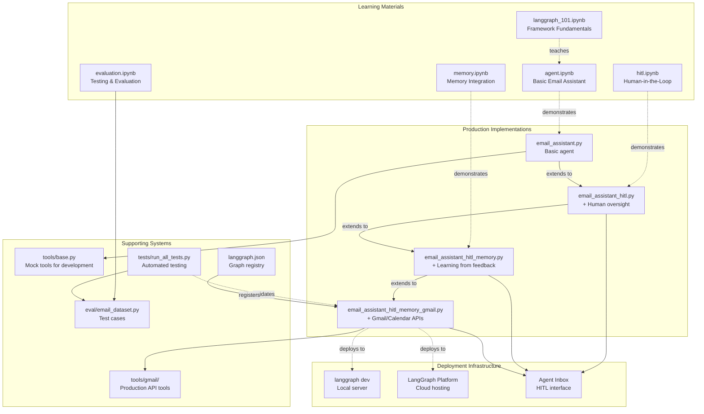
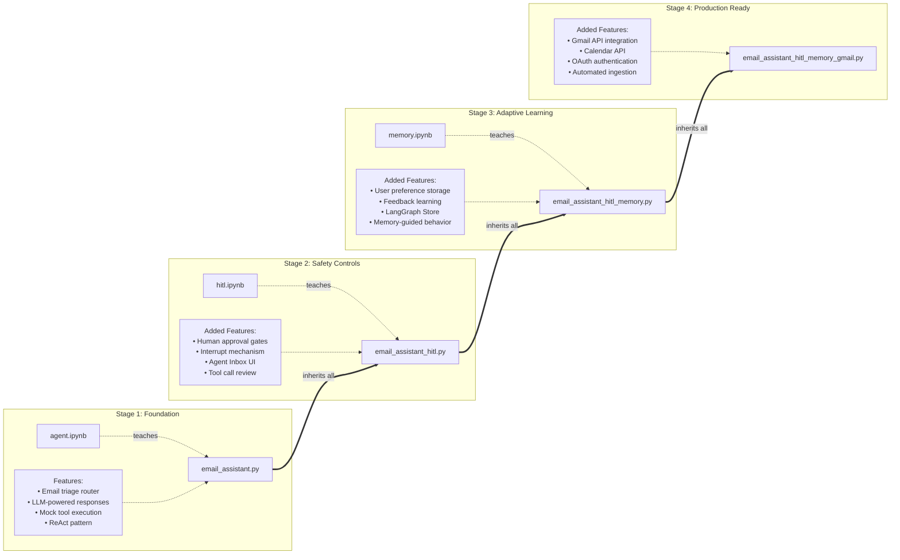
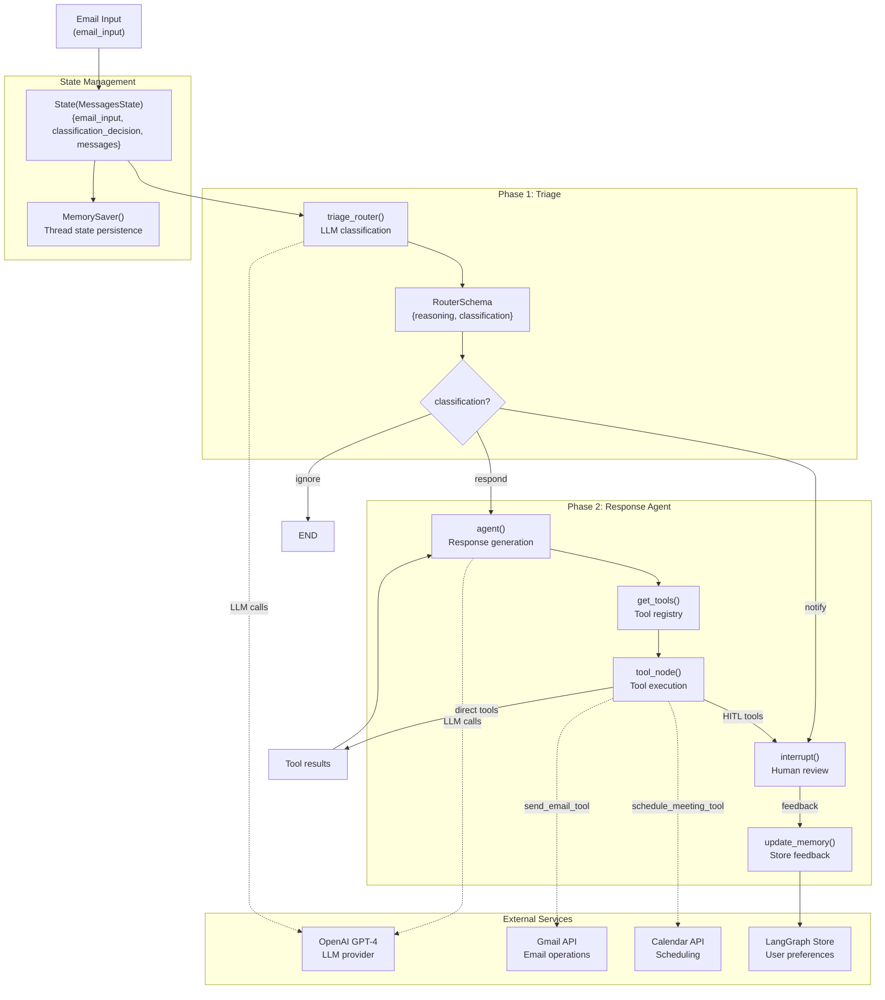
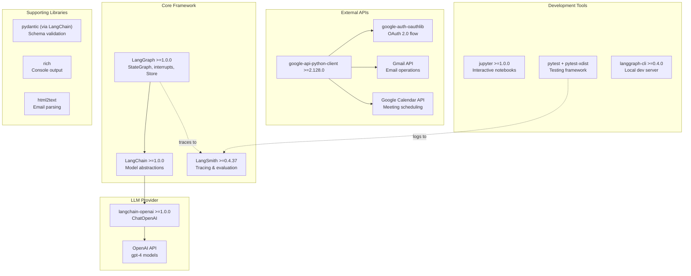
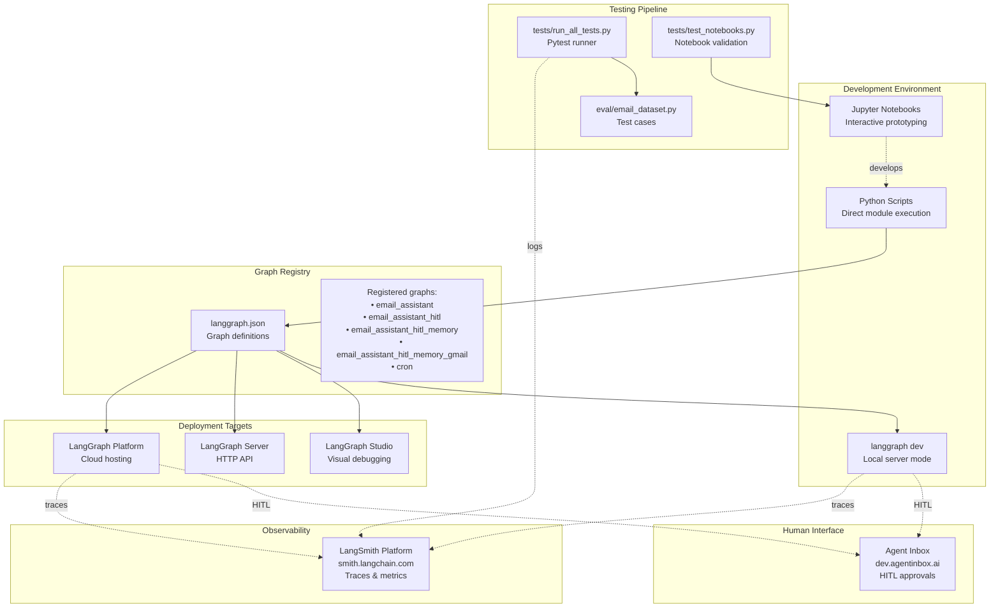

<!-- source: DeepWiki mcp.deepwiki.com · repo langchain-ai/agents-from-scratch · page 1 Overview · fetched 2026-10-26 -->

# Overview

<details>
<summary>Relevant source files</summary>

The following files were used as context for generating this wiki page:

- [.gitignore](.gitignore)
- [README.md](README.md)
- [langgraph.json](langgraph.json)
- [pyproject.toml](pyproject.toml)
- [src/email_assistant/schemas.py](src/email_assistant/schemas.py)

</details>


## Purpose and Scope

This document provides a high-level introduction to the **agents-from-scratch** repository, a hands-on tutorial for building a production-ready email assistant agent using LangGraph. The repository teaches agent development through progressive implementation, starting from basic ReAct patterns and advancing to human-in-the-loop oversight, memory-enabled learning, and Gmail API integration.

The tutorial is structured as four cumulative stages, each combining an interactive Jupyter notebook for learning and experimentation with production Python modules for deployment. By the final stage, the system demonstrates a fully functional "ambient" agent capable of triaging, responding to, and learning from email interactions with real Gmail and Google Calendar APIs.

For details on the LangGraph framework concepts used throughout (StateGraph, checkpoints, interrupts), see [LangGraph Framework](#2). For environment setup and deployment instructions, see [Development Setup](#8) and [Deployment](#8.1). For the core architecture details, see [Email Assistant Core Architecture](#3).

**Sources**: [README.md:1-6](), [README.md:75-130]()

---

## Repository Organization

The repository follows a **notebook-driven development pattern** where concepts are prototyped interactively before being hardened into production code. Each learning module consists of a paired notebook and Python implementation.

### File Structure Overview



**Sources**: [README.md:75-130](), [langgraph.json:1-16]()

### Repository Directory Structure

| Directory/File | Purpose |
|----------------|---------|
| `notebooks/` | Interactive Jupyter notebooks for learning and experimentation |
| `src/email_assistant/` | Production Python modules implementing the agent variants |
| `src/email_assistant/tools/` | Tool implementations (mock and Gmail API) |
| `eval/` | Test datasets and evaluation utilities |
| `tests/` | Automated test suite using pytest and LangSmith |
| `langgraph.json` | Graph registry for LangGraph Platform deployment |
| `pyproject.toml` | Python dependencies and package configuration |

**Sources**: [README.md:75-130](), [pyproject.toml:1-66]()

---

## Four-Stage Learning Path

The tutorial progresses through four cumulative implementation stages, each adding new capabilities while preserving all previous features. This design allows learners to understand how production agents evolve from simple prototypes.

### Stage Progression Diagram



**Sources**: [README.md:82-130]()

### Feature Accumulation Table

| Stage | Notebook | Production Module | Core Feature Added | Key Concepts |
|-------|----------|------------------|-------------------|--------------|
| **Preface** | `langgraph_101.ipynb` | `langgraph_101.py` | LangGraph fundamentals | StateGraph, nodes, edges, memory |
| **1: Foundation** | `agent.ipynb` | `email_assistant.py` | Email triage + response agent | ReAct pattern, tool calling, routing |
| **Evaluation** | `evaluation.ipynb` | N/A | Testing framework | Pytest, LLM-as-judge, LangSmith evaluate |
| **2: Safety** | `hitl.ipynb` | `email_assistant_hitl.py` | Human approval gates | Interrupts, checkpoints, Agent Inbox |
| **3: Learning** | `memory.ipynb` | `email_assistant_hitl_memory.py` | User preference memory | LangGraph Store, feedback loops |
| **4: Production** | N/A | `email_assistant_hitl_memory_gmail.py` | Gmail/Calendar APIs | OAuth, API integration, cron ingestion |

**Sources**: [README.md:79-130](), [langgraph.json:4-9]()

---

## High-Level Architecture

The email assistant implements a **two-phase workflow**: triage routing followed by agent-based response generation. Both phases leverage LLM decision-making, tool execution, and optional human oversight.

### Core Workflow Architecture



**Sources**: [src/email_assistant/schemas.py:1-38](), [README.md:82-130]()

### Key Architectural Components

#### State Management: `State` Class

The `State` class extends `MessagesState` to track email processing:

```python
# From schemas.py
class State(MessagesState):
    email_input: dict              # Original email data
    classification_decision: str    # Triage decision (ignore/respond/notify)
    # messages: list[Message]       # Inherited from MessagesState
```

**Sources**: [src/email_assistant/schemas.py:21-24]()

#### Workflow Phases

1. **Triage Phase** (`triage_router` node):
   - Uses LLM with structured output (`RouterSchema`) to classify emails
   - Three outcomes: `ignore`, `notify` (requires human review), `respond` (proceed to agent)
   - Reads from LangGraph Store to apply learned preferences

2. **Agent Phase** (`agent` node):
   - Implements ReAct pattern with `tool_choice="required"`
   - Executes tools via `tool_node` with conditional HITL gating
   - Updates memory based on human feedback

3. **Tool Execution** (`tool_node`):
   - Separates tools into HITL-required vs direct execution
   - HITL tools: `write_email`, `schedule_meeting`, `Question`
   - Direct tools: `check_calendar_availability`, `Done`, `fetch_emails_tool`

**Sources**: [src/email_assistant/schemas.py:5-16](), [README.md:82-130]()

---

## Key Technologies and Dependencies

The system integrates multiple technologies to provide agent capabilities, observability, and deployment infrastructure.

### Technology Stack Diagram



**Sources**: [pyproject.toml:6-25]()

### Required Environment Variables

| Variable | Purpose | Required For |
|----------|---------|--------------|
| `OPENAI_API_KEY` | OpenAI API authentication | All implementations |
| `LANGSMITH_API_KEY` | LangSmith tracing and evaluation | All implementations (optional but recommended) |
| `LANGSMITH_TRACING` | Enable LangSmith tracing | All implementations |
| `LANGSMITH_PROJECT` | Project name for trace organization | All implementations |
| Google OAuth credentials | Gmail/Calendar API access | Stage 4 only (`email_assistant_hitl_memory_gmail.py`) |

**Sources**: [README.md:18-45]()

---

## Development and Deployment Workflow

The repository supports both local development and cloud deployment through LangGraph Platform.

### Deployment Architecture



**Sources**: [README.md:132-166](), [langgraph.json:1-16]()

### Graph Registration via `langgraph.json`

The [langgraph.json:1-16]() file registers five graphs for deployment:

| Graph ID | Module Path | Purpose |
|----------|-------------|---------|
| `langgraph101` | `src/email_assistant/langgraph_101.py:app` | Educational example |
| `email_assistant` | `src/email_assistant/email_assistant.py:email_assistant` | Stage 1: Basic agent |
| `email_assistant_hitl` | `src/email_assistant/email_assistant_hitl.py:email_assistant` | Stage 2: + HITL |
| `email_assistant_hitl_memory` | `src/email_assistant/email_assistant_hitl_memory.py:email_assistant` | Stage 3: + Memory |
| `email_assistant_hitl_memory_gmail` | `src/email_assistant/email_assistant_hitl_memory_gmail.py:email_assistant` | Stage 4: + Gmail |
| `cron` | `src/email_assistant/cron.py:graph` | Automated email ingestion |

**Sources**: [langgraph.json:3-9]()

---

## Next Steps

This overview provides the foundation for understanding the agents-from-scratch repository structure and learning path. To dive deeper into specific components:

- **LangGraph fundamentals**: See [LangGraph Framework](#2) for StateGraph, interrupts, and checkpoints
- **Agent architecture details**: See [Email Assistant Core Architecture](#3) for triage router and agent implementation
- **HITL implementation**: See [Human-in-the-Loop (HITL) Integration](#3.2) for interrupt handling and Agent Inbox
- **Memory system**: See [Memory System](#3.3) for LangGraph Store and preference learning
- **Tool architecture**: See [Tool System](#4) for mock vs production tools
- **Evaluation methodology**: See [Evaluation System](#7) for testing and LLM-as-judge
- **Setup instructions**: See [Development Setup](#8) for environment configuration

**Sources**: [README.md:1-175]()

---

