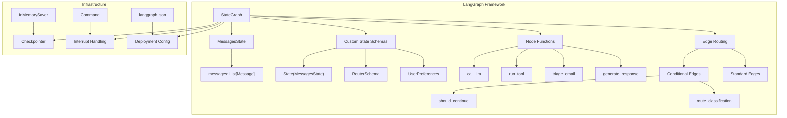
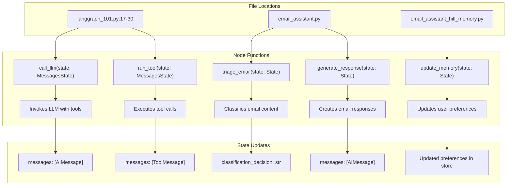
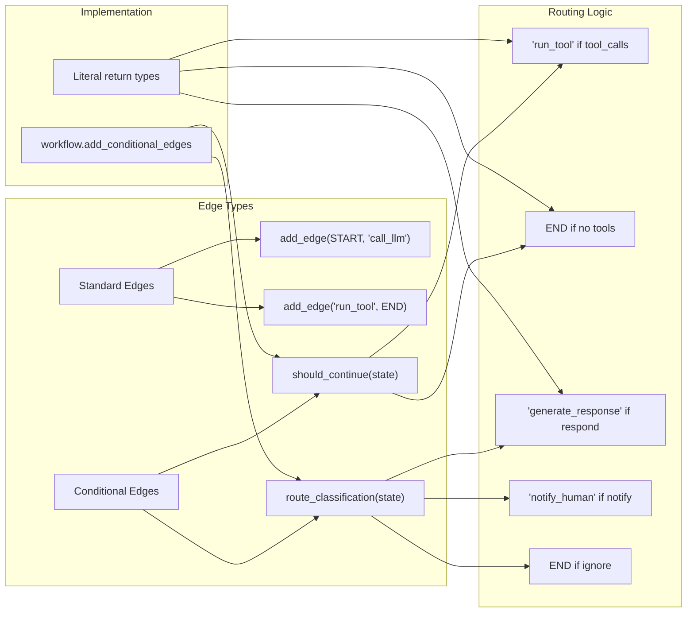
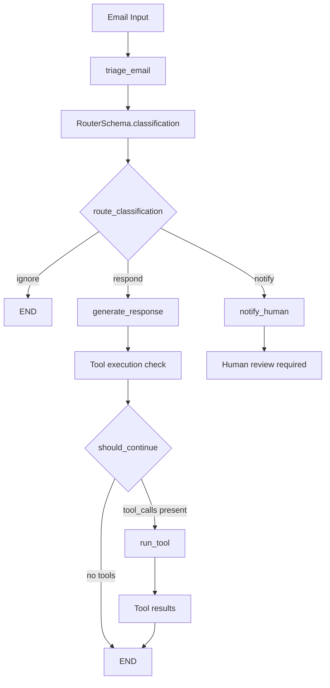
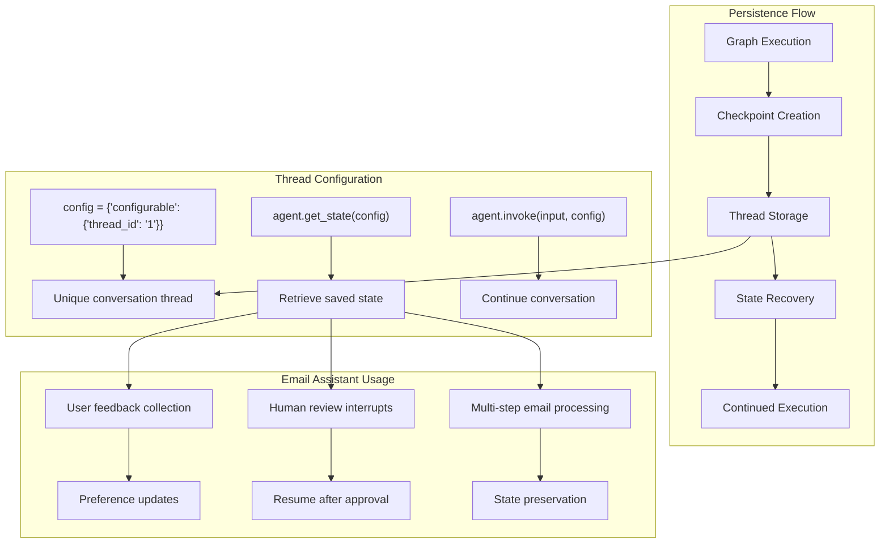
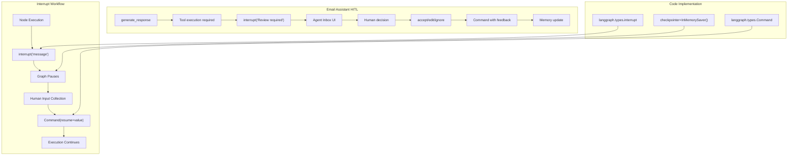
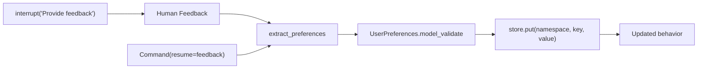
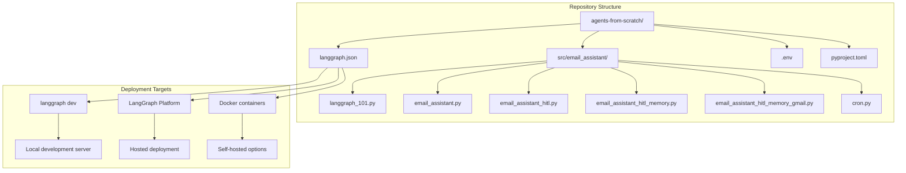

<!-- source: DeepWiki mcp.deepwiki.com · repo langchain-ai/agents-from-scratch · page 2 LangGraph Framework · fetched 2026-10-26 -->

# LangGraph Framework

<details>
<summary>Relevant source files</summary>

The following files were used as context for generating this wiki page:

- [README.md](README.md)
- [notebooks/langgraph_101.ipynb](notebooks/langgraph_101.ipynb)
- [src/email_assistant/langgraph_101.py](src/email_assistant/langgraph_101.py)

</details>


This document introduces the core LangGraph framework concepts and demonstrates how the email assistant system leverages state graphs, nodes, edges, and workflow orchestration to build sophisticated AI applications with human oversight capabilities.

For information about specific email assistant implementations, see [Email Assistant Core Architecture](#2). For deployment and automation details, see [Development Setup](#6).

## Framework Overview

LangGraph is a framework for building stateful, multi-step applications with Large Language Models (LLMs). It provides low-level infrastructure that enables developers to create both pre-defined workflows and dynamic agent behaviors with built-in persistence, human-in-the-loop capabilities, and deployment support.

### Core Benefits

LangGraph provides three primary benefits over direct LLM usage:

| Benefit | Description | Email Assistant Usage |
|---------|-------------|----------------------|
| **Control** | Define application flow as graphs with state, nodes, and edges | Triage routing, response generation, tool execution |
| **Persistence** | Built-in state management through checkpointers | Conversation memory, user preferences storage |
| **Deployment** | Integrated testing, debugging, and deployment tools | LangGraph Platform hosting, local development |

**LangGraph Core Architecture**



Sources: [notebooks/langgraph_101.ipynb:245-272](), [src/email_assistant/schemas.py:21-24](), [langgraph.json:1-16]()

## State Management

LangGraph applications are built around a central `State` concept that tracks information throughout the application lifecycle. The email assistant uses both built-in and custom state schemas.

### State Schema Hierarchy

```mermaid
graph TB
    subgraph "State Schema Types"
        A["MessagesState"] --> B["messages: List[Message]"]
        
        C["State(MessagesState)"] --> B
        C --> D["email_input: dict"]
        C --> E["classification_decision: Literal"]
        
        F["StateInput"] --> G["email_input: dict"]
        
        H["EmailData"] --> I["id: str"]
        H --> J["thread_id: str"]
        H --> K["from_email: str"]
        H --> L["subject: str"]
        H --> M["page_content: str"]
        H --> N["send_time: str"]
        H --> O["to_email: str"]
    end
    
    subgraph "Usage in Email Assistant"
        P["email_assistant.py"] --> C
        Q["email_assistant_hitl.py"] --> C
        R["email_assistant_hitl_memory.py"] --> C
        S["langgraph_101.py"] --> A
    end
    
    C --> P
    C --> Q
    C --> R
    A --> S
```



The `MessagesState` provides built-in message handling, while custom `State` classes extend this with email-specific fields like `email_input` and `classification_decision`.

Sources: [src/email_assistant/schemas.py:21-33](), [notebooks/langgraph_101.ipynb:281-288]()

## Node and Edge Architecture

LangGraph applications are composed of nodes (Python functions) connected by edges (control flow). Each node receives the current state and returns updates to merge back into the state.

### Email Assistant Node Structure



### Edge Types and Routing



Sources: [src/email_assistant/langgraph_101.py:45-50](), [notebooks/langgraph_101.ipynb:308-417]()

## Control Flow and Routing

LangGraph uses conditional edges to implement dynamic routing based on state content. The email assistant demonstrates this with classification-based routing and tool execution logic.

### Email Classification Router



### Conditional Edge Implementation

The routing logic uses typed return values to ensure type safety:

```python
def route_classification(state: State) -> Literal["generate_response", "notify_human", "__end__"]:
    """Route based on email classification"""
    classification = state["classification_decision"]
    if classification == "respond":
        return "generate_response"
    elif classification == "notify":
        return "notify_human"
    else:  # ignore
        return END
```

Sources: [notebooks/langgraph_101.ipynb:362-417](), [src/email_assistant/schemas.py:5-15]()

## Persistence and Memory

LangGraph provides built-in persistence through checkpointers, enabling applications to maintain state across executions and support human-in-the-loop workflows.

### Checkpointer Types

| Checkpointer | Use Case | Email Assistant Usage |
|--------------|----------|----------------------|
| `InMemorySaver` | Development, testing | Local development and demos |
| `PostgreSQLSaver` | Production deployment | Hosted LangGraph Platform |
| Custom checkpointers | Specialized storage | Integration with existing systems |

### Thread-based Persistence



Sources: [notebooks/langgraph_101.ipynb:482-558](), [src/email_assistant/langgraph_101.py:1-52]()

## Human-in-the-Loop with Interrupts

LangGraph supports interrupts that pause execution at specific points to collect human input. The email assistant uses this for review workflows and feedback collection.

### Interrupt Implementation



### Memory Update Flow

The human-in-the-loop variants use interrupts to collect feedback and update user preferences:



Sources: [notebooks/langgraph_101.ipynb:565-675](), [src/email_assistant/schemas.py:35-38]()

## Deployment Configuration

LangGraph applications are deployed through the LangGraph Platform using configuration files and structured project layouts.

### Project Structure



### Graph Registration

The `langgraph.json` file maps graph names to their Python module paths:

```json
{
  "graphs": {
    "langgraph101": "./src/email_assistant/langgraph_101.py:app",
    "email_assistant": "./src/email_assistant/email_assistant.py:email_assistant",
    "email_assistant_hitl": "./src/email_assistant/email_assistant_hitl.py:email_assistant",
    "email_assistant_hitl_memory": "./src/email_assistant/email_assistant_hitl_memory.py:email_assistant",
    "email_assistant_hitl_memory_gmail": "./src/email_assistant/email_assistant_hitl_memory_gmail.py:email_assistant",
    "cron": "./src/email_assistant/cron.py:graph"
  }
}
```

Each graph represents a different variant of the email assistant with progressive complexity and capabilities.

Sources: [langgraph.json:1-16](), [notebooks/langgraph_101.ipynb:708-757]()

---

