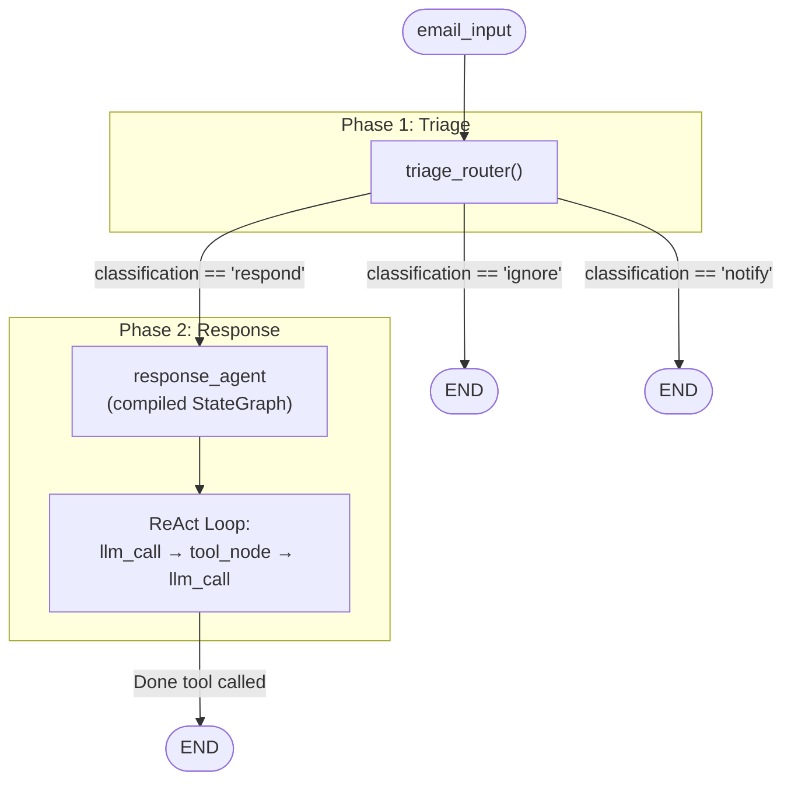
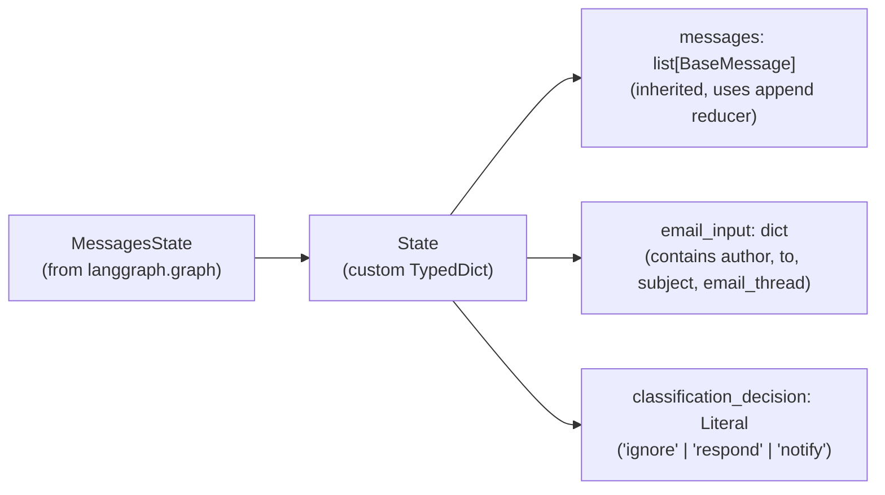
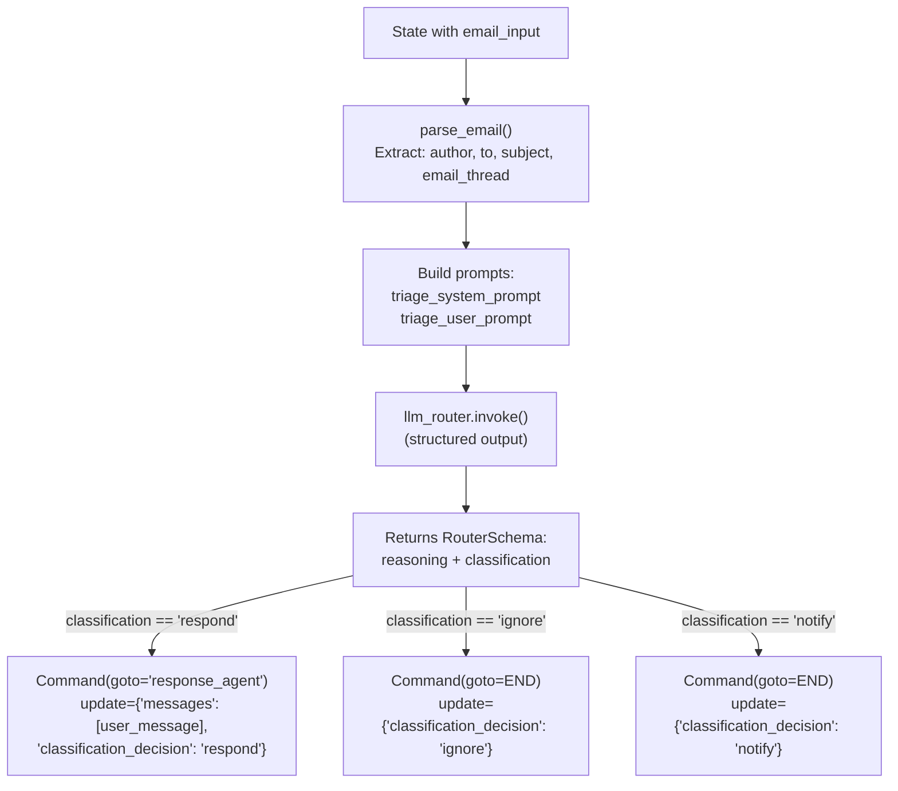
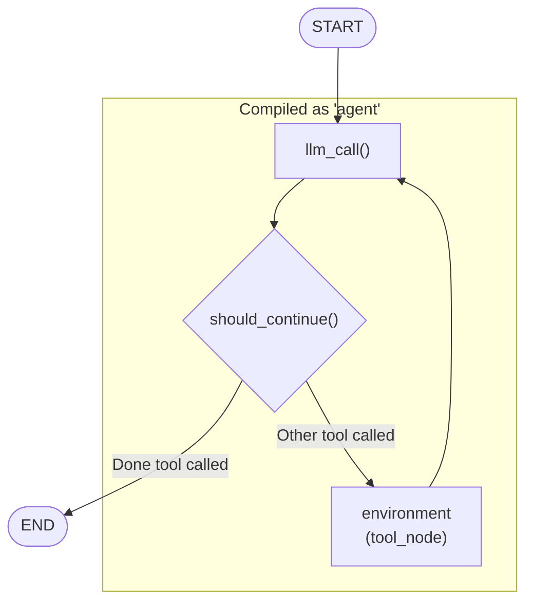
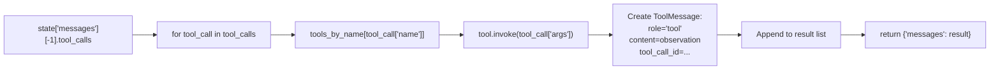
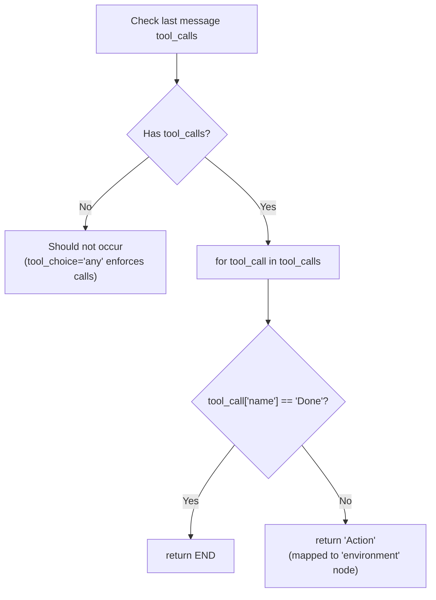
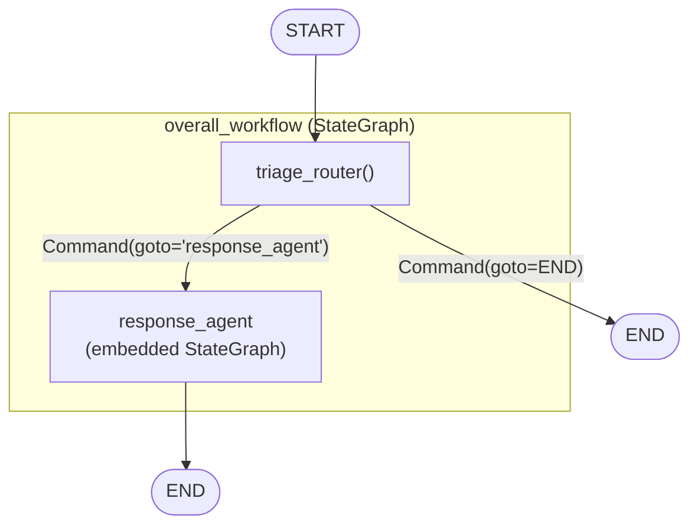
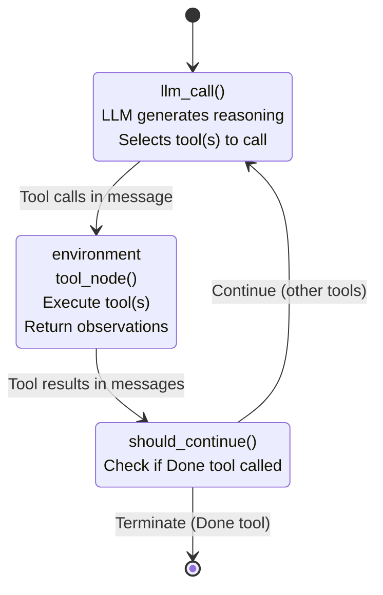

<!-- source: DeepWiki mcp.deepwiki.com · repo langchain-ai/agents-from-scratch · page 3 Email Assistant Core Architecture · fetched 2026-10-26 -->

# Email Assistant Core Architecture

<details>
<summary>Relevant source files</summary>

The following files were used as context for generating this wiki page:

- [README.md](README.md)
- [notebooks/agent.ipynb](notebooks/agent.ipynb)
- [src/email_assistant/email_assistant.py](src/email_assistant/email_assistant.py)

</details>


## Purpose and Scope

This document describes the fundamental architecture of the email assistant system as implemented in the basic `email_assistant.py` module. It covers the two-phase workflow structure (triage router + response agent), state management primitives, node implementations, and the ReAct (Reasoning + Acting) pattern that drives agent behavior.

For progressive feature additions across implementation variants, see [Implementation Variants](#3.1). For human-in-the-loop mechanisms, see [HITL Integration](#3.2). For memory and learning capabilities, see [Memory System](#3.3). For production Gmail API integration, see [Gmail Integration](#3.4).

**Sources:** [src/email_assistant/email_assistant.py:1-161](), [notebooks/agent.ipynb:1-686](), [README.md:82-88]()

---

## System Overview

The email assistant implements a two-phase workflow pattern that separates email classification from response generation:



**Workflow Phases**

| Phase | Entry Point | Purpose | Output |
|-------|-------------|---------|--------|
| **Triage** | `triage_router()` | Classify email as `ignore`, `notify`, or `respond` using `llm_router.with_structured_output(RouterSchema)` | Classification decision and optional messages |
| **Response** | `response_agent` (subgraph) | Execute multi-step reasoning and action loop to craft response using tools | Completed email response via tool calls |

The triage phase uses structured output to ensure deterministic classification, while the response phase implements an agentic ReAct loop with tool calling capabilities.

**Sources:** [src/email_assistant/email_assistant.py:94-161](), [notebooks/agent.ipynb:86-102]()

---

## State Management

The system uses LangGraph's `MessagesState` as a foundation and extends it with custom fields:



### State Schema Definition

The `State` class in [src/email_assistant/schemas.py]() defines the shared state structure:

| Field | Type | Purpose | Reducer |
|-------|------|---------|---------|
| `messages` | `list[BaseMessage]` | Conversation history for LLM context | Append (inherited from `MessagesState`) |
| `email_input` | `dict` | Raw email data with keys: `author`, `to`, `subject`, `email_thread` | Overwrite |
| `classification_decision` | `Literal["ignore", "respond", "notify"]` | Triage classification result | Overwrite |

The `messages` field automatically appends new messages returned by nodes due to the [reducer pattern](https://langchain-ai.github.io/langgraph/concepts/low_level/#reducers) inherited from `MessagesState`. This eliminates the need for manual message concatenation logic.

**Sources:** [notebooks/agent.ipynb:104-120](), [src/email_assistant/email_assistant.py:8]()

---

## Triage Router

The `triage_router()` function implements Phase 1 classification logic using structured output to ensure deterministic routing decisions.

### Classification Schema

```python
class RouterSchema(BaseModel):
    reasoning: str  # Step-by-step classification justification
    classification: Literal["ignore", "respond", "notify"]
```

The `reasoning` field enables chain-of-thought processing before classification, improving decision quality.

### Triage Node Implementation



**Key Implementation Details:**

1. **Email Parsing** ([src/email_assistant/email_assistant.py:102]()):
   ```python
   author, to, subject, email_thread = parse_email(state["email_input"])
   ```

2. **LLM Router Invocation** ([src/email_assistant/email_assistant.py:116-121]()):
   - Uses `llm.with_structured_output(RouterSchema)` for guaranteed schema compliance
   - System prompt includes `triage_system_prompt.format(background=..., triage_instructions=...)`
   - User prompt provides formatted email content

3. **Command Object Routing** ([src/email_assistant/email_assistant.py:126-151]()):
   - Returns `Command(goto=..., update=...)` to both route and update state
   - `goto="response_agent"` triggers Phase 2 agent execution
   - `goto=END` terminates workflow for `ignore` and `notify` classifications

**Sources:** [src/email_assistant/email_assistant.py:94-151](), [notebooks/agent.ipynb:127-288]()

---

## Response Agent Architecture

The response agent implements a ReAct loop as a compiled `StateGraph` subgraph. It consists of three core components: LLM decision node, tool execution node, and conditional routing logic.

### Agent Graph Structure



This graph is compiled once and embedded as a subgraph within the overall workflow at node name `"response_agent"`.

### LLM Call Node

The `llm_call()` function ([src/email_assistant/email_assistant.py:29-47]()) implements the reasoning phase:

**Node Behavior:**

| Step | Implementation | Purpose |
|------|----------------|---------|
| 1. Construct prompt | Prepend `agent_system_prompt.format(...)` to `state["messages"]` | Provide tool descriptions and response guidelines |
| 2. Invoke LLM | `llm_with_tools.invoke([system_msg] + messages)` | Get tool call decision |
| 3. Return message | `{"messages": [ai_message]}` | Update state with LLM's tool choice |

**Tool Binding Configuration:**

```python
llm_with_tools = llm.bind_tools(tools, tool_choice="any")
```

The `tool_choice="any"` parameter enforces that the LLM must select at least one tool on every invocation, implementing a strict ReAct pattern with no "direct response" mode.

**Sources:** [src/email_assistant/email_assistant.py:24-47](), [notebooks/agent.ipynb:301-375]()

### Tool Handler Node

The `tool_node()` function ([src/email_assistant/email_assistant.py:49-57]()) executes tool calls:



**Implementation Details:**

1. **Tool Registry Lookup** ([src/email_assistant/email_assistant.py:16-18]()):
   ```python
   tools = get_tools()
   tools_by_name = get_tools_by_name(tools)
   ```

2. **Multiple Tool Support** ([src/email_assistant/email_assistant.py:52-56]()):
   - Iterates through all tool calls in the last AI message
   - Creates separate `ToolMessage` for each execution result
   - Returns all tool messages in a single update

3. **Tool Message Format**:
   - `role="tool"` identifies the message type
   - `tool_call_id` links response to specific tool call in AI message
   - `content` contains string representation of tool output

**Sources:** [src/email_assistant/email_assistant.py:49-57](), [notebooks/agent.ipynb:382-413]()

### Conditional Routing Logic

The `should_continue()` function ([src/email_assistant/email_assistant.py:60-69]()) determines loop continuation:

**Routing Decision Tree:**



**Termination Condition:**

The `Done` tool serves as the explicit completion signal. When the LLM determines that the email response task is complete, it calls `Done(done=True)`, triggering workflow termination.

**Sources:** [src/email_assistant/email_assistant.py:60-69](), [notebooks/agent.ipynb:420-446]()

---

## Workflow Composition

The overall workflow combines the triage router and response agent as peer nodes in a parent graph:

### Graph Compilation



**Compilation Code** ([src/email_assistant/email_assistant.py:154-161]()):

```python
overall_workflow = (
    StateGraph(State, input=StateInput)
    .add_node(triage_router)
    .add_node("response_agent", agent)  # 'agent' is pre-compiled StateGraph
    .add_edge(START, "triage_router")
)

email_assistant = overall_workflow.compile()
```

**Key Architectural Decisions:**

| Decision | Rationale |
|----------|-----------|
| No explicit edges from `triage_router` | Uses `Command` objects for dynamic routing |
| `response_agent` is a compiled subgraph | Encapsulation: triage phase doesn't need to know agent internals |
| No edge from `response_agent` to other nodes | Always terminates workflow (reaches own internal `END`) |
| Single entry point (`START → triage_router`) | All emails must pass through triage classification |

**Sources:** [src/email_assistant/email_assistant.py:154-161](), [notebooks/agent.ipynb:519-558]()

---

## ReAct Pattern Implementation

The response agent implements the ReAct (Reasoning + Acting) pattern through enforced tool calling and iterative execution:

### ReAct Cycle



### Enforcement Mechanisms

| Mechanism | Implementation | Effect |
|-----------|----------------|--------|
| **Mandatory tool use** | `tool_choice="any"` in `llm.bind_tools()` | LLM cannot respond without calling a tool |
| **Explicit completion** | `Done` tool required for termination | Prevents premature workflow exit |
| **Observation integration** | Tool results added to `messages` state | LLM receives feedback in next iteration |
| **No direct responses** | No conditional edge bypassing tools | Forces action step in every cycle |

### Example Execution Trace

**Turn 1 - Reasoning:**
```
AI Message: {tool_calls: [{name: "check_calendar_availability", args: {day: "Monday"}}]}
```

**Turn 1 - Acting:**
```
Tool Message: {content: "Available times on Monday: 9:00 AM, 2:00 PM, 4:00 PM", tool_call_id: "..."}
```

**Turn 2 - Reasoning:**
```
AI Message: {tool_calls: [{name: "schedule_meeting", args: {attendees: [...], preferred_day: "2024-03-04", start_time: 14}}]}
```

**Turn 2 - Acting:**
```
Tool Message: {content: "Meeting 'API Review' scheduled on Monday, March 04, 2024 at 14 for 60 minutes with 2 attendees", tool_call_id: "..."}
```

**Turn 3 - Reasoning:**
```
AI Message: {tool_calls: [{name: "write_email", args: {to: "alice@...", subject: "Re: API documentation", content: "..."}}]}
```

**Turn 3 - Acting:**
```
Tool Message: {content: "Email sent to alice@... with subject 'Re: API documentation' and content: ...", tool_call_id: "..."}
```

**Turn 4 - Reasoning:**
```
AI Message: {tool_calls: [{name: "Done", args: {done: true}}]}
```

**Turn 4 - Termination:**
```
should_continue() returns END
```

This trace demonstrates how the ReAct pattern enables multi-step reasoning where each tool observation informs the next decision.

**Sources:** [src/email_assistant/email_assistant.py:29-89](), [notebooks/agent.ipynb:449-512]()

---

## Module Entry Point

The module exports a single compiled graph as the primary interface:

```python
# Exported at module level (src/email_assistant/email_assistant.py:161)
email_assistant = overall_workflow.compile()
```

**Invocation Contract:**

```python
# Input schema
input = {
    "email_input": {
        "author": "Alice <alice@example.com>",
        "to": "Bob <bob@example.com>",
        "subject": "Meeting request",
        "email_thread": "Hi Bob,\n\nCould we schedule a meeting next week?\n\nAlice"
    }
}

# Synchronous execution
result = email_assistant.invoke(input)

# Output contains:
# - result["messages"]: Full conversation history including tool calls
# - result["classification_decision"]: "ignore" | "respond" | "notify"
# - result["email_input"]: Original input (unchanged)
```

The `email_assistant` graph is registered in `langgraph.json` for deployment to LangGraph Platform.

**Sources:** [src/email_assistant/email_assistant.py:161](), [notebooks/agent.ipynb:605-616]()

---

