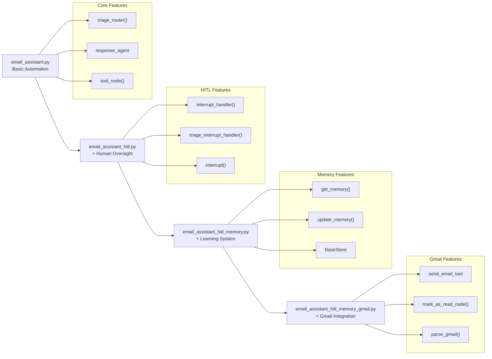
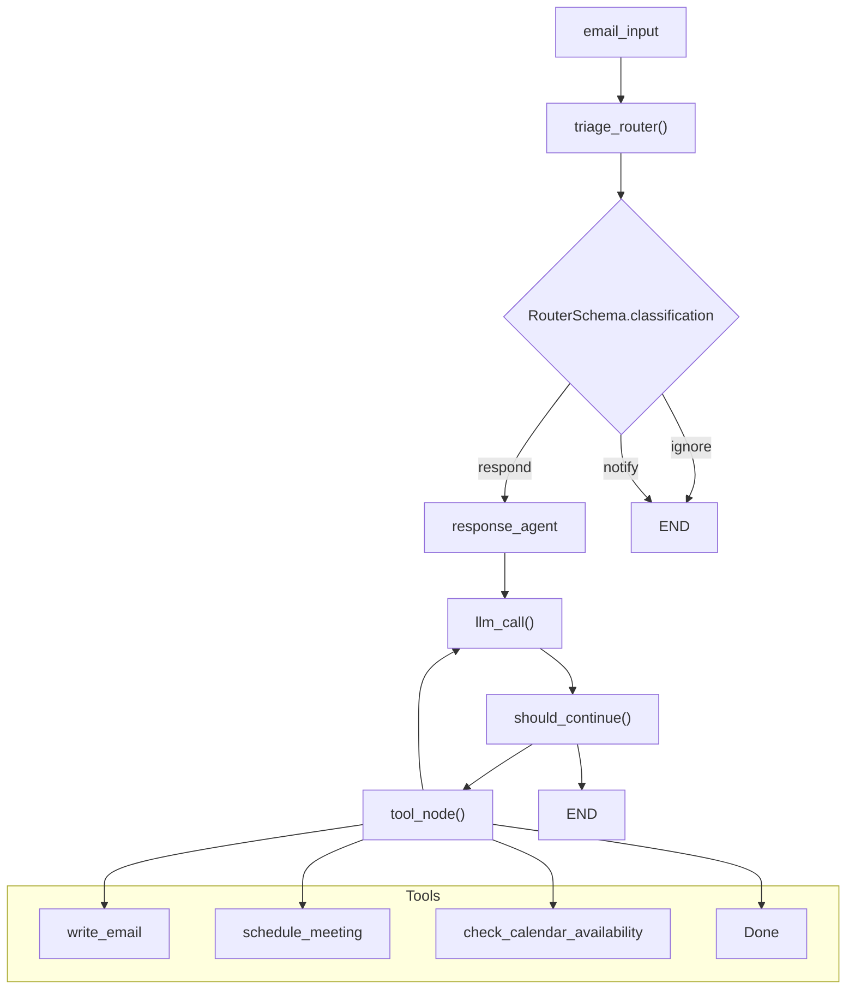
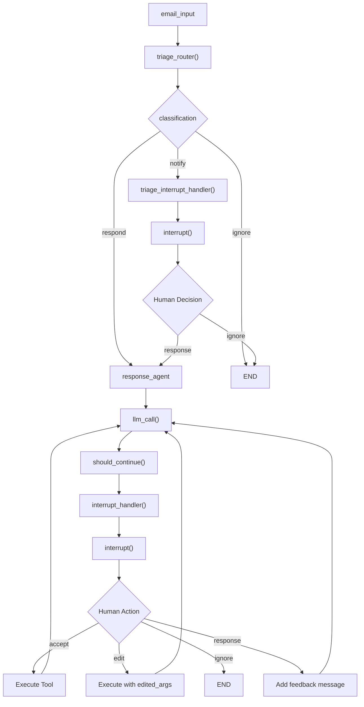
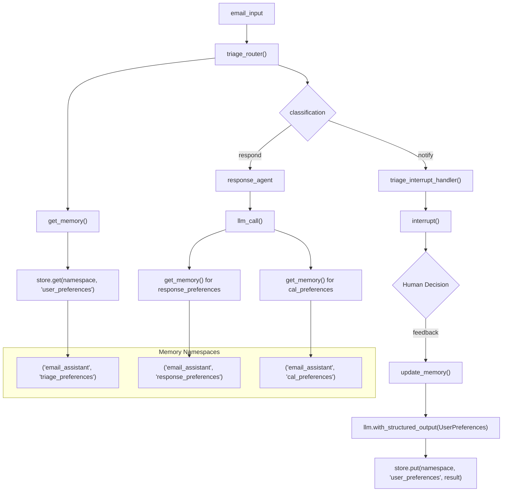
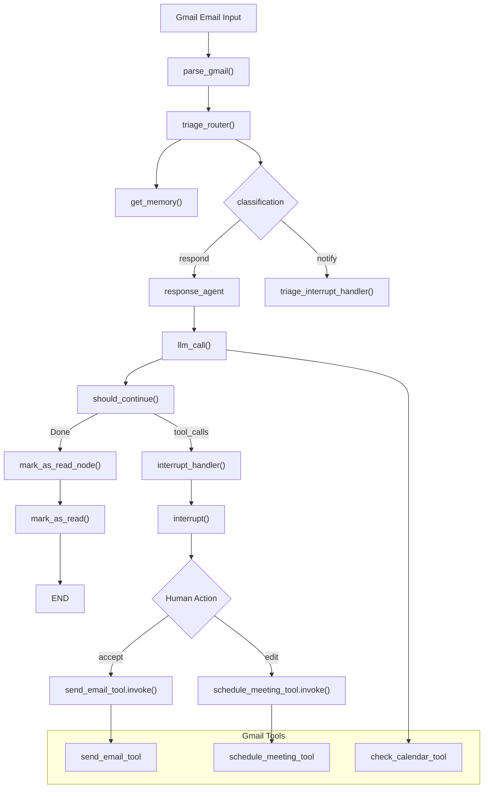

<!-- source: DeepWiki mcp.deepwiki.com · repo langchain-ai/agents-from-scratch · page 3.1 Implementation Variants · fetched 2026-10-26 -->

# Implementation Variants

Relevant source files

The following files were used as context for generating this wiki page:

- [README.md](README.md)
- [notebooks/agent.ipynb](notebooks/agent.ipynb)
- [src/email_assistant/email_assistant.py](src/email_assistant/email_assistant.py)

This document covers the progressive evolution of email assistant implementations, from basic automation to sophisticated human-AI collaboration with learning capabilities and Gmail integration. Each variant builds upon the previous one, adding new capabilities while maintaining the core email processing workflow.

For information about the underlying LangGraph framework concepts, see [LangGraph Framework](#4). For details about the human oversight mechanisms, see [Human-in-the-Loop (HITL) Integration](#2.2). For memory and learning capabilities, see [Memory System](#2.3). For production deployment with Gmail, see [Gmail Integration](#2.4).

## Implementation Evolution Overview

The email assistant system consists of four main implementation variants, each building incrementally on the previous version:

### Implementation Progression

**Sources:** [src/email_assistant/email_assistant.py](), [src/email_assistant/email_assistant_hitl.py](), [src/email_assistant/email_assistant_hitl_memory.py](), [src/email_assistant/email_assistant_hitl_memory_gmail.py]()

## Basic Email Assistant

### Architecture

The foundational implementation provides automated email triage and response without human intervention.

**Key Components:**

| Component | Function | Purpose |
|-----------|----------|---------|
| `triage_router` | [src/email_assistant/email_assistant.py:94-151]() | Classifies emails using `llm_router.with_structured_output(RouterSchema)` |
| `response_agent` | [src/email_assistant/email_assistant.py:153-159]() | Compiled `StateGraph` for handling email responses |
| `tool_node` | [src/email_assistant/email_assistant.py:49-57]() | Executes tool calls using `tools_by_name[tool_call["name"]]` |
| `should_continue` | [src/email_assistant/email_assistant.py:60-69]() | Routes workflow based on `Done` tool detection |

**Sources:** [src/email_assistant/email_assistant.py:1-161]()

## Human-in-the-Loop (HITL) Email Assistant

### Enhanced Architecture

Adds human oversight at both triage and action execution stages through interrupt mechanisms.

**Key HITL Components:**

| Component | Function | Purpose |
|-----------|----------|---------|
| `triage_interrupt_handler` | [src/email_assistant/email_assistant_hitl.py:101-158]() | Creates `interrupt([request])` for triage decisions |
| `interrupt_handler` | [src/email_assistant/email_assistant_hitl.py:179-346]() | Manages tool call interrupts with configurable actions |
| `hitl_tools` | [src/email_assistant/email_assistant_hitl.py:192]() | List `["write_email", "schedule_meeting", "Question"]` |

**Sources:** [src/email_assistant/email_assistant_hitl.py:1-391]()

## HITL + Memory Email Assistant

### Memory-Enhanced Architecture

Adds persistent memory storage and learning from human feedback to improve future decisions.

**Memory System Components:**

| Component | Function | Purpose |
|-----------|----------|---------|
| `get_memory` | [src/email_assistant/email_assistant_hitl_memory.py:30-55]() | Retrieves or initializes memory from `BaseStore` |
| `update_memory` | [src/email_assistant/email_assistant_hitl_memory.py:57-76]() | Updates memory using LLM with `UserPreferences` schema |
| `BaseStore` | [src/email_assistant/email_assistant_hitl_memory.py:6]() | LangGraph persistent storage interface |

**Sources:** [src/email_assistant/email_assistant_hitl_memory.py:1-501]()

## HITL + Memory + Gmail Email Assistant

### Production-Ready Architecture

Integrates with Gmail API for real-world email processing with authentication and email management.

**Gmail Integration Components:**

| Component | Function | Purpose |
|-----------|----------|---------|
| `parse_gmail` | [src/email_assistant/email_assistant_hitl_memory_gmail.py:14]() | Extracts `email_id` along with standard email fields |
| `format_gmail_markdown` | [src/email_assistant/email_assistant_hitl_memory_gmail.py:14]() | Formats Gmail emails for display with ID tracking |
| `mark_as_read_node` | [src/email_assistant/email_assistant_hitl_memory_gmail.py:472-475]() | Calls `mark_as_read(email_id)` after processing |
| Gmail tools | [src/email_assistant/email_assistant_hitl_memory_gmail.py:20]() | `["send_email_tool", "schedule_meeting_tool", "check_calendar_tool"]` |

**Sources:** [src/email_assistant/email_assistant_hitl_memory_gmail.py:1-511]()

## Implementation Comparison

### Feature Matrix

| Feature | Basic | HITL | HITL + Memory | HITL + Memory + Gmail |
|---------|-------|------|---------------|----------------------|
| Email Triage | ✓ | ✓ | ✓ | ✓ |
| Automated Response | ✓ | ✓ | ✓ | ✓ |
| Human Oversight | ✗ | ✓ | ✓ | ✓ |
| Learning from Feedback | ✗ | ✗ | ✓ | ✓ |
| Gmail Integration | ✗ | ✗ | ✗ | ✓ |
| Production Ready | ✗ | ✗ | ✗ | ✓ |

### Code Entity Mapping

```mermaid
graph TB
    subgraph "Common Core"
        A["State"]
        B["RouterSchema"]
        C["StateInput"]
        D["triage_system_prompt"]
        E["agent_system_prompt"]
    end
    
    subgraph "Basic Implementation"
        F["email_assistant.py"]
        G["tool_node()"]
        H["should_continue()"]
        I["AGENT_TOOLS_PROMPT"]
    end
    
    subgraph "HITL Implementation"
        J["email_assistant_hitl.py"]
        K["interrupt_handler()"]
        L["triage_interrupt_handler()"]
        M["HITL_TOOLS_PROMPT"]
    end
    
    subgraph "Memory Implementation"
        N["email_assistant_hitl_memory.py"]
        O["get_memory()"]
        P["update_memory()"]
        Q["UserPreferences"]
        R["HITL_MEMORY_TOOLS_PROMPT"]
    end
    
    subgraph "Gmail Implementation"
        S["email_assistant_hitl_memory_gmail.py"]
        T["parse_gmail()"]
        U["mark_as_read_node()"]
        V["GMAIL_TOOLS_PROMPT"]
    end
    
    A --> F
    A --> J
    A --> N
    A --> S
    
    B --> F
    B --> J
    B --> N
    B --> S
```

**Sources:** [src/email_assistant/schemas.py](), [src/email_assistant/prompts.py](), [src/email_assistant/tools/default/prompt_templates.py](), [src/email_assistant/tools/gmail/prompt_templates.py]()

## Testing Considerations

The testing framework in [tests/run_all_tests.py:25-33]() excludes HITL and memory variants due to the `Question` tool not being included in evaluation datasets and infinite loop issues with hardcoded resume commands.

**Testing Coverage:**

| Implementation | Tested | Reason |
|----------------|--------|--------|
| `email_assistant` | ✓ | Full compatibility with test datasets |
| `email_assistant_hitl` | ✗ | `Question` tool causes test loop issues |
| `email_assistant_hitl_memory` | ✗ | Same as HITL + memory complexity |
| `email_assistant_hitl_memory_gmail` | ✗ | Requires Gmail authentication |

**Sources:** [tests/run_all_tests.py:25-47]()

---

