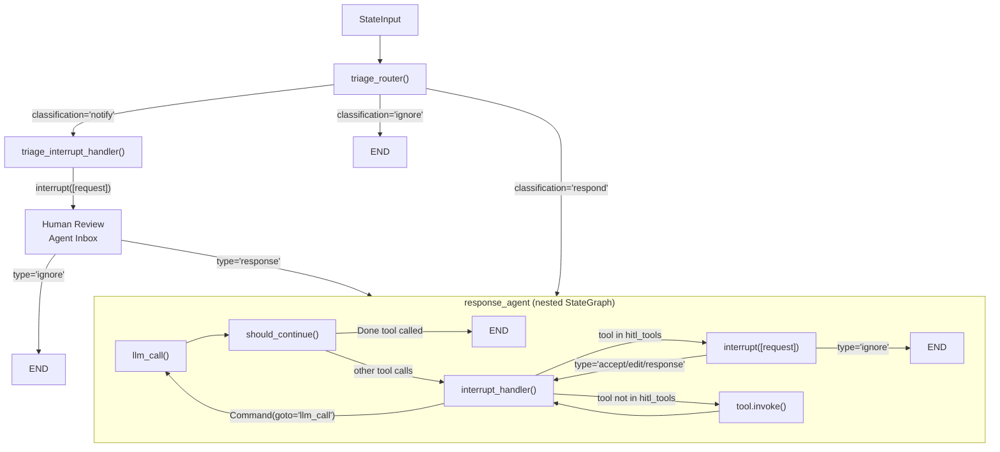
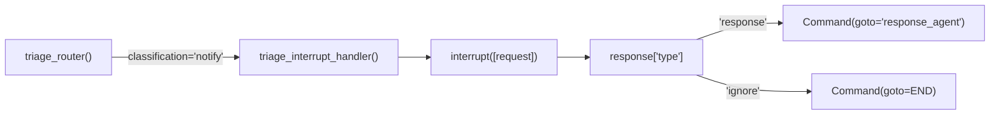
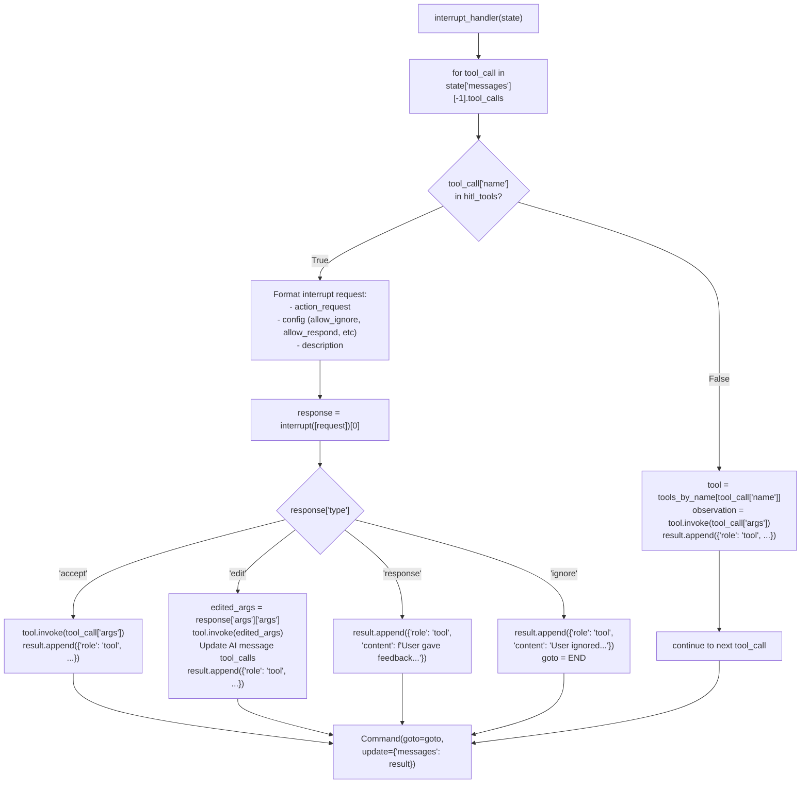
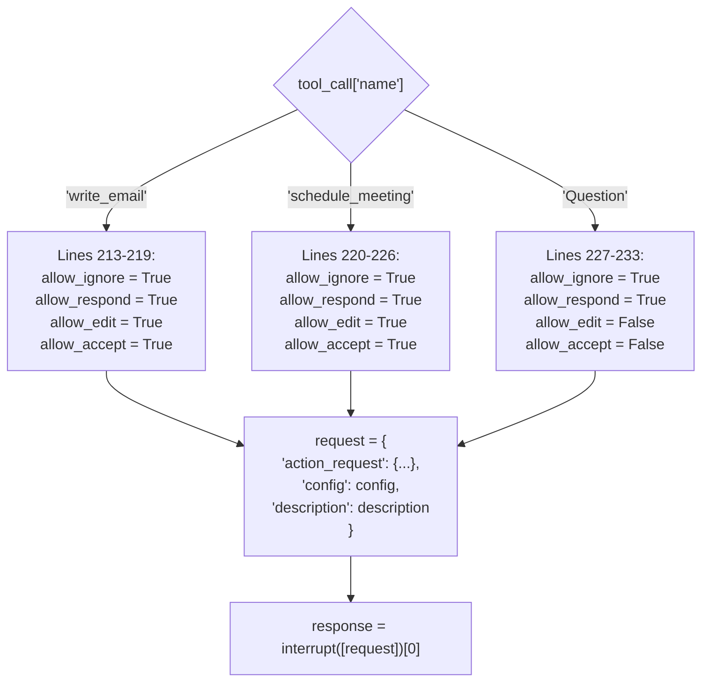
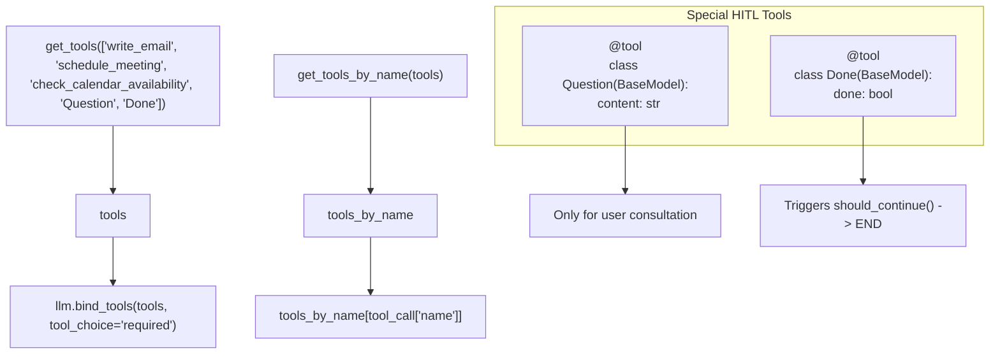
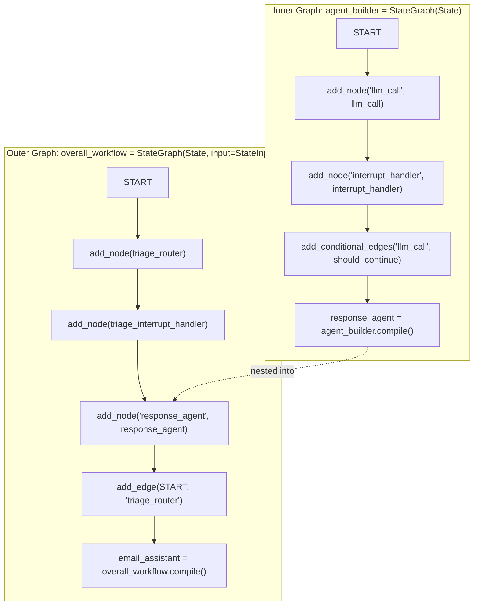
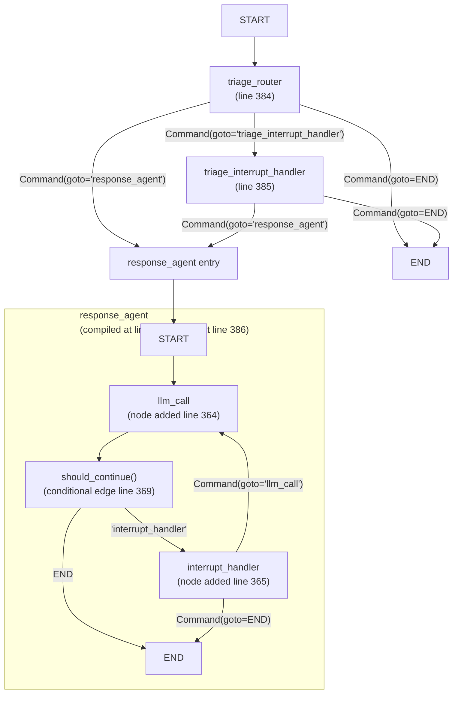

<!-- source: DeepWiki mcp.deepwiki.com · repo langchain-ai/agents-from-scratch · page 3.2 Human-in-the-Loop (HITL) Integration · fetched 2026-10-26 -->

# Human-in-the-Loop (HITL) Integration

<details>
<summary>Relevant source files</summary>

The following files were used as context for generating this wiki page:

- [README.md](README.md)
- [notebooks/hitl.ipynb](notebooks/hitl.ipynb)
- [src/email_assistant/email_assistant_hitl.py](src/email_assistant/email_assistant_hitl.py)

</details>


## Purpose and Overview

The Human-in-the-Loop (HITL) integration enables the email assistant to pause at critical decision points for human review and approval. This feature is essential for sensitive tasks like email management, where fully autonomous operation might not be appropriate. The HITL system allows humans to review, edit, approve or reject specific actions before they are executed, creating a collaborative workflow between AI and human users.

This document details how human intervention is incorporated into the email assistant workflow, focusing on the interrupt mechanism, user interaction types, and implementation architecture. For information about the core email assistant functionality, see [Email Assistant Core Architecture](#2).

## HITL Architecture

The HITL functionality extends the basic email assistant by adding interrupt mechanisms that pause execution at specific points for human input. The implementation in `email_assistant_hitl.py` consists of two main graph structures:

1. **Triage-level interrupts** - Via `triage_interrupt_handler()` when `classification == "notify"`
2. **Tool-level interrupts** - Via `interrupt_handler()` for sensitive tools like `write_email`, `schedule_meeting`, and `Question`

**High-Level HITL Flow Diagram**



Sources: [src/email_assistant/email_assistant_hitl.py:30-99](), [src/email_assistant/email_assistant_hitl.py:101-158](), [src/email_assistant/email_assistant_hitl.py:179-346](), [src/email_assistant/email_assistant_hitl.py:349-391]()

## Interrupt Points

The HITL integration adds two main interrupt points where human review and feedback are incorporated:

### 1. Triage Interrupt

When `result.classification == "notify"` in `triage_router()`, the system creates a `Command(goto="triage_interrupt_handler")` to pause execution for user review.



The `triage_interrupt_handler()` function creates an interrupt with specific configuration:

```python
request = {
    "action_request": {
        "action": f"Email Assistant: {state['classification_decision']}",
        "args": {}
    },
    "config": {
        "allow_ignore": True,  
        "allow_respond": True, 
        "allow_edit": False, 
        "allow_accept": False,  
    }
}
```

Sources: [src/email_assistant/email_assistant_hitl.py:87-95](), [src/email_assistant/email_assistant_hitl.py:116-129](), [src/email_assistant/email_assistant_hitl.py:135-151]()

### 2. Tool Call Interrupts

The `interrupt_handler()` function at [src/email_assistant/email_assistant_hitl.py:179-346]() filters tool calls using a hardcoded list defined at line 192:

```python
hitl_tools = ["write_email", "schedule_meeting", "Question"]
```

**HITL Tool Classification**

| Tool | Purpose | Interrupt Reason | Execution |
|------|---------|------------------|-----------|
| `write_email` | Create and send emails | Email sending has external impact | Requires HITL |
| `schedule_meeting` | Book calendar meetings | Calendar changes impact scheduling | Requires HITL |
| `Question` | Ask user for clarification | Requires direct human input | Requires HITL |
| `check_calendar_availability` | Query calendar | Read-only operation | Direct execution |
| `Done` | Signal workflow completion | Control flow signal | Direct execution |

**Interrupt Handler Flow**



Sources: [src/email_assistant/email_assistant_hitl.py:179-346](), [src/email_assistant/email_assistant_hitl.py:191-201](), [src/email_assistant/email_assistant_hitl.py:250-340]()

## User Interaction Types

The HITL system supports four types of user interactions, returned as `response["type"]` from the `interrupt()` call:

| Interaction | Description | Effect on Workflow | Implementation |
|-------------|-------------|-------------------|----------------|
| `accept` | Approve the action as proposed | Tool executes with original `tool_call["args"]` | `tool.invoke(tool_call["args"])` at line 255 |
| `edit` | Modify the action before execution | Tool executes with `response["args"]["args"]` | `tool.invoke(edited_args)` at lines 284, 294 |
| `response` | Provide feedback or answer questions | Feedback added to `messages` as tool response | Lines 325-333 |
| `ignore` | Reject the proposed action | Cancels tool execution, `goto = END` | Lines 303-320 |

**Per-Tool Interrupt Configuration**

Each tool's allowed interactions are configured in `interrupt_handler()` at [src/email_assistant/email_assistant_hitl.py:213-235]():



The `Question` tool intentionally disables `allow_edit` and `allow_accept` because questions require natural language responses, not structured argument editing.

Sources: [src/email_assistant/email_assistant_hitl.py:213-235](), [src/email_assistant/email_assistant_hitl.py:250-340]()

## Implementation Details

### HITL Tools

The system uses `get_tools()` to load tools including the special `Question` and `Done` tools for HITL operations:

```python
tools = get_tools(["write_email", "schedule_meeting", "check_calendar_availability", "Question", "Done"])
tools_by_name = get_tools_by_name(tools)
```



The `Question` tool enables direct user consultation, while `Done` signals workflow completion.

Sources: [src/email_assistant/email_assistant_hitl.py:18-19](), [src/email_assistant/email_assistant_hitl.py:27](), [notebooks/hitl.ipynb:109-117]()

### Triage Interrupt Handler

The `triage_interrupt_handler` function manages interrupts during the email triage process:

1. Parses and formats the email for display
2. Creates an interrupt request with the email content
3. Processes the user's response (respond or ignore)
4. Updates the workflow state based on the decision

Key code location: [src/email_assistant/email_assistant_hitl.py:101-158]()

### Tool Call Interrupt Handler

The `interrupt_handler` function manages interrupts for tool calls:

1. Identifies which tools require human review
2. Creates tailored interrupt requests based on tool type
3. Processes user responses (accept, edit, ignore, or feedback)
4. Executes or modifies tools based on user input

Key code location: [src/email_assistant/email_assistant_hitl.py:179-346]()

### State Graph Construction

The HITL email assistant is constructed from two nested `StateGraph` instances at [src/email_assistant/email_assistant_hitl.py:361-391]():

**Graph Construction Code Structure**



**Detailed Graph Topology**



The `should_continue()` function at [src/email_assistant/email_assistant_hitl.py:349-358]() checks if the `Done` tool was called to determine whether to continue to `interrupt_handler` or end the workflow.

Sources: [src/email_assistant/email_assistant_hitl.py:349-358](), [src/email_assistant/email_assistant_hitl.py:361-391]()

## Workflow Examples

### Email Triage with HITL

When an email is classified as "notify":

1. System pauses with email displayed to user
2. User can:
   - Respond with feedback on how to handle the email
   - Ignore the notification to end the workflow
3. If user chooses to respond, their feedback is incorporated into the response agent

Sources: [notebooks/hitl.ipynb:672-696]()

### Tool Call Review and Editing

For tools like `write_email` and `schedule_meeting`:

1. System proposes action (e.g., draft email or meeting details)
2. User can:
   - Accept proposal as-is
   - Edit proposal (e.g., modify email content or meeting duration)
   - Provide textual feedback to guide revisions
   - Ignore the proposal to cancel the action
3. System processes user input and continues accordingly

The edit capability is particularly powerful, allowing users to:
- Change meeting duration from 45 to 30 minutes
- Modify email content to be more concise
- Adjust email tone to be less formal

Sources: [notebooks/hitl.ipynb:836-884](), [notebooks/hitl.ipynb:963-1003]()

### Question-Answer Interactions

The `Question` tool enables direct consultation with users:

1. Assistant encounters uncertainty and asks user a question
2. System pauses for user response
3. User provides answer or guidance
4. Assistant incorporates this information into its actions

Sources: [notebooks/hitl.ipynb:1183-1216](), [notebooks/hitl.ipynb:1226-1233]()

## Integration with Agent Inbox

The HITL system integrates with [Agent Inbox](https://github.com/langchain-ai/agent-inbox) at [dev.agentinbox.ai](https://dev.agentinbox.ai/) to provide a user-friendly interface for reviewing interrupts. Agent Inbox connects to the LangGraph server and displays all threads with status `interrupted`.

**Interrupt Request Format for Agent Inbox**

Each interrupt is structured as a dictionary with three keys, formatted at [src/email_assistant/email_assistant_hitl.py:238-245]():

```python
request = {
    "action_request": {
        "action": tool_call["name"],        # Displayed as header in Agent Inbox
        "args": tool_call["args"]           # Tool call arguments
    },
    "config": {                              # UI configuration
        "allow_ignore": True,
        "allow_respond": True,
        "allow_edit": True,
        "allow_accept": True
    },
    "description": description               # Markdown description with email content
}
```

**Agent Inbox Connection**

To connect Agent Inbox to a local LangGraph development server:
- Graph name: `email_assistant_hitl` (from `langgraph.json`)
- Graph URL: `http://127.0.0.1:2024/`

Agent Inbox then uses the `Command` interface with `resume` to send user responses back to the graph:

```python
Command(resume=[{"type": "accept"}])           # Accept as-is
Command(resume=[{"type": "edit", "args": {...}}])  # Edit arguments
Command(resume=[{"type": "response", "args": "..."}])  # Provide feedback
Command(resume=[{"type": "ignore"}])           # Cancel action
```

Sources: [src/email_assistant/email_assistant_hitl.py:238-245](), [notebooks/hitl.ipynb:1318-1342]()

## Technical Implementation

### Interrupt and Resume Mechanism

The HITL system uses LangGraph's `interrupt()` function and `Command` interface from [langgraph.types](https://langchain-ai.github.io/langgraph/concepts/interrupts/):

**Creating an Interrupt**

At [src/email_assistant/email_assistant_hitl.py:248]():
```python
response = interrupt([request])[0]
```

This pauses graph execution and returns control to the client (e.g., Agent Inbox), storing the current state with a checkpoint.

**Resuming After Interrupt**

The graph resumes when it receives a `Command` with `resume`, as demonstrated in [notebooks/hitl.ipynb:726-729]():

```python
# Accept the tool call
Command(resume=[{"type": "accept"}])

# Edit the tool call
Command(resume=[{"type": "edit", "args": {"args": edited_args}}])

# Provide feedback
Command(resume=[{"type": "response", "args": "user feedback text"}])

# Ignore/cancel
Command(resume=[{"type": "ignore"}])
```

The `resume` value is passed back to the `interrupt()` call site as the return value, allowing `interrupt_handler()` to process the user's decision at [src/email_assistant/email_assistant_hitl.py:250-340]().

**Checkpointer Requirement**

Interrupts require a checkpointer to save the graph state during the pause. The HITL graph compilation at [notebooks/hitl.ipynb:687-688]() uses `InMemorySaver`:

```python
from langgraph.checkpoint.memory import InMemorySaver
graph = overall_workflow.compile(checkpointer=InMemorySaver())
```

In production deployments, a persistent checkpointer (like PostgreSQL) is used to maintain interrupted threads across server restarts.

Sources: [src/email_assistant/email_assistant_hitl.py:248](), [notebooks/hitl.ipynb:726-729](), [notebooks/hitl.ipynb:687-688]()

## Conclusion

The HITL integration transforms the email assistant from a fully autonomous system into a collaborative tool that leverages both AI capabilities and human judgment. By pausing at critical decision points for human input, the system maintains high accuracy while giving users control over sensitive actions like sending emails and scheduling meetings.

The flexible interaction types (accept, edit, ignore, and feedback) provide multiple ways for users to guide the system's behavior, leading to outputs that better match user preferences and standards.

---

